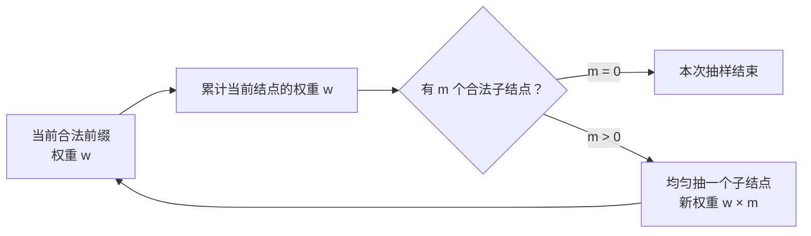

# 《算法分析与设计》第 8 章随堂练习：4 皇后与随机路径估计

本练习有两页，第二页只给题目，没有给出解答。题目有两个任务：用[回溯法](../../../topics/算法分析/回溯法框架.md)列出 4 皇后的所有解，再用样本路径 $(0,2)$ 和 $(1,3,0,2)$ [估计搜索树的结点数](../../../topics/算法分析/剪枝函数与效率分析.md)。

## 参考解答

### 从棋盘约束写出搜索程序

设一枚皇后的位置是 $(r,c)$，行与列都从 0 编号。同一条斜线可用 $r-c$ 或 $r+c$ 标识：沿斜线挪一格，行、列同增时差不变，行增列减时和不变。所以只要记录==已经占用的列、斜线差与斜线和==，就能判断放下一枚皇后是否安全。按行放置保证不会同行；同列和同斜线的冲突也不会因后来多放一枚皇后而消失。见 [N 皇后问题](../../../topics/算法分析/N皇后问题.md)。

```python
def queens(n):
    solutions = []
    widths = [0] * (n + 1)

    def visit(cols, diff, total, path):
        row = len(path)
        widths[row] += 1
        if row == n:
            solutions.append(path)
            return
        for col in range(n):
            if col in cols or row - col in diff or row + col in total:
                continue
            visit(cols | {col}, diff | {row - col}, total | {row + col}, path + (col,))

    visit(set(), set(), set(), ())
    return solutions, widths

assert queens(4) == ([(1, 3, 0, 2), (2, 0, 3, 1)], [1, 4, 6, 4, 2])
```

集合并运算返回新集合。一条递归分支返回时，调用者手里的占用集合没有变化，下一列从同一棋盘前缀出发。递归会枚举每个合法前缀的所有合法子结点，因此末行的两组解即为全部解。两组解也正好镜像。

> [!WARNING]
> $(0,2)$ 是合法前缀，但第三行已经走不下去：列 0 和 2 已占用；列 1 与列 3 分别和第 1 行第 2 列的皇后在两条斜线上。若误把列 3 接在它后面，从这一步起整棵子树都算错了。

### 样本走到死路后，还能估多少结点？

两条路径只走过 3 个和 5 个结点（含根），但不能把 $3$ 和 $5$ 直接平均。如果一层有 4 个合法选择，只走其中一个，就必须给那一层被选中的结点乘 4；下一层若有 2 个选择，其中一个代表的权重就变成 $4\times2=8$。具体做法是从根开始：每一步在合法子结点中均匀抽取一个，并按到达该结点概率的倒数计入估值。一类结点即使很少被采到，每次被采到的权重也更大，平均下来仍贡献 1。



| 路径 | 各访问结点的权重（从根起） | 只计合法结点的样本估值 |
|---|---|---:|
| $(0,2)$ | $1,4,8$ | $13$ |
| $(1,3,0,2)$ | $1,4,4,4,4$ | $17$ |

因此本题的两次样本均值为 $15$，它估计的是合法结点总数，与程序精确遍历所得的 $1+4+6+4+2=17$ 不必相等。

> [!TIP]
> 看到==“实际生成”==，先问冲突候选是否也算结点。如果像上面程序一样循环测试全部 4 列，并将每次试放都算生成，则每个非完整合法前缀都贡献 4 个候选，就算它没有合法后继也一样。此时精确值为 $1+4(1+4+6+4)=61$。在给定两条路径上，用所到非完整前缀的权重估计候选数，分别是 $1+4(1+4+8)=53$ 和 $1+4(1+4+4+4)=53$；这不是原题配套答案采用的合法结点口径。
