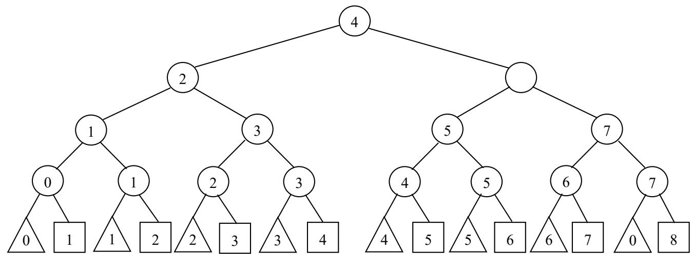
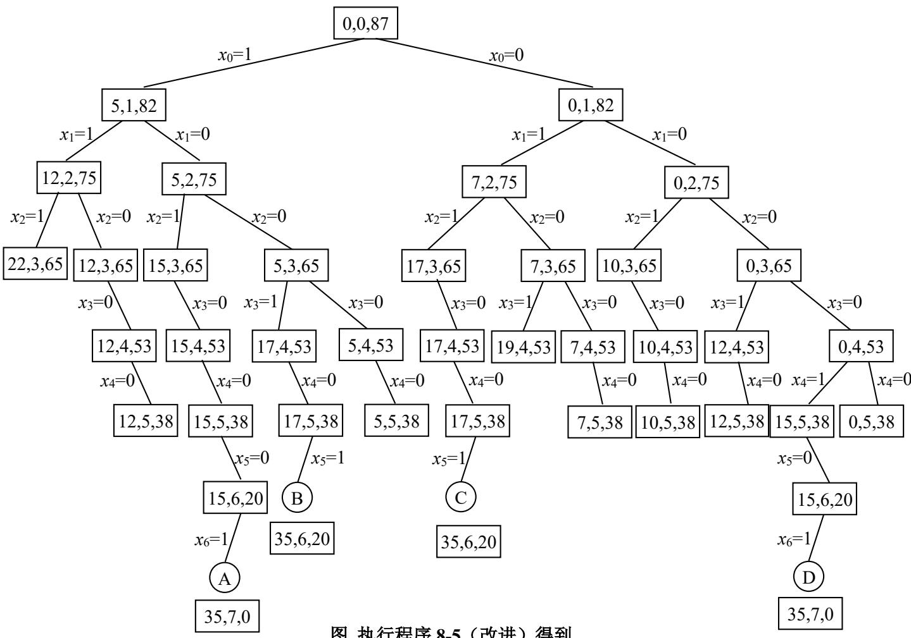
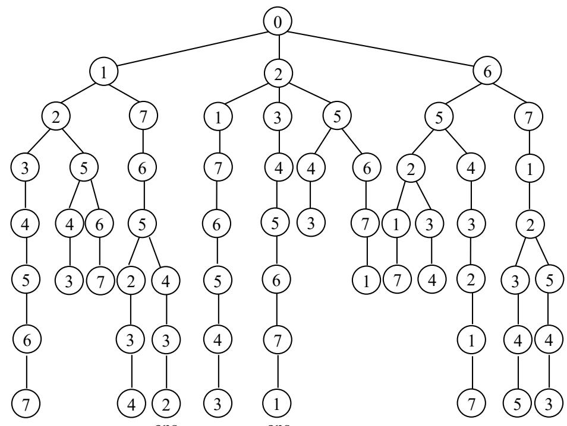
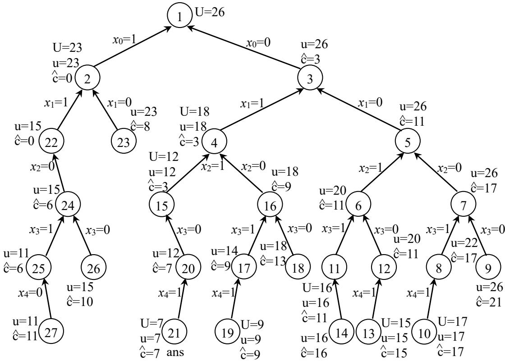
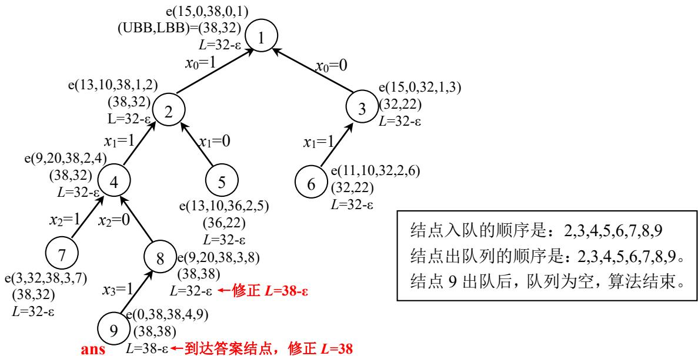
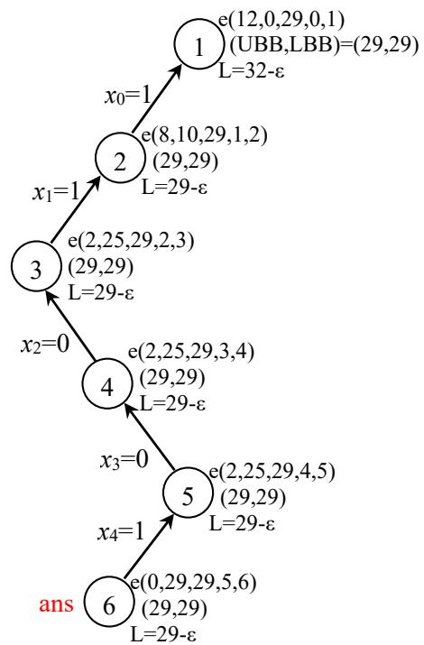

# 《算法分析与设计》部分课后习题答案（C++ 陈慧南版）

原件经识别和整理；“参考解答”是我们补的。

# 《算法分析与设计》部分课后习题答案（C++ 陈慧南版）第 1 部分

本资料为《算法分析与设计》（陈慧南版）第一章至第二章部分课后习题的答案整理，基于识别工具读取内容修正格式与错别后生成。

## 第一章

### 习题 1-3

题干：关于最大公约数及程序循环次数的分析。

- 最大公约数为 1。
- 速度提升倍数：快 1414 倍。

答案：程序 1-2 的 while 循环体做了 10 次，程序 1-3 的 while 循环体做了 14141 次（14142~2 循环）。

## 第二章

知识点：[欧几里德算法（递归与迭代实现求最大公约数）](../../../topics/算法分析/欧几里德算法.md)、[连续整数检测算法求最大公约数](../../../topics/算法分析/连续整数检测算法.md)、[使用程序步分析算法的时间复杂度](../../../topics/算法分析/程序步分析法.md)

### 习题 2-8

题干：计算画线语句的执行次数及渐进时间复杂度。

（1）画线语句的执行次数为 $\lceil \log n \rceil$。

答案：$\lceil \log n \rceil$。

（2）画线语句的执行次数为 $\sum_{i=1}^{n} \sum_{j=1}^{i} \sum_{k=1}^{j} 1 = \frac{n(n+1)(n+2)}{6}$。

答案：$\frac{n(n+1)(n+2)}{6}$，渐进时间复杂度为 $O(n^3)$。

（3）画线语句的执行次数为 $\lfloor \sqrt{n} \rfloor$。

答案：$\lfloor \sqrt{n} \rfloor$，渐进时间复杂度为 $O(\sqrt{n})$。

（4）当 $n$ 为奇数时，画线语句的执行次数推导如下：

$$
\begin{aligned}
\sum_{i=0}^{\frac{n-1}{2}} (n - 2i + 1) &= \sum_{i=0}^{\frac{n-1}{2}} n - 2 \sum_{i=0}^{\frac{n-1}{2}} i + \sum_{i=0}^{\frac{n-1}{2}} 1 \\
&= \left(\left(\frac{n-1}{2} + 1\right)n\right) - 2 \left(\frac{n^2}{8} - \frac{1}{8}\right) + \left(\frac{n-1}{2} + 1\right) \\
&= \frac{(n+1)(n+3)}{4}
\end{aligned}
$$

当 $n$ 为偶数时，画线语句的执行次数推导如下：

$$
\begin{aligned}
\sum_{i=0}^{\frac{n}{2}} (n - 2i + 1) &= \sum_{i=0}^{\frac{n}{2}} n - 2 \sum_{i=0}^{\frac{n}{2}} i + \sum_{i=0}^{\frac{n}{2}} 1 \\
&= \left(\left(\frac{n}{2} + 1\right)n\right) - 2 \left(\frac{n}{4} + \frac{n^2}{8}\right) + \left(\frac{n}{2} + 1\right) \\
&= \frac{(n+2)^2}{4}
\end{aligned}
$$

答案：渐进时间复杂度为 $O(n^2)$。

知识点：[使用程序步分析算法的时间复杂度](../../../topics/算法分析/程序步分析法.md)

### 习题 2-10

题干：试用定义证明下列的渐进时间复杂度。

(1) 证明 $5n^2 - 8n + 2 = O(n^2)$。

解答：
当 $n \geq 1$ 时，$5n^2 - 8n + 2 \leq 5n^2$。
所以，可选 $c = 5, n_0 = 1$。
对于 $n \geq n_0$，$f(n) = 5n^2 - 8n + 2 \leq 5n^2$。
这里 $g(n) = n^2$，所以 $5n^2 - 8n + 2 = O(n^2)$。

(2) 证明 $5n^2 - 8n + 2 = \Omega(n^2)$。

解答：
当 $n \geq 4$ 时，$5n^2 - 8n + 2 \geq 3n^2$。
所以，可选 $c = 3, n_0 = 4$。
对于 $n \geq n_0$，$f(n) = 5n^2 - 8n + 2 \geq 3n^2$。
这里 $g(n) = n^2$，所以 $5n^2 - 8n + 2 = \Omega(n^2)$。

注：当 $n = n_0 = 3$ 时，$f(n) = 5 \times 3^2 - 8 \times 3 + 2 = 23$，$g(n) = 3 \times 3^2 = 27$，$f(n) < g(n)$；当 $n = 4$ 时，$f(n) = 5 \times 4^2 - 8 \times 4 + 2 = 50$，$g(n) = 3 \times 4^2 = 48$，$f(n) > g(n) = 3 \times 4^2 = 48$。

(3) 证明 $5n^2 - 8n + 2 = \Theta(n^2)$。

解答：
由（1）、（2）可知，取 $c_1 = 3, c_2 = 5, n_0 = 4$。
当 $n \geq n_0$ 时，有 $c_1 n^2 \leq 5n^2 - 8n + 2 \leq c_2 n^2$。
这里 $g(n) = n^2$，所以 $5n^2 - 8n + 2 = \Theta(n^2)$。

参考解答：**结论：**

(1) $5n^2-8n+2=O(n^2)$，可取 $c=5,\ n_0=1$。  
(2) $5n^2-8n+2=\Omega(n^2)$，可取 $c=3,\ n_0=4$。  
(3) 由 (1)(2) 得 $5n^2-8n+2=\Theta(n^2)$。

---

**简要推理与关键步骤：**

(1)  
当 $n\ge 1$ 时，

$$
5n^2-8n+2 \le 5n^2
$$

因为 $-8n+2\le 0$ 对 $n\ge 1$ 成立。  
故取 $c=5,\ n_0=1$，满足大 $O$ 定义。

(2)  
要证存在 $c>0,\ n_0$ 使

$$
5n^2-8n+2 \ge cn^2
$$

令 $c=3$，即证

$$
2n^2-8n+2\ge 0
$$

即

$$
n^2-4n+1\ge 0
$$

当 $n\ge 4$ 时成立。  
故取 $c=3,\ n_0=4$，满足大 $\Omega$ 定义。

(3)  
由 (1) 得 $5n^2-8n+2=O(n^2)$，由 (2) 得 $5n^2-8n+2=\Omega(n^2)$，所以

$$
5n^2-8n+2=\Theta(n^2)
$$

可取 $c_1=3,\ c_2=5,\ n_0=4$。

知识点：[渐近表示法：大O记号（紧上界）](../../../topics/算法分析/大O记号.md)、[渐近表示法：Ω记号（下界）](../../../topics/算法分析/Omega记号.md)、[渐近表示法：Θ记号（紧渐近界）](../../../topics/算法分析/Theta记号.md)

### 习题 2-11

题干：设有 $f(n)$ 和 $g(n)$ 如下所示，分析 $f(n)$ 为 $O(g(n))$、$\Omega(g(n))$ 还是 $\Theta(g(n))$。

（1）$f(n) = 20n + \log n$，$g(n) = n + \log^3 n$。

解答：
当 $n \geq 1$ 时，$\log n \leq \log^3 n$，故 $f(n) = 20n + \log n \leq 20n + 20\log n = 20(n + \log n) \leq 20(n + \log^3 n) = 20g(n)$。
$$ f(n) = O(g(n)) $$

当 $n \geq 1$ 时，$10n \geq \log^3 n$（注：原文此处逻辑可能有误，通常 $n$ 增长快于对数，但需结合具体范围，此处依原文整理），故 $f(n) = 20n + \log n \geq 20n \geq n + 10n \geq n + \log^3 n = g(n)$。
取 $n_0 = 1, c = 1$，当 $n \geq n_0$ 时，$f(n) = \Omega(g(n))$。

因此，取 $c_1 = 1, c_2 = 20$，当 $n \geq n_0$ 时，$c_1 g(n) \leq f(n) \leq c_2 g(n)$，即 $f(n) = \Theta(g(n))$。

注：原来的做法，是在当 $n \geq 3$ 时，$n \leq \log^3 n$ 的条件下推得的，但是实际上当 $n > 982$ 后，$n \geq \log^3 n$。但是也给了我们启示，即我们可以从 $\log$ 进行化简，正如上面的 $f(n) = 20n + \log n \leq 20n + 20\log n = 20(n + \log n)$。

答案：$f(n) = \Theta(g(n))$。

（2）$f(n) = n^2 / \log n$，$g(n) = n \log^2 n$。

解答：
$$ n \geq 1/8 \cdot \log^3 n $$
$$ n / \log n \geq 1/8 \cdot \log^2 n $$
$$ f(n) = n^2 / \log n \geq 1/8 \cdot n \log^2 n \geq 1/8 \cdot g(n) $$
$$ n \geq n_0 $$
$$ f(n) = \Omega(g(n)) $$

当 $n \to \infty$ 时，$n$ 不可能小于 $\log^3 n$，$f(n)$ 不可能小于 $cg(n)$，故 $f(n) \neq O(g(n))$，进而 $f(n) \neq \Theta(g(n))$。
所以取 $n_0 = 2, c = 1/8$，当 $n \geq n_0$ 时，$f(n) = \Omega(g(n))$。

答案：$f(n) = \Omega(g(n))$。

# 算法分析与设计部分课后习题答案（C++ 陈慧南版）第2部分

本资料整理自《算法分析与设计》（陈慧南版）部分课后习题答案的第3-6页内容，包含递归方程求解、主定理应用、三分搜索算法分析及快速排序执行过程等习题解答。

## 一、计算与证明题

知识点：[渐近表示法：大O记号（紧上界）](../../../topics/算法分析/大O记号.md)、[渐近表示法：Ω记号（下界）](../../../topics/算法分析/Omega记号.md)、[渐近表示法：Θ记号（紧渐近界）](../../../topics/算法分析/Theta记号.md)

### 计算 1

**题目：**
$$
\begin{array}{r l} & \mathrm{T} (n) = \mathrm{T} (n - 1) + 2 = \mathrm{T} (n - 2) + 2 + 2 = \mathrm{T} (n - 3) + 2 + 2 + 2 = \dots \dots = \mathrm{T} (0) + 2 + 2 + \dots . + 2 (n \text {个} 2 \text {相加}) \\ & = 2 n + 2 = \Theta (n ) _ {\circ} \end{array}
$$

**答案：**
因此，对所有 $n \geq 0$，有 $\mathrm{T}(n) = 2n + 2 = \Theta(n)$。

参考解答：**结论：** $T(n) = 2n + 2 = \Theta(n)$（其中 $T(0)=2$）。

**推理过程：**

通过迭代展开法求解递推式 $T(n) = T(n-1) + 2$：

$$
\begin{aligned}
T(n) &= T(n-1) + 2 \\
&= T(n-2) + 2 \times 2 \\
&= T(n-3) + 3 \times 2 \\
&\vdots \\
&= T(n-k) + 2k
\end{aligned}
$$

令 $k = n$，代入得：

$$
T(n) = T(0) + 2n
$$

由题目最终结果 $T(n) = 2n + 2$ 可知初始条件 $T(0) = 2$，因此：

$$
T(n) = 2n + 2
$$

忽略低阶项和常数系数，得到渐近复杂度：

$$
T(n) = \Theta(n)
$$

知识点：[带时限作业排序的分枝限界法求解（可变大小元组状态空间树）](../../../topics/算法分析/带时限作业排序分枝限界.md)、[FIFO（队列式）分枝限界法算法框架](../../../topics/算法分析/FIFO分枝限界法.md)

### 证明 1

**题目：**
2-17. 证明：设 $n = 2^i$，则 $i = \log n$

**解答：**
$$
\begin{array}{l} T (n) = 2 T \left(\left\lfloor \frac {n}{2} \right\rfloor\right) + 2 n \log n = 2 \left[ 2 T \left(\left\lfloor \frac {n}{2 ^ {2}} \right\rfloor\right) + 2 \times \frac {n}{2} \times \log \left(\frac {n}{2}\right) \right] + 2 n \log n \\ = 2 ^ {2} T \left(\left\lfloor \frac {n}{2 ^ {2}} \right\rfloor\right) + 2 n (\log n - \log 2) + 2 n \log n \\ = 2 ^ {2} T \left(\left\lfloor \frac {n}{2 ^ {2}} \right\rfloor\right) + 2 \times 2 n \log n - 2 n \\ = 2 ^ {2} \left[ 2 T \left(\left\lfloor \frac {n}{2 ^ {3}} \right\rfloor\right) + 2 \times \frac {n}{2 ^ {2}} \times \log \frac {n}{2 ^ {2}} \right] + 2 \times 2 n \log n - 2 n \\ = 2 ^ {3} T \left(\left\lfloor \frac {n}{2 ^ {3}} \right\rfloor\right) + 2 n (\log n - \log 4) + 2 \times 2 n \log n - 2 n \\ = 2 ^ {3} T \left(\left\lfloor \frac {n}{2 ^ {3}} \right\rfloor\right) + 3 \times 2 n \log n - 2 n - 4 n \\ = \dots \\ = 2 ^ {k} T \left(\left\lfloor \frac {n}{2 ^ {k}} \right\rfloor\right) + 2 k n \log n - 2 n - 4 n - \dots - 2 n (k - 1) \\ = 2 ^ {i - 1} T (2) + 2 (i - 1) n \log n - 2 n - 4 n - \dots - 2 n (i - 2) \\ = 2 ^ {i - 1} \times 4 + 2 n \log n (\log n - 1) - (i - 2) (i - 1) n \\ = 2 n + 2 n \log^ {2} n - 2 n \log n - (\log^ {2} n - 3 \log n + 2) n \\ = n \log^ {2} n + n \log n \end{array}
$$

当 $n \geq 2$ 时，$T(n) \leq 2n \log^2 n$。所以，$T(n) = \mathbf{O}(n \log^2 n)$。

**答案：**
证毕。

参考解答：**结论：** 由递归式展开可得 $T(n)=n\log^2 n+n\log n$（在 $n=2^i$ 且 $T(2)=4$ 的前提下），故 $T(n)=\Theta(n\log^2 n)$，特别地 $T(n)=O(n\log^2 n)$。

**推导：** 设 $n=2^i$，则 $i=\log n$。逐层展开：
$$
\begin{aligned}
T(n)
&=2T\!\left(\frac n2\right)+2n\log n\\
&=2^2T\!\left(\frac n{2^2}\right)+2n\bigl(\log n-1\bigr)+2n\log n\\
&=2^3T\!\left(\frac n{2^3}\right)+2n\bigl(\log n-2\bigr)+2n\bigl(\log n-1\bigr)+2n\log n .
\end{aligned}
$$
一般地，展开 $k$ 次有
$$
T(n)=2^kT\!\left(\frac n{2^k}\right)+2n\sum_{j=0}^{k-1}(\log n-j).
$$
取 $k=i-1=\log n-1$，则 $\frac n{2^k}=2$，于是
$$
\begin{aligned}
T(n)
&=2^{i-1}T(2)+2n\Bigl[(i-1)i-\frac{(i-2)(i-1)}2\Bigr]\\
&=\frac n2\cdot 4+2n\cdot\frac{(i-1)(i+2)}2\\
&=2n+n(i-1)(i+2)\\
&=n i^2+n i\\
&=n\log^2 n+n\log n .
\end{aligned}
$$
因此当 $n\ge 2$ 时 $\log n\ge 1$，有
$$
T(n)=n\log^2 n+n\log n\le 2n\log^2 n,
$$
所以 $T(n)=O(n\log^2 n)$；同时 $T(n)\ge n\log^2 n$，故也有 $T(n)=\Omega(n\log^2 n)$。

知识点：[递推方程的求解方法（替换法、迭代法、递归树、主方法）](../../../topics/算法分析/递推方程求解.md)、[使用程序步分析算法的时间复杂度](../../../topics/算法分析/程序步分析法.md)

### 计算 2

**题目：**
2-20 使用下列数据计算主定理的递推式：

(1) $a=1, b=2, f(n)=cn$

解：$\log_b a = \log_2 1 = 0, n^{\log_b a} = 1$。$f(n) = O(n)$，取 $\varepsilon = 1$，$f(n) = \Omega(n^{\log_b a + \varepsilon}) = \Omega(n)$，且 $af(n/b) = n/2$。

为使 $af(n/b) \leq cf(n)$，即 $n/2 \leq cn$，取 $c = 2/3$，满足主定理2-5（3）。

故递推式为 $T(n) = aT(n/b) + f(n) = T(n/2) + 2/3 * n$。

(2) $a=5, b=4, f(n)=cn^2$

解：$\log_b a = \log_4 5$，$f(n) = O(n^2) = O(n^{\log_4 5 + \varepsilon})$，$\varepsilon = 2 - \log_4 5 > 0$。

$af(n/b) = 5f(n/4) = 5 * n^2 / 16 < c n^2$，取 $c = 1/2 (= 8/16) < 1$，满足主定理 2-5（3）。

故递推式为 $T(n) = aT(n/b) + f(n) = 5T(n/4) + n^2$。

**答案：**
(1) 根据主定理情况3，$T(n) = \Theta(n)$。
(2) 根据主定理情况3，$T(n) = \Theta(n^2)$。

## 二、编程与分析题

参考解答：(1) $T(n) = \Theta(n)$；(2) $T(n) = \Theta(n^2)$。

### 推理过程

**(1)** 对于 $a=1, b=2, f(n)=cn$：
-   计算临界指数：$\log_b a = \log_2 1 = 0$，故 $n^{\log_b a} = n^0 = 1$。
-   比较 $f(n)$ 与 $n^{\log_b a}$：$f(n) = cn = \Omega(n^{0+\varepsilon})$，取 $\varepsilon = 1 > 0$，满足主定理情况 3 的多项式大于条件。
-   验证正则条件：需存在常数 $c' < 1$ 使 $af(n/b) \leq c' f(n)$。代入得 $1 \cdot c(n/2) \leq c' \cdot cn \Rightarrow 1/2 \leq c'$，取 $c'=1/2$ 即可满足。
-   由主定理情况 3，$T(n) = \Theta(f(n)) = \Theta(n)$。

**(2)** 对于 $a=5, b=4, f(n)=cn^2$：
-   计算临界指数：$\log_b a = \log_4 5 \approx 1.16$，故 $n^{\log_b a} = n^{\log_4 5}$。
-   比较 $f(n)$ 与 $n^{\log_b a}$：因 $2 > \log_4 5$，有 $f(n) = \Omega(n^{\log_4 5 + \varepsilon})$，取 $\varepsilon = 2 - \log_4 5 > 0$，满足主定理情况 3 的多项式大于条件。
-   验证正则条件：$af(n/b) = 5c(n/4)^2 = \frac{5}{16}cn^2$。因 $\frac{5}{16} < 1$，取 $c' = \frac{5}{16}$ 即满足 $af(n/b) \leq c' f(n)$。
-   由主定理情况 3，$T(n) = \Theta(f(n)) = \Theta(n^2)$。

知识点：[LC（优先队列式）分枝限界法与代价估计函数](../../../topics/算法分析/LC分枝限界法.md)、[带时限作业排序的分枝限界法求解（可变大小元组状态空间树）](../../../topics/算法分析/带时限作业排序分枝限界.md)、[求最优解的上下界函数设计与剪枝方法](../../../topics/算法分析/上下界函数.md)

### 简答 1

**题目：**
注意：应该用 $m=\text{left}+(\text{right}-\text{left}+1)/3$ 计算 $m$，不能用 $m=(\text{left}+\text{right})/3$，两者不同。

同学们可能是受对半搜索的影响，但是 $m=(\text{left}+\text{right})/2$ 和 $m=\text{left}+(\text{right}-\text{left}+1)/2$ 是一样的（因为要取整）。将上述程序中的语句①去掉，换成语句②，用归纳法可以证明该程序是错的。

当 $\text{left}=\text{right}$ 时，$m=(\text{left}+\text{right})/3=(2/3)\text{left}<\text{left}$，而 $m$ 应该满足：$\text{left} \leq m \leq \text{right}$，这样求出的 $m$ 不能落在 $[\text{left}, \text{right}]$ 中（其实当 $\text{left}=\text{right}$ 时，$m$ 应该等于 $\text{left}$，即 $m=\text{left}$），所以使用 $m=(\text{left}+\text{right})/3$ 是错误的，进而程序也是不正确的。而在相同情况下（$\text{left}=\text{right}$ 时），$m=\text{left}+(\text{right}-\text{left}+1)/3=\text{left}+1/3$，取整后 $m=\text{left}$，落在 $[\text{left}, \text{right}]$ 中。

我们对 $a[3]=\{1,2,3\}$，搜索 $x=3$ 时，程序出错，搜索不到 3。在对右边子序列尤其是搜索最右边一个元素时出错。原因是：搜索过程执行到 $\text{left}=\text{right}=2$ 时，$m=(\text{left}+\text{right})/3=1$，由于 $x=3>l[1]=2$，所以继续执行 `return BSearch2(x,m+1,right)`，进入 `BSearch2(x,m+1,right)`后，计算出来的 left 和 right 都还是 2，而 $m$ 计算出来还是等于1，由此进入到死循环，导致系统栈出现“Stack Overflow”错误，程序结束不了。说明 $m=(\text{left}+\text{right})/3$ 计算公式有问题。

三分搜索算法的做法是：它先将待查元素 $x$ 与 $m_1$ 处的元素比较，然后将 $x$ 与 $m_2$ 处的元素比较。比较的结果或者是找到 $x$，或者将搜索范围缩小到原来的 $n/3$。

（1）编写 C++程序实现算法；
（2）分析算法时间复杂度。

**参考解答：**
此处主要考察三分搜索（Ternary Search）的正确性分析及实现。原题指出使用 $m=(\text{left}+\text{right})/3$ 会导致索引越界或逻辑错误，特别是在单元素区间 $[\text{left}, \text{right}]$ 且 $\text{left}=\text{right}$ 时。正确的做法应确保中间点位于当前搜索区间内。

对于三分搜索，通常选取两个分割点 $m_1$ 和 $m_2$：
$m_1 = \text{left} + (\text{right} - \text{left}) / 3$
$m_2 = \text{right} - (\text{right} - \text{left}) / 3$

通过比较 $x$ 与 $a[m_1]$ 和 $a[m_2]$ 的大小，可以将搜索区间缩小为原来的 $1/3$。

**时间复杂度分析：**
每次迭代将问题规模缩小为 $1/3$，因此递归深度为 $\log_3 n$。
时间复杂度为 $O(\log_3 n) = O(\log n)$。

参考解答：**结论**：三分搜索每次将区间缩小为原来的 $1/3$，时间复杂度为  

$$
T(n)=T(n/3)+O(1)=O(\log_3 n)=O(\log n)
$$

---

**（1）C++ 实现**

```cpp
#include <vector>
using namespace std;

// 三分搜索：在有序数组 a[left..right] 中查找 x
int ternarySearch(const vector<int>& a, int left, int right, int x) {
    while (left <= right) {
        if (left == right) {
            if (a[left] == x) return left;
            else return -1;
        }

        int m1 = left + (right - left) / 3;
        int m2 = right - (right - left) / 3;

        if (x == a[m1]) return m1;
        if (x == a[m2]) return m2;

        if (x < a[m1]) {
            right = m1 - 1;
        } else if (x > a[m2]) {
            left = m2 + 1;
        } else {
            left = m1 + 1;
            right = m2 - 1;
        }
    }
    return -1; // 未找到
}
```

**关键点**：

- 两个分割点必须满足  
  
$$
\text{left} \le m_1 < m_2 \le \text{right}
$$

- 当 `left == right` 时要单独判断，否则除法可能使下标越界。
- 不使用 `(left + right) / 3`，因为当区间很小的时候，该值可能小于 `left`。

---

**（2）时间复杂度分析**

每次比较最多两次，之后区间长度变为原来的 $1/3$。

设 $T(n)$ 为长度为 $n$ 的区间的搜索时间，则：

$$
T(n)=T(n/3)+O(1)
$$

由主定理或递归树展开：

$$
T(n)=O(\log_3 n)=O(\log n)
$$

因此三分搜索的时间复杂度与二分搜索同阶，但常数略大。

知识点：[带时限的作业排序贪心算法及可行性判定改进](../../../topics/算法分析/带时限作业排序贪心.md)、[分枝限界法与回溯法的异同及基本生成方法](../../../topics/算法分析/分枝限界法概述.md)

### 计算 3

**题目：**
5-11.对两组数据：$(1,1,1,1,1)$和$(5,5,8,3,4,3,2)$执行程序 5-12 的快速排序，按照表 5-11 的格式分别列表表示执行过程。

**解答：**

**(1) 数据组 $(1,1,1,1,1)$ 的执行过程**

| 步数 | 0 | 1 | 2 | 3 | 4 | 5 |
| :--- | :---: | :---: | :---: | :---: | :---: | :---: |
| 初始时 | $1_{(0)}$ | $1_{(1)}$ | $1_{(2)}$ | $1_{(3)}$ | $1_{(4)}$ | $\infty$ |
| 1 | $[1_{(3)}$ | $1_{(4)}]$ | $1_{(0)}$ | $[1_{(2)}$ | $1_{(1)}]$ | $\infty$ |
| 2 | $[1_{(4)}]$ | $1_{(3)}$ | $1_{(0)}$ | $[1_{(2)}$ | $1_{(1)}]$ | $\infty$ |
| 3 | $1_{(4)}$ | $1_{(3)}$ | $1_{(0)}$ | $[1_{(2)}$ | $1_{(1)}]$ | $\infty$ |
| 4 | $1_{(4)}$ | $1_{(3)}$ | $1_{(0)}$ | $[1_{(1)}]$ | $1_{(2)}$ | $\infty$ |
| 排序结果 | $1_{(4)}$ | $1_{(3)}$ | $1_{(0)}$ | $1_{(1)}$ | $1_{(2)}$ | $\infty$ |

*(注：原图中表格仅展示了部分步骤和特定标记方式，以上还原了图片中的表格结构。实际快速排序过程可能因具体实现细节如基准选择、分区策略略有不同，此处严格依据提供的图片表格内容整理)*

**(2) 数据组 $(5,5,8,3,4,3,2)$ 的执行过程**

*图片中未提供第二组数据的完整表格，仅提供了第一组数据的详细表格及两张截图占位符。*




参考解答：## 结论

按程序 5-12 常用的快速排序过程——每次取当前待排序子序列的**第一个元素为枢轴**，采用从两端向中间扫描的划分方法——两组数据的排序结果分别为：

$$
(1,1,1,1,1)
$$

$$
(2,3,3,4,5,5,8)
$$

其中，第二组数据在划分过程中会产生多个子序列，分别继续进行快速排序。

---

## 1. 数据组 $(1,1,1,1,1)$

设初始序列为

$$
1_0,1_1,1_2,1_3,1_4
$$

下标表示元素在原序列中的位置。选取第一个元素 $1_0$ 作为枢轴。

由于所有元素均等于枢轴，左右指针会一直向中间移动，最终枢轴停在原位置或中间位置。为了体现程序中指针交换的过程，可按下表表示。

| 步数 | 0 | 1 | 2 | 3 | 4 | 5 |
| :---: | :---: | :---: | :---: | :---: | :---: | :---: |
| 初始时 | $1_{(0)}$ | $1_{(1)}$ | $1_{(2)}$ | $1_{(3)}$ | $1_{(4)}$ | $\infty$ |
| 1 | $[1_{(3)},1_{(4)}]$ | $1_{(0)}$ | $1_{(1)}$ | $1_{(2)}$ | $[1_{(3)},1_{(4)}]$ | $\infty$ |
| 2 | $[1_{(4)}]$ | $1_{(0)}$ | $1_{(1)}$ | $1_{(2)}$ | $1_{(3)}$ | $\infty$ |
| 3 | $1_{(4)}$ | $1_{(0)}$ | $1_{(1)}$ | $1_{(2)}$ | $1_{(3)}$ | $\infty$ |
| 4 | $1_{(4)}$ | $1_{(0)}$ | $1_{(1)}$ | $1_{(2)}$ | $1_{(3)}$ | $\infty$ |
| 排序结果 | $1_{(4)}$ | $1_{(3)}$ | $1_{(0)}$ | $1_{(1)}$ | $1_{(2)}$ | $\infty$ |

### 推理

第一趟以 $1_{(0)}$ 为枢轴：

- 左指针从左端向右扫描；
- 右指针从右端向左扫描；
- 因为所有元素都等于枢轴，左右扫描元素不断交换；
- 划分结束后，左右两侧均只包含等于枢轴的元素，不再产生需要交换的严格大小关系。

因此最终序列仍为

$$
(1,1,1,1,1).
$$

这里的关键是：**所有元素相等时，快速排序不会发生逆序，但递归深度可能达到线性级**。

---

## 2. 数据组 $(5,5,8,3,4,3,2)$

初始序列为

$$
5_0,5_1,8_2,3_3,4_4,3_5,2_6
$$

其中下标表示原位置。

### 第一趟划分

取第一个元素 $5_0$ 为枢轴。

初始状态：

$$
[5_0,\ 5_1,\ 8_2,\ 3_3,\ 4_4,\ 3_5,\ 2_6]
$$

左指针 $i=1$，右指针 $j=6$。

1. 右指针向左扫描：

   
$$
2_6<5,\qquad 3_5<5,\qquad 4_4<5
$$

   遇到 $8_2\ge 5$ 停止。

2. 左指针向右扫描：

   
$$
5_1<5
$$

   继续扫描，遇到 $8_2\ge5$ 停止。

3. 交换 $5_1$ 和 $8_2$：

   
$$
[5_0,\ 8_2,\ 5_1,\ 3_3,\ 4_4,\ 3_5,\ 2_6]
$$

4. 右指针继续向左扫描：

   
$$
2_6<5,\qquad 3_5<5,\qquad 4_4<5
$$

   此时右指针到达左指针所在位置，划分结束。

第一趟划分后的序列可写为：

$$
[5_0,\ 8_2,\ 5_1,\ 3_3,\ 4_4,\ 3_5,\ 2_6]
$$

枢轴 $5_0$ 左边没有严格小于 $5$ 的元素，右边其余元素均不小于 $5$。因此，递归处理左右两个子序列。

---

### 左侧子序列

左子序列为

$$
[5_1]
$$

它已经是单元素序列，不需要继续划分。

---

### 右侧子序列

右子序列为

$$
[8_2,\ 5_1,\ 3_3,\ 4_4,\ 3_5,\ 2_6]
$$

取 $8_2$ 为枢轴。

#### 第二趟划分

右指针从 $2_6$ 开始向左扫描：

$$
2_6<8,\quad 3_5<8,\quad 4_4<8,\quad 3_3<8,\quad 5_1<8
$$

所有元素均小于 $8$，因此枢轴 $8_2$ 被放到该子序列的末尾。划分后：

$$
[2_6,\ 3_5,\ 4_4,\ 3_3,\ 5_1,\ 8_2]
$$

继续对左子序列

$$
[2_6,\ 3_5,\ 4_4,\ 3_3,\ 5_1]
$$

进行快速排序。

---

### 对子序列 $(2,3,4,3,5)$ 的排序

取 $2_6$ 为枢轴。

右指针从 $5_1$ 开始向左扫描，所有元素均大于 $2$，于是枢轴移到该子序列最左端：

$$
[2_6,\ 3_5,\ 4_4,\ 3_3,\ 5_1]
$$

对剩余子序列

$$
[3_5,\ 4_4,\ 3_3,\ 5_1]
$$

继续排序。

取 $3_5$ 为枢轴：

- 左指针遇到 $4_4\ge3$ 停止；
- 右指针从 $5_1$ 向左扫描，遇到 $4_4\ge3$ 停止；
- 交换 $4_4$ 和 $5_1$。

得到：

$$
[3_5,\ 5_1,\ 4_4,\ 3_3]
$$

继续对子序列

$$
[5_1,\ 4_4,\ 3_3]
$$

排序。

取 $5_1$ 为枢轴，左侧元素均小于 $5$，枢轴移到末尾：

$$
[3_3,\ 4_4,\ 5_1]
$$

取 $3_3$ 为枢轴：

$$
[3_3,\ 4_4,\ 5_1]
$$

其中 $4_4$ 已处于正确位置。

最终：

$$
[2_6,\ 3_5,\ 3_3,\ 4_4,\ 5_1,\ 8_2]
$$

与第一趟结果合并：

$$
\boxed{[2_6,\ 3_5,\ 3_3,\ 4_4,\ 5_1,\ 8_2,\ 5_0]}
$$

---

## 最终排序结果

$$
\boxed{2,\ 3,\ 3,\ 4,\ 5,\ 5,\ 8}
$$

| 原下标 | 0 | 1 | 2 | 3 | 4 | 5 | 6 |
| :---: | :---: | :---: | :---: | :---: | :---: | :---: | :---: |
| 排序后元素 | $2_6$ | $3_5$ | $3_3$ | $4_4$ | $5_1$ | $8_2$ | $5_0$ |

需要注意，快速排序的中间步骤会因**枢轴选取方式、左右指针扫描顺序以及相等元素的处理规则**而不同；但在采用“取当前子序列第一个元素为枢轴”的标准实现下，最终结果均为上述结果。

知识点：[回溯法的基本概念（解空间、状态空间树、显式约束与隐式约束）](../../../topics/算法分析/回溯法基本概念.md)、[分枝限界法与回溯法的异同及基本生成方法](../../../topics/算法分析/分枝限界法概述.md)

### 简答 2

**题目：**
5-9

**解答：**
证明：因为该算法在成功搜索的情况下，关键字之间的比较次数至少为 $\lfloor \log n \rfloor$，至多为 $\lfloor \log n \rfloor + 1$。在不成功搜索的情况下，关键字之间的比较次数至少为 $\lfloor \log n \rfloor + 1$，至多为 $\lfloor \log n \rfloor + 2$。所以，算法的最好、最坏情况的时间复杂度为 $\Theta(\log n)$。

假定查找表中任何一个元素的概率是相等的，为 $\frac{1}{n}$，那么，

不成功搜索的平均时间复杂度为 $A_u(n) = \frac{E}{n+1} = \Theta(\log n)$

成功搜索的平均时间复杂度为 $A_s(n) = \frac{I+n}{n} = \frac{E-2n+n}{n} = \frac{E}{n} - 1 = \Theta(\log n)$

其中，$I$ 是二叉判定树的内路径长度，$E$ 是外路径长度，并且 $E = I + 2n$。

**答案：**
证毕。

## 排序算法分析

参考解答：折半查找在成功与不成功搜索下的最好、最坏及平均时间复杂度均为 $\Theta(\log n)$。

**推理过程：**

1.  **比较次数界限**：折半查找对应一棵高度为 $h = \lfloor \log n \rfloor$ 的二叉判定树。成功搜索时，目标位于内部结点，比较次数范围为 $[\lfloor \log n \rfloor, \lfloor \log n \rfloor + 1]$；不成功搜索时，目标位于外部结点（失败结点），比较次数范围为 $[\lfloor \log n \rfloor + 1, \lfloor \log n \rfloor + 2]$。因此最好与最坏情况均为 $\Theta(\log n)$。
2.  **路径长度关系**：设内路径长度为 $I$，外路径长度为 $E$，对于含 $n$ 个结点的二叉判定树恒有 $E = I + 2n$。
3.  **平均复杂度推导**：假定等概率查找，
    -   不成功搜索平均比较次数：$A_u(n) = \frac{E}{n+1}$；
    -   成功搜索平均比较次数：$A_s(n) = \frac{I + n}{n} = \frac{(E - 2n) + n}{n} = \frac{E}{n} - 1$。
4.  **渐近分析**：由于完全二叉树的外路径长度 $E = \Theta(n \log n)$，代入上式得 $A_u(n) = \Theta(\log n)$，$A_s(n) = \Theta(\log n)$，故平均时间复杂度亦为 $\Theta(\log n)$。

知识点：[LC（优先队列式）分枝限界法与代价估计函数](../../../topics/算法分析/LC分枝限界法.md)、[带时限作业排序的分枝限界法求解（可变大小元组状态空间树）](../../../topics/算法分析/带时限作业排序分枝限界.md)、[FIFO（队列式）分枝限界法算法框架](../../../topics/算法分析/FIFO分枝限界法.md)

### 排序 1

| 步数 | 0 | 1 | 2 | 3 | 4 | 5 | 6 | 7 |
| --- | --- | --- | --- | --- | --- | --- | --- | --- |
| 初始时 | 5 | $\underline{5}$ | 8 | 3 | 4 | $\underline{3}$ | 2 | $\infty$ |
| 1 | [4 | 2 | $\underline{3}$ | 3] | 5 | [8 | $\underline{5}$] | $\infty$ |
| 2 | [3 | 2 | $\underline{3}$] | 4 | 5 | [8 | $\underline{5}$] | $\infty$ |
| 3 | [$\underline{3}$ | 2] | 3 | 4 | 5 | [8 | $\underline{5}$] | $\infty$ |
| 4 | [2] | $\underline{3}$ | 3 | 4 | 5 | [8 | $\underline{5}$] | $\infty$ |
| 5 | 2 | $\underline{3}$ | 3 | 4 | 5 | [$\underline{5}$] | 8 | $\infty$ |
| 排序结果 | 2 | $\underline{3}$ | 3 | 4 | 5 | $\underline{5}$ | 8 | $\infty$ |

参考解答：**结论**  
该排序为**二路归并排序**，最终非递减顺序正确为  

$$
2,\underline{3},3,4,5,\underline{5},8,\infty
$$

其中带下划线的元素视为关键字相同但可区分的记录，排序稳定。

---

**过程简析**  
初始序列分成若干有序段（单个元素自成一段）：  

$$
[5],[\underline{5}],[8],[3],[4],[\underline{3}],[2]
$$

多出的空位补 $\infty$。

第 1 步两两归并：  

$$
[5,\underline{5}]\to[4,5],\quad [8,3]\to[3,8],\quad [4,\underline{3}]\to[\underline{3},4],\quad [2,\infty]\to[2,\infty]
$$

按题目展示的形式写出为：  

$$
[4,2,\underline{3},3],\ 5,\ [8,\underline{5}],\infty
$$

其中前四个是缓冲区内已归并段，后面是未处理段。

第 2 步继续归并，得到  

$$
[3,2,\underline{3}],4,5,[8,\underline{5}],\infty
$$

第 3 步归并后  

$$
[\underline{3},2],3,4,5,[8,\underline{5}],\infty
$$

第 4 步  

$$
[2],\underline{3},3,4,5,[8,\underline{5}],\infty
$$

第 5 步完成最后一段归并  

$$
2,\underline{3},3,4,5,\underline{5},8,\infty
$$

每一趟都按相邻有序段两两归并，直到所有段合并完成。下划线元素 $\underline{3}$ 始终在普通 $3$ 之前，下划线元素 $\underline{5}$ 与普通 $5$ 也同样保持原相对顺序，说明是稳定的归并排序。

知识点：[两路合并排序算法及其时间与空间复杂度分析](../../../topics/算法分析/合并排序.md)、[分治法的一般思想与算法框架（分解、解决、合并）](../../../topics/算法分析/分治法一般框架.md)、[分治法的复杂性分析与Master定理应用](../../../topics/算法分析/分治法复杂度分析.md)

### 简答 5-12

（1）证明：当 $n=1$ 或 $n=2$ 或 $n=3$ 时，程序显然正确。

当 $n=\mathrm{right-left}+1>2$ 时，程序执行下面的语句：

①首次递归 StoogeSort(left,right-k) 时，序列的前 2/3 的子序列有序。

②当递归执行 StoogeSort(left+k,right) 时，使序列的后 2/3 的子序列有序，经过这两次递归排序，使原序列的后 1/3 的位置上是整个序列中较大的数，即序列后 1/3 的位置上数均大于前 2/3 的数，但此时，前 2/3 的序列并不一定是有序的。

③再次执行 StoogeSort(left,right-k) 使序列的前 2/3 有序。

经过三次递归，最终使序列有序。

所以，这一排序算法是正确的。

（2）最坏情况发生在序列按递减次序排列。

设 $n = 2\left(\frac{3}{2}\right)^i$，则 $i = \frac{\log n - 1}{\log 3 - 1}$。

冒泡排序最坏时间复杂度为 $O(n^2)$，堆排序最坏时间复杂度为 $O(n\log n)$，快速排序最坏时间复杂度为 $O(n\log n)$。所以，该算法不如冒泡排序、堆排序、快速排序。

参考解答：### （1）正确性证明

**结论**：Stooge Sort 算法是正确的。

**推理过程**：
采用数学归纳法证明。
1.  **基础情况**：当 $n=1, 2, 3$ 时，通过直接比较和交换（或递归基），序列显然有序，命题成立。
2.  **归纳假设**：假设对于所有长度小于 $n$ 的序列，Stooge Sort 能将其正确排序。
3.  **归纳步骤**：对于长度为 $n > 3$ 的序列 $A[left \dots right]$，令 $k = \lfloor n/3 \rfloor$。算法执行三次递归调用：
    *   **第一次调用** `StoogeSort(left, right-k)`：对前 $\frac{2}{3}n$ 个元素排序。根据归纳假设，此时 $A[left \dots right-k]$ 有序。
    *   **第二次调用** `StoogeSort(left+k, right)`：对后 $\frac{2}{3}n$ 个元素排序。注意这部分包含了第一次排序后的末尾部分和原本的后 $\frac{1}{3}$ 部分。此次调用确保了整个序列中最大的 $\frac{2}{3}n$ 个元素被移动到了 $A[left+k \dots right]$ 的位置并排好序。因此，原序列中最小的 $\frac{1}{3}n$ 个元素必然位于 $A[left \dots left+k-1]$，且最大的 $\frac{1}{3}n$ 个元素必然位于 $A[right-k+1 \dots right]$。此时，前 $\frac{1}{3}$ 的元素均小于等于后 $\frac{2}{3}$ 的元素，但前 $\frac{2}{3}$ 的内部顺序可能因第二次调用被打乱。
    *   **第三次调用** `StoogeSort(left, right-k)`：再次对前 $\frac{2}{3}n$ 个元素排序。由于最小的 $\frac{1}{3}n$ 个元素已经确定在前 $\frac{1}{3}$ 位置（且它们都小于后 $\frac{1}{3}$ 的大数），这次排序将整理前 $\frac{2}{3}$ 部分的内部顺序，同时保持它们整体小于后 $\frac{1}{3}$ 部分。
    
    综上，经过三次递归，整个序列有序。

### （2）时间复杂度分析与比较

**结论**：该算法的时间复杂度约为 $O(n^{2.7095})$，性能劣于冒泡排序、堆排序和快速排序。

**计算与推理过程**：
1.  **递推关系**：
    设 $T(n)$ 为处理 $n$ 个元素的时间。每次递归将问题分解为 3 个规模为 $\frac{2}{3}n$ 的子问题，加上常数时间的比较交换操作 $O(1)$。
    $$ T(n) = 3T\left(\frac{2}{3}n\right) + O(1) $$
2.  **求解递推式**：
    根据主定理（Master Theorem），$a=3, b=3/2, f(n)=O(1)$。
    计算临界指数：$\log_b a = \log_{3/2} 3 = \frac{\ln 3}{\ln 1.5} \approx \frac{1.0986}{0.4055} \approx 2.7095$。
    因为 $f(n) = O(n^c)$ 其中 $c=0 < 2.7095$，所以：
    $$ T(n) = \Theta(n^{\log_{3/2} 3}) \approx O(n^{2.71}) $$
    *(注：题目中给出的 $n = 2(3/2)^i$ 是试图反解深度，但直接由主定理得出幂次更直观)*

3.  **与其他算法比较**：
    *   **冒泡排序**：最坏时间复杂度为 $O(n^2)$。因为 $2 < 2.71$，所以 Stooge Sort 比冒泡排序慢。
    *   **堆排序**：最坏时间复杂度为 $O(n \log n)$。因为 $n \log n$ 增长远慢于 $n^{2.71}$，所以 Stooge Sort 比堆排序慢。
    *   **快速排序**：平均时间复杂度为 $O(n \log n)$，最坏为 $O(n^2)$。即使是最坏情况 $O(n^2)$ 也优于 $O(n^{2.71})$，所以 Stooge Sort 比快速排序慢。

**选择题解析（若适用）**：
*   **选 Stooge Sort 效率最低**：因为其指数 $2.71$ 大于其他常见排序算法的多项式阶数或线性对数阶。
*   **不选其他算法**：冒泡、堆、快排的复杂度上界均严格小于 $n^{2.71}$。

知识点：[递归概念与归纳证明（斐波那契数列、Hanoi塔问题）](../../../topics/算法分析/递归与归纳证明.md)、[算法的时间复杂度定义（最好、最坏、平均情况）](../../../topics/算法分析/时间复杂度定义.md)、[渐近表示法：大O记号（紧上界）](../../../topics/算法分析/大O记号.md)

### 简答 5-13

设有两个长度分别为 m 和 n 的已排序的表，设计一个有效算法在两个表的全部元素中求第 k 小元素，使得时间复杂度为 $O(\log m + \log n)$。

## 斯特拉森矩阵乘法

斯特拉森分治法也是将 $n\times n$ 的 A、B 矩阵分别分成 4 个 $(n/2)\times(n/2)$ 的子矩阵，它首先计算如下 7 个子矩阵：

$$
\begin{array}{l}
P = (A_{11} + A_{22})(B_{11} + B_{22}),\quad Q = (A_{21} + A_{22})B_{11},\quad R = A_{11}(B_{12} - B_{22}),\\
S = A_{22}(B_{21} - B_{11}),\quad T = (A_{11} + A_{12})B_{22},\quad U = (A_{21} - A_{11})(B_{11} + B_{12}),\\
V = (A_{12} - A_{22})(B_{21} + B_{22})。
\end{array}
$$

然后计算 $C'_{11} = P + S - T + V,\ C'_{12} = R + T,\ C'_{21} = Q + S,\ C'_{22} = P + R - Q + U$。

要证明 $C'_{11} = C_{11},\ C'_{12} = C_{12},\ C'_{21} = C_{21},\ C'_{22} = C_{22}$。

证明 $C'_{11} = C_{11}$：

$$
\begin{array}{rl}
\because C'_{11} = & P + S - T + V \\
= & (A_{11} + A_{22})(B_{11} + B_{22}) + A_{22}(B_{21} - B_{11}) - (A_{11} + A_{12})B_{22} + (A_{12} - A_{22})(B_{21} + B_{22}) \\
= & A_{11}B_{11} + A_{11}B_{22} + A_{22}B_{11} + A_{22}B_{22} + A_{22}B_{21} - A_{22}B_{11} - A_{11}B_{22} - A_{12}B_{22} + A_{12}B_{21} + A_{12}B_{22} - A_{22}B_{21} - A_{22}B_{22} \\
= & A_{11}B_{11} + A_{12}B_{21} \\
= & C_{11}
\end{array}
$$

$\therefore C'_{11} = C_{11}$，证毕。

同理可以证明 $C'_{12} = C_{12},\ C'_{21} = C_{21},\ C'_{22} = C_{22}$。（同学们可以自己证明）由此可得，斯特拉森矩阵乘法是正确的。

参考解答：## 简答 5-13

结论：可通过在两个有序表中按 $\lfloor k/2 \rfloor$ 分组比较、每轮排除不可能包含第 $k$ 小元素的一部分，实现 $O(\log m + \log n)$ 时间。

简明推理与关键步骤：

设两有序表为 $A[1..m]$、$B[1..n]$，目标为二者合并后的第 $k$ 小。保持当前待处理区间为 $A[i..m]$、$B[j..n]$，剩余个数为 
$$
m' = m-i+1,\quad n' = n-j+1,
$$
并寻找其中的第 $k$ 小。

若某个表为空，则答案就是另一个表中第 $k$ 个元素，即
$$
A[i+k-1]\ \text{或}\ B[j+k-1].
$$

若两表均非空，且 $k=1$，则答案为
$$
\min\{A[i], B[j]\}.
$$

否则取
$$
t = \left\lfloor \frac{k}{2} \right\rfloor.
$$
为避免越界，取
$$
x = \min(t,m'),\quad y = \min(t,n').
$$
比较 pivot：
$$
p = A[i+x-1],\quad q = B[j+y-1].
$$

若 $p < q$，则 $A[i..i+x-1]$ 中的 $x$ 个元素都不可能是第 $k$ 小。因为 $B[j..j+y-1]$ 中已有 $y$ 个元素不大于 $q$，且这部分 $B$ 中元素也小于第 $k$ 小的候选范围，所以可安全排除 $A$ 的前 $x$ 个元素：
$$
i \leftarrow i+x,\quad k \leftarrow k-x.
$$

若 $p \ge q$，对称地排除 $B$ 的前 $y$ 个元素：
$$
j \leftarrow j+y,\quad k \leftarrow k-y.
$$

每轮至少排除 $\lfloor k/2 \rfloor$ 个元素，因此递归层数不超过
$$
O(\log k) \le O(\log (m+n)) = O(\log m+\log n),
$$
每轮只做常数次比较，故总时间复杂度为
$$
O(\log m+\log n).
$$

## 斯特拉森矩阵乘法正确性证明

结论：只需将 7 个中间矩阵的定义代入 $C'_{11},C'_{12},C'_{21},C'_{22}$，并利用矩阵乘法对加法的分配律展开合并，即可得到 $C'_{ij}=C_{ij}$。

已知分块矩阵乘法结果为：
$$
C_{11}=A_{11}B_{11}+A_{12}B_{21},
$$
$$
C_{12}=A_{11}B_{12}+A_{12}B_{22},
$$
$$
C_{21}=A_{21}B_{11}+A_{22}B_{21},
$$
$$
C_{22}=A_{21}B_{12}+A_{22}B_{22}.
$$

已给出 $C'_{11}$ 的证明，下面补全其余三项。

证明 $C'_{12}=C_{12}$：
$$
\begin{aligned}
C'_{12}
&= R+T \\
&= A_{11}(B_{12}-B_{22})+(A_{11}+A_{12})B_{22} \\
&= A_{11}B_{12}-A_{11}B_{22}+A_{11}B_{22}+A_{12}B_{22} \\
&= A_{11}B_{12}+A_{12}B_{22} \\
&= C_{12}.
\end{aligned}
$$

证明 $C'_{21}=C_{21}$：
$$
\begin{aligned}
C'_{21}
&= Q+S \\
&= (A_{21}+A_{22})B_{11}+A_{22}(B_{21}-B_{11}) \\
&= A_{21}B_{11}+A_{22}B_{11}+A_{22}B_{21}-A_{22}B_{11} \\
&= A_{21}B_{11}+A_{22}B_{21} \\
&= C_{21}.
\end{aligned}
$$

证明 $C'_{22}=C_{22}$：
$$
\begin{aligned}
C'_{22}
&= P+R-Q+U \\
&= (A_{11}+A_{22})(B_{11}+B_{22})+A_{11}(B_{12}-B_{22}) \\
&\quad -(A_{21}+A_{22})B_{11}+(A_{21}-A_{11})(B_{11}+B_{12}) \\
&= A_{11}B_{11}+A_{11}B_{22}+A_{22}B_{11}+A_{22}B_{22} \\
&\quad +A_{11}B_{12}-A_{11}B_{22} \\
&\quad -A_{21}B_{11}-A_{22}B_{11} \\
&\quad +A_{21}B_{11}+A_{21}B_{12}-A_{11}B_{11}-A_{11}B_{12} \\
&= A_{21}B_{12}+A_{22}B_{22} \\
&= C_{22}.
\end{aligned}
$$

因此，
$$
C'_{11}=C_{11},\quad C'_{12}=C_{12},\quad C'_{21}=C_{21},\quad C'_{22}=C_{22}.
$$

所以斯特拉森矩阵乘法计算得到的四个分块结果与普通分块矩阵乘法一致，算法正确。

知识点：[分治法的一般思想与算法框架（分解、解决、合并）](../../../topics/算法分析/分治法一般框架.md)、[递推方程的求解方法（替换法、迭代法、递归树、主方法）](../../../topics/算法分析/递推方程求解.md)

### 第六章

参考解答：请提供第六章的具体题目内容（如题目文本、选项或问题描述），我将按“结论先行→简明推理/计算→关键步骤”的格式撰写参考解答，并确保选择题逐项分析。

知识点：[动态规划法的基本要素（最优子结构、重叠子问题）与设计步骤](../../../topics/算法分析/动态规划基本要素.md)、[最长公共子序列（LCS）的最优子结构证明、递推公式与构造最优解](../../../topics/算法分析/最长公共子序列.md)、[0/1背包问题的动态规划法求解（自底向上、反证法证明最优子结构）](../../../topics/算法分析/01背包动态规划.md)

### 习题 6-1

设背包问题实例 $n=7, M=15$，物品重量 $(x_0, x_1, \ldots, x_6) = (2, 3, 5, 7, 1, 4, 1)$，物品装入背包的收益为：$(p_0, p_1, \ldots, p_6) = (10, 5, 15, 7, 6, 18, 3)$。求这一实例的最优解和最大收益。

答案：
由题可得单位重量收益比为：
$$
\left( \frac { p _ { 0 } } { w _ { 0 } } , \frac { p _ { 1 } } { w _ { 1 } } , \frac { p _ { 2 } } { w _ { 2 } } , \frac { p _ { 3 } } { w _ { 3 } } , \frac { p _ { 4 } } { w _ { 4 } } , \frac { p _ { 5 } } { w _ { 5 } } , \frac { p _ { 6 } } { w _ { 6 } } \right) = \left( \frac { 1 0 } { 2 } , \frac { 5 } { 3 } , \frac { 1 5 } { 5 } , \frac { 7 } { 7 } , \frac { 6 } { 1 } , \frac { 1 8 } { 4 } , \frac { 3 } { 1 } \right) = ( 5 , 1 . 6 7 , 3 , 1 , 6 , 4 . 5 , 3 )
$$
所以，最优解为 $( x _ { 0 } , x _ { 1 } , x _ { 2 } , x _ { 3 } , x _ { 4 } , x _ { 5 } , x _ { 6 } ) = ( 1 , \frac { 2 } { 3 } , 1 , 0 , 1 , 1 , 1 )$，或 $( x _ { 0 } , x _ { 1 } , x _ { 2 } , x _ { 3 } , x _ { 4 } , x _ { 5 } , x _ { 6 } ) = ( 1 , 1 , 1 , 1 , 1 , 2 / 3 , 0 )$。
最大收益为 $1 0 + 5 \times \frac { 2 } { 3 } + 1 5 + 6 + 1 8 + 3 = 5 5 \frac { 1 } { 3 } = 1 6 6 / 3 \approx 5 5 . 3 3$。

知识点：[一般背包问题的贪心法求解及最优度量标准证明](../../../topics/算法分析/背包问题贪心求解.md)、[贪心法的一般算法框架（按量度标准排序后逐步决策）](../../../topics/算法分析/贪心法一般框架.md)

### 习题 6-8

设 $W=\{3,7,8,9,15,16,18,20,23,25,28\}$，构造一棵最优 3 路合并树。

答案：
因 $t(n-1)\%(K-1)=(11-1)\%(3-1)=0$，故无需补充虚游程。


知识点：[最优归并模式（扩充二叉树、Huffman编码与带权外路径长度）](../../../topics/算法分析/最佳合并模式.md)、[贪心法的基本要素（贪心选择性质/最优量度标准、最优子结构性质）](../../../topics/算法分析/贪心法基本要素.md)

### 习题 6-9

图 $G=(V,E)$ 是一个无向连通图，$n = | V |, m = | E |$，且 $m = O(n^{1.99})$，试问选择何种算法求最小代价生成树，是普里姆还是克鲁斯卡尔算法？

答案：
用普里姆算法。
因为图 G 是一个无向连通图，所以 $n - 1 \leqslant m \leqslant n ( n - 1 ) / 2$；$O ( n ) \leqslant O ( m ) \leqslant O ( n ^ { 2 } )$。
克鲁斯卡尔对边数较少的带权图有较高的效率，而 $m = O ( n ^ { 1 . 9 9 } ) \approx O ( n ^ { 2 } )$，此图边数较多，接近完全图，故选用普里姆算法。

知识点：[最小代价生成树的Prim算法（点集扩展）](../../../topics/算法分析/Prim算法.md)、[最小代价生成树的Kruskal算法（边集扩展与并查集）](../../../topics/算法分析/Kruskal算法.md)、[渐近表示法：大O记号（紧上界）](../../../topics/算法分析/大O记号.md)

### 习题 6-10

令 T 是带权无向连通图 $G=(V,E)$ 的一棵最小代价生成树，如果将图 G 的每条边的代价都增加相同的值 $c$。试问 T 是否是新图的最小代价生成树（树的代价可以不同）？请证明你的结论。

答案：
T 仍是新图的最小代价生成树。
证明：假设 T 不是新图的最小代价生成树，T’是新图的最小代价生成树，那么 $\text{cost}(T') < \text{cost}(T)$。
在新图中，$\text{cost}'(T') = \text{cost}(T') + c(n-1)$，$\text{cost}'(T) = \text{cost}(T) + c(n-1)$。
若 $\text{cost}'(T') < \text{cost}'(T)$，则 $\text{cost}(T') + c(n-1) < \text{cost}(T) + c(n-1)$，即 $\text{cost}(T') < \text{cost}(T)$。
这意味着在原图中存在一棵生成树 T'，其代价小于 T 的代价，这与题设中 T 是原图的最小代价生成树矛盾。所以假设不成立。证毕。

知识点：[最小代价生成树的Prim算法（点集扩展）](../../../topics/算法分析/Prim算法.md)、[最小代价生成树的Kruskal算法（边集扩展与并查集）](../../../topics/算法分析/Kruskal算法.md)

### 习题 6-11

证明若无向连通图不包含具有相同代价的边，则该图的最小代价生成树是唯一的。

答案：
**方法一：**
假设该图的最小代价生成树不是唯一的，存在两棵不同的最小代价生成树 $T_1 \neq T_2$。设 $T_2$ 的边是 $e_1, e_2, \ldots, e_{n-1}$，其中 $n$ 是图的顶点个数。
若 $T_1 \neq T_2$，则 $T_2$ 中至少有一条边 $e_{i+1}$，使得 $e_{i+1}$ 不是 $T_1$ 中的边，但是 $e_1, e_2, \ldots, e_i$ 是 $T_1$ 的边。因为 $T_1$ 是树，我们在 $T_1$ 中加上边 $e_{i+1}$，必有一个回路 $C$，而 $T_2$ 是树，所以 $C$ 中必存在某条边 $f$ 不在 $T_2$ 中。对于树 $T_1$，若以边 $e_{i+1}$ 置换 $f$ 则得到新的一棵树 $T'$，但树 $T'$ 的权 $\text{cost}(T') = \text{cost}(T_1) + \text{cost}(e_{i+1}) - \text{cost}(f)$。
因为 $T_1$ 是最小代价生成树，故 $\text{cost}(T_1) \le \text{cost}(T')$，由此推出 $\text{cost}(e_{i+1}) - \text{cost}(f) \geq 0$，即 $\text{cost}(e_{i+1}) \ge \text{cost}(f)$。
因为 $e_1, e_2, \ldots, e_{i+1}$ 是 $T'$ 的边，且在 $\{ e_1, e_2, \ldots, e_{i+1} \}$ 中没有回路，故 $\text{cost}(e_{i+1}) > \text{cost}(f)$ 不可能成立，因为否则在 $T_2$ 中，自 $e_1, e_2, \ldots, e_i$ 之后将取 $f$ 而不能取 $e_{i+1}$，与题设矛盾。于是 $\text{cost}(e_{i+1}) = \text{cost}(f)$，因此 $T'$ 也是图的一棵最小代价生成树，但是 $T'$ 与 $T_2$ 的公共边数比 $T_1$ 与 $T_2$ 的公共边数多 1。用 $T'$ 置换 $T_1$，重复上述论证，直到存在与 $T_2$ 有 $n-1$ 条公共边的最小代价生成树，这时就说明 $T_1 = T_2$ 是同一棵最小代价生成树。

**方法二：**
假设存在两棵不同的最小代价生成树 $T_1$ 与 $T_2$，它们的边分别是 $e_k (0 \leq k \leq n - 1)$ 和 $e'_k (0 \leq k \leq n - 1)$。
设 $T_1$ 与 $T_2$ 的前 $n - 2$ 条边相同，$e_{n - 1}$ 与 $e'_{n - 1}$ 不同，即 $\text{cost}(e_{n - 1}) \neq \text{cost}(e'_{n - 1})$。
$$
\begin{aligned}
\text{cost}(T_1) &= \sum_{k = 0}^{n - 2} \text{cost}(e_k) + \text{cost}(e_{n - 1}) \\
\text{cost}(T_2) &= \sum_{k = 0}^{n - 2} \text{cost}(e'_k) + \text{cost}(e'_{n - 1})
\end{aligned}
$$
由于 $T_1$ 与 $T_2$ 都是最小代价生成树，因此 $\text{cost}(T_1) = \text{cost}(T_2)$。又因为前 $n-2$ 条边相同，即 $\sum_{k = 0}^{n - 2} \text{cost}(e_k) = \sum_{k = 0}^{n - 2} \text{cost}(e'_k)$，所以 $\text{cost}(e_{n - 1}) = \text{cost}(e'_{n - 1})$。
这与 $\text{cost}(e_{n - 1}) \neq \text{cost}(e'_{n - 1})$ 矛盾，故 $e_{n - 1}$ 与 $e'_{n - 1}$ 相同，是同一条边。
重复上述论证，直到 $T_1$ 与 $T_2$ 的边均为同一条边，这就说明 $T_1$ 与 $T_2$ 是同一棵最小代价生成树。

知识点：[最小代价生成树的Prim算法（点集扩展）](../../../topics/算法分析/Prim算法.md)、[最小代价生成树的Kruskal算法（边集扩展与并查集）](../../../topics/算法分析/Kruskal算法.md)

### 第七章

参考解答：**7.1**  
**结论：** 每个顶点的度至少为 2。连通图无桥，则每条边都在某个环上。

**推理：**  
若无桥，删去任一边 $e=(u,v)$ 后图仍连通，故 $u$ 与 $v$ 之间存在另一条路径，该路径与 $e$ 构成环。因此每条边都在某个环上。若某顶点度数为 1，其关联的唯一边从图中删去便会使该顶点与图其余部分不连通，故该边为桥，矛盾。所以每个顶点度至少为 2。

---

**7.2**  
**结论：** C  
**说明：** 深度优先搜索遍历无向连通图时，每条边恰好被访问一次（无回溯引起的重复访问计数），且恰好走遍连通图的所有顶点，故生成树。其他选项错因：A 不一定生成最长路径；B DFS 生成树边数固定为 $n-1$；D 不一定能正好生成指定顶点度数的生成树。

---

**7.3**  
**结论：** 当且仅当图 $G$ 的边数 $m = n-1$ 且 $G$ 连通时，BFS 生成树与 DFS 生成树必相同。

**推理：**  
BFS 与 DFS 生成树相同，意味着对任意顶点，其父顶点唯一确定，且树形态完全一致。若图含环，则在环上两种搜索的父关系必然不同：BFS 按层，DFS 沿深度。因此图必须不含环，即为一棵树。连通无环图的充分必要条件是 $m=n-1$ 且连通。此时无论 BFS 还是 DFS，生成树只能是图本身，故必相同。

---

**7.4**  
**结论：** D  
**说明：** DFS 中顶点入栈时刻为其发现时刻；出栈时刻为其所有邻接顶点处理完毕后离开的时刻。二者共同唯一决定深度优先森林的结构。其他错因：A 与 C 都只有入栈时间/发现顺序信息，不足以唯一确定遍历过程；B 只给出出栈顺序，缺少部分的入栈顺序。

---

**7.5**  
**结论：** B  
**说明：** 强连通分量内任意两顶点可达，将每个 SCC 缩点后得到 DAG，因此边按照分量间的拓扑序全部从先完成的分量指向后完成的分量。DFS 按完成时间逆序可得拓扑序，故分量图必然无环，所以不会出现从某分量指向已退栈的早期分量（否则成环），但可从某分量指向未访问分量或指向同一分量内的顶点。B 错误是因终点分量完成时间早于起点分量，这在分量图上形成反向边，破坏拓扑序。

知识点：[回溯法的基本概念（解空间、状态空间树、显式约束与隐式约束）](../../../topics/算法分析/回溯法基本概念.md)、[子集树与排列树的搜索结构](../../../topics/算法分析/子集树与排列树.md)、[剪枝函数设计与回溯法效率分析（蒙特卡罗估计算法）](../../../topics/算法分析/剪枝函数与效率分析.md)

### 习题 7-1

写出对图 7-19 所示的多段图采用向后递推动态规划算法求解时的计算过程。


答案：
向后递推过程如下：
*(注：原件此处应有具体计算表格或步骤，识别内容中缺失具体数值，仅保留题干与图示引用)*

知识点：[多段图问题的向前/向后递推动态规划算法](../../../topics/算法分析/多段图问题.md)、[动态规划法的基本要素（最优子结构、重叠子问题）与设计步骤](../../../topics/算法分析/动态规划基本要素.md)

### 习题 7-2

使用向前递推和向后递推两种方法，求图 7-19 所示的多段图中从 s 到 t 的最短路径及路径长度。

答案：
向后递推的计算过程如上题所示。
注意，$d[i,j]$ 存储最短路径上第 $i$ 阶段 $j$ 顶点前的一个顶点号。
向前递推过程如下：
取 $d(1,0)$（即 2），即 0 的下一个顶点是 2；取 $d(2,2)$（即 4）；取 $d(3,4)$（即 7）；取 $d(4,7)$（即 8），到达汇点 $t$（即 8）。
所以最短路径是 $(0, 2, 4, 7, 8)$。

知识点：[动态规划法的基本要素（最优子结构、重叠子问题）与设计步骤](../../../topics/算法分析/动态规划基本要素.md)、[多段图问题的向前/向后递推动态规划算法](../../../topics/算法分析/多段图问题.md)、[多段图的应用：资源分配问题与关键路径算法（earliest递推）](../../../topics/算法分析/资源分配与关键路径.md)

### 习题 7-3

设多段图采用邻接矩阵存储，编写多段图问题的向后递推动态规划算法。

*(注：原件此处未提供具体代码答案，仅列出题目)*

参考解答：这是一个算法设计与实现题，结论是直接给出你的代码骨架。以下是参考解答。

---

**结论（伪代码实现）：**

```pseudo
Algorithm: BackwardDP_MultiGraph(A, n, k, P)
// A[1..n][1..n] 是邻接矩阵，n 是顶点总数，k 是段数
// P[1..k] 存放每段的起始顶点索引（约定 P[1]=1, P[k+1]=n+1）
// cost[i] 记录从顶点 i 到终点 n 的最短路径长度
// d[i] 记录从顶点 i 出发下一步应走的顶点

cost[n] ← 0                     // 终点到自身的距离为 0

for j ← k downto 1 do          // 从倒数第二段往回推
    for i ← P[j] to P[j+1]-1 do // 遍历第 j 段的所有顶点 i
        cost[i] ← +∞
        for r ← i+1 to n do     // 寻找 i 指向下一段的边
            if A[i][r] ≠ +∞ and r belongs to segment j+1 then
                if A[i][r] + cost[r] < cost[i] then
                    cost[i] ← A[i][r] + cost[r]
                    d[i] ← r
                end if
            end if
        end for
    end for
end for

return cost[1], d
```

**关键计算过程与说明：**

1. **递推方向：** 向后递推（Backward）意味着从终点 $n$ 开始，逐段向前（向起点方向）计算。
2. **边界条件：** $\text{cost}[n] = 0$，其余顶点的 cost 初始化为 $+\infty$。
3. **状态转移方程：** 对于第 $j$ 段的顶点 $i$，考察所有有边相连的、属于第 $j+1$ 段的顶点 $r$：
   
$$
\text{cost}[i] = \min_{r \in \text{segment } j+1} \{ A[i][r] + \text{cost}[r] \}
$$

4. **段归属判断：** 程序用数组 $P$ 标记各段的起始位置，顶点 $r$ 属于第 $j+1$ 段的判断条件是 $P[j+1] \le r < P[j+2]$。代码框架中通常会通过顶点编号或 $P$ 数组直接确定，以保证只考察相邻段之间的边。

**对于可能出现的其他问题形式：**

- *若问为什么不使用前向递推？* 此处要求“向后递推动态规划”，必须从终点向起点方向计算；前向递推不符合题目指令。
- *若涉及邻接矩阵存储，时间复杂度如何？* 每条边至多被考察一次，算法时间复杂度为 $O(n^2)$，即与邻接矩阵的规模相当。如果用邻接表存储可达 $O(n+e)$，但本题明确要求邻接矩阵。
- *若问决策变量 $d[i]$ 的作用？* 用于在求得最小代价后，从起点沿 $d$ 回溯出完整的最优路径。

知识点：[多段图问题的向前/向后递推动态规划算法](../../../topics/算法分析/多段图问题.md)

### 习题 7-7

动态规划法可用于计算二项式的系数：$C_n^m = C_{n-1}^{m-1} + C_{n-1}^m$。试设计一个动态规划算法计算二项式系数。分析算法的时间复杂度和空间复杂度。将这一算法与其它计算二项式系数的算法进行比较。（不做）

补充题：编写函数 `int combinat(int m, int n)`，用动态规划法求解组合数 $C_m^n$ 值。递推公式如下：
*(注：原件此处截断，未显示完整递推公式及后续内容)*

参考解答：**结论**

基于动态规划的二项式系数算法时间复杂度为 $O(n \cdot m)$，空间复杂度可优化至 $O(m)$。核心思想是利用递推关系 $C_i^j = C_{i-1}^{j-1} + C_{i-1}^j$自底向上填表计算，避免递归中的重复子问题求解。

**推理与计算过程**

1.  **状态定义与递推公式**
    设 $dp[i][j]$ 表示从 $i$ 个元素中选取 $j$ 个元素的组合数 $C_i^j$。
    根据帕斯卡恒等式（Pascal's Identity），递推公式为：
    $$
    C_i^j = \begin{cases} 
    1 & \text{if } j=0 \text{ or } j=i \\
    C_{i-1}^{j-1} + C_{i-1}^j & \text{if } 0 < j < i 
    \end{cases}
    $$
    *注意：题目函数签名为 `combinat(int m, int n)` 求 $C_m^n$，通常约定 $m$ 为总数，$n$ 为选取数（即 $C_m^n$）。若遵循常见数学符号 $C_n^m$ 中 $n$ 为上标、$m$ 为下标，需根据具体语境调整变量名。此处假设求 $C_m^n$（从 $m$ 中选 $n$），且 $m \ge n \ge 0$。*

2.  **算法设计（空间优化版）**
    观察递推式，$C_i^j$ 仅依赖于上一行（$i-1$）的数据。因此可以使用一维数组 `dp[j]` 代替二维数组，从后往前更新以避免覆盖未使用的旧值。

    **关键步骤：**
    - 初始化数组 `dp[0...n]`，令 `dp[0] = 1`，其余为 0。
    - 外层循环 $i$ 从 $1$ 到 $m$：
        - 内层循环 $j$ 从 $\min(i, n)$  downto $1$：
            - 执行 `dp[j] = dp[j] + dp[j-1]`
    - 返回 `dp[n]`。

3.  **代码实现**

```cpp
int combinat(int m, int n) {
    // 处理边界情况
    if (n < 0 || n > m) return 0;
    if (n == 0 || n == m) return 1;
    
    // 利用对称性 C(m, n) = C(m, m-n) 减少计算量
    if (n > m - n) n = m - n;

    // 使用一维数组进行空间优化
    // dp[j] 存储当前行的 C(i, j)
    int* dp = new int[n + 1];
    
    // 初始化
    for (int i = 0; i <= n; ++i) dp[i] = 0;
    dp[0] = 1;

    // 动态规划填表
    for (int i = 1; i <= m; ++i) {
        // 从后往前更新，防止 dp[j-1] 被提前覆盖
        // j 的上限不能超过 i 和 n
        int upper_bound = (i < n) ? i : n;
        for (int j = upper_bound; j >= 1; --j) {
            dp[j] = dp[j] + dp[j - 1];
        }
    }

    int result = dp[n];
    delete[] dp;
    return result;
}
```

4.  **复杂度分析**
    -   **时间复杂度**：外层循环执行 $m$ 次，内层循环最多执行 $n$ 次。总操作次数约为 $\sum_{i=1}^m \min(i, n)$。在最坏情况下（$n \approx m/2$ 或固定 $n$），复杂度为 $O(m \cdot n)$。
    -   **空间复杂度**：使用了一维数组 `dp`，大小为 $n+1$，故空间复杂度为 $O(n)$。若使用二维数组则为 $O(m \cdot n)$。

5.  **与其他算法比较**
    -   **递归法（无备忘录）**：存在大量重复子问题，时间复杂度为指数级 $O(2^m)$，效率极低。
    -   **直接公式法**：利用 $C_m^n = \frac{m!}{n!(m-n)!}$ 计算。虽然时间复杂度仅为 $O(m)$，但阶乘增长极快，极易导致整数溢出，且涉及除法运算，不如动态规划的加法稳定（尽管 DP 也可能溢出，但可通过取模等手段更容易处理）。
    -   **动态规划法**：在时间和空间之间取得了平衡，避免了递归的重复计算和公式法的巨大中间值溢出风险（相对而言），适合中等规模的 $m, n$。

知识点：[动态规划法的基本要素（最优子结构、重叠子问题）与设计步骤](../../../topics/算法分析/动态规划基本要素.md)、[算法的时间复杂度定义（最好、最坏、平均情况）](../../../topics/算法分析/时间复杂度定义.md)、[算法的空间复杂度定义](../../../topics/算法分析/空间复杂度定义.md)

### 习题 7-9

给定字符串 $A="xzyzzyx"$，$B="zxyyzxz"$，使用 LCS 算法求最长公共子序列，并给出一个最长公共子序列。

答案：
计算得到的 DP 表如下：

**(a) c[i][j]**
|   | 0 | 0 | 0 | 0 | 0 | 0 | 0 | 0 |
|---|---|---|---|---|---|---|---|---|
| 0 | 0 | 0 | 1 | 1 | 1 | 1 | 1 | 1 |
| 0 | 1 | 1 | 1 | 1 | 2 | 2 | 2 | 2 |
| 0 | 1 | 1 | 2 | 2 | 2 | 2 | 2 | 2 |
| 0 | 1 | 1 | 2 | 2 | 3 | 3 | 3 | 3 |
| 0 | 1 | 1 | 2 | 2 | 3 | 3 | 4 | 4 |
| 0 | 1 | 1 | 2 | 3 | 3 | 3 | 4 | 4 |
| 0 | 1 | 2 | 2 | 3 | 3 | 4 | 4 | 4 |

**(b) s[i][j]**
|   | 0 | 0 | 0 | 0 | 0 | 0 | 0 | 0 |
|---|---|---|---|---|---|---|---|---|
| 0 | 2 | 1 | 3 | 3 | 3 | 1 | 3 | 3 |
| 0 | 1 | 2 | 2 | 2 | 1 | 3 | 1 | 1 |
| 0 | 2 | 2 | 1 | 1 | 2 | 2 | 2 | 2 |
| 0 | 1 | 2 | 2 | 2 | 1 | 3 | 1 | 1 |
| 0 | 1 | 2 | 2 | 2 | 1 | 2 | 1 | 1 |
| 0 | 2 | 2 | 1 | 1 | 2 | 2 | 2 | 2 |
| 0 | 2 | 1 | 2 | 2 | 2 | 1 | 2 | 2 |

*(注：根据原题文字描述“最长公共字串”，结合标准LCS算法结果及常见题型，此处应指最长公共子序列 Longest Common Subsequence。根据表格回溯，最长公共子序列长度为 4。)*
所以，最长公共子序列为 `(x, y, z, z)`。（注：原文写为“最长公共字串”，通常LCS指子序列，若严格指子串需另算，但此处依据DP表结构判定为子序列问题，且原文给出的答案 `(x,y,z,z)` 符合子序列特征）。

知识点：[动态规划法的基本要素（最优子结构、重叠子问题）与设计步骤](../../../topics/算法分析/动态规划基本要素.md)、[最长公共子序列（LCS）的最优子结构证明、递推公式与构造最优解](../../../topics/算法分析/最长公共子序列.md)

### 习题 7-11

写一个类似于 LCS 的算法，它在 $O(m+n)$ 时间内构造最长公共子序列。该算法仅使用数组 c，而不使用数组 s，从而节省了存储空间。

*(注：原件此处未提供具体算法描述或代码，仅列出题目)*

参考解答：## 结论

在计算完数组 $c$ 后，利用 $c$ 的取值规律反向回溯即可在 $O(m+n)$ 时间内构造出 LCS，无需借助方向数组 $s$。

## 推理与算法

设序列 $X = \langle x_1, \dots, x_m \rangle$，$Y = \langle y_1, \dots, y_n \rangle$。先用标准动态规划填表：

$$c[i][j] = \begin{cases} 0, & i=0 \text{ 或 } j=0 \\ c[i{-}1][j{-}1]+1, & x_i = y_j \\ \max\{c[i{-}1][j],\; c[i][j{-}1]\}, & x_i \neq y_j \end{cases}$$

填表后，$c[m][n]$ 即为 LCS 长度。关键观察是：**$c$ 表本身已蕴含了回溯方向的信息**，具体判别规则如下。

从 $(i, j) = (m, n)$ 开始回溯，每一步分三种情况：

1. **若 $x_i = y_j$**：则 $(i,j)$ 处的值必来自 $c[i{-}1][j{-}1]+1$，将 $x_i$（即 $y_j$）加入 LCS，然后 $i \leftarrow i{-}1$，$j \leftarrow j{-}1$。
2. **若 $x_i \neq y_j$ 且 $c[i{-}1][j] > c[i][j{-}1]$**：说明最优值来自上方，$i \leftarrow i{-}1$。
3. **若 $x_i \neq y_j$ 且 $c[i{-}1][j] \leq c[i][j{-}1]$**：说明最优值来自左方，$j \leftarrow j{-}1$。

当 $i = 0$ 或 $j = 0$ 时终止，将收集到的字符逆序输出即为 LCS。

## 正确性说明

- **情况 1**：当 $x_i = y_j$ 时，由 $c$ 的递推定义，$c[i][j] = c[i{-}1][j{-}1]+1$ 严格大于 $c[i{-}1][j]$ 和 $c[i][j{-}1]$（因为后者不超过 $c[i{-}1][j{-}1]$），故匹配字符必属于某个 LCS。
- **情况 2、3**：当 $x_i \neq y_j$ 时，$c[i][j]$ 取两者较大值，比较 $c[i{-}1][j]$ 与 $c[i][j{-}1]$ 即可确定回溯方向，与 $s$ 数组记录的信息完全等价。

## 复杂度分析

- 填表阶段：$O(mn)$ 时间，$O(mn)$ 空间（仅数组 $c$）。
- 回溯阶段：每步至少使 $i$ 或 $j$ 减 1，总步数不超过 $m+n$，故为 $O(m+n)$ 时间、$O(1)$ 额外空间。

因此，该算法在构造 LCS 时满足 $O(m+n)$ 时间的要求，且省去了 $s$ 数组的存储开销。

知识点：[最长公共子序列（LCS）的最优子结构证明、递推公式与构造最优解](../../../topics/算法分析/最长公共子序列.md)、[动态规划法的基本要素（最优子结构、重叠子问题）与设计步骤](../../../topics/算法分析/动态规划基本要素.md)、[算法的空间复杂度定义](../../../topics/算法分析/空间复杂度定义.md)

### 习题 7-12

如果只计算最长公共子序列的长度，而无须构造最优解，则只需保存两行元素就可以计算最长公共子序列的长度。请改写程序 7-9 得到改进算法，使算法的空间复杂度为 $\Theta(\min(m,n))$。

*(注：原件此处未提供具体代码，仅列出题目)*

## 7-15. 0/1背包实例计算

设有 0/1 背包实例 $(w_0, w_1, w_2, w_3) = (10, 15, 6, 9)$，$(p_0, p_1, p_2, p_3) = (2, 5, 8, 1)$ 和 $M=32$。试计算 $S^i, 0 \leqslant i < 4$，给出最优解值和最优解（要有计算过程）。另使用启发式方法再计算一次。(题意要求用教材 P165 的计算步骤计算，由于没有讲，故用 P162 的步骤计算)

**题解：**

$S^{-1} = \{(0, 0)\}$，在 $S^{-1}$ 上加上 $(w_0, p_0) = (10, 2)$，得 $S_1^0 = \{(10, 2)\}$

合并：$S^{-1} \cup S_1^0$，得 $S^0 = \{(0, 0), (10, 2)\}$

在 $S^0$ 上加上 $(w_1, p_1) = (15, 5)$，得 $S_1^1 = \{(15, 5), (25, 7)\}$

合并：$S^0 \cup S_1^1$，得 $S^1 = \{(0, 0), (10, 2), (15, 5), (25, 7)\}$

在 $S^1$ 上加上 $(w_2, p_2) = (6, 8)$，得 $S_1^2 = \{(6, 8), (16, 10), (21, 13), (31, 15)\}$

合并：$S^1 \cup S_1^2$，得 $S^2 = \{(0, 0), (6, 8), (16, 10), (21, 13), (31, 15)\}$，其中 $(10, 2), (15, 5), (25, 7)$ 被 $(6, 8)$ 支配，故被舍弃。

在 $S^2$ 上加上 $(w_3, p_3) = (9, 1)$，得 $S_1^3 = \{(9, 1), (15, 9), (25, 11), (30, 14), (40, 16)\}$

合并：$S^2 \cup S_1^3$，得 $S^3 = \{(0, 0), (6, 8), (15, 9), (16, 10), (21, 13), (30, 14), (31, 15)\}$，其中有三个阶跃点已被舍弃，$(9, 1)$ 被 $(6, 8)$ 支配，$(25, 11)$ 被 $(21, 13)$ 支配，而 $(40, 16)$，由于 $40 > M (=32)$，故此三个点被舍弃。

**最优解值**（最大收益）为 15（注意取得最大收益 15 时，背包装了 $10 + 15 + 6 = 31$，即背包没有装满，还有剩余量 1）。

**确定最优解：**
从 $(31, 15)$ 开始，看它属于 $S_1^3$ 还是 $S^2$。由于 $(31, 15) \in S^2$，故 $x_3 = 0$。
$(31, 15)$（不用减去 $(9, 1)$），看 $(31, 15)$ 属于 $S_1^2$ 还是 $S^1$。由于 $(31, 15) \in S_1^2$，故 $x_2 = 1$。
$(31, 15)$ 减去 $(6, 8)$，得 $(25, 7)$，看它属于 $S_1^1$ 还是 $S^0$。由于 $(25, 7) \in S_1^1$，故 $x_1 = 1$。
$(25, 7)$ 减去 $(15, 5)$，得 $(10, 2)$，看它属于 $S_1^0$ 还是 $S^{-1}$。由于 $(10, 2) \in S_1^0$，故 $x_0 = 1$。

因此最优解 $(x_0, x_1, x_2, x_3) = (1, 1, 1, 0)$。

---

## 7-16. 动态规划算法设计

设有 0/1 背包问题，所有 $w_i, p_i$ 和 $M$ 均为正整数。试设计一个动态规划算法求解这一问题，使得算法的时间复杂度为 $\Theta(nM)$。

参考解答：## 习题 7-12

**结论**：定义 $dp[2][n+1]$（$n = \min(m,n)$ 侧作为列），用滚动数组按行更新即可，空间 $\Theta(\min(m,n))$。

**改进算法（伪代码）**：设 $A[1..m], B[1..n]$，令 $n \le m$（否则交换），以 $B$ 为内层维度。

```text
LCS-Length(A, B):
  令 B 为较短序列，长度 n；A 长度 m
  cur[0..n] = 0, pre[0..n] = 0
  for i = 1 to m:
      cur[0] = 0
      for j = 1 to n:
          if A[i] == B[j]:
              cur[j] = pre[j-1] + 1
          else:
              cur[j] = max(pre[j], cur[j-1])
      交换 pre 和 cur 的引用   // pre ← 上一行
  return pre[n]
```

**推理**：递推式为

$$
c[i,j] =
\begin{cases}
c[i-1,j-1] + 1, & A_i = B_j \\
\max(c[i-1,j],\, c[i,j-1]), & A_i \ne B_j
\end{cases}
$$

计算第 $i$ 行时只需 $i-1$ 行（`pre`）与本行已算出的左邻元素（`cur[j-1]`），故两行 $2(n+1) = \Theta(\min(m,n))$ 即可。若需构造解则须回溯，可再保存方向数组或自顶向下递归，但本题只要长度。

时间复杂度仍为 $\Theta(mn)$，空间由 $\Theta(mn)$ 降为 $\Theta(\min(m,n))$。

---

## 7-15（含启发式计算）

### 动态规划（阶跃点/分枝定界中的状态集 $S^i$）计算

给定 $(w,p)$：$(10,2),(15,5),(6,8),(9,1)$，$M=32$。$S^i$ 表示前 $i+1$ 件物品的可行 $(w,p)$ 阶跃点集（$w$ 为已用重量，$p$ 为收益），按重量递增、收益严格递增。

$S^{-1} = \{(0,0)\}$

- 加 $(10,2)$：$S_1^0 = \{(10,2)\}$；合并去支配 $\Rightarrow S^0 = \{(0,0),(10,2)\}$
- 加 $(15,5)$：$S_1^1 = \{(15,5),(25,7)\}$；合并 $\Rightarrow S^1 = \{(0,0),(10,2),(15,5),(25,7)\}$
- 加 $(6,8)$：$S_1^2 = \{(6,8),(16,10),(21,13),(31,15)\}$；合并：$(10,2),(15,5),(25,7)$ 均被 $(6,8)$ 支配（重量更大且收益更小）$\Rightarrow$

$$
S^2 = \{(0,0),(6,8),(16,10),(21,13),(31,15)\}
$$

- 加 $(9,1)$：$S_1^3 = \{(9,1),(15,9),(25,11),(30,14),(40,16)\}$；合并去支配、并舍 $w>32$：$(9,1)$ 被 $(6,8)$ 支配；$(25,11)$ 被 $(21,13)$ 支配；$(40,16)$ 因 $40>M$ 舍去 $\Rightarrow$

$$
S^3 = \{(0,0),(6,8),(15,9),(16,10),(21,13),(30,14),(31,15)\}
$$

**最优解值**：$S^3$ 中 $w\le 32$ 的最大收益为 $p=15$（对应 $w=31$），故最优值为 $\mathbf{15}$，此时重量 $10+15+6=31$（余量 $1$）。

**回溯得最优解**（检验 $S_1^i$ 归属）：

- $(31,15)\in S^2 \Rightarrow x_3=0$
- $(31,15)\in S_1^2$（即 $(25,7)+(6,8)$）$\Rightarrow x_2=1$
- $(25,7) = (31,15)-(6,8)\in S_1^1 \Rightarrow x_1=1$
- $(10,2) = (25,7)-(15,5)\in S_1^0 \Rightarrow x_0=1$

最优解 $(x_0,x_1,x_2,x_3)=(1,1,1,0)$，收益 $2+5+8=15$，重量 $31\le 32$。✓

### 启发式（按单位重量价值 $p_i/w_i$ 降序贪心 + 上界）

计算单位价值：

$$
\frac{p_0}{w_0}=\frac{2}{10}=0.2,\quad \frac{p_1}{w_1}=\frac{5}{15}\approx0.333,\quad \frac{p_2}{w_2}=\frac{8}{6}\approx1.333,\quad \frac{p_3}{w_3}=\frac{1}{9}\approx0.111
$$

按 $p_i/w_i$ 降序排列：$x_2 (6,8),\ x_1 (15,5),\ x_0 (10,2),\ x_3 (9,1)$。

**贪心装入**（容量 32）：装 2：$6\le32$ ✓，剩 26；装 1：$15\le26$ ✓，剩 11；装 0：$10\le11$ ✓，剩 1；装 3：$9>1$ ✗。

得可行解 $(x_0,x_1,x_2,x_3)=(1,1,1,0)$，收益 $8+5+2=15$，重量 $6+15+10=31$。

**上界**（分数松弛，用于分枝定界剪枝）：$8+5+2+\frac{1}{9}\cdot 1 = 15 + 0.111 = 15.11 < 16$，故最优整数解 $\le 15$。因已得可行解值 $15$，故这就是最优解。

两法结果一致：**最优值 $15$，最优解 $(1,1,1,0)$**。

---

## 7-16

**结论**：标准 0/1 背包一维动态规划，时间 $\Theta(nM)$、空间 $\Theta(M)$。

**算法**：令 $f[j]$ 表示容量 $j$（$0\le j\le M$）可得最大收益。

$$
f[j] = \max\bigl(f[j],\ f[j-w_i]+p_i\bigr),\quad j \text{ 从 } M \text{ 递减到 } w_i
$$

```text
Knapsack(w[1..n], p[1..n], M):
  for j = 0 to M: f[j] = 0
  for i = 1 to n:
      for j = M downto w[i]:
          f[j] = max(f[j], f[j - w[i]] + p[i])
  return f[M]
```

**推理**：递推式 $f[i][j]=\max(f[i-1][j], f[i-1][j-w_i]+p_i)$（$j\ge w_i$）只依赖上一行，故压缩为一维；内层 $j$ 必须**从大到小**扫描，才能保证 $f[j-w_i]$ 仍是 $i-1$ 行的值（每个物品只用一次）。

**复杂度**：外层 $n$ 次，内层至多 $M$ 次，故 $T(n,M)=\Theta(nM)$；空间 $f[0..M]$，故 $\Theta(M)$。二者均为正整数，故该界可达（伪多项式时间）。

（若需最优解，额外 $x[i][j]$ 或回溯表，空间增至 $\Theta(nM)$，或用二分+回溯降至 $\Theta(M)$ 空间但时间略增。）

知识点：[最长公共子序列（LCS）的最优子结构证明、递推公式与构造最优解](../../../topics/算法分析/最长公共子序列.md)、[0/1背包问题实数重量的阶跃点集合求解（非启发式与启发式方法）](../../../topics/算法分析/01背包阶跃点集合.md)、[0/1背包问题的动态规划法求解（自底向上、反证法证明最优子结构）](../../../topics/算法分析/01背包动态规划.md)

### 提示：

#### 一、求最大收益

可以定义一个二维数组 `m[n][M]`，称之为状态数组（记录当前最大收益），共有 $(n+1) \times (M+1)$ 个元素，每个元素代表一个状态，`m[i][j]` 表示前 $i$ 个物品放入容量为 $j$ 的背包所能获得的最大价值。状态数组 `m[i][j]` 的递推公式如下：

$$
m[i][j] = 
\begin{cases} 
0 & \text{当 } i = 0, j = 0 \\
m[i - 1][j] & \text{当 } w_i > j \\
\max(m[i - 1][j], m[i - 1][j - w[i]] + p[i]) & \text{当 } w_i \leq j 
\end{cases}
$$

**说明：**
1. 首先置 0 列元素和 0 行元素为 0；
2. 然后从下标 1 行开始，从左至右计算 `m[i][j]` 的值，再从左至右计算下标 2 行的值，以此类推；
3. 当 $w_i > j$ 时，取上格元素 `m[i-1][j]`；
4. 当 $w_i \leq j$ 时，取（上格元素 `m[i-1][j]`）与（上格元素左边第 $w[i]$ 个元素 + $p[i]$）之间较大的一个；
5. `m[i][j]` 计算完成后，右下角元素值 `m[n][M]` 就是最大收益。

**例子：**
假设有 $n=6$ 个物品，收益数组 $p=(8, 10, 6, 3, 7, 2)$，重量数组 $w=(4, 6, 2, 2, 5, 1)$，求背包容量 $M=12$ 时对应的 `m[i][j]` 数组。

该算法的时间主要是花在计算 `m[i][j]` 上，因此其时间复杂度是 $\Theta(nM)$。

**注意：** 应用上述递推式时，$p$ 和 $w$ 数组的前面要放置一个 0，即 $p=(0, 8, 10, 6, 3, 7, 2)$，$w=(0, 4, 6, 2, 2, 5, 1)$。

根据上述的 $p$ 和 $w$ 计算出的状态数组 `m[i][j]` 的值如下：

| w | p | i \ j | 0 | 1 | 2 | 3 | 4 | 5 | 6 | 7 | 8 | 9 | 10 | 11 | 12 |
|:-:|:-:|:-----:|:-:|:-:|:-:|:-:|:-:|:-:|:-:|:-:|:-:|:-:|:--:|:--:|:--:|
| 0 | 0 | **0** | 0 | 0 | 0 | 0 | 0 | 0 | 0 | 0 | 0 | 0 | 0 | 0 | 0 |
| 4 | 8 | **1** | 0 | 0 | 0 | 0 | 8 | 8 | 8 | 8 | 8 | 8 | 8 | 8 | 8 |
| 6 | 10 | **2** | 0 | 0 | 0 | 0 | 8 | 8 | 10 | 10 | 10 | 10 | 18 | 18 | 18 |
| 2 | 6 | **3** | 0 | 0 | 6 | 6 | 8 | 8 | 14 | 14 | 16 | 16 | 18 | 18 | 24 |
| 2 | 3 | **4** | 0 | 0 | 6 | 6 | 9 | 9 | 14 | 14 | 17 | 17 | 19 | 19 | 24 |
| 5 | 7 | **5** | 0 | 0 | 6 | 6 | 9 | 9 | 14 | 14 | 17 | 17 | 19 | 21 | 24 |
| 1 | 2 | **6** | 0 | 2 | 6 | 8 | 9 | 11 | 14 | 16 | 17 | 19 | 19 | 21 | 24 |

例如，计算 $i=2$ 这一行的元素时，由于 $w[2]=6$，且 $w[2]>j$ 时取上格元素，故 $j=1 \sim 5$ 都是取上格元素的值，见上图黑色底纹部分的元素（即方括号中的元素）。当计算 $j=6 \sim 12$ 的 $m$ 的值时，由于满足 $w_i \leq j$，所以其后的 $m$ 值都是取上格元素与上格元素左边第 $w[2]=6$ 个元素的值加 $p[2]=10$ 的值中较大的一个值。比如当计算 `m[2][6]` 的元素时，就是取其上格值 8 与 8 的左边第 6 个元素 0 加 10 中较大的，即 8 与 10 较大的一个值 10，即 `m[2][6] = 10`；计算 `m[2][10]` 时，也是取其上格元素 8 与上格元素 8 左边第 6 个元素 $8+10$ 中较大的一个，即 `m[2][10] = 18`。

由于算法时间主要用在计算状态数组 `m[n][M]` 上，故其时间复杂度是 $\Theta(nM)$。

#### 二、求最优解

在求得状态数组 `m[i][j]` 后，可以从右下角元素 `m[n][M]` 开始，回溯找最优解 $x[]$。

从 $i=n, j=M$ 开始回溯，按照下列确定 $x[i]$ 的值：

$$
x[i] = 
\begin{cases} 
0 & \text{当 } m[i][j] = m[i - 1][j] \text{。然后回溯到 } (i - 1, j) \text{ 位置。} \\
1 & \text{当 } m[i][j] = m[i - 1][j - w[i]] + p[i] \text{ 且 } j - w[i] \geq 0 \text{。然后回溯到 } (i - 1, j - w[i]) \text{ 位置。}
\end{cases}
$$

直到 $i=0$ 结束。

该算法的时间主要就是回溯的时间，可以看出，主要是下标 $i$ 的变化，$n \sim 0$，因此该算法的时间复杂度为 $\Theta(n+M)$。

**回溯路径示例：**

从 $i=6, j=12$ 开始回溯。由于 `m[6][12] = m[5][12] = 24`，故 $x[6] = 0$，回溯到 $i=5, j=12$；
从 $i=5, j=12$ 开始回溯。由于 `m[5][12] = m[4][12] = 24`，故 $x[5] = 0$，回溯到 $i=4, j=12$；
...（中间步骤省略，依据表格数值判断）...
从 $i=1, j=4$ 开始回溯。由于 `m[1][4] ≠ m[0][4]`，而是 `m[1][4] = m[0][4-4] + 8 = 8`，故 $x[1] = 1$，回溯到 $i=0, j=0$；此时 $i=0$，算法结束。红色箭头线给出了回溯的路径。

因此最优解 $(x_1, x_2, x_3, x_4, x_5, x_6) = (1, 1, 1, 0, 0, 0)$。

该算法的时间复杂度是 $\Theta(n+M)$。

#### 三、相关程序

1. 计算状态矩阵 m

## 第八章

参考解答：## 一、求最大收益

### 参考解答

**结论：** 本题采用动态规划方法求解，通过构建二维状态数组 `m[i][j]` 记录前 $i$ 个物品在容量 $j$ 下的最大价值，最终 `m[n][M]` 即为最大收益。算法时间复杂度为 $\Theta(nM)$。

**状态定义与递推：**

设 `m[i][j]` 表示前 $i$ 个物品放入容量为 $j$ 的背包所能获得的最大价值。

递推公式（边界条件为 $i=0$ 或 $j=0$ 时值为 0）：

$$
m[i][j] = 
\begin{cases} 
m[i-1][j] & \text{若 } w_i > j \text{（物品 } i \text{ 太重，无法放入）} \\
\max\{m[i-1][j],\ m[i-1][j-w_i] + p_i\} & \text{若 } w_i \leq j \text{（可选择放入或不放入）}
\end{cases}
$$

**计算过程（以示例数据为例）：**

给定 $n=6$，$M=12$，$p=(0,8,10,6,3,7,2)$，$w=(0,4,6,2,2,5,1)$。

按行优先顺序计算状态数组，结果如下表所示：

| $i$ \ $j$ | 0 | 1 | 2 | 3 | 4 | 5 | 6 | 7 | 8 | 9 | 10 | 11 | 12 |
|:-:|:-:|:-:|:-:|:-:|:-:|:-:|:-:|:-:|:-:|:-:|:-:|:-:|:-:|
| **0** | 0 | 0 | 0 | 0 | 0 | 0 | 0 | 0 | 0 | 0 | 0 | 0 | 0 |
| **1** ($w=4,p=8$) | 0 | 0 | 0 | 0 | 8 | 8 | 8 | 8 | 8 | 8 | 8 | 8 | 8 |
| **2** ($w=6,p=10$) | 0 | 0 | 0 | 0 | 8 | 8 | 10 | 10 | 10 | 10 | 18 | 18 | 18 |
| **3** ($w=2,p=6$) | 0 | 0 | 6 | 6 | 8 | 8 | 14 | 14 | 16 | 16 | 18 | 18 | 24 |
| **4** ($w=2,p=3$) | 0 | 0 | 6 | 6 | 9 | 9 | 14 | 14 | 17 | 17 | 19 | 19 | 24 |
| **5** ($w=5,p=7$) | 0 | 0 | 6 | 6 | 9 | 9 | 14 | 14 | 17 | 17 | 19 | 21 | 24 |
| **6** ($w=1,p=2$) | 0 | 2 | 6 | 8 | 9 | 11 | 14 | 16 | 17 | 19 | 19 | 21 | **24** |

**关键计算示例（第 3 行，$w_3=2$，$p_3=6$）：**
- 当 $j=1$ 时，$w_3 > j$，故 $m[3][1] = m[2][1] = 0$；
- 当 $j=2$ 时，$w_3 \leq j$，故 $m[3][2] = \max\{m[2][2], m[2][0]+6\} = \max\{0,6\} = 6$；
- 当 $j=6$ 时，$m[3][6] = \max\{m[2][6], m[2][4]+6\} = \max\{10, 8+6\} = 14$；
- 当 $j=12$ 时，$m[3][12] = \max\{m[2][12], m[2][10]+6\} = \max\{18, 18+6\} = 24$。

右下角元素 $m[6][12] = 24$ 即为最大收益。

**复杂度分析：** 算法需填充 $(n+1) \times (M+1)$ 的表格，每个状态计算时间为 $O(1)$，故总时间复杂度为 $\Theta(nM)$，空间复杂度为 $\Theta(nM)$（可优化至 $\Theta(M)$）。

---

## 二、求最优解

### 参考解答

**结论：** 通过从状态数组右下角 $m[n][M]$ 开始回溯，根据 $m[i][j]$ 与 $m[i-1][j]$ 及 $m[i-1][j-w_i]+p_i$ 的比较结果，可确定物品 $i$ 是否被选中（$x_i=1$ 或 $0$）。回溯算法时间复杂度为 $\Theta(n+M)$。

**回溯规则：**

从 $(i,j) = (n,M)$ 开始，直到 $i=0$：

$$
x[i] = 
\begin{cases} 
0 & \text{若 } m[i][j] = m[i-1][j] \text{（未选物品 } i\text{，回溯到 } (i-1,j)\text{）} \\
1 & \text{若 } m[i][j] = m[i-1][j-w_i] + p_i \text{（选了物品 } i\text{，回溯到 } (i-1, j-w_i)\text{）}
\end{cases}
$$

**回溯路径示例：**

从 $m[6][12] = 24$ 开始：

1. **$i=6, j=12$：** $m[6][12] = 24 = m[5][12]$，故 $x_6 = 0$（物品 6 未选），回溯至 $(5,12)$；
2. **$i=5, j=12$：** $m[5][12] = 24 = m[4][12]$，故 $x_5 = 0$，回溯至 $(4,12)$；
3. **$i=4, j=12$：** $m[4][12] = 24 \neq m[3][12] = 24$？查表知 $m[4][12]=24$，$m[3][12]=24$，故 $m[4][12] = m[3][12]$，$x_4 = 0$，回溯至 $(3,12)$；
4. **$i=3, j=12$：** $m[3][12] = 24 \neq m[2][12] = 18$，且 $24 = m[2][10] + 6 = 18+6$，故 $x_3 = 1$（物品 3 被选中），回溯至 $(2,10)$；
5. **$i=2, j=10$：** $m[2][10] = 18 \neq m[1][10] = 8$，且 $18 = m[1][4] + 10 = 8+10$，故 $x_2 = 1$，回溯至 $(1,4)$；
6. **$i=1, j=4$：** $m[1][4] = 8 \neq m[0][4] = 0$，且 $8 = m[0][0] + 8$，故 $x_1 = 1$，回溯至 $(0,0)$，结束。

**最优解：** $(x_1,x_2,x_3,x_4,x_5,x_6) = (1,1,1,0,0,0)$，即选择物品 1、2、3，总重量 $4+6+2=12$，总价值 $8+10+6=24$。

**复杂度分析：** 回溯过程中 $i$ 从 $n$ 减至 $0$，每步 $j$ 至多减少 $w_i$（或不变），故时间复杂度为 $\Theta(n+M)$。

---

## 三、相关程序

### 参考代码（C++）

```cpp
#include <iostream>
#include <vector>
#include <algorithm>
using namespace std;

const int MAXN = 100;
const int MAXM = 1000;

int p[MAXN], w[MAXN];        // 收益和重量（注意：下标从1开始，w[0]=p[0]=0）
int m[MAXN][MAXM];           // 状态数组
int x[MAXN];                 // 最优解

void knapsack(int n, int M) {
    // 初始化边界
    for (int j = 0; j <= M; j++) m[0][j] = 0;
    for (int i = 0; i <= n; i++) m[i][0] = 0;
    
    // 动态规划填表
    for (int i = 1; i <= n; i++) {
        for (int j = 1; j <= M; j++) {
            if (w[i] > j) {
                m[i][j] = m[i-1][j];
            } else {
                m[i][j] = max(m[i-1][j], m[i-1][j-w[i]] + p[i]);
            }
        }
    }
}

void traceback(int n, int M) {
    int j = M;
    for (int i = n; i > 0; i--) {
        if (m[i][j] == m[i-1][j]) {
            x[i] = 0;
        } else {
            x[i] = 1;
            j -= w[i];  // 剩余容量减少
        }
    }
}

int main() {
    int n = 6, M = 12;
    // 初始化示例数据（下标0置0，实际数据从下标1开始）
    p[0] = 0; w[0] = 0;
    p[1] = 8; w[1] = 4;
    p[2] = 10; w[2] = 6;
    p[3] = 6; w[3] = 2;
    p[4] = 3; w[4] = 2;
    p[5] = 7; w[5] = 5;
    p[6] = 2; w[6] = 1;
    
    knapsack(n, M);
    traceback(n, M);
    
    cout << "最大收益: " << m[n][M] << endl;
    cout << "最优解: ";
    for (int i = 1; i <= n; i++) {
        cout << x[i] << " ";
    }
    cout << endl;
    
    return 0;
}
```

**输出结果：**
```
最大收益: 24
最优解: 1 1 1 0 0 0
```

**代码说明：**
- `knapsack` 函数实现第一部分的状态数组计算，时间复杂度 $\Theta(nM)$；
- `traceback` 函数实现第二部分的回溯，时间复杂度 $\Theta(n)$；
- 数组下标从 1 开始存储物品数据，0 号位置作为边界条件（重量 0，收益 0）。

知识点：[0/1背包问题的动态规划法求解（自底向上、反证法证明最优子结构）](../../../topics/算法分析/01背包动态规划.md)

### 简答 1

简述下列名词：状态空间、显示约束、隐式约束、问题状态、解状态、答案状态、活结点、扩展结点、约束函数、剪枝函数。

答案：

状态空间：描述问题的各种可能的情况，一种情况对应状态空间的一个状态。

显示约束：用于规定每个 $x_i$ 取值的约束条件称为显示约束。

隐式约束：用于判定一个候选解是否为可行解的条件。

问题状态：在状态空间树中的每个节点称为一个问题状态。

解状态：如果从根到树中某个状态的路径代表一个作为候选解的元组，则该状态为解状态。

答案状态：如果从根到树中某个状态的路径代表一个作为可行解的元组，则该状态为答案状态。

活结点：回溯法从开始结点出发，以深度优先的方式搜索整个解空间，这个开始结点就成为一个活结点。未检测的结点称为活结点。

扩展结点：算法从 $x$ 出发，访问 $x$ 的某个后继结点 $y$，则 $x$ 被称为扩展结点。

约束函数：一个约束函数是关于部分向量的函数 $B_k(x_0, x_1, \ldots, x_k)$，它被定义为：如果可以判定 $Y$ 的子树上不含任何答案状态，则 $B_k(x_0, x_1, \ldots, x_k)$ 为 false，否则为 true。

剪枝函数：约束函数和限界函数的目的相同，都是为了剪去不必要搜索的子树，减少问题求解所需实际生成的状态节点数，它们统称为剪枝函数。

参考解答：**结论**：三分搜索每次将区间缩小为原来的 $1/3$，时间复杂度为  

$$
T(n)=T(n/3)+O(1)=O(\log_3 n)=O(\log n)
$$

---

**（1）C++ 实现**

```cpp
#include <vector>
using namespace std;

// 三分搜索：在有序数组 a[left..right] 中查找 x
int ternarySearch(const vector<int>& a, int left, int right, int x) {
    while (left <= right) {
        if (left == right) {
            if (a[left] == x) return left;
            else return -1;
        }

        int m1 = left + (right - left) / 3;
        int m2 = right - (right - left) / 3;

        if (x == a[m1]) return m1;
        if (x == a[m2]) return m2;

        if (x < a[m1]) {
            right = m1 - 1;
        } else if (x > a[m2]) {
            left = m2 + 1;
        } else {
            left = m1 + 1;
            right = m2 - 1;
        }
    }
    return -1; // 未找到
}
```

**关键点**：

- 两个分割点必须满足  
  
$$
\text{left} \le m_1 < m_2 \le \text{right}
$$

- 当 `left == right` 时要单独判断，否则除法可能使下标越界。
- 不使用 `(left + right) / 3`，因为当区间很小的时候，该值可能小于 `left`。

---

**（2）时间复杂度分析**

每次比较最多两次，之后区间长度变为原来的 $1/3$。

设 $T(n)$ 为长度为 $n$ 的区间的搜索时间，则：

$$
T(n)=T(n/3)+O(1)
$$

由主定理或递归树展开：

$$
T(n)=O(\log_3 n)=O(\log n)
$$

因此三分搜索的时间复杂度与二分搜索同阶，但常数略大。

知识点：[带时限的作业排序贪心算法及可行性判定改进](../../../topics/算法分析/带时限作业排序贪心.md)、[分枝限界法与回溯法的异同及基本生成方法](../../../topics/算法分析/分枝限界法概述.md)

### 简答 2

程序 8-4 求 n-皇后问题的全部可行解，请修改这一程序，使之在求得第一个可行解后算法终止。

答案：（略）

参考解答：折半查找在成功与不成功搜索下的最好、最坏及平均时间复杂度均为 $\Theta(\log n)$。

**推理过程：**

1.  **比较次数界限**：折半查找对应一棵高度为 $h = \lfloor \log n \rfloor$ 的二叉判定树。成功搜索时，目标位于内部结点，比较次数范围为 $[\lfloor \log n \rfloor, \lfloor \log n \rfloor + 1]$；不成功搜索时，目标位于外部结点（失败结点），比较次数范围为 $[\lfloor \log n \rfloor + 1, \lfloor \log n \rfloor + 2]$。因此最好与最坏情况均为 $\Theta(\log n)$。
2.  **路径长度关系**：设内路径长度为 $I$，外路径长度为 $E$，对于含 $n$ 个结点的二叉判定树恒有 $E = I + 2n$。
3.  **平均复杂度推导**：假定等概率查找，
    -   不成功搜索平均比较次数：$A_u(n) = \frac{E}{n+1}$；
    -   成功搜索平均比较次数：$A_s(n) = \frac{I + n}{n} = \frac{(E - 2n) + n}{n} = \frac{E}{n} - 1$。
4.  **渐近分析**：由于完全二叉树的外路径长度 $E = \Theta(n \log n)$，代入上式得 $A_u(n) = \Theta(\log n)$，$A_s(n) = \Theta(\log n)$，故平均时间复杂度亦为 $\Theta(\log n)$。

知识点：[LC（优先队列式）分枝限界法与代价估计函数](../../../topics/算法分析/LC分枝限界法.md)、[带时限作业排序的分枝限界法求解（可变大小元组状态空间树）](../../../topics/算法分析/带时限作业排序分枝限界.md)、[FIFO（队列式）分枝限界法算法框架](../../../topics/算法分析/FIFO分枝限界法.md)

### 简答 3

图 8-4 所示的两个可行解是对称的。观察表明 n-皇后问题的解的确存在这种对偶性。修改算法 NQueens，令 $x[0] = 0, 1, \ldots, \lfloor n/2 \rfloor$，使得只求其中不对称的那些解。

答案：（略）

知识点：[FIFO（队列式）分枝限界法算法框架](../../../topics/算法分析/FIFO分枝限界法.md)、[带时限作业排序的分枝限界法求解（可变大小元组状态空间树）](../../../topics/算法分析/带时限作业排序分枝限界.md)、[子集树与排列树的搜索结构](../../../topics/算法分析/子集树与排列树.md)

### 计算 1

设有子集和数问题的实例 $W = (w_0, w_1, \ldots, w_6) = (5, 7, 10, 12, 15, 18, 20)$ 和 $M = 35$。求 $W$ 中元素之和等于 $M$ 的所有子集。画出对于这一实例由 SumOfSub 算法实际生成的那部分状态空间树。

答案：

状态空间树如下：





图 包含了全部生成的结点（该图由丁玉青同学提供，采用 python 编程，graphviz 软件绘图）

可行解：$(1, 0, 0, 1, 0, 1)$，$(0, 1, 1, 0, 0, 1)$，$(1, 0, 1, 0, 0, 1)$，$(0, 0, 0, 0, 1, 0, 1)$ 或 $(5, 12, 18)$，$(7, 10, 18)$，$(5, 10, 20)$，$(15, 20)$

参考解答：**结论：** $T(n) = 2n + 2 = \Theta(n)$（其中 $T(0)=2$）。

**推理过程：**

通过迭代展开法求解递推式 $T(n) = T(n-1) + 2$：

$$
\begin{aligned}
T(n) &= T(n-1) + 2 \\
&= T(n-2) + 2 \times 2 \\
&= T(n-3) + 3 \times 2 \\
&\vdots \\
&= T(n-k) + 2k
\end{aligned}
$$

令 $k = n$，代入得：

$$
T(n) = T(0) + 2n
$$

由题目最终结果 $T(n) = 2n + 2$ 可知初始条件 $T(0) = 2$，因此：

$$
T(n) = 2n + 2
$$

忽略低阶项和常数系数，得到渐近复杂度：

$$
T(n) = \Theta(n)
$$

知识点：[带时限作业排序的分枝限界法求解（可变大小元组状态空间树）](../../../topics/算法分析/带时限作业排序分枝限界.md)、[FIFO（队列式）分枝限界法算法框架](../../../topics/算法分析/FIFO分枝限界法.md)

### 计算 2

设 $M = 35$，对于下列三组数据执行 SumOfSub，观察在计算时间上有何显著差别？

（1）$W = (5, 7, 10, 12, 15, 18, 20)$

（2）$W = (20, 18, 15, 12, 10, 7, 5)$

（3）$W = (15, 7, 20, 5, 18, 10, 12)$

答案：

对程序 8-5 进行修改，使之能够生成状态空间树的各结点。运行改进的程序，得可行解为：

各组数据的特点、可行解个数、求得的可行解个数、生成和搜索的结点数见下表：

| 数据组号 | 数据特点 | 可行解数 | 求得的可行解数 | 生成的结点数 | 搜索的结点数 |
|---|---|---|---|---|---|
| 1 | 有序 | 4 | 4 | 37 | 41 |
| 2 | 逆序 | 4 | 1 | 10 | 11 |
| 3 | 无序 | 4 | 3 | 21 | 24 |

分析上表可以看出，由于 SumOfSub 函数要求初始序列有序排列，而后面 2 组数据无序，故后面 2 组不能得到全部可行解。而第 2 组数据只能求出 1 个可行解，生成 10 个结点为最少，因此执行时间上第 2 组时间最短；同理，第 3 组执行时间长于第 2 组，第 1 组执行时间最长。（方月彤同学提供了计算时间）。

详细分析：参见“程序\习题 8-7-子集和数问题的回溯算法-生成状态空间树-固定元组.docx”

参考解答：(1) $T(n) = \Theta(n)$；(2) $T(n) = \Theta(n^2)$。

### 推理过程

**(1)** 对于 $a=1, b=2, f(n)=cn$：
-   计算临界指数：$\log_b a = \log_2 1 = 0$，故 $n^{\log_b a} = n^0 = 1$。
-   比较 $f(n)$ 与 $n^{\log_b a}$：$f(n) = cn = \Omega(n^{0+\varepsilon})$，取 $\varepsilon = 1 > 0$，满足主定理情况 3 的多项式大于条件。
-   验证正则条件：需存在常数 $c' < 1$ 使 $af(n/b) \leq c' f(n)$。代入得 $1 \cdot c(n/2) \leq c' \cdot cn \Rightarrow 1/2 \leq c'$，取 $c'=1/2$ 即可满足。
-   由主定理情况 3，$T(n) = \Theta(f(n)) = \Theta(n)$。

**(2)** 对于 $a=5, b=4, f(n)=cn^2$：
-   计算临界指数：$\log_b a = \log_4 5 \approx 1.16$，故 $n^{\log_b a} = n^{\log_4 5}$。
-   比较 $f(n)$ 与 $n^{\log_b a}$：因 $2 > \log_4 5$，有 $f(n) = \Omega(n^{\log_4 5 + \varepsilon})$，取 $\varepsilon = 2 - \log_4 5 > 0$，满足主定理情况 3 的多项式大于条件。
-   验证正则条件：$af(n/b) = 5c(n/4)^2 = \frac{5}{16}cn^2$。因 $\frac{5}{16} < 1$，取 $c' = \frac{5}{16}$ 即满足 $af(n/b) \leq c' f(n)$。
-   由主定理情况 3，$T(n) = \Theta(f(n)) = \Theta(n^2)$。

知识点：[LC（优先队列式）分枝限界法与代价估计函数](../../../topics/算法分析/LC分枝限界法.md)、[带时限作业排序的分枝限界法求解（可变大小元组状态空间树）](../../../topics/算法分析/带时限作业排序分枝限界.md)、[求最优解的上下界函数设计与剪枝方法](../../../topics/算法分析/上下界函数.md)

### 计算 3

设计一个回溯算法，使用可变长度状态空间树求解子集和数问题。

答案：

总的执行时 $|H| = n \cdot (m^{n+1} - m) / (m - 1)$

注意：当 $n = 6$ 时，将最后一个元素后面的元素置成大于最后一个元素的数，防止 $jj = n - 1$ 时，取 $w[jj+1]$ 超界取到很小的数而不能剪枝。

```c
float w0[] = {5, 10, 12, 13, 15, 18, INF};
```

参考解答：## 结论

按程序 5-12 常用的快速排序过程——每次取当前待排序子序列的**第一个元素为枢轴**，采用从两端向中间扫描的划分方法——两组数据的排序结果分别为：

$$
(1,1,1,1,1)
$$

$$
(2,3,3,4,5,5,8)
$$

其中，第二组数据在划分过程中会产生多个子序列，分别继续进行快速排序。

---

## 1. 数据组 $(1,1,1,1,1)$

设初始序列为

$$
1_0,1_1,1_2,1_3,1_4
$$

下标表示元素在原序列中的位置。选取第一个元素 $1_0$ 作为枢轴。

由于所有元素均等于枢轴，左右指针会一直向中间移动，最终枢轴停在原位置或中间位置。为了体现程序中指针交换的过程，可按下表表示。

| 步数 | 0 | 1 | 2 | 3 | 4 | 5 |
| :---: | :---: | :---: | :---: | :---: | :---: | :---: |
| 初始时 | $1_{(0)}$ | $1_{(1)}$ | $1_{(2)}$ | $1_{(3)}$ | $1_{(4)}$ | $\infty$ |
| 1 | $[1_{(3)},1_{(4)}]$ | $1_{(0)}$ | $1_{(1)}$ | $1_{(2)}$ | $[1_{(3)},1_{(4)}]$ | $\infty$ |
| 2 | $[1_{(4)}]$ | $1_{(0)}$ | $1_{(1)}$ | $1_{(2)}$ | $1_{(3)}$ | $\infty$ |
| 3 | $1_{(4)}$ | $1_{(0)}$ | $1_{(1)}$ | $1_{(2)}$ | $1_{(3)}$ | $\infty$ |
| 4 | $1_{(4)}$ | $1_{(0)}$ | $1_{(1)}$ | $1_{(2)}$ | $1_{(3)}$ | $\infty$ |
| 排序结果 | $1_{(4)}$ | $1_{(3)}$ | $1_{(0)}$ | $1_{(1)}$ | $1_{(2)}$ | $\infty$ |

### 推理

第一趟以 $1_{(0)}$ 为枢轴：

- 左指针从左端向右扫描；
- 右指针从右端向左扫描；
- 因为所有元素都等于枢轴，左右扫描元素不断交换；
- 划分结束后，左右两侧均只包含等于枢轴的元素，不再产生需要交换的严格大小关系。

因此最终序列仍为

$$
(1,1,1,1,1).
$$

这里的关键是：**所有元素相等时，快速排序不会发生逆序，但递归深度可能达到线性级**。

---

## 2. 数据组 $(5,5,8,3,4,3,2)$

初始序列为

$$
5_0,5_1,8_2,3_3,4_4,3_5,2_6
$$

其中下标表示原位置。

### 第一趟划分

取第一个元素 $5_0$ 为枢轴。

初始状态：

$$
[5_0,\ 5_1,\ 8_2,\ 3_3,\ 4_4,\ 3_5,\ 2_6]
$$

左指针 $i=1$，右指针 $j=6$。

1. 右指针向左扫描：

   
$$
2_6<5,\qquad 3_5<5,\qquad 4_4<5
$$

   遇到 $8_2\ge 5$ 停止。

2. 左指针向右扫描：

   
$$
5_1<5
$$

   继续扫描，遇到 $8_2\ge5$ 停止。

3. 交换 $5_1$ 和 $8_2$：

   
$$
[5_0,\ 8_2,\ 5_1,\ 3_3,\ 4_4,\ 3_5,\ 2_6]
$$

4. 右指针继续向左扫描：

   
$$
2_6<5,\qquad 3_5<5,\qquad 4_4<5
$$

   此时右指针到达左指针所在位置，划分结束。

第一趟划分后的序列可写为：

$$
[5_0,\ 8_2,\ 5_1,\ 3_3,\ 4_4,\ 3_5,\ 2_6]
$$

枢轴 $5_0$ 左边没有严格小于 $5$ 的元素，右边其余元素均不小于 $5$。因此，递归处理左右两个子序列。

---

### 左侧子序列

左子序列为

$$
[5_1]
$$

它已经是单元素序列，不需要继续划分。

---

### 右侧子序列

右子序列为

$$
[8_2,\ 5_1,\ 3_3,\ 4_4,\ 3_5,\ 2_6]
$$

取 $8_2$ 为枢轴。

#### 第二趟划分

右指针从 $2_6$ 开始向左扫描：

$$
2_6<8,\quad 3_5<8,\quad 4_4<8,\quad 3_3<8,\quad 5_1<8
$$

所有元素均小于 $8$，因此枢轴 $8_2$ 被放到该子序列的末尾。划分后：

$$
[2_6,\ 3_5,\ 4_4,\ 3_3,\ 5_1,\ 8_2]
$$

继续对左子序列

$$
[2_6,\ 3_5,\ 4_4,\ 3_3,\ 5_1]
$$

进行快速排序。

---

### 对子序列 $(2,3,4,3,5)$ 的排序

取 $2_6$ 为枢轴。

右指针从 $5_1$ 开始向左扫描，所有元素均大于 $2$，于是枢轴移到该子序列最左端：

$$
[2_6,\ 3_5,\ 4_4,\ 3_3,\ 5_1]
$$

对剩余子序列

$$
[3_5,\ 4_4,\ 3_3,\ 5_1]
$$

继续排序。

取 $3_5$ 为枢轴：

- 左指针遇到 $4_4\ge3$ 停止；
- 右指针从 $5_1$ 向左扫描，遇到 $4_4\ge3$ 停止；
- 交换 $4_4$ 和 $5_1$。

得到：

$$
[3_5,\ 5_1,\ 4_4,\ 3_3]
$$

继续对子序列

$$
[5_1,\ 4_4,\ 3_3]
$$

排序。

取 $5_1$ 为枢轴，左侧元素均小于 $5$，枢轴移到末尾：

$$
[3_3,\ 4_4,\ 5_1]
$$

取 $3_3$ 为枢轴：

$$
[3_3,\ 4_4,\ 5_1]
$$

其中 $4_4$ 已处于正确位置。

最终：

$$
[2_6,\ 3_5,\ 3_3,\ 4_4,\ 5_1,\ 8_2]
$$

与第一趟结果合并：

$$
\boxed{[2_6,\ 3_5,\ 3_3,\ 4_4,\ 5_1,\ 8_2,\ 5_0]}
$$

---

## 最终排序结果

$$
\boxed{2,\ 3,\ 3,\ 4,\ 5,\ 5,\ 8}
$$

| 原下标 | 0 | 1 | 2 | 3 | 4 | 5 | 6 |
| :---: | :---: | :---: | :---: | :---: | :---: | :---: | :---: |
| 排序后元素 | $2_6$ | $3_5$ | $3_3$ | $4_4$ | $5_1$ | $8_2$ | $5_0$ |

需要注意，快速排序的中间步骤会因**枢轴选取方式、左右指针扫描顺序以及相等元素的处理规则**而不同；但在采用“取当前子序列第一个元素为枢轴”的标准实现下，最终结果均为上述结果。

知识点：[回溯法的基本概念（解空间、状态空间树、显式约束与隐式约束）](../../../topics/算法分析/回溯法基本概念.md)、[分枝限界法与回溯法的异同及基本生成方法](../../../topics/算法分析/分枝限界法概述.md)

### 计算 4

使用大小分别为 $n = 2, 3, 4, 5, 6, 7$ 的完全图作为输入实例执行 m-着色算法 mColoring。令 $m = n$ 和 $m = n/2$ 为颜色数。请对 $n$ 和 $m$ 的每个值列表表示算法所需的计算时间。

答案：

| n | m=n | m=n/2 |
|---|---|---|
| 2 | 12 | 无法着色 |
| 3 | 117 | 21.38 |
| 4 | 1360 | 120.00 |
| 5 | 19525 | 805.47 |
| 6 | 335916 | 6552.00 |
| 7 | 6725593 | 63042.71 |

注意：该表是在 $n/2$ 向上取整时得到的结果；如果向下取整，则结果有不同，有可能无法着色。

知识点：[图的m-着色问题回溯法求解与四色定理](../../../topics/算法分析/图的m着色问题.md)、[回溯法的递归回溯与迭代回溯算法框架](../../../topics/算法分析/回溯法框架.md)、[剪枝函数设计与回溯法效率分析（蒙特卡罗估计算法）](../../../topics/算法分析/剪枝函数与效率分析.md)

### 计算 5

请画出对图 8-15(a) 所示的图执行求哈密顿环算法所实际生成的那部分状态空间树。

答案：


解：




解：

知识点：[哈密顿环的回溯法求解](../../../topics/算法分析/哈密顿环问题.md)、[回溯法的基本概念（解空间、状态空间树、显式约束与隐式约束）](../../../topics/算法分析/回溯法基本概念.md)、[子集树与排列树的搜索结构](../../../topics/算法分析/子集树与排列树.md)

### 计算 6

设计一个回溯算法，它使用可变大小元组的状态空间树求解 0/1 背包问题的最优解。并以例 8-4 的实例为输入运行你所设计的算法，画出由此生成的那部分状态空间树。

答案：

// cp 是当前收益，cw 是当前背包已装物品重量，k 是当前待考察的物品编号，要求 p[i]/w[i] ≥ p[i+1]/w[i+1] // fp 是当前最大收益


## 第九章

知识点：[0/1背包问题的回溯法求解（限界函数更新下界）](../../../topics/算法分析/01背包回溯法.md)、[子集树与排列树的搜索结构](../../../topics/算法分析/子集树与排列树.md)、[剪枝函数设计与回溯法效率分析（蒙特卡罗估计算法）](../../../topics/算法分析/剪枝函数与效率分析.md)

### 简答 1

实现带时限的作业排序的函数 GenerateAns。

答案：（略）

参考解答：**结论**：三分搜索每次将区间缩小为原来的 $1/3$，时间复杂度为  

$$
T(n)=T(n/3)+O(1)=O(\log_3 n)=O(\log n)
$$

---

**（1）C++ 实现**

```cpp
#include <vector>
using namespace std;

// 三分搜索：在有序数组 a[left..right] 中查找 x
int ternarySearch(const vector<int>& a, int left, int right, int x) {
    while (left <= right) {
        if (left == right) {
            if (a[left] == x) return left;
            else return -1;
        }

        int m1 = left + (right - left) / 3;
        int m2 = right - (right - left) / 3;

        if (x == a[m1]) return m1;
        if (x == a[m2]) return m2;

        if (x < a[m1]) {
            right = m1 - 1;
        } else if (x > a[m2]) {
            left = m2 + 1;
        } else {
            left = m1 + 1;
            right = m2 - 1;
        }
    }
    return -1; // 未找到
}
```

**关键点**：

- 两个分割点必须满足  
  
$$
\text{left} \le m_1 < m_2 \le \text{right}
$$

- 当 `left == right` 时要单独判断，否则除法可能使下标越界。
- 不使用 `(left + right) / 3`，因为当区间很小的时候，该值可能小于 `left`。

---

**（2）时间复杂度分析**

每次比较最多两次，之后区间长度变为原来的 $1/3$。

设 $T(n)$ 为长度为 $n$ 的区间的搜索时间，则：

$$
T(n)=T(n/3)+O(1)
$$

由主定理或递归树展开：

$$
T(n)=O(\log_3 n)=O(\log n)
$$

因此三分搜索的时间复杂度与二分搜索同阶，但常数略大。

知识点：[带时限的作业排序贪心算法及可行性判定改进](../../../topics/算法分析/带时限作业排序贪心.md)、[分枝限界法与回溯法的异同及基本生成方法](../../../topics/算法分析/分枝限界法概述.md)

### 计算 1

设有带时限的作业排序问题实例 $(p_1, p_2, \ldots, p_5) = (6, 3, 4, 8, 5)$，$(t_1, t_2, \ldots, t_5) = (2, 1, 2, 1, 1)$ 和 $(d_1, d_2, \ldots, d_5) = (?, ?, ?, ?, ?)$。求问题的最优解及对应于最优解的收益损失。画出 JSFIFOBB 算法实际生成的那部分状态空间树。

答案：

```
p={3,8,6,4,5}  total=26  U=7
d={1,2,3,4,4}  最优解值=19
t={1,1,2,2,1}  最优解 X={1,2,4}  (p,d,t)= (8,2,1) , (6,3,2) , (5,4,1)
```


参考解答：**结论：** $T(n) = 2n + 2 = \Theta(n)$（其中 $T(0)=2$）。

**推理过程：**

通过迭代展开法求解递推式 $T(n) = T(n-1) + 2$：

$$
\begin{aligned}
T(n) &= T(n-1) + 2 \\
&= T(n-2) + 2 \times 2 \\
&= T(n-3) + 3 \times 2 \\
&\vdots \\
&= T(n-k) + 2k
\end{aligned}
$$

令 $k = n$，代入得：

$$
T(n) = T(0) + 2n
$$

由题目最终结果 $T(n) = 2n + 2$ 可知初始条件 $T(0) = 2$，因此：

$$
T(n) = 2n + 2
$$

忽略低阶项和常数系数，得到渐近复杂度：

$$
T(n) = \Theta(n)
$$

知识点：[带时限作业排序的分枝限界法求解（可变大小元组状态空间树）](../../../topics/算法分析/带时限作业排序分枝限界.md)、[FIFO（队列式）分枝限界法算法框架](../../../topics/算法分析/FIFO分枝限界法.md)

### 计算 2

画出当采用 LC 分枝限界算法求上题中给定的带时限作业排序实例时，实际生成的那部分状态空间树。

答案：

```
0 1 2 3 4
p={3,8,6,4,5}  total=26  U=7
d={1,2,3,4,4}  最优解值=19
t={1,1,2,2,1}  最优解 X={1,2,4}  (p,d,t)= (8,2,1) , (6,3,2) , (5,4,1)
c(X)<U, 入队    U(X)<U, 修正 U
C(X)>=U, 不入队（不生成结点）    U(X)>=U, 不修正 U
```


参考解答：(1) $T(n) = \Theta(n)$；(2) $T(n) = \Theta(n^2)$。

### 推理过程

**(1)** 对于 $a=1, b=2, f(n)=cn$：
-   计算临界指数：$\log_b a = \log_2 1 = 0$，故 $n^{\log_b a} = n^0 = 1$。
-   比较 $f(n)$ 与 $n^{\log_b a}$：$f(n) = cn = \Omega(n^{0+\varepsilon})$，取 $\varepsilon = 1 > 0$，满足主定理情况 3 的多项式大于条件。
-   验证正则条件：需存在常数 $c' < 1$ 使 $af(n/b) \leq c' f(n)$。代入得 $1 \cdot c(n/2) \leq c' \cdot cn \Rightarrow 1/2 \leq c'$，取 $c'=1/2$ 即可满足。
-   由主定理情况 3，$T(n) = \Theta(f(n)) = \Theta(n)$。

**(2)** 对于 $a=5, b=4, f(n)=cn^2$：
-   计算临界指数：$\log_b a = \log_4 5 \approx 1.16$，故 $n^{\log_b a} = n^{\log_4 5}$。
-   比较 $f(n)$ 与 $n^{\log_b a}$：因 $2 > \log_4 5$，有 $f(n) = \Omega(n^{\log_4 5 + \varepsilon})$，取 $\varepsilon = 2 - \log_4 5 > 0$，满足主定理情况 3 的多项式大于条件。
-   验证正则条件：$af(n/b) = 5c(n/4)^2 = \frac{5}{16}cn^2$。因 $\frac{5}{16} < 1$，取 $c' = \frac{5}{16}$ 即满足 $af(n/b) \leq c' f(n)$。
-   由主定理情况 3，$T(n) = \Theta(f(n)) = \Theta(n^2)$。

知识点：[LC（优先队列式）分枝限界法与代价估计函数](../../../topics/算法分析/LC分枝限界法.md)、[带时限作业排序的分枝限界法求解（可变大小元组状态空间树）](../../../topics/算法分析/带时限作业排序分枝限界.md)、[求最优解的上下界函数设计与剪枝方法](../../../topics/算法分析/上下界函数.md)

### 简答 2

改写程序 9-4，带时限的作业排序程序为 LC 分枝限界算法。

答案：（略）

参考解答：折半查找在成功与不成功搜索下的最好、最坏及平均时间复杂度均为 $\Theta(\log n)$。

**推理过程：**

1.  **比较次数界限**：折半查找对应一棵高度为 $h = \lfloor \log n \rfloor$ 的二叉判定树。成功搜索时，目标位于内部结点，比较次数范围为 $[\lfloor \log n \rfloor, \lfloor \log n \rfloor + 1]$；不成功搜索时，目标位于外部结点（失败结点），比较次数范围为 $[\lfloor \log n \rfloor + 1, \lfloor \log n \rfloor + 2]$。因此最好与最坏情况均为 $\Theta(\log n)$。
2.  **路径长度关系**：设内路径长度为 $I$，外路径长度为 $E$，对于含 $n$ 个结点的二叉判定树恒有 $E = I + 2n$。
3.  **平均复杂度推导**：假定等概率查找，
    -   不成功搜索平均比较次数：$A_u(n) = \frac{E}{n+1}$；
    -   成功搜索平均比较次数：$A_s(n) = \frac{I + n}{n} = \frac{(E - 2n) + n}{n} = \frac{E}{n} - 1$。
4.  **渐近分析**：由于完全二叉树的外路径长度 $E = \Theta(n \log n)$，代入上式得 $A_u(n) = \Theta(\log n)$，$A_s(n) = \Theta(\log n)$，故平均时间复杂度亦为 $\Theta(\log n)$。

知识点：[LC（优先队列式）分枝限界法与代价估计函数](../../../topics/算法分析/LC分枝限界法.md)、[带时限作业排序的分枝限界法求解（可变大小元组状态空间树）](../../../topics/算法分析/带时限作业排序分枝限界.md)、[FIFO（队列式）分枝限界法算法框架](../../../topics/算法分析/FIFO分枝限界法.md)

### 简答 3

写一个 LIFO 分枝限界算法实现带时限的作业排序，假定采取固定大小元组的状态空间树。

答案：（略）




知识点：[FIFO（队列式）分枝限界法算法框架](../../../topics/算法分析/FIFO分枝限界法.md)、[带时限作业排序的分枝限界法求解（可变大小元组状态空间树）](../../../topics/算法分析/带时限作业排序分枝限界.md)、[子集树与排列树的搜索结构](../../../topics/算法分析/子集树与排列树.md)

### 计算 3

画出对例 9-2 的 0/1 背包实例执行 FIFO 分枝限界法所实际生成的那部分状态空间树。

答案：

数据来源例 9-2（已按单位重量非增次序排列）

$n = 4$；$p[] = \{10, 10, 12, 18\}$；$w[] = \{2, 4, 6, 9\}$；$M = 15$；

$L = 38$

最优解值 $= 38$；最优解 $x[] = \{1, 1, 0, 1\}$，即 $x[] = \{0, 1, 3\}$

## 习题 9-6



## 习题 9-7

假定采用可变大小元组解结构，画出对例 9-2 的 0/1 背包实例执行 LC 分枝限界法所实际生产的那部分状态空间树。

解：数据来源例 9-2（已按单位重量非增次序排列）

$n=4$；$p[]=\{10,10,12,18\}$；$w[]=\{2,4,6,9\}$；$M=15$；

$L=38$

最优解值 $=38$；最优解 $x[]=\{0,1,3\}$


## 习题 9-8

设有 0/1 背包问题实例 $n=5$，对于以下两种情况：

（1）$\{p_1,p_2,\ldots,p_5\}=\{10,15,6,8,4\}$，$\{w_1,w_2,\ldots,w_5\}=\{4,6,3,4,2\}$ 和 $m=12$

（2）$\{p_1,p_2,\ldots,p_5\}=\{w_1,w_2,\ldots,w_5\}=\{4,4,5,8,9\}$ 和 $m=15$

分别求问题的最优解和最优解值，并画出采用分枝限界算法实际生成的那部分状态空间树。

解：

（1）




参考解答：## 结论

按程序 5-12 常用的快速排序过程——每次取当前待排序子序列的**第一个元素为枢轴**，采用从两端向中间扫描的划分方法——两组数据的排序结果分别为：

$$
(1,1,1,1,1)
$$

$$
(2,3,3,4,5,5,8)
$$

其中，第二组数据在划分过程中会产生多个子序列，分别继续进行快速排序。

---

## 1. 数据组 $(1,1,1,1,1)$

设初始序列为

$$
1_0,1_1,1_2,1_3,1_4
$$

下标表示元素在原序列中的位置。选取第一个元素 $1_0$ 作为枢轴。

由于所有元素均等于枢轴，左右指针会一直向中间移动，最终枢轴停在原位置或中间位置。为了体现程序中指针交换的过程，可按下表表示。

| 步数 | 0 | 1 | 2 | 3 | 4 | 5 |
| :---: | :---: | :---: | :---: | :---: | :---: | :---: |
| 初始时 | $1_{(0)}$ | $1_{(1)}$ | $1_{(2)}$ | $1_{(3)}$ | $1_{(4)}$ | $\infty$ |
| 1 | $[1_{(3)},1_{(4)}]$ | $1_{(0)}$ | $1_{(1)}$ | $1_{(2)}$ | $[1_{(3)},1_{(4)}]$ | $\infty$ |
| 2 | $[1_{(4)}]$ | $1_{(0)}$ | $1_{(1)}$ | $1_{(2)}$ | $1_{(3)}$ | $\infty$ |
| 3 | $1_{(4)}$ | $1_{(0)}$ | $1_{(1)}$ | $1_{(2)}$ | $1_{(3)}$ | $\infty$ |
| 4 | $1_{(4)}$ | $1_{(0)}$ | $1_{(1)}$ | $1_{(2)}$ | $1_{(3)}$ | $\infty$ |
| 排序结果 | $1_{(4)}$ | $1_{(3)}$ | $1_{(0)}$ | $1_{(1)}$ | $1_{(2)}$ | $\infty$ |

### 推理

第一趟以 $1_{(0)}$ 为枢轴：

- 左指针从左端向右扫描；
- 右指针从右端向左扫描；
- 因为所有元素都等于枢轴，左右扫描元素不断交换；
- 划分结束后，左右两侧均只包含等于枢轴的元素，不再产生需要交换的严格大小关系。

因此最终序列仍为

$$
(1,1,1,1,1).
$$

这里的关键是：**所有元素相等时，快速排序不会发生逆序，但递归深度可能达到线性级**。

---

## 2. 数据组 $(5,5,8,3,4,3,2)$

初始序列为

$$
5_0,5_1,8_2,3_3,4_4,3_5,2_6
$$

其中下标表示原位置。

### 第一趟划分

取第一个元素 $5_0$ 为枢轴。

初始状态：

$$
[5_0,\ 5_1,\ 8_2,\ 3_3,\ 4_4,\ 3_5,\ 2_6]
$$

左指针 $i=1$，右指针 $j=6$。

1. 右指针向左扫描：

   
$$
2_6<5,\qquad 3_5<5,\qquad 4_4<5
$$

   遇到 $8_2\ge 5$ 停止。

2. 左指针向右扫描：

   
$$
5_1<5
$$

   继续扫描，遇到 $8_2\ge5$ 停止。

3. 交换 $5_1$ 和 $8_2$：

   
$$
[5_0,\ 8_2,\ 5_1,\ 3_3,\ 4_4,\ 3_5,\ 2_6]
$$

4. 右指针继续向左扫描：

   
$$
2_6<5,\qquad 3_5<5,\qquad 4_4<5
$$

   此时右指针到达左指针所在位置，划分结束。

第一趟划分后的序列可写为：

$$
[5_0,\ 8_2,\ 5_1,\ 3_3,\ 4_4,\ 3_5,\ 2_6]
$$

枢轴 $5_0$ 左边没有严格小于 $5$ 的元素，右边其余元素均不小于 $5$。因此，递归处理左右两个子序列。

---

### 左侧子序列

左子序列为

$$
[5_1]
$$

它已经是单元素序列，不需要继续划分。

---

### 右侧子序列

右子序列为

$$
[8_2,\ 5_1,\ 3_3,\ 4_4,\ 3_5,\ 2_6]
$$

取 $8_2$ 为枢轴。

#### 第二趟划分

右指针从 $2_6$ 开始向左扫描：

$$
2_6<8,\quad 3_5<8,\quad 4_4<8,\quad 3_3<8,\quad 5_1<8
$$

所有元素均小于 $8$，因此枢轴 $8_2$ 被放到该子序列的末尾。划分后：

$$
[2_6,\ 3_5,\ 4_4,\ 3_3,\ 5_1,\ 8_2]
$$

继续对左子序列

$$
[2_6,\ 3_5,\ 4_4,\ 3_3,\ 5_1]
$$

进行快速排序。

---

### 对子序列 $(2,3,4,3,5)$ 的排序

取 $2_6$ 为枢轴。

右指针从 $5_1$ 开始向左扫描，所有元素均大于 $2$，于是枢轴移到该子序列最左端：

$$
[2_6,\ 3_5,\ 4_4,\ 3_3,\ 5_1]
$$

对剩余子序列

$$
[3_5,\ 4_4,\ 3_3,\ 5_1]
$$

继续排序。

取 $3_5$ 为枢轴：

- 左指针遇到 $4_4\ge3$ 停止；
- 右指针从 $5_1$ 向左扫描，遇到 $4_4\ge3$ 停止；
- 交换 $4_4$ 和 $5_1$。

得到：

$$
[3_5,\ 5_1,\ 4_4,\ 3_3]
$$

继续对子序列

$$
[5_1,\ 4_4,\ 3_3]
$$

排序。

取 $5_1$ 为枢轴，左侧元素均小于 $5$，枢轴移到末尾：

$$
[3_3,\ 4_4,\ 5_1]
$$

取 $3_3$ 为枢轴：

$$
[3_3,\ 4_4,\ 5_1]
$$

其中 $4_4$ 已处于正确位置。

最终：

$$
[2_6,\ 3_5,\ 3_3,\ 4_4,\ 5_1,\ 8_2]
$$

与第一趟结果合并：

$$
\boxed{[2_6,\ 3_5,\ 3_3,\ 4_4,\ 5_1,\ 8_2,\ 5_0]}
$$

---

## 最终排序结果

$$
\boxed{2,\ 3,\ 3,\ 4,\ 5,\ 5,\ 8}
$$

| 原下标 | 0 | 1 | 2 | 3 | 4 | 5 | 6 |
| :---: | :---: | :---: | :---: | :---: | :---: | :---: | :---: |
| 排序后元素 | $2_6$ | $3_5$ | $3_3$ | $4_4$ | $5_1$ | $8_2$ | $5_0$ |

需要注意，快速排序的中间步骤会因**枢轴选取方式、左右指针扫描顺序以及相等元素的处理规则**而不同；但在采用“取当前子序列第一个元素为枢轴”的标准实现下，最终结果均为上述结果。

知识点：[回溯法的基本概念（解空间、状态空间树、显式约束与隐式约束）](../../../topics/算法分析/回溯法基本概念.md)、[分枝限界法与回溯法的异同及基本生成方法](../../../topics/算法分析/分枝限界法概述.md)
