# 《算法分析与设计》部分课后习题答案（C++ 陈慧南版）

原件经识别和整理；“参考解答”是我们补的。

# 《算法分析与设计》部分课后习题答案（C++ 陈慧南版）第 1 部分

本资料为《算法分析与设计》（陈慧南版）第一章至第二章部分课后习题的答案整理，基于识别工具读取内容修正格式与错别后生成。

## 第一章

### 习题 1-3

题干：关于最大公约数及程序循环次数的分析。

- 最大公约数为 1。
- 速度提升倍数：快 1414 倍。

答案：程序 1-2 的 while 循环体做了 10 次，程序 1-3 的 while 循环体做了 14141 次（14142~2 循环）。

## 第二章

知识点：[欧几里德算法（递归与迭代实现求最大公约数）](../../../topics/算法分析/欧几里德算法.md)、[连续整数检测算法求最大公约数](../../../topics/算法分析/连续整数检测算法.md)、[使用程序步分析算法的时间复杂度](../../../topics/算法分析/程序步分析法.md)

### 习题 2-8

题干：计算画线语句的执行次数及渐进时间复杂度。

（1）画线语句的执行次数为 $\lceil \log n \rceil$。

答案：$\lceil \log n \rceil$。

（2）画线语句的执行次数为 $\sum_{i=1}^{n} \sum_{j=1}^{i} \sum_{k=1}^{j} 1 = \frac{n(n+1)(n+2)}{6}$。

答案：$\frac{n(n+1)(n+2)}{6}$，渐进时间复杂度为 $O(n^3)$。

（3）画线语句的执行次数为 $\lfloor \sqrt{n} \rfloor$。

答案：$\lfloor \sqrt{n} \rfloor$，渐进时间复杂度为 $O(\sqrt{n})$。

（4）当 $n$ 为奇数时，画线语句的执行次数推导如下：

$$
\begin{aligned}
\sum_{i=0}^{\frac{n-1}{2}} (n - 2i + 1) &= \sum_{i=0}^{\frac{n-1}{2}} n - 2 \sum_{i=0}^{\frac{n-1}{2}} i + \sum_{i=0}^{\frac{n-1}{2}} 1 \\
&= \left(\left(\frac{n-1}{2} + 1\right)n\right) - 2 \left(\frac{n^2}{8} - \frac{1}{8}\right) + \left(\frac{n-1}{2} + 1\right) \\
&= \frac{(n+1)(n+3)}{4}
\end{aligned}
$$

当 $n$ 为偶数时，画线语句的执行次数推导如下：

$$
\begin{aligned}
\sum_{i=0}^{\frac{n}{2}} (n - 2i + 1) &= \sum_{i=0}^{\frac{n}{2}} n - 2 \sum_{i=0}^{\frac{n}{2}} i + \sum_{i=0}^{\frac{n}{2}} 1 \\
&= \left(\left(\frac{n}{2} + 1\right)n\right) - 2 \left(\frac{n}{4} + \frac{n^2}{8}\right) + \left(\frac{n}{2} + 1\right) \\
&= \frac{(n+2)^2}{4}
\end{aligned}
$$

答案：渐进时间复杂度为 $O(n^2)$。

知识点：[使用程序步分析算法的时间复杂度](../../../topics/算法分析/程序步分析法.md)

### 习题 2-10

题干：试用定义证明下列的渐进时间复杂度。

(1) 证明 $5n^2 - 8n + 2 = O(n^2)$。

解答：
当 $n \geq 1$ 时，$5n^2 - 8n + 2 \leq 5n^2$。
所以，可选 $c = 5, n_0 = 1$。
对于 $n \geq n_0$，$f(n) = 5n^2 - 8n + 2 \leq 5n^2$。
这里 $g(n) = n^2$，所以 $5n^2 - 8n + 2 = O(n^2)$。

(2) 证明 $5n^2 - 8n + 2 = \Omega(n^2)$。

解答：
当 $n \geq 4$ 时，$5n^2 - 8n + 2 \geq 3n^2$。
所以，可选 $c = 3, n_0 = 4$。
对于 $n \geq n_0$，$f(n) = 5n^2 - 8n + 2 \geq 3n^2$。
这里 $g(n) = n^2$，所以 $5n^2 - 8n + 2 = \Omega(n^2)$。

注：当 $n = n_0 = 3$ 时，$f(n) = 5 \times 3^2 - 8 \times 3 + 2 = 23$，$g(n) = 3 \times 3^2 = 27$，$f(n) < g(n)$；当 $n = 4$ 时，$f(n) = 5 \times 4^2 - 8 \times 4 + 2 = 50$，$g(n) = 3 \times 4^2 = 48$，$f(n) > g(n) = 3 \times 4^2 = 48$。

(3) 证明 $5n^2 - 8n + 2 = \Theta(n^2)$。

解答：
由（1）、（2）可知，取 $c_1 = 3, c_2 = 5, n_0 = 4$。
当 $n \geq n_0$ 时，有 $c_1 n^2 \leq 5n^2 - 8n + 2 \leq c_2 n^2$。
这里 $g(n) = n^2$，所以 $5n^2 - 8n + 2 = \Theta(n^2)$。

知识点：[渐近表示法：大O记号（紧上界）](../../../topics/算法分析/大O记号.md)、[渐近表示法：Ω记号（下界）](../../../topics/算法分析/Omega记号.md)、[渐近表示法：Θ记号（紧渐近界）](../../../topics/算法分析/Theta记号.md)

### 习题 2-11

题干：设有 $f(n)$ 和 $g(n)$ 如下所示，分析 $f(n)$ 为 $O(g(n))$、$\Omega(g(n))$ 还是 $\Theta(g(n))$。

（1）$f(n) = 20n + \log n$，$g(n) = n + \log^3 n$。

解答：
当 $n \geq 1$ 时，$\log n \leq \log^3 n$，故 $f(n) = 20n + \log n \leq 20n + 20\log n = 20(n + \log n) \leq 20(n + \log^3 n) = 20g(n)$。
$$ f(n) = O(g(n)) $$

当 $n \geq 1$ 时，$10n \geq \log^3 n$（注：原文此处逻辑可能有误，通常 $n$ 增长快于对数，但需结合具体范围，此处依原文整理），故 $f(n) = 20n + \log n \geq 20n \geq n + 10n \geq n + \log^3 n = g(n)$。
取 $n_0 = 1, c = 1$，当 $n \geq n_0$ 时，$f(n) = \Omega(g(n))$。

因此，取 $c_1 = 1, c_2 = 20$，当 $n \geq n_0$ 时，$c_1 g(n) \leq f(n) \leq c_2 g(n)$，即 $f(n) = \Theta(g(n))$。

注：原来的做法，是在当 $n \geq 3$ 时，$n \leq \log^3 n$ 的条件下推得的，但是实际上当 $n > 982$ 后，$n \geq \log^3 n$。但是也给了我们启示，即我们可以从 $\log$ 进行化简，正如上面的 $f(n) = 20n + \log n \leq 20n + 20\log n = 20(n + \log n)$。

答案：$f(n) = \Theta(g(n))$。

（2）$f(n) = n^2 / \log n$，$g(n) = n \log^2 n$。

解答：
$$ n \geq 1/8 \cdot \log^3 n $$
$$ n / \log n \geq 1/8 \cdot \log^2 n $$
$$ f(n) = n^2 / \log n \geq 1/8 \cdot n \log^2 n \geq 1/8 \cdot g(n) $$
$$ n \geq n_0 $$
$$ f(n) = \Omega(g(n)) $$

当 $n \to \infty$ 时，$n$ 不可能小于 $\log^3 n$，$f(n)$ 不可能小于 $cg(n)$，故 $f(n) \neq O(g(n))$，进而 $f(n) \neq \Theta(g(n))$。
所以取 $n_0 = 2, c = 1/8$，当 $n \geq n_0$ 时，$f(n) = \Omega(g(n))$。

答案：$f(n) = \Omega(g(n))$。

# 算法分析与设计部分课后习题答案（C++ 陈慧南版）第2部分

本资料整理自《算法分析与设计》（陈慧南版）部分课后习题答案的第3-6页内容，包含递归方程求解、主定理应用、三分搜索算法分析及快速排序执行过程等习题解答。

## 一、计算与证明题

知识点：[渐近表示法：大O记号（紧上界）](../../../topics/算法分析/大O记号.md)、[渐近表示法：Ω记号（下界）](../../../topics/算法分析/Omega记号.md)、[渐近表示法：Θ记号（紧渐近界）](../../../topics/算法分析/Theta记号.md)

### 计算 1

**题目：**
$$
\begin{array}{r l} & \mathrm{T} (n) = \mathrm{T} (n - 1) + 2 = \mathrm{T} (n - 2) + 2 + 2 = \mathrm{T} (n - 3) + 2 + 2 + 2 = \dots \dots = \mathrm{T} (0) + 2 + 2 + \dots . + 2 (n \text {个} 2 \text {相加}) \\ & = 2 n + 2 = \Theta (n ) _ {\circ} \end{array}
$$

**答案：**
因此，对所有 $n \geq 0$，有 $\mathrm{T}(n) = 2n + 2 = \Theta(n)$。

知识点：[带时限作业排序的分枝限界法求解（可变大小元组状态空间树）](../../../topics/算法分析/带时限作业排序分枝限界.md)、[FIFO（队列式）分枝限界法算法框架](../../../topics/算法分析/FIFO分枝限界法.md)

### 证明 1

**题目：**
2-17. 证明：设 $n = 2^i$，则 $i = \log n$

**解答：**
$$
\begin{array}{l} T (n) = 2 T \left(\left\lfloor \frac {n}{2} \right\rfloor\right) + 2 n \log n = 2 \left[ 2 T \left(\left\lfloor \frac {n}{2 ^ {2}} \right\rfloor\right) + 2 \times \frac {n}{2} \times \log \left(\frac {n}{2}\right) \right] + 2 n \log n \\ = 2 ^ {2} T \left(\left\lfloor \frac {n}{2 ^ {2}} \right\rfloor\right) + 2 n (\log n - \log 2) + 2 n \log n \\ = 2 ^ {2} T \left(\left\lfloor \frac {n}{2 ^ {2}} \right\rfloor\right) + 2 \times 2 n \log n - 2 n \\ = 2 ^ {2} \left[ 2 T \left(\left\lfloor \frac {n}{2 ^ {3}} \right\rfloor\right) + 2 \times \frac {n}{2 ^ {2}} \times \log \frac {n}{2 ^ {2}} \right] + 2 \times 2 n \log n - 2 n \\ = 2 ^ {3} T \left(\left\lfloor \frac {n}{2 ^ {3}} \right\rfloor\right) + 2 n (\log n - \log 4) + 2 \times 2 n \log n - 2 n \\ = 2 ^ {3} T \left(\left\lfloor \frac {n}{2 ^ {3}} \right\rfloor\right) + 3 \times 2 n \log n - 2 n - 4 n \\ = \dots \\ = 2 ^ {k} T \left(\left\lfloor \frac {n}{2 ^ {k}} \right\rfloor\right) + 2 k n \log n - 2 n - 4 n - \dots - 2 n (k - 1) \\ = 2 ^ {i - 1} T (2) + 2 (i - 1) n \log n - 2 n - 4 n - \dots - 2 n (i - 2) \\ = 2 ^ {i - 1} \times 4 + 2 n \log n (\log n - 1) - (i - 2) (i - 1) n \\ = 2 n + 2 n \log^ {2} n - 2 n \log n - (\log^ {2} n - 3 \log n + 2) n \\ = n \log^ {2} n + n \log n \end{array}
$$

当 $n \geq 2$ 时，$T(n) \leq 2n \log^2 n$。所以，$T(n) = \mathbf{O}(n \log^2 n)$。

**答案：**
证毕。

知识点：[递推方程的求解方法（替换法、迭代法、递归树、主方法）](../../../topics/算法分析/递推方程求解.md)、[使用程序步分析算法的时间复杂度](../../../topics/算法分析/程序步分析法.md)

### 计算 2

**题目：**
2-20 使用下列数据计算主定理的递推式：

(1) $a=1, b=2, f(n)=cn$

解：$\log_b a = \log_2 1 = 0, n^{\log_b a} = 1$。$f(n) = O(n)$，取 $\varepsilon = 1$，$f(n) = \Omega(n^{\log_b a + \varepsilon}) = \Omega(n)$，且 $af(n/b) = n/2$。

为使 $af(n/b) \leq cf(n)$，即 $n/2 \leq cn$，取 $c = 2/3$，满足主定理2-5（3）。

故递推式为 $T(n) = aT(n/b) + f(n) = T(n/2) + 2/3 * n$。

(2) $a=5, b=4, f(n)=cn^2$

解：$\log_b a = \log_4 5$，$f(n) = O(n^2) = O(n^{\log_4 5 + \varepsilon})$，$\varepsilon = 2 - \log_4 5 > 0$。

$af(n/b) = 5f(n/4) = 5 * n^2 / 16 < c n^2$，取 $c = 1/2 (= 8/16) < 1$，满足主定理 2-5（3）。

故递推式为 $T(n) = aT(n/b) + f(n) = 5T(n/4) + n^2$。

**答案：**
(1) 根据主定理情况3，$T(n) = \Theta(n)$。
(2) 根据主定理情况3，$T(n) = \Theta(n^2)$。

## 二、编程与分析题

知识点：[LC（优先队列式）分枝限界法与代价估计函数](../../../topics/算法分析/LC分枝限界法.md)、[带时限作业排序的分枝限界法求解（可变大小元组状态空间树）](../../../topics/算法分析/带时限作业排序分枝限界.md)、[求最优解的上下界函数设计与剪枝方法](../../../topics/算法分析/上下界函数.md)

### 简答 1

**题目：**
注意：应该用 $m=\text{left}+(\text{right}-\text{left}+1)/3$ 计算 $m$，不能用 $m=(\text{left}+\text{right})/3$，两者不同。

同学们可能是受对半搜索的影响，但是 $m=(\text{left}+\text{right})/2$ 和 $m=\text{left}+(\text{right}-\text{left}+1)/2$ 是一样的（因为要取整）。将上述程序中的语句①去掉，换成语句②，用归纳法可以证明该程序是错的。

当 $\text{left}=\text{right}$ 时，$m=(\text{left}+\text{right})/3=(2/3)\text{left}<\text{left}$，而 $m$ 应该满足：$\text{left} \leq m \leq \text{right}$，这样求出的 $m$ 不能落在 $[\text{left}, \text{right}]$ 中（其实当 $\text{left}=\text{right}$ 时，$m$ 应该等于 $\text{left}$，即 $m=\text{left}$），所以使用 $m=(\text{left}+\text{right})/3$ 是错误的，进而程序也是不正确的。而在相同情况下（$\text{left}=\text{right}$ 时），$m=\text{left}+(\text{right}-\text{left}+1)/3=\text{left}+1/3$，取整后 $m=\text{left}$，落在 $[\text{left}, \text{right}]$ 中。

我们对 $a[3]=\{1,2,3\}$，搜索 $x=3$ 时，程序出错，搜索不到 3。在对右边子序列尤其是搜索最右边一个元素时出错。原因是：搜索过程执行到 $\text{left}=\text{right}=2$ 时，$m=(\text{left}+\text{right})/3=1$，由于 $x=3>l[1]=2$，所以继续执行 `return BSearch2(x,m+1,right)`，进入 `BSearch2(x,m+1,right)`后，计算出来的 left 和 right 都还是 2，而 $m$ 计算出来还是等于1，由此进入到死循环，导致系统栈出现“Stack Overflow”错误，程序结束不了。说明 $m=(\text{left}+\text{right})/3$ 计算公式有问题。

三分搜索算法的做法是：它先将待查元素 $x$ 与 $m_1$ 处的元素比较，然后将 $x$ 与 $m_2$ 处的元素比较。比较的结果或者是找到 $x$，或者将搜索范围缩小到原来的 $n/3$。

（1）编写 C++程序实现算法；
（2）分析算法时间复杂度。

**参考解答：**
此处主要考察三分搜索（Ternary Search）的正确性分析及实现。原题指出使用 $m=(\text{left}+\text{right})/3$ 会导致索引越界或逻辑错误，特别是在单元素区间 $[\text{left}, \text{right}]$ 且 $\text{left}=\text{right}$ 时。正确的做法应确保中间点位于当前搜索区间内。

对于三分搜索，通常选取两个分割点 $m_1$ 和 $m_2$：
$m_1 = \text{left} + (\text{right} - \text{left}) / 3$
$m_2 = \text{right} - (\text{right} - \text{left}) / 3$

通过比较 $x$ 与 $a[m_1]$ 和 $a[m_2]$ 的大小，可以将搜索区间缩小为原来的 $1/3$。

**时间复杂度分析：**
每次迭代将问题规模缩小为 $1/3$，因此递归深度为 $\log_3 n$。
时间复杂度为 $O(\log_3 n) = O(\log n)$。

知识点：[带时限的作业排序贪心算法及可行性判定改进](../../../topics/算法分析/带时限作业排序贪心.md)、[分枝限界法与回溯法的异同及基本生成方法](../../../topics/算法分析/分枝限界法概述.md)

### 计算 3

**题目：**
5-11.对两组数据：$(1,1,1,1,1)$和$(5,5,8,3,4,3,2)$执行程序 5-12 的快速排序，按照表 5-11 的格式分别列表表示执行过程。

**解答：**

**(1) 数据组 $(1,1,1,1,1)$ 的执行过程**

| 步数 | 0 | 1 | 2 | 3 | 4 | 5 |
| :--- | :---: | :---: | :---: | :---: | :---: | :---: |
| 初始时 | $1_{(0)}$ | $1_{(1)}$ | $1_{(2)}$ | $1_{(3)}$ | $1_{(4)}$ | $\infty$ |
| 1 | $[1_{(3)}$ | $1_{(4)}]$ | $1_{(0)}$ | $[1_{(2)}$ | $1_{(1)}]$ | $\infty$ |
| 2 | $[1_{(4)}]$ | $1_{(3)}$ | $1_{(0)}$ | $[1_{(2)}$ | $1_{(1)}]$ | $\infty$ |
| 3 | $1_{(4)}$ | $1_{(3)}$ | $1_{(0)}$ | $[1_{(2)}$ | $1_{(1)}]$ | $\infty$ |
| 4 | $1_{(4)}$ | $1_{(3)}$ | $1_{(0)}$ | $[1_{(1)}]$ | $1_{(2)}$ | $\infty$ |
| 排序结果 | $1_{(4)}$ | $1_{(3)}$ | $1_{(0)}$ | $1_{(1)}$ | $1_{(2)}$ | $\infty$ |

*(注：原图中表格仅展示了部分步骤和特定标记方式，以上还原了图片中的表格结构。实际快速排序过程可能因具体实现细节如基准选择、分区策略略有不同，此处严格依据提供的图片表格内容整理)*

**(2) 数据组 $(5,5,8,3,4,3,2)$ 的执行过程**

*图片中未提供第二组数据的完整表格，仅提供了第一组数据的详细表格及两张截图占位符。*

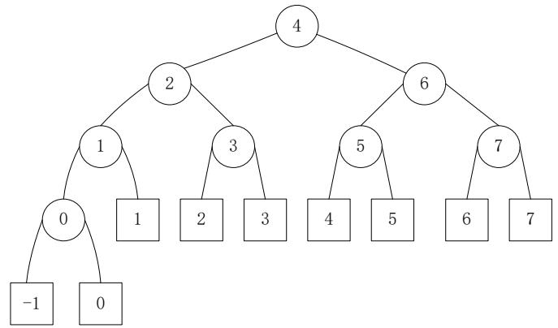


知识点：[回溯法的基本概念（解空间、状态空间树、显式约束与隐式约束）](../../../topics/算法分析/回溯法基本概念.md)、[分枝限界法与回溯法的异同及基本生成方法](../../../topics/算法分析/分枝限界法概述.md)

### 简答 2

**题目：**
5-9

**解答：**
证明：因为该算法在成功搜索的情况下，关键字之间的比较次数至少为 $\lfloor \log n \rfloor$，至多为 $\lfloor \log n \rfloor + 1$。在不成功搜索的情况下，关键字之间的比较次数至少为 $\lfloor \log n \rfloor + 1$，至多为 $\lfloor \log n \rfloor + 2$。所以，算法的最好、最坏情况的时间复杂度为 $\Theta(\log n)$。

假定查找表中任何一个元素的概率是相等的，为 $\frac{1}{n}$，那么，

不成功搜索的平均时间复杂度为 $A_u(n) = \frac{E}{n+1} = \Theta(\log n)$

成功搜索的平均时间复杂度为 $A_s(n) = \frac{I+n}{n} = \frac{E-2n+n}{n} = \frac{E}{n} - 1 = \Theta(\log n)$

其中，$I$ 是二叉判定树的内路径长度，$E$ 是外路径长度，并且 $E = I + 2n$。

**答案：**
证毕。

## 排序算法分析

知识点：[LC（优先队列式）分枝限界法与代价估计函数](../../../topics/算法分析/LC分枝限界法.md)、[带时限作业排序的分枝限界法求解（可变大小元组状态空间树）](../../../topics/算法分析/带时限作业排序分枝限界.md)、[FIFO（队列式）分枝限界法算法框架](../../../topics/算法分析/FIFO分枝限界法.md)

### 排序 1

| 步数 | 0 | 1 | 2 | 3 | 4 | 5 | 6 | 7 |
| --- | --- | --- | --- | --- | --- | --- | --- | --- |
| 初始时 | 5 | $\underline{5}$ | 8 | 3 | 4 | $\underline{3}$ | 2 | $\infty$ |
| 1 | [4 | 2 | $\underline{3}$ | 3] | 5 | [8 | $\underline{5}$] | $\infty$ |
| 2 | [3 | 2 | $\underline{3}$] | 4 | 5 | [8 | $\underline{5}$] | $\infty$ |
| 3 | [$\underline{3}$ | 2] | 3 | 4 | 5 | [8 | $\underline{5}$] | $\infty$ |
| 4 | [2] | $\underline{3}$ | 3 | 4 | 5 | [8 | $\underline{5}$] | $\infty$ |
| 5 | 2 | $\underline{3}$ | 3 | 4 | 5 | [$\underline{5}$] | 8 | $\infty$ |
| 排序结果 | 2 | $\underline{3}$ | 3 | 4 | 5 | $\underline{5}$ | 8 | $\infty$ |

知识点：[两路合并排序算法及其时间与空间复杂度分析](../../../topics/算法分析/合并排序.md)、[分治法的一般思想与算法框架（分解、解决、合并）](../../../topics/算法分析/分治法一般框架.md)、[分治法的复杂性分析与Master定理应用](../../../topics/算法分析/分治法复杂度分析.md)

### 简答 5-12

（1）证明：当 $n=1$ 或 $n=2$ 或 $n=3$ 时，程序显然正确。

当 $n=\mathrm{right-left}+1>2$ 时，程序执行下面的语句：

①首次递归 StoogeSort(left,right-k) 时，序列的前 2/3 的子序列有序。

②当递归执行 StoogeSort(left+k,right) 时，使序列的后 2/3 的子序列有序，经过这两次递归排序，使原序列的后 1/3 的位置上是整个序列中较大的数，即序列后 1/3 的位置上数均大于前 2/3 的数，但此时，前 2/3 的序列并不一定是有序的。

③再次执行 StoogeSort(left,right-k) 使序列的前 2/3 有序。

经过三次递归，最终使序列有序。

所以，这一排序算法是正确的。

（2）最坏情况发生在序列按递减次序排列。

设 $n = 2\left(\frac{3}{2}\right)^i$，则 $i = \frac{\log n - 1}{\log 3 - 1}$。

冒泡排序最坏时间复杂度为 $O(n^2)$，堆排序最坏时间复杂度为 $O(n\log n)$，快速排序最坏时间复杂度为 $O(n\log n)$。所以，该算法不如冒泡排序、堆排序、快速排序。

知识点：[递归概念与归纳证明（斐波那契数列、Hanoi塔问题）](../../../topics/算法分析/递归与归纳证明.md)、[算法的时间复杂度定义（最好、最坏、平均情况）](../../../topics/算法分析/时间复杂度定义.md)、[渐近表示法：大O记号（紧上界）](../../../topics/算法分析/大O记号.md)

### 简答 5-13

设有两个长度分别为 m 和 n 的已排序的表，设计一个有效算法在两个表的全部元素中求第 k 小元素，使得时间复杂度为 $O(\log m + \log n)$。

## 斯特拉森矩阵乘法

斯特拉森分治法也是将 $n\times n$ 的 A、B 矩阵分别分成 4 个 $(n/2)\times(n/2)$ 的子矩阵，它首先计算如下 7 个子矩阵：

$$
\begin{array}{l}
P = (A_{11} + A_{22})(B_{11} + B_{22}),\quad Q = (A_{21} + A_{22})B_{11},\quad R = A_{11}(B_{12} - B_{22}),\\
S = A_{22}(B_{21} - B_{11}),\quad T = (A_{11} + A_{12})B_{22},\quad U = (A_{21} - A_{11})(B_{11} + B_{12}),\\
V = (A_{12} - A_{22})(B_{21} + B_{22})。
\end{array}
$$

然后计算 $C'_{11} = P + S - T + V,\ C'_{12} = R + T,\ C'_{21} = Q + S,\ C'_{22} = P + R - Q + U$。

要证明 $C'_{11} = C_{11},\ C'_{12} = C_{12},\ C'_{21} = C_{21},\ C'_{22} = C_{22}$。

证明 $C'_{11} = C_{11}$：

$$
\begin{array}{rl}
\because C'_{11} = & P + S - T + V \\
= & (A_{11} + A_{22})(B_{11} + B_{22}) + A_{22}(B_{21} - B_{11}) - (A_{11} + A_{12})B_{22} + (A_{12} - A_{22})(B_{21} + B_{22}) \\
= & A_{11}B_{11} + A_{11}B_{22} + A_{22}B_{11} + A_{22}B_{22} + A_{22}B_{21} - A_{22}B_{11} - A_{11}B_{22} - A_{12}B_{22} + A_{12}B_{21} + A_{12}B_{22} - A_{22}B_{21} - A_{22}B_{22} \\
= & A_{11}B_{11} + A_{12}B_{21} \\
= & C_{11}
\end{array}
$$

$\therefore C'_{11} = C_{11}$，证毕。

同理可以证明 $C'_{12} = C_{12},\ C'_{21} = C_{21},\ C'_{22} = C_{22}$。（同学们可以自己证明）由此可得，斯特拉森矩阵乘法是正确的。

知识点：[分治法的一般思想与算法框架（分解、解决、合并）](../../../topics/算法分析/分治法一般框架.md)、[递推方程的求解方法（替换法、迭代法、递归树、主方法）](../../../topics/算法分析/递推方程求解.md)

### 第六章

知识点：[动态规划法的基本要素（最优子结构、重叠子问题）与设计步骤](../../../topics/算法分析/动态规划基本要素.md)、[最长公共子序列（LCS）的最优子结构证明、递推公式与构造最优解](../../../topics/算法分析/最长公共子序列.md)、[0/1背包问题的动态规划法求解（自底向上、反证法证明最优子结构）](../../../topics/算法分析/01背包动态规划.md)

### 习题 6-1

设背包问题实例 $n=7, M=15$，物品重量 $(x_0, x_1, \ldots, x_6) = (2, 3, 5, 7, 1, 4, 1)$，物品装入背包的收益为：$(p_0, p_1, \ldots, p_6) = (10, 5, 15, 7, 6, 18, 3)$。求这一实例的最优解和最大收益。

答案：
由题可得单位重量收益比为：
$$
\left( \frac { p _ { 0 } } { w _ { 0 } } , \frac { p _ { 1 } } { w _ { 1 } } , \frac { p _ { 2 } } { w _ { 2 } } , \frac { p _ { 3 } } { w _ { 3 } } , \frac { p _ { 4 } } { w _ { 4 } } , \frac { p _ { 5 } } { w _ { 5 } } , \frac { p _ { 6 } } { w _ { 6 } } \right) = \left( \frac { 1 0 } { 2 } , \frac { 5 } { 3 } , \frac { 1 5 } { 5 } , \frac { 7 } { 7 } , \frac { 6 } { 1 } , \frac { 1 8 } { 4 } , \frac { 3 } { 1 } \right) = ( 5 , 1 . 6 7 , 3 , 1 , 6 , 4 . 5 , 3 )
$$
所以，最优解为 $( x _ { 0 } , x _ { 1 } , x _ { 2 } , x _ { 3 } , x _ { 4 } , x _ { 5 } , x _ { 6 } ) = ( 1 , \frac { 2 } { 3 } , 1 , 0 , 1 , 1 , 1 )$，或 $( x _ { 0 } , x _ { 1 } , x _ { 2 } , x _ { 3 } , x _ { 4 } , x _ { 5 } , x _ { 6 } ) = ( 1 , 1 , 1 , 1 , 1 , 2 / 3 , 0 )$。
最大收益为 $1 0 + 5 \times \frac { 2 } { 3 } + 1 5 + 6 + 1 8 + 3 = 5 5 \frac { 1 } { 3 } = 1 6 6 / 3 \approx 5 5 . 3 3$。

知识点：[一般背包问题的贪心法求解及最优度量标准证明](../../../topics/算法分析/背包问题贪心求解.md)、[贪心法的一般算法框架（按量度标准排序后逐步决策）](../../../topics/算法分析/贪心法一般框架.md)

### 习题 6-8

设 $W=\{3,7,8,9,15,16,18,20,23,25,28\}$，构造一棵最优 3 路合并树。

答案：
因 $t(n-1)\%(K-1)=(11-1)\%(3-1)=0$，故无需补充虚游程。

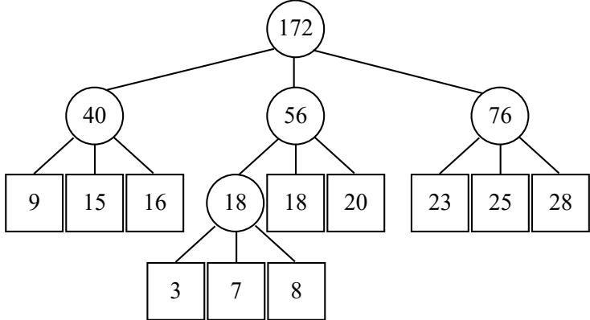

知识点：[最优归并模式（扩充二叉树、Huffman编码与带权外路径长度）](../../../topics/算法分析/最佳合并模式.md)、[贪心法的基本要素（贪心选择性质/最优量度标准、最优子结构性质）](../../../topics/算法分析/贪心法基本要素.md)

### 习题 6-9

图 $G=(V,E)$ 是一个无向连通图，$n = | V |, m = | E |$，且 $m = O(n^{1.99})$，试问选择何种算法求最小代价生成树，是普里姆还是克鲁斯卡尔算法？

答案：
用普里姆算法。
因为图 G 是一个无向连通图，所以 $n - 1 \leqslant m \leqslant n ( n - 1 ) / 2$；$O ( n ) \leqslant O ( m ) \leqslant O ( n ^ { 2 } )$。
克鲁斯卡尔对边数较少的带权图有较高的效率，而 $m = O ( n ^ { 1 . 9 9 } ) \approx O ( n ^ { 2 } )$，此图边数较多，接近完全图，故选用普里姆算法。

知识点：[最小代价生成树的Prim算法（点集扩展）](../../../topics/算法分析/Prim算法.md)、[最小代价生成树的Kruskal算法（边集扩展与并查集）](../../../topics/算法分析/Kruskal算法.md)、[渐近表示法：大O记号（紧上界）](../../../topics/算法分析/大O记号.md)

### 习题 6-10

令 T 是带权无向连通图 $G=(V,E)$ 的一棵最小代价生成树，如果将图 G 的每条边的代价都增加相同的值 $c$。试问 T 是否是新图的最小代价生成树（树的代价可以不同）？请证明你的结论。

答案：
T 仍是新图的最小代价生成树。
证明：假设 T 不是新图的最小代价生成树，T’是新图的最小代价生成树，那么 $\text{cost}(T') < \text{cost}(T)$。
在新图中，$\text{cost}'(T') = \text{cost}(T') + c(n-1)$，$\text{cost}'(T) = \text{cost}(T) + c(n-1)$。
若 $\text{cost}'(T') < \text{cost}'(T)$，则 $\text{cost}(T') + c(n-1) < \text{cost}(T) + c(n-1)$，即 $\text{cost}(T') < \text{cost}(T)$。
这意味着在原图中存在一棵生成树 T'，其代价小于 T 的代价，这与题设中 T 是原图的最小代价生成树矛盾。所以假设不成立。证毕。

知识点：[最小代价生成树的Prim算法（点集扩展）](../../../topics/算法分析/Prim算法.md)、[最小代价生成树的Kruskal算法（边集扩展与并查集）](../../../topics/算法分析/Kruskal算法.md)

### 习题 6-11

证明若无向连通图不包含具有相同代价的边，则该图的最小代价生成树是唯一的。

答案：
**方法一：**
假设该图的最小代价生成树不是唯一的，存在两棵不同的最小代价生成树 $T_1 \neq T_2$。设 $T_2$ 的边是 $e_1, e_2, \ldots, e_{n-1}$，其中 $n$ 是图的顶点个数。
若 $T_1 \neq T_2$，则 $T_2$ 中至少有一条边 $e_{i+1}$，使得 $e_{i+1}$ 不是 $T_1$ 中的边，但是 $e_1, e_2, \ldots, e_i$ 是 $T_1$ 的边。因为 $T_1$ 是树，我们在 $T_1$ 中加上边 $e_{i+1}$，必有一个回路 $C$，而 $T_2$ 是树，所以 $C$ 中必存在某条边 $f$ 不在 $T_2$ 中。对于树 $T_1$，若以边 $e_{i+1}$ 置换 $f$ 则得到新的一棵树 $T'$，但树 $T'$ 的权 $\text{cost}(T') = \text{cost}(T_1) + \text{cost}(e_{i+1}) - \text{cost}(f)$。
因为 $T_1$ 是最小代价生成树，故 $\text{cost}(T_1) \le \text{cost}(T')$，由此推出 $\text{cost}(e_{i+1}) - \text{cost}(f) \geq 0$，即 $\text{cost}(e_{i+1}) \ge \text{cost}(f)$。
因为 $e_1, e_2, \ldots, e_{i+1}$ 是 $T'$ 的边，且在 $\{ e_1, e_2, \ldots, e_{i+1} \}$ 中没有回路，故 $\text{cost}(e_{i+1}) > \text{cost}(f)$ 不可能成立，因为否则在 $T_2$ 中，自 $e_1, e_2, \ldots, e_i$ 之后将取 $f$ 而不能取 $e_{i+1}$，与题设矛盾。于是 $\text{cost}(e_{i+1}) = \text{cost}(f)$，因此 $T'$ 也是图的一棵最小代价生成树，但是 $T'$ 与 $T_2$ 的公共边数比 $T_1$ 与 $T_2$ 的公共边数多 1。用 $T'$ 置换 $T_1$，重复上述论证，直到存在与 $T_2$ 有 $n-1$ 条公共边的最小代价生成树，这时就说明 $T_1 = T_2$ 是同一棵最小代价生成树。

**方法二：**
假设存在两棵不同的最小代价生成树 $T_1$ 与 $T_2$，它们的边分别是 $e_k (0 \leq k \leq n - 1)$ 和 $e'_k (0 \leq k \leq n - 1)$。
设 $T_1$ 与 $T_2$ 的前 $n - 2$ 条边相同，$e_{n - 1}$ 与 $e'_{n - 1}$ 不同，即 $\text{cost}(e_{n - 1}) \neq \text{cost}(e'_{n - 1})$。
$$
\begin{aligned}
\text{cost}(T_1) &= \sum_{k = 0}^{n - 2} \text{cost}(e_k) + \text{cost}(e_{n - 1}) \\
\text{cost}(T_2) &= \sum_{k = 0}^{n - 2} \text{cost}(e'_k) + \text{cost}(e'_{n - 1})
\end{aligned}
$$
由于 $T_1$ 与 $T_2$ 都是最小代价生成树，因此 $\text{cost}(T_1) = \text{cost}(T_2)$。又因为前 $n-2$ 条边相同，即 $\sum_{k = 0}^{n - 2} \text{cost}(e_k) = \sum_{k = 0}^{n - 2} \text{cost}(e'_k)$，所以 $\text{cost}(e_{n - 1}) = \text{cost}(e'_{n - 1})$。
这与 $\text{cost}(e_{n - 1}) \neq \text{cost}(e'_{n - 1})$ 矛盾，故 $e_{n - 1}$ 与 $e'_{n - 1}$ 相同，是同一条边。
重复上述论证，直到 $T_1$ 与 $T_2$ 的边均为同一条边，这就说明 $T_1$ 与 $T_2$ 是同一棵最小代价生成树。

知识点：[最小代价生成树的Prim算法（点集扩展）](../../../topics/算法分析/Prim算法.md)、[最小代价生成树的Kruskal算法（边集扩展与并查集）](../../../topics/算法分析/Kruskal算法.md)

### 第七章

知识点：[回溯法的基本概念（解空间、状态空间树、显式约束与隐式约束）](../../../topics/算法分析/回溯法基本概念.md)、[子集树与排列树的搜索结构](../../../topics/算法分析/子集树与排列树.md)、[剪枝函数设计与回溯法效率分析（蒙特卡罗估计算法）](../../../topics/算法分析/剪枝函数与效率分析.md)

### 习题 7-1

写出对图 7-19 所示的多段图采用向后递推动态规划算法求解时的计算过程。

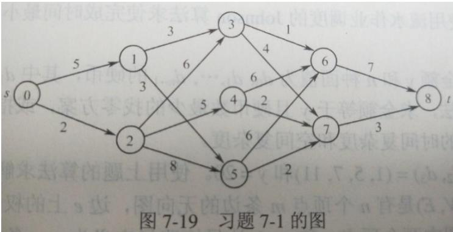

答案：
向后递推过程如下：
*(注：原件此处应有具体计算表格或步骤，识别内容中缺失具体数值，仅保留题干与图示引用)*

知识点：[多段图问题的向前/向后递推动态规划算法](../../../topics/算法分析/多段图问题.md)、[动态规划法的基本要素（最优子结构、重叠子问题）与设计步骤](../../../topics/算法分析/动态规划基本要素.md)

### 习题 7-2

使用向前递推和向后递推两种方法，求图 7-19 所示的多段图中从 s 到 t 的最短路径及路径长度。

答案：
向后递推的计算过程如上题所示。
注意，$d[i,j]$ 存储最短路径上第 $i$ 阶段 $j$ 顶点前的一个顶点号。
向前递推过程如下：
取 $d(1,0)$（即 2），即 0 的下一个顶点是 2；取 $d(2,2)$（即 4）；取 $d(3,4)$（即 7）；取 $d(4,7)$（即 8），到达汇点 $t$（即 8）。
所以最短路径是 $(0, 2, 4, 7, 8)$。

知识点：[动态规划法的基本要素（最优子结构、重叠子问题）与设计步骤](../../../topics/算法分析/动态规划基本要素.md)、[多段图问题的向前/向后递推动态规划算法](../../../topics/算法分析/多段图问题.md)、[多段图的应用：资源分配问题与关键路径算法（earliest递推）](../../../topics/算法分析/资源分配与关键路径.md)

### 习题 7-3

设多段图采用邻接矩阵存储，编写多段图问题的向后递推动态规划算法。

*(注：原件此处未提供具体代码答案，仅列出题目)*

知识点：[多段图问题的向前/向后递推动态规划算法](../../../topics/算法分析/多段图问题.md)

### 习题 7-7

动态规划法可用于计算二项式的系数：$C_n^m = C_{n-1}^{m-1} + C_{n-1}^m$。试设计一个动态规划算法计算二项式系数。分析算法的时间复杂度和空间复杂度。将这一算法与其它计算二项式系数的算法进行比较。（不做）

补充题：编写函数 `int combinat(int m, int n)`，用动态规划法求解组合数 $C_m^n$ 值。递推公式如下：
*(注：原件此处截断，未显示完整递推公式及后续内容)*

知识点：[动态规划法的基本要素（最优子结构、重叠子问题）与设计步骤](../../../topics/算法分析/动态规划基本要素.md)、[算法的时间复杂度定义（最好、最坏、平均情况）](../../../topics/算法分析/时间复杂度定义.md)、[算法的空间复杂度定义](../../../topics/算法分析/空间复杂度定义.md)

### 习题 7-9

给定字符串 $A="xzyzzyx"$，$B="zxyyzxz"$，使用 LCS 算法求最长公共子序列，并给出一个最长公共子序列。

答案：
计算得到的 DP 表如下：

**(a) c[i][j]**
|   | 0 | 0 | 0 | 0 | 0 | 0 | 0 | 0 |
|---|---|---|---|---|---|---|---|---|
| 0 | 0 | 0 | 1 | 1 | 1 | 1 | 1 | 1 |
| 0 | 1 | 1 | 1 | 1 | 2 | 2 | 2 | 2 |
| 0 | 1 | 1 | 2 | 2 | 2 | 2 | 2 | 2 |
| 0 | 1 | 1 | 2 | 2 | 3 | 3 | 3 | 3 |
| 0 | 1 | 1 | 2 | 2 | 3 | 3 | 4 | 4 |
| 0 | 1 | 1 | 2 | 3 | 3 | 3 | 4 | 4 |
| 0 | 1 | 2 | 2 | 3 | 3 | 4 | 4 | 4 |

**(b) s[i][j]**
|   | 0 | 0 | 0 | 0 | 0 | 0 | 0 | 0 |
|---|---|---|---|---|---|---|---|---|
| 0 | 2 | 1 | 3 | 3 | 3 | 1 | 3 | 3 |
| 0 | 1 | 2 | 2 | 2 | 1 | 3 | 1 | 1 |
| 0 | 2 | 2 | 1 | 1 | 2 | 2 | 2 | 2 |
| 0 | 1 | 2 | 2 | 2 | 1 | 3 | 1 | 1 |
| 0 | 1 | 2 | 2 | 2 | 1 | 2 | 1 | 1 |
| 0 | 2 | 2 | 1 | 1 | 2 | 2 | 2 | 2 |
| 0 | 2 | 1 | 2 | 2 | 2 | 1 | 2 | 2 |

*(注：根据原题文字描述“最长公共字串”，结合标准LCS算法结果及常见题型，此处应指最长公共子序列 Longest Common Subsequence。根据表格回溯，最长公共子序列长度为 4。)*
所以，最长公共子序列为 `(x, y, z, z)`。（注：原文写为“最长公共字串”，通常LCS指子序列，若严格指子串需另算，但此处依据DP表结构判定为子序列问题，且原文给出的答案 `(x,y,z,z)` 符合子序列特征）。

知识点：[动态规划法的基本要素（最优子结构、重叠子问题）与设计步骤](../../../topics/算法分析/动态规划基本要素.md)、[最长公共子序列（LCS）的最优子结构证明、递推公式与构造最优解](../../../topics/算法分析/最长公共子序列.md)

### 习题 7-11

写一个类似于 LCS 的算法，它在 $O(m+n)$ 时间内构造最长公共子序列。该算法仅使用数组 c，而不使用数组 s，从而节省了存储空间。

*(注：原件此处未提供具体算法描述或代码，仅列出题目)*

知识点：[最长公共子序列（LCS）的最优子结构证明、递推公式与构造最优解](../../../topics/算法分析/最长公共子序列.md)、[动态规划法的基本要素（最优子结构、重叠子问题）与设计步骤](../../../topics/算法分析/动态规划基本要素.md)、[算法的空间复杂度定义](../../../topics/算法分析/空间复杂度定义.md)

### 习题 7-12

如果只计算最长公共子序列的长度，而无须构造最优解，则只需保存两行元素就可以计算最长公共子序列的长度。请改写程序 7-9 得到改进算法，使算法的空间复杂度为 $\Theta(\min(m,n))$。

*(注：原件此处未提供具体代码，仅列出题目)*

## 7-15. 0/1背包实例计算

设有 0/1 背包实例 $(w_0, w_1, w_2, w_3) = (10, 15, 6, 9)$，$(p_0, p_1, p_2, p_3) = (2, 5, 8, 1)$ 和 $M=32$。试计算 $S^i, 0 \leqslant i < 4$，给出最优解值和最优解（要有计算过程）。另使用启发式方法再计算一次。(题意要求用教材 P165 的计算步骤计算，由于没有讲，故用 P162 的步骤计算)

**题解：**

$S^{-1} = \{(0, 0)\}$，在 $S^{-1}$ 上加上 $(w_0, p_0) = (10, 2)$，得 $S_1^0 = \{(10, 2)\}$

合并：$S^{-1} \cup S_1^0$，得 $S^0 = \{(0, 0), (10, 2)\}$

在 $S^0$ 上加上 $(w_1, p_1) = (15, 5)$，得 $S_1^1 = \{(15, 5), (25, 7)\}$

合并：$S^0 \cup S_1^1$，得 $S^1 = \{(0, 0), (10, 2), (15, 5), (25, 7)\}$

在 $S^1$ 上加上 $(w_2, p_2) = (6, 8)$，得 $S_1^2 = \{(6, 8), (16, 10), (21, 13), (31, 15)\}$

合并：$S^1 \cup S_1^2$，得 $S^2 = \{(0, 0), (6, 8), (16, 10), (21, 13), (31, 15)\}$，其中 $(10, 2), (15, 5), (25, 7)$ 被 $(6, 8)$ 支配，故被舍弃。

在 $S^2$ 上加上 $(w_3, p_3) = (9, 1)$，得 $S_1^3 = \{(9, 1), (15, 9), (25, 11), (30, 14), (40, 16)\}$

合并：$S^2 \cup S_1^3$，得 $S^3 = \{(0, 0), (6, 8), (15, 9), (16, 10), (21, 13), (30, 14), (31, 15)\}$，其中有三个阶跃点已被舍弃，$(9, 1)$ 被 $(6, 8)$ 支配，$(25, 11)$ 被 $(21, 13)$ 支配，而 $(40, 16)$，由于 $40 > M (=32)$，故此三个点被舍弃。

**最优解值**（最大收益）为 15（注意取得最大收益 15 时，背包装了 $10 + 15 + 6 = 31$，即背包没有装满，还有剩余量 1）。

**确定最优解：**
从 $(31, 15)$ 开始，看它属于 $S_1^3$ 还是 $S^2$。由于 $(31, 15) \in S^2$，故 $x_3 = 0$。
$(31, 15)$（不用减去 $(9, 1)$），看 $(31, 15)$ 属于 $S_1^2$ 还是 $S^1$。由于 $(31, 15) \in S_1^2$，故 $x_2 = 1$。
$(31, 15)$ 减去 $(6, 8)$，得 $(25, 7)$，看它属于 $S_1^1$ 还是 $S^0$。由于 $(25, 7) \in S_1^1$，故 $x_1 = 1$。
$(25, 7)$ 减去 $(15, 5)$，得 $(10, 2)$，看它属于 $S_1^0$ 还是 $S^{-1}$。由于 $(10, 2) \in S_1^0$，故 $x_0 = 1$。

因此最优解 $(x_0, x_1, x_2, x_3) = (1, 1, 1, 0)$。

---

## 7-16. 动态规划算法设计

设有 0/1 背包问题，所有 $w_i, p_i$ 和 $M$ 均为正整数。试设计一个动态规划算法求解这一问题，使得算法的时间复杂度为 $\Theta(nM)$。

知识点：[最长公共子序列（LCS）的最优子结构证明、递推公式与构造最优解](../../../topics/算法分析/最长公共子序列.md)、[0/1背包问题实数重量的阶跃点集合求解（非启发式与启发式方法）](../../../topics/算法分析/01背包阶跃点集合.md)、[0/1背包问题的动态规划法求解（自底向上、反证法证明最优子结构）](../../../topics/算法分析/01背包动态规划.md)

### 提示：

#### 一、求最大收益

可以定义一个二维数组 `m[n][M]`，称之为状态数组（记录当前最大收益），共有 $(n+1) \times (M+1)$ 个元素，每个元素代表一个状态，`m[i][j]` 表示前 $i$ 个物品放入容量为 $j$ 的背包所能获得的最大价值。状态数组 `m[i][j]` 的递推公式如下：

$$
m[i][j] = 
\begin{cases} 
0 & \text{当 } i = 0, j = 0 \\
m[i - 1][j] & \text{当 } w_i > j \\
\max(m[i - 1][j], m[i - 1][j - w[i]] + p[i]) & \text{当 } w_i \leq j 
\end{cases}
$$

**说明：**
1. 首先置 0 列元素和 0 行元素为 0；
2. 然后从下标 1 行开始，从左至右计算 `m[i][j]` 的值，再从左至右计算下标 2 行的值，以此类推；
3. 当 $w_i > j$ 时，取上格元素 `m[i-1][j]`；
4. 当 $w_i \leq j$ 时，取（上格元素 `m[i-1][j]`）与（上格元素左边第 $w[i]$ 个元素 + $p[i]$）之间较大的一个；
5. `m[i][j]` 计算完成后，右下角元素值 `m[n][M]` 就是最大收益。

**例子：**
假设有 $n=6$ 个物品，收益数组 $p=(8, 10, 6, 3, 7, 2)$，重量数组 $w=(4, 6, 2, 2, 5, 1)$，求背包容量 $M=12$ 时对应的 `m[i][j]` 数组。

该算法的时间主要是花在计算 `m[i][j]` 上，因此其时间复杂度是 $\Theta(nM)$。

**注意：** 应用上述递推式时，$p$ 和 $w$ 数组的前面要放置一个 0，即 $p=(0, 8, 10, 6, 3, 7, 2)$，$w=(0, 4, 6, 2, 2, 5, 1)$。

根据上述的 $p$ 和 $w$ 计算出的状态数组 `m[i][j]` 的值如下：

| w | p | i \ j | 0 | 1 | 2 | 3 | 4 | 5 | 6 | 7 | 8 | 9 | 10 | 11 | 12 |
|:-:|:-:|:-----:|:-:|:-:|:-:|:-:|:-:|:-:|:-:|:-:|:-:|:-:|:--:|:--:|:--:|
| 0 | 0 | **0** | 0 | 0 | 0 | 0 | 0 | 0 | 0 | 0 | 0 | 0 | 0 | 0 | 0 |
| 4 | 8 | **1** | 0 | 0 | 0 | 0 | 8 | 8 | 8 | 8 | 8 | 8 | 8 | 8 | 8 |
| 6 | 10 | **2** | 0 | 0 | 0 | 0 | 8 | 8 | 10 | 10 | 10 | 10 | 18 | 18 | 18 |
| 2 | 6 | **3** | 0 | 0 | 6 | 6 | 8 | 8 | 14 | 14 | 16 | 16 | 18 | 18 | 24 |
| 2 | 3 | **4** | 0 | 0 | 6 | 6 | 9 | 9 | 14 | 14 | 17 | 17 | 19 | 19 | 24 |
| 5 | 7 | **5** | 0 | 0 | 6 | 6 | 9 | 9 | 14 | 14 | 17 | 17 | 19 | 21 | 24 |
| 1 | 2 | **6** | 0 | 2 | 6 | 8 | 9 | 11 | 14 | 16 | 17 | 19 | 19 | 21 | 24 |

例如，计算 $i=2$ 这一行的元素时，由于 $w[2]=6$，且 $w[2]>j$ 时取上格元素，故 $j=1 \sim 5$ 都是取上格元素的值，见上图黑色底纹部分的元素（即方括号中的元素）。当计算 $j=6 \sim 12$ 的 $m$ 的值时，由于满足 $w_i \leq j$，所以其后的 $m$ 值都是取上格元素与上格元素左边第 $w[2]=6$ 个元素的值加 $p[2]=10$ 的值中较大的一个值。比如当计算 `m[2][6]` 的元素时，就是取其上格值 8 与 8 的左边第 6 个元素 0 加 10 中较大的，即 8 与 10 较大的一个值 10，即 `m[2][6] = 10`；计算 `m[2][10]` 时，也是取其上格元素 8 与上格元素 8 左边第 6 个元素 $8+10$ 中较大的一个，即 `m[2][10] = 18`。

由于算法时间主要用在计算状态数组 `m[n][M]` 上，故其时间复杂度是 $\Theta(nM)$。

#### 二、求最优解

在求得状态数组 `m[i][j]` 后，可以从右下角元素 `m[n][M]` 开始，回溯找最优解 $x[]$。

从 $i=n, j=M$ 开始回溯，按照下列确定 $x[i]$ 的值：

$$
x[i] = 
\begin{cases} 
0 & \text{当 } m[i][j] = m[i - 1][j] \text{。然后回溯到 } (i - 1, j) \text{ 位置。} \\
1 & \text{当 } m[i][j] = m[i - 1][j - w[i]] + p[i] \text{ 且 } j - w[i] \geq 0 \text{。然后回溯到 } (i - 1, j - w[i]) \text{ 位置。}
\end{cases}
$$

直到 $i=0$ 结束。

该算法的时间主要就是回溯的时间，可以看出，主要是下标 $i$ 的变化，$n \sim 0$，因此该算法的时间复杂度为 $\Theta(n+M)$。

**回溯路径示例：**

从 $i=6, j=12$ 开始回溯。由于 `m[6][12] = m[5][12] = 24`，故 $x[6] = 0$，回溯到 $i=5, j=12$；
从 $i=5, j=12$ 开始回溯。由于 `m[5][12] = m[4][12] = 24`，故 $x[5] = 0$，回溯到 $i=4, j=12$；
...（中间步骤省略，依据表格数值判断）...
从 $i=1, j=4$ 开始回溯。由于 `m[1][4] ≠ m[0][4]`，而是 `m[1][4] = m[0][4-4] + 8 = 8`，故 $x[1] = 1$，回溯到 $i=0, j=0$；此时 $i=0$，算法结束。红色箭头线给出了回溯的路径。

因此最优解 $(x_1, x_2, x_3, x_4, x_5, x_6) = (1, 1, 1, 0, 0, 0)$。

该算法的时间复杂度是 $\Theta(n+M)$。

#### 三、相关程序

1. 计算状态矩阵 m

## 第八章

知识点：[0/1背包问题的动态规划法求解（自底向上、反证法证明最优子结构）](../../../topics/算法分析/01背包动态规划.md)

### 简答 1

简述下列名词：状态空间、显示约束、隐式约束、问题状态、解状态、答案状态、活结点、扩展结点、约束函数、剪枝函数。

答案：

状态空间：描述问题的各种可能的情况，一种情况对应状态空间的一个状态。

显示约束：用于规定每个 $x_i$ 取值的约束条件称为显示约束。

隐式约束：用于判定一个候选解是否为可行解的条件。

问题状态：在状态空间树中的每个节点称为一个问题状态。

解状态：如果从根到树中某个状态的路径代表一个作为候选解的元组，则该状态为解状态。

答案状态：如果从根到树中某个状态的路径代表一个作为可行解的元组，则该状态为答案状态。

活结点：回溯法从开始结点出发，以深度优先的方式搜索整个解空间，这个开始结点就成为一个活结点。未检测的结点称为活结点。

扩展结点：算法从 $x$ 出发，访问 $x$ 的某个后继结点 $y$，则 $x$ 被称为扩展结点。

约束函数：一个约束函数是关于部分向量的函数 $B_k(x_0, x_1, \ldots, x_k)$，它被定义为：如果可以判定 $Y$ 的子树上不含任何答案状态，则 $B_k(x_0, x_1, \ldots, x_k)$ 为 false，否则为 true。

剪枝函数：约束函数和限界函数的目的相同，都是为了剪去不必要搜索的子树，减少问题求解所需实际生成的状态节点数，它们统称为剪枝函数。

知识点：[带时限的作业排序贪心算法及可行性判定改进](../../../topics/算法分析/带时限作业排序贪心.md)、[分枝限界法与回溯法的异同及基本生成方法](../../../topics/算法分析/分枝限界法概述.md)

### 简答 2

程序 8-4 求 n-皇后问题的全部可行解，请修改这一程序，使之在求得第一个可行解后算法终止。

答案：（略）

知识点：[LC（优先队列式）分枝限界法与代价估计函数](../../../topics/算法分析/LC分枝限界法.md)、[带时限作业排序的分枝限界法求解（可变大小元组状态空间树）](../../../topics/算法分析/带时限作业排序分枝限界.md)、[FIFO（队列式）分枝限界法算法框架](../../../topics/算法分析/FIFO分枝限界法.md)

### 简答 3

图 8-4 所示的两个可行解是对称的。观察表明 n-皇后问题的解的确存在这种对偶性。修改算法 NQueens，令 $x[0] = 0, 1, \ldots, \lfloor n/2 \rfloor$，使得只求其中不对称的那些解。

答案：（略）

知识点：[FIFO（队列式）分枝限界法算法框架](../../../topics/算法分析/FIFO分枝限界法.md)、[带时限作业排序的分枝限界法求解（可变大小元组状态空间树）](../../../topics/算法分析/带时限作业排序分枝限界.md)、[子集树与排列树的搜索结构](../../../topics/算法分析/子集树与排列树.md)

### 计算 1

设有子集和数问题的实例 $W = (w_0, w_1, \ldots, w_6) = (5, 7, 10, 12, 15, 18, 20)$ 和 $M = 35$。求 $W$ 中元素之和等于 $M$ 的所有子集。画出对于这一实例由 SumOfSub 算法实际生成的那部分状态空间树。

答案：

状态空间树如下：

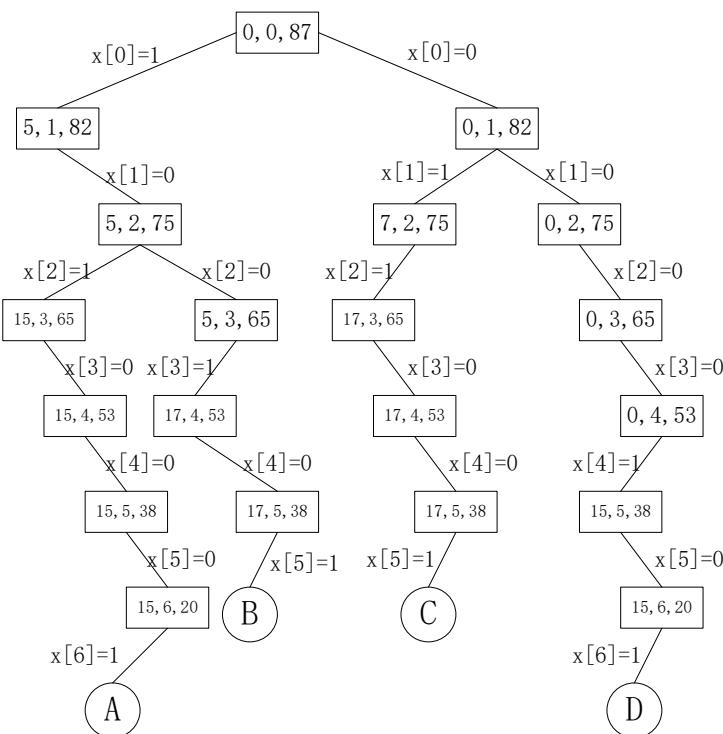


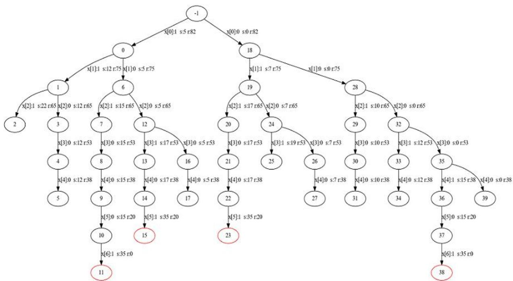

图 包含了全部生成的结点（该图由丁玉青同学提供，采用 python 编程，graphviz 软件绘图）

可行解：$(1, 0, 0, 1, 0, 1)$，$(0, 1, 1, 0, 0, 1)$，$(1, 0, 1, 0, 0, 1)$，$(0, 0, 0, 0, 1, 0, 1)$ 或 $(5, 12, 18)$，$(7, 10, 18)$，$(5, 10, 20)$，$(15, 20)$

知识点：[带时限作业排序的分枝限界法求解（可变大小元组状态空间树）](../../../topics/算法分析/带时限作业排序分枝限界.md)、[FIFO（队列式）分枝限界法算法框架](../../../topics/算法分析/FIFO分枝限界法.md)

### 计算 2

设 $M = 35$，对于下列三组数据执行 SumOfSub，观察在计算时间上有何显著差别？

（1）$W = (5, 7, 10, 12, 15, 18, 20)$

（2）$W = (20, 18, 15, 12, 10, 7, 5)$

（3）$W = (15, 7, 20, 5, 18, 10, 12)$

答案：

对程序 8-5 进行修改，使之能够生成状态空间树的各结点。运行改进的程序，得可行解为：

各组数据的特点、可行解个数、求得的可行解个数、生成和搜索的结点数见下表：

| 数据组号 | 数据特点 | 可行解数 | 求得的可行解数 | 生成的结点数 | 搜索的结点数 |
|---|---|---|---|---|---|
| 1 | 有序 | 4 | 4 | 37 | 41 |
| 2 | 逆序 | 4 | 1 | 10 | 11 |
| 3 | 无序 | 4 | 3 | 21 | 24 |

分析上表可以看出，由于 SumOfSub 函数要求初始序列有序排列，而后面 2 组数据无序，故后面 2 组不能得到全部可行解。而第 2 组数据只能求出 1 个可行解，生成 10 个结点为最少，因此执行时间上第 2 组时间最短；同理，第 3 组执行时间长于第 2 组，第 1 组执行时间最长。（方月彤同学提供了计算时间）。

详细分析：参见“程序\习题 8-7-子集和数问题的回溯算法-生成状态空间树-固定元组.docx”

知识点：[LC（优先队列式）分枝限界法与代价估计函数](../../../topics/算法分析/LC分枝限界法.md)、[带时限作业排序的分枝限界法求解（可变大小元组状态空间树）](../../../topics/算法分析/带时限作业排序分枝限界.md)、[求最优解的上下界函数设计与剪枝方法](../../../topics/算法分析/上下界函数.md)

### 计算 3

设计一个回溯算法，使用可变长度状态空间树求解子集和数问题。

答案：

总的执行时 $|H| = n \cdot (m^{n+1} - m) / (m - 1)$

注意：当 $n = 6$ 时，将最后一个元素后面的元素置成大于最后一个元素的数，防止 $jj = n - 1$ 时，取 $w[jj+1]$ 超界取到很小的数而不能剪枝。

```c
float w0[] = {5, 10, 12, 13, 15, 18, INF};
```

知识点：[回溯法的基本概念（解空间、状态空间树、显式约束与隐式约束）](../../../topics/算法分析/回溯法基本概念.md)、[分枝限界法与回溯法的异同及基本生成方法](../../../topics/算法分析/分枝限界法概述.md)

### 计算 4

使用大小分别为 $n = 2, 3, 4, 5, 6, 7$ 的完全图作为输入实例执行 m-着色算法 mColoring。令 $m = n$ 和 $m = n/2$ 为颜色数。请对 $n$ 和 $m$ 的每个值列表表示算法所需的计算时间。

答案：

| n | m=n | m=n/2 |
|---|---|---|
| 2 | 12 | 无法着色 |
| 3 | 117 | 21.38 |
| 4 | 1360 | 120.00 |
| 5 | 19525 | 805.47 |
| 6 | 335916 | 6552.00 |
| 7 | 6725593 | 63042.71 |

注意：该表是在 $n/2$ 向上取整时得到的结果；如果向下取整，则结果有不同，有可能无法着色。

知识点：[图的m-着色问题回溯法求解与四色定理](../../../topics/算法分析/图的m着色问题.md)、[回溯法的递归回溯与迭代回溯算法框架](../../../topics/算法分析/回溯法框架.md)、[剪枝函数设计与回溯法效率分析（蒙特卡罗估计算法）](../../../topics/算法分析/剪枝函数与效率分析.md)

### 计算 5

请画出对图 8-15(a) 所示的图执行求哈密顿环算法所实际生成的那部分状态空间树。

答案：

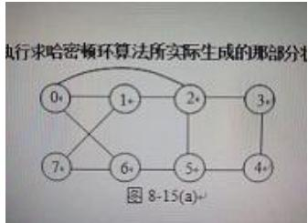

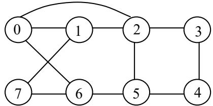

解：


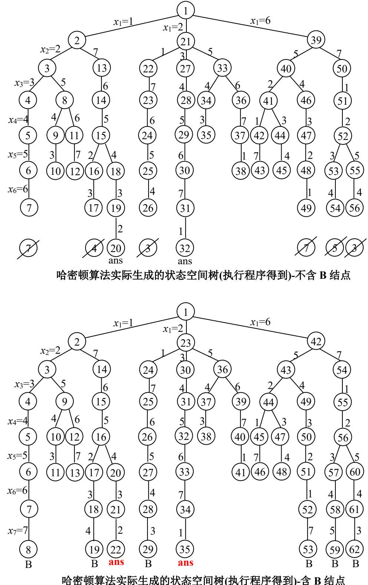

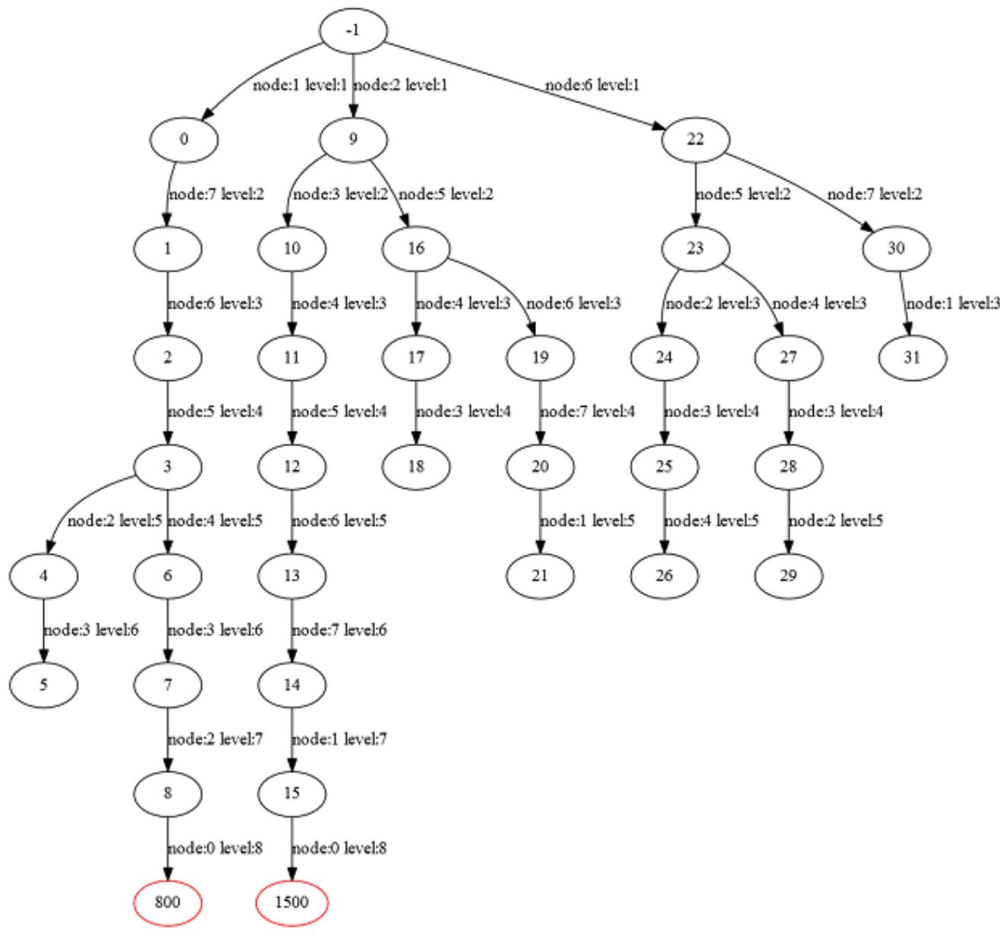

解：

知识点：[哈密顿环的回溯法求解](../../../topics/算法分析/哈密顿环问题.md)、[回溯法的基本概念（解空间、状态空间树、显式约束与隐式约束）](../../../topics/算法分析/回溯法基本概念.md)、[子集树与排列树的搜索结构](../../../topics/算法分析/子集树与排列树.md)

### 计算 6

设计一个回溯算法，它使用可变大小元组的状态空间树求解 0/1 背包问题的最优解。并以例 8-4 的实例为输入运行你所设计的算法，画出由此生成的那部分状态空间树。

答案：

// cp 是当前收益，cw 是当前背包已装物品重量，k 是当前待考察的物品编号，要求 p[i]/w[i] ≥ p[i+1]/w[i+1] // fp 是当前最大收益

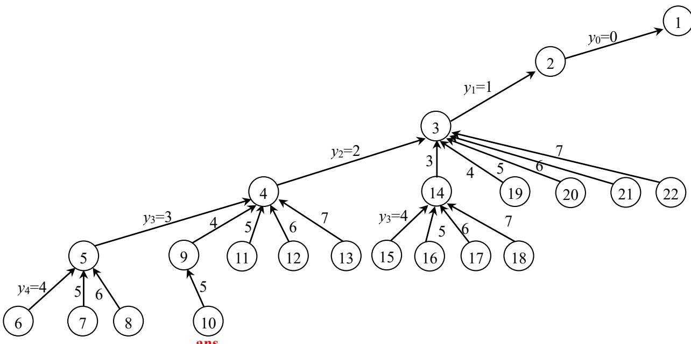

## 第九章

知识点：[0/1背包问题的回溯法求解（限界函数更新下界）](../../../topics/算法分析/01背包回溯法.md)、[子集树与排列树的搜索结构](../../../topics/算法分析/子集树与排列树.md)、[剪枝函数设计与回溯法效率分析（蒙特卡罗估计算法）](../../../topics/算法分析/剪枝函数与效率分析.md)

### 简答 1

实现带时限的作业排序的函数 GenerateAns。

答案：（略）

知识点：[带时限的作业排序贪心算法及可行性判定改进](../../../topics/算法分析/带时限作业排序贪心.md)、[分枝限界法与回溯法的异同及基本生成方法](../../../topics/算法分析/分枝限界法概述.md)

### 计算 1

设有带时限的作业排序问题实例 $(p_1, p_2, \ldots, p_5) = (6, 3, 4, 8, 5)$，$(t_1, t_2, \ldots, t_5) = (2, 1, 2, 1, 1)$ 和 $(d_1, d_2, \ldots, d_5) = (?, ?, ?, ?, ?)$。求问题的最优解及对应于最优解的收益损失。画出 JSFIFOBB 算法实际生成的那部分状态空间树。

答案：

```
p={3,8,6,4,5}  total=26  U=7
d={1,2,3,4,4}  最优解值=19
t={1,1,2,2,1}  最优解 X={1,2,4}  (p,d,t)= (8,2,1) , (6,3,2) , (5,4,1)
```

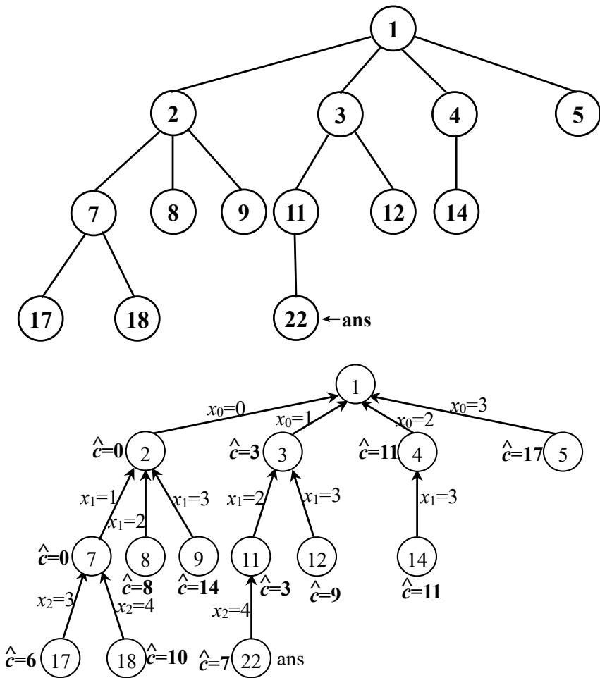

知识点：[带时限作业排序的分枝限界法求解（可变大小元组状态空间树）](../../../topics/算法分析/带时限作业排序分枝限界.md)、[FIFO（队列式）分枝限界法算法框架](../../../topics/算法分析/FIFO分枝限界法.md)

### 计算 2

画出当采用 LC 分枝限界算法求上题中给定的带时限作业排序实例时，实际生成的那部分状态空间树。

答案：

```
0 1 2 3 4
p={3,8,6,4,5}  total=26  U=7
d={1,2,3,4,4}  最优解值=19
t={1,1,2,2,1}  最优解 X={1,2,4}  (p,d,t)= (8,2,1) , (6,3,2) , (5,4,1)
c(X)<U, 入队    U(X)<U, 修正 U
C(X)>=U, 不入队（不生成结点）    U(X)>=U, 不修正 U
```

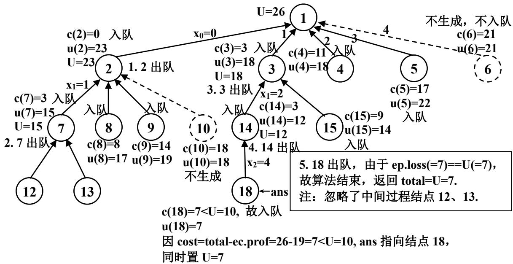

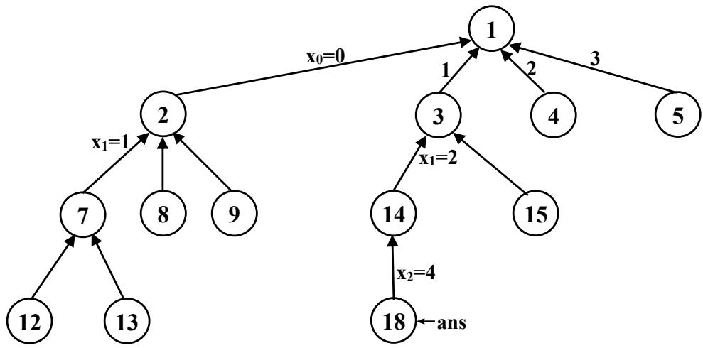

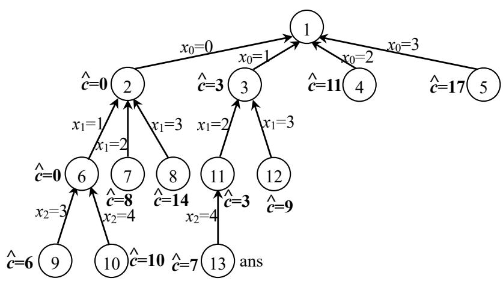

知识点：[LC（优先队列式）分枝限界法与代价估计函数](../../../topics/算法分析/LC分枝限界法.md)、[带时限作业排序的分枝限界法求解（可变大小元组状态空间树）](../../../topics/算法分析/带时限作业排序分枝限界.md)、[求最优解的上下界函数设计与剪枝方法](../../../topics/算法分析/上下界函数.md)

### 简答 2

改写程序 9-4，带时限的作业排序程序为 LC 分枝限界算法。

答案：（略）

知识点：[LC（优先队列式）分枝限界法与代价估计函数](../../../topics/算法分析/LC分枝限界法.md)、[带时限作业排序的分枝限界法求解（可变大小元组状态空间树）](../../../topics/算法分析/带时限作业排序分枝限界.md)、[FIFO（队列式）分枝限界法算法框架](../../../topics/算法分析/FIFO分枝限界法.md)

### 简答 3

写一个 LIFO 分枝限界算法实现带时限的作业排序，假定采取固定大小元组的状态空间树。

答案：（略）


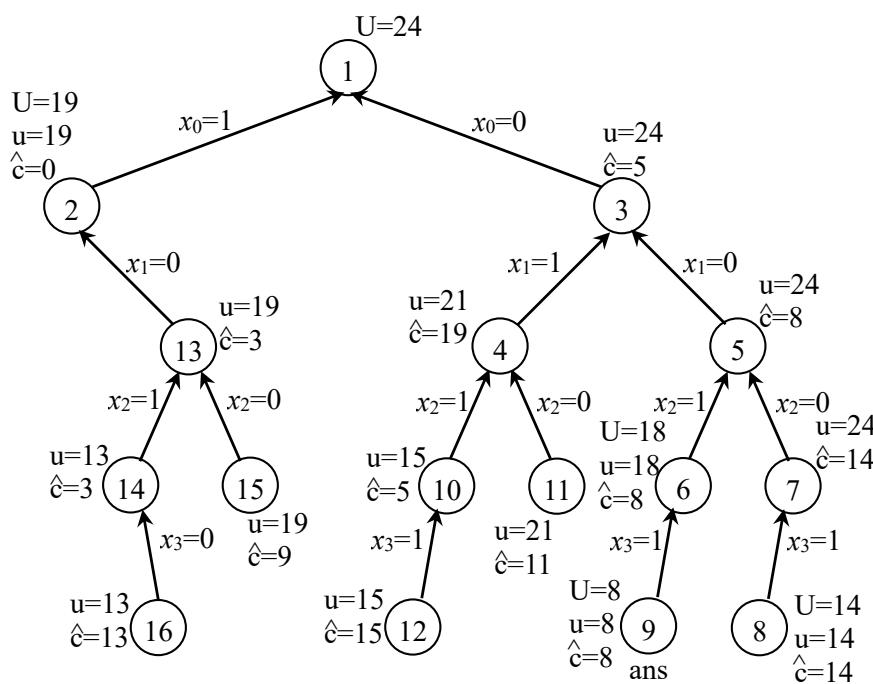

知识点：[FIFO（队列式）分枝限界法算法框架](../../../topics/算法分析/FIFO分枝限界法.md)、[带时限作业排序的分枝限界法求解（可变大小元组状态空间树）](../../../topics/算法分析/带时限作业排序分枝限界.md)、[子集树与排列树的搜索结构](../../../topics/算法分析/子集树与排列树.md)

### 计算 3

画出对例 9-2 的 0/1 背包实例执行 FIFO 分枝限界法所实际生成的那部分状态空间树。

答案：

数据来源例 9-2（已按单位重量非增次序排列）

$n = 4$；$p[] = \{10, 10, 12, 18\}$；$w[] = \{2, 4, 6, 9\}$；$M = 15$；

$L = 38$

最优解值 $= 38$；最优解 $x[] = \{1, 1, 0, 1\}$，即 $x[] = \{0, 1, 3\}$

## 习题 9-6


## 习题 9-7

假定采用可变大小元组解结构，画出对例 9-2 的 0/1 背包实例执行 LC 分枝限界法所实际生产的那部分状态空间树。

解：数据来源例 9-2（已按单位重量非增次序排列）

$n=4$；$p[]=\{10,10,12,18\}$；$w[]=\{2,4,6,9\}$；$M=15$；

$L=38$

最优解值 $=38$；最优解 $x[]=\{0,1,3\}$

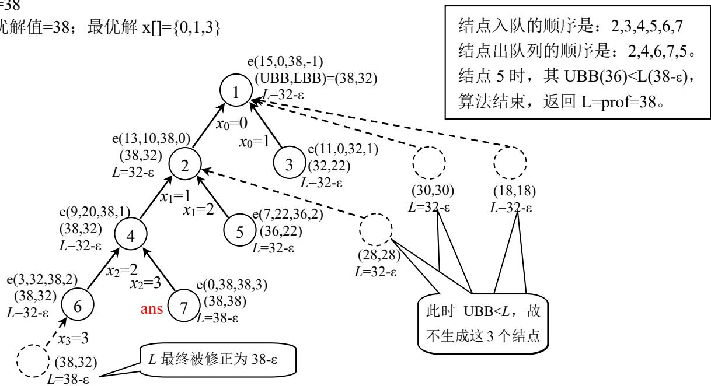

## 习题 9-8

设有 0/1 背包问题实例 $n=5$，对于以下两种情况：

（1）$\{p_1,p_2,\ldots,p_5\}=\{10,15,6,8,4\}$，$\{w_1,w_2,\ldots,w_5\}=\{4,6,3,4,2\}$ 和 $m=12$

（2）$\{p_1,p_2,\ldots,p_5\}=\{w_1,w_2,\ldots,w_5\}=\{4,4,5,8,9\}$ 和 $m=15$

分别求问题的最优解和最优解值，并画出采用分枝限界算法实际生成的那部分状态空间树。

解：

（1）


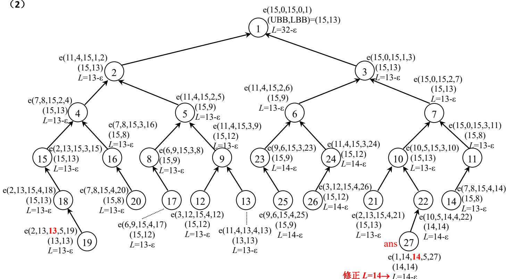

知识点：[回溯法的基本概念（解空间、状态空间树、显式约束与隐式约束）](../../../topics/算法分析/回溯法基本概念.md)、[分枝限界法与回溯法的异同及基本生成方法](../../../topics/算法分析/分枝限界法概述.md)
