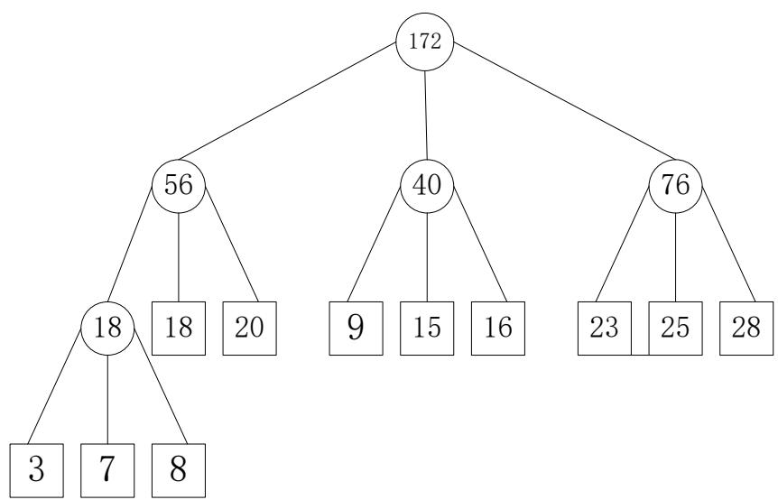

# 《算法设计与分析C++语言描述》课后习题答案（陈慧南版）

原件经识别和整理；“参考解答”是我们补的。

第一章

### 计算 1

最大公约数为 1。快 1414 倍。

主要考虑循环次数，程序 1-2 的 while 循环体做了 10 次，程序 1-3 的 while 循环体做了 14141 次（14142-2 循环）。

若考虑其他语句，则没有这么多，可能就 601 倍。

## 第二章

知识点：[使用程序步分析算法的时间复杂度](../../../topics/算法分析/程序步分析法.md)、[渐近表示法：大O记号（紧上界）](../../../topics/算法分析/大O记号.md)、[算法的时间复杂度定义（最好、最坏、平均情况）](../../../topics/算法分析/时间复杂度定义.md)

### 计算 1

（1）画线语句的执行次数为 $\left\lceil \log n \right\rceil$，$O(\log n)$。划线语句的执行次数应该理解为一格整体。

（2）画线语句的执行次数为 $\sum_{i=1}^{n}\sum_{j=1}^{i}\sum_{k=1}^{j}1=\frac{n(n+1)(n+2)}{6}$，$\mathrm{O}(n^{3})$。

（3）画线语句的执行次数为 $\left\lfloor \sqrt{n} \right\rfloor$，$O(\sqrt{n})$。

（4）当 $n$ 为奇数时画线语句的执行次数为 $\frac{(n+1)(n+3)}{4}$；当 $n$ 为偶数时画线语句的执行次数为 $\frac{(n+2)^{2}}{4}$，$O(n^{2})$。

知识点：[使用程序步分析算法的时间复杂度](../../../topics/算法分析/程序步分析法.md)、[渐近表示法：大O记号（紧上界）](../../../topics/算法分析/大O记号.md)、[算法的时间复杂度定义（最好、最坏、平均情况）](../../../topics/算法分析/时间复杂度定义.md)

### 计算 2

（1）当 $n \geq 1$ 时，$5n^{2} - 8n + 2 \leq 5n^{2}$，所以，可选 $c = 5$，$n_{0} = 1$。对于 $n \geq n_{0}$，$f(n) = 5n^{2} - 8n + 2 \leq 5n^{2}$，所以，$5n^{2} - 8n + 2 = \mathrm{O}(n^{2})$。

（2）当 $n \geq 8$ 时，$5n^{2} - 8n + 2 \geq 5n^{2} - n^{2} + 2 \geq 4n^{2}$，所以，可选 $c = 4$，$n_{0} = 8$。对于 $n \geq n_{0}$，$f(n) = 5n^{2} - 8n + 2 \geq 4n^{2}$，所以，$5n^{2} - 8n + 2 = \Omega(n^{2})$。

（3）由（1）、（2）可知，取 $c_{1} = 4$，$c_{2} = 5$，$n_0 = 8$，当 $n\geq n_0$ 时，有 $c_{1}n^{2}\leq 5n^{2} - 8n + 2\leq c_{2}n^{2}$，所以 $5n^{2} - 8n + 2 = \Theta (n^{2})$。

知识点：[渐近表示法：大O记号（紧上界）](../../../topics/算法分析/大O记号.md)、[渐近表示法：Ω记号（下界）](../../../topics/算法分析/Omega记号.md)、[渐近表示法：Θ记号（紧渐近界）](../../../topics/算法分析/Theta记号.md)

### 计算 3

（1）当 $n \geq 3$ 时，$\log n < n < \log^3 n$，所以 $f(n) = 20n + \log n < 21n$，$g(n) = n + \log^3 n > 2n$。可选 $c = \frac{21}{2}$，$n_0 = 3$。对于 $n \geq n_0$，$f(n) \leq cg(n)$，即 $f(n) = O(g(n))$。注意：是 $f(n)$ 和 $g(n)$ 的关系。

（2）当 $n \geq 4$ 时，$\log n < n < \log^2 n$，所以 $f(n) = n^2 / \log n < n^2$，$g(n) = n \log^2 n \geq n^2$。可选 $c = 1$，$n_0 = 4$。对于 $n \geq n_0$，$f(n) < n^2 \leq cg(n)$，即 $f(n) = O(g(n))$。

（3）因为 $f(n)=(\log n)^{\log n}=n^{\log(\log n)}$，$g(n)=n/\log n=n\log_{n}2$。当 $n\geq 4$ 时，$f(n)=n^{\log(\log n)}\geq n$，$g(n)=n\log_{n}2<n$。所以，可选 $c=1$，$n_{0}=4$，对于 $n\geq n_{0}$，$f(n)\geq cg(n)$，即 $f(n)=\Omega(g(n))$。

知识点：[渐近表示法：大O记号（紧上界）](../../../topics/算法分析/大O记号.md)、[渐近表示法：Ω记号（下界）](../../../topics/算法分析/Omega记号.md)、[算法的时间复杂度定义（最好、最坏、平均情况）](../../../topics/算法分析/时间复杂度定义.md)

### 证明 1

证明：设 $n = 2^i$，则 $i = \log n$。

$$
\begin{array}{l}
T (n) = 2 T \left(\left\lfloor \frac {n}{2} \right\rfloor\right) + 2 n \log n = 2 \left[ 2 T \left(\left\lfloor \frac {n}{2 ^ {2}} \right\rfloor\right) + 2 \times \frac {n}{2} \times \log \left(\frac {n}{2}\right) \right] + 2 n \log n \\
= 2 ^ {2} T \left(\left\lfloor \frac {n}{2 ^ {2}} \right\rfloor\right) + 2 n (\log n - \log 2) + 2 n \log n \\
= 2 ^ {2} T \left(\left\lfloor \frac {n}{2 ^ {2}} \right\rfloor\right) + 2 \times 2 n \log n - 2 n \\
= 2 ^ {2} \left[ 2 T \left(\left\lfloor \frac {n}{2 ^ {3}} \right\rfloor\right) + 2 \times \frac {n}{2 ^ {2}} \times \log \frac {n}{2 ^ {2}} \right] + 2 \times 2 n \log n - 2 n \\
= 2 ^ {3} T \left(\left\lfloor \frac {n}{2 ^ {3}} \right\rfloor\right) + 2 n (\log n - \log 4) + 2 \times 2 n \log n - 2 n \\
= 2 ^ {3} T \left(\left\lfloor \frac {n}{2 ^ {3}} \right\rfloor\right) + 3 \times 2 n \log n - 2 n - 4 n \\
= \dots \\
= 2 ^ {k} T \left(\left\lfloor \frac {n}{2 ^ {k}} \right\rfloor\right) + 2 k n \log n - 2 n - 4 n - \dots - 2 n (k - 1) \\
= 2 ^ {i - 1} T (2) + 2 (i - 1) n \log n - 2 n - 4 n - \dots - 2 n (i - 2) \\
= 2 ^ {i - 1} \times 4 + 2 n \log n (\log n - 1) - (i - 2) (i - 1) n \\
= 2 n + 2 n \log^ {2} n - 2 n \log n - (\log^ {2} n - 3 \log n + 2) n \\
= n \log^ {2} n + n \log n
\end{array}
$$

当 $n \geq 2$ 时，$T(n) \leq 2n \log^{2} n$。所以，$T(n) = O(n \log^{2} n)$。

知识点：[递推方程的求解方法（替换法、迭代法、递归树、主方法）](../../../topics/算法分析/递推方程求解.md)、[渐近表示法：大O记号（紧上界）](../../../topics/算法分析/大O记号.md)、[分治法的复杂性分析与Master定理应用](../../../topics/算法分析/分治法复杂度分析.md)

### 证明 2


证明：因为该算法在成功搜索的情况下，关键字之间的比较次数至少为 $\lfloor \log n\rfloor$，至多为 $\lfloor \log n\rfloor +1$。在不成功搜索的情况下，关键字之间的比较次数至少为 $\left\lfloor \log n \right\rfloor + 1$，至多为 $\left\lfloor \log n \right\rfloor + 2$。所以，算法的最好、最坏情况的时间复杂度为 $\Theta(\log n)$。

假定查找表中任何一个元素的概率是相等的，为 $\frac{1}{n}$，那么，

不成功搜索的平均时间复杂度为 $A_{u}(n) = \frac{E}{n + 1} = \Theta (\log n)$

成功搜索的平均时间复杂度为 $A_{s}(n) = \frac{I + n}{n} = \frac{E - 2n + n}{n} = \frac{E}{n} - 1 = \Theta (\log n)$。

其中，$I$ 是二叉判定树的内路径长度，$E$ 是外路径长度，并且 $E = I + 2n$。

知识点：[对半搜索的二叉判定树性质及基于关键字比较的搜索算法时间下界](../../../topics/算法分析/二叉判定树.md)、[算法的时间复杂度定义（最好、最坏、平均情况）](../../../topics/算法分析/时间复杂度定义.md)、[渐近表示法：Θ记号（紧渐近界）](../../../topics/算法分析/Theta记号.md)

### 计算 4

| 步数 | 0 | 1 | 2 | 3 | 4 | 5 |
| --- | --- | --- | --- | --- | --- | --- |
| 初始时 | 1 | 1 | 1 | 1 | 1 | |
| 1 | [1] | 1] | 1 | [1] | 1] | $\infty$ |
| 2 | [1] | 1 | 1 | [1] | 1] | $\infty$ |
| 3 | 1 | 1 | 1 | [1] | 1] | $\infty$ |
| 4 | 1 | 1 | 1 | [1] | 1 | $\infty$ |
| 排序结果 | 1 | 1 | 1 | 1 | 1 | $\infty$ |

| 步数 | 0 | 1 | 2 | 3 | 4 | 5 | 6 | 7 |
| --- | --- | --- | --- | --- | --- | --- | --- | --- |
| 初始时 | 5 | 5 | 8 | 3 | 4 | 3 | 2 | $\infty$ |
| 1 | [4 | 2 | 3 | 3] | 5 | [8 | 5] | $\infty$ |
| 2 | [3 | 2 | 3] | 4 | 5 | [8 | 5] | $\infty$ |
| 3 | [3 | 2] | 3 | 4 | 5 | [8 | 5] | $\infty$ |
| 4 | [2] | 3 | 3 | 4 | 5 | [8 | 5] | $\infty$ |
| 5 | 2 | 3 | 3 | 4 | 5 | [5] | 8 | $\infty$ |
| 排序结果 | 2 | 3 | 3 | 4 | 5 | 5 | 8 | $\infty$ |

知识点：[单源最短路径的Dijkstra算法及数据结构选择](../../../topics/算法分析/Dijkstra算法.md)

### 综合 1

（1）证明：当 $n = 0$ 或 $n = 1$ 或 $n = 2$ 时，程序显然正确。当 `n=right-left+1>2` 时，程序执行下面的语句：

```cpp
int k=(right-left+1)/3;
StoogeSort(left,right-k);
StoogeSort(left+k,right);
StoogeSort(left,right-k);
```

①首次递归 `StoogeSort(left,right-k);` 时，序列的前 2/3 的子序列有序。

②当递归执行 `StoogeSort(left+k,right);` 时，使序列的后 2/3 的子序列有序，经过这两次递归排序，使原序列的后 1/3 的位置上是整个序列中较大的数，即序列后 1/3 的位置上数均大于前 2/3 的数，但此时，前 2/3 的序列并不一定是有序的。

③再次执行 `StoogeSort(left,right-k);` 使序列的前 2/3 有序。

经过三次递归，最终使序列有序。

所以，这一排序算法是正确的。

（2）最坏情况发生在序列按递减次序排列。

设 $n = 2\left(\frac{3}{2}\right)^i$，则 $i = \frac{\log n - 1}{\log 3 - 1}$。

$$
\begin{array}{r l}
\mathrm{T} (n) & = 3 \mathrm{T} \left(\frac {2}{3} n\right) + 1 = 3 \left[ 3 \mathrm{T} \left(\frac {4}{9} n\right) + 1 \right] + 1 = 9 \mathrm{T} \left(\frac {4}{9} n\right) + 3 + 1 = \dots \\
& = 3 ^ {i} \mathrm{T} \left[ \left(\frac {2}{3}\right) ^ {i} n \right] + 3 ^ {i - 1} + 3 ^ {i - 2} + \dots + 3 + 1 \\
& = 3 ^ {i} \mathrm{T} (2) + \frac {3 ^ {i} - 1}{2} \\
& = \frac {3}{2} (3 ^ {i}) - \frac {1}{2} \\
& = \frac {3}{2} \times \frac {n}{2} \times 2 ^ {\frac {\log n - 1}{\log 3 - 1}} - \frac {1}{2} \\
& \leq 3 \times n ^ {\frac {\log 3}{\log 3 - 1}} \\
& = \mathrm{O} \left(n ^ {\frac {\log 3}{\log 3 - 1}}\right)
\end{array}
$$

冒泡排序最坏时间复杂度为 $\mathrm{O}\left(n^{2}\right)$，堆排序最坏时间复杂度为 $\mathrm{O}\left(n\log n\right)$，快速排序最坏时间复杂度为 $\mathrm{O}\left(n\log n\right)$。所以，该算法不如冒泡排序、堆排序、快速排序。

# 算法设计与分析（课后习题答案）

本资料整理自《算法设计与分析 C++ 语言描述》（陈慧南版）课后习题答案，识别自第 7–10 页内容。

## 第六章 图论与最小生成树

知识点：[递归概念与归纳证明（斐波那契数列、Hanoi塔问题）](../../../topics/算法分析/递归与归纳证明.md)、[递推方程的求解方法（替换法、迭代法、递归树、主方法）](../../../topics/算法分析/递推方程求解.md)、[算法的时间复杂度定义（最好、最坏、平均情况）](../../../topics/算法分析/时间复杂度定义.md)

### 选择 8

题干：关于普里姆算法与克鲁斯卡尔算法的适用场景及计算结果。

**分析过程：**

最优解为 $\left(x_{0},x_{1},x_{2},x_{3},x_{4},x_{5},x_{6}\right)=\left(1,\frac{2}{3},1,0,1,1,1\right)$。

最大收益为 $10+5\times\frac{2}{3}+15+6+18+3=55\frac{1}{3}$。



**知识点：** 动态规划, 整数规划

知识点：[最小代价生成树的Prim算法（点集扩展）](../../../topics/算法分析/Prim算法.md)、[最小代价生成树的Kruskal算法（边集扩展与并查集）](../../../topics/算法分析/Kruskal算法.md)

### 简答 9

题干：简述普里姆算法的适用条件及与克鲁斯卡尔算法的比较。

答案：普里姆算法。
因为图 $G$ 是一个无向连通图，所以边数 $m$ 满足 $n-1 \le m \le n(n-1)/2$。
时间复杂度关系为：
$$
\mathrm{O} (\mathrm{n}) \le \mathrm{m} \le \mathrm{O} \left(\mathrm{n} ^ {2}\right)
$$

克鲁斯卡尔算法对边数较少的带权图有较高的效率，而本题中 $m = \mathrm{O}\left(n^{1.99}\right) \approx \mathrm{O}\left(n^2\right)$，此图边数较多，接近完全图，故选用普里姆算法。

**知识点：** 最小生成树, 普里姆算法, 克鲁斯卡尔算法

知识点：[最小代价生成树的Prim算法（点集扩展）](../../../topics/算法分析/Prim算法.md)、[最小代价生成树的Kruskal算法（边集扩展与并查集）](../../../topics/算法分析/Kruskal算法.md)、[算法按时间复杂度分类（多项式时间算法与指数时间算法）](../../../topics/算法分析/算法按时间复杂度分类.md)

### 简答 10

题干：证明若原图的最小代价生成树为 $T$，则在新图中 $T$ 仍是最小代价生成树（假设新图仅通过某种方式改变边权，此处指代原题特定情境）。

答案：$T$ 仍是新图的最小代价生成树。

**证明：**
假设 $T$ 不是新图的最小代价生成树，设 $T'$ 是新图的最小代价生成树，那么 $\text{cost}(T') < \text{cost}(T)$。
根据题意推导，有 $\text{cost}(T') - c(n-1) < \text{cost}(T) - c(n-1)$。
即在原图中存在一颗生成树，其代价小于 $T$ 的代价，这与题设中 $T$ 是原图的最小代价生成树矛盾。
所以假设不成立。证毕。

**知识点：** 最小生成树性质, 反证法

## 第七章 动态规划

知识点：[最小代价生成树的Prim算法（点集扩展）](../../../topics/算法分析/Prim算法.md)、[最小代价生成树的Kruskal算法（边集扩展与并查集）](../../../topics/算法分析/Kruskal算法.md)、[递归概念与归纳证明（斐波那契数列、Hanoi塔问题）](../../../topics/算法分析/递归与归纳证明.md)

### 简答 2

题干：向后递推的计算过程。

答案：向后递推的计算过程如上题所示。

计算矩阵如下：

$$
\left[ \begin{array}{c c c c c c c c} 
0 & 0 & 0 & 0 & 0 & 0 & 0 & 0 \\ 
0 & 0 & 1 & 1 & 1 & 1 & 1 & 1 \\ 
0 & 1 & 1 & 1 & 1 & 2 & 2 & 2 \\ 
0 & 1 & 1 & 2 & 2 & 2 & 2 & 2 \\ 
0 & 1 & 1 & 2 & 2 & 3 & 3 & 3 \\ 
0 & 1 & 1 & 2 & 2 & 3 & 3 & 4 \\ 
0 & 1 & 1 & 2 & 3 & 3 & 3 & 4 \\ 
0 & 1 & 2 & 2 & 3 & 3 & 4 & 4 
\end{array} \right]
$$

$$
\left[ \begin{array}{c c c c c c c c} 
0 & 0 & 0 & 0 & 0 & 0 & 0 & 0 \\ 
0 & 2 & 1 & 3 & 3 & 3 & 1 & 3 \\ 
0 & 1 & 2 & 2 & 2 & 1 & 3 & 1 \\ 
0 & 2 & 2 & 1 & 1 & 2 & 2 & 2 \\ 
0 & 1 & 2 & 2 & 2 & 1 & 3 & 1 \\ 
0 & 1 & 2 & 2 & 2 & 1 & 2 & 1 \\ 
0 & 2 & 2 & 1 & 1 & 2 & 2 & 2 \\ 
0 & 2 & 1 & 2 & 2 & 2 & 1 & 2 
\end{array} \right]
$$

(b) $s[i][j]$

所以，最长公共字串为 $(x,y,z,z)$ 。

**知识点：** 动态规划, 最长公共子序列, 回溯法

知识点：[动态规划法的基本要素（最优子结构、重叠子问题）与设计步骤](../../../topics/算法分析/动态规划基本要素.md)、[最长公共子序列（LCS）的最优子结构证明、递推公式与构造最优解](../../../topics/算法分析/最长公共子序列.md)、[回溯法的基本概念（解空间、状态空间树、显式约束与隐式约束）](../../../topics/算法分析/回溯法基本概念.md)

### 编程题 12

题干：实现最长公共子序列长度计算的类方法 `LCSLength`。

```cpp
int LCS::LCSLength() {
    // 代码实现逻辑
    // ...
}
```

**知识点：** 最长公共子序列, C++ 类实现

知识点：[最长公共子序列（LCS）的最优子结构证明、递推公式与构造最优解](../../../topics/算法分析/最长公共子序列.md)、[动态规划法的基本要素（最优子结构、重叠子问题）与设计步骤](../../../topics/算法分析/动态规划基本要素.md)、[递推方程的求解方法（替换法、迭代法、递归树、主方法）](../../../topics/算法分析/递推方程求解.md)
