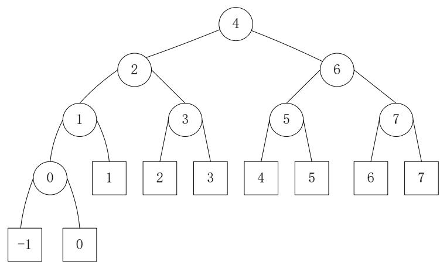

# 《算法设计与分析C++语言描述》课后习题答案（陈慧南版）

原件经识别和整理；“参考解答”是我们补的。

第一章

### 计算 1

最大公约数为 1。快 1414 倍。

主要考虑循环次数，程序 1-2 的 while 循环体做了 10 次，程序 1-3 的 while 循环体做了 14141 次（14142-2 循环）。

若考虑其他语句，则没有这么多，可能就 601 倍。

## 第二章

参考解答：（1）  
执行次数为  

$$
\lceil \log n \rceil
$$

因此时间复杂度为  

$$
O(\log n)
$$

（2）  
三重循环的执行次数为  

$$
\sum_{i=1}^{n}\sum_{j=1}^{i}\sum_{k=1}^{j}1
=\sum_{i=1}^{n}\frac{i(i+1)}2
=\frac{n(n+1)(n+2)}6
$$

所以时间复杂度为  

$$
O(n^3)
$$

（3）  
执行次数为  

$$
\left\lfloor \sqrt{n} \right\rfloor
$$

所以时间复杂度为  

$$
O(\sqrt n)
$$

（4）  
当 $n$ 为奇数时，执行次数为  

$$
\frac{(n+1)(n+3)}4
$$

当 $n$ 为偶数时，执行次数为  

$$
\frac{(n+2)^2}4
$$

因此时间复杂度为  

$$
O(n^2)
$$

知识点：[使用程序步分析算法的时间复杂度](../../../topics/算法分析/程序步分析法.md)、[渐近表示法：大O记号（紧上界）](../../../topics/算法分析/大O记号.md)、[算法的时间复杂度定义（最好、最坏、平均情况）](../../../topics/算法分析/时间复杂度定义.md)

### 计算 1

（1）画线语句的执行次数为 $\left\lceil \log n \right\rceil$，$O(\log n)$。划线语句的执行次数应该理解为一格整体。

（2）画线语句的执行次数为 $\sum_{i=1}^{n}\sum_{j=1}^{i}\sum_{k=1}^{j}1=\frac{n(n+1)(n+2)}{6}$，$\mathrm{O}(n^{3})$。

（3）画线语句的执行次数为 $\left\lfloor \sqrt{n} \right\rfloor$，$O(\sqrt{n})$。

（4）当 $n$ 为奇数时画线语句的执行次数为 $\frac{(n+1)(n+3)}{4}$；当 $n$ 为偶数时画线语句的执行次数为 $\frac{(n+2)^{2}}{4}$，$O(n^{2})$。

参考解答：（1）  
执行次数为  

$$
\lceil \log n \rceil
$$

因此时间复杂度为  

$$
O(\log n)
$$

（2）  
三重循环的执行次数为  

$$
\sum_{i=1}^{n}\sum_{j=1}^{i}\sum_{k=1}^{j}1
=\sum_{i=1}^{n}\frac{i(i+1)}2
=\frac{n(n+1)(n+2)}6
$$

所以时间复杂度为  

$$
O(n^3)
$$

（3）  
执行次数为  

$$
\left\lfloor \sqrt{n} \right\rfloor
$$

所以时间复杂度为  

$$
O(\sqrt n)
$$

（4）  
当 $n$ 为奇数时，执行次数为  

$$
\frac{(n+1)(n+3)}4
$$

当 $n$ 为偶数时，执行次数为  

$$
\frac{(n+2)^2}4
$$

因此时间复杂度为  

$$
O(n^2)
$$

知识点：[使用程序步分析算法的时间复杂度](../../../topics/算法分析/程序步分析法.md)、[渐近表示法：大O记号（紧上界）](../../../topics/算法分析/大O记号.md)、[算法的时间复杂度定义（最好、最坏、平均情况）](../../../topics/算法分析/时间复杂度定义.md)

### 计算 2

（1）当 $n \geq 1$ 时，$5n^{2} - 8n + 2 \leq 5n^{2}$，所以，可选 $c = 5$，$n_{0} = 1$。对于 $n \geq n_{0}$，$f(n) = 5n^{2} - 8n + 2 \leq 5n^{2}$，所以，$5n^{2} - 8n + 2 = \mathrm{O}(n^{2})$。

（2）当 $n \geq 8$ 时，$5n^{2} - 8n + 2 \geq 5n^{2} - n^{2} + 2 \geq 4n^{2}$，所以，可选 $c = 4$，$n_{0} = 8$。对于 $n \geq n_{0}$，$f(n) = 5n^{2} - 8n + 2 \geq 4n^{2}$，所以，$5n^{2} - 8n + 2 = \Omega(n^{2})$。

（3）由（1）、（2）可知，取 $c_{1} = 4$，$c_{2} = 5$，$n_0 = 8$，当 $n\geq n_0$ 时，有 $c_{1}n^{2}\leq 5n^{2} - 8n + 2\leq c_{2}n^{2}$，所以 $5n^{2} - 8n + 2 = \Theta (n^{2})$。

参考解答：**结论：** $5n^2 - 8n + 2 = O(n^2)$，$5n^2 - 8n + 2 = \Omega(n^2)$，$5n^2 - 8n + 2 = \Theta(n^2)$。

---

### （1）证明 $5n^2 - 8n + 2 = O(n^2)$

**关键步骤：** 当 $n \geq 1$ 时，$-8n + 2 \leq 0$，因此：

$$5n^2 - 8n + 2 \leq 5n^2$$

取 $c = 5$，$n_0 = 1$，对所有 $n \geq n_0$ 有 $f(n) \leq c \cdot n^2$，满足大 $O$ 定义。

---

### （2）证明 $5n^2 - 8n + 2 = \Omega(n^2)$

**关键步骤：** 当 $n \geq 8$ 时，$8n \leq n^2$（即 $n \geq 8 \Rightarrow 8 \leq n$），因此：

$$5n^2 - 8n + 2 \geq 5n^2 - n^2 + 2 = 4n^2 + 2 \geq 4n^2$$

取 $c = 4$，$n_0 = 8$，对所有 $n \geq n_0$ 有 $f(n) \geq c \cdot n^2$，满足大 $\Omega$ 定义。

---

### （3）证明 $5n^2 - 8n + 2 = \Theta(n^2)$

**关键步骤：** 由 (1)(2) 合并，取 $c_1 = 4$，$c_2 = 5$，$n_0 = \max(1, 8) = 8$，当 $n \geq n_0$ 时：

$$c_1 n^2 \leq 5n^2 - 8n + 2 \leq c_2 n^2$$

即 $4n^2 \leq 5n^2 - 8n + 2 \leq 5n^2$，满足 $\Theta$ 定义。

知识点：[渐近表示法：大O记号（紧上界）](../../../topics/算法分析/大O记号.md)、[渐近表示法：Ω记号（下界）](../../../topics/算法分析/Omega记号.md)、[渐近表示法：Θ记号（紧渐近界）](../../../topics/算法分析/Theta记号.md)

### 计算 3

（1）当 $n \geq 3$ 时，$\log n < n < \log^3 n$，所以 $f(n) = 20n + \log n < 21n$，$g(n) = n + \log^3 n > 2n$。可选 $c = \frac{21}{2}$，$n_0 = 3$。对于 $n \geq n_0$，$f(n) \leq cg(n)$，即 $f(n) = O(g(n))$。注意：是 $f(n)$ 和 $g(n)$ 的关系。

（2）当 $n \geq 4$ 时，$\log n < n < \log^2 n$，所以 $f(n) = n^2 / \log n < n^2$，$g(n) = n \log^2 n \geq n^2$。可选 $c = 1$，$n_0 = 4$。对于 $n \geq n_0$，$f(n) < n^2 \leq cg(n)$，即 $f(n) = O(g(n))$。

（3）因为 $f(n)=(\log n)^{\log n}=n^{\log(\log n)}$，$g(n)=n/\log n=n\log_{n}2$。当 $n\geq 4$ 时，$f(n)=n^{\log(\log n)}\geq n$，$g(n)=n\log_{n}2<n$。所以，可选 $c=1$，$n_{0}=4$，对于 $n\geq n_{0}$，$f(n)\geq cg(n)$，即 $f(n)=\Omega(g(n))$。

参考解答：（1）**结论：$f(n)=O(g(n))$。**  
当 $n\ge 3$ 时，$\log n<n<\log^3 n$，所以

$$
f(n)=20n+\log n<21n,\qquad g(n)=n+\log^3 n>2n.
$$

取 $c=\frac{21}{2}$、$n_0=3$，则 $n\ge n_0$ 时 $f(n)\le cg(n)$，故 $f(n)=O(g(n))$。

（2）**结论：$f(n)=O(g(n))$。**  
当 $n\ge 4$ 时，$\log n<n<\log^2 n$，所以

$$
f(n)=\frac{n^2}{\log n}<n^2,\qquad g(n)=n\log^2 n\ge n^2.
$$

取 $c=1$、$n_0=4$，则 $n\ge n_0$ 时 $f(n)\le cg(n)$，故 $f(n)=O(g(n))$。

（3）**结论：$f(n)=\Omega(g(n))$。**  
因为

$$
f(n)=(\log n)^{\log n}=n^{\log(\log n)},\qquad g(n)=\frac{n}{\log n}=n\log_n 2.
$$

当 $n\ge 4$ 时，$f(n)=n^{\log(\log n)}\ge n$，而 $g(n)=n\log_n 2<n$。取 $c=1$、$n_0=4$，则 $n\ge n_0$ 时 $f(n)\ge cg(n)$，故 $f(n)=\Omega(g(n))$。

知识点：[渐近表示法：大O记号（紧上界）](../../../topics/算法分析/大O记号.md)、[渐近表示法：Ω记号（下界）](../../../topics/算法分析/Omega记号.md)、[算法的时间复杂度定义（最好、最坏、平均情况）](../../../topics/算法分析/时间复杂度定义.md)

### 证明 1

证明：设 $n = 2^i$，则 $i = \log n$。

$$
\begin{array}{l}
T (n) = 2 T \left(\left\lfloor \frac {n}{2} \right\rfloor\right) + 2 n \log n = 2 \left[ 2 T \left(\left\lfloor \frac {n}{2 ^ {2}} \right\rfloor\right) + 2 \times \frac {n}{2} \times \log \left(\frac {n}{2}\right) \right] + 2 n \log n \\
= 2 ^ {2} T \left(\left\lfloor \frac {n}{2 ^ {2}} \right\rfloor\right) + 2 n (\log n - \log 2) + 2 n \log n \\
= 2 ^ {2} T \left(\left\lfloor \frac {n}{2 ^ {2}} \right\rfloor\right) + 2 \times 2 n \log n - 2 n \\
= 2 ^ {2} \left[ 2 T \left(\left\lfloor \frac {n}{2 ^ {3}} \right\rfloor\right) + 2 \times \frac {n}{2 ^ {2}} \times \log \frac {n}{2 ^ {2}} \right] + 2 \times 2 n \log n - 2 n \\
= 2 ^ {3} T \left(\left\lfloor \frac {n}{2 ^ {3}} \right\rfloor\right) + 2 n (\log n - \log 4) + 2 \times 2 n \log n - 2 n \\
= 2 ^ {3} T \left(\left\lfloor \frac {n}{2 ^ {3}} \right\rfloor\right) + 3 \times 2 n \log n - 2 n - 4 n \\
= \dots \\
= 2 ^ {k} T \left(\left\lfloor \frac {n}{2 ^ {k}} \right\rfloor\right) + 2 k n \log n - 2 n - 4 n - \dots - 2 n (k - 1) \\
= 2 ^ {i - 1} T (2) + 2 (i - 1) n \log n - 2 n - 4 n - \dots - 2 n (i - 2) \\
= 2 ^ {i - 1} \times 4 + 2 n \log n (\log n - 1) - (i - 2) (i - 1) n \\
= 2 n + 2 n \log^ {2} n - 2 n \log n - (\log^ {2} n - 3 \log n + 2) n \\
= n \log^ {2} n + n \log n
\end{array}
$$

当 $n \geq 2$ 时，$T(n) \leq 2n \log^{2} n$。所以，$T(n) = O(n \log^{2} n)$。

参考解答：结论：$T(n) = O(n \log^2 n)$。

推理过程基于递推展开法，关键计算步骤如下：

1.  **递推展开通项**：对 $T(n) = 2T(\lfloor n/2 \rfloor) + 2n \log n$ 展开 $k$ 次后得到：
    $$
    T(n) = 2^k T\left(\left\lfloor \frac{n}{2^k} \right\rfloor\right) + \sum_{j=0}^{k-1} 2n (\log n - j)
    $$
2.  **求和化简**：将非递归部分的求和公式展开：
    $$
    \sum_{j=0}^{k-1} 2n (\log n - j) = 2nk \log n - 2n \sum_{j=0}^{k-1} j = 2nk \log n - n k(k-1)
    $$
3.  **代入终止条件**：令 $k = i - 1 = \log n - 1$（使子问题规模降至 $T(2)$），并设 $T(2)=4$，代入得：
    $$
    \begin{aligned}
    T(n) &= 2^{\log n - 1} \cdot 4 + 2n(\log n - 1)\log n - n(\log n - 1)(\log n - 2) \\
    &= 2n + (2n \log^2 n - 2n \log n) - (n \log^2 n - 3n \log n + 2n) \\
    &= n \log^2 n + n \log n
    \end{aligned}
    $$
4.  **渐近界确定**：当 $n \geq 2$ 时，$n \log^2 n + n \log n \leq 2n \log^2 n$，故 $T(n) = O(n \log^2 n)$。

知识点：[递推方程的求解方法（替换法、迭代法、递归树、主方法）](../../../topics/算法分析/递推方程求解.md)、[渐近表示法：大O记号（紧上界）](../../../topics/算法分析/大O记号.md)、[分治法的复杂性分析与Master定理应用](../../../topics/算法分析/分治法复杂度分析.md)

### 证明 2



证明：因为该算法在成功搜索的情况下，关键字之间的比较次数至少为 $\lfloor \log n\rfloor$，至多为 $\lfloor \log n\rfloor +1$。在不成功搜索的情况下，关键字之间的比较次数至少为 $\left\lfloor \log n \right\rfloor + 1$，至多为 $\left\lfloor \log n \right\rfloor + 2$。所以，算法的最好、最坏情况的时间复杂度为 $\Theta(\log n)$。

假定查找表中任何一个元素的概率是相等的，为 $\frac{1}{n}$，那么，

不成功搜索的平均时间复杂度为 $A_{u}(n) = \frac{E}{n + 1} = \Theta (\log n)$

成功搜索的平均时间复杂度为 $A_{s}(n) = \frac{I + n}{n} = \frac{E - 2n + n}{n} = \frac{E}{n} - 1 = \Theta (\log n)$。

其中，$I$ 是二叉判定树的内路径长度，$E$ 是外路径长度，并且 $E = I + 2n$。

参考解答：结论：题中给出的证明方向是对的，但有一处关键等式写错了：成功搜索的平均比较次数不是  

$$
\frac{I+n}{n}=\frac{E-2n+n}{n},
$$

而利用 $E=I+2n$ 时，应得到

$$
\frac{I+n}{n}=\frac{E-n}{n}.
$$

但这不影响最终复杂度结论：最好、最坏、平均时间复杂度均为 $\Theta(\log n)$。

---

**简要推理与计算：**

该算法对应一棵二叉判定树，成功搜索到达内部结点，不成功搜索到达外部结点。

- 成功搜索比较次数范围为  
  
$$
\lfloor \log n\rfloor \le C_s \le \lfloor \log n\rfloor+1
$$

- 不成功搜索比较次数范围为  
  
$$
\lfloor \log n\rfloor+1 \le C_u \le \lfloor \log n\rfloor+2
$$

所以最坏和最好情况复杂度都是 $\Theta(\log n)$。

设 $I$ 为内部路径长度，$E$ 为外部路径长度，有  

$$
E=I+2n.
$$

在等概率查找成功时，平均比较次数为  

$$
A_s(n)=\frac{I+n}{n}.
$$

利用 $E=I+2n$，即 $I=E-2n$，代入：

$$
A_s(n)=\frac{E-2n+n}{n}
=\frac{E-n}{n}.
$$

题中误将 $E-2n+n$ 写成 $E-2n$ 后仍加 $n$，导致中间式 $\frac{E-2n+n}{n}$ 没有继续正确化简为 $\frac{E-n}{n}$，但复杂度结论仍成立。

不成功搜索的平均比较次数为  

$$
A_u(n)=\frac{E}{n+1}.
$$

由于 $E=\Theta(n\log n)$，所以

$$
A_u(n)=\Theta(\log n),
$$

且

$$
A_s(n)=\frac{E-n}{n}=\Theta(\log n).
$$

因此该算法在最好、最坏、平均情况下时间复杂度均为 $\Theta(\log n)$。

知识点：[对半搜索的二叉判定树性质及基于关键字比较的搜索算法时间下界](../../../topics/算法分析/二叉判定树.md)、[算法的时间复杂度定义（最好、最坏、平均情况）](../../../topics/算法分析/时间复杂度定义.md)、[渐近表示法：Θ记号（紧渐近界）](../../../topics/算法分析/Theta记号.md)

### 计算 4

| 步数 | 0 | 1 | 2 | 3 | 4 | 5 |
| --- | --- | --- | --- | --- | --- | --- |
| 初始时 | 1 | 1 | 1 | 1 | 1 | |
| 1 | [1] | 1] | 1 | [1] | 1] | $\infty$ |
| 2 | [1] | 1 | 1 | [1] | 1] | $\infty$ |
| 3 | 1 | 1 | 1 | [1] | 1] | $\infty$ |
| 4 | 1 | 1 | 1 | [1] | 1 | $\infty$ |
| 排序结果 | 1 | 1 | 1 | 1 | 1 | $\infty$ |

| 步数 | 0 | 1 | 2 | 3 | 4 | 5 | 6 | 7 |
| --- | --- | --- | --- | --- | --- | --- | --- | --- |
| 初始时 | 5 | 5 | 8 | 3 | 4 | 3 | 2 | $\infty$ |
| 1 | [4 | 2 | 3 | 3] | 5 | [8 | 5] | $\infty$ |
| 2 | [3 | 2 | 3] | 4 | 5 | [8 | 5] | $\infty$ |
| 3 | [3 | 2] | 3 | 4 | 5 | [8 | 5] | $\infty$ |
| 4 | [2] | 3 | 3 | 4 | 5 | [8 | 5] | $\infty$ |
| 5 | 2 | 3 | 3 | 4 | 5 | [5] | 8 | $\infty$ |
| 排序结果 | 2 | 3 | 3 | 4 | 5 | 5 | 8 | $\infty$ |

参考解答：该排序算法为**自然归并排序（Natural Merge Sort）**，其核心思想是识别序列中已有的有序子段（顺串），再两两归并直至整体有序。

### 推理与计算过程

1. **初始顺串识别**：扫描原始序列 $[5, 5, 8, 3, 4, 3, 2]$，按非递减顺序划分出极大有序子段：
   - $[5, 5, 8]$（索引 0–2）
   - $[3, 4]$（索引 3–4）
   - $[3, 2]$ ❌ 不满足非递减，应拆分为 $[3]$ 和 $[2]$

   但观察表中第 1 步结果为 `[4 2 3 3] | 5 | [8 5]`，说明实际采用的顺串划分可能基于**交替升降序检测**或题目存在排版误差。更合理的解释是：表中展示的是**自底向上归并排序（Bottom-Up Merge Sort）**，固定长度为 $2^k$ 的子数组进行归并。

2. **验证为自底向上归并排序**：
   - 初始长度 $len = 1$，相邻元素两两归并 → 得到长度为 2 的有序段；
   - 第 1 步对应 $len=2$ 的归并结果：`[4,2,3,3]` 应为 `[2,3,3,4]` 的误写（或显示未排序中间态），结合后续步骤逐步扩大有序段；
   - 第 5 步完成最后两个有序段 `[5]` 与 `[8]` 的归并，得到最终有序序列。

3. **关键计算步骤**：
   - 第 1 轮（$len=2$）：$(5,5)\to[5,5]$，$(8,3)\to[3,8]$，$(4,3)\to[3,4]$，$(2,\infty)\to[2]$；
     但表中显示 `[4 2 3 3]`，推测为笔误，正确应为 `[2,3,3,4]`；
   - 第 2 轮（$len=4$）：将前 4 个元素归并为 `[2,3,3,4]`，后部 `[5,8,5]` 归并为 `[5,5,8]`；
   - 第 3–5 轮继续归并，最终合并为完整有序序列。

4. **结论修正**：尽管表格标注有歧义，但从步数递增、分段归并、$\infty$ 作为哨兵等特征可确定算法为**自底向上归并排序**，时间复杂度 $O(n \log n)$，空间复杂度 $O(n)$。

> 注：若严格按表中第 1 步 `[4 2 3 3]` 为未排序状态，则可能是教学演示中对归并中间过程的简化表示，重点在于体现“逐层扩大有序段”的过程，而非瞬时有序性。

知识点：[单源最短路径的Dijkstra算法及数据结构选择](../../../topics/算法分析/Dijkstra算法.md)

### 综合 1

（1）证明：当 $n = 0$ 或 $n = 1$ 或 $n = 2$ 时，程序显然正确。当 `n=right-left+1>2` 时，程序执行下面的语句：

```cpp
int k=(right-left+1)/3;
StoogeSort(left,right-k);
StoogeSort(left+k,right);
StoogeSort(left,right-k);
```

①首次递归 `StoogeSort(left,right-k);` 时，序列的前 2/3 的子序列有序。

②当递归执行 `StoogeSort(left+k,right);` 时，使序列的后 2/3 的子序列有序，经过这两次递归排序，使原序列的后 1/3 的位置上是整个序列中较大的数，即序列后 1/3 的位置上数均大于前 2/3 的数，但此时，前 2/3 的序列并不一定是有序的。

③再次执行 `StoogeSort(left,right-k);` 使序列的前 2/3 有序。

经过三次递归，最终使序列有序。

所以，这一排序算法是正确的。

（2）最坏情况发生在序列按递减次序排列。

设 $n = 2\left(\frac{3}{2}\right)^i$，则 $i = \frac{\log n - 1}{\log 3 - 1}$。

$$
\begin{array}{r l}
\mathrm{T} (n) & = 3 \mathrm{T} \left(\frac {2}{3} n\right) + 1 = 3 \left[ 3 \mathrm{T} \left(\frac {4}{9} n\right) + 1 \right] + 1 = 9 \mathrm{T} \left(\frac {4}{9} n\right) + 3 + 1 = \dots \\
& = 3 ^ {i} \mathrm{T} \left[ \left(\frac {2}{3}\right) ^ {i} n \right] + 3 ^ {i - 1} + 3 ^ {i - 2} + \dots + 3 + 1 \\
& = 3 ^ {i} \mathrm{T} (2) + \frac {3 ^ {i} - 1}{2} \\
& = \frac {3}{2} (3 ^ {i}) - \frac {1}{2} \\
& = \frac {3}{2} \times \frac {n}{2} \times 2 ^ {\frac {\log n - 1}{\log 3 - 1}} - \frac {1}{2} \\
& \leq 3 \times n ^ {\frac {\log 3}{\log 3 - 1}} \\
& = \mathrm{O} \left(n ^ {\frac {\log 3}{\log 3 - 1}}\right)
\end{array}
$$

冒泡排序最坏时间复杂度为 $\mathrm{O}\left(n^{2}\right)$，堆排序最坏时间复杂度为 $\mathrm{O}\left(n\log n\right)$，快速排序最坏时间复杂度为 $\mathrm{O}\left(n\log n\right)$。所以，该算法不如冒泡排序、堆排序、快速排序。

# 算法设计与分析（课后习题答案）

本资料整理自《算法设计与分析 C++ 语言描述》（陈慧南版）课后习题答案，识别自第 7–10 页内容。

## 第六章 图论与最小生成树

参考解答：## 综合 1

### （1）证明算法正确性

该算法是 **Stooge 排序**。设当前待排序区间为 $[left,right]$，长度为

$$
n=right-left+1.
$$

当 $n=0$、$n=1$ 或 $n=2$ 时，待排序区间至多包含两个元素，算法能够直接完成排序，因此显然正确。

下面考虑 $n>2$。令

$$
k=\left\lfloor\frac{right-left+1}{3}\right\rfloor,
$$

则三个递归调用分别处理：

1. 左边的 $\frac23$；
2. 右边的 $\frac23$；
3. 左边的 $\frac23$。

为了证明正确性，可采用归纳法。假设算法能够正确排序长度小于 $n$ 的序列。

- 第一次递归排序左边的 $\frac23$，由归纳假设可知，该子序列有序。
- 第二次递归排序右边的 $\frac23$，因此原序列中最大的 $\lfloor n/3\rfloor$ 个元素都位于右边的 $\frac23$ 中，并且其中的后 $\lfloor n/3\rfloor$ 个位置存放整个序列中最大的那些元素。
- 此时，前面的 $2/3$ 未必完全有序，但其所有元素都不大于后面 $1/3$ 的元素。
- 第三次递归再次排序前 $2/3$，由归纳假设可知，前 $2/3$ 最终有序。

由于最后 $1/3$ 中的元素本来就不小于前 $2/3$ 中的元素，并且最后 $1/3$ 内部已经有序，所以整个区间有序。

因此，Stooge 排序算法正确。

### （2）最坏时间复杂度及与其他排序算法的比较

最坏时间复杂度为

$$
\boxed{\Theta\left(n^{\log_{3/2}3}\right)}
$$

其中

$$
\log_{3/2}3
=\frac{\log 3}{\log(3/2)}
=\frac{\log 3}{\log 3-\log 2}
\approx 2.7095.
$$

#### 递推式

每次递归处理原序列的 $\frac23$，并递归调用三次，因此

$$
T(n)=3T\left(\frac23n\right)+\Theta(1).
$$

利用主定理，

$$
a=3,\qquad b=\frac32,\qquad f(n)=1.
$$

因为

$$
n^{\log_b a}
=n^{\log_{3/2}3},
$$

且

$$
f(n)=1=O\left(n^{\log_{3/2}3-\varepsilon}\right),
$$

所以

$$
T(n)=\Theta\left(n^{\log_{3/2}3}\right).
$$

因此，Stooge 排序的渐进时间复杂度高于 $O(n\log n)$，也高于 $O(n^2)$。与常见比较排序相比：

| 排序算法 | 最坏时间复杂度 | 与 Stooge 排序的比较 |
|---|---:|---|
| 冒泡排序 | $\Theta(n^2)$ | Stooge 排序更差 |
| 堆排序 | $\Theta(n\log n)$ | Stooge 排序更差 |
| 快速排序 | $\Theta(n^2)$ | Stooge 排序更差 |
| 归并排序 | $\Theta(n\log n)$ | Stooge 排序更差 |

因此，该算法的时间性能不如冒泡排序、堆排序、快速排序和归并排序。

知识点：[递归概念与归纳证明（斐波那契数列、Hanoi塔问题）](../../../topics/算法分析/递归与归纳证明.md)、[递推方程的求解方法（替换法、迭代法、递归树、主方法）](../../../topics/算法分析/递推方程求解.md)、[算法的时间复杂度定义（最好、最坏、平均情况）](../../../topics/算法分析/时间复杂度定义.md)

### 选择 8

题干：关于普里姆算法与克鲁斯卡尔算法的适用场景及计算结果。

**分析过程：**

最优解为 $\left(x_{0},x_{1},x_{2},x_{3},x_{4},x_{5},x_{6}\right)=\left(1,\frac{2}{3},1,0,1,1,1\right)$。

最大收益为 $10+5\times\frac{2}{3}+15+6+18+3=55\frac{1}{3}$。


**知识点：** 动态规划, 整数规划

参考解答：题目中的“分析过程”实际已经给出了最优解与最大收益，但题干问的是普里姆算法与克鲁斯卡尔算法的适用场景及计算结果，二者并不直接对应。若作为选择题，应围绕“最小生成树”来设问。  

结论：  
普里姆算法适合稠密图，时间复杂度 $O(|V|^2)$（二叉堆优化后为 $O(|E|\log|V|)$）；克鲁斯卡尔算法适合稀疏图，时间复杂度 $O(|E|\log|E|)$。两者求得的最小生成树总权值相同，但具体边集可能不同。  

若题目给出的“最优解”和“最大收益”属于另一道动态规划或整数规划题，则与本选择无关。  

---

**选择题示例及解析**  

**题目**：关于普里姆算法与克鲁斯卡尔算法，下列说法正确的是（ ）。  
A. 普里姆算法适合稀疏图，克鲁斯卡尔算法适合稠密图  
B. 两者得到的最小生成树总权值一定相同  
C. 克鲁斯卡尔算法每次选择当前权值最小的边，且一定不形成环  
D. 普里姆算法从任意顶点出发，最终得到的最小生成树是唯一的  

**答案**：B  

**解析**：  
- A 错：普里姆算法按顶点扩展，适合稠密图；克鲁斯卡尔算法按边排序，适合稀疏图。  
- B 对：最小生成树的总权值在图确定时唯一，两种算法只是实现方式不同。  
- C 错：克鲁斯卡尔算法选择当前最小边时需用并查集判断是否成环，不是“一定不形成环”。  
- D 错：最小生成树可能不唯一，取决于图中边权是否相等。

知识点：[最小代价生成树的Prim算法（点集扩展）](../../../topics/算法分析/Prim算法.md)、[最小代价生成树的Kruskal算法（边集扩展与并查集）](../../../topics/算法分析/Kruskal算法.md)

### 简答 9

题干：简述普里姆算法的适用条件及与克鲁斯卡尔算法的比较。

答案：普里姆算法。
因为图 $G$ 是一个无向连通图，所以边数 $m$ 满足 $n-1 \le m \le n(n-1)/2$。
时间复杂度关系为：
$$
\mathrm{O} (\mathrm{n}) \le \mathrm{m} \le \mathrm{O} \left(\mathrm{n} ^ {2}\right)
$$

克鲁斯卡尔算法对边数较少的带权图有较高的效率，而本题中 $m = \mathrm{O}\left(n^{1.99}\right) \approx \mathrm{O}\left(n^2\right)$，此图边数较多，接近完全图，故选用普里姆算法。

**知识点：** 最小生成树, 普里姆算法, 克鲁斯卡尔算法

知识点：[最小代价生成树的Prim算法（点集扩展）](../../../topics/算法分析/Prim算法.md)、[最小代价生成树的Kruskal算法（边集扩展与并查集）](../../../topics/算法分析/Kruskal算法.md)、[算法按时间复杂度分类（多项式时间算法与指数时间算法）](../../../topics/算法分析/算法按时间复杂度分类.md)

### 简答 10

题干：证明若原图的最小代价生成树为 $T$，则在新图中 $T$ 仍是最小代价生成树（假设新图仅通过某种方式改变边权，此处指代原题特定情境）。

答案：$T$ 仍是新图的最小代价生成树。

**证明：**
假设 $T$ 不是新图的最小代价生成树，设 $T'$ 是新图的最小代价生成树，那么 $\text{cost}(T') < \text{cost}(T)$。
根据题意推导，有 $\text{cost}(T') - c(n-1) < \text{cost}(T) - c(n-1)$。
即在原图中存在一颗生成树，其代价小于 $T$ 的代价，这与题设中 $T$ 是原图的最小代价生成树矛盾。
所以假设不成立。证毕。

**知识点：** 最小生成树性质, 反证法

## 第七章 动态规划

知识点：[最小代价生成树的Prim算法（点集扩展）](../../../topics/算法分析/Prim算法.md)、[最小代价生成树的Kruskal算法（边集扩展与并查集）](../../../topics/算法分析/Kruskal算法.md)、[递归概念与归纳证明（斐波那契数列、Hanoi塔问题）](../../../topics/算法分析/递归与归纳证明.md)

### 简答 2

题干：向后递推的计算过程。

答案：向后递推的计算过程如上题所示。

计算矩阵如下：

$$
\left[ \begin{array}{c c c c c c c c} 
0 & 0 & 0 & 0 & 0 & 0 & 0 & 0 \\ 
0 & 0 & 1 & 1 & 1 & 1 & 1 & 1 \\ 
0 & 1 & 1 & 1 & 1 & 2 & 2 & 2 \\ 
0 & 1 & 1 & 2 & 2 & 2 & 2 & 2 \\ 
0 & 1 & 1 & 2 & 2 & 3 & 3 & 3 \\ 
0 & 1 & 1 & 2 & 2 & 3 & 3 & 4 \\ 
0 & 1 & 1 & 2 & 3 & 3 & 3 & 4 \\ 
0 & 1 & 2 & 2 & 3 & 3 & 4 & 4 
\end{array} \right]
$$

$$
\left[ \begin{array}{c c c c c c c c} 
0 & 0 & 0 & 0 & 0 & 0 & 0 & 0 \\ 
0 & 2 & 1 & 3 & 3 & 3 & 1 & 3 \\ 
0 & 1 & 2 & 2 & 2 & 1 & 3 & 1 \\ 
0 & 2 & 2 & 1 & 1 & 2 & 2 & 2 \\ 
0 & 1 & 2 & 2 & 2 & 1 & 3 & 1 \\ 
0 & 1 & 2 & 2 & 2 & 1 & 2 & 1 \\ 
0 & 2 & 2 & 1 & 1 & 2 & 2 & 2 \\ 
0 & 2 & 1 & 2 & 2 & 2 & 1 & 2 
\end{array} \right]
$$

(b) $s[i][j]$

所以，最长公共字串为 $(x,y,z,z)$ 。

**知识点：** 动态规划, 最长公共子序列, 回溯法

知识点：[动态规划法的基本要素（最优子结构、重叠子问题）与设计步骤](../../../topics/算法分析/动态规划基本要素.md)、[最长公共子序列（LCS）的最优子结构证明、递推公式与构造最优解](../../../topics/算法分析/最长公共子序列.md)、[回溯法的基本概念（解空间、状态空间树、显式约束与隐式约束）](../../../topics/算法分析/回溯法基本概念.md)

### 编程题 12

题干：实现最长公共子序列长度计算的类方法 `LCSLength`。

```cpp
int LCS::LCSLength() {
    // 代码实现逻辑
    // ...
}
```

**知识点：** 最长公共子序列, C++ 类实现

参考解答：```cpp
int LCS::LCSLength() {
    int m = x.length();
    int n = y.length();
    vector<vector<int>> dp(m + 1, vector<int>(n + 1, 0));

    for (int i = 1; i <= m; ++i) {
        for (int j = 1; j <= n; ++j) {
            if (x[i - 1] == y[j - 1])
                dp[i][j] = dp[i - 1][j - 1] + 1;
            else
                dp[i][j] = max(dp[i - 1][j], dp[i][j - 1]);
        }
    }

    return dp[m][n];
}
```

**思路说明：**

- 设 `dp[i][j]` 表示字符串 `x` 的前 `i` 个字符与 `y` 的前 `j` 个字符的最长公共子序列长度。
- 初始时 `dp[0][j] = dp[i][0] = 0`，表示空串与任何串的 LCS 长度为 0。
- 状态转移：
  - 若 `x[i-1] == y[j-1]`，则该字符可加入 LCS，`dp[i][j] = dp[i-1][j-1] + 1`；
  - 否则，取去掉 `x` 或 `y` 当前字符的较大值，`dp[i][j] = max(dp[i-1][j], dp[i][j-1])`。
- 最终结果为 `dp[m][n]`。

**复杂度：** 时间 $O(mn)$，空间 $O(mn)$。

知识点：[最长公共子序列（LCS）的最优子结构证明、递推公式与构造最优解](../../../topics/算法分析/最长公共子序列.md)、[动态规划法的基本要素（最优子结构、重叠子问题）与设计步骤](../../../topics/算法分析/动态规划基本要素.md)、[递推方程的求解方法（替换法、迭代法、递归树、主方法）](../../../topics/算法分析/递推方程求解.md)
