# 《算法设计与分析》第9章 分枝限界法（课件）

原件的每一页，下面附识别出的文字。

### 算法设计与分析

原文：

Nanjing University of Posts & Telecommunications

算法设计与分析

### 第9章 分枝限界法

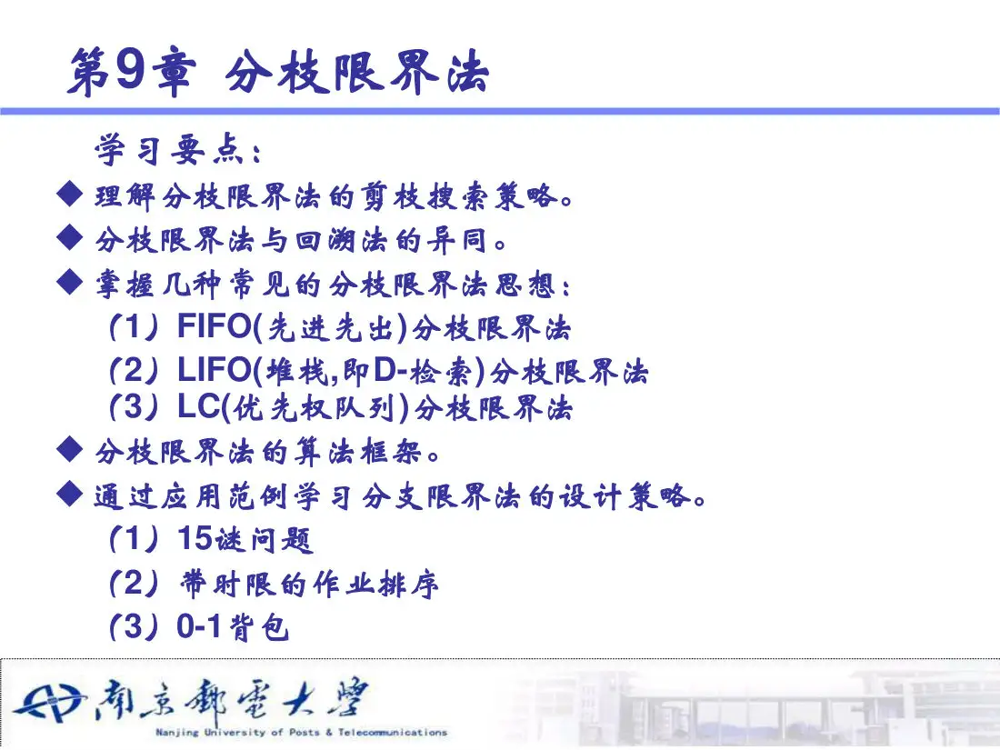

原文：

第9章 分枝限界法

学习要点：

◆理解分枝限界法的剪枝搜索策略。

◆分枝限界法与回溯法的异同。

◆掌握几种常见的分枝限界法思想：

（1）FIFO(先进先出)分枝限界法

（2）LIFO(堆栈,即D-检索)分枝限界法

（3）LC(优先权队列)分枝限界法

◆分枝限界法的算法框架。

◆通过应用范例学习分支限界法的设计策略。

（1）15谜问题

（2）带时限的作业排序

（3）0-1背包

安南京郵電大学

### ◆章节内容:

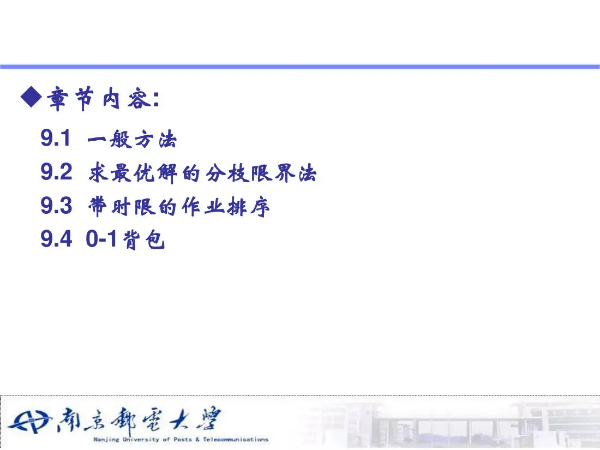

原文：

◆章节内容:
9.1 一般方法
9.2 求最优解的分枝限界法
9.3 带时限的作业排序
9.4 0-1背包

安南京郵電大学 Nanjing University of Posts & Telecommunications

### 生成问题状态的基本方法

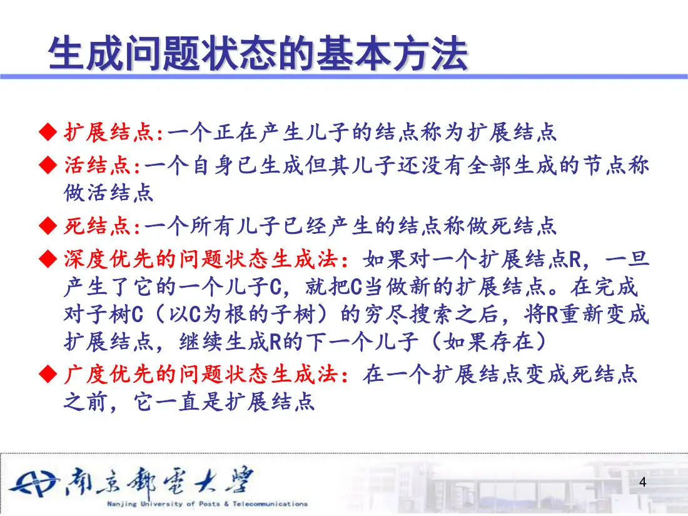

原文：

生成问题状态的基本方法

◆扩展结点:一个正在产生儿子的结点称为扩展结点

◆活结点:一个自身已生成但其儿子还没有全部生成的节点称做活结点

◆死结点:一个所有儿子已经产生的结点称做死结点

深度优先的问题状态生成法：如果对一个扩展结点R，一旦产生了它的一个儿子C，就把C当做新的扩展结点。在完成对子树C（以C为根的子树）的穷尽搜索之后，将R重新变成扩展结点，继续生成R的下一个儿子（如果存在）

◆广度优先的问题状态生成法：在一个扩展结点变成死结点之前，它一直是扩展结点

安南京郵電大学 Nanjing University of Posts & Telecommunications

4

### 9.1 分支限界法的一般方法

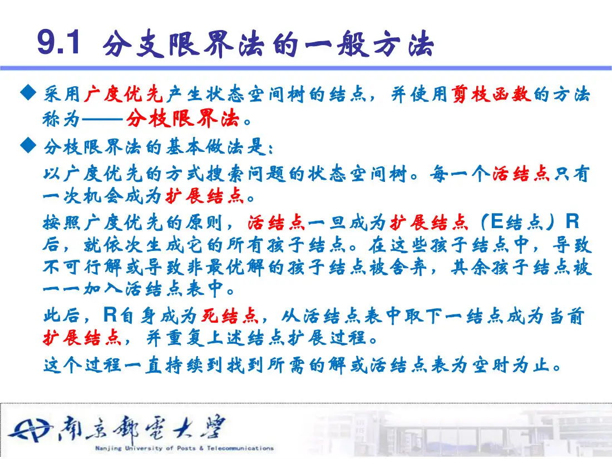

原文：

9.1 分支限界法的一般方法

◆采用广度优先产生状态空间树的结点，并使用剪枝函数的方法称为——分枝限界法。

◆分枝限界法的基本做法是：

以广度优先的方式搜索问题的状态空间树。每一个活结点只有一次机会成为扩展结点。

按照广度优先的原则，活结点一旦成为扩展结点（E结点）R后，就依次生成它的所有孩子结点。在这些孩子结点中，导致不可行解或导致非最优解的孩子结点被舍弃，其余孩子结点被一一加入活结点表中。

此后，R自身成为死结点，从活结点表中取下一结点成为当前扩展结点，并重复上述结点扩展过程。

这个过程一直持续到找到所需的解或活结点表为空时为止。

安南京郵電大学 Nanjing University of Posts & Telecommunications

### 分支限界法与回溯法的异同

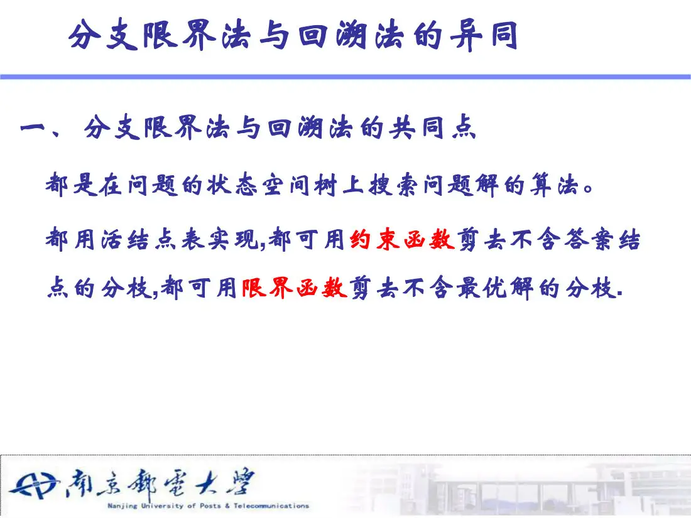

原文：

分支限界法与回溯法的异同

一、分支限界法与回溯法的共同点

都是在问题的状态空间树上搜索问题解的算法。

都用活结点表实现,都可用约束函数剪去不含答案结

点的分枝,都可用限界函数剪去不含最优解的分枝.

安南京郵電大学 Nanjing University of Posts & Telecommunications

### 二、分支限界法与回溯法的区别

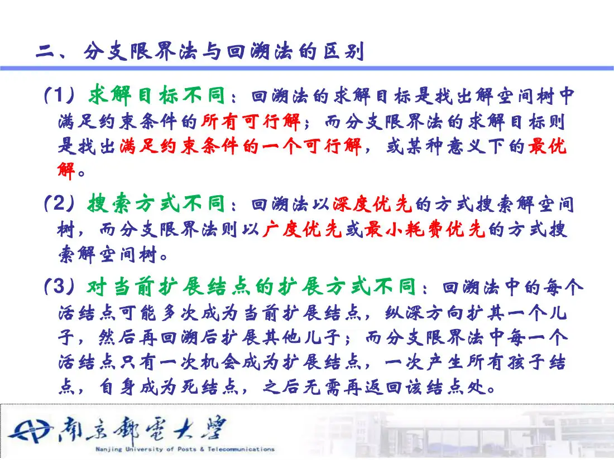

原文：

二、分支限界法与回溯法的区别

（1）求解目标不同：回溯法的求解目标是找出解空间树中满足约束条件的所有可行解；而分支限界法的求解目标则是找出满足约束条件的一个可行解，或某种意义下的最优解。

（2）搜索方式不同：回溯法以深度优先的方式搜索解空间树，而分支限界法则以广度优先或最小耗费优先的方式搜索解空间树。

（3）对当前扩展结点的扩展方式不同：回溯法中的每个活结点可能多次成为当前扩展结点，纵深方向扩其一个儿子，然后再回溯后扩展其他儿子；而分支限界法中每一个活结点只有一次机会成为扩展结点，一次产生所有孩子结点，自身成为死结点，之后无需再返回该结点处。

安南京郵電大学 Nanjing University of Posts & Telecommunications

### 分支限界法的种类

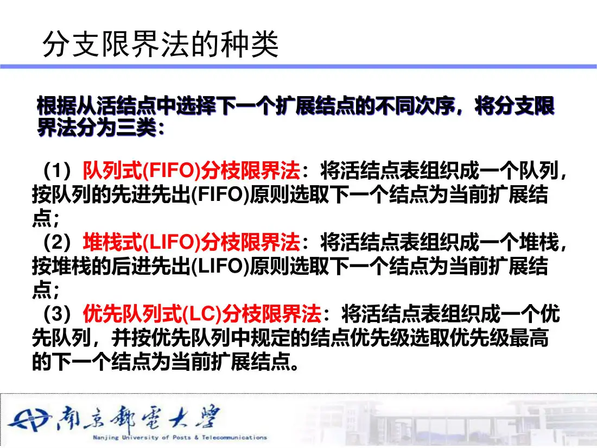

原文：

分支限界法的种类

根据从活结点中选择下一个扩展结点的不同次序，将分支限界法分为三类：

（1）队列式(FIFO)分枝限界法：将活结点表组织成一个队列，按队列的先进先出(FIFO)原则选取下一个结点为当前扩展结点；

（2）堆栈式(LIFO)分枝限界法：将活结点表组织成一个堆栈，按堆栈的后进先出(LIFO)原则选取下一个结点为当前扩展结点；

（3）优先队列式(LC)分枝限界法：将活结点表组织成一个优先队列，并按优先队列中规定的结点优先级选取优先级最高的下一个结点为当前扩展结点。

安南京郵電大学 Nanjing University of Posts & Telecommunications

### 程序9-1 分枝限界法的算法框架 (为简化起见,用指针代表所指向的结点)

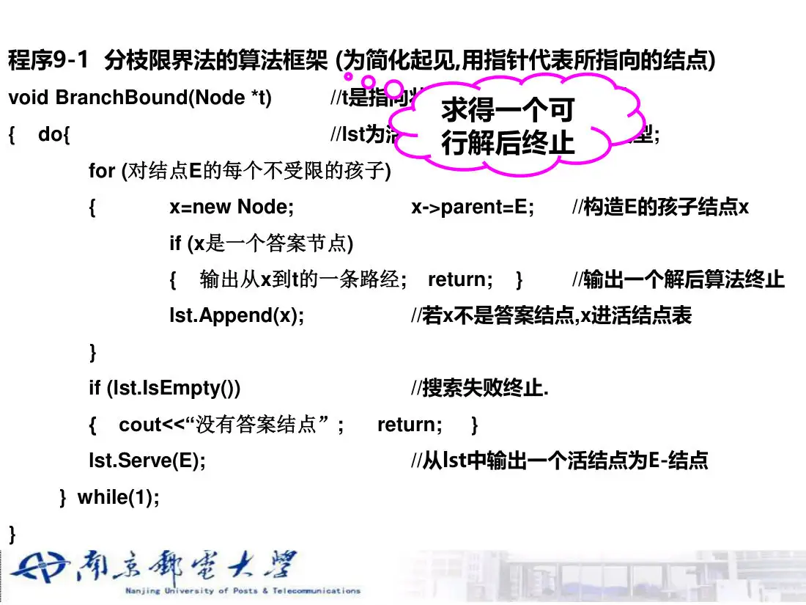

原文：

程序9-1 分枝限界法的算法框架 (为简化起见,用指针代表所指向的结点)

### 第 10 页

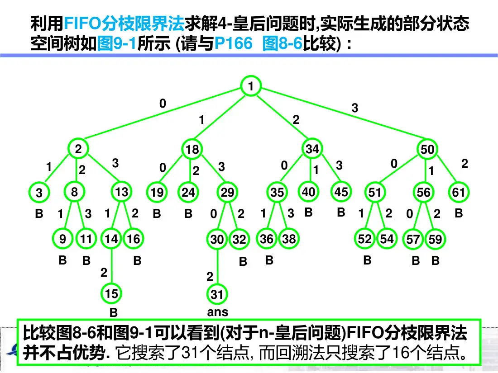

原文：

利用FIFO分枝限界法求解4-皇后问题时,实际生成的部分状态空间树如图9-1所示 (请与P166 图8-6比较) :

比较图8-6和图9-1可以看到(对于n-皇后问题)FIFO分枝限界法并不占优势. 它搜索了31个结点, 而回溯法只搜索了16个结点。

### 第 11 页

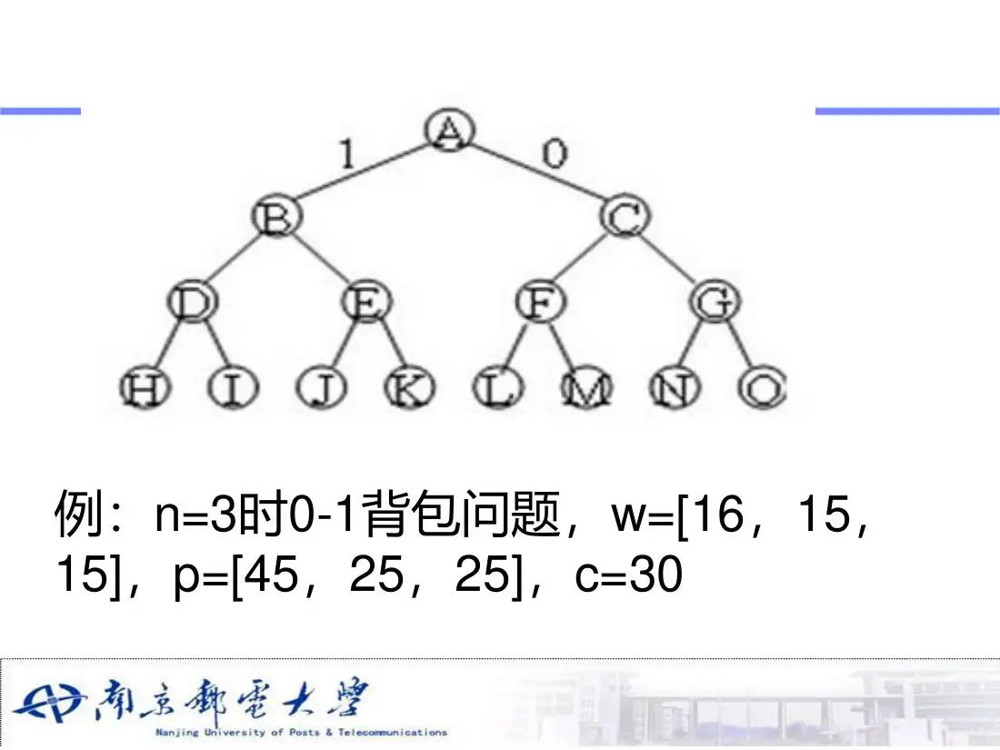

原文：

例：n=3时0-1背包问题， $w { = } [ 1 6$ ，15，15]，p=[45，25，25]，c=30

安南京郵電大学 Nanjing University of Posts & Telecommunications

### 第 12 页

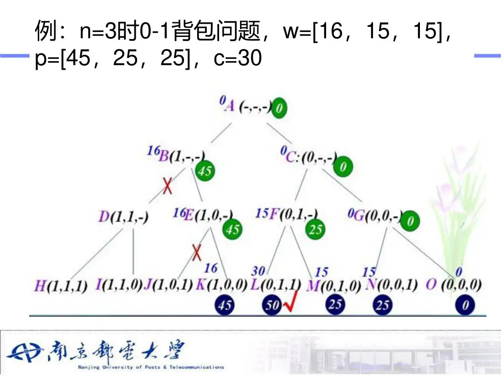

原文：

例：n=3时0-1背包问题，w=[16，15，15]，p=[45，25，25]，c=30

S南京郵電大学 Nanjing University of Posts & Telecommunications

### 优先队列式分支限界法

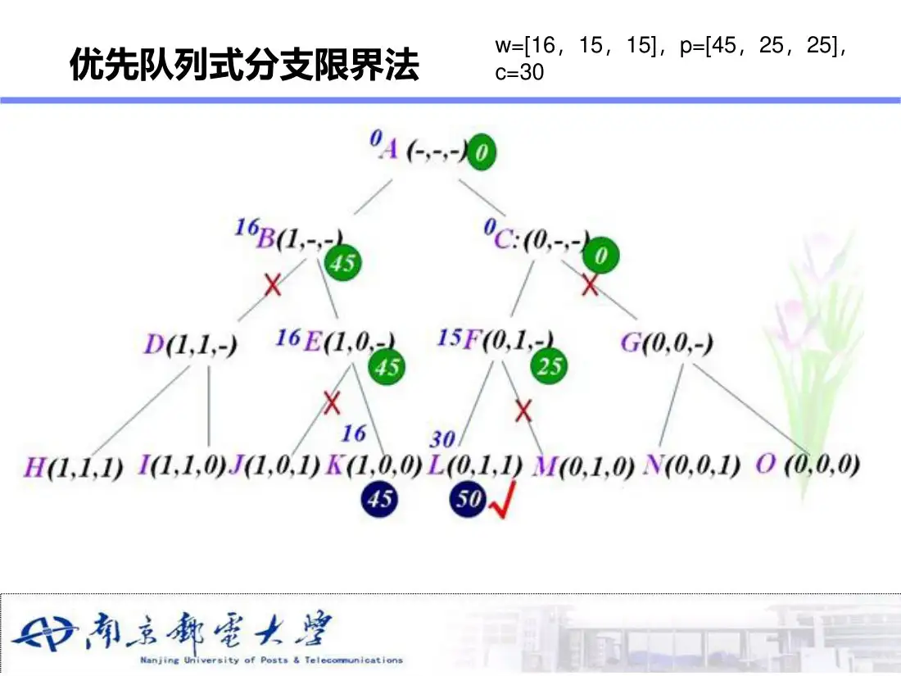

原文：

优先队列式分支限界法

安南京郵電大学 Nanjing University of Posts & Telecommunications

w=[16，15，15]，p=[45，25，25]，c=30

### LC分枝限界法

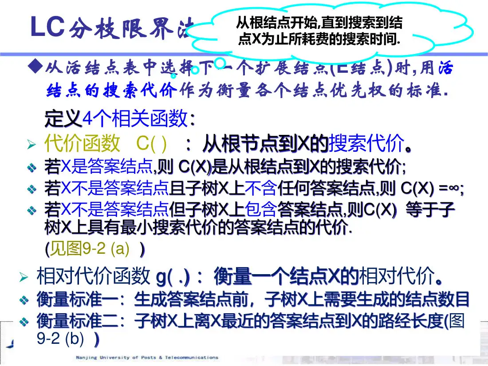

原文：

LC分枝限界法

从根结点开始,直到搜索到结点X为止所耗费的搜索时间.

从活结点表中选择下一个扩展结点(E结点)时,用活结点的搜索代价作为衡量各个结点优先权的标准.

定义4个相关函数：

➢ 代价函数 C( ) ：从根节点到X的搜索代价。

❖ 若X是答案结点,则 C(X)是从根结点到X的搜索代价;

X 若X不是答案结点且子树X上不含任何答案结点,则 ${ \sf C } ( { \sf X } ) = \infty$

若X不是答案结点但子树X上包含答案结点,则C(X) 等于子树X上具有最小搜索代价的答案结点的代价.

(见图9-2 (a) )

相对代价函数 g( .) ：衡量一个结点X的相对代价。

❖ 衡量标准一：生成答案结点前，子树X上需要生成的结点数目

衡量标准二：子树X上离X最近的答案结点到X的路经长度(图9-2 (b) )

Nanjing University of Posts & Telecommunications

### 代价函数 C( )

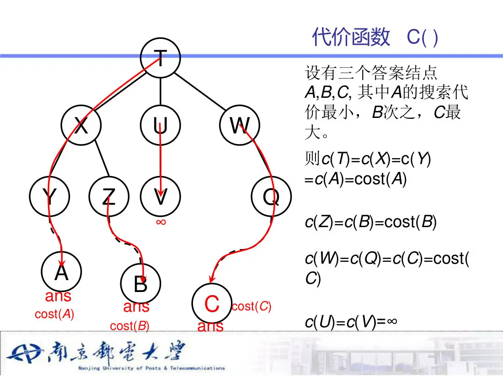

原文：

代价函数 C( )

设有三个答案结点A,B,C, 其中A的搜索代价最小，B次之，C最大。

$$
= c (A) = \mathrm{cost} (A)
$$

$$
c (Z) = c (B) = \mathrm{cost} (B)
$$

$$
\begin{array}{l} c (W) = c (Q) = c (C) = \operatorname{cost} ( \\ C) \end{array}
$$

$$
c (U) = c (V) = \infty
$$

安南京郵電大学 Nanjing University of Posts & Telecommunications

### 相对代价函数 g( .)

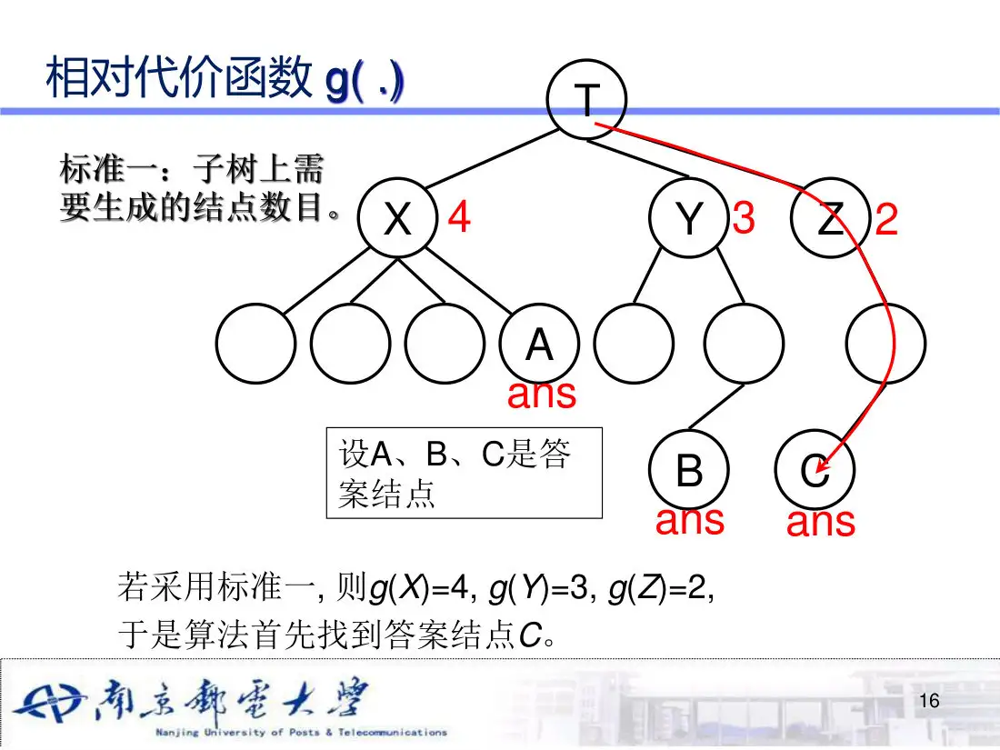

原文：

相对代价函数 g( .)

标准一：子树上需要生成的结点数目。

若采用标准一, 则 $g ( X ) = 4 , g ( \ Y ) = 3 , g ( \ Z ) = 2 .$ 于是算法首先找到答案结点C。

S南京郵電大学 Nanjing University of Posts & Telecommunications

16

### 标准二：离X最近的答案结点到X的路径长度。

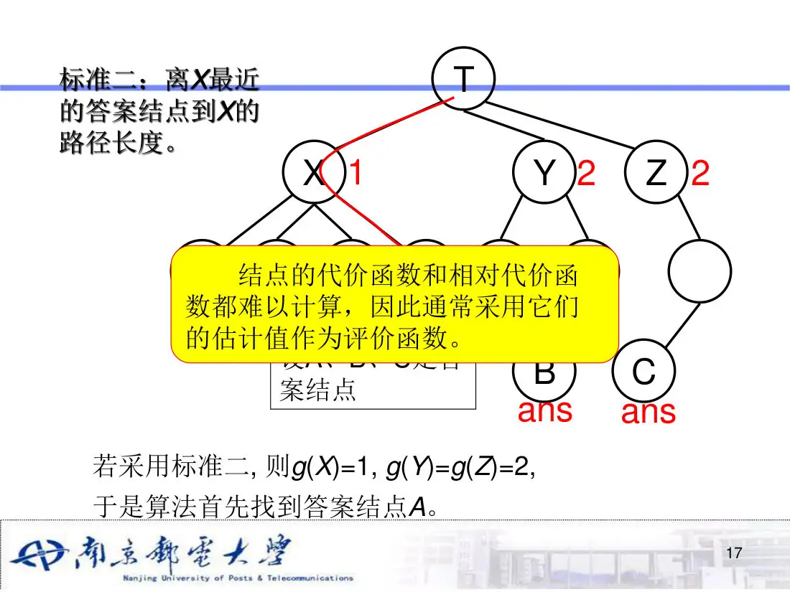

原文：

标准二：离X最近的答案结点到X的路径长度。

若采用标准二, 则 $\scriptstyle { g ( X ) = 1 , g ( Y ) = g ( Z ) = 2 }$

于是算法首先找到答案结点A。

安南京郵電大学 Nanjing University of Posts & Telecommunications

17

### 结点代价和相对代价都难以计算，因此通常采用它们的估计值作为评价函数：

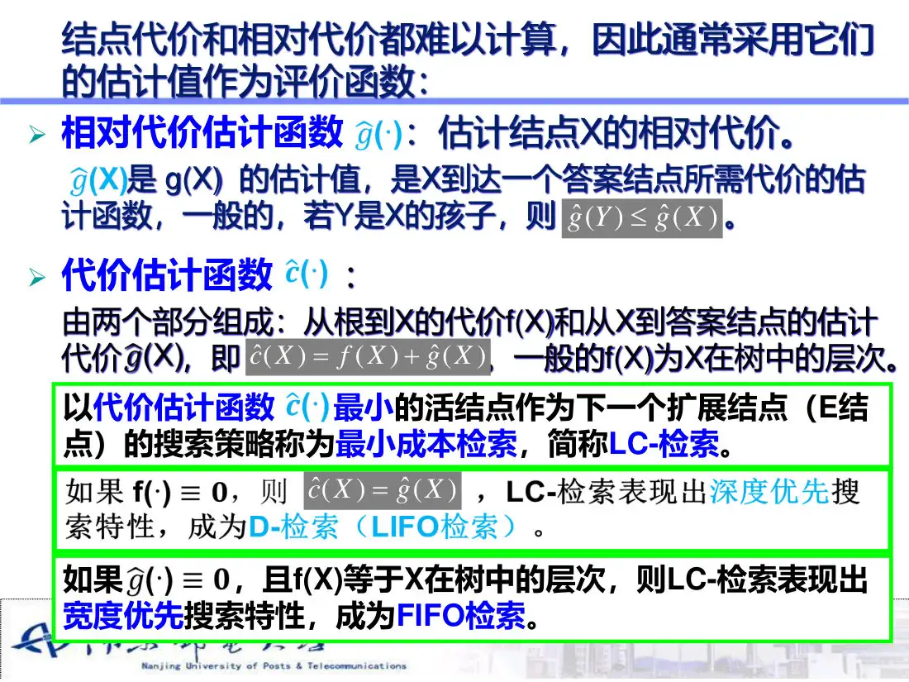

原文：

结点代价和相对代价都难以计算，因此通常采用它们的估计值作为评价函数：

相对代价估计函数 ：估计结点X的相对代价。是 g(X) 的估计值，是X到达一个答案结点所需代价的估计函数，一般的，若Y是X的孩子，则 g Y g X ˆ( ) ( )  ˆ 。

➢ 代价估计函数 ：

由两个部分组成：从根到X的代价f(X)和从X到答案结点的估计代价 ，即 c X f X g X ˆ( ) ( ) ( ) = + ˆ 。一般的f(X)为X在树中的层次。

以代价估计函数 最小的活结点作为下一个扩展结点（E结点）的搜索策略称为最小成本检索，简称LC-检索。

c X g X ˆ( ) ( ) = ˆ索特性，成为D-检索（LIFO检索）。

如果 ，且f(X)等于X在树中的层次，则LC-检索表现出宽度优先搜索特性，成为FIFO检索。

Nanjing University of Posts & Telecommunications

### 15谜问题

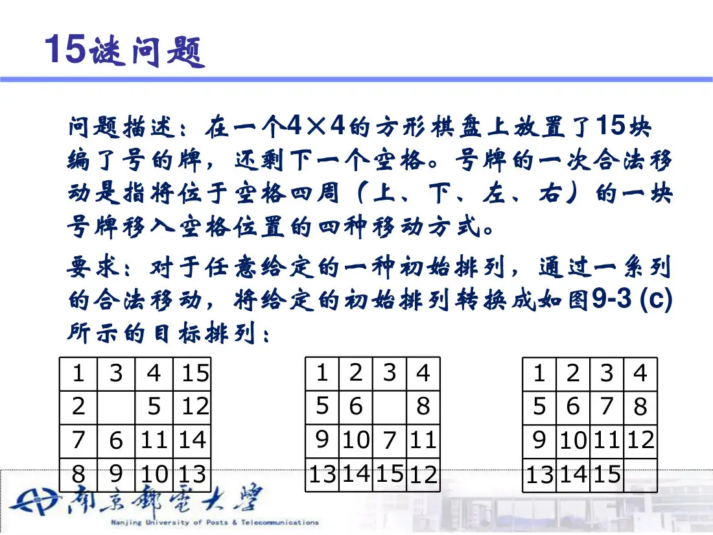

原文：

15谜问题

问题描述：在一个4×4的方形棋盘上放置了15块编了号的牌，还剩下一个空格。号牌的一次合法移动是指将位于空格四周（上、下、左、右）的一块号牌移入空格位置的四种移动方式。

要求：对于任意给定的一种初始排列，通过一系列的合法移动，将给定的初始排列转换成如图9-3 (c)所示的目标排列：

<table><tr><td>1</td><td>3</td><td>4</td><td>15</td></tr><tr><td>2</td><td></td><td>5</td><td>12</td></tr><tr><td>7</td><td>6</td><td>11</td><td>14</td></tr><tr><td>8</td><td>9</td><td>10</td><td>13</td></tr></table>

<table><tr><td>1</td><td>2</td><td>3</td><td>4</td></tr><tr><td>5</td><td>6</td><td></td><td>8</td></tr><tr><td>9</td><td>10</td><td>7</td><td>11</td></tr><tr><td>13</td><td>14</td><td>15</td><td>12</td></tr></table>

<table><tr><td>1</td><td>2</td><td>3</td><td>4</td></tr><tr><td>5</td><td>6</td><td>7</td><td>8</td></tr><tr><td>9</td><td>10</td><td>11</td><td>12</td></tr><tr><td>13</td><td>14</td><td>15</td><td></td></tr></table>

Nanjing University of Posts & Telecommunications

### 定理9-1给出了一种简单的判定方法：

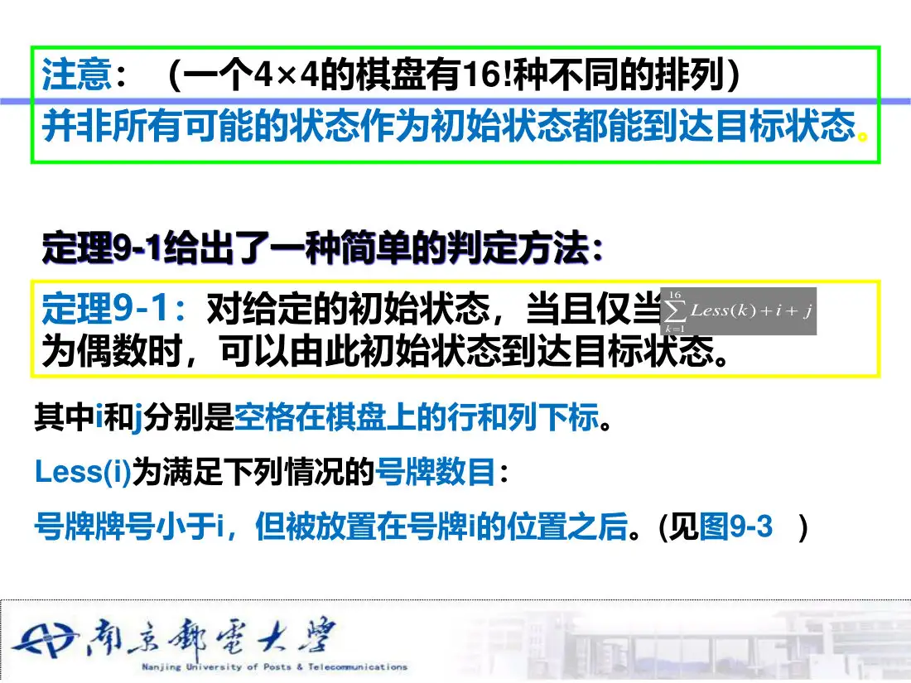

原文：

注意：（一个4×4的棋盘有16!种不同的排列）并非所有可能的状态作为初始状态都能到达目标状态。

定理9-1给出了一种简单的判定方法：

定理9-1：对给定的初始状态，当且仅当16 ( )Less k i j + +为偶数时，可以由此初始状态到达目标状态。

其中i和j分别是空格在棋盘上的行和列下标。

Less(i)为满足下列情况的号牌数目：

号牌牌号小于i，但被放置在号牌i的位置之后。(见图9-3 )

安南京郵電大学 Nanjing University of Posts & Telecommunications

### 初始状态1

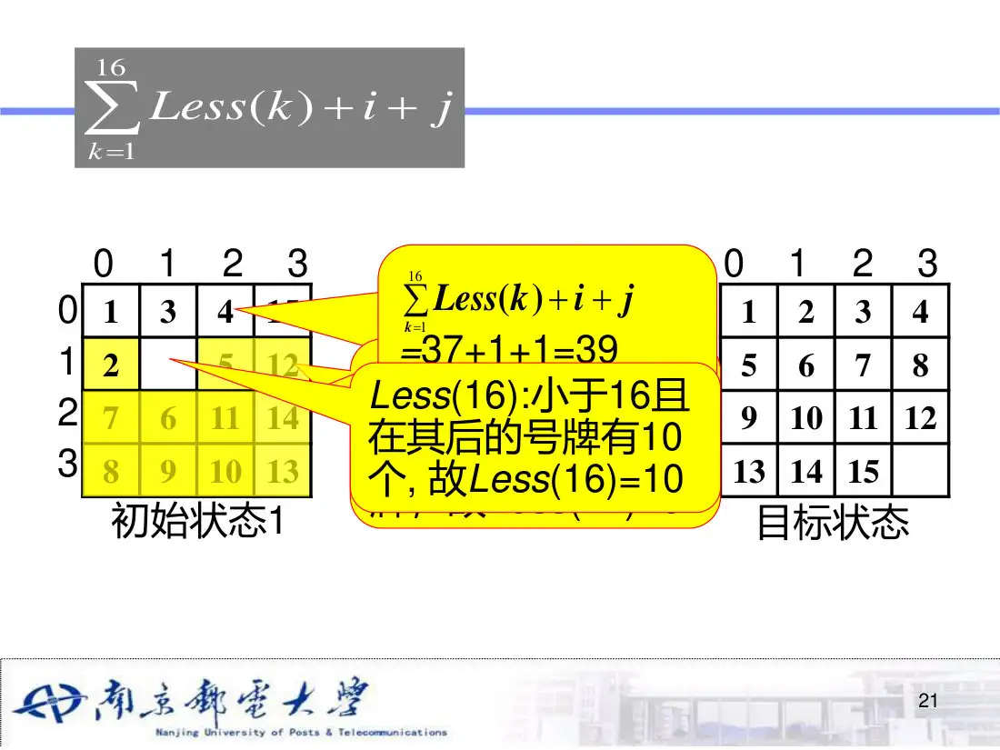

原文：

初始状态1

Less(4):小于 + +Less(k) i j=k 1=37+1+1=39故此状态不能到Less(16):小于16且达目标状态。在其后的号牌有10个, 故Less(16)=10

<table><tr><td>0</td><td>1</td><td>2</td><td>3</td></tr><tr><td>1</td><td>2</td><td>3</td><td>4</td></tr><tr><td>5</td><td>6</td><td>7</td><td>8</td></tr><tr><td>9</td><td>10</td><td>11</td><td>12</td></tr><tr><td>13</td><td>14</td><td>15</td><td></td></tr></table>

目标状态

16  1k=

安南京郵電大学

21

Nanjing University of Posts & Telecommunications

### 0123415682910711313141512

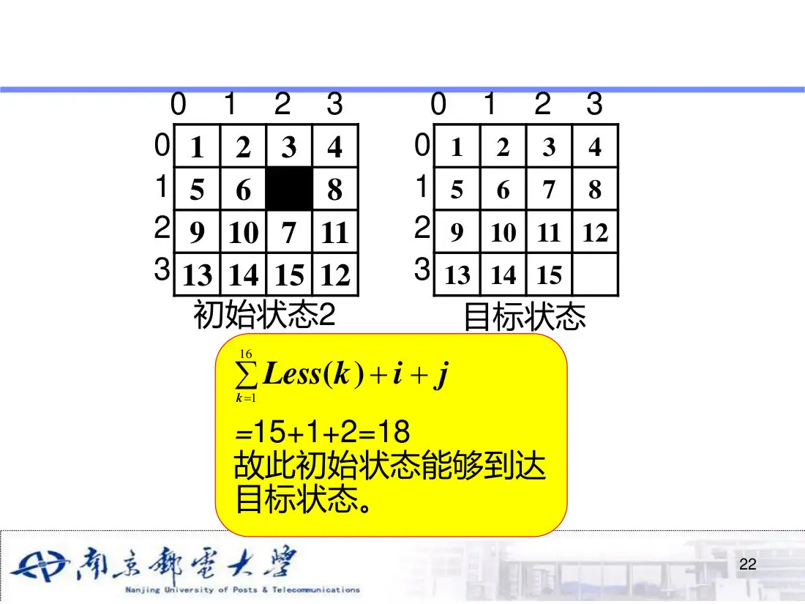

原文：

<table><tr><td>0</td><td>1</td><td>2</td><td>3</td><td>4</td></tr><tr><td>1</td><td>5</td><td>6</td><td></td><td>8</td></tr><tr><td>2</td><td>9</td><td>10</td><td>7</td><td>11</td></tr><tr><td>3</td><td>13</td><td>14</td><td>15</td><td>12</td></tr></table>

初始状态2

<table><tr><td>0</td><td>1</td><td>2</td><td>3</td><td>4</td></tr><tr><td>1</td><td>5</td><td>6</td><td>7</td><td>8</td></tr><tr><td>2</td><td>9</td><td>10</td><td>11</td><td>12</td></tr><tr><td>3</td><td>13</td><td>14</td><td>15</td><td></td></tr></table>

目标状态

$\sum _ { k = 1 } ^ { 1 6 } L e s s ( k ) + i + j$ $= 1 5 + 1 + 2 = 1 8$ 故此初始状态能够到达目标状态。

分南京郵電大学

22

Nanjing University of Posts & Telecommunications

### 第一种搜索方式：

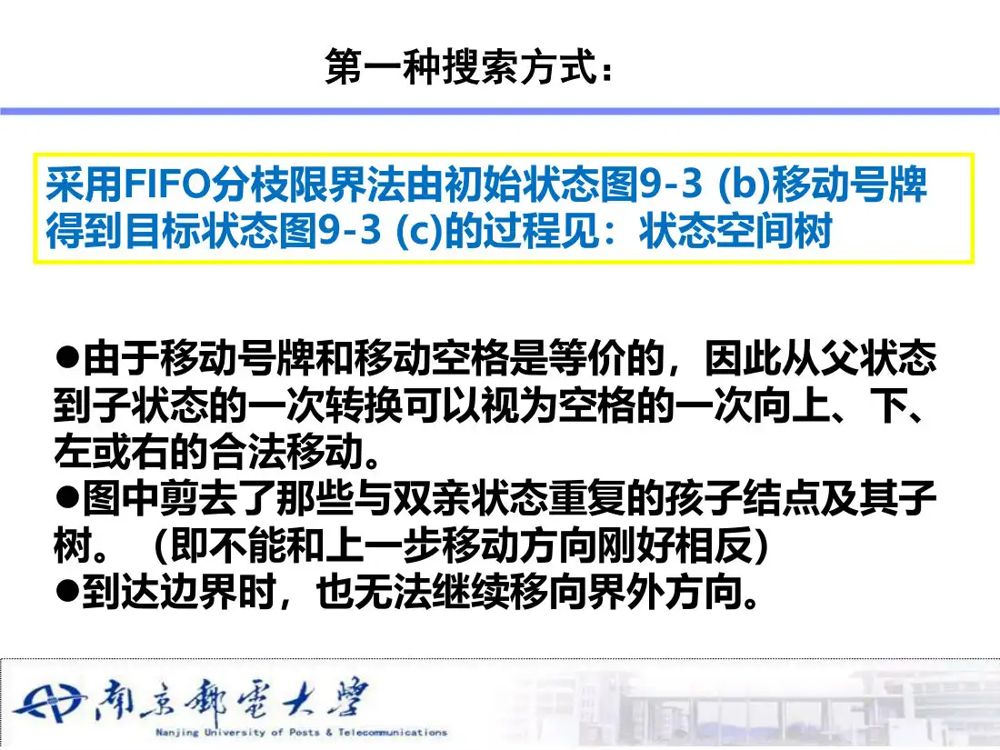

原文：

第一种搜索方式：

采用FIFO分枝限界法由初始状态图9-3 (b)移动号牌 得到目标状态图9-3 (c)的过程见：状态空间树

⚫由于移动号牌和移动空格是等价的，因此从父状态到子状态的一次转换可以视为空格的一次向上、下、左或右的合法移动。

⚫图中剪去了那些与双亲状态重复的孩子结点及其子树。（即不能和上一步移动方向刚好相反）

⚫到达边界时，也无法继续移向界外方向。

安南京郵電大学 Nanjing University of Posts & Telecommunications

### 15谜问题的部分状态空间树(FIFOBB)

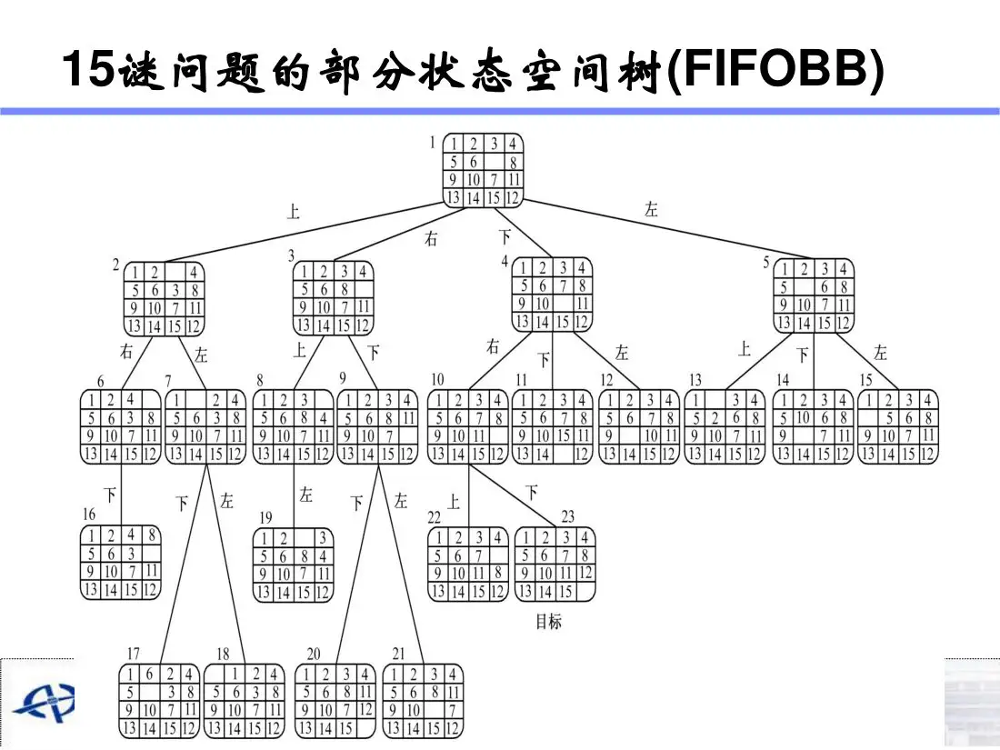

原文：

15谜问题的部分状态空间树(FIFOBB)

### 第二种搜索方式：

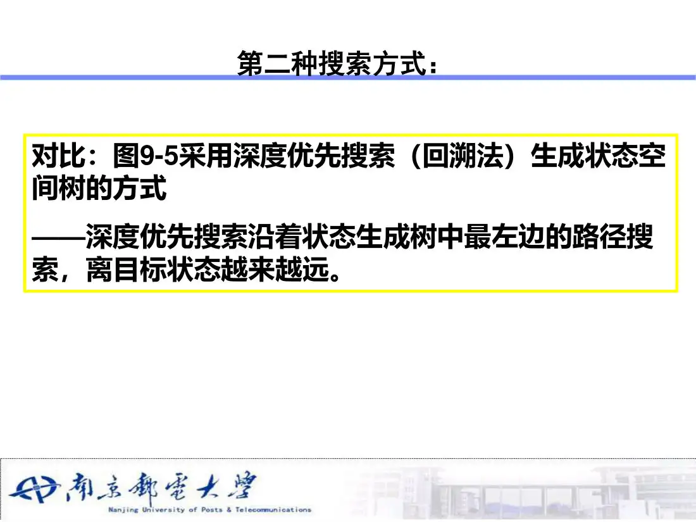

原文：

第二种搜索方式：

对比：图9-5采用深度优先搜索（回溯法）生成状态空间树的方式

——深度优先搜索沿着状态生成树中最左边的路径搜索，离目标状态越来越远。

安南京郵電大学 Nanjing University of Posts & Telecommunications

### ——可以看到这种代价估计函数对这一实例十分有效。

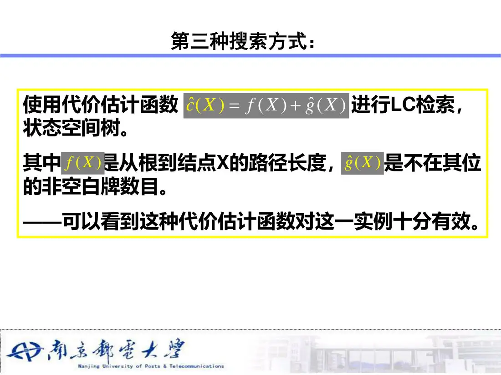

原文：

使用代价估计函数 进行LC检索，cˆ( ) X = + f X( ) ( ) g X ˆ状态空间树。

其中 是从根到结点X的路径长度， 是不在其位g X ˆ( ) f X( )的非空白牌数目。

——可以看到这种代价估计函数对这一实例十分有效。

第三种搜索方式：

安南京郵電大学 Nanjing University of Posts & Telecommunications

### 15谜问题的部分状态空间树(LCBB)

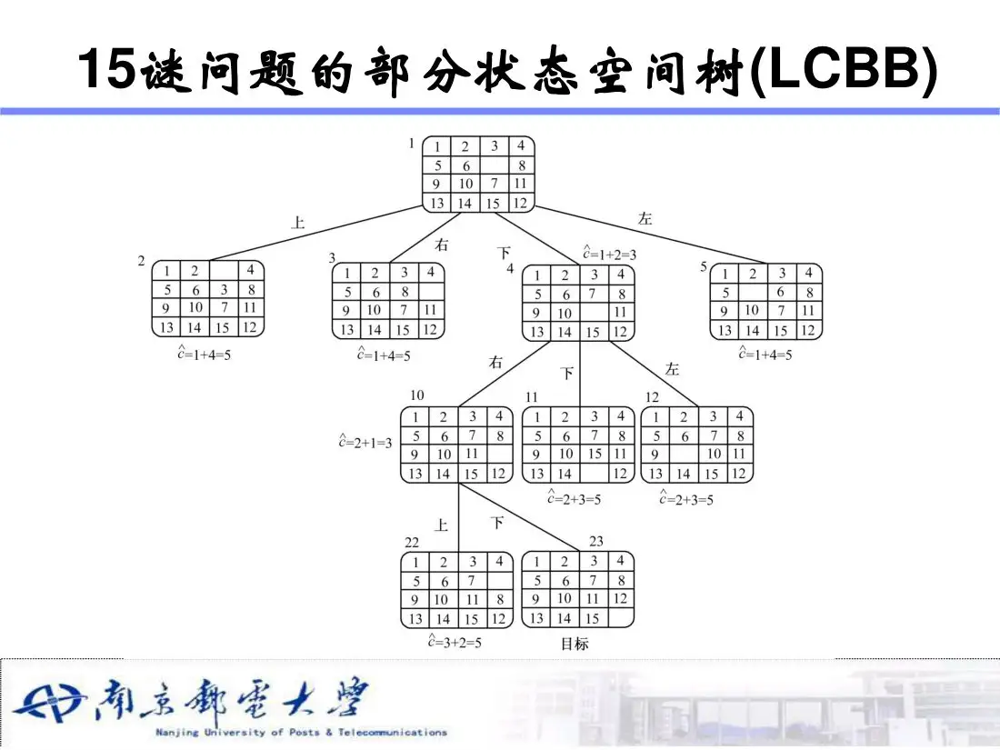

原文：

15谜问题的部分状态空间树(LCBB)

安南京郵電大学 Nanjing University of Posts & Telecommunications

### 9.2 求最优解的分枝限界法

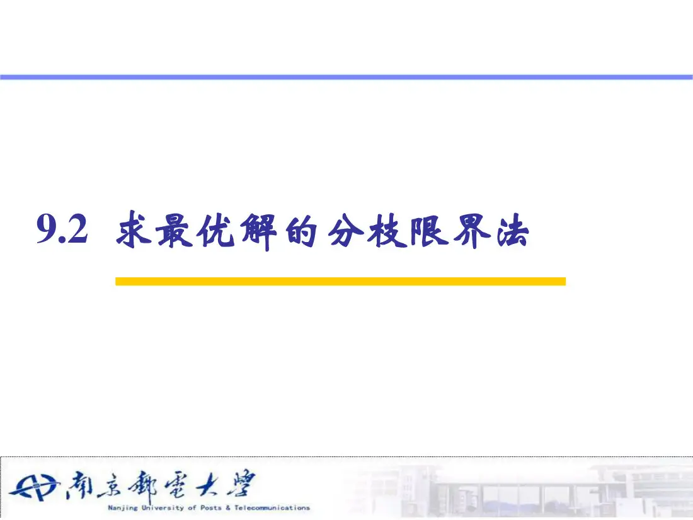

原文：

9.2 求最优解的分枝限界法

安南京郵電大学 Nanjing University of Posts & Telecommunications

### 9.2.1 上下界函数

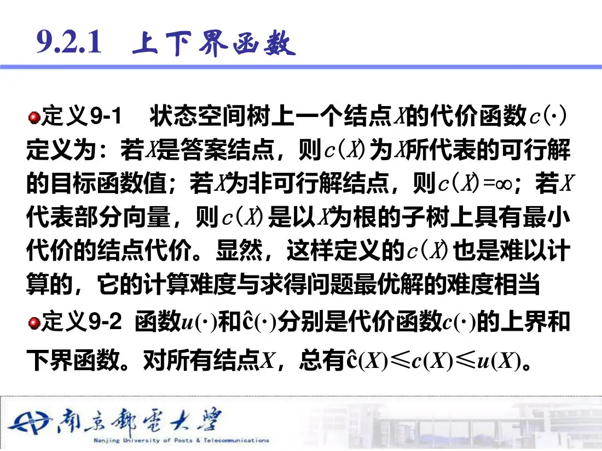

原文：

9.2.1 上下界函数

定义9-1 状态空间树上一个结点X的代价函数c(·)定义为：若X是答案结点，则c(X)为X所代表的可行解的目标函数值；若X为非可行解结点，则 $c ( \chi ) = \infty ;$ 若X代表部分向量，则c(X)是以X为根的子树上具有最小代价的结点代价。显然，这样定义的c(X)也是难以计算的，它的计算难度与求得问题最优解的难度相当定义9-2 函数u(·)和ĉ(·)分别是代价函数c(·)的上界和下界函数。对所有结点X，总有ĉ $( X ) { \leqslant } c ( X ) { \leqslant } u ( X )$

安南京郵電大学 Nanjing University of Posts & Telecommunications

### 假定目标函数取最小值时为最优解，U是其上界变量

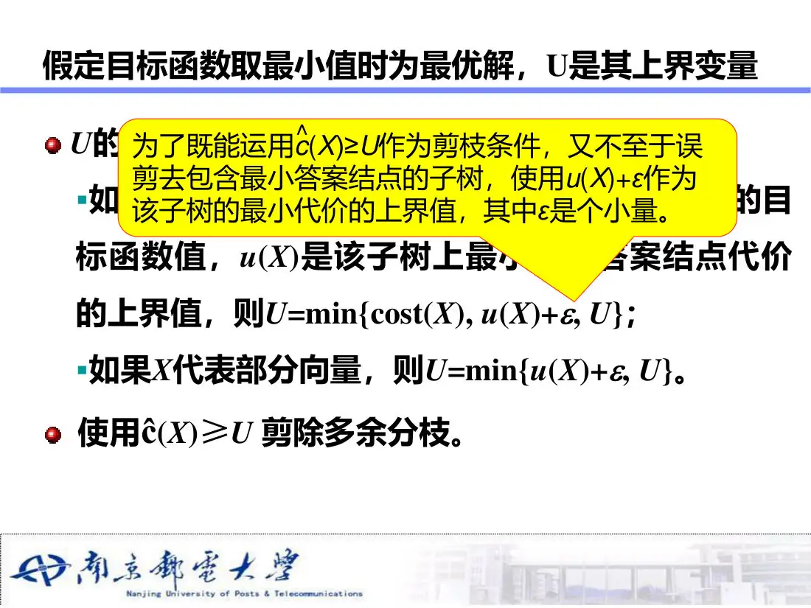

原文：

假定目标函数取最小值时为最优解，U是其上界变量

U的 值可以按下为了既能运用 $\hat { \boldsymbol c } ( \boldsymbol X ) \ge \boldsymbol U$ 修正：作为剪枝条件，又不至于误剪去包含最小答案结点的子树，使用u(X)+ε作为▪如 果X是答案结点，cost(X)是X所代表的可该子树的最小代价的上界值，其中ε是个小量。 的目标函数值，u(X)是该子树上最 案结点代价的上界值，则 $U { \bf = m i n } \{ \cos t ( X ) , u ( X ) + \xi , U \}$ ▪如果X代表部分向量，则 $U { = } \mathbf { m i n } \{ u ( X ) { + } \varepsilon , U \}$

使用ĉ $( X ) { \geqslant } U$ 剪除多余分枝。

安南京郵電大学 Nanjing University of Posts & Telecommunications

### 9.2.2 FIFO分枝限界法

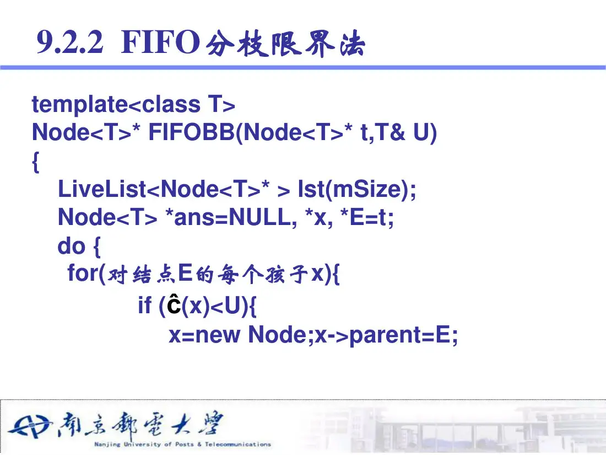

原文：

9.2.2 FIFO分枝限界法

安南京郵電大学 Nanjing University of Posts & Telecommunications

### lst.Append(x);

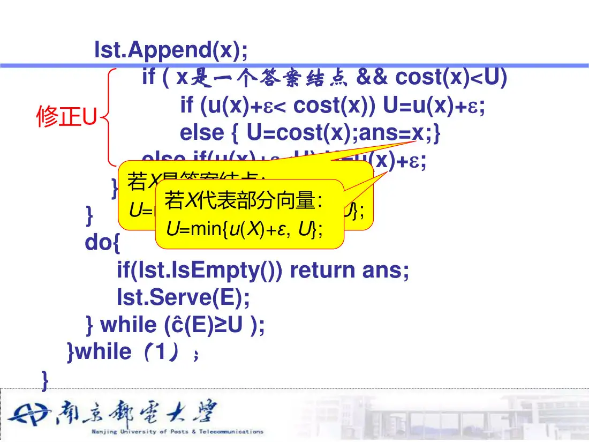

原文：

lst.Append(x);

if ( x是一个答案结点 && cost(x)<U)

修正U

$$
\text { if } (u (x) + \varepsilon <   \operatorname{cost} (x)) U = u (x) + \varepsilon ;
$$

$$
\text { else } \{\mathrm{U} = \text { cost(x);ans } = \mathrm{x;} \}
$$

$$
\text {   also   if   } (u (x) + \varepsilon , u (x)) = u (x) + \varepsilon ;
$$

若XU=m

若 X代表部分向量：

U};

$$
U = \min \{u (X) + \varepsilon , U \};
$$

do{

if(lst.IsEmpty()) return ans;

lst.Serve(E);

} while (ĉ(E)≥U );

}while（1）；

安南京郵電大学 Nanjing University of Posts & Telecommunications

### 9.2.3 LC分枝限界法

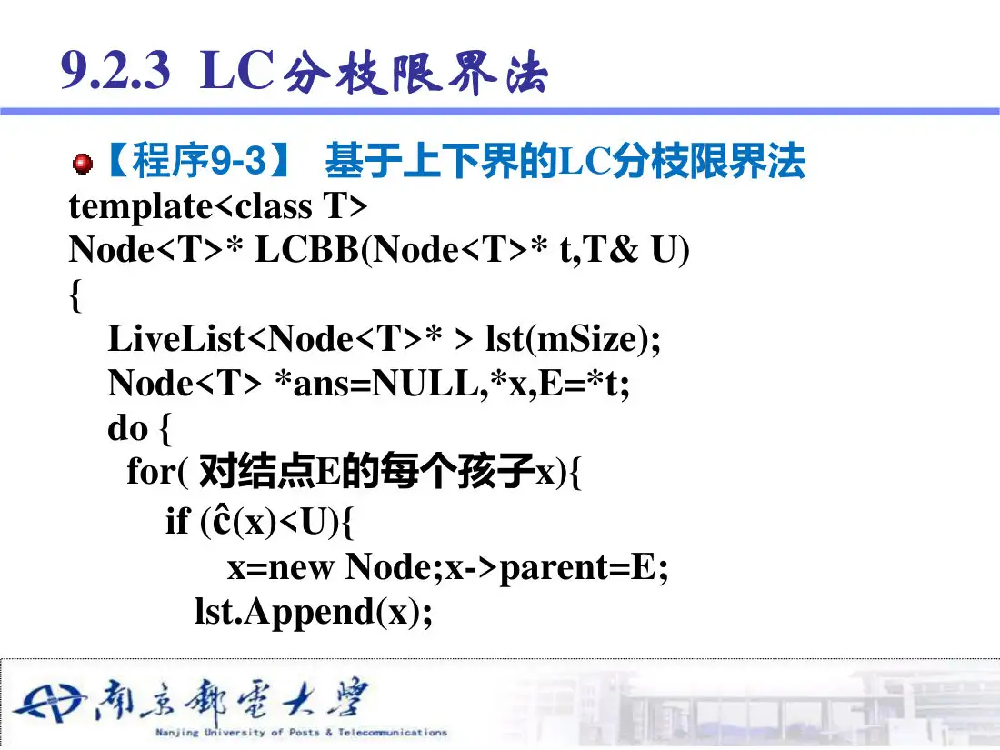

原文：

9.2.3 LC分枝限界法

【程序9-3】 基于上下界的LC分枝限界法

安南京郵電大学 Nanjing University of Posts & Telecommunications

### 第 34 页

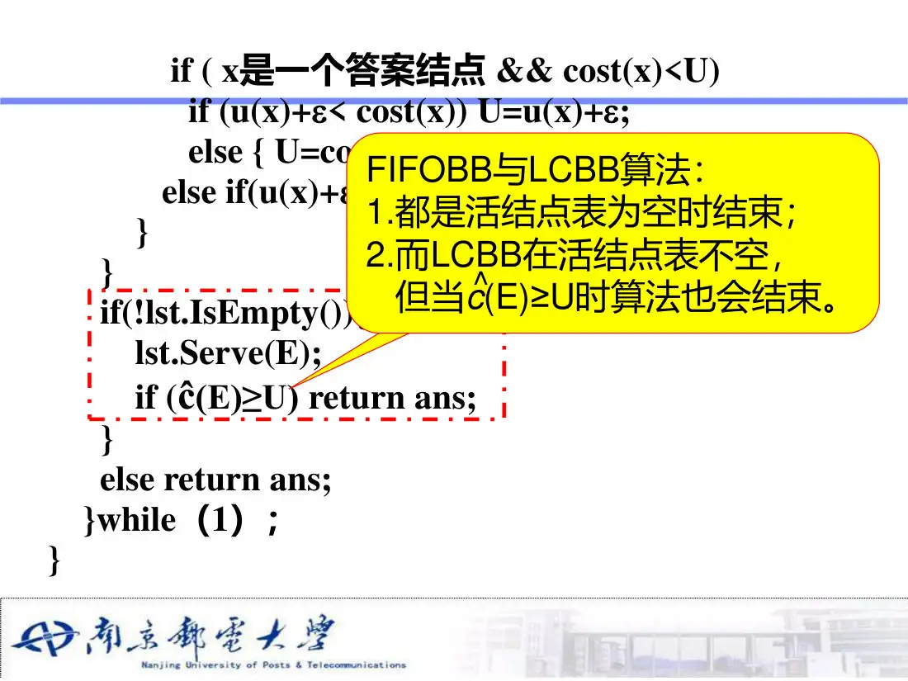

### 9.3 带时限的作业排序

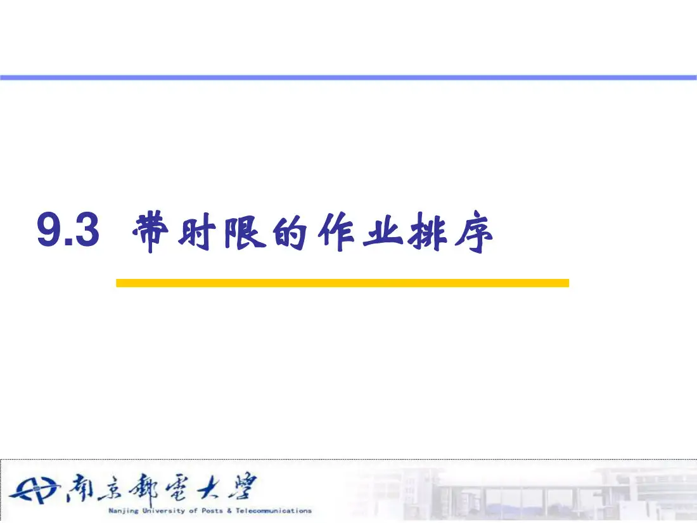

原文：

9.3 带时限的作业排序

S南京郵電大学 Nanjing University of Posts & Telecommunications

### 9.3.1 问题描述

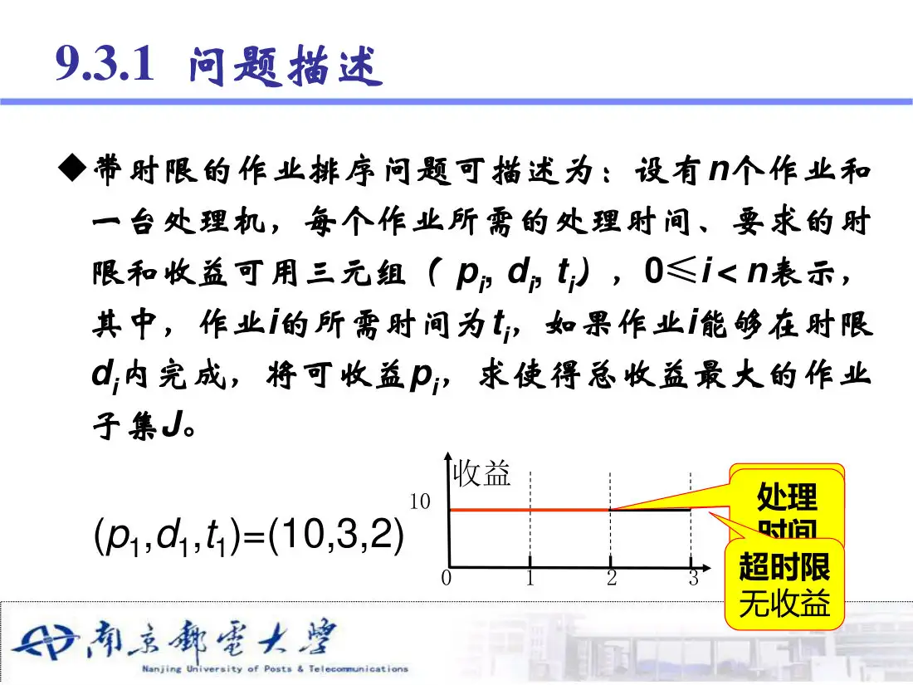

原文：

9.3.1 问题描述

◆带时限的作业排序问题可描述为：设有n个作业和一台处理机，每个作业所需的处理时间、要求的时限和收益可用三元组 $( \ p _ { j } , \ d _ { j } , \ t _ { j } )$ $0 \leqslant i < n$ 表示，其中，作业i的所需时间为 $t _ { j } ,$ ，如果作业i能够在时限$d _ { i }$ 内完成，将可收益 $p _ { j }$ ，求使得总收益最大的作业子集J。

$$
(p _ {1}, d _ {1}, t _ {1}) = (1 0, 3, 2)
$$

安南京郵電大学

### 最大收益子集为J=(2,1)最大收益为16。

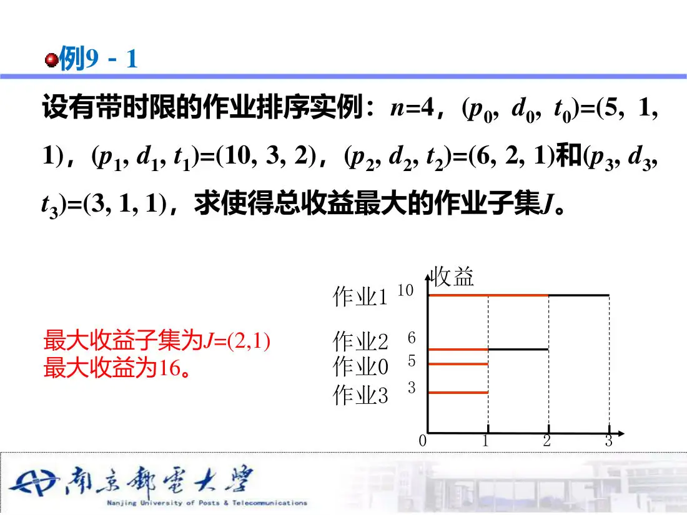

原文：

设有带时限的作业排序实例：n=4， $( p _ { 0 } , \ d _ { 0 } , \ t _ { 0 } ) { = } ( 5 , \ 1 ,$ 1)， $( p _ { 1 } , d _ { 1 } , t _ { 1 } ) { = } ( 1 0 , 3 , 2 )$ $( p _ { 2 } , d _ { 2 } , t _ { 2 } ) { = } ( 6 , 2 , 1 _ { \cdot }$ )和 $( p _ { 3 } , d _ { 3 } ,$ $\pmb { t } _ { 3 } ) \mathbf { = } ( 3 , 1 , 1 )$ ，求使得总收益最大的作业子集J。

最大收益子集为J=(2,1)最大收益为16。

A南京郵電大学 Nanjing University of Posts & Telecommunications

### 9.3.2 分枝限界法求解

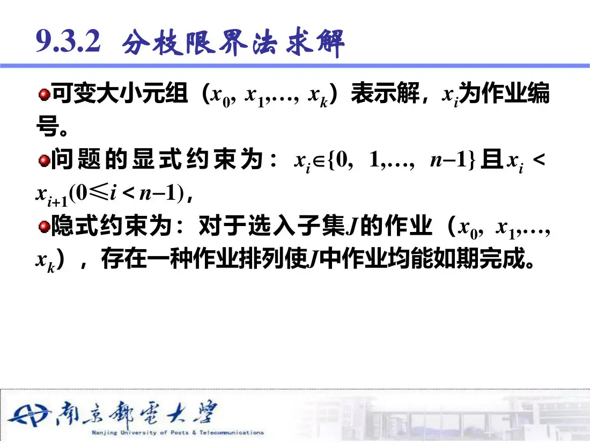

原文：

9.3.2 分枝限界法求解

可变大小元组 $( x _ { 0 } , x _ { 1 } , . . . , x _ { k } )$ 表示解， $x _ { i }$ 为作业编号。

问题的显式约束为： $x _ { i } { \in } \{ 0 ,  ~ 1 , { \ldots } , ~ n { - } 1 \}$ 且 $x _ { i } <$ $x _ { i + 1 } ( 0 \leqslant i < n - 1 )$

隐式约束为：对于选入子集J的作业 $( x _ { 0 } , \ x _ { 1 } , \ldots ,$ $x _ { k } )$ ，存在一种作业排列使J中作业均能如期完成。

安南京郵電大学 Nanjing University of Posts & Telecommunications

### $$

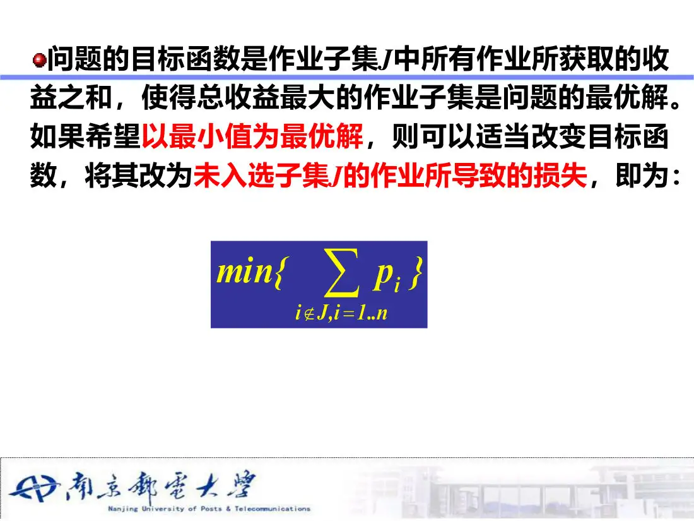

原文：

问题的目标函数是作业子集J中所有作业所获取的收益之和，使得总收益最大的作业子集是问题的最优解。如果希望以最小值为最优解，则可以适当改变目标函数，将其改为未入选子集J的作业所导致的损失，即为：

$$
\min \{\sum_ {i \notin J, i = 1.. n} p _ {i} \}
$$

安南京郵電大学 Nanjing University of Posts & Telecommunications

### $$

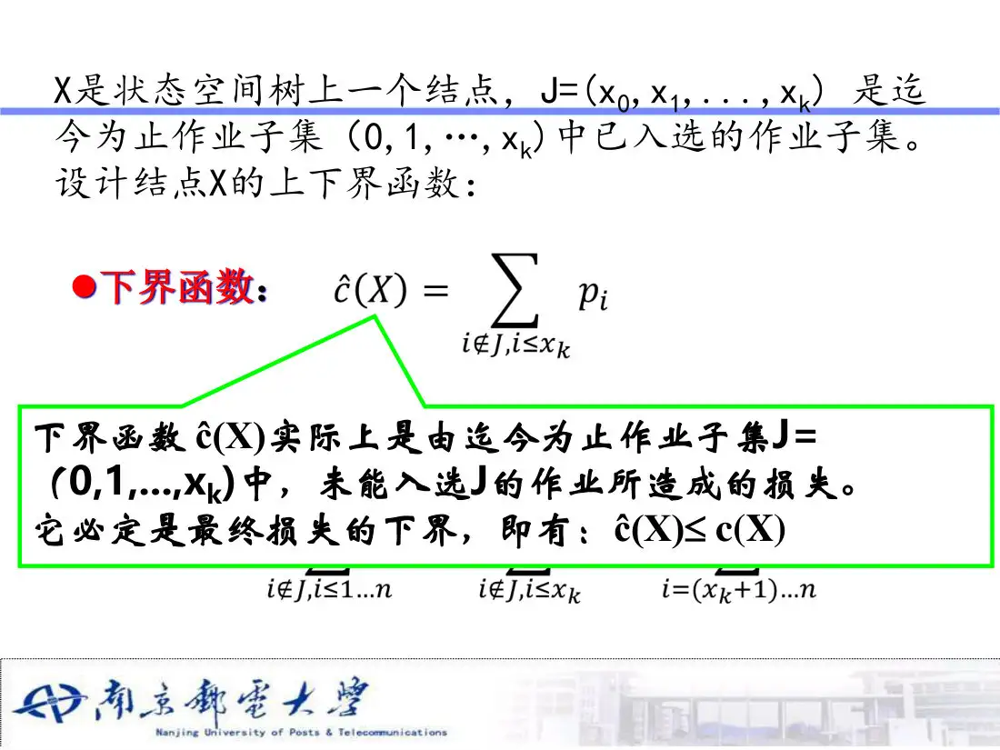

原文：

X是状态空间树上一个结点， $\mathsf { J } = ( \mathsf { x } _ { 0 } , \mathsf { x } _ { 1 } , \ldots , \mathsf { x } _ { \mathsf { k } } )$ 是迄今为止作业子集 $( 0 , 1 , \cdots , \mathsf { x } _ { \mathsf { k } } )$ 中已入选的作业子集。设计结点X的上下界函数：

⚫下界函数： $\hat { c } ( X ) = \sum _ { i \notin J , i \leq x _ { k } } p _ { i }$

下界函数 ĉ(X)实际上是由迄今为止作业子集J=$( 0 , 1 , . . . , x _ { \mathrm { k } } )$ 中，未能入选J的作业所造成的损失。它必定是最终损失的下界，即有： $\hat { \mathbf { c } } ( \mathbf { X } ) { \leq } \mathbf { c } ( \mathbf { X } )$

$$
i \not \in J, i \leq 1 \dots n \qquad i \not \in J, i \leq x _ {k} \qquad i = (x _ {k} + 1) \dots n
$$

安南京郵電大学 Nanjing University of Posts & Telecommunications

### X是状态空间树上一个结点，上界函数u(X)值由两部分组成：

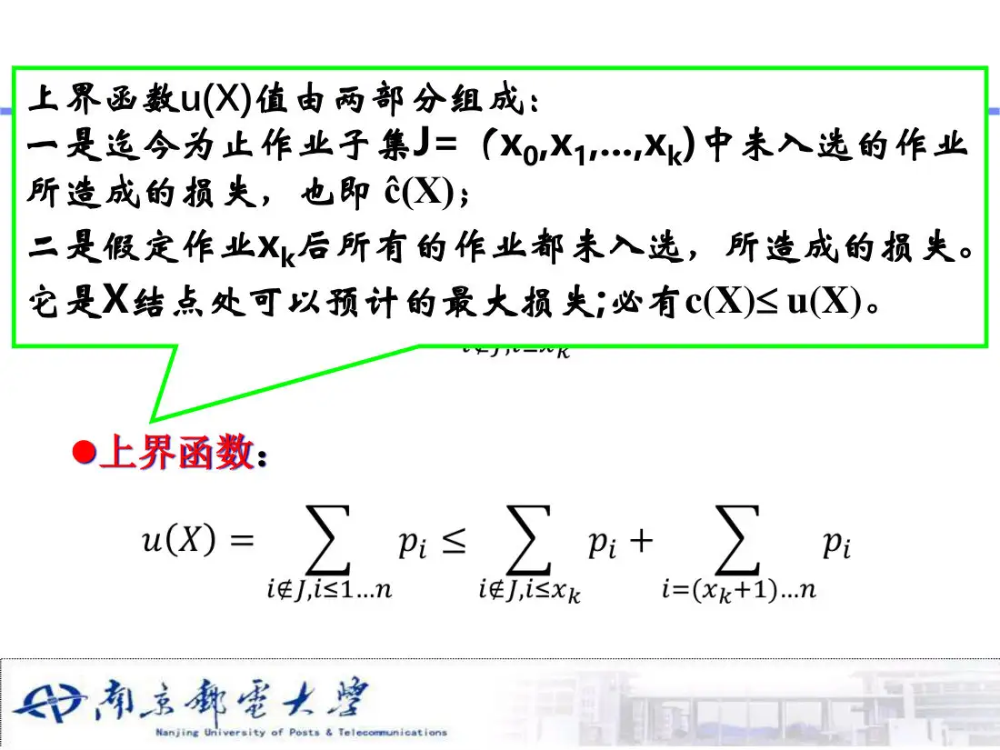

原文：

X是状态空间树上一个结点，上界函数u(X)值由两部分组成：

今为止作业子集（0,一是迄今为止作业子集 $\mathbf { J } = \mathbf { \Phi } ( \mathbf { x } _ { 0 } , \mathbf { x } _ { 1 } , \dots , \mathbf { x } _ { | _ { \mathbf { k } } } )$ 的作业子集。中未入选的作业设计结点X的上下界函数：所造成的损失，也即 ĉ(X)；

二是假定作业 $\mathbf { \boldsymbol { x } } _ { \mathbf { k } }$ 后所有的作业都未入选，所造成的损失。它是X结点处可以预计的最大损失;必有 $\mathbf { c } ( \mathbf { X } ) { \leq } \mathbf { u } ( \mathbf { X } )$ o

⚫上界函数：

$$
u (X) = \sum_ {i \notin J, i \leq 1 \dots n} p _ {i} \leq \sum_ {i \notin J, i \leq x _ {k}} p _ {i} + \sum_ {i = (x _ {k} + 1) \dots n} p _ {i}
$$

安南京郵電大学 Nanjing University of Posts & Telecommunications

### $$

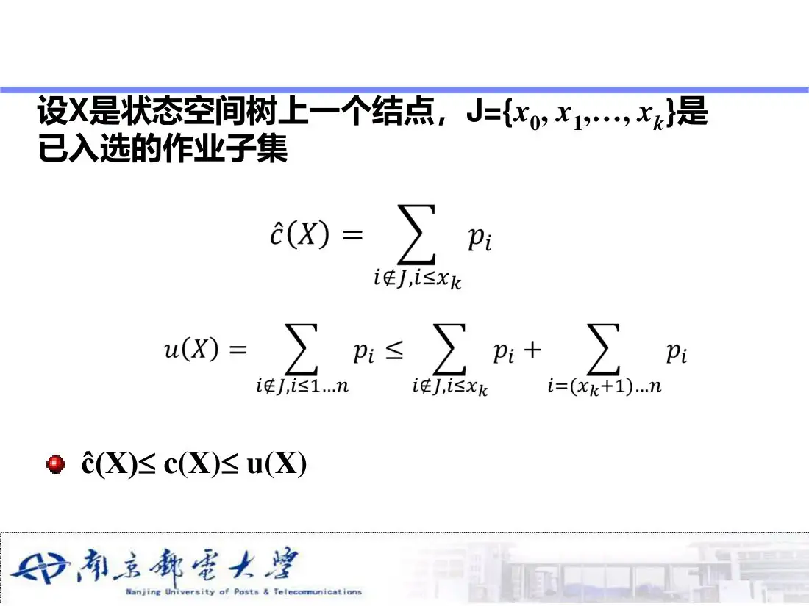

原文：

设X是状态空间树上一个结点， $\mathsf { J } = \{ x _ { 0 } , x _ { 1 } , . . . , x _ { k } \}$ 是已入选的作业子集

$$
\hat {c} (X) = \sum_ {i \not \in J, i \leq x _ {k}} p _ {i}
$$

$$
u (X) = \sum_ {i \notin J, i \leq 1 \dots n} p _ {i} \leq \sum_ {i \notin J, i \leq x _ {k}} p _ {i} + \sum_ {i = (x _ {k} + 1) \dots n} p _ {i}
$$

$$
ⓢ \hat {\mathbf {c}} (\mathbf {X}) \leq \mathbf {c} (\mathbf {X}) \leq \mathbf {u} (\mathbf {X})
$$

安南京郵電大学 Nanjing University of Posts & Telecommunications

### $$

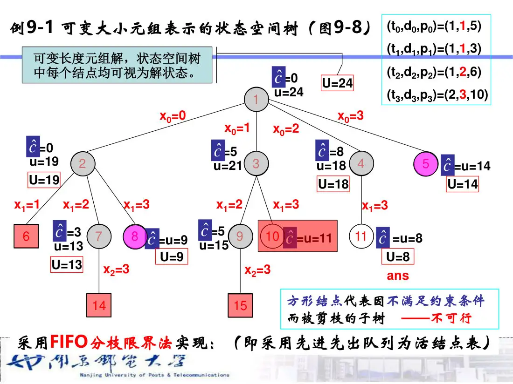

原文：

$$
(t _ {0}, d _ {0}, p _ {0}) = (1, 1, 5)
$$

六用原哪電大学

Nanjing University of Posts & Telecommunications

### 9.3.3 带时限作业排序算法

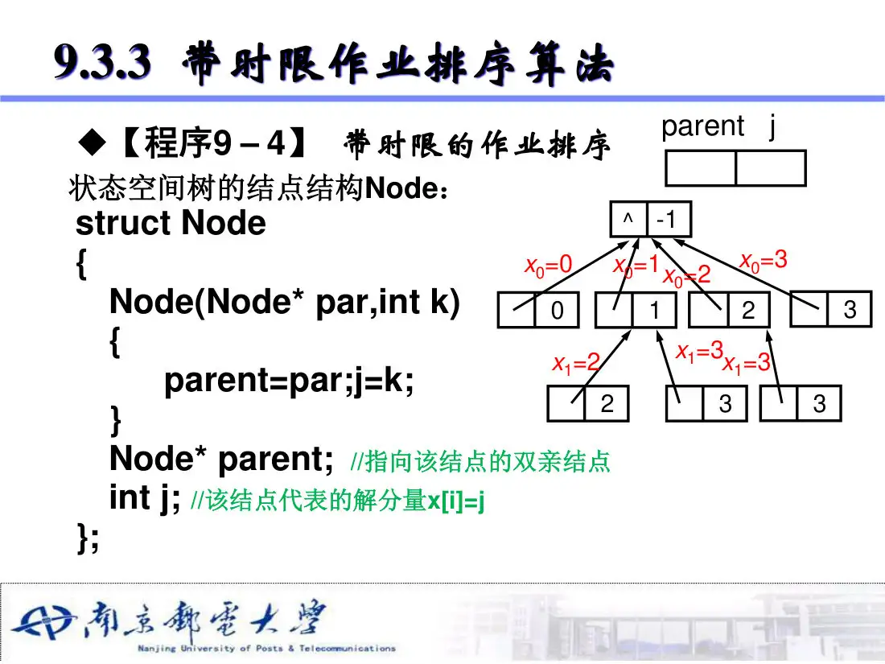

原文：

9.3.3 带时限作业排序算法

◆【程序9－4】 带时限的作业排序

安南京郵電大学 Nanjing University of Posts & Telecommunications

### 活结点表的结点结构qNode：

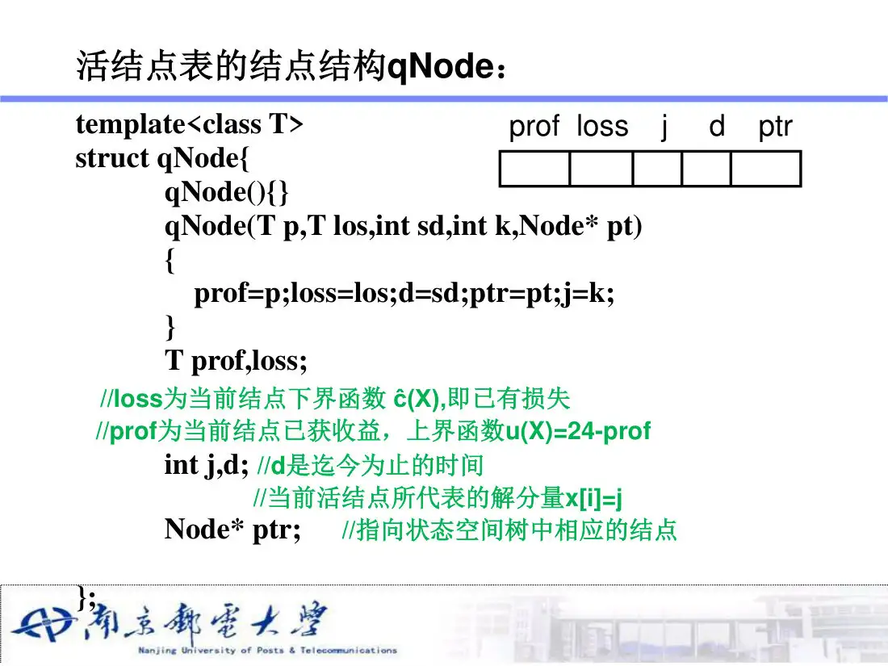

原文：

活结点表的结点结构qNode：

南京郵電大学 Nanjing University of Posts & Telecommunications

### 第 46 页

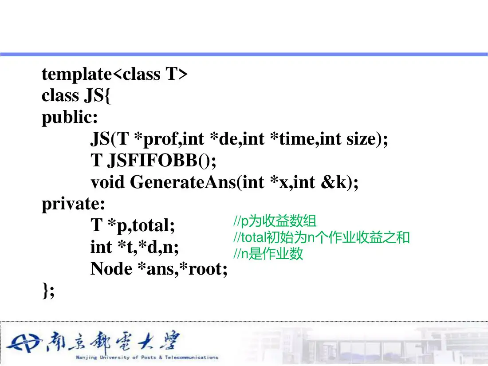

原文：

安南京郵電大学 Nanjing University of Posts & Telecommunications

### 第 47 页

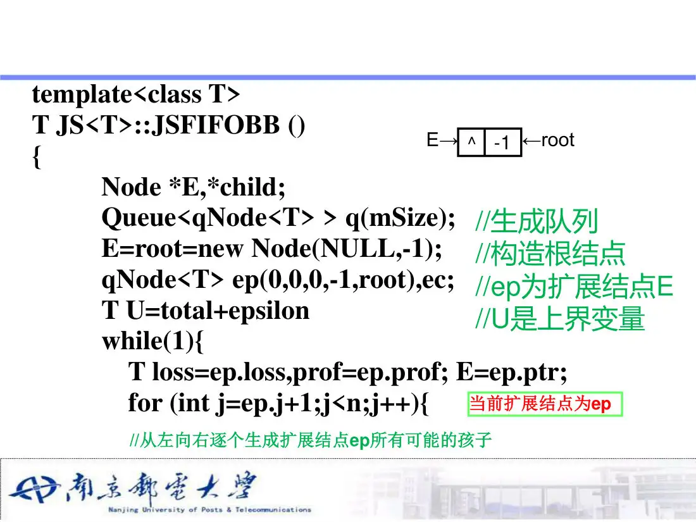

原文：

安南京郵電大学 Nanjing University of Posts & Telecommunications

### 第 48 页

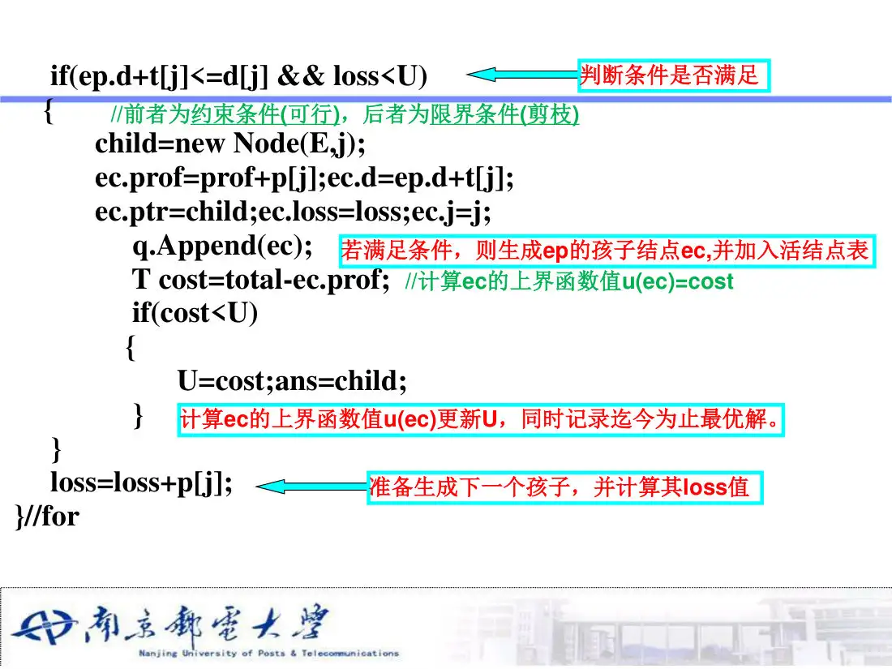

原文：

安南京郵電大学 Nanjing University of Posts & Telecommunications

### 第 49 页

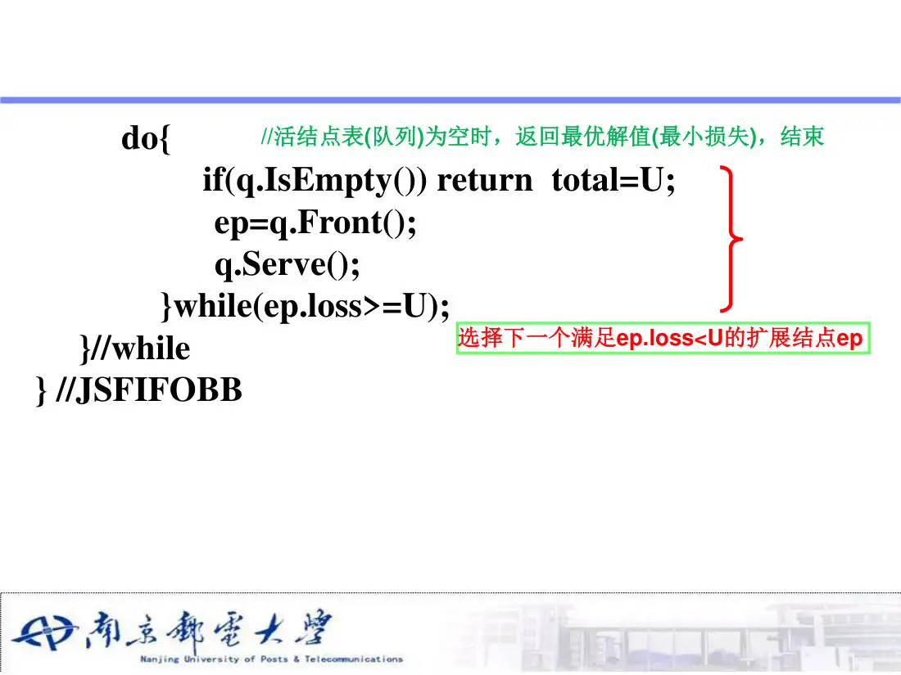

原文：

安南京郵電大学 Nanjing University of Posts & Telecommunications

### $$

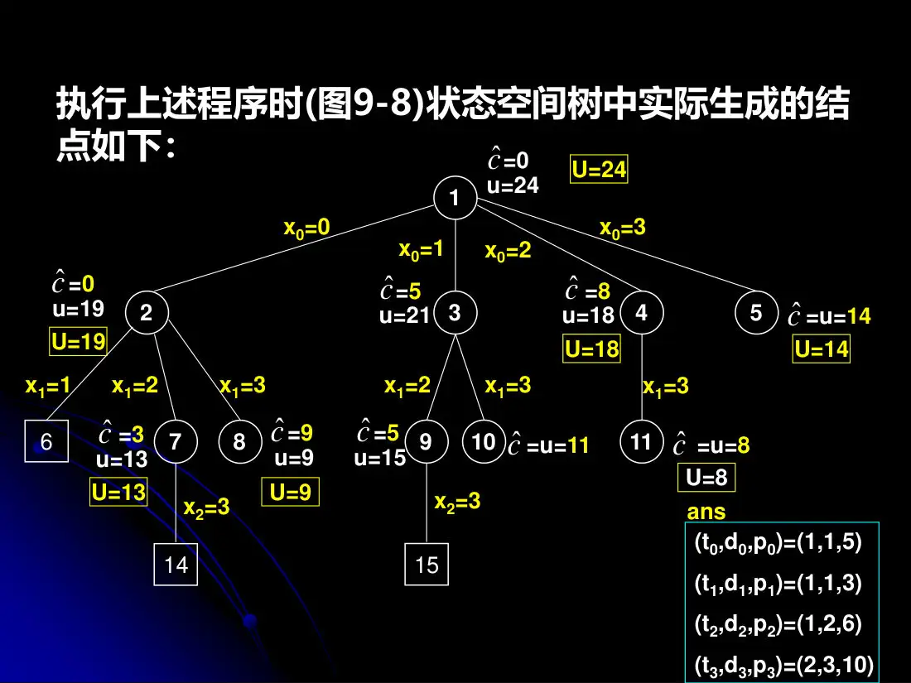

原文：

执行上述程序时(图9-8)状态空间树中实际生成的结点如下： =0 cˆ 11-24

$$
\mathrm{U=24}
$$

$$
x _ {0} = 1
$$

$$
x _ {0} = 2
$$

$$
x _ {0} = 3
$$

$$
\mathrm{U=8}
$$

$$
(t _ {0}, d _ {0}, p _ {0}) = (1, 1, 5)
$$

$$
(t _ {1}, d _ {1}, p _ {1}) = (1, 1, 3)
$$

$$
(t _ {2}, d _ {2}, p _ {2}) = (1, 2, 6)
$$

$$
(t _ {3}, d _ {3}, p _ {3}) = (2, 3, 1 0)
$$

### 思考

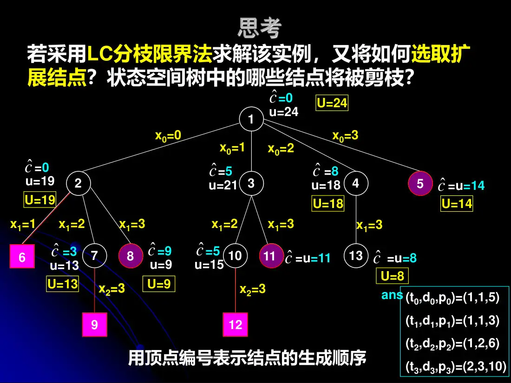

原文：

思考

若采用LC分枝限界法求解该实例，又将如何选取扩展结点？状态空间树中的哪些结点将被剪枝？

$$
\begin{array}{l} \hat {\mathcal {C}} = 0 \\ u = 2 4 \end{array}
$$

$$
\mathrm{U} = 2 4
$$

$$
x _ {0} = 0
$$

$$
x _ {0} = 3
$$

$$
\hat {\mathcal {C}} = 0
$$

$$
x _ {0} = 1
$$

$$
x _ {0} = 2
$$

$$
u = 1 9
$$

$$
\hat {\mathcal {C}} = 5
$$

$$
\boxed {U = 1 9}
$$

$$
\hat {c} = 8
$$

$$
u = 2 1
$$

$$
u = 1 8
$$

55

$$
\hat {\mathcal {C}} = \mathrm{u} = 1 4
$$

$$
\boxed {U = 1 8}
$$

$$
\boxed {U = 1 4}
$$

$$
x _ {1} = 1
$$

$$
x _ {1} = 2
$$

$$
x _ {1} = 3
$$

$$
x _ {1} = 2
$$

$$
x _ {1} = 3
$$

$$
x _ {1} = 3
$$

$$
\begin{array}{l} \hat {C} = 3 \\ u = 1 3 \end{array}
$$

$$
\begin{array}{c} \hat {\mathcal {C}} = 9 \\ u = 9 \end{array}
$$

$$
\hat {c} = 5
$$

$$
\hat {\mathcal {C}} = \mathrm{u} = 1 1
$$

$$
\hat {\mathcal {C}} = \mathrm{u} = 8
$$

$$
\boxed {U = 1 3}
$$

$$
U = 8
$$

$$
U = 9
$$

$$
x _ {2} = 3
$$

$$
(t _ {0}, d _ {0}, p _ {0}) = (1, 1, 5)
$$

9

12

$$
(t _ {1}, d _ {1}, p _ {1}) = (1, 1, 3)
$$

用顶点编号表示结点的生成顺序

$$
(t _ {2}, d _ {2}, p _ {2}) = (1, 2, 6)
$$

$$
(t _ {3}, d _ {3}, p _ {3}) = (2, 3, 1 0)
$$

### 作业

原文：

作业

P205 补充题 9-2

【补充题】判断由如图(a)所示的初始状态出发，经过一系列合法的号牌移动能否到达图(b)所示的目标状态？为什么？如果可以到达目标状态，请画出其LC分枝限界法实际生成的那部分状态空间树。

1 3 4 5 2 7 8 9 6 1012 131411 15

1 2 3 4 5 6 7 8 9 1011 12 13 14 15

(a)

(b)

ch8.52
