# 《单片机原理与接口技术教程》第6章 单片机输入输出接口及系统扩展设计（课件）

原件的每一页，下面附识别出的文字。

### 第六章单片机输入输出接口及系统扩展设计

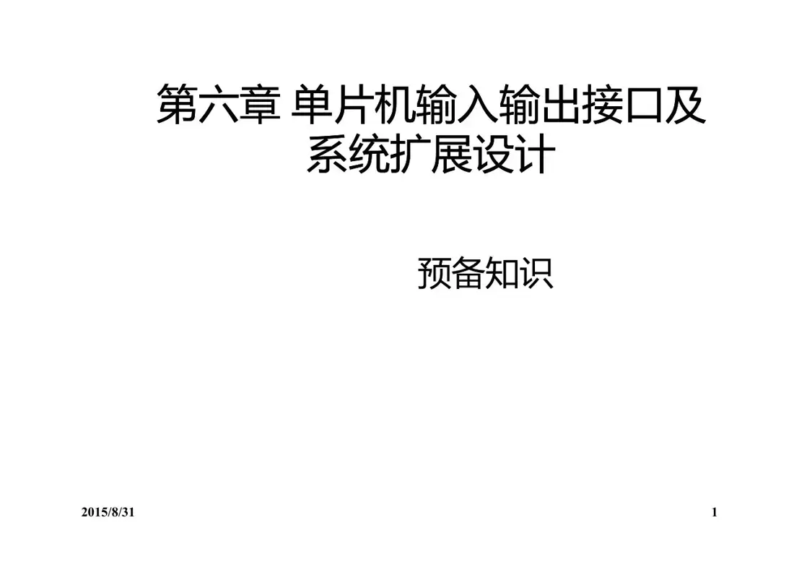

原文：

第六章单片机输入输出接口及系统扩展设计

预备知识

2015/8/31

1

### 单片机原理与接口技术教程

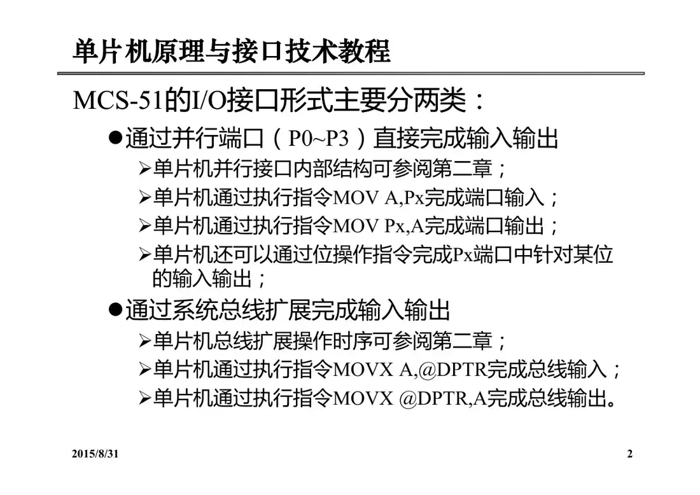

原文：

单片机原理与接口技术教程

MCS-51的I/O接口形式主要分两类：

通过并行端口（P0\~P3）直接完成输入输出

单片机并行接口内部结构可参阅第二章；

单片机通过执行指令MOV A,Px完成端口输入；

单片机通过执行指令MOV Px,A完成端口输出；

单片机还可以通过位操作指令完成Px端口中针对某位的输入输出；

通过系统总线扩展完成输入输出

单片机总线扩展操作时序可参阅第二章；

单片机通过执行指令MOVX A,@DPTR完成总线输入；

单片机通过执行指令MOVX @DPTR,A完成总线输出。

2015/8/31

2

### 第六章单片机输入输出接口及系统扩展设计

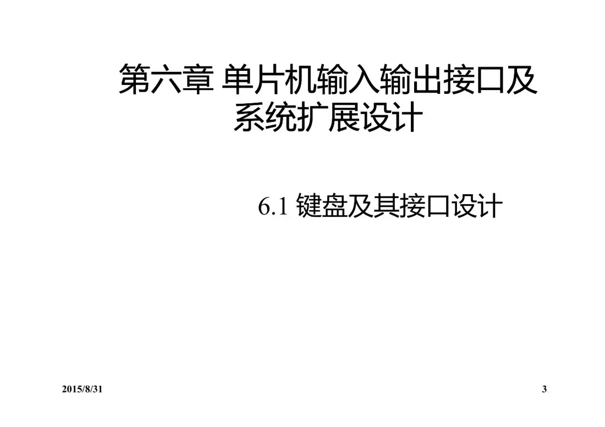

原文：

第六章单片机输入输出接口及系统扩展设计

6.1 键盘及其接口设计

2015/8/31

3

### 单片机原理与接口技术教程

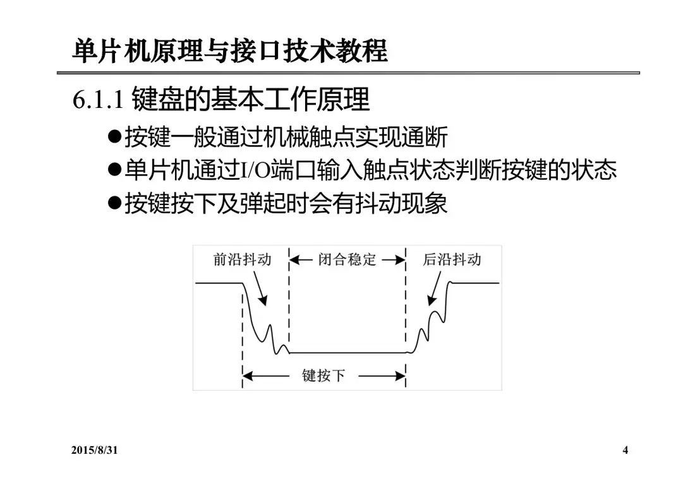

原文：

单片机原理与接口技术教程

6.1.1 键盘的基本工作原理

按键一般通过机械触点实现通断

单片机通过I/O端口输入触点状态判断按键的状态

按键按下及弹起时会有抖动现象

2015/8/31

4

### 单片机原理与接口技术教程

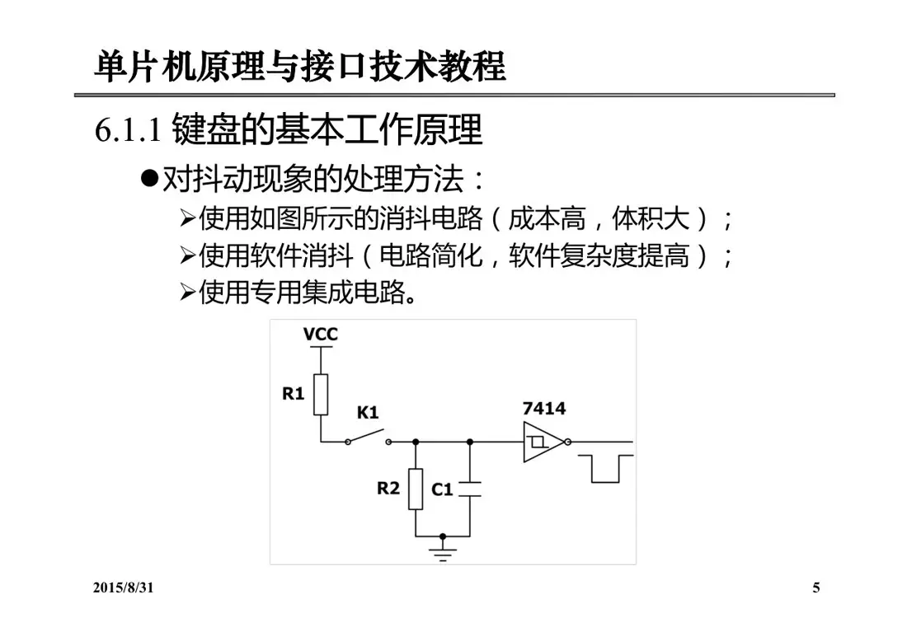

原文：

单片机原理与接口技术教程

6.1.1 键盘的基本工作原理

对抖动现象的处理方法：

使用如图所示的消抖电路（成本高，体积大）；

使用软件消抖（电路简化，软件复杂度提高）；

使用专用集成电路。

2015/8/31

5

### 单片机原理与接口技术教程

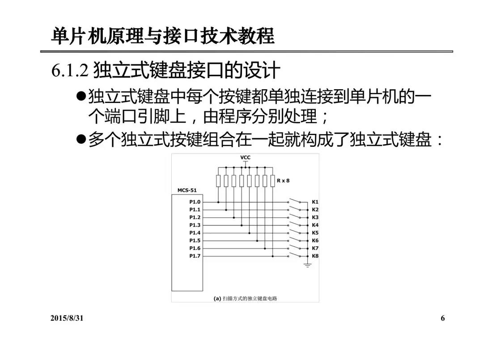

原文：

单片机原理与接口技术教程

6.1.2 独立式键盘接口的设计

独立式键盘中每个按键都单独连接到单片机的一个端口引脚上，由程序分别处理；

多个独立式按键组合在一起就构成了独立式键盘：

2015/8/31

6

### 单片机原理与接口技术教程

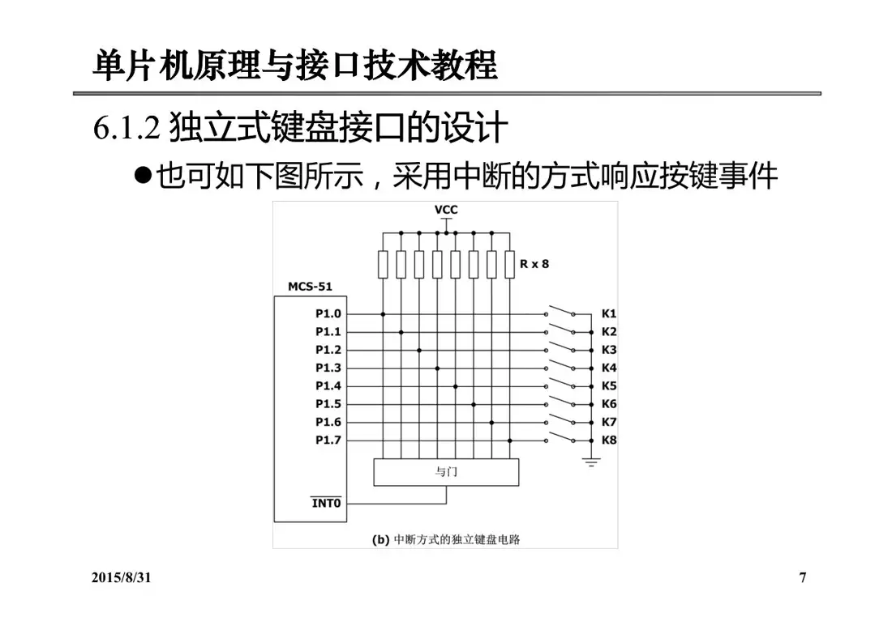

原文：

单片机原理与接口技术教程

6.1.2 独立式键盘接口的设计

也可如下图所示，采用中断的方式响应按键事件

2015/8/31

7

### 单片机原理与接口技术教程

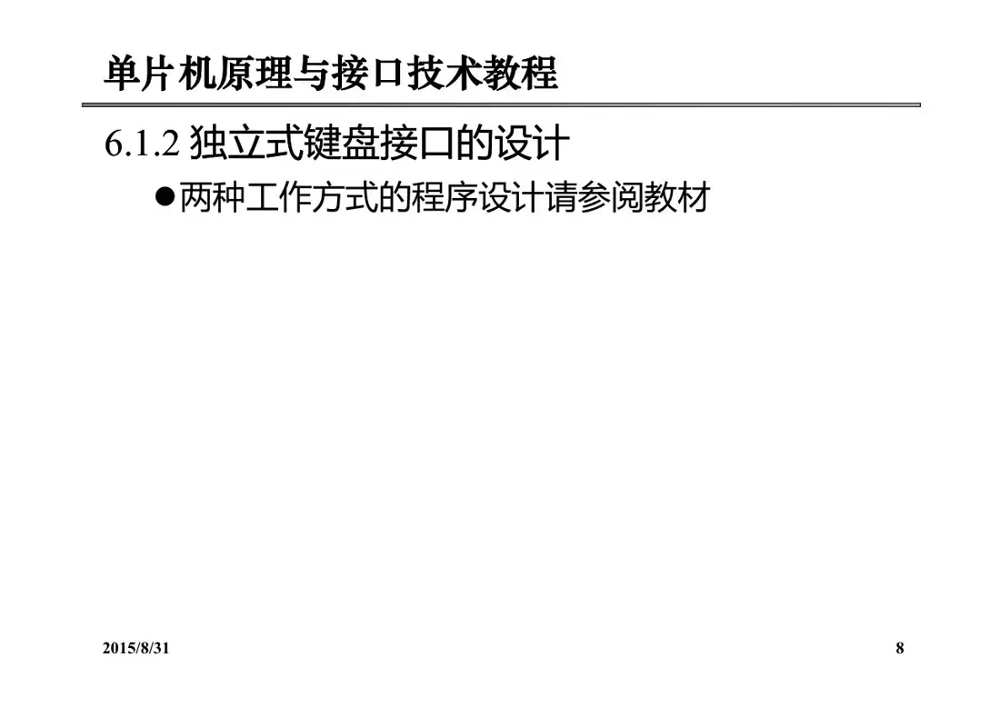

原文：

单片机原理与接口技术教程

6.1.2 独立式键盘接口的设计

两种工作方式的程序设计请参阅教材

2015/8/31

8

### 单片机原理与接口技术教程

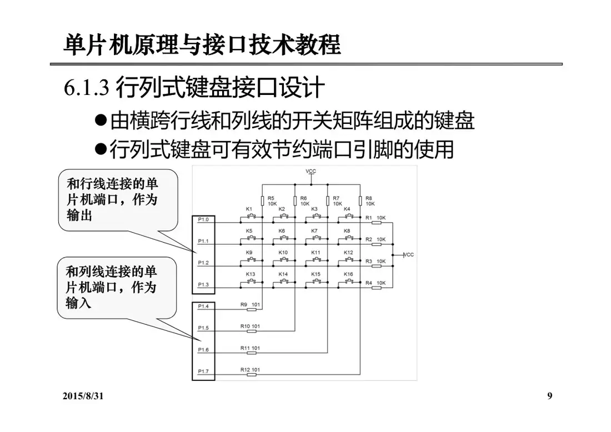

原文：

单片机原理与接口技术教程

6.1.3 行列式键盘接口设计

由横跨行线和列线的开关矩阵组成的键盘

行列式键盘可有效节约端口引脚的使用

2015/8/31

9

### 单片机原理与接口技术教程

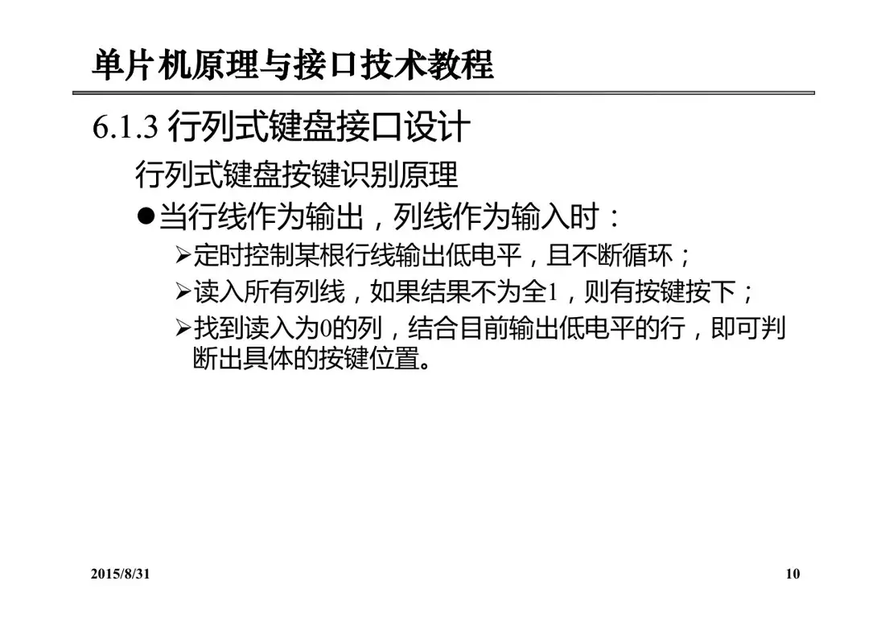

原文：

单片机原理与接口技术教程

6.1.3 行列式键盘接口设计

行列式键盘按键识别原理

当行线作为输出，列线作为输入时：

定时控制某根行线输出低电平，且不断循环；

读入所有列线，如果结果不为全1，则有按键按下；

找到读入为0的列，结合目前输出低电平的行，即可判断出具体的按键位置。

2015/8/31

10

### 单片机原理与接口技术教程

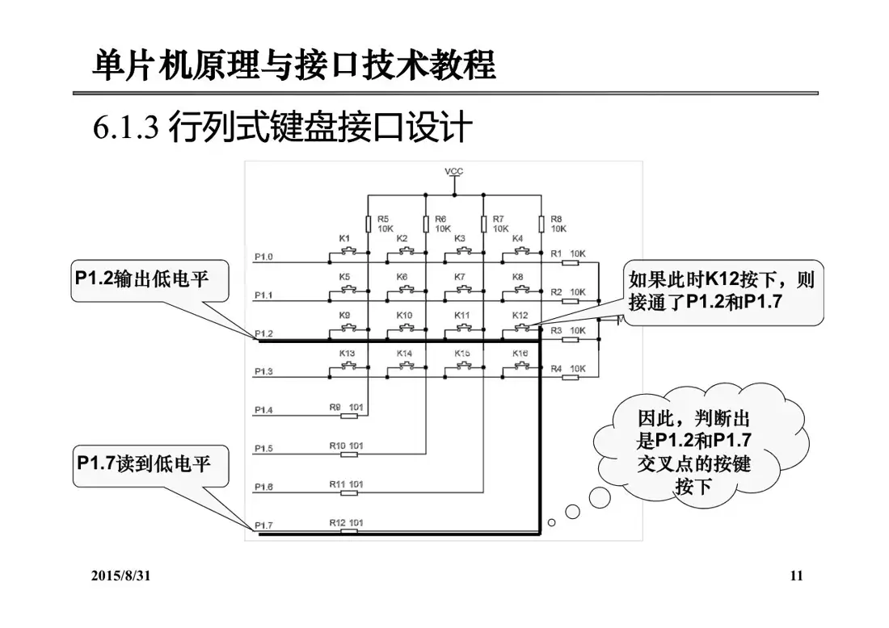

原文：

单片机原理与接口技术教程

6.1.3 行列式键盘接口设计

P1.2输出低电平

P1.7读到低电平如果此时K12按下，则接通了P1.2和P1.7

因此，判断出是P1.2和P1.7交叉点的按键按下

2015/8/31

11

### 单片机原理与接口技术教程

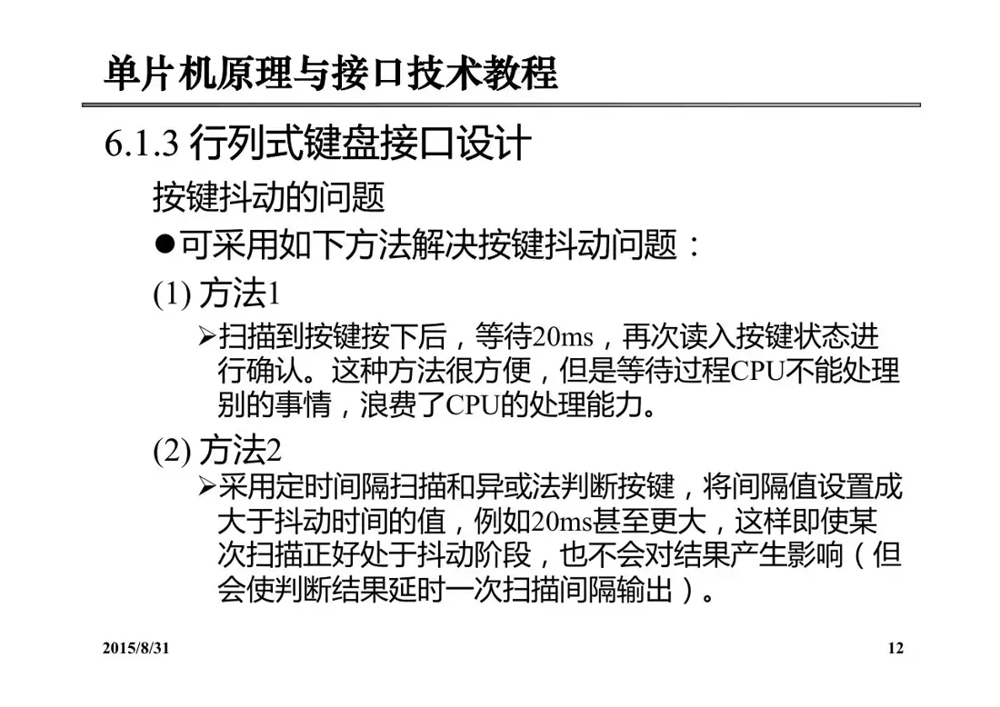

原文：

单片机原理与接口技术教程

6.1.3 行列式键盘接口设计

按键抖动的问题

可采用如下方法解决按键抖动问题：

(1) 方法1

扫描到按键按下后，等待20ms，再次读入按键状态进行确认。这种方法很方便，但是等待过程CPU不能处理别的事情，浪费了CPU的处理能力。

(2) 方法2

采用定时间隔扫描和异或法判断按键，将间隔值设置成大于抖动时间的值，例如20ms甚至更大，这样即使某次扫描正好处于抖动阶段，也不会对结果产生影响（但会使判断结果延时一次扫描间隔输出）。

2015/8/31

12

### 单片机原理与接口技术教程

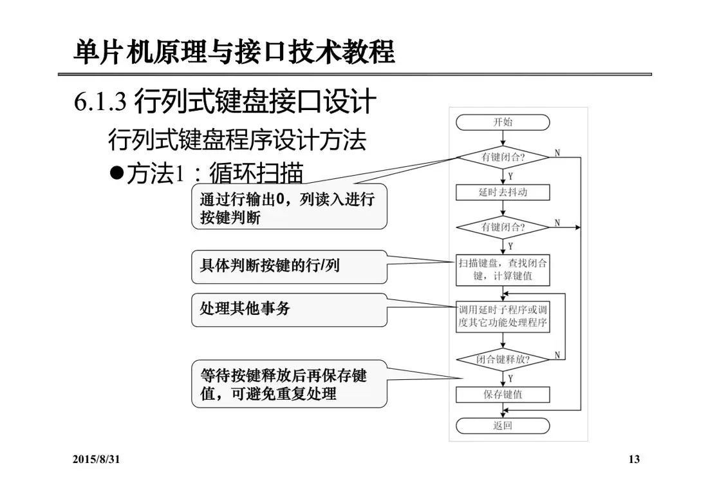

原文：

单片机原理与接口技术教程

6.1.3 行列式键盘接口设计行列式键盘程序设计方法

方法1：循环扫描

通过行输出0，列读入进行按键判断

具体判断按键的行/列

处理其他事务

等待按键释放后再保存键值，可避免重复处理

2015/8/31

13

### 单片机原理与接口技术教程

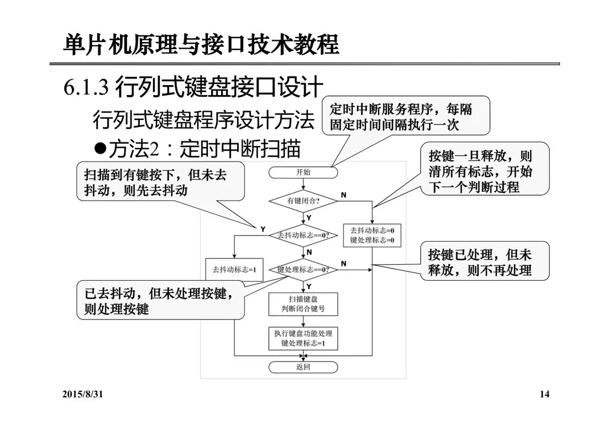

原文：

单片机原理与接口技术教程

6.1.3 行列式键盘接口设计

行列式键盘程序设计方法

方法2：定时中断扫描

扫描到有键按下，但未去抖动，则先去抖动

已去抖动，但未处理按键，则处理按键

定时中断服务程序，每隔固定时间间隔执行一次

按键一旦释放，则清所有标志，开始下一个判断过程

2015/8/31

14

### 第六章单片机输入输出接口及系统扩展设计

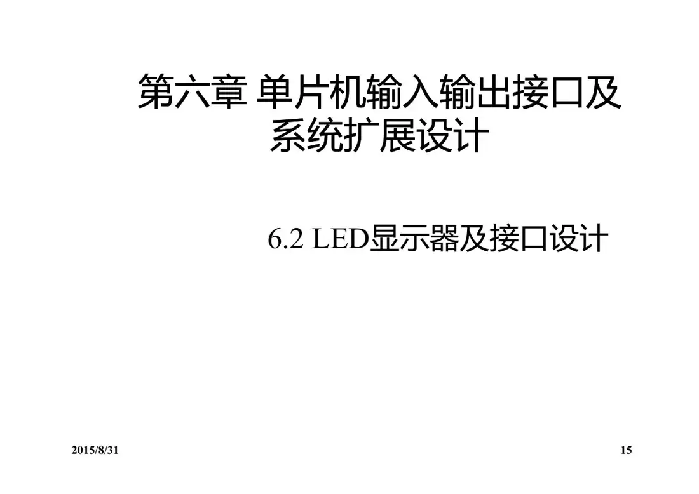

原文：

第六章单片机输入输出接口及系统扩展设计

6.2 LED显示器及接口设计

2015/8/31

15

### 单片机原理与接口技术教程

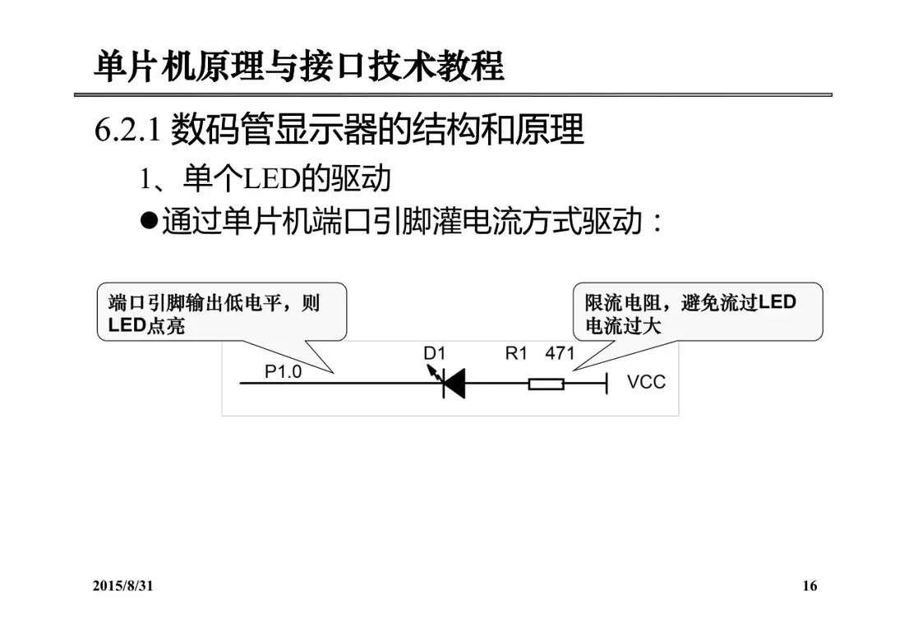

原文：

单片机原理与接口技术教程

6.2.1 数码管显示器的结构和原理

1、单个LED的驱动

通过单片机端口引脚灌电流方式驱动：

端口引脚输出低电平，则 LED点亮

限流电阻，避免流过LED电流过大

2015/8/31

16

### 单片机原理与接口技术教程

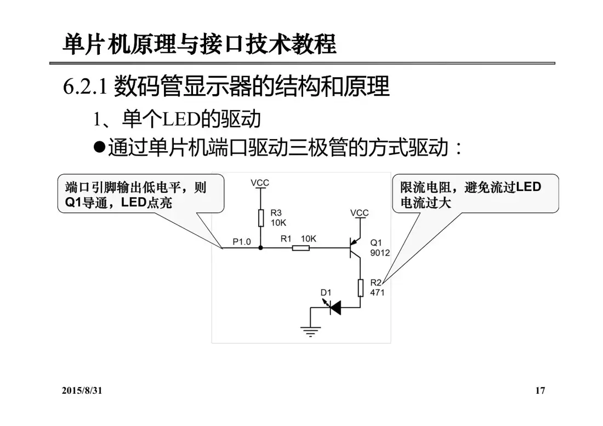

原文：

单片机原理与接口技术教程

6.2.1 数码管显示器的结构和原理

1、单个LED的驱动

通过单片机端口驱动三极管的方式驱动：

端口引脚输出低电平，则 Q1导通，LED点亮

限流电阻，避免流过LED电流过大

2015/8/31

17

### 单片机原理与接口技术教程

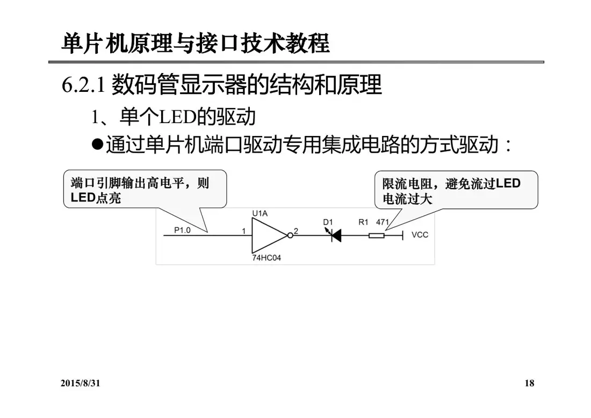

原文：

单片机原理与接口技术教程

6.2.1 数码管显示器的结构和原理

1、单个LED的驱动

通过单片机端口驱动专用集成电路的方式驱动：

端口引脚输出高电平，则 LED点亮

限流电阻，避免流过LED电流过大

2015/8/31

18

### 单片机原理与接口技术教程

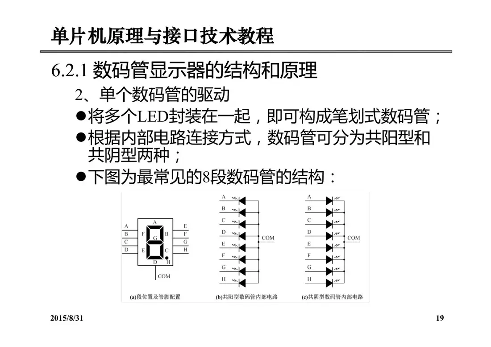

原文：

单片机原理与接口技术教程

6.2.1 数码管显示器的结构和原理

2、单个数码管的驱动

将多个LED封装在一起，即可构成笔划式数码管；

根据内部电路连接方式，数码管可分为共阳型和共阴型两种；

下图为最常见的8段数码管的结构：

2015/8/31

19

### 单片机原理与接口技术教程

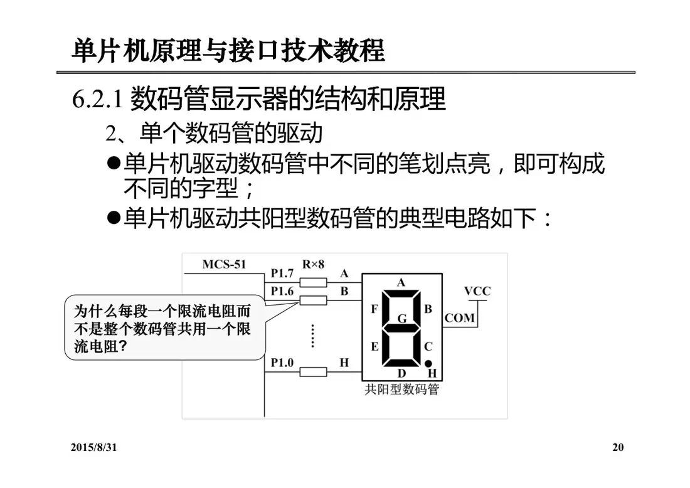

原文：

单片机原理与接口技术教程

6.2.1 数码管显示器的结构和原理

2、单个数码管的驱动

单片机驱动数码管中不同的笔划点亮，即可构成不同的字型；

单片机驱动共阳型数码管的典型电路如下：

2015/8/31

20

### 单片机原理与接口技术教程

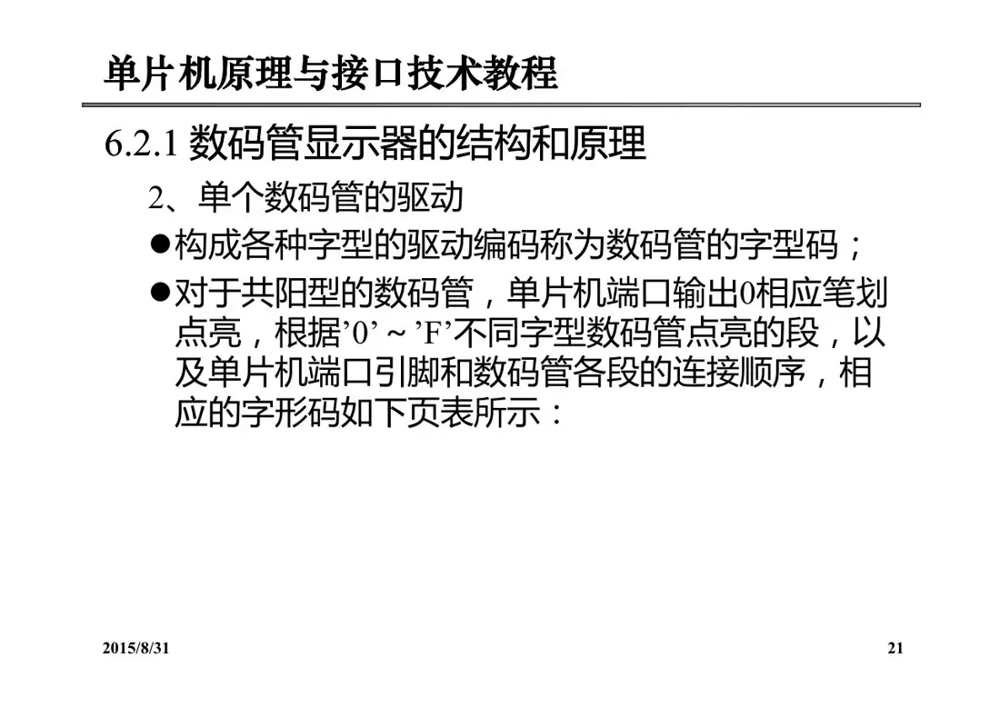

原文：

单片机原理与接口技术教程

6.2.1 数码管显示器的结构和原理

2、单个数码管的驱动

构成各种字型的驱动编码称为数码管的字型码；

对于共阳型的数码管，单片机端口输出0相应笔划点亮，根据’0’～’F’不同字型数码管点亮的段，以及单片机端口引脚和数码管各段的连接顺序，相应的字形码如下页表所示：

2015/8/31

21

### 单片机原理与接口技术教程

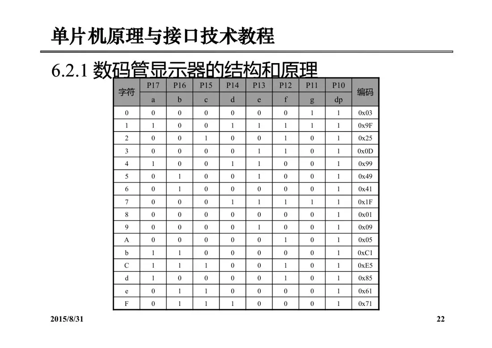

原文：

单片机原理与接口技术教程

6.2.1 数码管显示器的结构和原理

<table><tr><td rowspan="2">字符</td><td>P17</td><td>P16</td><td>P15</td><td>P14</td><td>P13</td><td>P12</td><td>P11</td><td>P10</td><td rowspan="2">编码</td></tr><tr><td>a</td><td>b</td><td>c</td><td>d</td><td>e</td><td>f</td><td>g</td><td>dp</td></tr><tr><td>0</td><td>0</td><td>0</td><td>0</td><td>0</td><td>0</td><td>0</td><td>1</td><td>1</td><td>0x03</td></tr><tr><td>1</td><td>1</td><td>0</td><td>0</td><td>1</td><td>1</td><td>1</td><td>1</td><td>1</td><td>0x9F</td></tr><tr><td>2</td><td>0</td><td>0</td><td>1</td><td>0</td><td>0</td><td>1</td><td>0</td><td>1</td><td>0x25</td></tr><tr><td>3</td><td>0</td><td>0</td><td>0</td><td>0</td><td>1</td><td>1</td><td>0</td><td>1</td><td>0x0D</td></tr><tr><td>4</td><td>1</td><td>0</td><td>0</td><td>1</td><td>1</td><td>0</td><td>0</td><td>1</td><td>0x99</td></tr><tr><td>5</td><td>0</td><td>1</td><td>0</td><td>0</td><td>1</td><td>0</td><td>0</td><td>1</td><td>0x49</td></tr><tr><td>6</td><td>0</td><td>1</td><td>0</td><td>0</td><td>0</td><td>0</td><td>0</td><td>1</td><td>0x41</td></tr><tr><td>7</td><td>0</td><td>0</td><td>0</td><td>1</td><td>1</td><td>1</td><td>1</td><td>1</td><td>0x1F</td></tr><tr><td>8</td><td>0</td><td>0</td><td>0</td><td>0</td><td>0</td><td>0</td><td>0</td><td>1</td><td>0x01</td></tr><tr><td>9</td><td>0</td><td>0</td><td>0</td><td>0</td><td>1</td><td>0</td><td>0</td><td>1</td><td>0x09</td></tr><tr><td>A</td><td>0</td><td>0</td><td>0</td><td>0</td><td>0</td><td>1</td><td>0</td><td>1</td><td>0x05</td></tr><tr><td>b</td><td>1</td><td>1</td><td>0</td><td>0</td><td>0</td><td>0</td><td>0</td><td>1</td><td>0xC1</td></tr><tr><td>C</td><td>1</td><td>1</td><td>1</td><td>0</td><td>0</td><td>1</td><td>0</td><td>1</td><td>0xE5</td></tr><tr><td>d</td><td>1</td><td>0</td><td>0</td><td>0</td><td>0</td><td>1</td><td>0</td><td>1</td><td>0x85</td></tr><tr><td>e</td><td>0</td><td>1</td><td>1</td><td>0</td><td>0</td><td>0</td><td>0</td><td>1</td><td>0x61</td></tr><tr><td>F</td><td>0</td><td>1</td><td>1</td><td>1</td><td>0</td><td>0</td><td>0</td><td>1</td><td>0x71</td></tr></table>

2015/8/31

22

### 单片机原理与接口技术教程

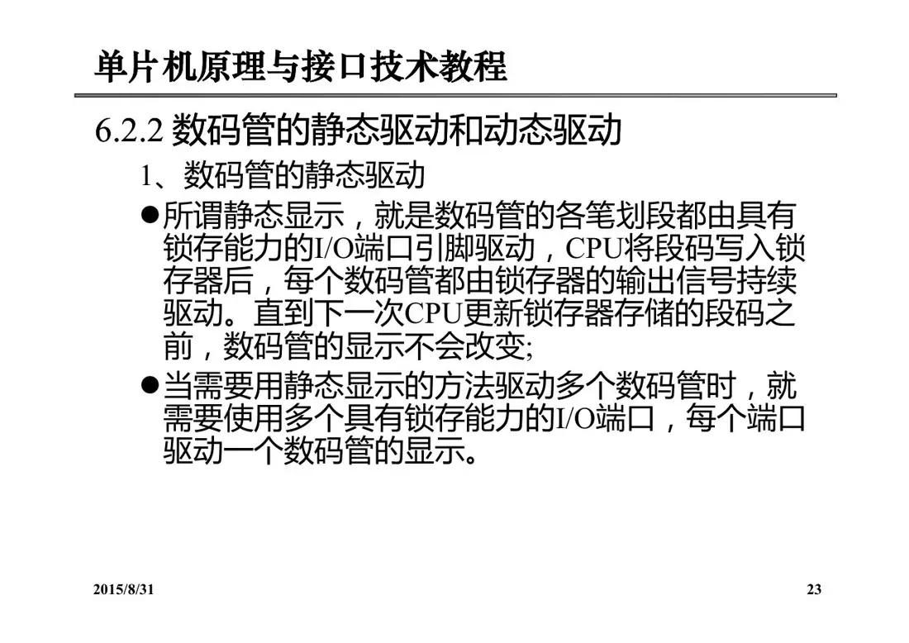

原文：

单片机原理与接口技术教程

6.2.2 数码管的静态驱动和动态驱动

1、数码管的静态驱动

所谓静态显示，就是数码管的各笔划段都由具有锁存能力的I/O端口引脚驱动，CPU将段码写入锁存器后，每个数码管都由锁存器的输出信号持续驱动。直到下一次CPU更新锁存器存储的段码之前，数码管的显示不会改变;

当需要用静态显示的方法驱动多个数码管时，就需要使用多个具有锁存能力的I/O端口，每个端口驱动一个数码管的显示。

2015/8/31

23

### 单片机原理与接口技术教程

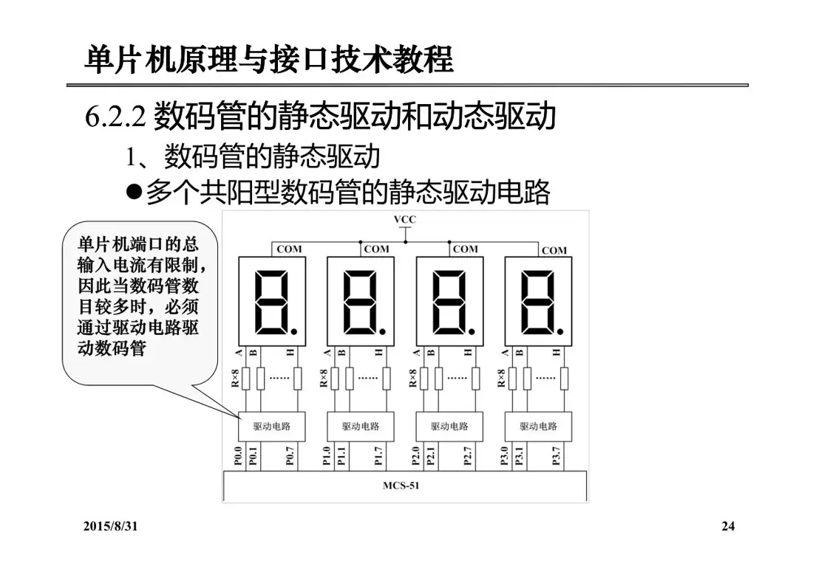

原文：

单片机原理与接口技术教程

6.2.2 数码管的静态驱动和动态驱动

1、数码管的静态驱动

多个共阳型数码管的静态驱动电路

单片机端口的总输入电流有限制，因此当数码管数目较多时，必须通过驱动电路驱动数码管

2015/8/31

24

### 单片机原理与接口技术教程

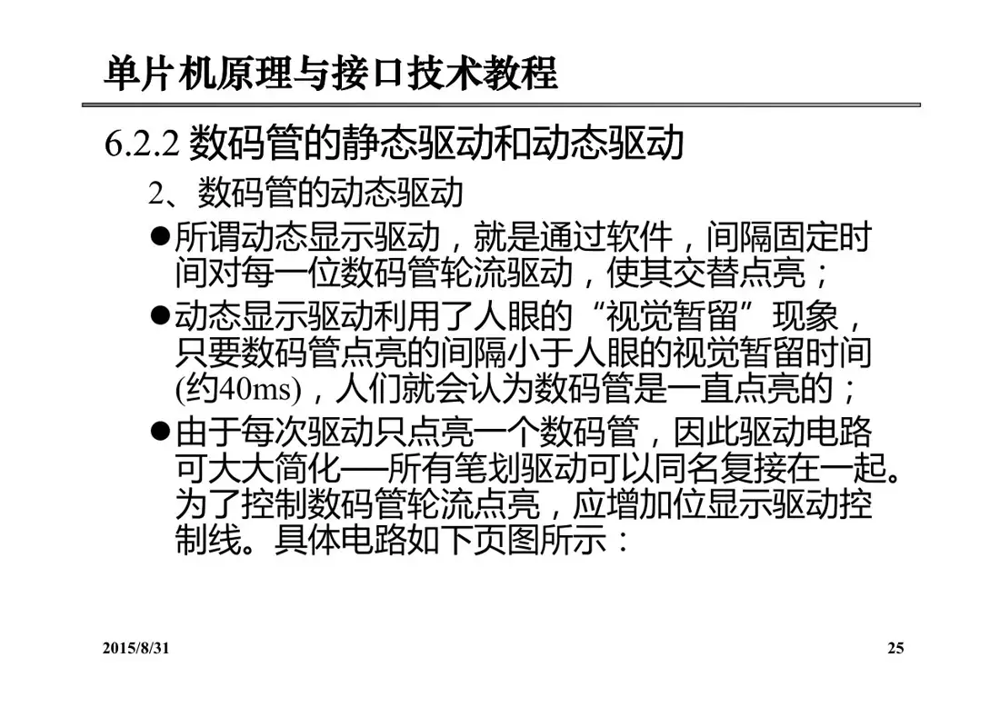

原文：

单片机原理与接口技术教程

6.2.2 数码管的静态驱动和动态驱动

2、数码管的动态驱动

所谓动态显示驱动，就是通过软件，间隔固定时间对每一位数码管轮流驱动，使其交替点亮；

动态显示驱动利用了人眼的“视觉暂留”现象，只要数码管点亮的间隔小于人眼的视觉暂留时间(约40ms)，人们就会认为数码管是一直点亮的；

由于每次驱动只点亮一个数码管，因此驱动电路可大大简化──所有笔划驱动可以同名复接在一起。为了控制数码管轮流点亮，应增加位显示驱动控制线。具体电路如下页图所示：

2015/8/31

25

### 单片机原理与接口技术教程

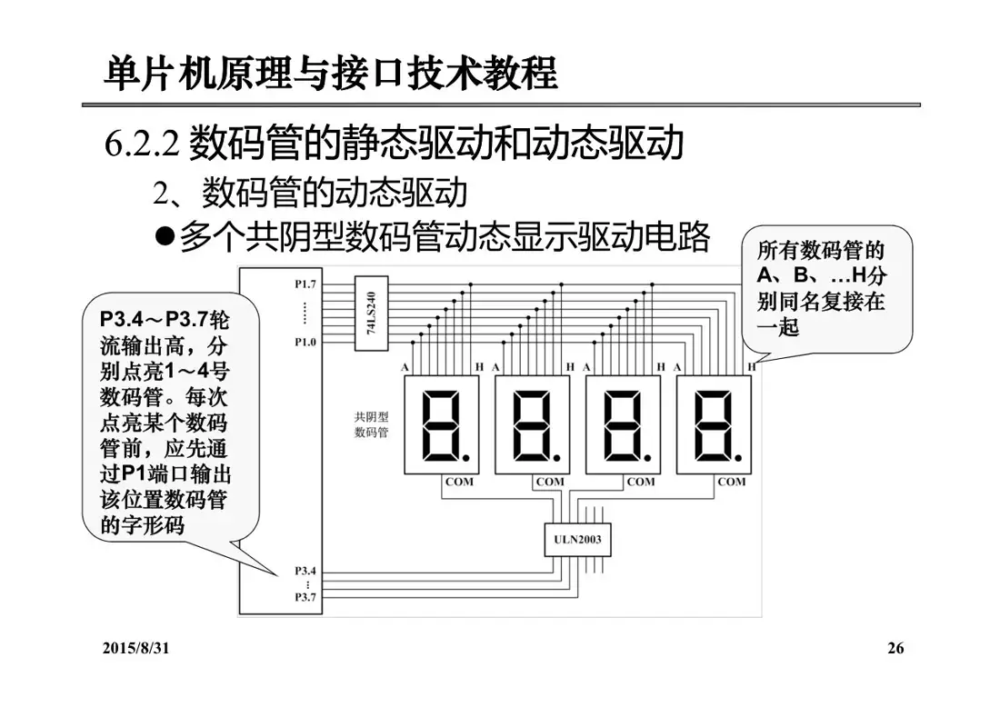

原文：

单片机原理与接口技术教程

6.2.2 数码管的静态驱动和动态驱动

2、数码管的动态驱动

多个共阴型数码管动态显示驱动电路

2015/8/31

26

### 单片机原理与接口技术教程

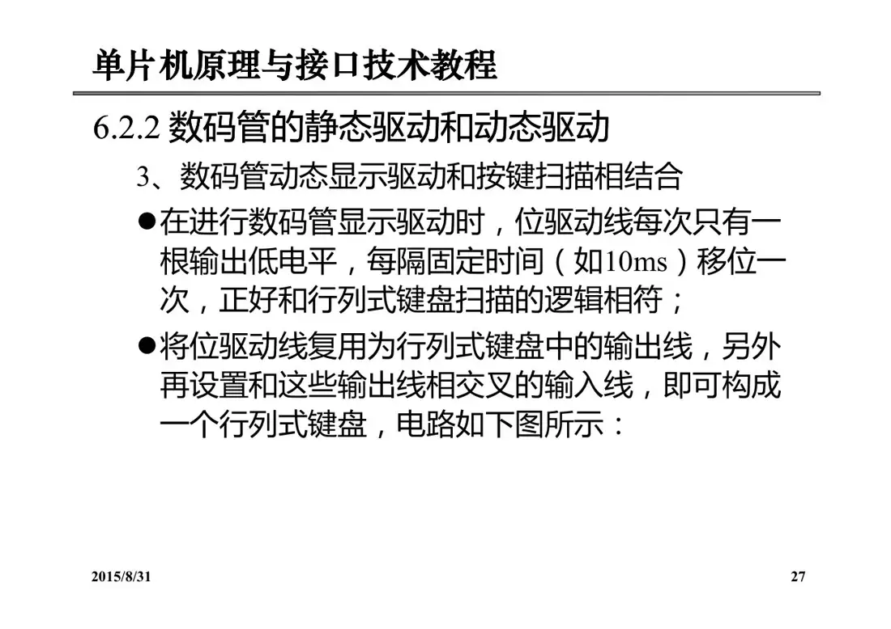

原文：

单片机原理与接口技术教程

6.2.2 数码管的静态驱动和动态驱动

3、数码管动态显示驱动和按键扫描相结合

在进行数码管显示驱动时，位驱动线每次只有一根输出低电平，每隔固定时间（如10ms）移位一次，正好和行列式键盘扫描的逻辑相符；

将位驱动线复用为行列式键盘中的输出线，另外再设置和这些输出线相交叉的输入线，即可构成一个行列式键盘，电路如下图所示：

2015/8/31

27

### 单片机原理与接口技术教程

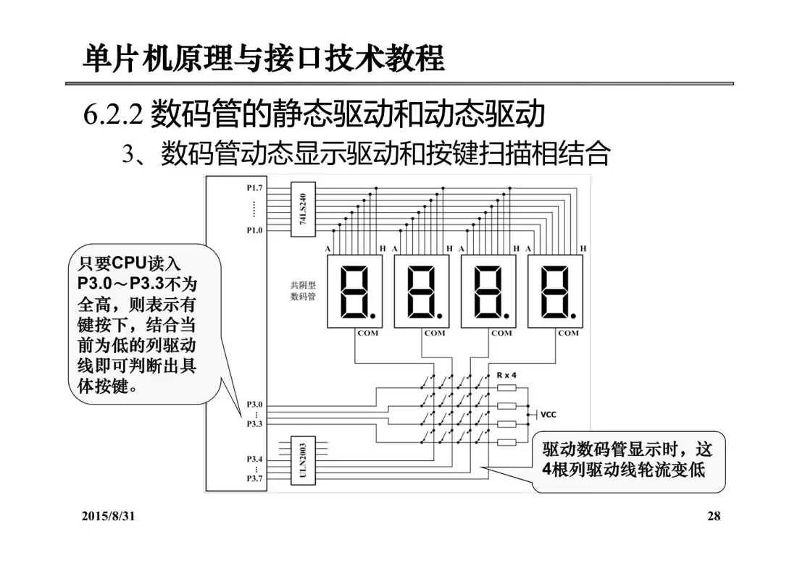

原文：

单片机原理与接口技术教程

6.2.2 数码管的静态驱动和动态驱动

3、数码管动态显示驱动和按键扫描相结合

只要CPU读入P3.0～P3.3不为全高，则表示有键按下，结合当前为低的列驱动线即可判断出具体按键。

2015/8/31

28

### 第六章单片机输入输出接口及系统扩展设计

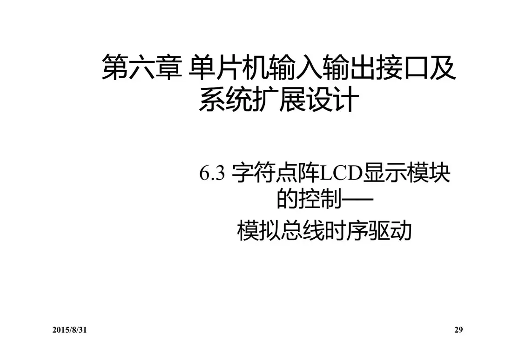

原文：

第六章单片机输入输出接口及系统扩展设计

6.3 字符点阵LCD显示模块的控制模拟总线时序驱动

2015/8/31

29

### 单片机原理与接口技术教程

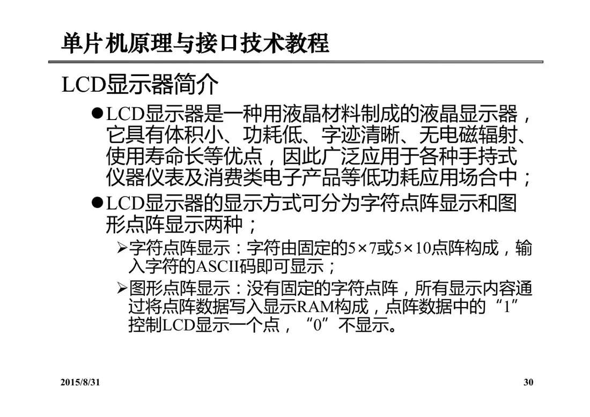

原文：

单片机原理与接口技术教程

LCD显示器简介

LCD显示器是一种用液晶材料制成的液晶显示器，它具有体积小、功耗低、字迹清晰、无电磁辐射、使用寿命长等优点，因此广泛应用于各种手持式仪器仪表及消费类电子产品等低功耗应用场合中；

LCD显示器的显示方式可分为字符点阵显示和图形点阵显示两种；

字符点阵显示：字符由固定的5×7或5×10点阵构成，输入字符的ASCII码即可显示；

图形点阵显示：没有固定的字符点阵，所有显示内容通过将点阵数据写入显示RAM构成，点阵数据中的“1”控制LCD显示一个点，“0”不显示。

2015/8/31

30

### 单片机原理与接口技术教程

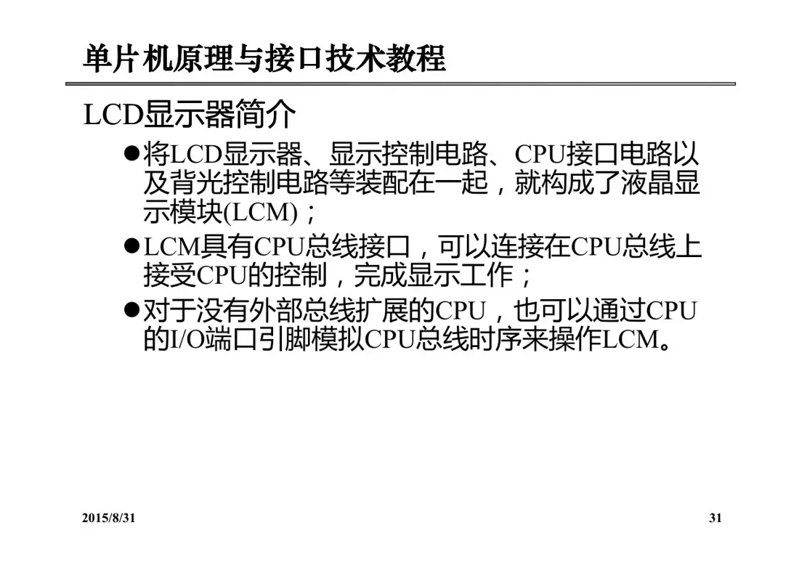

原文：

单片机原理与接口技术教程

LCD显示器简介

将LCD显示器、显示控制电路、CPU接口电路以及背光控制电路等装配在一起，就构成了液晶显示模块(LCM)；

LCM具有CPU总线接口，可以连接在CPU总线上接受CPU的控制，完成显示工作；

对于没有外部总线扩展的CPU，也可以通过CPU的I/O端口引脚模拟CPU总线时序来操作LCM。

2015/8/31

31

### 单片机原理与接口技术教程

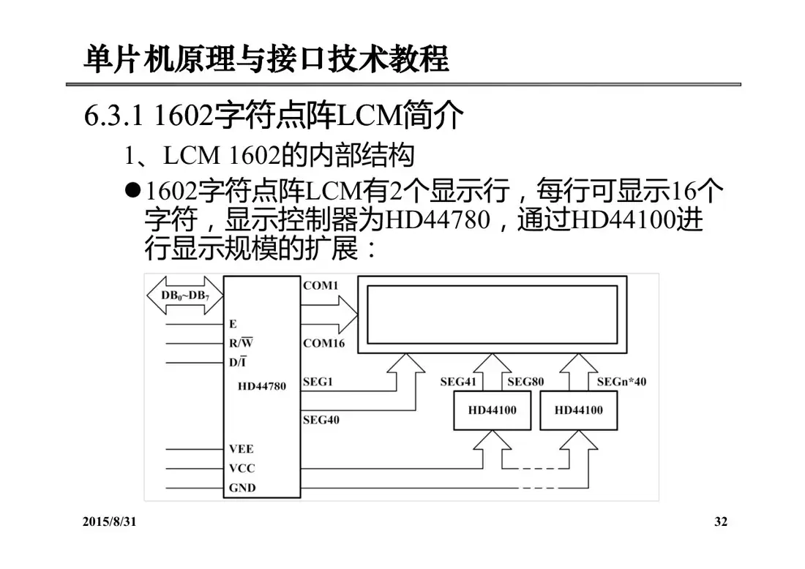

原文：

单片机原理与接口技术教程

6.3.1 1602字符点阵LCM简介

1、LCM 1602的内部结构

1602字符点阵LCM有2个显示行，每行可显示16个字符，显示控制器为HD44780，通过HD44100进行显示规模的扩展：

2015/8/31

32

### 单片机原理与接口技术教程

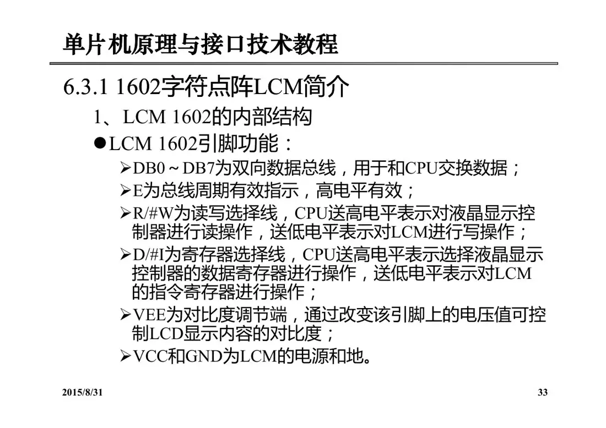

原文：

单片机原理与接口技术教程

6.3.1 1602字符点阵LCM简介

1、LCM 1602的内部结构

LCM 1602引脚功能：

DB0～DB7为双向数据总线，用于和CPU交换数据；

E为总线周期有效指示，高电平有效；

R/#W为读写选择线，CPU送高电平表示对液晶显示控制器进行读操作，送低电平表示对LCM进行写操作；

D/#I为寄存器选择线，CPU送高电平表示选择液晶显示控制器的数据寄存器进行操作，送低电平表示对LCM的指令寄存器进行操作；

VEE为对比度调节端，通过改变该引脚上的电压值可控制LCD显示内容的对比度；

VCC和GND为LCM的电源和地。

2015/8/31

33

### 单片机原理与接口技术教程

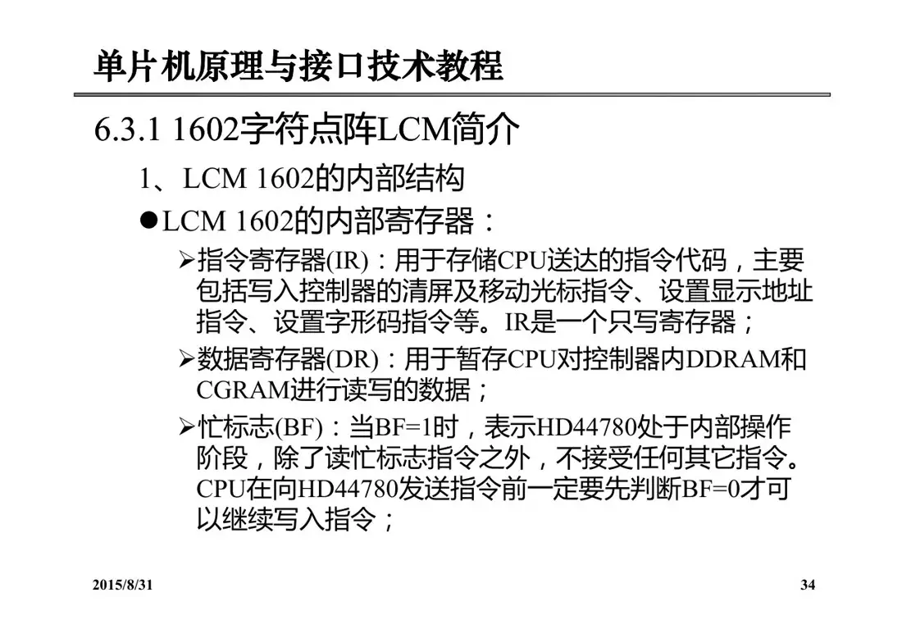

原文：

单片机原理与接口技术教程

6.3.1 1602字符点阵LCM简介

1、LCM 1602的内部结构

LCM 1602的内部寄存器：

指令寄存器(IR)：用于存储CPU送达的指令代码，主要包括写入控制器的清屏及移动光标指令、设置显示地址指令、设置字形码指令等。IR是一个只写寄存器；

数据寄存器(DR)：用于暂存CPU对控制器内DDRAM和CGRAM进行读写的数据；

忙标志(BF)：当BF=1时，表示HD44780处于内部操作阶段，除了读忙标志指令之外，不接受任何其它指令。CPU在向HD44780发送指令前一定要先判断BF=0才可以继续写入指令；

2015/8/31

34

### 单片机原理与接口技术教程

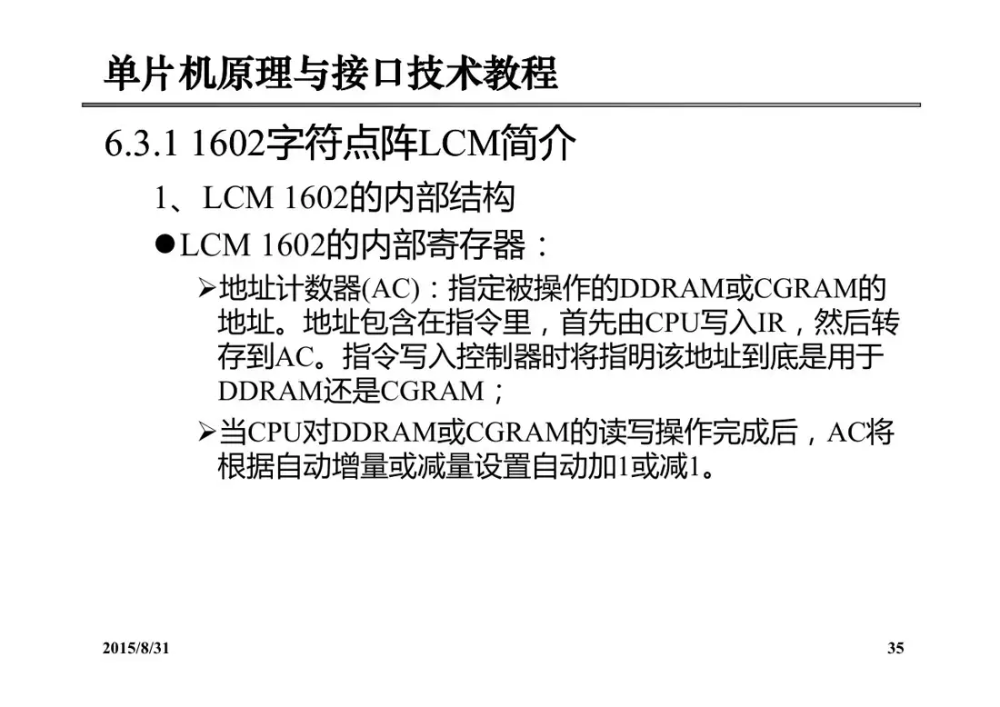

原文：

单片机原理与接口技术教程

6.3.1 1602字符点阵LCM简介

1、LCM 1602的内部结构

LCM 1602的内部寄存器：

地址计数器(AC)：指定被操作的DDRAM或CGRAM的地址。地址包含在指令里，首先由CPU写入IR，然后转存到AC。指令写入控制器时将指明该地址到底是用于DDRAM还是CGRAM；

当CPU对DDRAM或CGRAM的读写操作完成后，AC将根据自动增量或减量设置自动加1或减1。

2015/8/31

35

### 单片机原理与接口技术教程

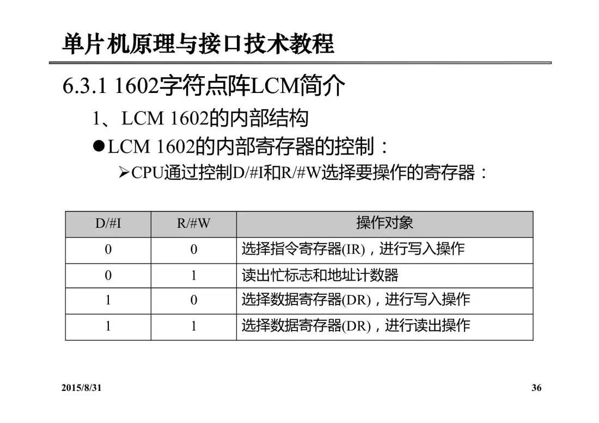

原文：

单片机原理与接口技术教程

6.3.1 1602字符点阵LCM简介

1、LCM 1602的内部结构

LCM 1602的内部寄存器的控制：

CPU通过控制D/#I和R/#W选择要操作的寄存器：

<table><tr><td>D/#I</td><td>R/#W</td><td>操作对象</td></tr><tr><td>0</td><td>0</td><td>选择指令寄存器(IR),进行写入操作</td></tr><tr><td>0</td><td>1</td><td>读出忙标志和地址计数器</td></tr><tr><td>1</td><td>0</td><td>选择数据寄存器(DR),进行写入操作</td></tr><tr><td>1</td><td>1</td><td>选择数据寄存器(DR),进行读出操作</td></tr></table>

2015/8/31

36

### 单片机原理与接口技术教程

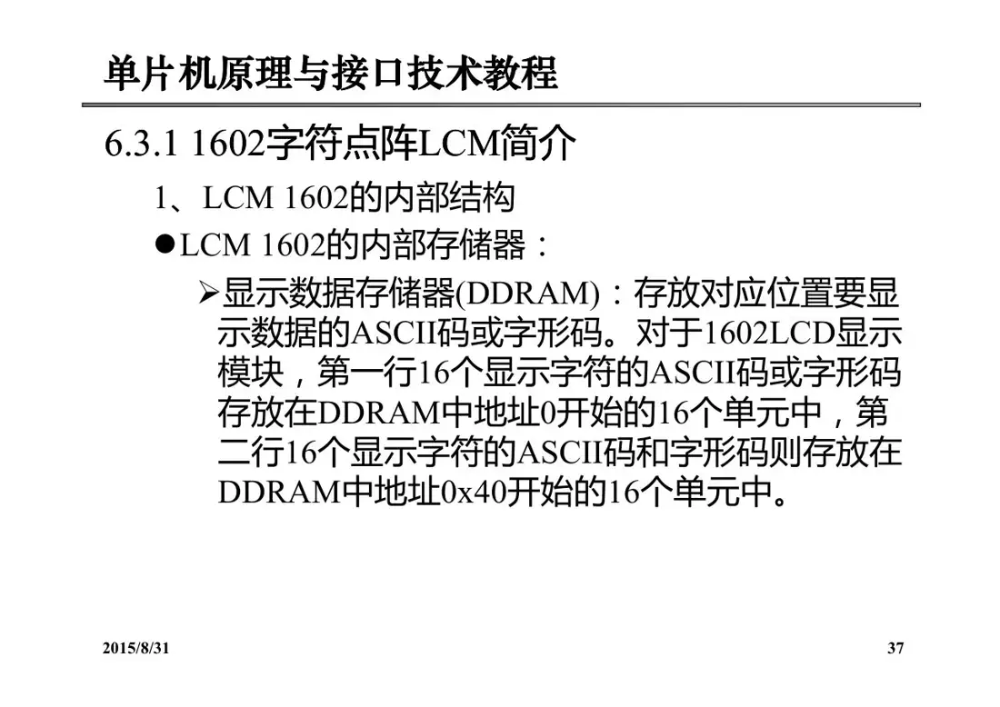

原文：

单片机原理与接口技术教程

6.3.1 1602字符点阵LCM简介

1、LCM 1602的内部结构

LCM 1602的内部存储器：

显示数据存储器(DDRAM)：存放对应位置要显示数据的ASCII码或字形码。对于1602LCD显示模块，第一行16个显示字符的ASCII码或字形码存放在DDRAM中地址0开始的16个单元中，第二行16个显示字符的ASCII码和字形码则存放在DDRAM中地址0x40开始的16个单元中。

2015/8/31

37

### 单片机原理与接口技术教程

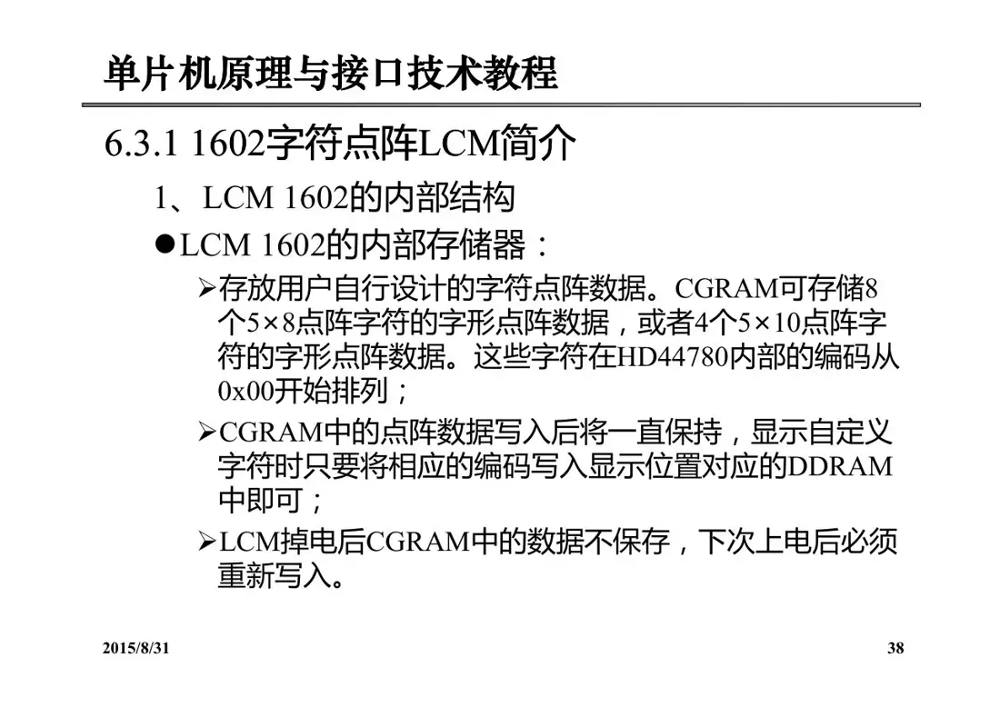

原文：

单片机原理与接口技术教程

6.3.1 1602字符点阵LCM简介

1、LCM 1602的内部结构

LCM 1602的内部存储器：

存放用户自行设计的字符点阵数据。CGRAM可存储8个5×8点阵字符的字形点阵数据，或者4个5×10点阵字符的字形点阵数据。这些字符在HD44780内部的编码从0x00开始排列；

CGRAM中的点阵数据写入后将一直保持，显示自定义字符时只要将相应的编码写入显示位置对应的DDRAM中即可；

LCM掉电后CGRAM中的数据不保存，下次上电后必须重新写入。

2015/8/31

38

### 单片机原理与接口技术教程

原文：

单片机原理与接口技术教程

6.3.1 1602字符点阵LCM简介

2、LCM 1602的操作时序

 CPU对HD44780进行一次总线读操作的时序为：

2015/8/31

39

### 单片机原理与接口技术教程

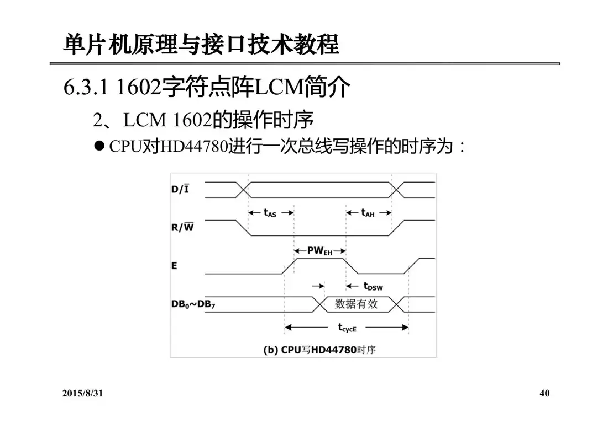

原文：

单片机原理与接口技术教程

6.3.1 1602字符点阵LCM简介

2、LCM 1602的操作时序

 CPU对HD44780进行一次总线写操作的时序为：

2015/8/31

40

### 单片机原理与接口技术教程

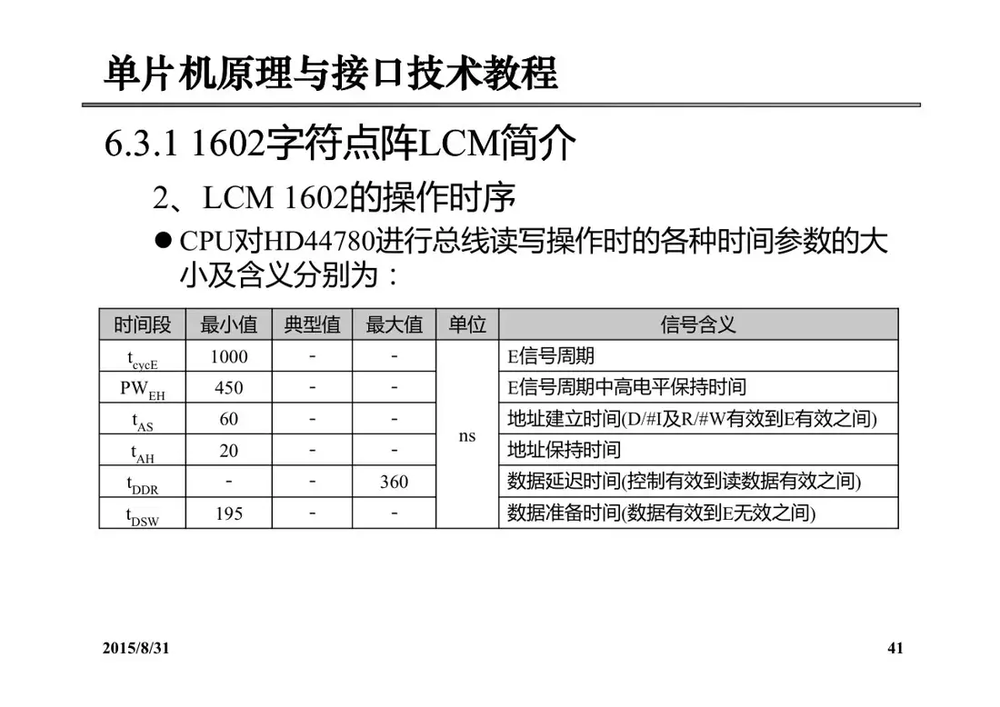

原文：

单片机原理与接口技术教程

6.3.1 1602字符点阵LCM简介

2、LCM 1602的操作时序

 CPU对HD44780进行总线读写操作时的各种时间参数的大小及含义分别为：

<table><tr><td>时间段</td><td>最小值</td><td>典型值</td><td>最大值</td><td>单位</td><td>信号含义</td></tr><tr><td> $t_{cycE}$ </td><td>1000</td><td>-</td><td>-</td><td rowspan="6">ns</td><td>E信号周期</td></tr><tr><td> $PW_{EH}$ </td><td>450</td><td>-</td><td>-</td><td>E信号周期中高电平保持时间</td></tr><tr><td> $t_{AS}$ </td><td>60</td><td>-</td><td>-</td><td>地址建立时间(D/#I及R/#W有效到E有效之间)</td></tr><tr><td> $t_{AH}$ </td><td>20</td><td>-</td><td>-</td><td>地址保持时间</td></tr><tr><td> $t_{DDR}$ </td><td>-</td><td>-</td><td>360</td><td>数据延迟时间(控制有效到读数据有效之间)</td></tr><tr><td> $t_{DSW}$ </td><td>195</td><td>-</td><td>-</td><td>数据准备时间(数据有效到E无效之间)</td></tr></table>

2015/8/31

41

### 单片机原理与接口技术教程

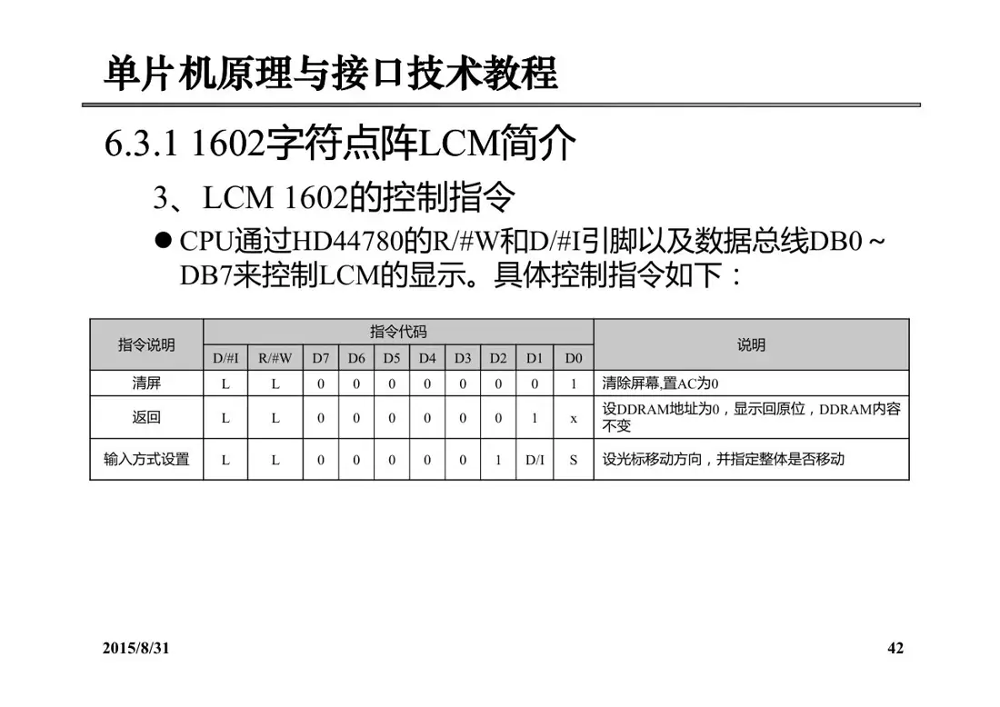

原文：

单片机原理与接口技术教程

6.3.1 1602字符点阵LCM简介

3、LCM 1602的控制指令

 CPU通过HD44780的R/#W和D/#I引脚以及数据总线DB0～DB7来控制LCM的显示。具体控制指令如下：

<table><tr><td rowspan="2">指令说明</td><td colspan="10">指令代码</td><td rowspan="2">说明</td></tr><tr><td>D/#I</td><td>R/#W</td><td>D7</td><td>D6</td><td>D5</td><td>D4</td><td>D3</td><td>D2</td><td>D1</td><td>D0</td></tr><tr><td>清屏</td><td>L</td><td>L</td><td>0</td><td>0</td><td>0</td><td>0</td><td>0</td><td>0</td><td>0</td><td>1</td><td>清除屏幕,置AC为0</td></tr><tr><td>返回</td><td>L</td><td>L</td><td>0</td><td>0</td><td>0</td><td>0</td><td>0</td><td>0</td><td>1</td><td>x</td><td>设DDRAM地址为0,显示回原位,DDRAM内容不变</td></tr><tr><td>输入方式设置</td><td>L</td><td>L</td><td>0</td><td>0</td><td>0</td><td>0</td><td>0</td><td>1</td><td>D/I</td><td>S</td><td>设光标移动方向,并指定整体是否移动</td></tr></table>

2015/8/31

42

### 单片机原理与接口技术教程

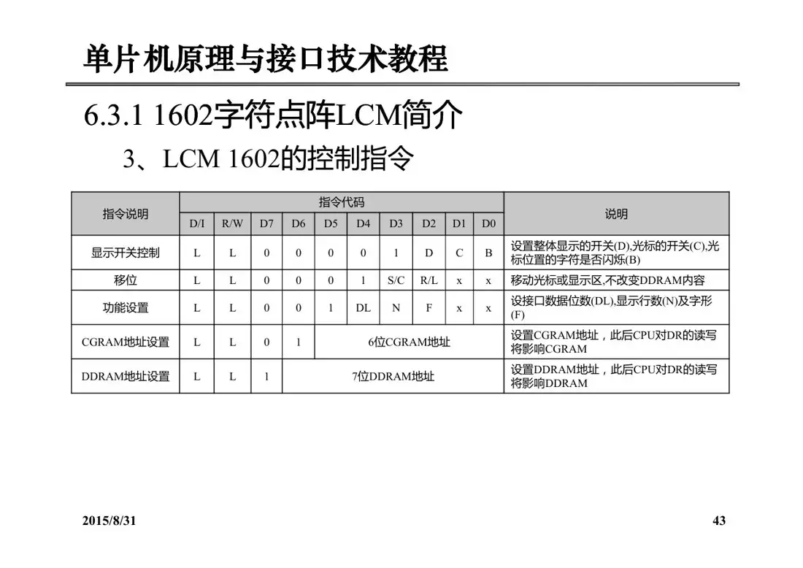

原文：

单片机原理与接口技术教程

6.3.1 1602字符点阵LCM简介

3、LCM 1602的控制指令

<table><tr><td rowspan="2">指令说明</td><td colspan="10">指令代码</td><td rowspan="2">说明</td></tr><tr><td>D/I</td><td>R/W</td><td>D7</td><td>D6</td><td>D5</td><td>D4</td><td>D3</td><td>D2</td><td>D1</td><td>D0</td></tr><tr><td>显示开关控制</td><td>L</td><td>L</td><td>0</td><td>0</td><td>0</td><td>0</td><td>1</td><td>D</td><td>C</td><td>B</td><td>设置整体显示的开关(D),光标的开关(C),光标位置的字符是否闪烁(B)</td></tr><tr><td>移位</td><td>L</td><td>L</td><td>0</td><td>0</td><td>0</td><td>1</td><td>S/C</td><td>R/L</td><td>x</td><td>x</td><td>移动光标或显示区,不改变DDRAM内容</td></tr><tr><td>功能设置</td><td>L</td><td>L</td><td>0</td><td>0</td><td>1</td><td>DL</td><td>N</td><td>F</td><td>x</td><td>x</td><td>设接口数据位数(DL),显示行数(N)及字形(F)</td></tr><tr><td>CGRAM地址设置</td><td>L</td><td>L</td><td>0</td><td>1</td><td colspan="6">6位CGRAM地址</td><td>设置CGRAM地址,此后CPU对DR的读写将影响CGRAM</td></tr><tr><td>DDRAM地址设置</td><td>L</td><td>L</td><td>1</td><td colspan="7">7位DDRAM地址</td><td>设置DDRAM地址,此后CPU对DR的读写将影响DDRAM</td></tr></table>

2015/8/31

43

### 单片机原理与接口技术教程

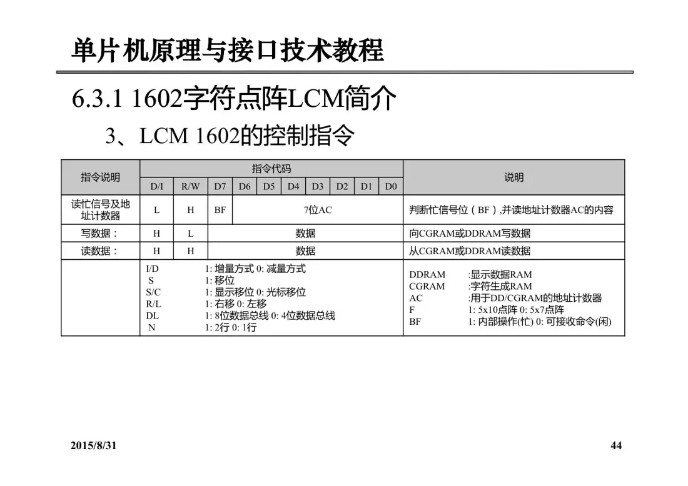

原文：

单片机原理与接口技术教程

6.3.1 1602字符点阵LCM简介

3、LCM 1602的控制指令

<table><tr><td rowspan="2">指令说明</td><td colspan="10">指令代码</td><td rowspan="2">说明</td></tr><tr><td>D/I</td><td>R/W</td><td>D7</td><td>D6</td><td>D5</td><td>D4</td><td>D3</td><td>D2</td><td>D1</td><td>D0</td></tr><tr><td>读忙信号及地址计数器</td><td>L</td><td>H</td><td>BF</td><td colspan="7">7位AC</td><td>判断忙信号位(BF),并读地址计数器AC的内容</td></tr><tr><td>写数据:</td><td>H</td><td>L</td><td colspan="8">数据</td><td>向CGRAM或DDRAM写数据</td></tr><tr><td>读数据:</td><td>H</td><td>H</td><td colspan="8">数据</td><td>从CGRAM或DDRAM读数据</td></tr><tr><td></td><td>I/D S S/C R/L DL N</td><td colspan="9">1:增量方式 0:减量方式1:移位1:显示移位 0:光标移位1:右移 0:左移1:8位数据总线 0:4位数据总线1:2行 0:1行</td><td>DDRAM :显示数据RAMCGRAM :字符生成RAMAC :用于DD/CGRAM的地址计数器F 1:5x10点阵 0:5x7点阵BF 1:内部操作(忙) 0:可接收命令(闲)</td></tr></table>

2015/8/31

44

### 单片机原理与接口技术教程

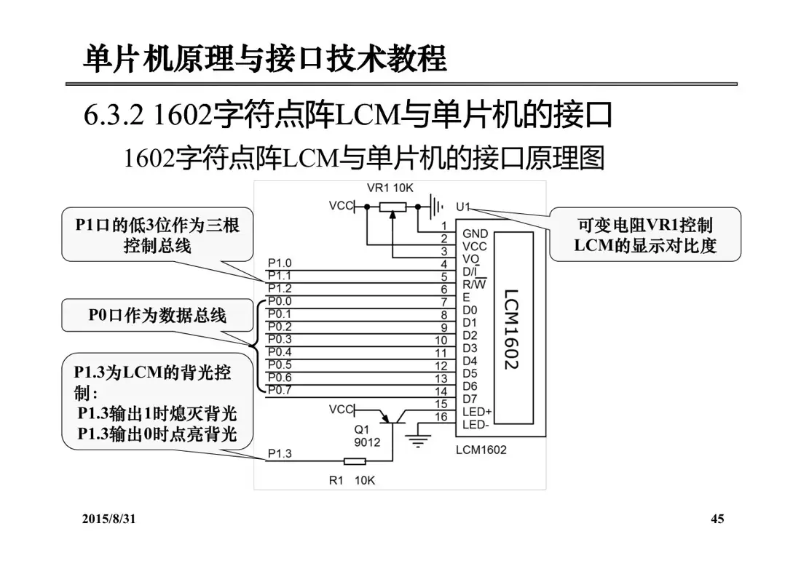

原文：

单片机原理与接口技术教程

6.3.2 1602字符点阵LCM与单片机的接口

1602字符点阵LCM与单片机的接口原理图

2015/8/31

45

### 单片机原理与接口技术教程

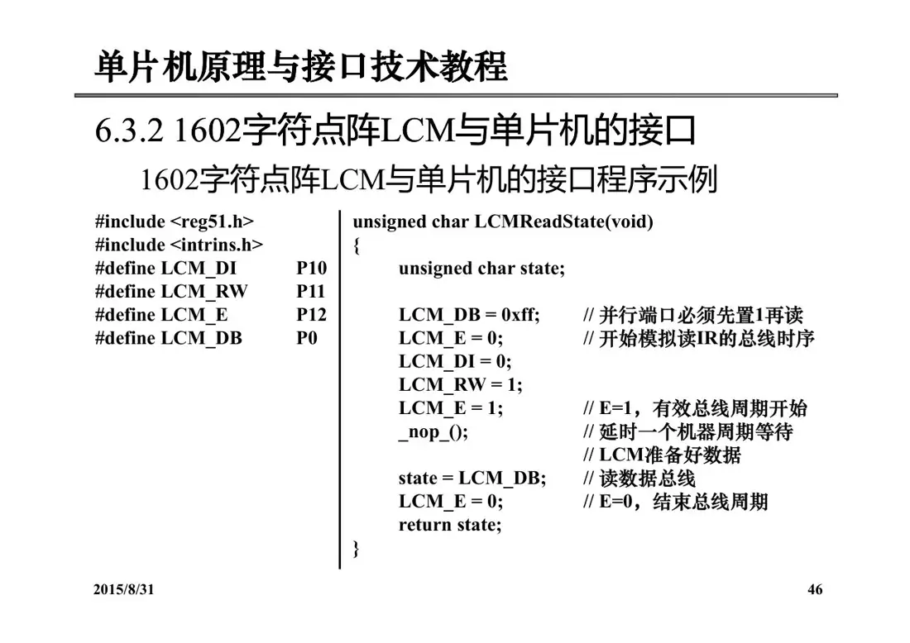

原文：

单片机原理与接口技术教程

6.3.2 1602字符点阵LCM与单片机的接口

1602字符点阵LCM与单片机的接口程序示例

2015/8/31

46

### 第六章 单片机输入输出接口及系统扩展设计

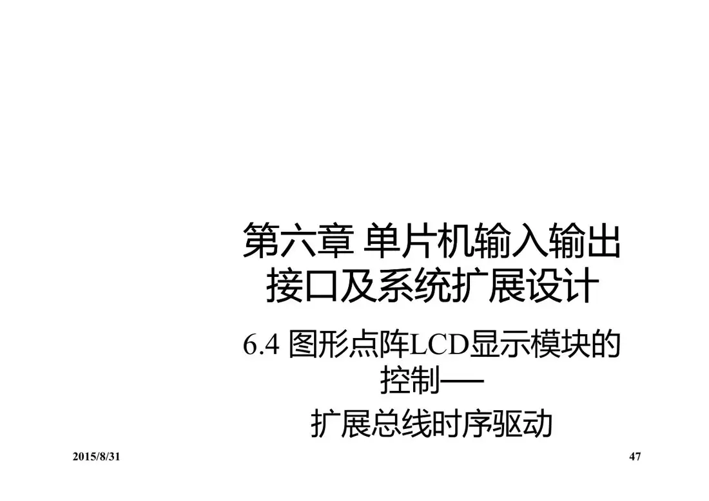

原文：

第六章 单片机输入输出接口及系统扩展设计

6.4 图形点阵LCD显示模块的控制──扩展总线时序驱动

2015/8/31

47

### 单片机原理与接口技术教程

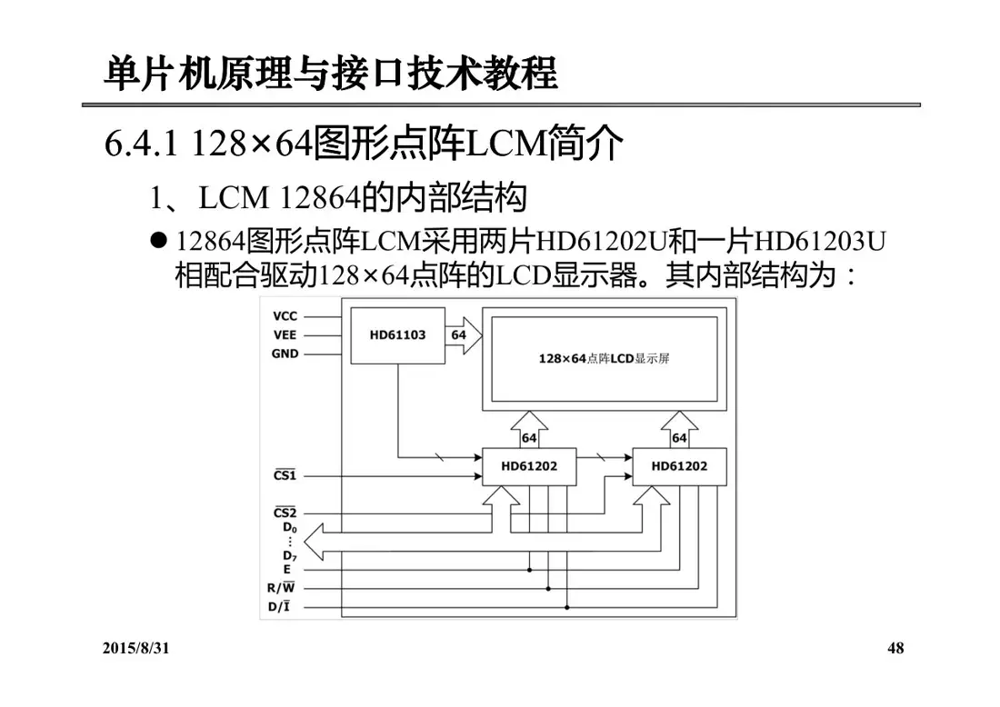

原文：

单片机原理与接口技术教程

6.4.1 128×64图形点阵LCM简介

1、LCM 12864的内部结构

 12864图形点阵LCM采用两片HD61202U和一片HD61203U相配合驱动128×64点阵的LCD显示器。其内部结构为：

2015/8/31

48

### 单片机原理与接口技术教程

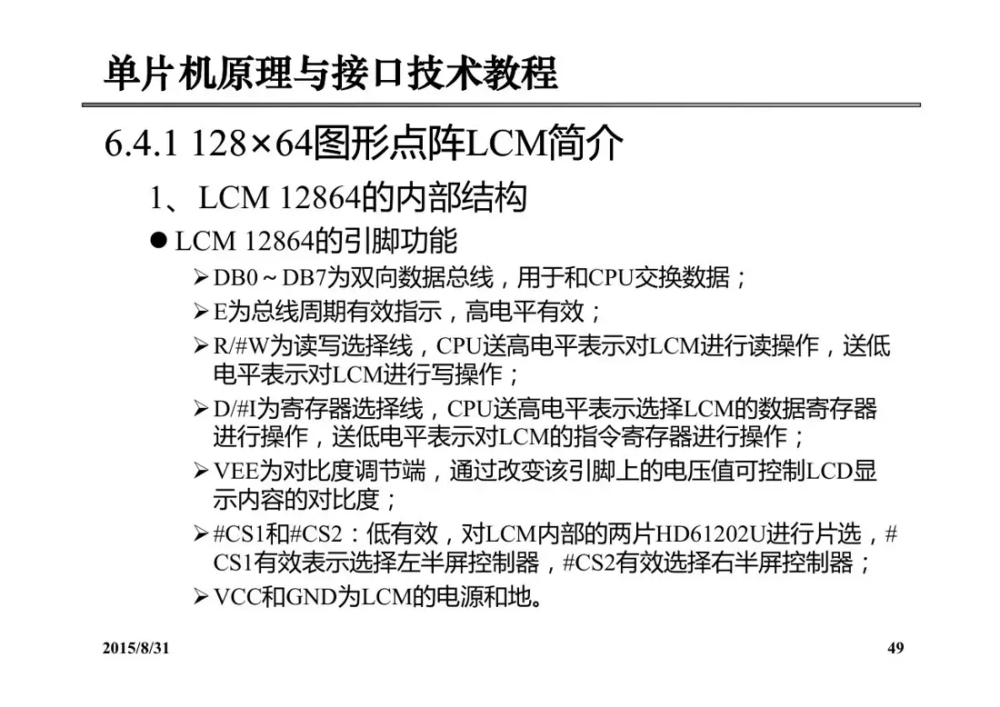

原文：

单片机原理与接口技术教程

6.4.1 128×64图形点阵LCM简介

1、LCM 12864的内部结构

 LCM 12864的引脚功能

DB0～DB7为双向数据总线，用于和CPU交换数据；

E为总线周期有效指示，高电平有效；

R/#W为读写选择线，CPU送高电平表示对LCM进行读操作，送低电平表示对LCM进行写操作；

D/#I为寄存器选择线，CPU送高电平表示选择LCM的数据寄存器进行操作，送低电平表示对LCM的指令寄存器进行操作；

VEE为对比度调节端，通过改变该引脚上的电压值可控制LCD显示内容的对比度；

#CS1和#CS2：低有效，对LCM内部的两片HD61202U进行片选，#

CS1有效表示选择左半屏控制器，#CS2有效选择右半屏控制器；

VCC和GND为LCM的电源和地。

2015/8/31

49

### 单片机原理与接口技术教程

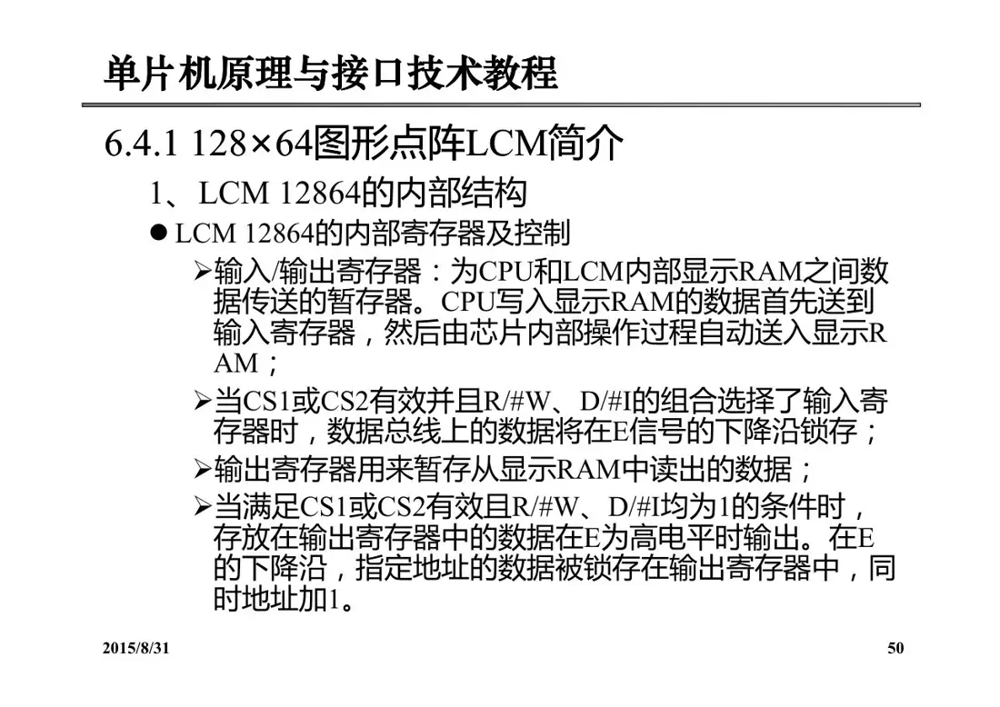

原文：

单片机原理与接口技术教程

6.4.1 128×64图形点阵LCM简介

1、LCM 12864的内部结构

LCM 12864的内部寄存器及控制

输入/输出寄存器：为CPU和LCM内部显示RAM之间数据传送的暂存器。CPU写入显示RAM的数据首先送到输入寄存器，然后由芯片内部操作过程自动送入显示RAM；

当CS1或CS2有效并且R/#W、D/#I的组合选择了输入寄存器时，数据总线上的数据将在E信号的下降沿锁存；

输出寄存器用来暂存从显示RAM中读出的数据；

当满足CS1或CS2有效且R/#W、D/#I均为1的条件时，存放在输出寄存器中的数据在E为高电平时输出。在E的下降沿，指定地址的数据被锁存在输出寄存器中，同时地址加1。

2015/8/31

50

### 单片机原理与接口技术教程

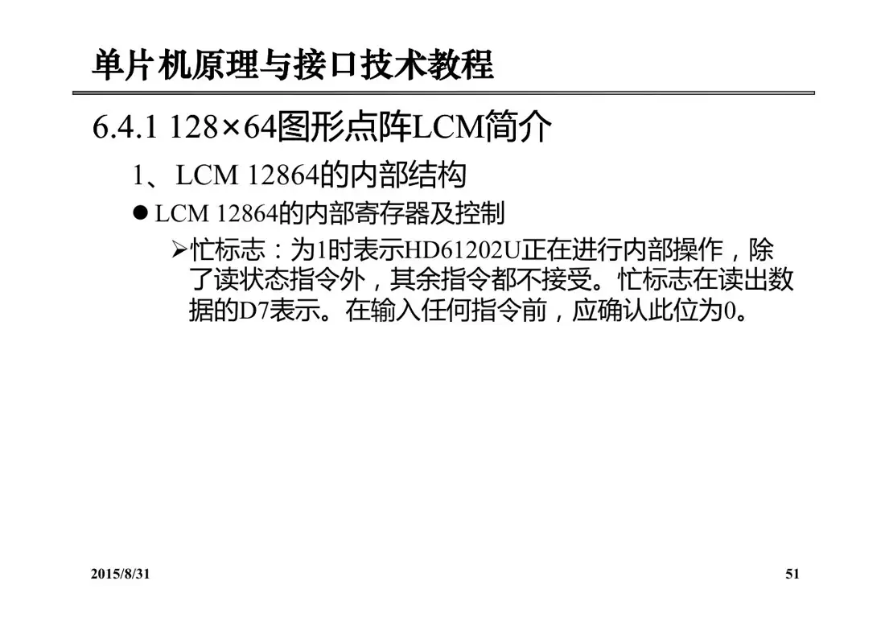

原文：

单片机原理与接口技术教程

6.4.1 128×64图形点阵LCM简介

1、LCM 12864的内部结构

LCM 12864的内部寄存器及控制

忙标志：为1时表示HD61202U正在进行内部操作，除了读状态指令外，其余指令都不接受。忙标志在读出数据的D7表示。在输入任何指令前，应确认此位为0。

2015/8/31

51

### 单片机原理与接口技术教程

原文：

单片机原理与接口技术教程

6.4.1 128×64图形点阵LCM简介

1、LCM 12864的内部结构

LCM 12864的内部寄存器及控制

显示存储器：每一片HD61202U负责驱动64×64点阵的LCD显示器，其内部显示RAM的地址结构如下图所示：

某列的8行(位)数据构成一个字节，其中为1的位显示点，为0的位不显示

<table><tr><td rowspan="2"></td><td colspan="6">Y地址</td></tr><tr><td>0</td><td>1</td><td>2</td><td>......</td><td>61</td><td>62</td></tr><tr><td rowspan="2">ROW1</td><td> $D_0$ </td><td> $D_0$ </td><td></td><td></td><td></td><td> $D_0$ </td></tr><tr><td>...</td><td>...</td><td></td><td></td><td></td><td>...</td></tr><tr><td>...</td><td>...</td><td>...</td><td></td><td></td><td></td><td>...</td></tr><tr><td>ROW8</td><td> $D_7$ </td><td> $D_7$ </td><td></td><td></td><td></td><td> $D_7$ </td></tr><tr><td>ROW9</td><td> $D_0$ </td><td> $D_0$ </td><td></td><td></td><td></td><td> $D_0$ </td></tr><tr><td>...</td><td>...</td><td>...</td><td></td><td></td><td></td><td>...</td></tr><tr><td>...</td><td>...</td><td>...</td><td></td><td></td><td></td><td>...</td></tr><tr><td>ROW16</td><td> $D_7$ </td><td> $D_7$ </td><td></td><td></td><td></td><td> $D_7$ </td></tr><tr><td>...</td><td></td><td></td><td></td><td></td><td></td><td>...</td></tr><tr><td rowspan="2">...</td><td> $D_0$ </td><td> $D_0$ </td><td></td><td></td><td></td><td> $D_0$ </td></tr><tr><td>...</td><td>...</td><td></td><td></td><td></td><td>...</td></tr><tr><td>...</td><td>...</td><td>...</td><td></td><td></td><td></td><td>...</td></tr><tr><td>ROW64</td><td> $D_7$ </td><td> $D_7$ </td><td></td><td></td><td></td><td> $D_7$ </td></tr></table>

共64列，每列分成8个大行，每行对应显示RAM中的一个字节

一片HD61202U内部的RAM容量为512字节,按行的方向(横向)分为8页(页地址X=0\~7)，每页64字节(和列一一对应)

2015/8/31

52

### 单片机原理与接口技术教程

原文：

单片机原理与接口技术教程

6.4.1 128×64图形点阵LCM简介

1、LCM 12864的内部结构

LCM 12864的内部寄存器及控制

X、Y地址计数器：X，Y地址计数器是和内部512字节的显示RAM相对应的9bit的计数器。高3位为X地址计数器，低6位为Y地址计数器，根据指令的不同可以分别设置成X地址（页地址）计数器和Y地址（列地址）计数器。X地址计数器只能作为普通的无计数功能的寄存器使用，而Y地址则在CPU对显示数据进行读写操作后自动加1，并在0\~63范围内循环。

2015/8/31

53

### 单片机原理与接口技术教程

原文：

单片机原理与接口技术教程

6.4.1 128×64图形点阵LCM简介

1、LCM 12864的内部结构

 LCM 12864的内部寄存器及控制

 起始显示行寄存器：指定和LCD的第一行相对应的显示RAM的行号。此寄存器用于显示器的卷屏操作。通过设置起始显示行指令可以将6bit的起始显示行信息写入此寄存器；

2015/8/31

54

### 单片机原理与接口技术教程

原文：

单片机原理与接口技术教程

6.4.1 128×64图形点阵LCM简介

1、LCM 12864的内部结构

 LCM 12864的内部寄存器及控制

 显示开关及翻转：通过选择Y1\~Y64的开关状态来实现对LCM显示的控制；

 在开状态，显示RAM中为1的位会在点阵的对应位置上显示一个点；

 在关状态，所有的点都不显示；

 此功能通过显示器开/关指令控制。RST=0将显示器设置为关状态；

 当前显示状态通过读指令在D5位输出。显示开/关指令不影响显示RAM中的数据。

2015/8/31

55

### 单片机原理与接口技术教程

原文：

单片机原理与接口技术教程

6.4.1 128×64图形点阵LCM简介

1、LCM 12864的内部结构

 LCM 12864的内部寄存器及控制

 复位：在LCM加电时将复位引脚(RST)接低将初始化LCM；

 所谓初始化是指关闭LCD的显示并将起始显示地址寄存器置0；

 当RST=0时，只能对LCM进行读状态操作；

 正常工作状态下，只有判断状态字的D4=0(RESET完成)和D7=0(就绪)时，程序方可输出其它的指令。

2015/8/31

56

### 单片机原理与接口技术教程

原文：

单片机原理与接口技术教程

6.4.1 128×64图形点阵LCM简介

1、LCM 12864的内部结构

LCM 12864内部寄存器的控制

CPU通过D/#I和R/#W操作LCM 12864的内部寄存器：

<table><tr><td>D/#I</td><td>R/#W</td><td>操作对象</td></tr><tr><td>0</td><td>0</td><td>选择指令寄存器(IR),进行写入操作</td></tr><tr><td>0</td><td>1</td><td>读出忙标志</td></tr><tr><td>1</td><td>0</td><td>选择输入寄存器,写数据到内部显示RAM</td></tr><tr><td>1</td><td>1</td><td>选择输出寄存器,从内部显示RAM读出数据</td></tr></table>

2015/8/31

57

### 单片机原理与接口技术教程

原文：

单片机原理与接口技术教程

6.4.1 128×64图形点阵LCM简介

2、LCM 12864的控制指令

 CPU对HD61202的控制指令如下：

<table><tr><td rowspan="2">指令</td><td colspan="10">指令代码</td><td rowspan="2">功能描述</td></tr><tr><td>R/W</td><td>D/I</td><td> $D_7$ </td><td> $D_6$ </td><td> $D_5$ </td><td> $D_4$ </td><td> $D_3$ </td><td> $D_2$ </td><td> $D_1$ </td><td> $D_0$ </td></tr><tr><td>显示开/关</td><td>0</td><td>0</td><td>0</td><td>0</td><td>1</td><td>1</td><td>1</td><td>1</td><td>1</td><td>1/0</td><td>1:显示开 0:显示关</td></tr><tr><td>设置起始显示行</td><td>0</td><td>0</td><td>1</td><td>1</td><td colspan="6">起始显示行(0~63)</td><td>设置起始显示行寄存器</td></tr><tr><td>设置页(X)地址</td><td>0</td><td>0</td><td>1</td><td>0</td><td>1</td><td>1</td><td>1</td><td colspan="3">页号(0~7)</td><td>设置页寄存器</td></tr><tr><td>设置Y地址</td><td>0</td><td>0</td><td>0</td><td>1</td><td colspan="6">Y地址(0~63)</td><td>设置Y地址计数器</td></tr><tr><td>读状态</td><td>1</td><td>0</td><td>Busy</td><td>0</td><td>On/Off</td><td>RST</td><td>0</td><td>0</td><td>0</td><td>0</td><td>状态解释:RST 1:复位,0:正常On/Off 1:显示关闭,0:显示打开Busy 1:内部操作,0:就绪</td></tr><tr><td>写显示数据</td><td>0</td><td>1</td><td colspan="8">写入数据</td><td></td></tr><tr><td>读显示数据</td><td>1</td><td>1</td><td colspan="8">读出数据</td><td></td></tr></table>

2015/8/31

58

### 单片机原理与接口技术教程

原文：

单片机原理与接口技术教程

6.4.2 128 ×64图形点阵LCM和单片机的接口

 LCM 128

单片机最小系统

LCD的数据线接单片机的数据总线；地址总线A8\~A11接LCD的控制端，通过MOVX指令模拟LCD的操作时序

路图

LCD显示对比度调节

LCD背光控制

LCD复位的极性和单片机相反

2015/8/31

59

### 单片机原理与接口技术教程

原文：

单片机原理与接口技术教程

6.4.2 128 ×64图形点阵LCM和单片机的接口

 LCM 12864和单片机接口电路的工作过程

 单片机采用存储器映像方式通过扩展总线操作的方式对其进行控制；

 单片机的数据总线(P0.0～P0.7)和LCM的数据总线(D0\~D7)直接相连，即直接入单片机的数据总线；

 LCM的控制信号R/#W、D/#I、#CS1和#CS2直接和单片机地址总线中的A8、A9、A10和A11相连，在执行MOVX指令时，设置合适的地址将在A8\~A11上产生符合LCM操作要求的控制信号时序；

 单片机的#RD、#WR经与非门U3A后和LCM12864的E相连，保证只有在单片机进行外部RAM读写操作时E才输出高电平，选通LCM。

2015/8/31

60

### 单片机原理与接口技术教程

原文：

单片机原理与接口技术教程

6.4.2 128 ×64图形点阵LCM和单片机的接口

 LCM 12864内部寄存器的编址

 综上所述，符合LCM控制信号时序要求的编址方案如下表所示：

<table><tr><td rowspan="2"> $A_{15} \sim A_{12}$ </td><td> $A_{11}$ </td><td> $A_{10}$ </td><td> $A_9$ </td><td> $A_8$ </td><td rowspan="2"> $A_7 \sim A_0$ </td><td rowspan="2">操作地址</td><td rowspan="2">操作功能描述</td></tr><tr><td>CS2</td><td>CS1</td><td>R/#W</td><td>D/#I</td></tr><tr><td rowspan="8">未参与控制,0/1均可,假设全为0</td><td>1</td><td>0</td><td>0</td><td>0</td><td rowspan="8">未参与控制,0/1均可,假设全为0</td><td>0x0800</td><td>写LCM左半屏指令寄存器</td></tr><tr><td>1</td><td>0</td><td>0</td><td>1</td><td>0x0900</td><td>写LCM左半屏显示存储器</td></tr><tr><td>1</td><td>0</td><td>1</td><td>0</td><td>0x0A00</td><td>读LCM左半屏状态寄存器</td></tr><tr><td>1</td><td>0</td><td>1</td><td>1</td><td>0x0B00</td><td>读LCM左半屏显示存储器</td></tr><tr><td>0</td><td>1</td><td>0</td><td>0</td><td>0x0400</td><td>写LCM右半屏指令寄存器</td></tr><tr><td>0</td><td>1</td><td>0</td><td>1</td><td>0x0500</td><td>写LCM右半屏显示存储器</td></tr><tr><td>0</td><td>1</td><td>1</td><td>0</td><td>0x0600</td><td>读LCM右半屏状态寄存器</td></tr><tr><td>0</td><td>1</td><td>1</td><td>1</td><td>0x0700</td><td>读LCM右半屏显示存储器</td></tr></table>

2015/8/31

61

### 单片机原理与接口技术教程

原文：

单片机原理与接口技术教程

6.4.2 128 ×64图形点阵LCM和单片机的接口

128×64图形点阵LCM与单片机的接口程序示例

<table><tr><td>include</td></tr><tr><td>include</td></tr><tr><td>define CWADD1 XBYTE[0x0800]</td></tr><tr><td>define CRADD1 XBYTE[0x0A00]</td></tr><tr><td>define DWADD1 XBYTE[0x0900]</td></tr><tr><td>define DRADD1 XBYTE[0x0B00]</td></tr><tr><td>define CWADD2 XBYTE[0x0400]</td></tr><tr><td>define CRADD2 XBYTE[0x0600]</td></tr><tr><td>define DWADD2 XBYTE[0x0500]</td></tr><tr><td>define DRADD2 XBYTE[0x0700]</td></tr><tr><td>define NOP _nop_();_nop_()</td></tr></table>

2015/8/31

62

### 第六章 单片机输入输出接口及系统扩展设计

原文：

第六章 单片机输入输出接口及系统扩展设计

6.5 并行输入输出接口的扩展

2015/8/31

63

### 单片机原理与接口技术教程

原文：

单片机原理与接口技术教程

概述

 标准的MCS-51单片机具有四个并行I/O端口，对于一般的应用而言已基本够用；

 对于需要大量I/O端口的复杂应用，或进行了系统总线扩展的单片机(P0、P2和P3.6、P3.7被占用，作为数据总线、地址总线和读写控制线)，则单片机I/O端口的数量将会比较紧张；

 此时单片机系统就需要进行I/O端口的扩展；

 本节主要介绍两种常用的I/O端口扩展的方法。

2015/8/31

64

### 单片机原理与接口技术教程

原文：

单片机原理与接口技术教程

6.5.1 通过串行口扩展并行输入输出接口

1、通过串行口扩展并行输出接口

 设计原理

 设置串行口工作在方式0（同步移位寄存器），此时串行口的TxD输出移位时钟，RxD输出数据；

 外接一个串行-并行移位寄存器74LS164实现串-并变换，可扩展出一个8位的并行输出端口；

 74LS164可级联扩展更大规模的并行输出接口。

2015/8/31

65

### 单片机原理与接口技术教程

原文：

单片机原理与接口技术教程

6.5.1 通过串行口扩展并行输入输出接口

1、通过串行口扩展并行输出接口

 单片机串行口扩展并行输出接口电路图

RxD输出数据

TxD输出移位脉冲单片机通过串行口输出一个字节，经8次移位脉冲后输出到Q0\~Q7；由于串口先输出D0，因此Q0\~Q7字节序倒置，对应D7\~D0

2015/8/31

66

### 单片机原理与接口技术教程

原文：

单片机原理与接口技术教程

6.5.1 通过串行口扩展并行输入输出接口

1、通过串行口扩展并行输出接口

 单片机串行口级联扩展并行输出接口电路图

第一个164的Q7输出到第二个164的数据输入，移位时钟共用，可实现级联

2015/8/31

67

### 单片机原理与接口技术教程

原文：

单片机原理与接口技术教程

6.5.1 通过串行口扩展并行输入输出接口

2、通过串行口扩展并行输入接口

 设计原理

 设置串行口工作在方式0（同步移位寄存器），此时串行口的TxD输出移位时钟，RxD输出数据；

 外接一个并行-串行移位寄存器74LS165实现并-串变换，可扩展出一个8位的并行输入端口；

 74LS165可级联扩展更大规模的并行输入接口。

2015/8/31

68

### 单片机原理与接口技术教程

原文：

单片机原理与接口技术教程

6.5.1 通过串行口扩展并行输入输出接口

2、通过串行口扩展并行输入接口

 单片机串行口扩展并行输入接口电路图

并行输入锁存后，单片机发起一次串行口读字节操作，即可将外部输入数据移入串行口，存入SBUF中。注意输入字节序同样倒置

2015/8/31

69

### 单片机原理与接口技术教程

原文：

单片机原理与接口技术教程

6.5.1 通过串行口扩展并行输入输出接口

2、通过串行口扩展并行输入接口

 单片机串行口级联扩展并行输入接口电路图

2015/8/31

70

### 单片机原理与接口技术教程

原文：

单片机原理与接口技术教程

6.5.2 通过系统总线扩展并行输入输出接口

 设计原理

 将锁存器/缓冲器连接在单片机数据总线上；

 使用译码电路，保证当单片机使用MOVX指令读写外部存储器时产生片选信号，将此片选信号连接到锁存控制端及缓冲打开端；

 此时单片机将挂接在扩展总线上的锁存器及缓冲器映像为外部RAM，在执行读写外部RAM的MOVX指令时控制锁存及打开三态缓冲器，实现CPU和扩展端口之间的数据交换。

2015/8/31

71

### 单片机原理与接口技术教程

原文：

单片机原理与接口技术教程

6.5.2 通过系统总线扩展并行输入输出接口

 单片机系统总线扩展并行输入输出接口电路图

2015/8/31

72

### 第六章 单片机输入输出接口及系统扩展设计

原文：

第六章 单片机输入输出接口及系统扩展设计

6.6 单片机I/O端口模拟时序操作扩展设备

2015/8/31

73

### 单片机原理与接口技术教程

原文：

单片机原理与接口技术教程

概述

 单片机和扩展设备或芯片之间的接口通常分为并行接口和串行接口两种；

 单片机不可能包括所有种类的接口控制逻辑，因此在设计中，通常使用I/O端口，通过程序控制引脚模拟出符合接口操作要求的时序来和外部设备接口；

 由于串行接口具有占用I/O资源少、扩展方便、灵活，有利于减小器件体积等特点，所以现在越来越多的芯片使用串行总线和CPU连接；

 常用的串行接口除了异步串行通信接口之外，还有I2C总线、1-Wire总线、SPI串行总线及串行移位寄存器等等；

 本节介绍单片机模拟I2C串行总线接口时序的设计原理。

2015/8/31

74

### 单片机原理与接口技术教程

原文：

单片机原理与接口技术教程

6.6.1 I2C串行总线的基本特点

 I2C（Inter-Integrated Circuit）是Philips公司推出的串行总线技术，它是在器件之间实现同步串行数据传输的技术，是一种采用两线制（数据线和时钟线）通信的标准总线。

2015/8/31

75

### 单片机原理与接口技术教程

原文：

单片机原理与接口技术教程

6.6.1 I2C串行总线的基本特点

 I2C总线主要有以下几个特征：

 数据传输只需要两条通信线：串行数据线（SDA）和串行时钟线（SCL）；

 总线模式包括主发送模式、主接收模式、从发送模式、从接收模式；

 每个连接到I2C总线上的器件都必须有唯一的器件地址，通过这个地址，主器件可以对从器件进行寻址；

 存在冲突检测和仲裁机制以保证数据传输的完整性和稳定性。

2015/8/31

76

### 单片机原理与接口技术教程

原文：

单片机原理与接口技术教程

6.6.1 I2C串行总线的基本特点

 I2C总线主要有以下几个特征：

 传输速率高，标准模式下数据传输速率可达100Kbps,快速模式下可达400Kbps，高速模式下可达3.4Mbps；

 由于总线接口引脚内部采用了漏极开路工艺，所以总线上要接上拉电阻。连接到相同总线上的IC数量只受到总线最大电容负载400pF的限制。

 I2C总线可极大简化子系统之间的连接，总线接口驱动集成在器件中，可最大限度地简化结构；

 电路的简化减少了电路板面积，提高了可靠性，降低了成本；

 使用I2C总线有利于促进系统的模块化、标准化设计。

2015/8/31

77

### 单片机原理与接口技术教程

原文：

单片机原理与接口技术教程

6.6.2 I2C串行总线通信协议

1、I2C总线传输接口的特性

 总线由两根双向的数据线和时钟线构成，使用时必须分别通过上拉电阻接VCC；

 接入总线的所有器件的输出都必须是漏极开路方式；

 I2C总线是一个半双工、多主器件总线，即总线上可有多个主控器件；当器件发送数据时即为主器件，接收数据时则为从器件；

 I2C总线进行数据传送时，每一位数据都与时钟脉冲相对应，在时钟信号高电平期间，数据线上必须保持稳定的逻辑电平。只有在时钟线为低电平时，才允许数据线的电平发生变化。

2015/8/31

78

### 单片机原理与接口技术教程

原文：

单片机原理与接口技术教程

6.6.2 I2C串行总线通信协议

2、I2C总线的时序

 一次完整的I2C总线时序过程由起始信号、从器件地址信号、应答信号ACK、字节数据信号和停止信号等几部分组成；

(1) 起始和停止信号

 在I2C总线协议中，起始信号(S)和停止信号(P)都是由主器件产生的。起始信号表明一次I2C总线传送的开始，停止信号则表明I2C总线通信结束；

 当SCL线为高电平时，SDA线由高电平到低电平的负跳变被定义为起始信号，而SDA由低电平到高电平的正跳变为停止信号。

2015/8/31

79

### 单片机原理与接口技术教程

原文：

单片机原理与接口技术教程

6.6.2 I2C串行总线通信协议

2、I2C总线的时序

(1) 起始和停止信号

 I2C总线起始信号和停止信号的时序

2015/8/31

80

### 单片机原理与接口技术教程

原文：

单片机原理与接口技术教程

6.6.2 I2C串行总线通信协议

2、I2C总线的时序

(2) 器件地址

 接入I2C总线的每一个器件都要有一个唯一的地址。每次发送器发出起始信号后，必须接着发出一个字节的地址信息，以选取连接在总线上的某一从器件；

 地址字节用“从器件地址+R/#W”表示。从器件地址是7位的器件地址编码，占用字节的高7位(D7\~D1)；D0为读写控制位，D0=1，表示后续操作中，主器件将读从器件；D0=0，则表示后续操作中，主器件将写从器件；

 7位的从器件地址进一步分为固定部分和可编程部分。固定部分为器件标识，在出厂时设置。可编程部分为器件的物理地址，以区分连接在同一I2C总线上的同类器件。

2015/8/31

81

### 单片机原理与接口技术教程

原文：

单片机原理与接口技术教程

6.6.2 I2C串行总线通信协议

2、I2C总线的时序

(3) 应答信号ACK

 I2C总线上的发送器发送完地址字节和每一个字节数据后，被寻址的接收器都必须产生一个应答信号；产生该应答信号的器件在第9个时钟周期时将SDA线拉低，表示其已收到一个8位数据；

 与应答信号相对应的第9个时钟由发送器产生。发送器必须在输出该时钟时释放数据线SDA，使其处于高阻状态，以便接收接收器件送出的应答信号；

 若接收器在SDA线上输出低电平应答信号(ACK)，表示后续将继续接收数据；而如果接收器输出高电平的非应答信号(NO ACK)，则表示结束接收。

2015/8/31

82

### 单片机原理与接口技术教程

原文：

单片机原理与接口技术教程

6.6.2 I2C串行总线通信协议

2、I2C总线的时序

(3) 应答信号ACK

 I2C总线应答时序如下图所示：

2015/8/31

83

### 单片机原理与接口技术教程

原文：

单片机原理与接口技术教程

6.6.2 I2C串行总线通信协议

2、I2C总线的时序

(4) 数据字节信号

 I2C总线在器件之间传送数据的字节数是没有限制的；

 传送的每字节必须是8位，且首先发送数据的最高位；

 每个字节数据发完后发送器都必须发送一位应答脉冲，并在该脉冲有效(高)时接收由接收器发回的应答信号；

 如果接收器回送ACK，则发送器继续发送后续字节；如果接收器回送NACK，则发送器发出停止信号P后结束数据传送；

 数据传送过程中，如果接收器将SCL线拉成低电平，将迫使发送器处于等待状态，接收器释放SCL线后再继续发送过程。

2015/8/31

84

### 单片机原理与接口技术教程

原文：

单片机原理与接口技术教程

6.6.2 I2C串行总线通信协议

2、I2C总线的时序

(4) 数据字节信号

 I2C总线连续发送多个数据字节的时序如下图所示：

2015/8/31

85

### 单片机原理与接口技术教程

原文：

单片机原理与接口技术教程

© The End ©

2015/8/31

86
