# 《单片机原理与系统设计》第3章 MCS-51指令系统（课件）

原件的每一页，下面附识别出的文字。

### 第三章 MCS-51单片机的指令系统

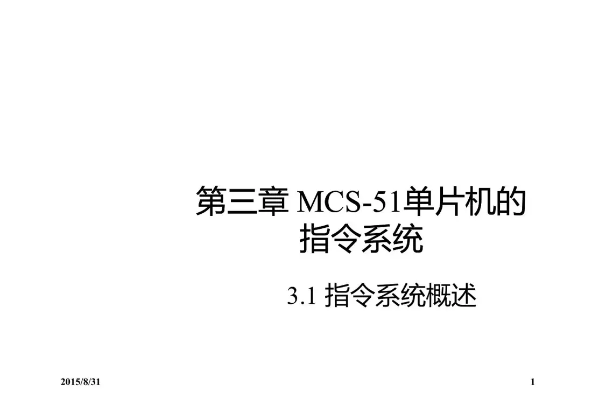

原文：

第三章 MCS-51单片机的指令系统

3.1 指令系统概述

2015/8/31

1

### 单片机原理及系统设计

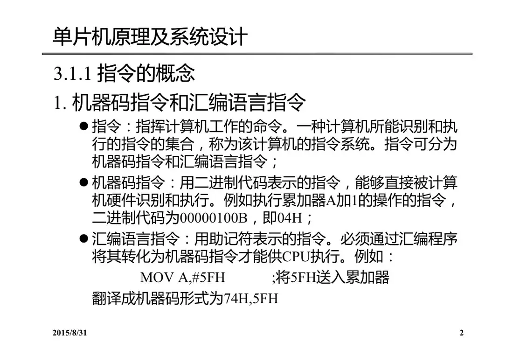

原文：

单片机原理及系统设计

3.1.1 指令的概念

1. 机器码指令和汇编语言指令

指令：指挥计算机工作的命令。一种计算机所能识别和执行的指令的集合，称为该计算机的指令系统。指令可分为机器码指令和汇编语言指令；

机器码指令：用二进制代码表示的指令，能够直接被计算机硬件识别和执行。例如执行累加器A加1的操作的指令，二进制代码为00000100B，即04H；

汇编语言指令：用助记符表示的指令。必须通过汇编程序将其转化为机器码指令才能供CPU执行。例如：

MOV A,#5FH ;将5FH送入累加器

翻译成机器码形式为74H,5FH

2015/8/31

2

### 单片机原理及系统设计

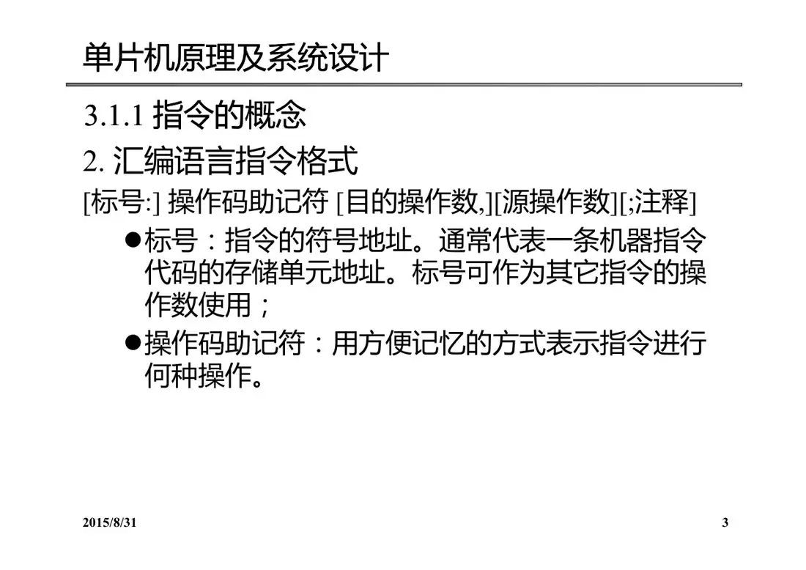

原文：

单片机原理及系统设计

3.1.1 指令的概念

2. 汇编语言指令格式

[标号:] 操作码助记符 [目的操作数,][源操作数][;注释]

标号：指令的符号地址。通常代表一条机器指令代码的存储单元地址。标号可作为其它指令的操作数使用；

操作码助记符：用方便记忆的方式表示指令进行何种操作。

2015/8/31

3

### 单片机原理及系统设计

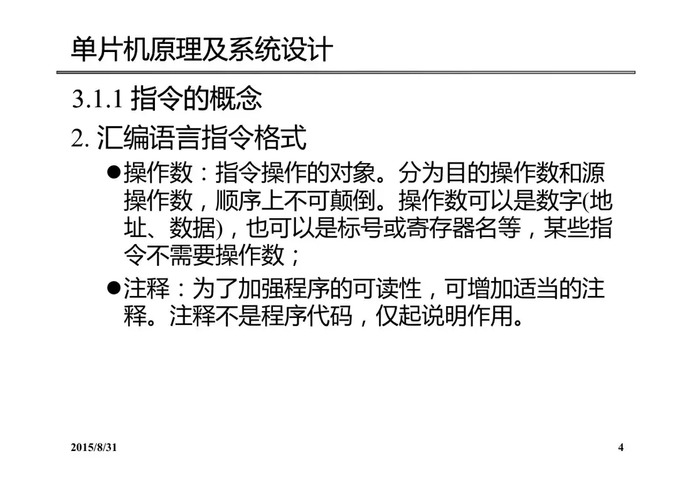

原文：

单片机原理及系统设计

3.1.1 指令的概念

2. 汇编语言指令格式

操作数：指令操作的对象。分为目的操作数和源操作数，顺序上不可颠倒。操作数可以是数字(地址、数据)，也可以是标号或寄存器名等，某些指令不需要操作数；

注释：为了加强程序的可读性，可增加适当的注释。注释不是程序代码，仅起说明作用。

2015/8/31

4

### 单片机原理及系统设计

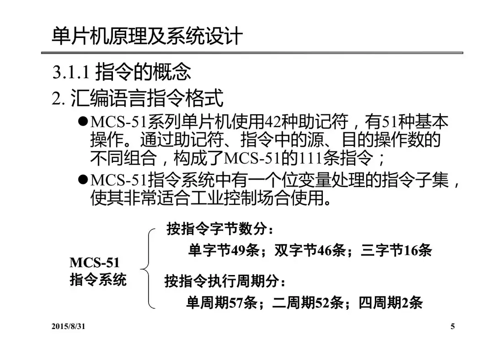

原文：

单片机原理及系统设计

3.1.1 指令的概念

2. 汇编语言指令格式

MCS-51系列单片机使用42种助记符，有51种基本操作。通过助记符、指令中的源、目的操作数的不同组合，构成了MCS-51的111条指令；

MCS-51指令系统中有一个位变量处理的指令子集，使其非常适合工业控制场合使用。

按指令字节数分：

MCS-51指令系统

单字节49条；双字节46条；三字节16条

按指令执行周期分：

单周期57条；二周期52条；四周期2条

2015/8/31

5

### 第三章 MCS-51单片机的指令系统

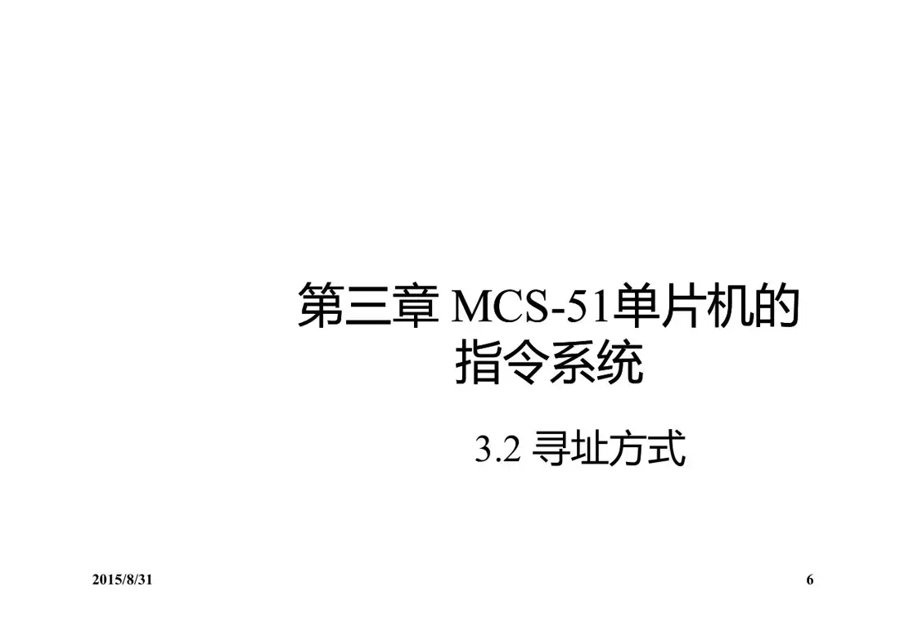

原文：

第三章 MCS-51单片机的指令系统

3.2 寻址方式

2015/8/31

6

### 单片机原理及系统设计

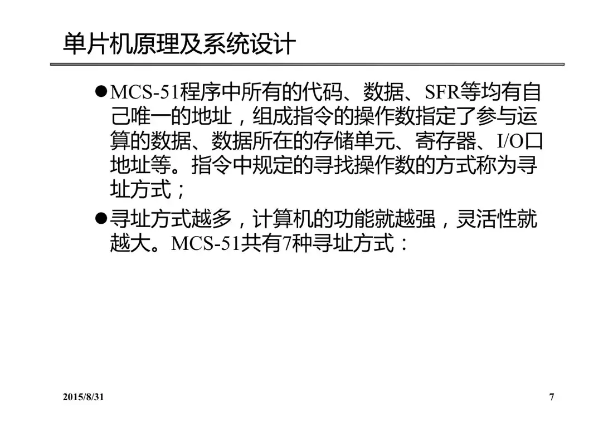

原文：

单片机原理及系统设计

MCS-51程序中所有的代码、数据、SFR等均有自己唯一的地址，组成指令的操作数指定了参与运算的数据、数据所在的存储单元、寄存器、I/O口地址等。指令中规定的寻找操作数的方式称为寻址方式；

寻址方式越多，计算机的功能就越强，灵活性就越大。MCS-51共有7种寻址方式：

2015/8/31

7

### 单片机原理及系统设计

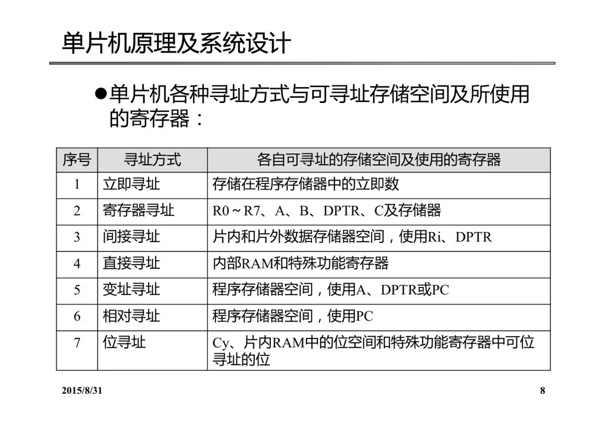

原文：

单片机原理及系统设计

单片机各种寻址方式与可寻址存储空间及所使用的寄存器：

<table><tr><td>序号</td><td>寻址方式</td><td>各自可寻址的存储空间及使用的寄存器</td></tr><tr><td>1</td><td>立即寻址</td><td>存储在程序存储器中的立即数</td></tr><tr><td>2</td><td>寄存器寻址</td><td>R0~R7、A、B、DPTR、C及存储器</td></tr><tr><td>3</td><td>间接寻址</td><td>片内和片外数据存储器空间,使用Ri、DPTR</td></tr><tr><td>4</td><td>直接寻址</td><td>内部RAM和特殊功能寄存器</td></tr><tr><td>5</td><td>变址寻址</td><td>程序存储器空间,使用A、DPTR或PC</td></tr><tr><td>6</td><td>相对寻址</td><td>程序存储器空间,使用PC</td></tr><tr><td>7</td><td>位寻址</td><td>Cy、片内RAM中的位空间和特殊功能寄存器中可位寻址的位</td></tr></table>

2015/8/31

8

### 单片机原理及系统设计

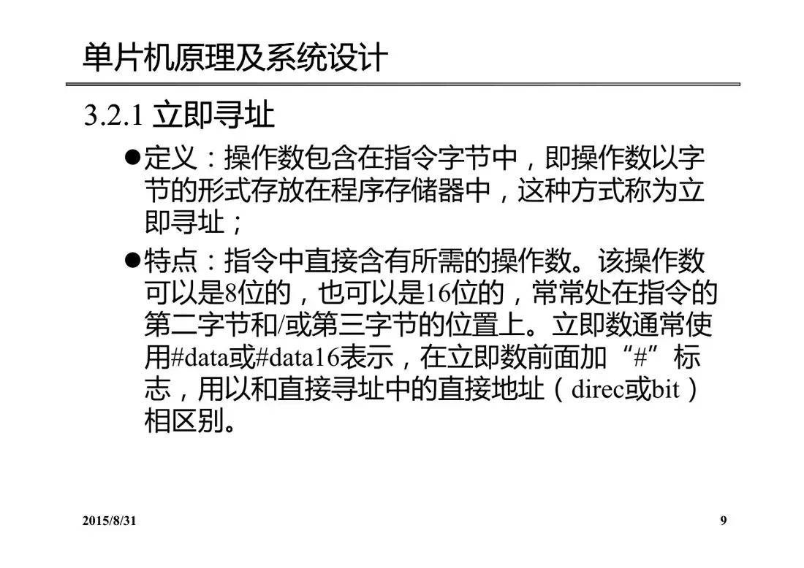

原文：

单片机原理及系统设计

3.2.1 立即寻址

定义：操作数包含在指令字节中，即操作数以字节的形式存放在程序存储器中，这种方式称为立即寻址；

特点：指令中直接含有所需的操作数。该操作数可以是8位的，也可以是16位的，常常处在指令的第二字节和/或第三字节的位置上。立即数通常使用#data或#data16表示，在立即数前面加“#”标志，用以和直接寻址中的直接地址（direc或bit）相区别。

2015/8/31

9

### 单片机原理及系统设计

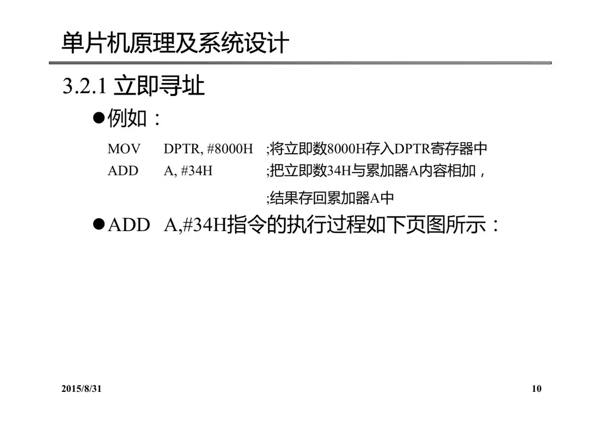

原文：

单片机原理及系统设计

3.2.1 立即寻址

例如：

MOV DPTR, #8000H ;将立即数8000H存入DPTR寄存器中

ADD A, #34H ;把立即数34H与累加器A内容相加，

;结果存回累加器A中

ADD A,#34H指令的执行过程如下页图所示：

2015/8/31

10

### 单片机原理及系统设计

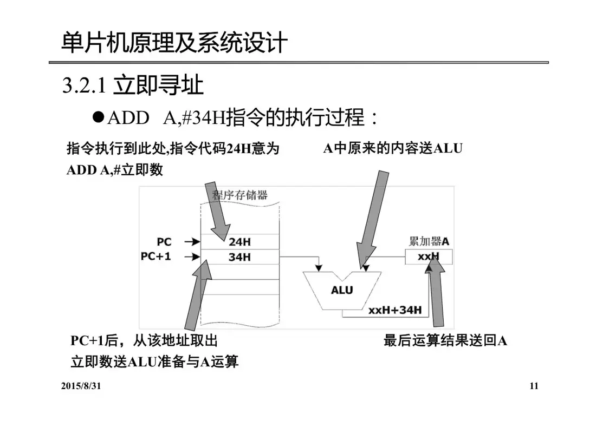

原文：

单片机原理及系统设计

3.2.1 立即寻址

ADD A,#34H指令的执行过程：

指令执行到此处,指令代码24H意为 A中原来的内容送ALUADD A,#立即数 7

立即数送ALU准备与A运算

2015/8/31

11

### 单片机原理及系统设计

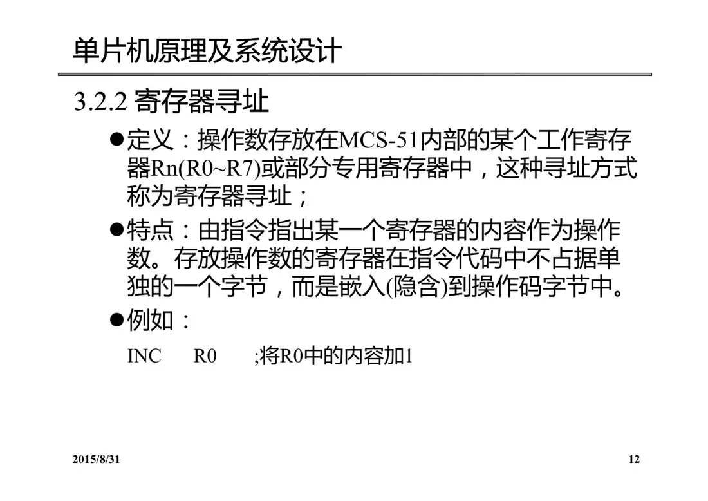

原文：

单片机原理及系统设计

3.2.2 寄存器寻址

定义：操作数存放在MCS-51内部的某个工作寄存器Rn(R0\~R7)或部分专用寄存器中，这种寻址方式称为寄存器寻址；

特点：由指令指出某一个寄存器的内容作为操作数。存放操作数的寄存器在指令代码中不占据单独的一个字节，而是嵌入(隐含)到操作码字节中。

例如：

INC R0 ;将R0中的内容加1

2015/8/31

12

### 单片机原理及系统设计

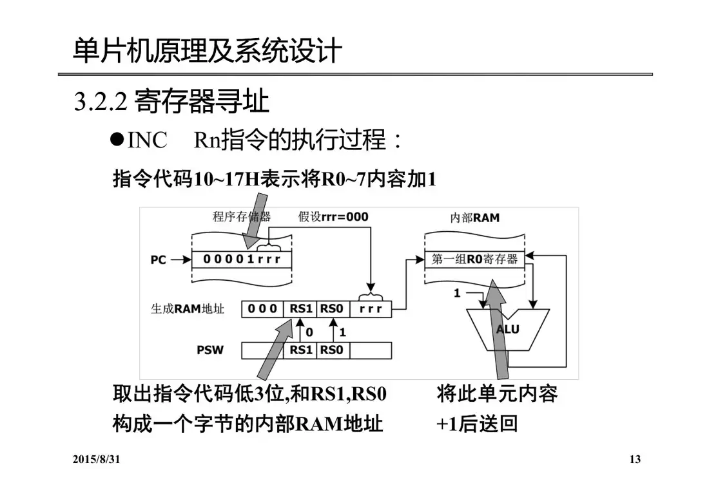

原文：

单片机原理及系统设计

3.2.2 寄存器寻址

INC Rn指令的执行过程：

指令代码10\~17H表示将R0\~7内容加1

2015/8/31

13

### 单片机原理及系统设计

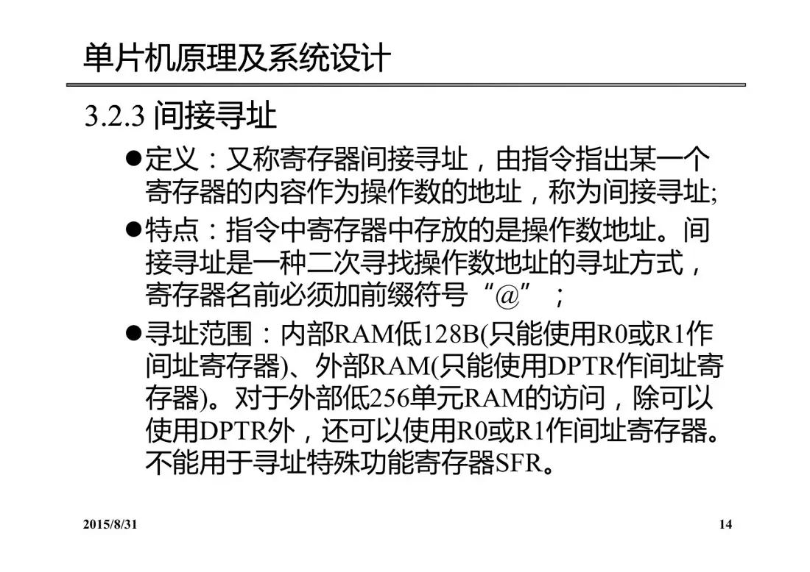

原文：

单片机原理及系统设计

3.2.3 间接寻址

定义：又称寄存器间接寻址，由指令指出某一个寄存器的内容作为操作数的地址，称为间接寻址;

特点：指令中寄存器中存放的是操作数地址。间接寻址是一种二次寻找操作数地址的寻址方式，寄存器名前必须加前缀符号“@”；

寻址范围：内部RAM低128B(只能使用R0或R1作间址寄存器)、外部RAM(只能使用DPTR作间址寄存器)。对于外部低256单元RAM的访问，除可以使用DPTR外，还可以使用R0或R1作间址寄存器。不能用于寻址特殊功能寄存器SFR。

2015/8/31

14

### 单片机原理及系统设计

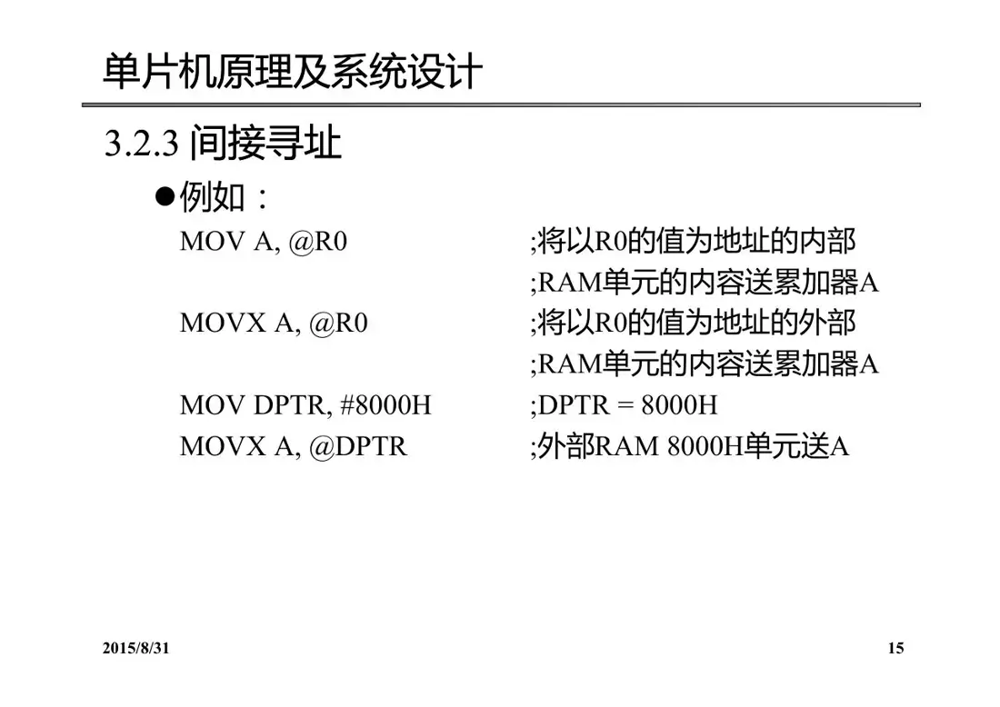

原文：

单片机原理及系统设计

3.2.3 间接寻址

例如：

MOV A, @R0

MOVX A, @R0

MOV DPTR, #8000H

MOVX A, @DPTR

;将以R0的值为地址的内部

;RAM单元的内容送累加器A

;将以R0的值为地址的外部

;RAM单元的内容送累加器A

;DPTR = 8000H

;外部RAM 8000H单元送A

2015/8/31

15

### 单片机原理及系统设计

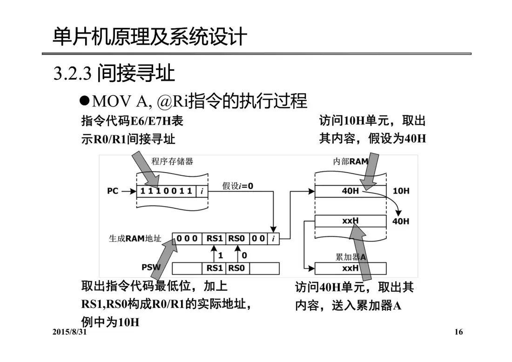

原文：

单片机原理及系统设计

3.2.3 间接寻址

MOV A, @Ri指令的执行过程指令代码E6/E7H表示R0/R1间接寻址

访问10H单元，取出其内容，假设为40H

取出指令代码最低位，加上 访问40H单元，取出其RS1,RS0构成R0/R1的实际地址， 内容，送入累加器A例中为10H/31

2015/8/31

16

### 单片机原理及系统设计

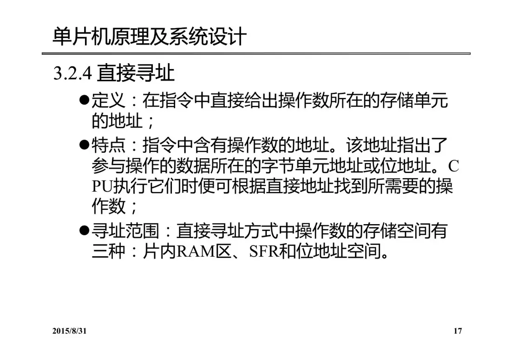

原文：

单片机原理及系统设计

3.2.4 直接寻址

定义：在指令中直接给出操作数所在的存储单元的地址；

特点：指令中含有操作数的地址。该地址指出了参与操作的数据所在的字节单元地址或位地址。CPU执行它们时便可根据直接地址找到所需要的操作数；

寻址范围：直接寻址方式中操作数的存储空间有三种：片内RAM区、SFR和位地址空间。

2015/8/31

17

### 单片机原理及系统设计

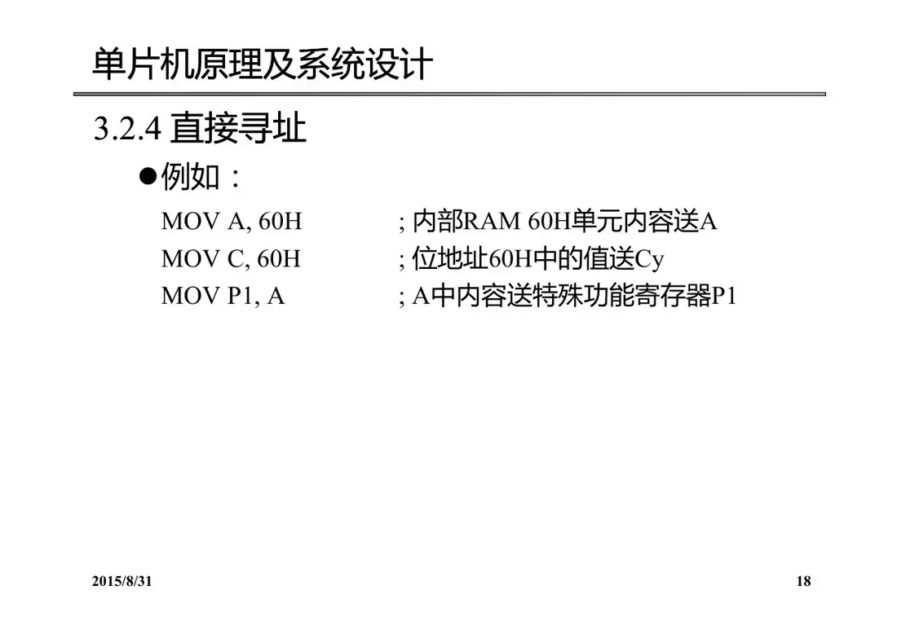

原文：

单片机原理及系统设计

3.2.4 直接寻址

例如：

MOV A, 60H ; 内部RAM 60H单元内容送A

MOV C, 60H ; 位地址60H中的值送Cy

MOV P1, A ; A中内容送特殊功能寄存器P1

2015/8/31

18

### 单片机原理及系统设计

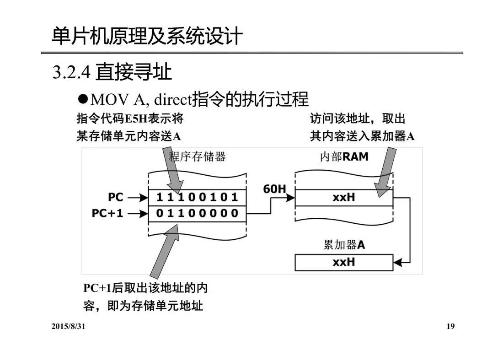

原文：

单片机原理及系统设计

3.2.4 直接寻址

MOV A, direct指令的执行过程

指令代码E5H表示将

某存储单元内容送A访问该地址，取出其内容送入累加器A

PC+1后取出该地址的内

容，即为存储单元地址

2015/8/31

19

### 单片机原理及系统设计

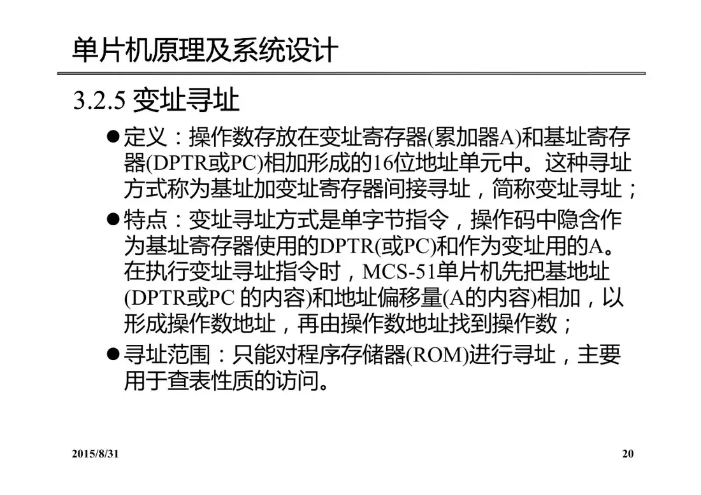

原文：

单片机原理及系统设计

3.2.5 变址寻址

定义：操作数存放在变址寄存器(累加器A)和基址寄存器(DPTR或PC)相加形成的16位地址单元中。这种寻址方式称为基址加变址寄存器间接寻址，简称变址寻址；

特点：变址寻址方式是单字节指令，操作码中隐含作为基址寄存器使用的DPTR(或PC)和作为变址用的A。在执行变址寻址指令时，MCS-51单片机先把基地址(DPTR或PC 的内容)和地址偏移量(A的内容)相加，以形成操作数地址，再由操作数地址找到操作数；

寻址范围：只能对程序存储器(ROM)进行寻址，主要用于查表性质的访问。

2015/8/31

20

### 单片机原理及系统设计

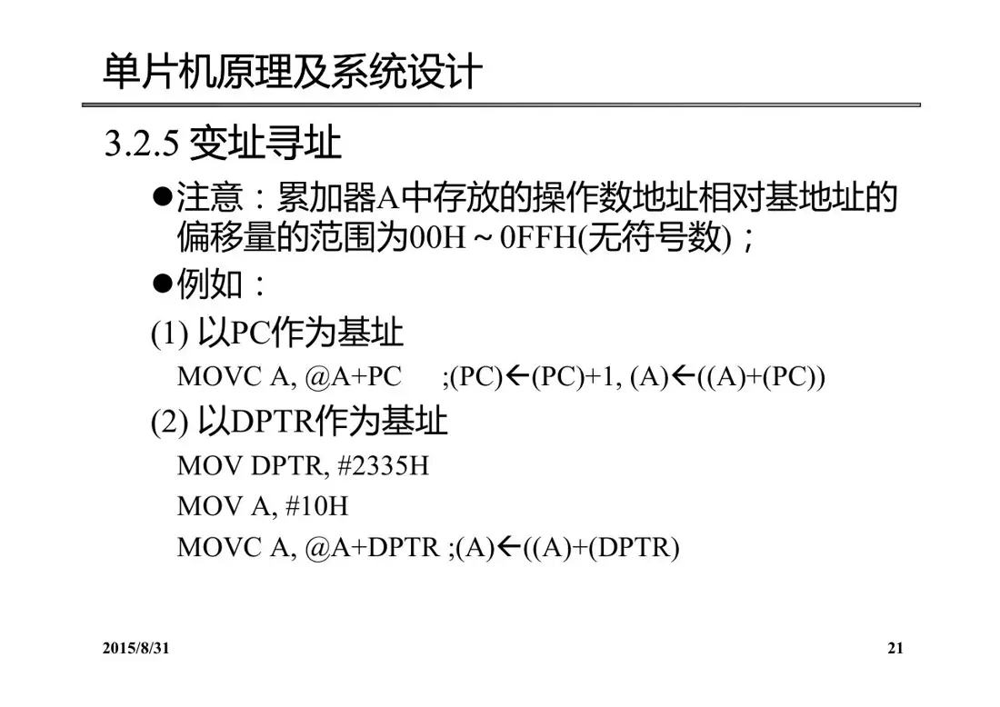

原文：

单片机原理及系统设计

3.2.5 变址寻址

注意：累加器A中存放的操作数地址相对基地址的偏移量的范围为00H～0FFH(无符号数)；

例如：

(1) 以PC作为基址 MOVC A, @A+PC ;(PC)←(PC)+1, (A)←((A)+(PC))

(2) 以DPTR作为基址

MOV DPTR, #2335H

MOV A, #10H

2015/8/31

21

### 单片机原理及系统设计

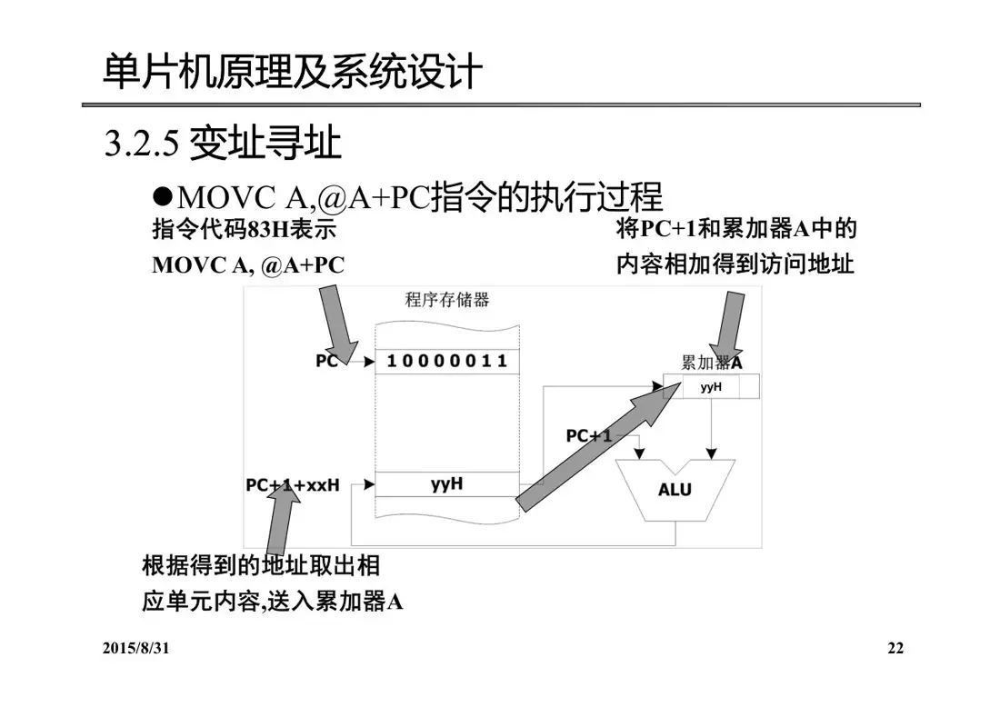

原文：

单片机原理及系统设计

3.2.5 变址寻址

MOVC A,@A+PC指令的执行过程

指令代码83H表示

MOVC A, @A+PC将PC+1和累加器A中的内容相加得到访问地址

根据得到的地址取出相

应单元内容,送入累加器A

2015/8/31

22

### 单片机原理及系统设计

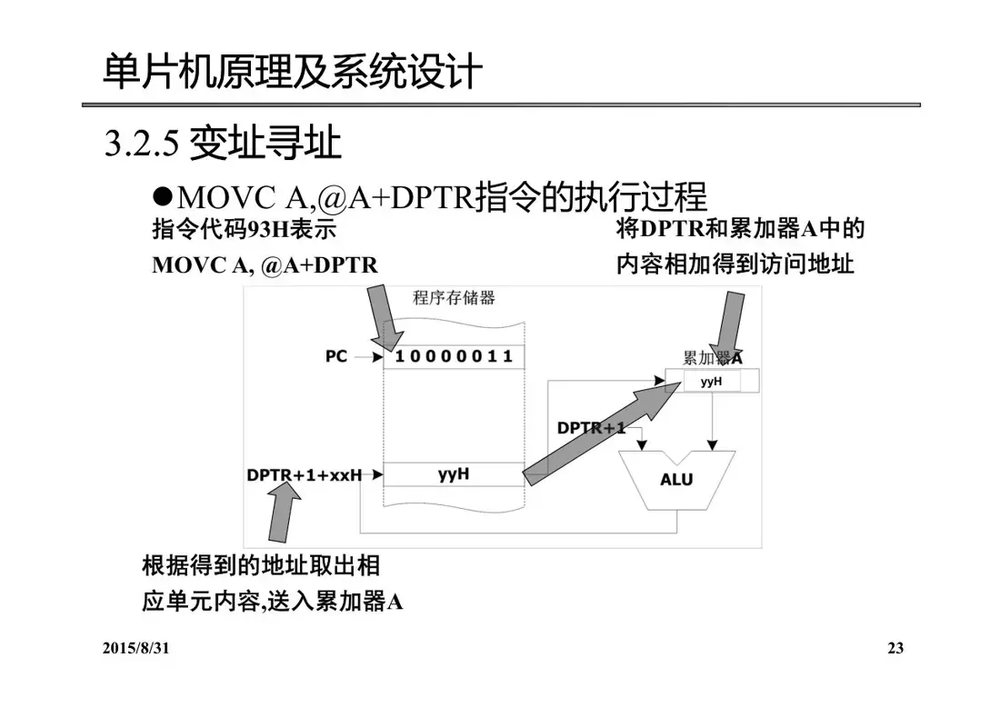

原文：

单片机原理及系统设计

3.2.5 变址寻址

MOVC A,@A+DPTR指令的执行过程

指令代码93H表示

MOVC A, @A+DPTR将DPTR和累加器A中的内容相加得到访问地址

根据得到的地址取出相

应单元内容,送入累加器A

2015/8/31

23

### 单片机原理及系统设计

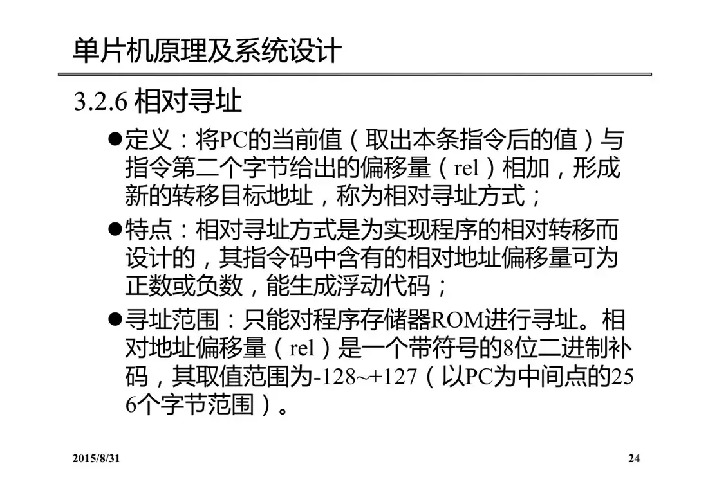

原文：

单片机原理及系统设计

3.2.6 相对寻址

定义：将PC的当前值（取出本条指令后的值）与指令第二个字节给出的偏移量（rel）相加，形成新的转移目标地址，称为相对寻址方式；

特点：相对寻址方式是为实现程序的相对转移而设计的，其指令码中含有的相对地址偏移量可为正数或负数，能生成浮动代码；

寻址范围：只能对程序存储器ROM进行寻址。相对地址偏移量（rel）是一个带符号的8位二进制补码，其取值范围为-128\~+127（以PC为中间点的256个字节范围）。

2015/8/31

24

### 单片机原理及系统设计

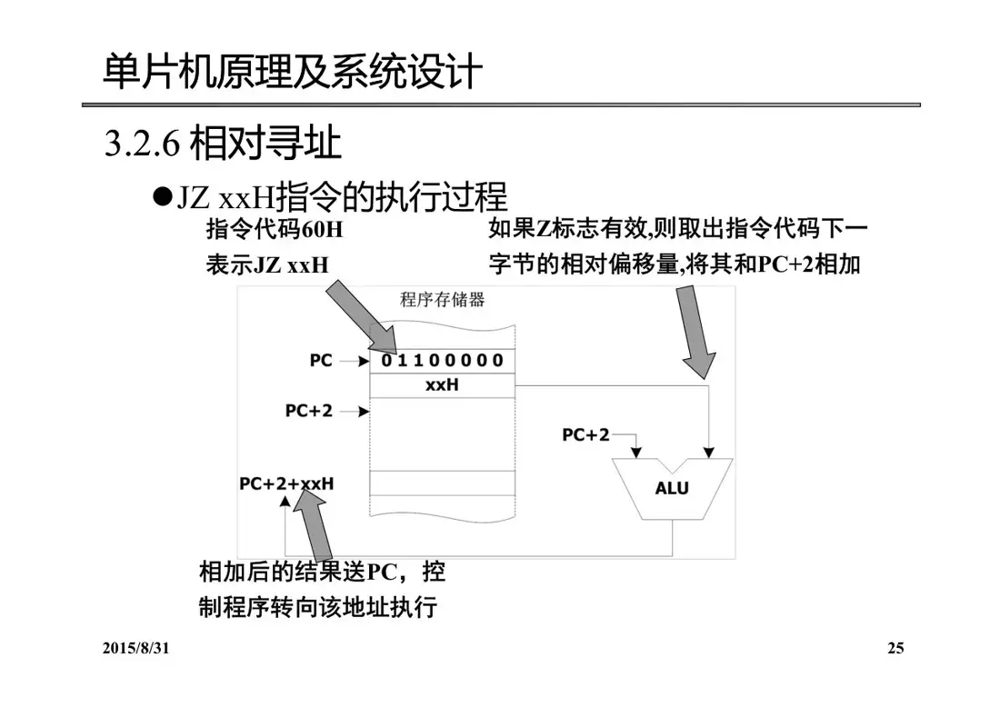

原文：

单片机原理及系统设计

3.2.6 相对寻址

JZ xxH指令的执行过程

指令代码60H

表示JZ xxH

如果Z标志有效,则取出指令代码下一字节的相对偏移量,将其和PC+2相加

相加后的结果送PC，控

制程序转向该地址执行

2015/8/31

25

### 单片机原理及系统设计

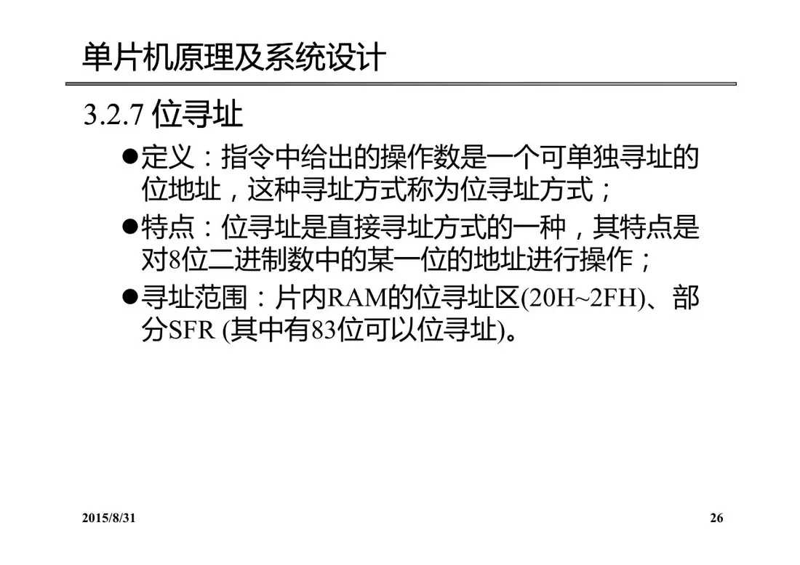

原文：

单片机原理及系统设计

3.2.7 位寻址

定义：指令中给出的操作数是一个可单独寻址的位地址，这种寻址方式称为位寻址方式；

特点：位寻址是直接寻址方式的一种，其特点是对8位二进制数中的某一位的地址进行操作；

寻址范围：片内RAM的位寻址区(20H\~2FH)、部分SFR (其中有83位可以位寻址)。

2015/8/31

26

### 单片机原理及系统设计

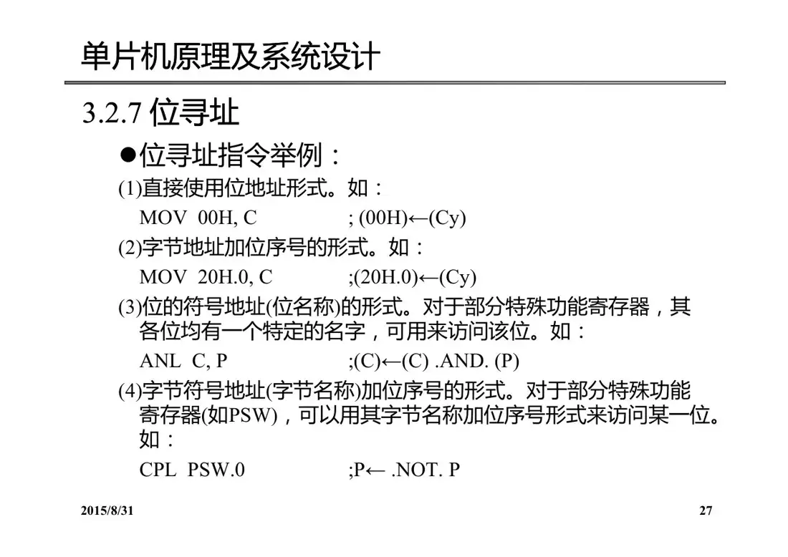

原文：

单片机原理及系统设计

3.2.7 位寻址

位寻址指令举例：

(1)直接使用位地址形式。如：MOV 00H, C ; (00H)←(Cy)

(2)字节地址加位序号的形式。如： MOV 20H.0, C ;(20H.0)←(Cy)

(3)位的符号地址(位名称)的形式。对于部分特殊功能寄存器，其各位均有一个特定的名字，可用来访问该位。如：ANL C, P ;(C)←(C) .AND. (P)

(4)字节符号地址(字节名称)加位序号的形式。对于部分特殊功能寄存器(如PSW)，可以用其字节名称加位序号形式来访问某一位。如：CPL PSW.0 ;P← .NOT. P

2015/8/31

27

### 第三章 MCS-51单片机的指令系统

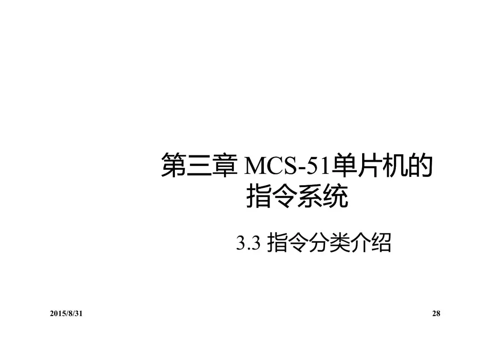

原文：

第三章 MCS-51单片机的指令系统

3.3 指令分类介绍

2015/8/31

28

### 单片机原理及系统设计

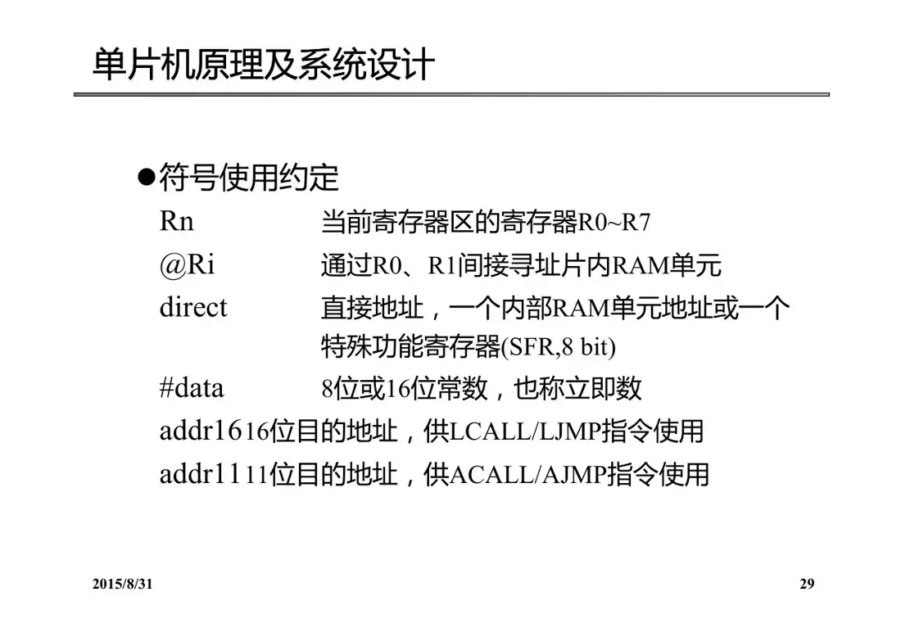

原文：

单片机原理及系统设计

符号使用约定

Rn 当前寄存器区的寄存器R0\~R7

@Ri 通过R0、R1间接寻址片内RAM单元

direct 直接地址，一个内部RAM单元地址或一个特殊功能寄存器(SFR,8 bit)

data 8位或16位常数，也称立即数

addr1616位目的地址，供LCALL/LJMP指令使用

addr1111位目的地址，供ACALL/AJMP指令使用

2015/8/31

29

### 单片机原理及系统设计

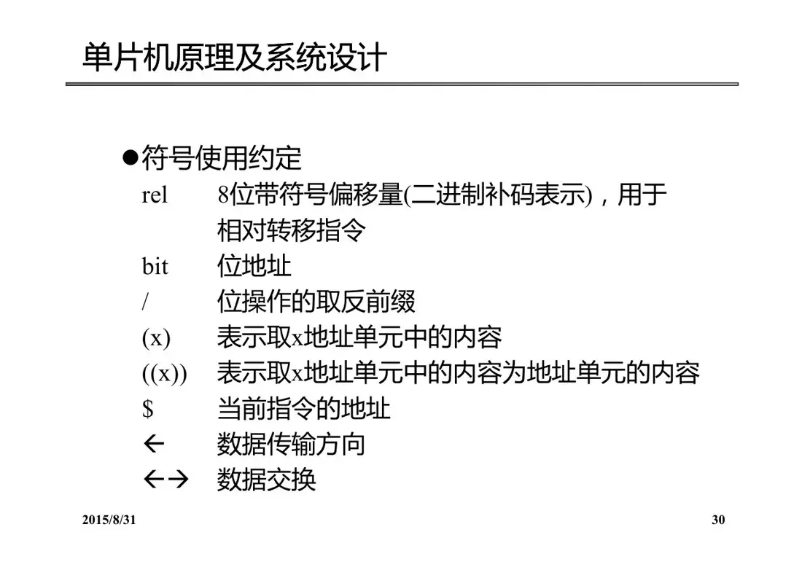

原文：

单片机原理及系统设计

符号使用约定

rel 8位带符号偏移量(二进制补码表示)，用于相对转移指令

bit 位地址

/ 位操作的取反前缀

(x) 表示取x地址单元中的内容

((x)) 表示取x地址单元中的内容为地址单元的内容

\$ 当前指令的地址

 数据传输方向

←→ 数据交换

2015/8/31

30

### 单片机原理及系统设计

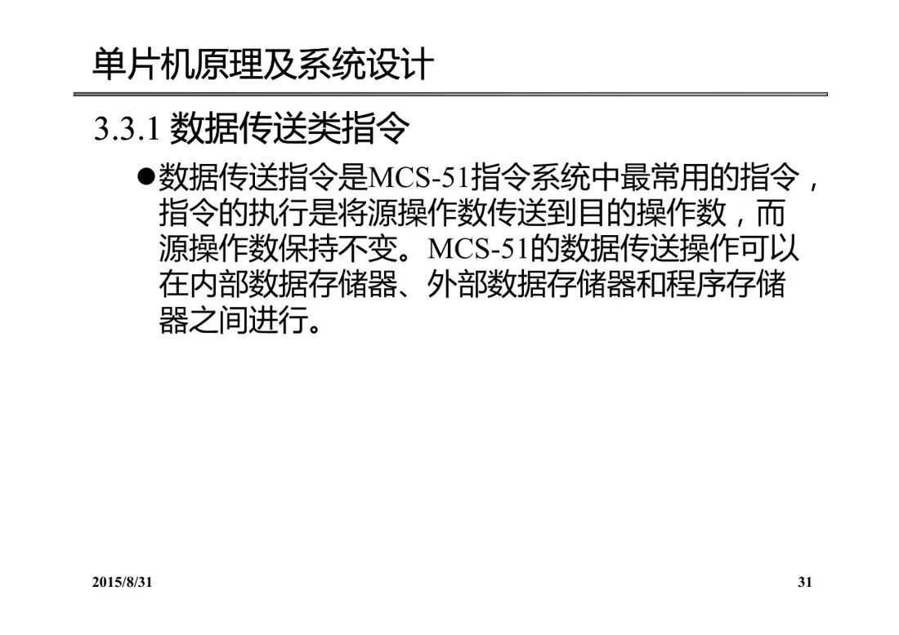

原文：

单片机原理及系统设计

3.3.1 数据传送类指令

数据传送指令是MCS-51指令系统中最常用的指令，指令的执行是将源操作数传送到目的操作数，而源操作数保持不变。MCS-51的数据传送操作可以在内部数据存储器、外部数据存储器和程序存储器之间进行。

2015/8/31

31

### 单片机原理及系统设计

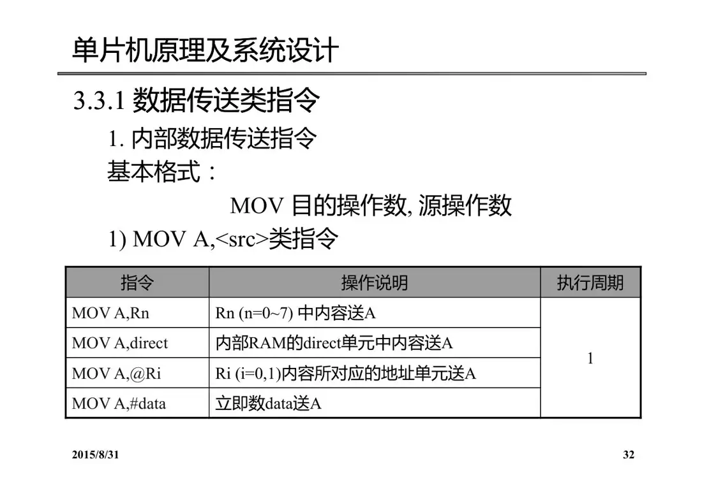

原文：

单片机原理及系统设计

3.3.1 数据传送类指令

1. 内部数据传送指令

基本格式：

MOV 目的操作数, 源操作数

1) $\mathrm { M O V } \mathrm { A } , { < } \mathrm { s r c } { > }$ 类指令

<table><tr><td>指令</td><td>操作说明</td><td>执行周期</td></tr><tr><td>MOV A,Rn</td><td>Rn (n=0~7) 中内容送A</td><td rowspan="4">1</td></tr><tr><td>MOV A,direct</td><td>内部RAM的direct单元中内容送A</td></tr><tr><td>MOV A,@Ri</td><td>Ri (i=0,1)内容所对应的地址单元送A</td></tr><tr><td>MOV A,#data</td><td>立即数data送A</td></tr></table>

2015/8/31

32

### 单片机原理及系统设计

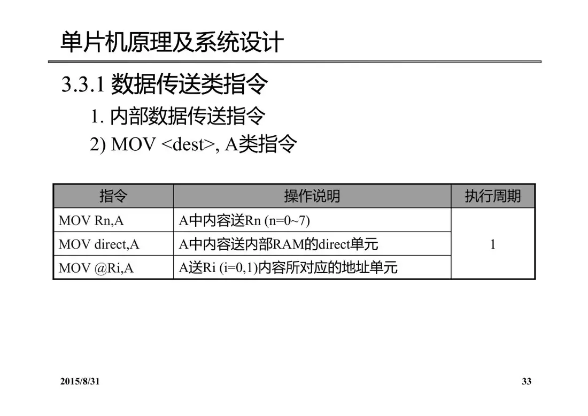

原文：

单片机原理及系统设计

3.3.1 数据传送类指令

1. 内部数据传送指令

2) MOV <dest>, A类指令

<table><tr><td>指令</td><td>操作说明</td><td>执行周期</td></tr><tr><td>MOV Rn,A</td><td>A中内容送Rn (n=0~7)</td><td rowspan="3">1</td></tr><tr><td>MOV direct,A</td><td>A中内容送内部RAM的direct单元</td></tr><tr><td>MOV @Ri,A</td><td>A送Ri (i=0,1)内容所对应的地址单元</td></tr></table>

2015/8/31

33

### 单片机原理及系统设计

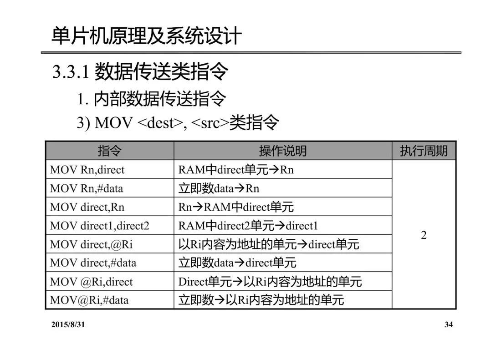

原文：

单片机原理及系统设计

3.3.1 数据传送类指令

1. 内部数据传送指令

3) MOV <dest>, <src>类指令

<table><tr><td>指令</td><td>操作说明</td><td>执行周期</td></tr><tr><td>MOV Rn, direct</td><td>RAM中direct单元→Rn</td><td rowspan="8">2</td></tr><tr><td>MOV Rn,#data</td><td>立即数data→Rn</td></tr><tr><td>MOV direct,Rn</td><td>Rn→RAM中direct单元</td></tr><tr><td>MOV direct1, direct2</td><td>RAM中direct2单元→direct1</td></tr><tr><td>MOV direct,@Ri</td><td>以Ri内容为地址的单元→direct单元</td></tr><tr><td>MOV direct,#data</td><td>立即数data→direct单元</td></tr><tr><td>MOV @Ri, direct</td><td>Direct单元→以Ri内容为地址的单元</td></tr><tr><td>MOV@Ri,#data</td><td>立即数→以Ri内容为地址的单元</td></tr></table>

2015/8/31

34

### 单片机原理及系统设计

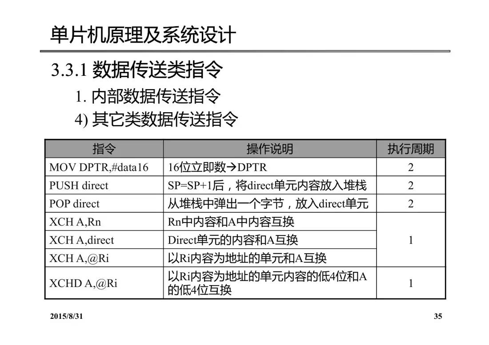

原文：

单片机原理及系统设计

3.3.1 数据传送类指令

1. 内部数据传送指令

4) 其它类数据传送指令

<table><tr><td>指令</td><td>操作说明</td><td>执行周期</td></tr><tr><td>MOV DPTR,#data16</td><td>16位立即数→DPTR</td><td>2</td></tr><tr><td>PUSH direct</td><td>SP=SP+1后,将direct单元内容放入堆栈</td><td>2</td></tr><tr><td>POP direct</td><td>从堆栈中弹出一个字节,放入direct单元</td><td>2</td></tr><tr><td>XCH A,Rn</td><td>Rn中内容和A中内容互换</td><td rowspan="3">1</td></tr><tr><td>XCH A,direct</td><td>Direct单元的内容和A互换</td></tr><tr><td>XCH A,@Ri</td><td>以Ri内容为地址的单元和A互换</td></tr><tr><td>XCHD A,@Ri</td><td>以Ri内容为地址的单元内容的低4位和A的低4位互换</td><td>1</td></tr></table>

2015/8/31

35

### 单片机原理及系统设计

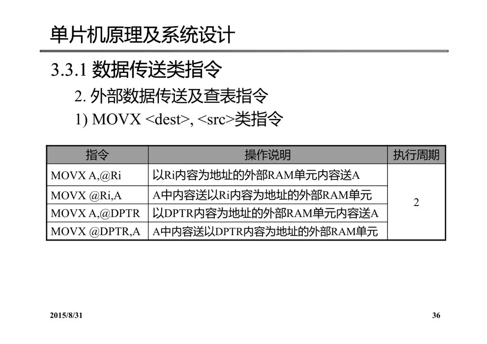

原文：

单片机原理及系统设计

3.3.1 数据传送类指令

2. 外部数据传送及查表指令

1) MOVX <dest>, <src>类指令

<table><tr><td>指令</td><td>操作说明</td><td>执行周期</td></tr><tr><td>MOVX A,@Ri</td><td>以Ri内容为地址的外部RAM单元内容送A</td><td rowspan="4">2</td></tr><tr><td>MOVX @Ri,A</td><td>A中内容送以Ri内容为地址的外部RAM单元</td></tr><tr><td>MOVX A,@DPTR</td><td>以DPTR内容为地址的外部RAM单元内容送A</td></tr><tr><td>MOVX @DPTR,A</td><td>A中内容送以DPTR内容为地址的外部RAM单元</td></tr></table>

2015/8/31

36

### 单片机原理及系统设计

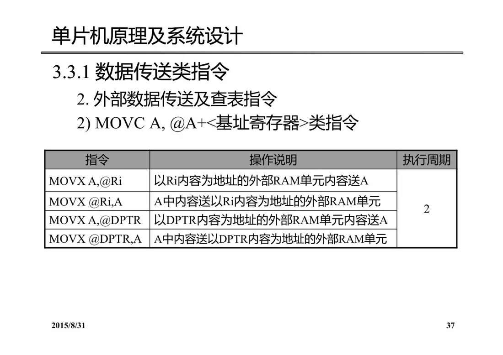

原文：

单片机原理及系统设计

3.3.1 数据传送类指令

2. 外部数据传送及查表指令

2) MOVC A, @A+<基址寄存器>类指令

<table><tr><td>指令</td><td>操作说明</td><td>执行周期</td></tr><tr><td>MOVX A,@Ri</td><td>以Ri内容为地址的外部RAM单元内容送A</td><td rowspan="4">2</td></tr><tr><td>MOVX @Ri,A</td><td>A中内容送以Ri内容为地址的外部RAM单元</td></tr><tr><td>MOVX A,@DPTR</td><td>以DPTR内容为地址的外部RAM单元内容送A</td></tr><tr><td>MOVX @DPTR,A</td><td>A中内容送以DPTR内容为地址的外部RAM单元</td></tr></table>

2015/8/31

37

### 单片机原理及系统设计

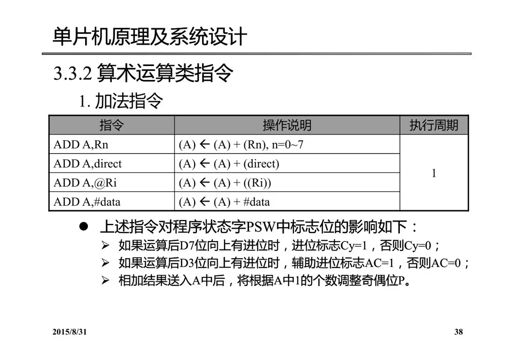

原文：

单片机原理及系统设计

3.3.2 算术运算类指令

1. 加法指令

<table><tr><td>指令</td><td>操作说明</td><td>执行周期</td></tr><tr><td>ADD A,Rn</td><td>(A) ← (A) + (Rn), n=0~7</td><td rowspan="4">1</td></tr><tr><td>ADD A,direct</td><td>(A) ← (A) + (direct)</td></tr><tr><td>ADD A,@Ri</td><td>(A) ← (A) + ((Ri))</td></tr><tr><td>ADD A,#data</td><td>(A) ← (A) + #data</td></tr></table>

 上述指令对程序状态字PSW中标志位的影响如下：

 如果运算后D7位向上有进位时，进位标志 $\mathrm { C y } { = } 1$ ，否则 $\mathrm { C y = 0 }$

 如果运算后D3位向上有进位时，辅助进位标志 $\mathbf { A C } { = } 1$ ，否则 $\mathbf { A C { = } 0 }$

 相加结果送入A中后，将根据A中1的个数调整奇偶位P。

2015/8/31

38

### 单片机原理及系统设计

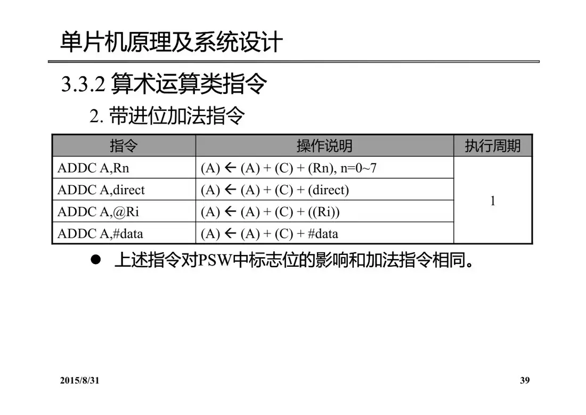

原文：

单片机原理及系统设计

3.3.2 算术运算类指令

2. 带进位加法指令

<table><tr><td>指令</td><td>操作说明</td><td>执行周期</td></tr><tr><td>ADDC A,Rn</td><td>(A) ← (A) + (C) + (Rn), n=0~7</td><td rowspan="4">1</td></tr><tr><td>ADDC A,direct</td><td>(A) ← (A) + (C) + (direct)</td></tr><tr><td>ADDC A,@Ri</td><td>(A) ← (A) + (C) + ((Ri))</td></tr><tr><td>ADDC A,#data</td><td>(A) ← (A) + (C) + #data</td></tr></table>
 上述指令对PSW中标志位的影响和加法指令相同。

2015/8/31

39

### 单片机原理及系统设计

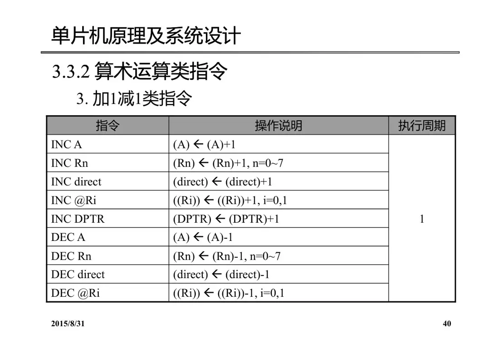

原文：

单片机原理及系统设计

3.3.2 算术运算类指令

3. 加1减1类指令

<table><tr><td>指令</td><td>操作说明</td><td>执行周期</td></tr><tr><td>INCA</td><td>(A) ← (A)+1</td><td rowspan="9">1</td></tr><tr><td>INCRn</td><td>(Rn) ← (Rn)+1, n=0~7</td></tr><tr><td>INC direct</td><td>(direct) ← (direct)+1</td></tr><tr><td>INC @Ri</td><td>((Ri)) ← ((Ri))+1, i=0,1</td></tr><tr><td>INC DPTR</td><td>(DPTR) ← (DPTR)+1</td></tr><tr><td>DEC A</td><td>(A) ← (A)-1</td></tr><tr><td>DEC Rn</td><td>(Rn) ← (Rn)-1, n=0~7</td></tr><tr><td>DEC direct</td><td>(direct) ← (direct)-1</td></tr><tr><td>DEC @Ri</td><td>((Ri)) ← ((Ri))-1, i=0,1</td></tr></table>

2015/8/31

40

### 单片机原理及系统设计

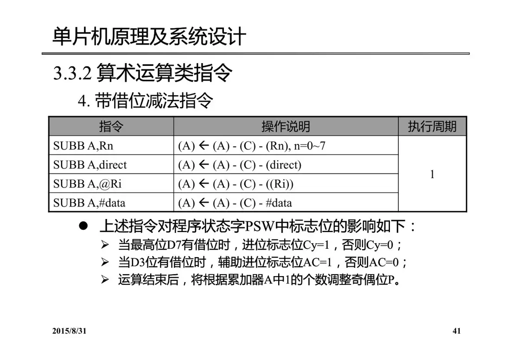

原文：

单片机原理及系统设计

3.3.2 算术运算类指令

4. 带借位减法指令

<table><tr><td>指令</td><td>操作说明</td><td>执行周期</td></tr><tr><td>SUBB A,Rn</td><td>(A) ← (A) - (C) - (Rn), n=0~7</td><td rowspan="4">1</td></tr><tr><td>SUBB A,direct</td><td>(A) ← (A) - (C) - (direct)</td></tr><tr><td>SUBB A,@Ri</td><td>(A) ← (A) - (C) - ((Ri))</td></tr><tr><td>SUBB A,#data</td><td>(A) ← (A) - (C) - #data</td></tr></table>

 上述指令对程序状态字PSW中标志位的影响如下：

 当最高位D7有借位时，进位标志位 $\mathrm { C y } { = } 1$ ，否则 $\mathrm { C y = 0 }$

 当D3位有借位时，辅助进位标志位 $\mathbf { A C } { = } 1$ ，否则 $\mathbf { A C { = } 0 }$

 运算结束后，将根据累加器A中1的个数调整奇偶位P。

2015/8/31

41

### 单片机原理及系统设计

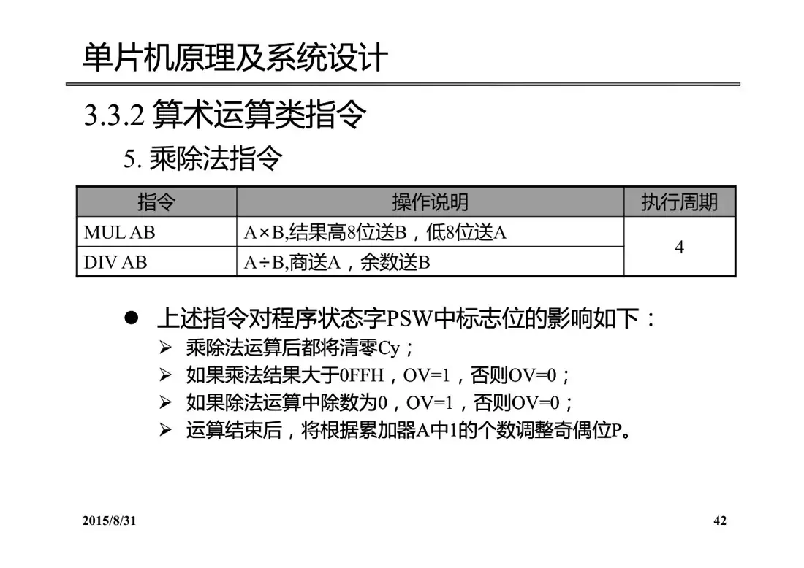

原文：

单片机原理及系统设计

3.3.2 算术运算类指令

5. 乘除法指令

<table><tr><td>指令</td><td>操作说明</td><td>执行周期</td></tr><tr><td>MUL AB</td><td>A×B,结果高8位送B,低8位送A</td><td rowspan="2">4</td></tr><tr><td>DIV AB</td><td>A÷B,商送A,余数送B</td></tr></table>

 上述指令对程序状态字PSW中标志位的影响如下：

 乘除法运算后都将清零Cy；

 如果乘法结果大于0FFH，OV=1，否则OV=0；

 如果除法运算中除数为0，OV=1，否则OV=0；

 运算结束后，将根据累加器A中1的个数调整奇偶位P。

2015/8/31

42

### 单片机原理及系统设计

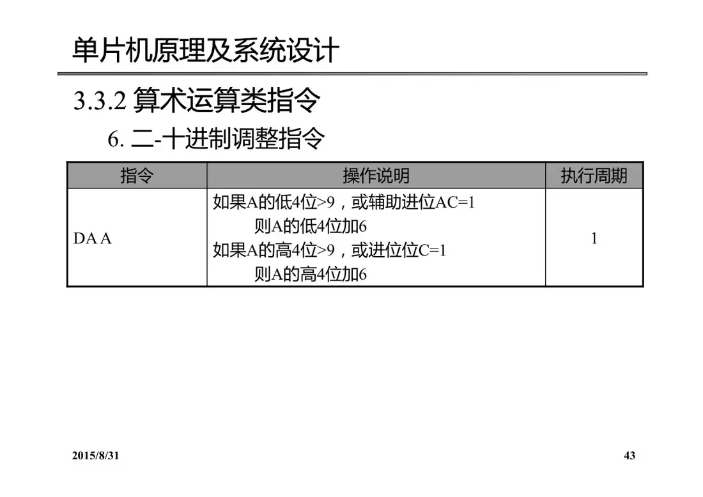

原文：

单片机原理及系统设计

3.3.2 算术运算类指令

6. 二-十进制调整指令

<table><tr><td>指令</td><td>操作说明</td><td>执行周期</td></tr><tr><td>D A A</td><td>如果A的低4位&gt;9,或辅助进位AC=1则A的低4位加6如果A的高4位&gt;9,或进位位C=1则A的高4位加6</td><td>1</td></tr></table>

2015/8/31

43

### 单片机原理及系统设计

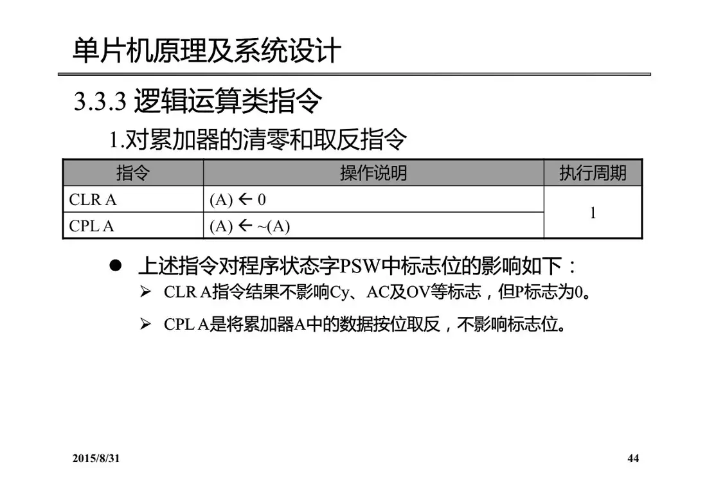

原文：

单片机原理及系统设计

3.3.3 逻辑运算类指令

1.对累加器的清零和取反指令

<table><tr><td>指令</td><td>操作说明</td><td>执行周期</td></tr><tr><td>CLR A</td><td>(A) ← 0</td><td rowspan="2">1</td></tr><tr><td>CPL A</td><td>(A) ← ~(A)</td></tr></table>

 上述指令对程序状态字PSW中标志位的影响如下：

 CLR A指令结果不影响Cy、AC及OV等标志，但P标志为0。

 CPL A是将累加器A中的数据按位取反，不影响标志位。

2015/8/31

44

### 单片机原理及系统设计

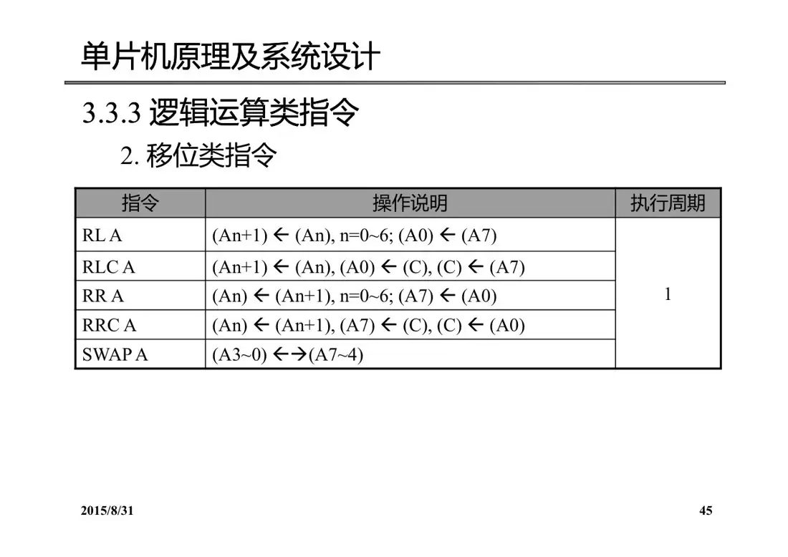

原文：

单片机原理及系统设计

3.3.3 逻辑运算类指令

2. 移位类指令

<table><tr><td>指令</td><td>操作说明</td><td>执行周期</td></tr><tr><td>RL A</td><td> $(An+1) \leftarrow (An), n=0\sim6; (A0) \leftarrow (A7)$ </td><td rowspan="5">1</td></tr><tr><td>RLC A</td><td> $(An+1) \leftarrow (An), (A0) \leftarrow (C), (C) \leftarrow (A7)$ </td></tr><tr><td>RR A</td><td> $(An) \leftarrow (An+1), n=0\sim6; (A7) \leftarrow (A0)$ </td></tr><tr><td>RRC A</td><td> $(An) \leftarrow (An+1), (A7) \leftarrow (C), (C) \leftarrow (A0)$ </td></tr><tr><td>SWAP A</td><td> $(A3\sim0) \leftrightarrow (A7\sim4)$ </td></tr></table>

2015/8/31

45

### 单片机原理及系统设计

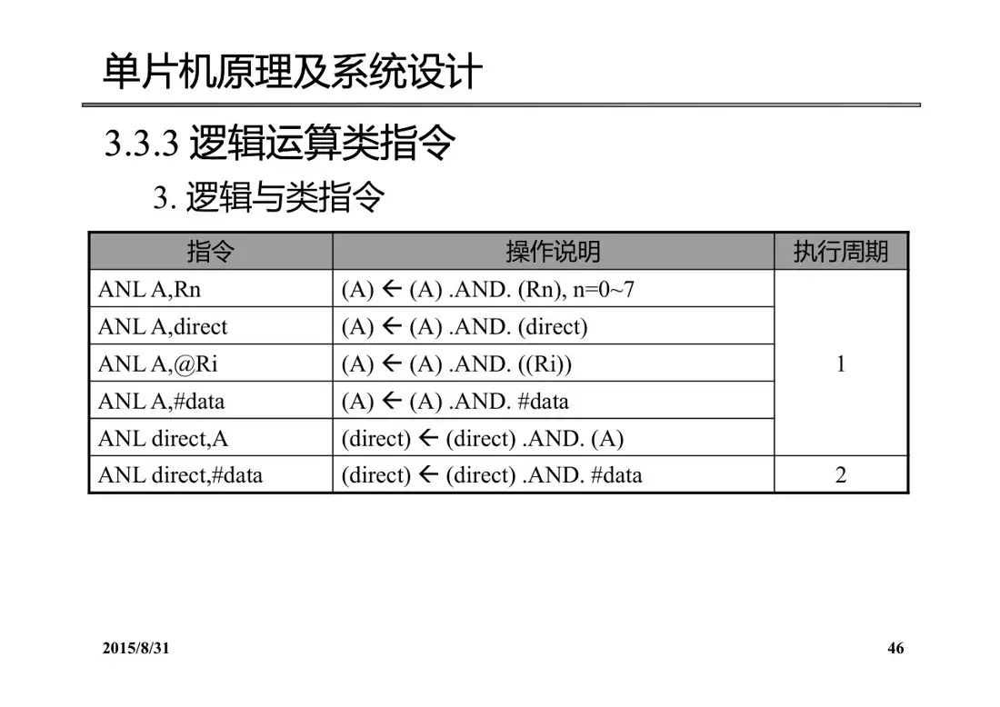

原文：

单片机原理及系统设计

3.3.3 逻辑运算类指令

3. 逻辑与类指令

<table><tr><td>指令</td><td>操作说明</td><td>执行周期</td></tr><tr><td>ANL A,Rn</td><td>(A) ← (A).AND. (Rn), n=0~7</td><td rowspan="5">1</td></tr><tr><td>ANL A,direct</td><td>(A) ← (A).AND. (direct)</td></tr><tr><td>ANL A,@Ri</td><td>(A) ← (A).AND. ((Ri))</td></tr><tr><td>ANL A,#data</td><td>(A) ← (A).AND. #data</td></tr><tr><td>ANL direct,A</td><td>(direct) ← (direct).AND. (A)</td></tr><tr><td>ANL direct,#data</td><td>(direct) ← (direct).AND. #data</td><td>2</td></tr></table>

2015/8/31

46

### 单片机原理及系统设计

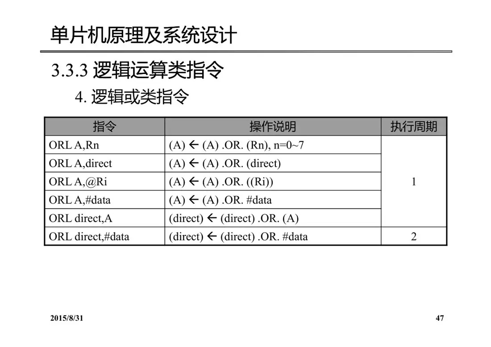

原文：

单片机原理及系统设计

3.3.3 逻辑运算类指令

4. 逻辑或类指令

<table><tr><td>指令</td><td>操作说明</td><td>执行周期</td></tr><tr><td>ORL A,Rn</td><td>(A) ← (A).OR. (Rn), n=0~7</td><td rowspan="5">1</td></tr><tr><td>ORL A,direct</td><td>(A) ← (A).OR. (direct)</td></tr><tr><td>ORL A,@Ri</td><td>(A) ← (A).OR. ((Ri))</td></tr><tr><td>ORL A,#data</td><td>(A) ← (A).OR. #data</td></tr><tr><td>ORL direct,A</td><td>(direct) ← (direct).OR. (A)</td></tr><tr><td>ORL direct,#data</td><td>(direct) ← (direct).OR. #data</td><td>2</td></tr></table>

2015/8/31

47

### 单片机原理及系统设计

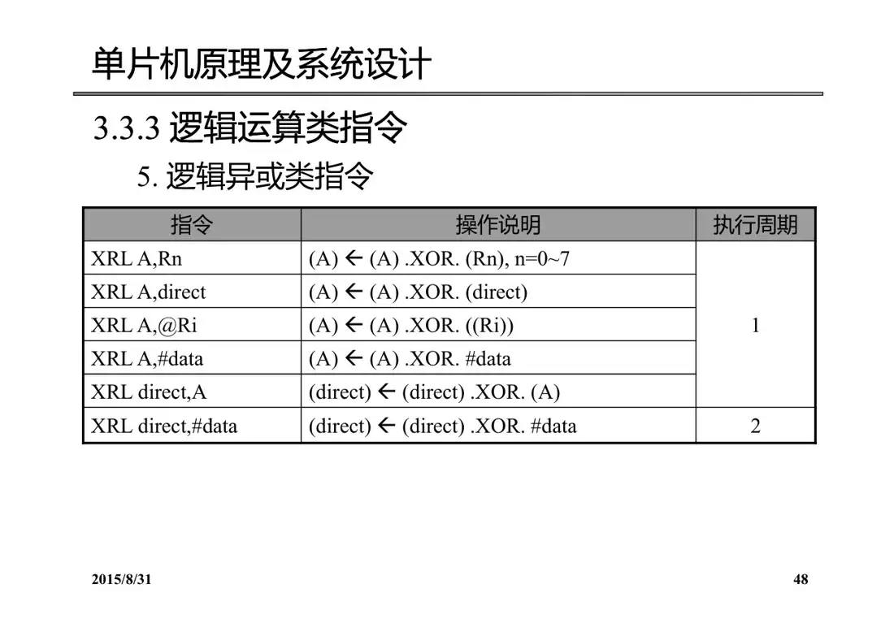

原文：

单片机原理及系统设计

3.3.3 逻辑运算类指令

5. 逻辑异或类指令

<table><tr><td>指令</td><td>操作说明</td><td>执行周期</td></tr><tr><td>XRL A,Rn</td><td>(A) ← (A). XOR. (Rn), n=0~7</td><td rowspan="5">1</td></tr><tr><td>XRL A,direct</td><td>(A) ← (A). XOR. (direct)</td></tr><tr><td>XRL A,@Ri</td><td>(A) ← (A). XOR. ((Ri))</td></tr><tr><td>XRL A,#data</td><td>(A) ← (A). XOR. #data</td></tr><tr><td>XRL direct,A</td><td>(direct) ← (direct). XOR. (A)</td></tr><tr><td>XRL direct,#data</td><td>(direct) ← (direct). XOR. #data</td><td>2</td></tr></table>

2015/8/31

48

### 单片机原理及系统设计

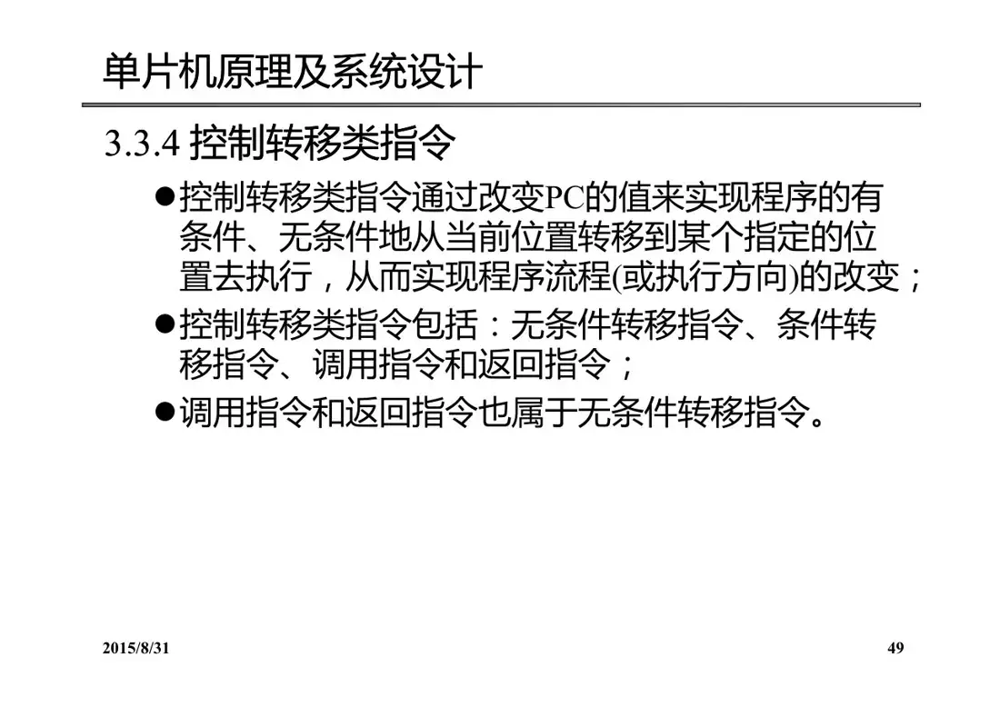

原文：

单片机原理及系统设计

3.3.4 控制转移类指令

控制转移类指令通过改变PC的值来实现程序的有条件、无条件地从当前位置转移到某个指定的位置去执行，从而实现程序流程(或执行方向)的改变；

控制转移类指令包括：无条件转移指令、条件转移指令、调用指令和返回指令；

调用指令和返回指令也属于无条件转移指令。

2015/8/31

49

### 单片机原理及系统设计

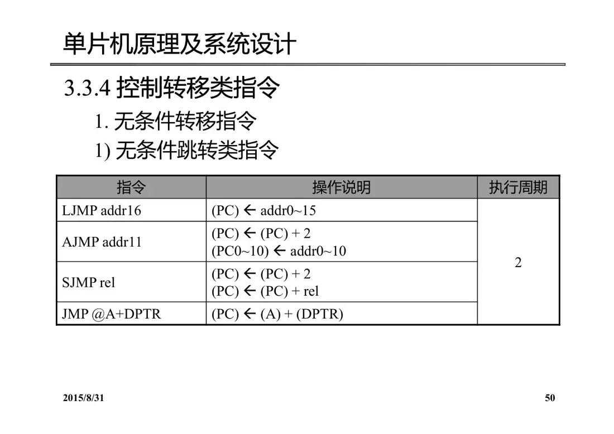

原文：

单片机原理及系统设计

3.3.4 控制转移类指令

1. 无条件转移指令

1) 无条件跳转类指令

<table><tr><td>指令</td><td>操作说明</td><td>执行周期</td></tr><tr><td>LJMP addr16</td><td>(PC) ← addr0~15</td><td rowspan="4">2</td></tr><tr><td>AJMP addr11</td><td>(PC) ← (PC) + 2(PC0~10) ← addr0~10</td></tr><tr><td>SJMP rel</td><td>(PC) ← (PC) + 2(PC) ← (PC) + rel</td></tr><tr><td>JMP @A+DPTR</td><td>(PC) ← (A) + (DPTR)</td></tr></table>

2015/8/31

50

### 单片机原理及系统设计

原文：

单片机原理及系统设计

3.3.4 控制转移类指令

1. 无条件转移指令

2) 调用类指令

<table><tr><td>指令</td><td>操作说明</td><td>执行周期</td></tr><tr><td>LCALL addr16</td><td>(PC) ← PC + 3; (SP) ← (SP) + 1;((SP)) ← (PC0~7); (SP) ← (SP) + 1;((SP)) ← (PC8~15);(PC) ← addr0~15</td><td rowspan="2">2</td></tr><tr><td>ACALL addr11</td><td>(PC) ← PC + 2; (SP) ← (SP) + 1;((SP)) ← (PC0~7); (SP) ← (SP) + 1;((SP)) ← (PC8~15);(PC0~10) ← addr0~10</td></tr></table>

2015/8/31

51

### 单片机原理及系统设计

原文：

单片机原理及系统设计

3.3.4 控制转移类指令

1. 无条件转移指令

2) 返回类指令及空操作

<table><tr><td>指令</td><td>操作说明</td><td>执行周期</td></tr><tr><td>RET</td><td>(PC8~15) ← ((SP)); (SP) ← (SP)-1; (PC0~7) ← ((SP)); ((SP)) ← (SP)-1</td><td rowspan="2">2</td></tr><tr><td>RETI</td><td>(PC8~15) ← ((SP)); (SP) ← (SP)-1; (PC0~7) ← ((SP)); ((SP)) ← (SP)-1</td></tr><tr><td>NOP</td><td>(PC) ← (PC) + 1</td><td>1</td></tr></table>

2015/8/31

52

### 单片机原理及系统设计

原文：

单片机原理及系统设计

3.3.4 控制转移类指令

2. 条件转移指令

1) 判0转移类指令

<table><tr><td>指令</td><td>操作说明</td><td>执行周期</td></tr><tr><td>JZ rel</td><td>(PC) ← (PC) + 2if (A) == 0 : (PC) ← (PC) + rel</td><td rowspan="2">2</td></tr><tr><td>JNZ rel</td><td>(PC) ← (PC) + 2if (A) != 0 : (PC) ← (PC) + rel</td></tr></table>

2015/8/31

53

### 单片机原理及系统设计

原文：

单片机原理及系统设计

3.3.4 控制转移类指令

2. 条件转移指令

2) 比较转移类指令

格式为 CJNE OP1, OP2, rel

<table><tr><td>指令</td><td>操作说明</td><td>执行周期</td></tr><tr><td>CJNE A,direct,rel</td><td rowspan="2">(PC) ← (PC) + 3if OP1 != OP2 then(PC) ← (PC) + rel</td><td rowspan="4">2</td></tr><tr><td>CJNE A,#data,rel</td></tr><tr><td>CJNE Rn,#data,rel</td><td rowspan="2">if OP1 &lt; OP2 thenC ← 1 else C ← 0</td></tr><tr><td>CJNE @Ri,#data,rel</td></tr></table>

2015/8/31

54

### 单片机原理及系统设计

原文：

单片机原理及系统设计

3.3.4 控制转移类指令

2. 条件转移指令

3) 循环转移类指令

格式为 DJNZ OP, rel

<table><tr><td>指令</td><td>操作说明</td><td>执行周期</td></tr><tr><td>DJNZ Rn,rel</td><td rowspan="2">(PC) ← (PC) + 2(OP) ← (OP) - 1if OP != 0 then(PC) ← (PC) + rel</td><td rowspan="2">2</td></tr><tr><td>DJNZ direct,rel</td></tr></table>

2015/8/31

55

### 单片机原理及系统设计

原文：

单片机原理及系统设计

3.3.5 布尔(位)处理类指令

 位操作是以位（bit）为对象来进行运算和操作的。由于位变量的值只能为1或0，故位操作又称为布尔操作；

MCS-51 CPU内部有一个功能强大的布尔处理器，它实际上就是一个一位的CPU。它以进位标志位Cy作为布尔累加器，以单片机内部RAM的可位寻址区和特殊功能寄存器中可位寻址寄存器的位为操作数；

 MCS-51单片机的位寻址空间可分为两个部分：

内部RAM中地址为20H\~2FH的16个可位寻址字节，共 有128个位地址，位地址范围从00H\~7FH;

SFR区中的可位寻址寄存器。每个地址可被8整除的SFR(即地址最低3位为000)均可位寻址。

2015/8/31

56

### 单片机原理及系统设计

原文：

单片机原理及系统设计

3.3.5 布尔(位)处理类指令

1. 位传送指令

<table><tr><td>指令</td><td>操作说明</td><td>执行周期</td></tr><tr><td>MOV C,bit</td><td>(C) ← (bit)</td><td rowspan="2">1</td></tr><tr><td>MOV bit,C</td><td>(bit) ← (C)</td></tr></table>

2015/8/31

57

### 单片机原理及系统设计

原文：

单片机原理及系统设计

3.3.5 布尔(位)处理类指令

2. 位修改指令

<table><tr><td>指令</td><td>操作说明</td><td>执行周期</td></tr><tr><td>CLR C</td><td>(C) ← 0</td><td rowspan="6">1</td></tr><tr><td>CLR bit</td><td>(bit) ← 0</td></tr><tr><td>SETB C</td><td>(C) ← 1</td></tr><tr><td>SETB bit</td><td>(bit) ← 1</td></tr><tr><td>CPL C</td><td>(C) ← !(C)</td></tr><tr><td>CPL bit</td><td>(bit) ← !(bit)</td></tr></table>

2015/8/31

58

### 单片机原理及系统设计

原文：

单片机原理及系统设计

3.3.5 布尔(位)处理类指令

3. 位逻辑运算指令

<table><tr><td>指令</td><td>操作说明</td><td>执行周期</td></tr><tr><td>ANL C,bit</td><td>(C) ← (C).AND. (bit)</td><td rowspan="4">2</td></tr><tr><td>ANL C,/bit</td><td>(C) ← (C).AND. (bit)</td></tr><tr><td>ORL C,bit</td><td>(C) ← (C).OR. (bit)</td></tr><tr><td>ORL C,/bit</td><td>(C) ← (C).OR. (bit)</td></tr></table>

2015/8/31

59

### 单片机原理及系统设计

原文：

单片机原理及系统设计

3.3.5 布尔(位)处理类指令

4.布尔(位)条件转移指令

<table><tr><td>指令</td><td>操作说明</td><td>执行周期</td></tr><tr><td>JC rel</td><td>(PC) ← (PC)+2if (C)==1 then (PC) ← (PC)+rel</td><td rowspan="5">2</td></tr><tr><td>JNC rel</td><td>(PC) ← (PC)+2if (C)==0 then (PC) ← (PC)+rel</td></tr><tr><td>JB bit,rel</td><td>(PC) ← (PC)+3if (bit)==1 then (PC) ← (PC)+rel</td></tr><tr><td>JBC bit,rel</td><td>(PC) ← (PC)+3if (bit)==1 then (bit)←0;(PC)←(PC)+rel</td></tr><tr><td>JNB bit,rel</td><td>(PC) ← (PC)+3if (bit)==0 then (PC) ← (PC)+rel</td></tr></table>

2015/8/31

60
