# 《单片机原理及系统设计》第1章 概述（课件）

原件的每一页，下面附识别出的文字。

### 第一章 概述

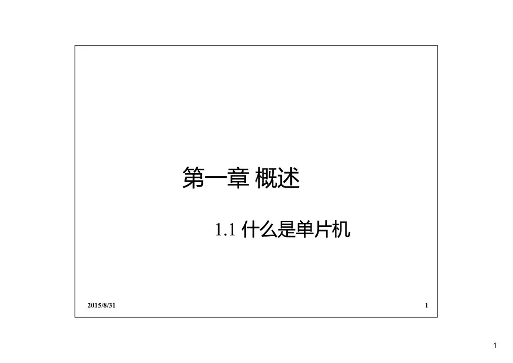

原文：

第一章 概述

1.1 什么是单片机

1

### 单片机原理及系统设计

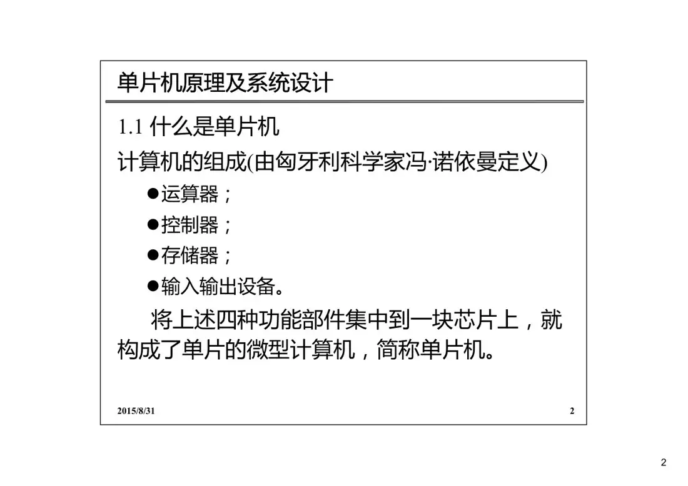

原文：

单片机原理及系统设计

1.1 什么是单片机

计算机的组成(由匈牙利科学家冯·诺依曼定义)

运算器；

控制器；

存储器；

输入输出设备。

将上述四种功能部件集中到一块芯片上，就构成了单片的微型计算机，简称单片机。

2015/8/31

2

### 单片机原理及系统设计

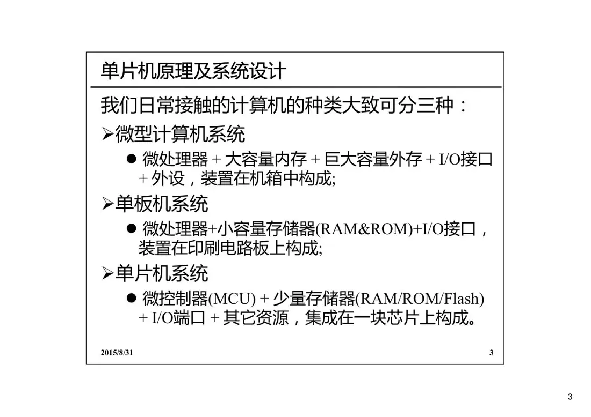

原文：

单片机原理及系统设计

我们日常接触的计算机的种类大致可分三种：

微型计算机系统

 微处理器 + 大容量内存 + 巨大容量外存 + I/O接口+ 外设，装置在机箱中构成;

单板机系统

 微处理器+小容量存储器(RAM&ROM)+I/O接口，装置在印刷电路板上构成;

单片机系统

 微控制器(MCU) + 少量存储器(RAM/ROM/Flash)+ I/O端口 + 其它资源，集成在一块芯片上构成。

2015/8/31

3

### 第一章 概述

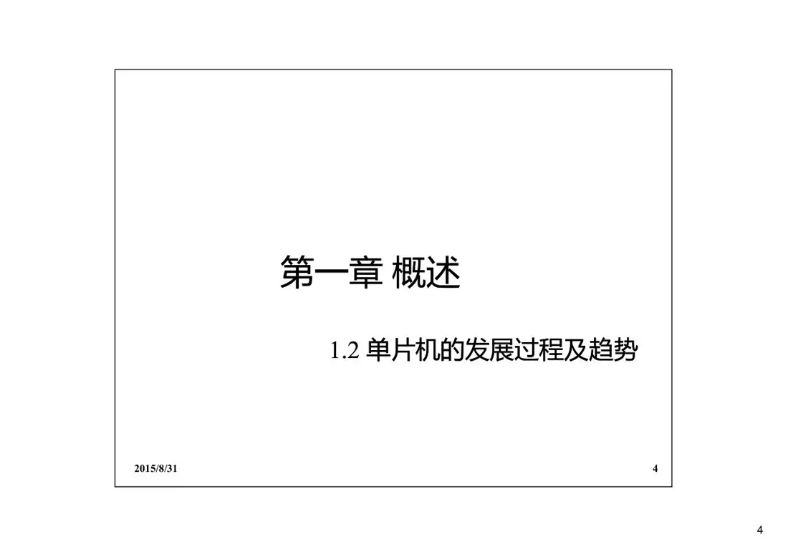

原文：

第一章 概述

1.2 单片机的发展过程及趋势

4

### 单片机原理及系统设计

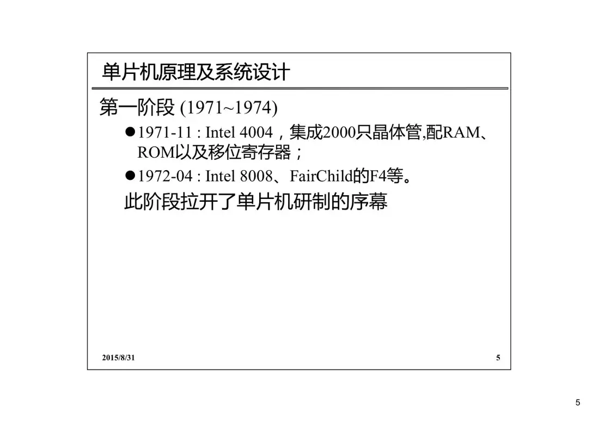

原文：

单片机原理及系统设计

第一阶段 (1971\~1974)

1972-04 : Intel 8008、FairChild的F4等。

此阶段拉开了单片机研制的序幕

2015/8/31

5

### 第 6 页

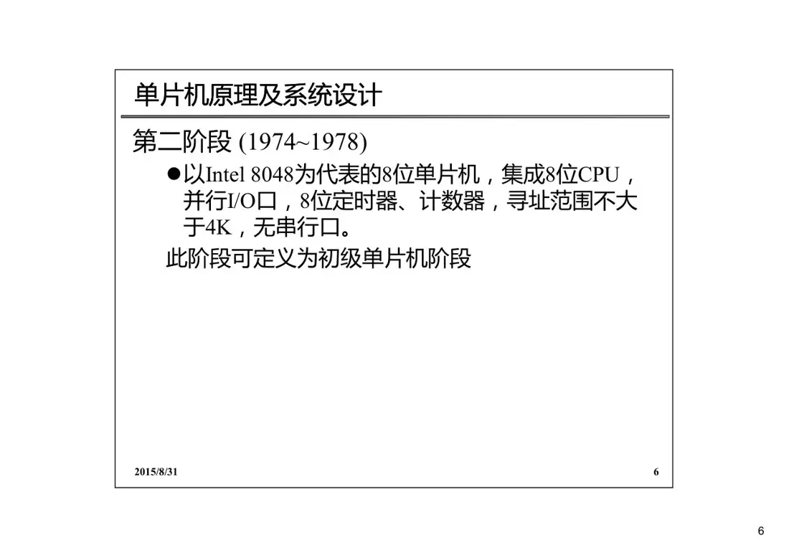

原文：

<table><tr><td colspan="2">单片机原理及系统设计</td></tr><tr><td colspan="2">第二阶段 (1974~1978)●以Intel 8048为代表的8位单片机,集成8位CPU,并行I/O口,8位定时器、计数器,寻址范围不大于4K,无串行口。此阶段可定义为初级单片机阶段</td></tr><tr><td>2015/8/31</td><td>6</td></tr></table>

6

### 单片机原理及系统设计

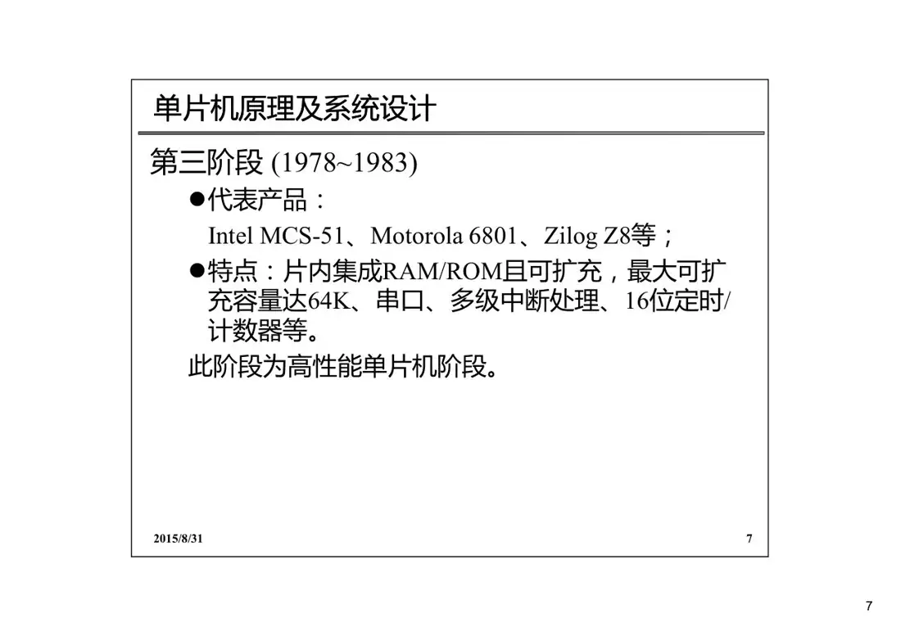

原文：

单片机原理及系统设计

第三阶段 (1978\~1983)

代表产品：

Intel MCS-51、Motorola 6801、Zilog Z8等；

特点：片内集成RAM/ROM且可扩充，最大可扩充容量达64K、串口、多级中断处理、16位定时/计数器等。

此阶段为高性能单片机阶段。

2015/8/31

7

### 第 8 页

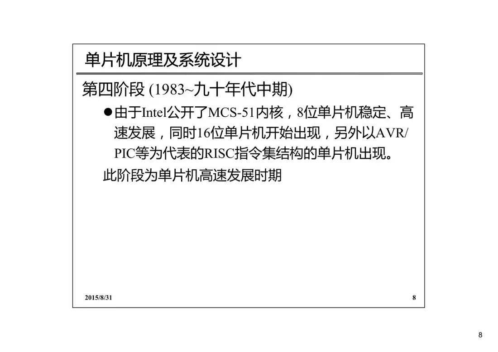

原文：

<table><tr><td colspan="2">单片机原理及系统设计</td></tr><tr><td colspan="2">第四阶段(1983~九十年代中期)●由于Intel公开了MCS-51内核,8位单片机稳定、高速发展,同时16位单片机开始出现,另外以AVR/PIC等为代表的RISC指令集结构的单片机出现。此阶段为单片机高速发展时期</td></tr><tr><td>2015/8/31</td><td>8</td></tr></table>

8

### 单片机原理及系统设计

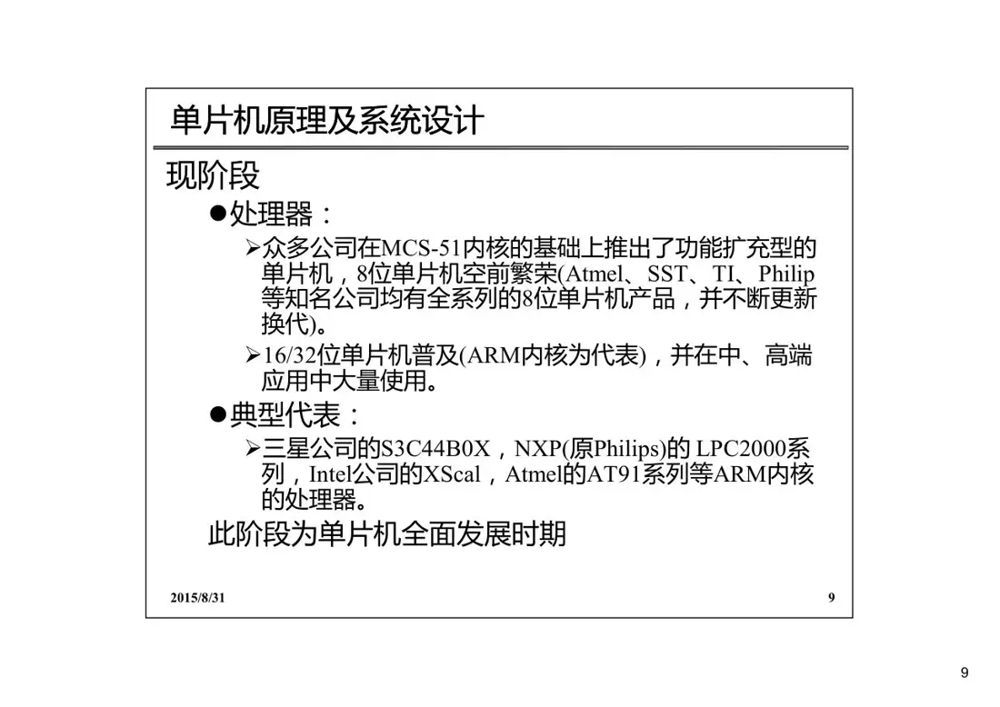

原文：

单片机原理及系统设计

现阶段

处理器：

众多公司在MCS-51内核的基础上推出了功能扩充型的单片机，8位单片机空前繁荣(Atmel、SST、TI、Philip等知名公司均有全系列的8位单片机产品，并不断更新换代)。

16/32位单片机普及(ARM内核为代表)，并在中、高端应用中大量使用。

典型代表：

三星公司的S3C44B0X，NXP(原Philips)的 LPC2000系列，Intel公司的XScal，Atmel的AT91系列等ARM内核的处理器。

此阶段为单片机全面发展时期

2015/8/31

9

### 单片机原理及系统设计

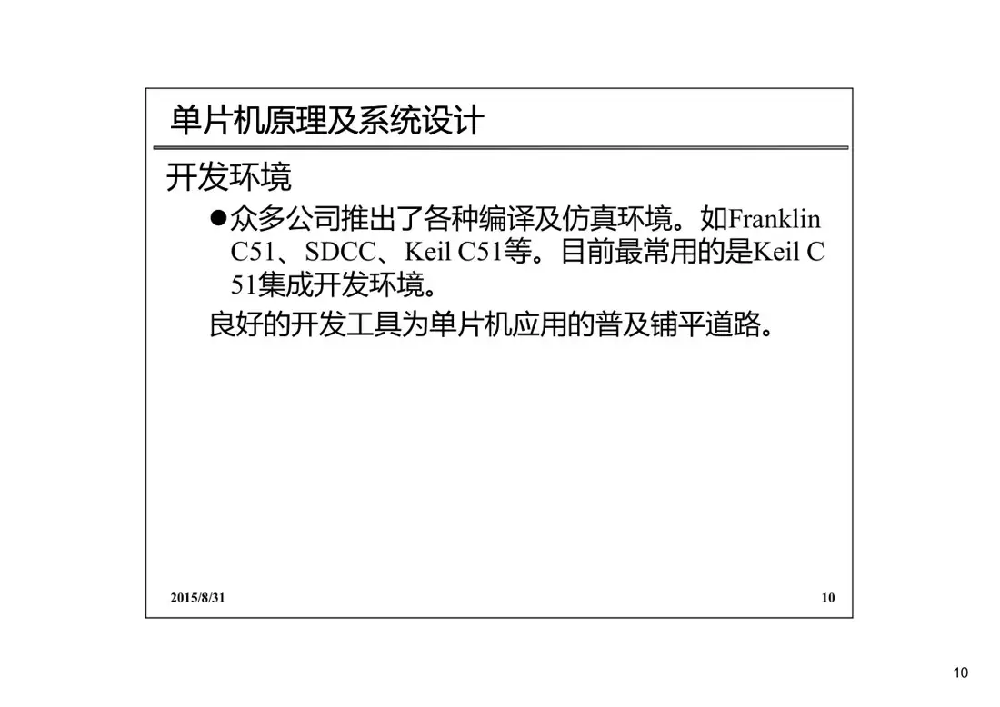

原文：

单片机原理及系统设计

开发环境

众多公司推出了各种编译及仿真环境。如FranklinC51、SDCC、Keil C51等。目前最常用的是Keil C51集成开发环境。

良好的开发工具为单片机应用的普及铺平道路。

2015/8/31

10

### 单片机原理及系统设计

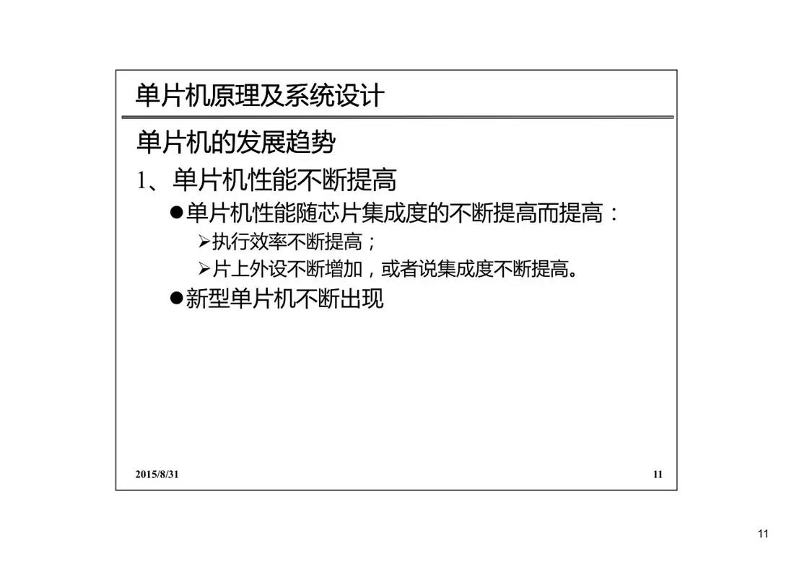

原文：

单片机原理及系统设计

单片机的发展趋势

1、单片机性能不断提高

单片机性能随芯片集成度的不断提高而提高：

执行效率不断提高；

片上外设不断增加，或者说集成度不断提高。

新型单片机不断出现

2015/8/31

11

### 单片机原理及系统设计

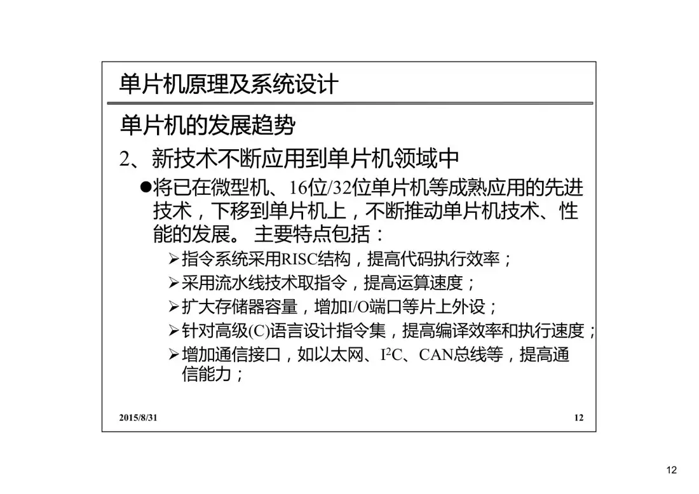

原文：

单片机原理及系统设计

单片机的发展趋势

2、新技术不断应用到单片机领域中

将已在微型机、16位/32位单片机等成熟应用的先进技术，下移到单片机上，不断推动单片机技术、性能的发展。 主要特点包括：

指令系统采用RISC结构，提高代码执行效率；

采用流水线技术取指令，提高运算速度；

扩大存储器容量，增加I/O端口等片上外设；

针对高级(C)语言设计指令集，提高编译效率和执行速度；

增加通信接口，如以太网、I2C、CAN总线等，提高通信能力；

2015/8/31

12

### 单片机原理及系统设计

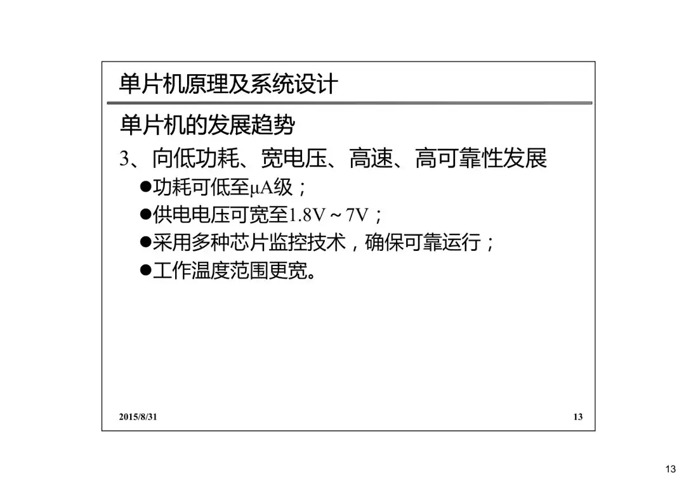

原文：

单片机原理及系统设计

单片机的发展趋势

3、向低功耗、宽电压、高速、高可靠性发展功耗可低至 $\mu \mathrm { A }$ 级；

供电电压可宽至1.8V～7V；

采用多种芯片监控技术，确保可靠运行；

工作温度范围更宽。

2015/8/31

13

13

### 单片机原理及系统设计

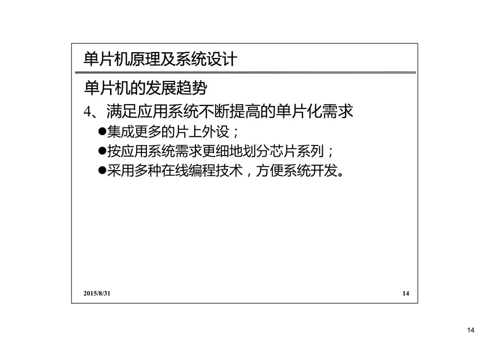

原文：

单片机原理及系统设计

单片机的发展趋势

4、满足应用系统不断提高的单片化需求

集成更多的片上外设；

按应用系统需求更细地划分芯片系列；

采用多种在线编程技术，方便系统开发。

14

2015/8/31

14

### 单片机原理及系统设计

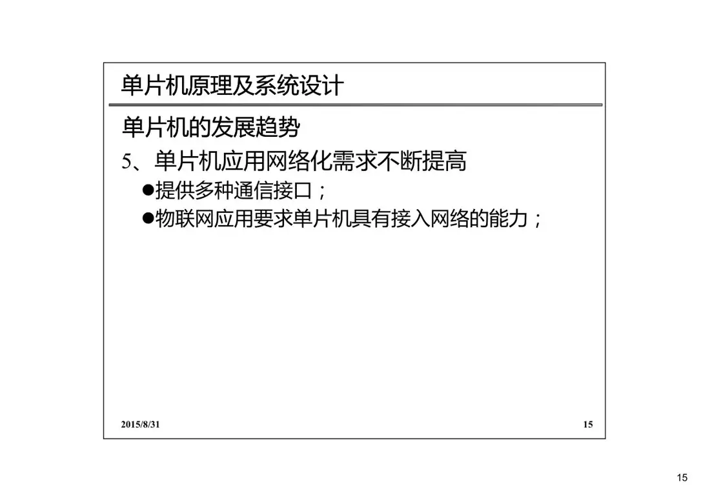

原文：

单片机原理及系统设计

单片机的发展趋势

5、单片机应用网络化需求不断提高

提供多种通信接口；

物联网应用要求单片机具有接入网络的能力；

15

2015/8/31

15

### 第一章 概述

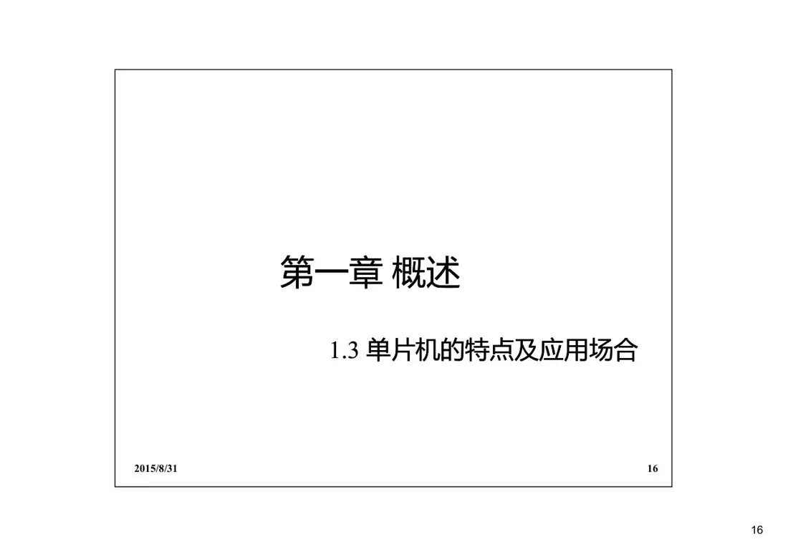

原文：

第一章 概述

1.3 单片机的特点及应用场合

16

### 单片机原理及系统设计

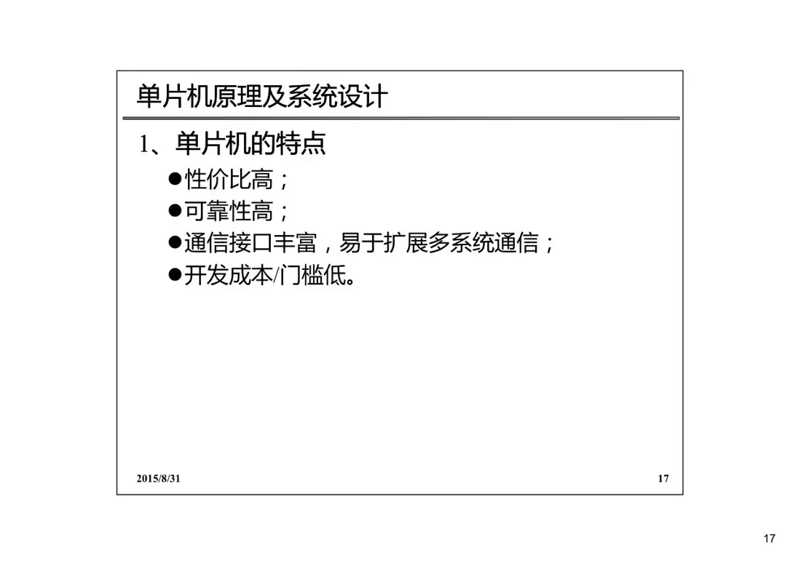

原文：

单片机原理及系统设计

1、单片机的特点

性价比高；

可靠性高；

通信接口丰富，易于扩展多系统通信；

开发成本/门槛低。

2015/8/31

17

17

### 单片机原理及系统设计

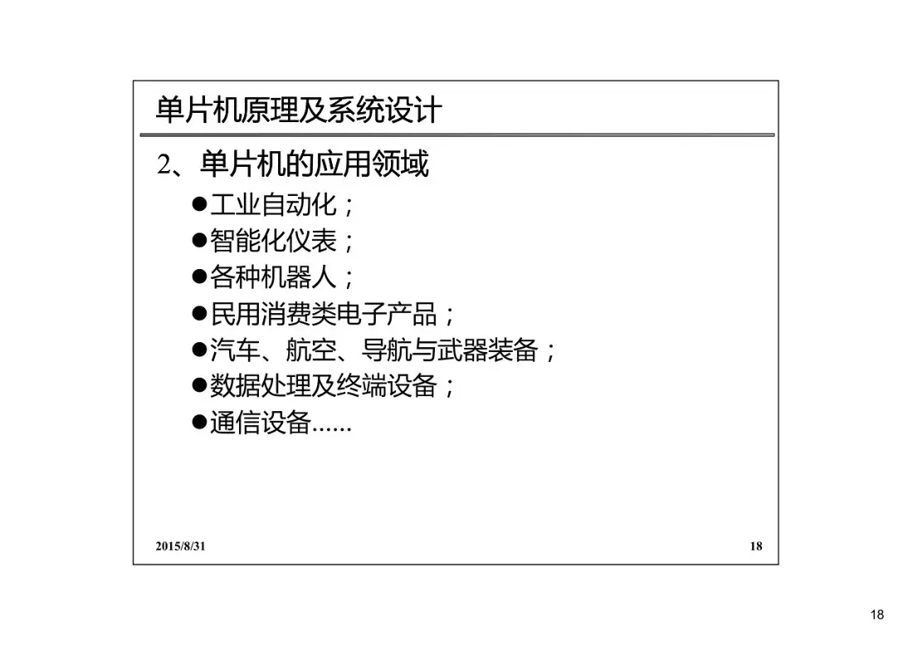

原文：

单片机原理及系统设计

2、单片机的应用领域

工业自动化；

智能化仪表；

各种机器人；

民用消费类电子产品；

汽车、航空、导航与武器装备；

数据处理及终端设备；

通信设备……

2015/8/31

18

18

### 第一章 概述

原文：

第一章 概述

1.4 单片机与嵌入式系统

19

### 单片机原理及系统设计

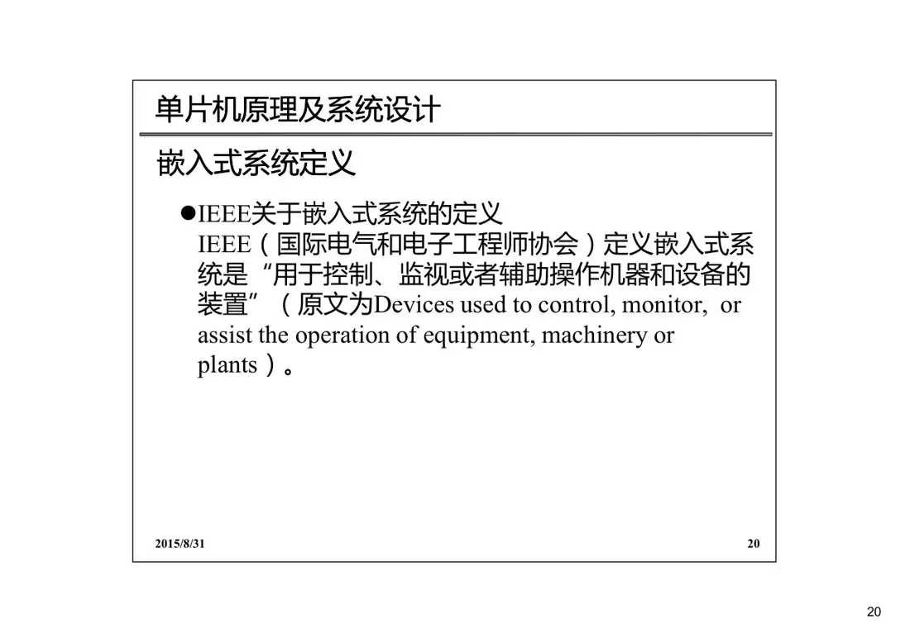

原文：

单片机原理及系统设计

嵌入式系统定义

IEEE关于嵌入式系统的定义

IEEE（国际电气和电子工程师协会）定义嵌入式系统是“用于控制、监视或者辅助操作机器和设备的装置”（原文为Devices used to control, monitor, orassist the operation of equipment, machinery orplants）。

2015/8/31

20

20

### 单片机原理及系统设计

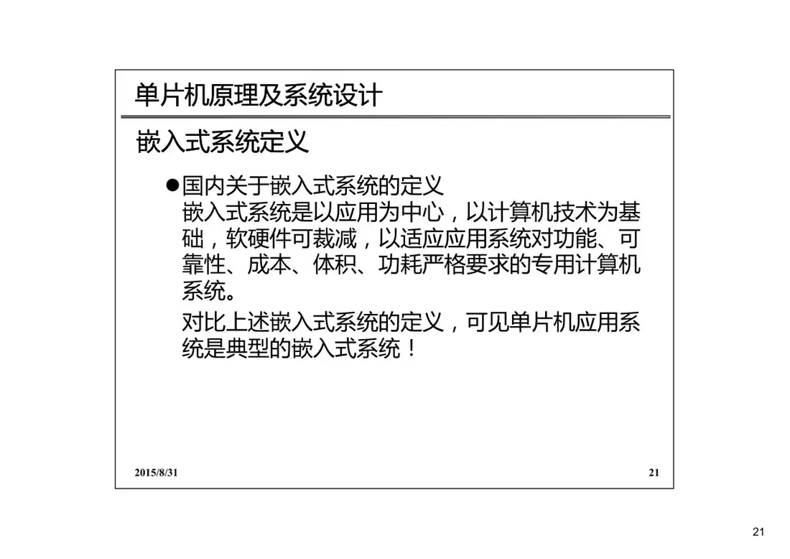

原文：

单片机原理及系统设计

嵌入式系统定义

国内关于嵌入式系统的定义

嵌入式系统是以应用为中心，以计算机技术为基础，软硬件可裁减，以适应应用系统对功能、可靠性、成本、体积、功耗严格要求的专用计算机系统。

对比上述嵌入式系统的定义，可见单片机应用系统是典型的嵌入式系统！

2015/8/31

21

21

### 第一章 概述

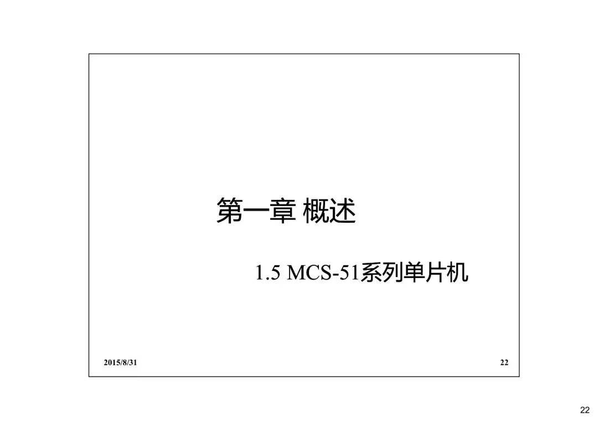

原文：

第一章 概述

1.5 MCS-51系列单片机

22

### 单片机原理及系统设计

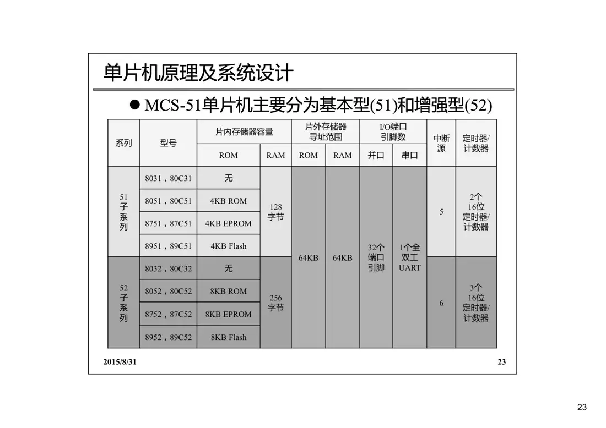

原文：

单片机原理及系统设计

 MCS-51单片机主要分为基本型 (51)和增强型(52)

<table><tr><td rowspan="2">系列</td><td rowspan="2">型号</td><td colspan="2">片内存储器容量</td><td colspan="2">片外存储器寻址范围</td><td colspan="2">I/O端口引脚数</td><td rowspan="2">中断源</td><td rowspan="2">定时器/计数器</td></tr><tr><td>ROM</td><td>RAM</td><td>ROM</td><td>RAM</td><td>并口</td><td>串口</td></tr><tr><td rowspan="4">51子系列</td><td>8031, 80C31</td><td>无</td><td rowspan="4">128字节</td><td rowspan="8">64KB</td><td rowspan="8">64KB</td><td rowspan="8">32个端口引脚</td><td rowspan="8">1个全双工UART</td><td rowspan="4">5</td><td rowspan="4">2个16位定时器/计数器</td></tr><tr><td>8051, 80C51</td><td>4KB ROM</td></tr><tr><td>8751, 87C51</td><td>4KB EPROM</td></tr><tr><td>8951, 89C51</td><td>4KB Flash</td></tr><tr><td rowspan="4">52子系列</td><td>8032, 80C32</td><td>无</td><td rowspan="4">256字节</td><td rowspan="4">6</td><td rowspan="4">3个16位定时器/计数器</td></tr><tr><td>8052, 80C52</td><td>8KB ROM</td></tr><tr><td>8752, 87C52</td><td>8KB EPROM</td></tr><tr><td>8952, 89C52</td><td>8KB Flash</td></tr></table>
2015/8/31

23

23
