# 《单片机原理及系统设计》第2章 MCS-51单片机的硬件结构及工作原理（课件）

原件的每一页，下面附识别出的文字。

### 第二章 MCS-51单片机的硬件结构及工作原理

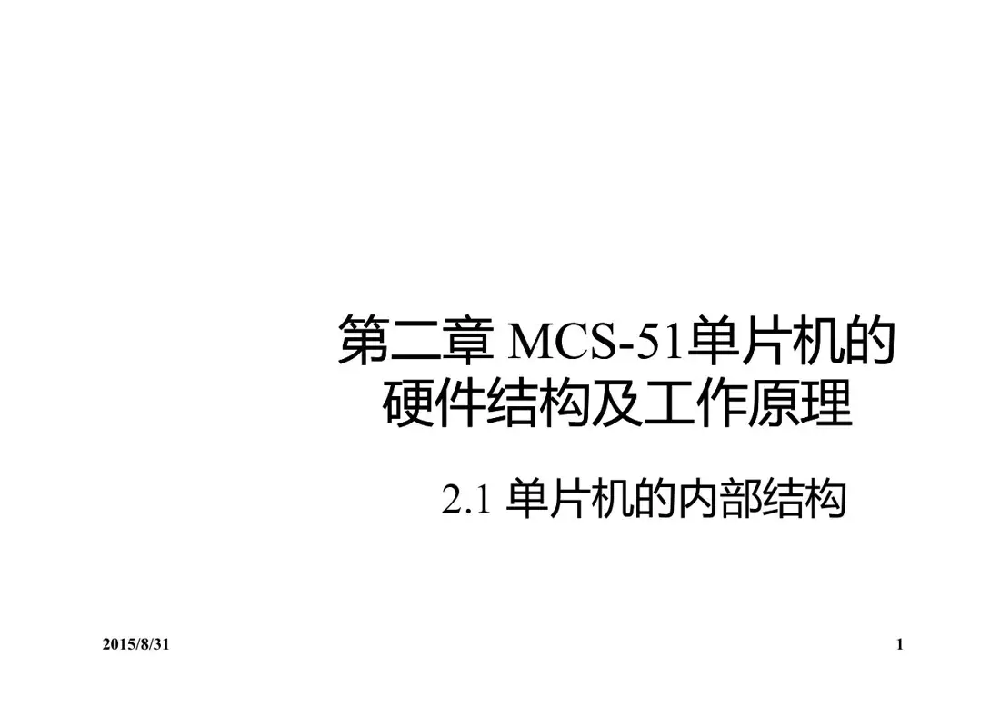

原文：

第二章 MCS-51单片机的硬件结构及工作原理

2.1 单片机的内部结构

2015/8/31

1

### 单片机原理及系统设计

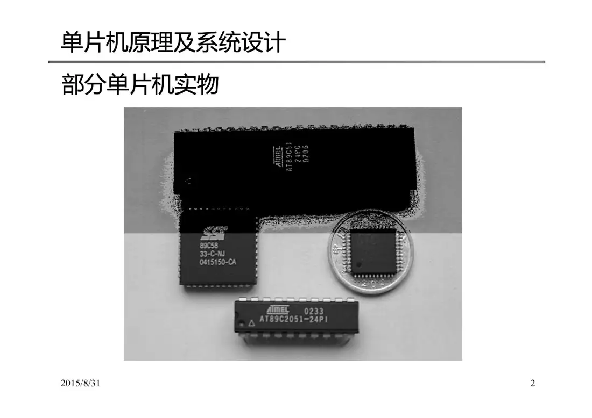

原文：

单片机原理及系统设计

部分单片机实物

2015/8/31

2

### 单片机原理及系统设计

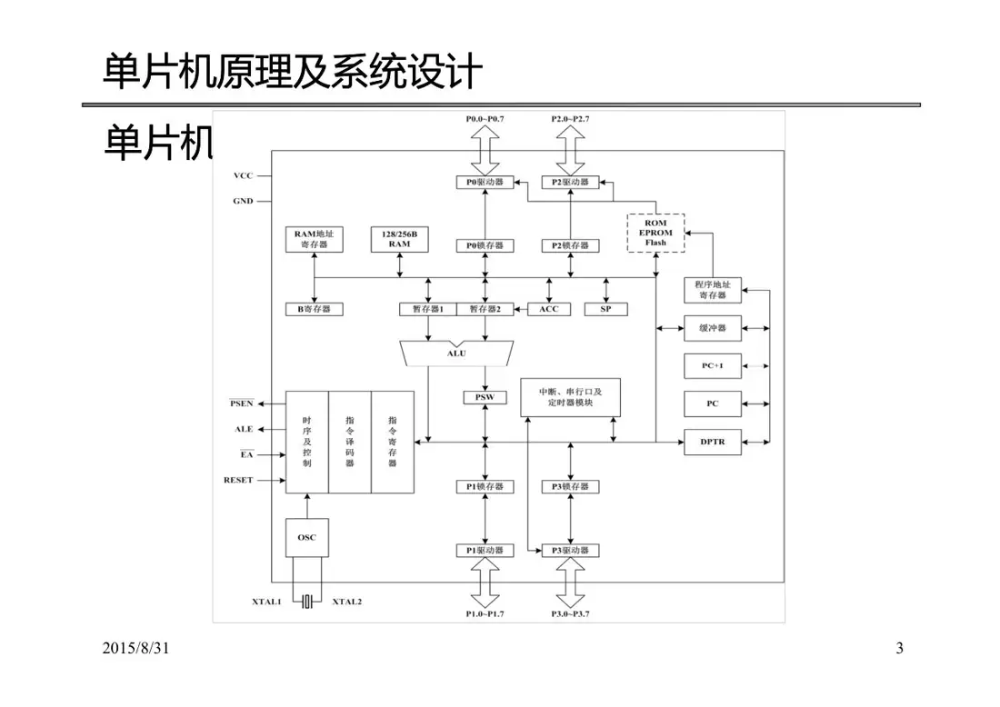

原文：

单片机原理及系统设计

单片机

2015/8/31

3

### 单片机原理及系统设计

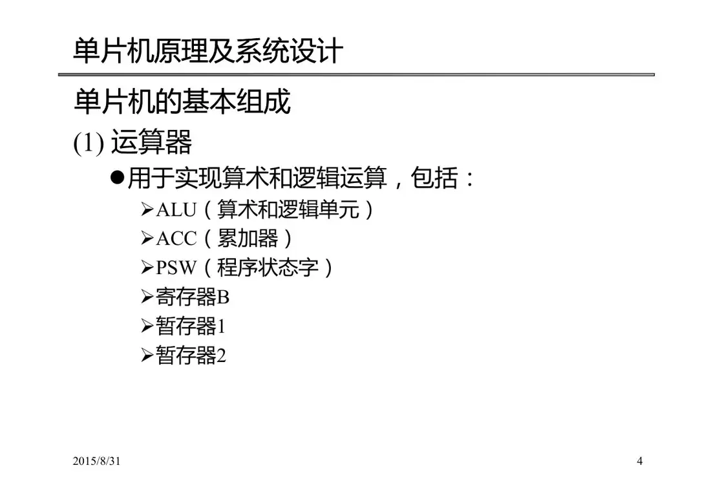

原文：

单片机原理及系统设计

单片机的基本组成

(1) 运算器

用于实现算术和逻辑运算，包括：

ALU（算术和逻辑单元）

ACC（累加器）

PSW（程序状态字）

寄存器B

暂存器1

暂存器2

2015/8/31

4

### 单片机原理及系统设计

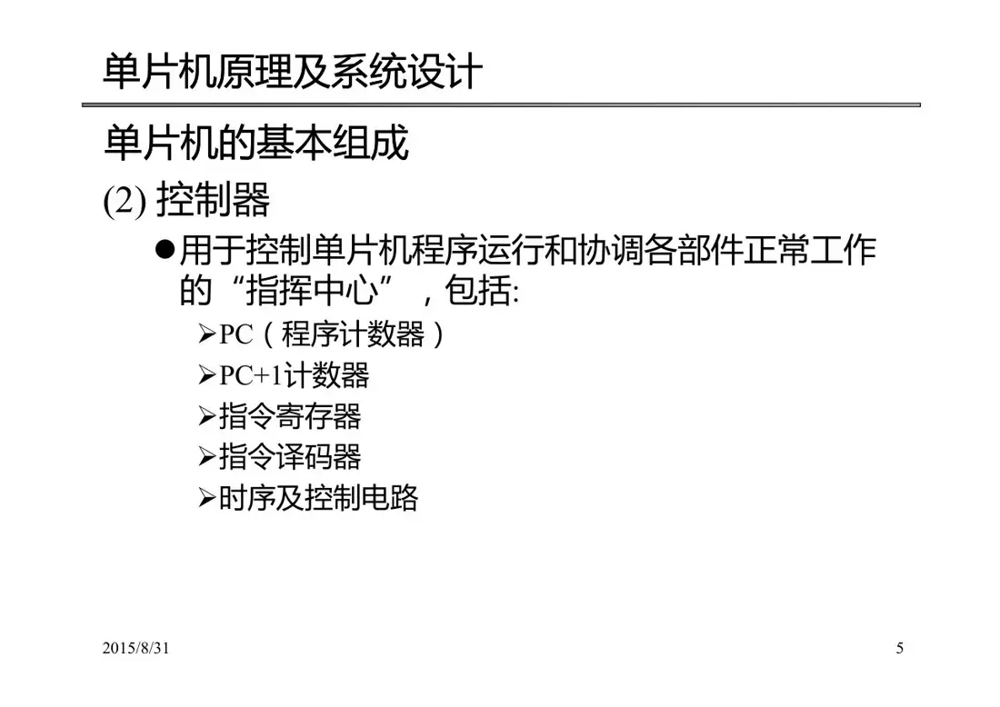

原文：

单片机原理及系统设计

单片机的基本组成

(2) 控制器

用于控制单片机程序运行和协调各部件正常工作的“指挥中心”，包括:

PC（程序计数器）

PC+1计数器

指令寄存器

指令译码器

时序及控制电路

2015/8/31

5

### 单片机原理及系统设计

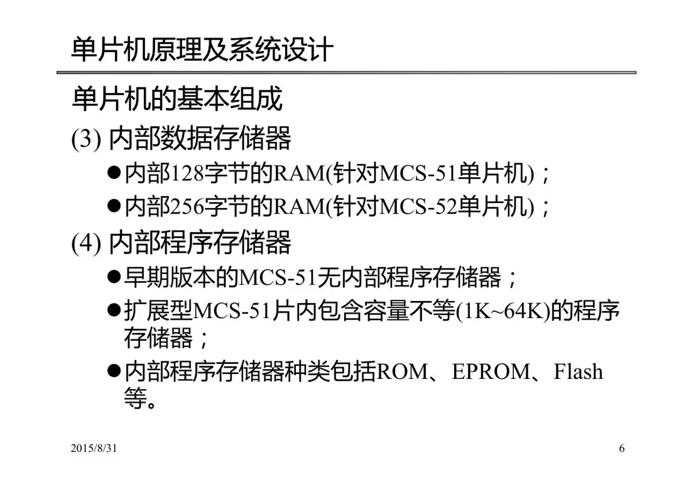

原文：

单片机原理及系统设计

单片机的基本组成

(3) 内部数据存储器

内部128字节的RAM(针对MCS-51单片机)；

内部256字节的RAM(针对MCS-52单片机)；

(4) 内部程序存储器

早期版本的MCS-51无内部程序存储器；

扩展型MCS-51片内包含容量不等(1K\~64K)的程序存储器；

内部程序存储器种类包括ROM、EPROM、Flash等。

2015/8/31

6

### 单片机原理及系统设计

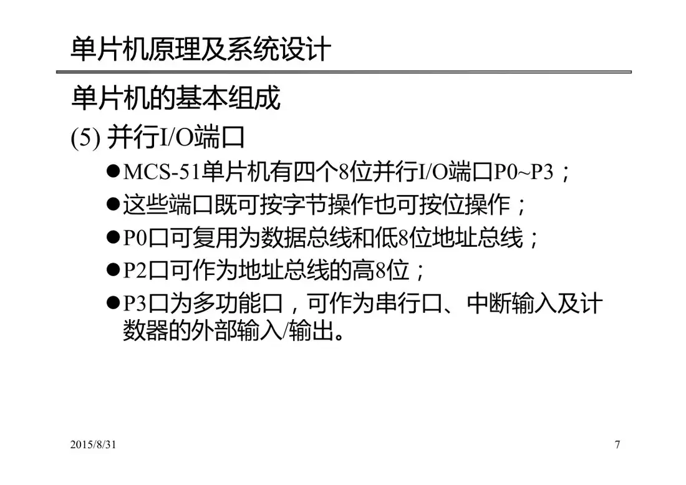

原文：

单片机原理及系统设计

单片机的基本组成

(5) 并行I/O端口

MCS-51单片机有四个8位并行I/O端口P0\~P3；

这些端口既可按字节操作也可按位操作；

P0口可复用为数据总线和低8位地址总线；

P2口可作为地址总线的高8位；

P3口为多功能口，可作为串行口、中断输入及计数器的外部输入/输出。

2015/8/31

7

### 单片机原理及系统设计

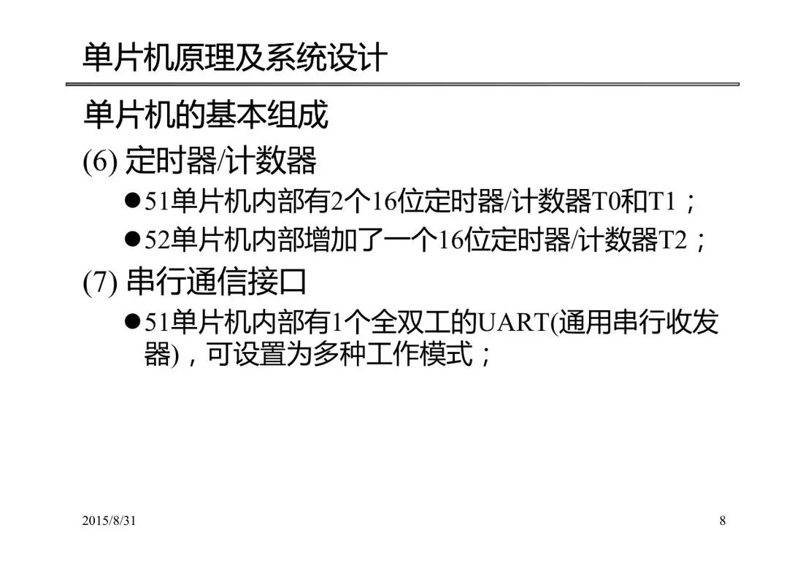

原文：

单片机原理及系统设计

单片机的基本组成

(6) 定时器/计数器

51单片机内部有2个16位定时器/计数器T0和T1；

52单片机内部增加了一个16位定时器/计数器T2；

(7) 串行通信接口

51单片机内部有1个全双工的UART(通用串行收发器)，可设置为多种工作模式；

2015/8/31

8

### 单片机原理及系统设计

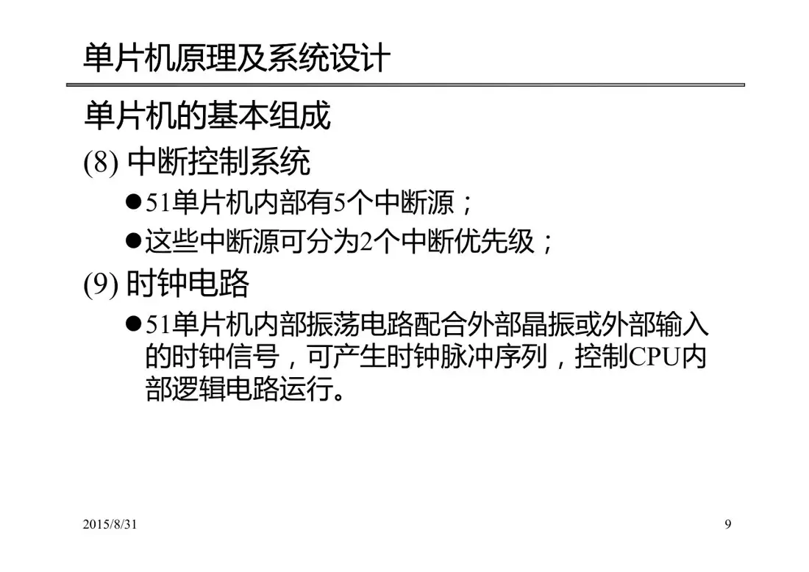

原文：

单片机原理及系统设计

单片机的基本组成

(8) 中断控制系统

51单片机内部有5个中断源；

这些中断源可分为2个中断优先级；

(9) 时钟电路

51单片机内部振荡电路配合外部晶振或外部输入的时钟信号，可产生时钟脉冲序列，控制CPU内部逻辑电路运行。

2015/8/31

9

### 单片机原理及系统设计

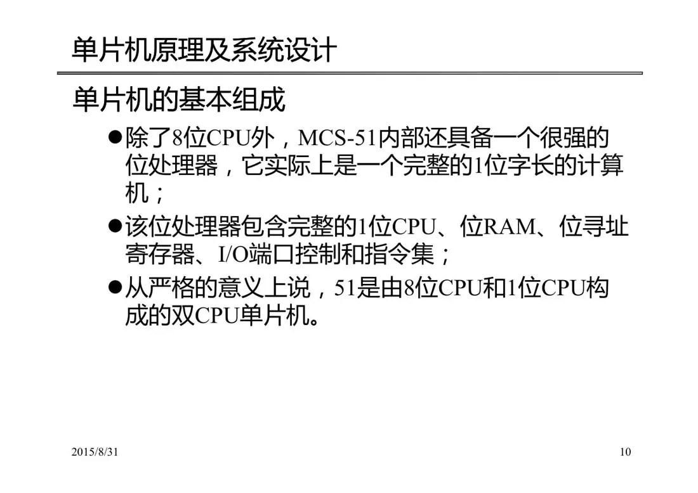

原文：

单片机原理及系统设计

单片机的基本组成

除了8位CPU外，MCS-51内部还具备一个很强的位处理器，它实际上是一个完整的1位字长的计算机；

该位处理器包含完整的1位CPU、位RAM、位寻址寄存器、I/O端口控制和指令集；

从严格的意义上说，51是由8位CPU和1位CPU构成的双CPU单片机。

2015/8/31

10

### 第二章 MCS-51单片机的硬件结构及工作原理

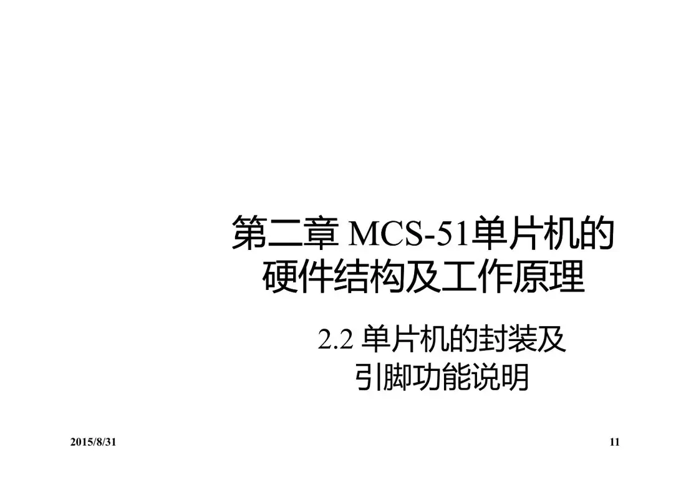

原文：

第二章 MCS-51单片机的硬件结构及工作原理

2.2 单片机的封装及引脚功能说明

2015/8/31

11

### 单片机原理及系统设计

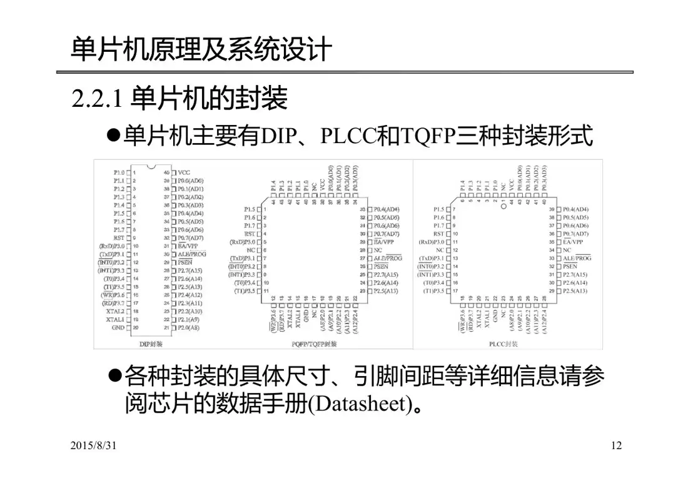

原文：

单片机原理及系统设计

2.2.1 单片机的封装

单片机主要有DIP、PLCC和TQFP三种封装形式

各种封装的具体尺寸、引脚间距等详细信息请参阅芯片的数据手册(Datasheet)。

2015/8/31

12

### 单片机原理及系统设计

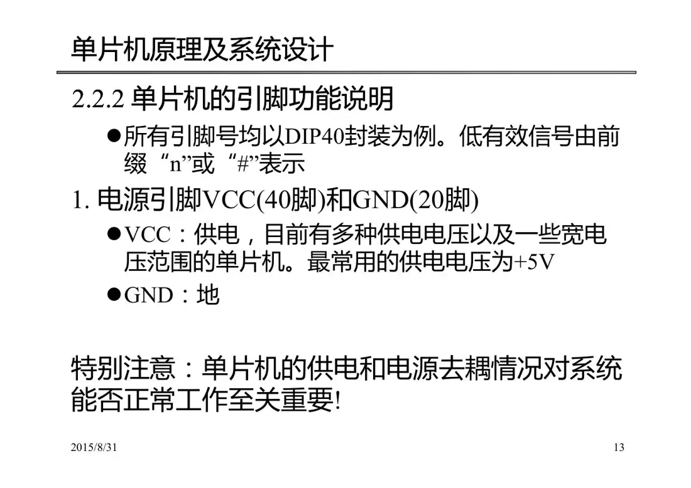

原文：

单片机原理及系统设计

2.2.2 单片机的引脚功能说明

所有引脚号均以DIP40封装为例。低有效信号由前缀“n”或“#”表示

1. 电源引脚VCC(40脚)和GND(20脚)

VCC：供电，目前有多种供电电压以及一些宽电压范围的单片机。最常用的供电电压为+5V

GND：地

特别注意：单片机的供电和电源去耦情况对系统能否正常工作至关重要!

2015/8/31

13

### 单片机原理及系统设计

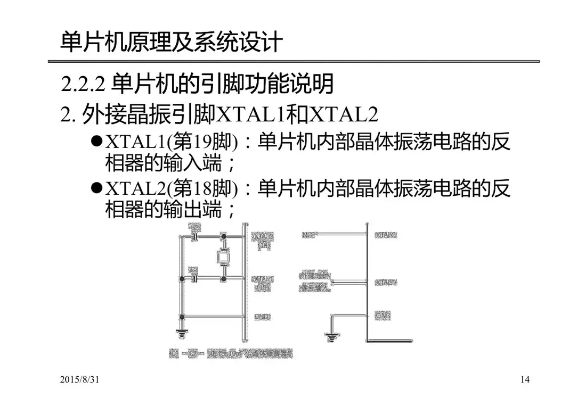

原文：

单片机原理及系统设计

2.2.2 单片机的引脚功能说明

2. 外接晶振引脚XTAL1和XTAL2

XTAL1(第19脚)：单片机内部晶体振荡电路的反相器的输入端；

XTAL2(第18脚)：单片机内部晶体振荡电路的反相器的输出端；

2015/8/31

14

### 单片机原理及系统设计

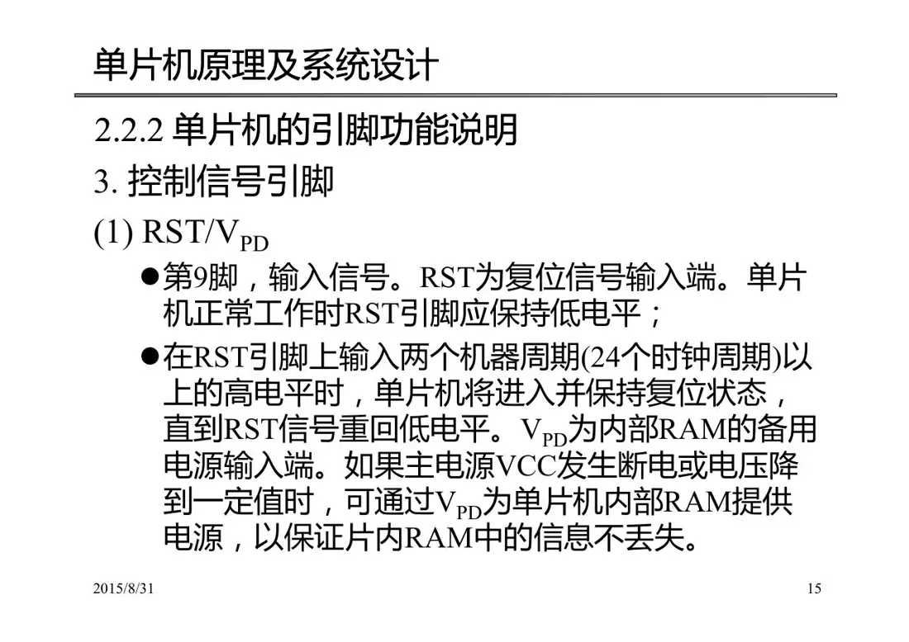

原文：

单片机原理及系统设计

2.2.2 单片机的引脚功能说明

3. 控制信号引脚

(1) $\mathrm { R S T / V _ { P D } }$

第9脚，输入信号。RST为复位信号输入端。单片机正常工作时RST引脚应保持低电平；

在RST引脚上输入两个机器周期(24个时钟周期)以上的高电平时，单片机将进入并保持复位状态，直到RST信号重回低电平。 $\mathrm { V _ { P D } }$ 为内部RAM的备用电源输入端。如果主电源VCC发生断电或电压降到一定值时，可通过 $\mathrm { V _ { P D } }$ 为单片机内部RAM提供电源，以保证片内RAM中的信息不丢失。

2015/8/31

15

### 单片机原理及系统设计

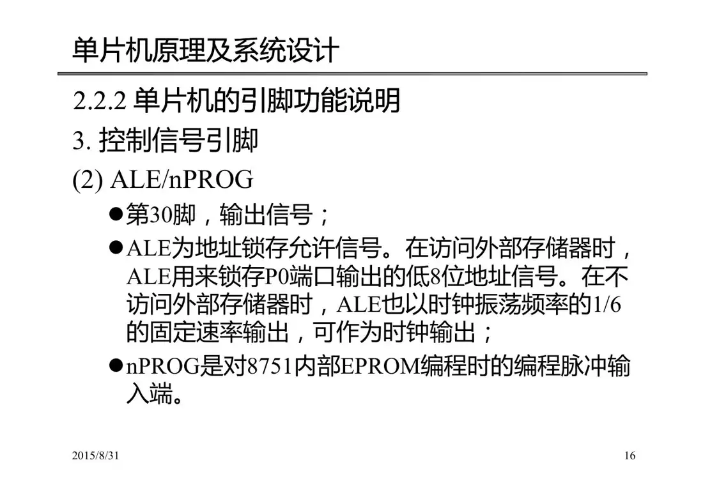

原文：

单片机原理及系统设计

2.2.2 单片机的引脚功能说明

3. 控制信号引脚

(2) ALE/nPROG

第30脚，输出信号；

ALE为地址锁存允许信号。在访问外部存储器时，ALE用来锁存P0端口输出的低8位地址信号。在不访问外部存储器时，ALE也以时钟振荡频率的1/6的固定速率输出，可作为时钟输出；

nPROG是对8751内部EPROM编程时的编程脉冲输入端。

2015/8/31

16

### 单片机原理及系统设计

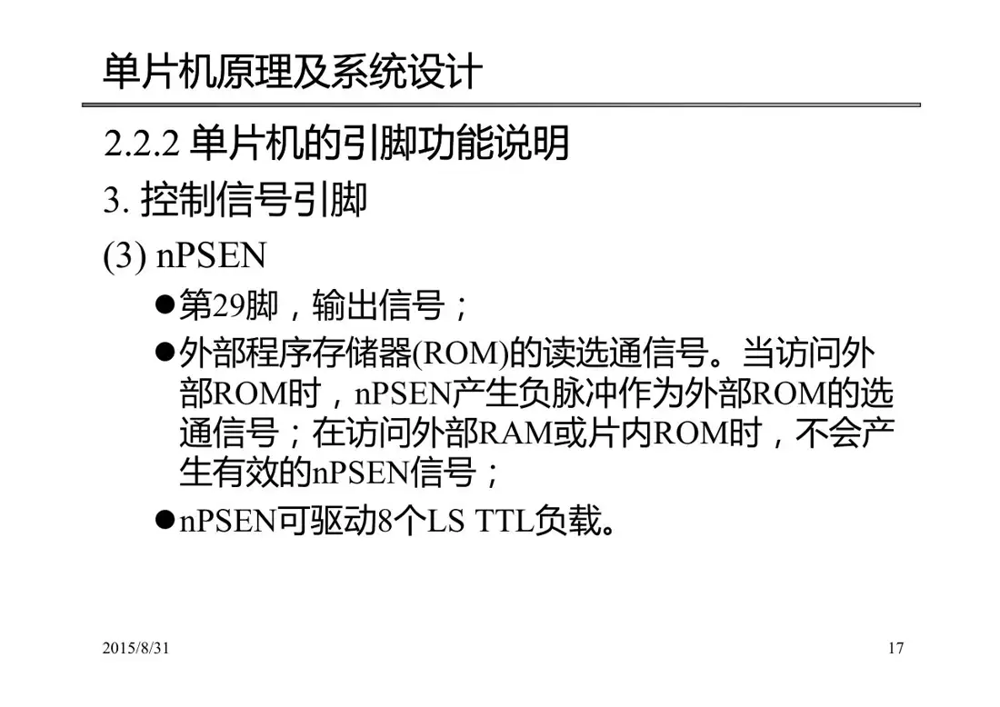

原文：

单片机原理及系统设计

2.2.2 单片机的引脚功能说明

3. 控制信号引脚

(3) nPSEN

第29脚，输出信号；

外部程序存储器(ROM)的读选通信号。当访问外部ROM时，nPSEN产生负脉冲作为外部ROM的选通信号；在访问外部RAM或片内ROM时，不会产生有效的nPSEN信号；

nPSEN可驱动8个LS TTL负载。

2015/8/31

17

### 单片机原理及系统设计

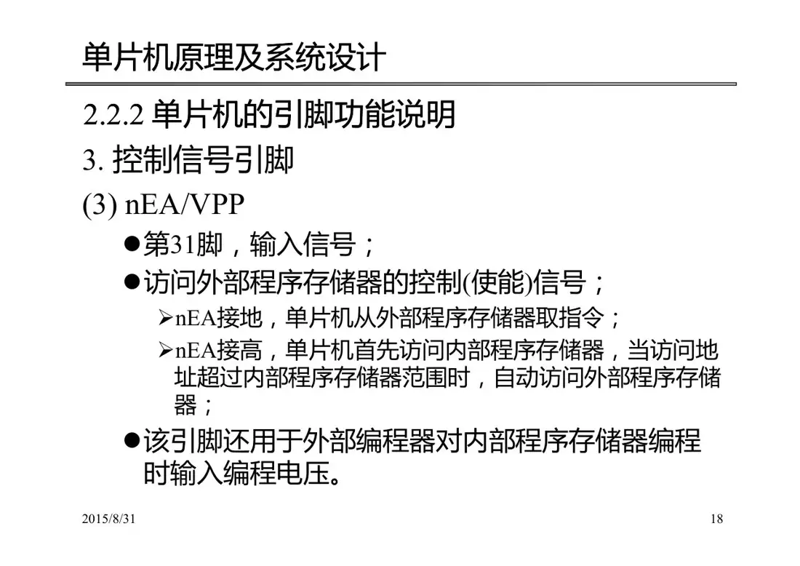

原文：

单片机原理及系统设计

2.2.2 单片机的引脚功能说明

3. 控制信号引脚

(3) nEA/VPP

第31脚，输入信号；

访问外部程序存储器的控制(使能)信号；

nEA接地，单片机从外部程序存储器取指令；

nEA接高，单片机首先访问内部程序存储器，当访问地址超过内部程序存储器范围时，自动访问外部程序存储器；

该引脚还用于外部编程器对内部程序存储器编程时输入编程电压。

2015/8/31

18

### 单片机原理及系统设计

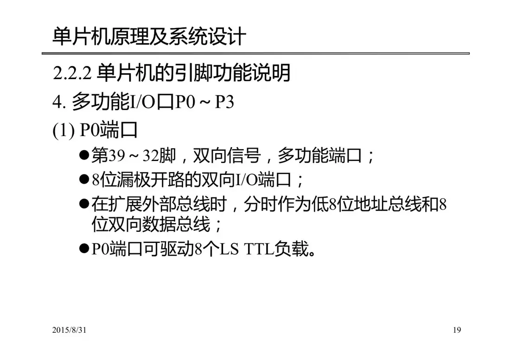

原文：

单片机原理及系统设计

2.2.2 单片机的引脚功能说明

4. 多功能I/O口P0～P3

(1) P0端口

第39～32脚，双向信号，多功能端口；

8位漏极开路的双向I/O端口；

在扩展外部总线时，分时作为低8位地址总线和8位双向数据总线；

P0端口可驱动8个LS TTL负载。

2015/8/31

19

### 单片机原理及系统设计

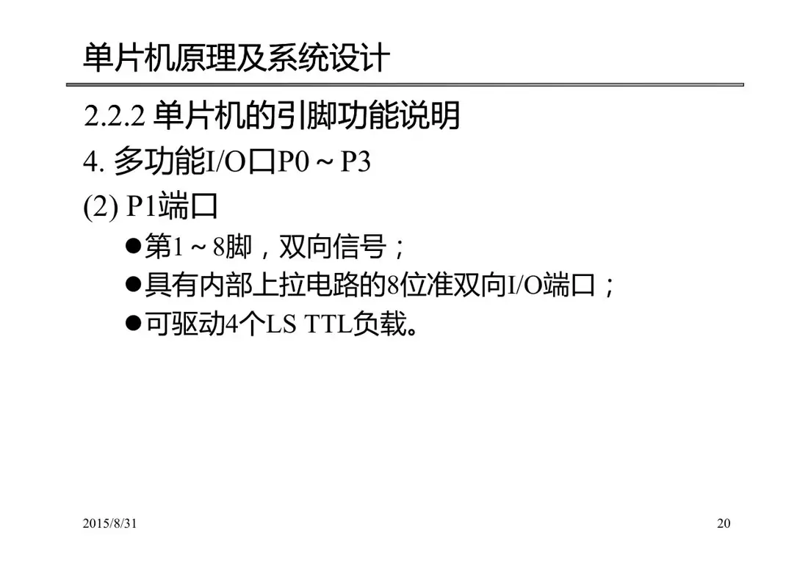

原文：

单片机原理及系统设计

2.2.2 单片机的引脚功能说明

4. 多功能I/O口P0～P3

(2) P1端口

第1～8脚，双向信号；

具有内部上拉电路的8位准双向I/O端口；

可驱动4个LS TTL负载。

2015/8/31

20

### 单片机原理及系统设计

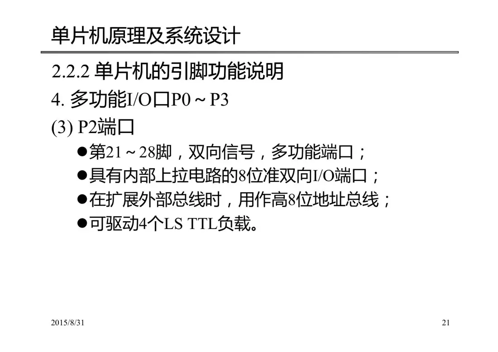

原文：

单片机原理及系统设计

2.2.2 单片机的引脚功能说明

4. 多功能I/O口P0～P3

(3) P2端口

第21～28脚，双向信号，多功能端口；

具有内部上拉电路的8位准双向I/O端口；

在扩展外部总线时，用作高8位地址总线；

可驱动4个LS TTL负载。

2015/8/31

21

### 单片机原理及系统设计

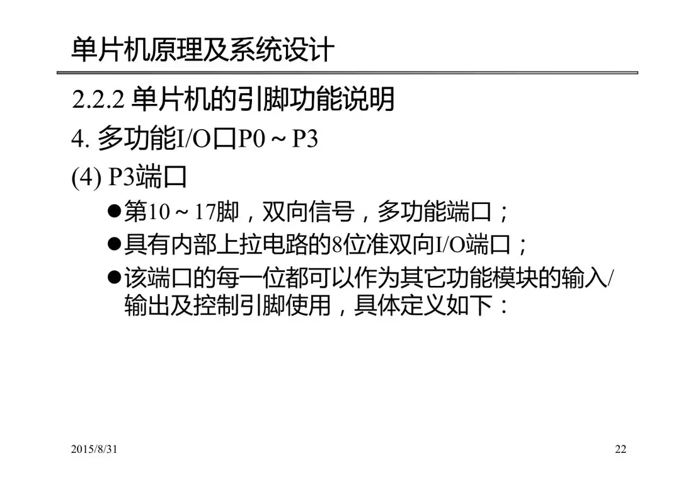

原文：

单片机原理及系统设计

2.2.2 单片机的引脚功能说明

4. 多功能I/O口P0～P3

(4) P3端口

第10～17脚，双向信号，多功能端口；

具有内部上拉电路的8位准双向I/O端口；

该端口的每一位都可以作为其它功能模块的输入/输出及控制引脚使用，具体定义如下：

2015/8/31

22

### 单片机原理及系统设计

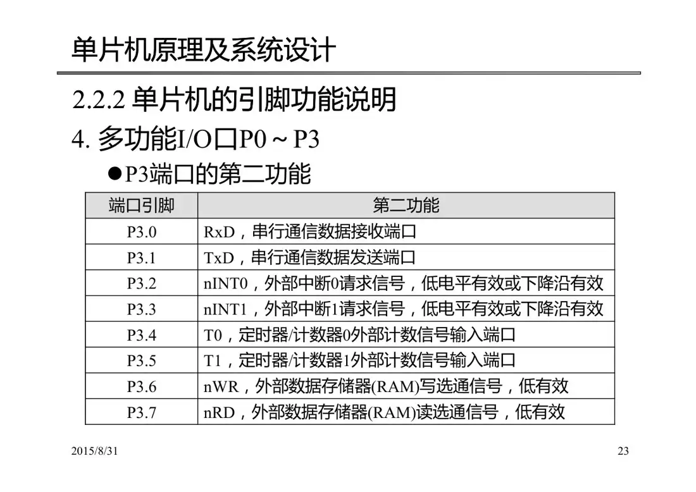

原文：

单片机原理及系统设计

2.2.2 单片机的引脚功能说明

4. 多功能I/O口P0～P3

P3端口的第二功能

<table><tr><td>端口引脚</td><td>第二功能</td></tr><tr><td>P3.0</td><td>RxD,串行通信数据接收端口</td></tr><tr><td>P3.1</td><td>TxD,串行通信数据发送端口</td></tr><tr><td>P3.2</td><td>nINT0,外部中断0请求信号,低电平有效或下降沿有效</td></tr><tr><td>P3.3</td><td>nINT1,外部中断1请求信号,低电平有效或下降沿有效</td></tr><tr><td>P3.4</td><td>T0,定时器/计数器0外部计数信号输入端口</td></tr><tr><td>P3.5</td><td>T1,定时器/计数器1外部计数信号输入端口</td></tr><tr><td>P3.6</td><td>nWR,外部数据存储器(RAM)写选通信号,低有效</td></tr><tr><td>P3.7</td><td>nRD,外部数据存储器(RAM)读选通信号,低有效</td></tr></table>

2015/8/31

23

### 第二章 MCS-51单片机的硬件结构及工作原理

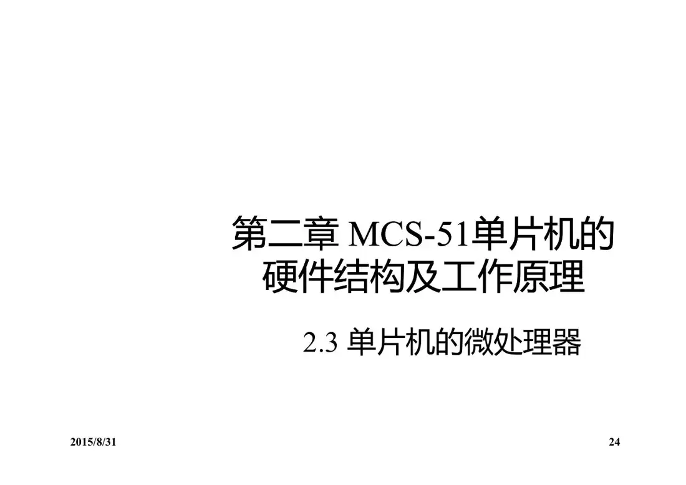

原文：

第二章 MCS-51单片机的硬件结构及工作原理

2.3 单片机的微处理器

2015/8/31

24

### 单片机原理及系统设计

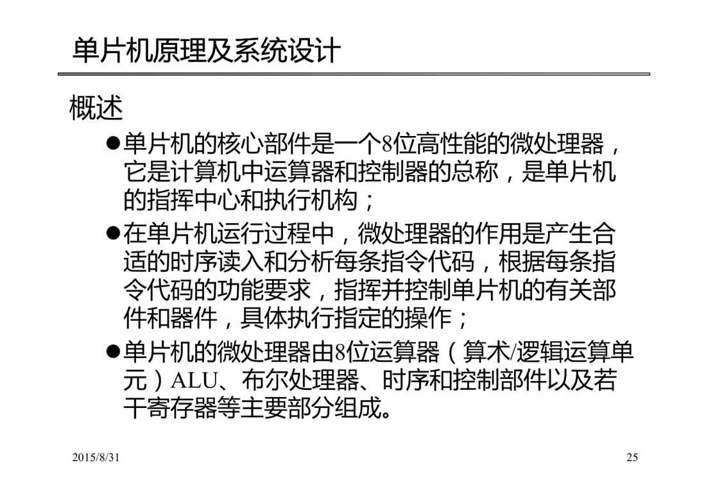

原文：

单片机原理及系统设计

概述

单片机的核心部件是一个8位高性能的微处理器，它是计算机中运算器和控制器的总称，是单片机的指挥中心和执行机构；

在单片机运行过程中，微处理器的作用是产生合适的时序读入和分析每条指令代码，根据每条指令代码的功能要求，指挥并控制单片机的有关部件和器件，具体执行指定的操作；

单片机的微处理器由8位运算器（算术/逻辑运算单元）ALU、布尔处理器、时序和控制部件以及若干寄存器等主要部分组成。

2015/8/31

25

### 单片机原理及系统设计

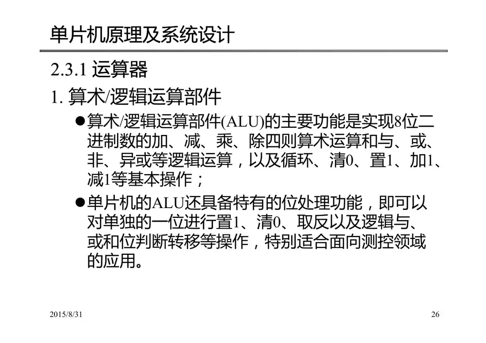

原文：

单片机原理及系统设计

2.3.1 运算器

1. 算术/逻辑运算部件

算术/逻辑运算部件(ALU)的主要功能是实现8位二进制数的加、减、乘、除四则算术运算和与、或、非、异或等逻辑运算，以及循环、清0、置1、加1、减1等基本操作；

单片机的ALU还具备特有的位处理功能，即可以对单独的一位进行置1、清0、取反以及逻辑与、或和位判断转移等操作，特别适合面向测控领域的应用。

2015/8/31

26

### 单片机原理及系统设计

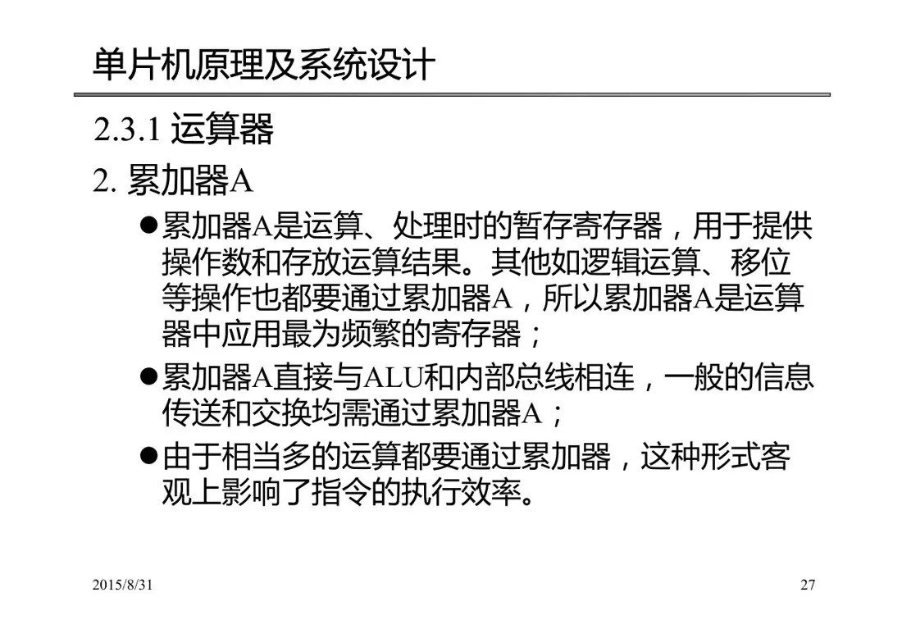

原文：

单片机原理及系统设计

2.3.1 运算器

2. 累加器A

累加器A是运算、处理时的暂存寄存器，用于提供操作数和存放运算结果。其他如逻辑运算、移位等操作也都要通过累加器A，所以累加器A是运算器中应用最为频繁的寄存器；

累加器A直接与ALU和内部总线相连，一般的信息传送和交换均需通过累加器A；

由于相当多的运算都要通过累加器，这种形式客观上影响了指令的执行效率。

2015/8/31

27

### 单片机原理及系统设计

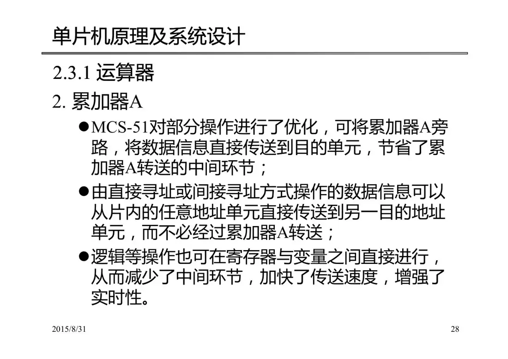

原文：

单片机原理及系统设计

2.3.1 运算器

2. 累加器A

MCS-51对部分操作进行了优化，可将累加器A旁路，将数据信息直接传送到目的单元，节省了累加器A转送的中间环节；

由直接寻址或间接寻址方式操作的数据信息可以从片内的任意地址单元直接传送到另一目的地址单元，而不必经过累加器A转送；

逻辑等操作也可在寄存器与变量之间直接进行，从而减少了中间环节，加快了传送速度，增强了实时性。

2015/8/31

28

### 单片机原理及系统设计

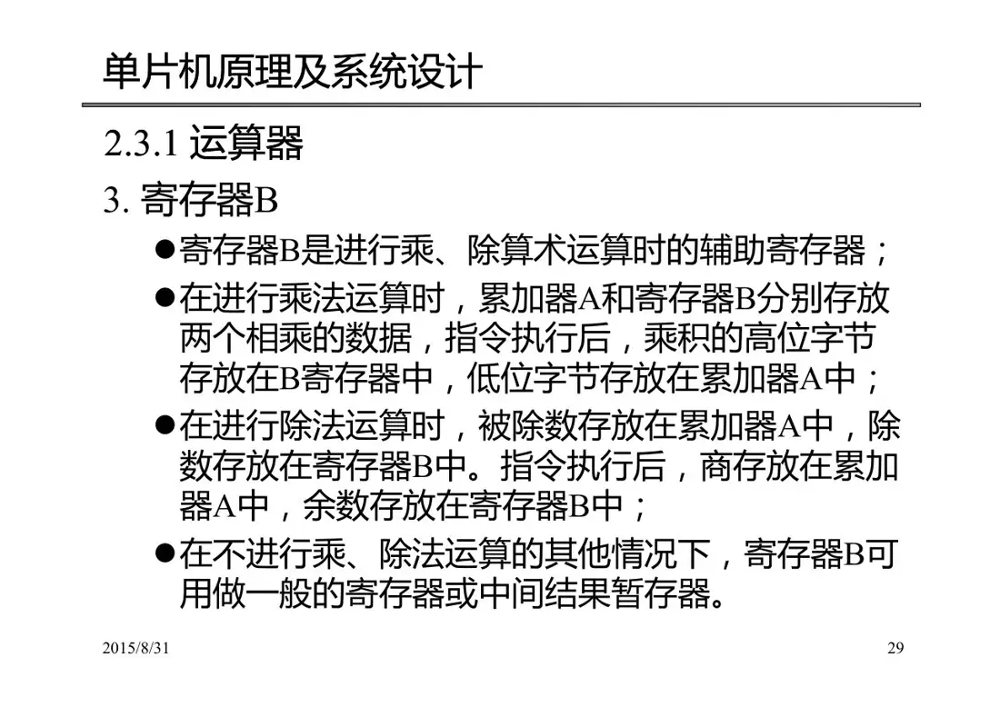

原文：

单片机原理及系统设计

2.3.1 运算器

3. 寄存器B

寄存器B是进行乘、除算术运算时的辅助寄存器；

在进行乘法运算时，累加器A和寄存器B分别存放两个相乘的数据，指令执行后，乘积的高位字节存放在B寄存器中，低位字节存放在累加器A中；

在进行除法运算时，被除数存放在累加器A中，除数存放在寄存器B中。指令执行后，商存放在累加器A中，余数存放在寄存器B中；

在不进行乘、除法运算的其他情况下，寄存器B可用做一般的寄存器或中间结果暂存器。

2015/8/31

29

### 单片机原理及系统设计

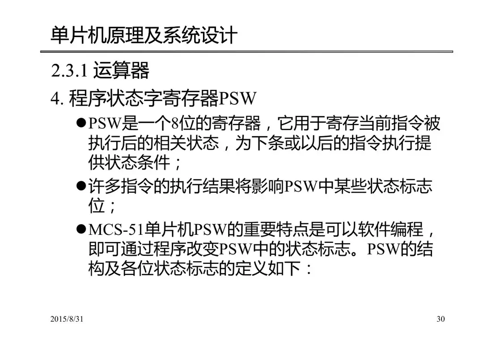

原文：

单片机原理及系统设计

2.3.1 运算器

4. 程序状态字寄存器PSW

PSW是一个8位的寄存器，它用于寄存当前指令被执行后的相关状态，为下条或以后的指令执行提供状态条件；

许多指令的执行结果将影响PSW中某些状态标志位；

MCS-51单片机PSW的重要特点是可以软件编程，即可通过程序改变PSW中的状态标志。PSW的结构及各位状态标志的定义如下：

2015/8/31

30

### 单片机原理及系统设计

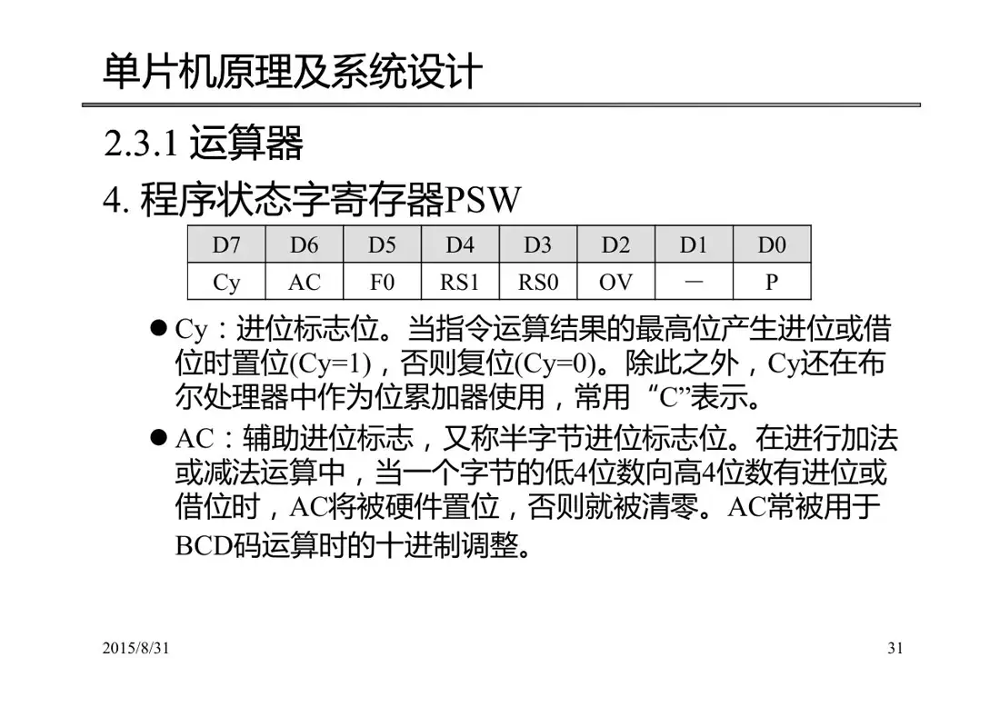

原文：

单片机原理及系统设计

2.3.1 运算器

4. 程序状态字寄存器PSW

<table><tr><td>D7</td><td>D6</td><td>D5</td><td>D4</td><td>D3</td><td>D2</td><td>D1</td><td>D0</td></tr><tr><td>Cy</td><td>AC</td><td>F0</td><td>RS1</td><td>RS0</td><td>OV</td><td>—</td><td>P</td></tr></table>

 Cy：进位标志位。当指令运算结果的最高位产生进位或借位时置位(Cy=1)，否则复位(Cy=0)。除此之外，Cy还在布尔处理器中作为位累加器使用，常用“C”表示。

AC：辅助进位标志，又称半字节进位标志位。在进行加法或减法运算中，当一个字节的低4位数向高4位数有进位或借位时，AC将被硬件置位，否则就被清零。AC常被用于BCD码运算时的十进制调整。

2015/8/31

31

### 单片机原理及系统设计

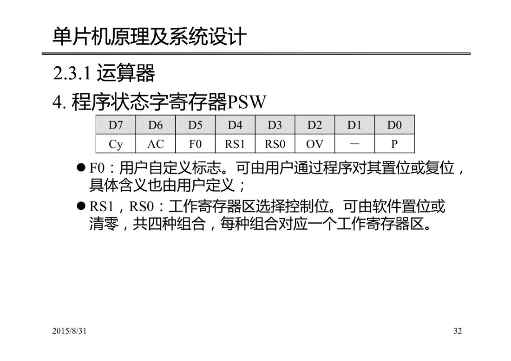

原文：

单片机原理及系统设计

2.3.1 运算器

4. 程序状态字寄存器PSW

<table><tr><td>D7</td><td>D6</td><td>D5</td><td>D4</td><td>D3</td><td>D2</td><td>D1</td><td>D0</td></tr><tr><td>Cy</td><td>AC</td><td>F0</td><td>RS1</td><td>RS0</td><td>OV</td><td>—</td><td>P</td></tr></table>

 F0：用户自定义标志。可由用户通过程序对其置位或复位，具体含义也由用户定义；

 RS1，RS0：工作寄存器区选择控制位。可由软件置位或清零，共四种组合，每种组合对应一个工作寄存器区。

2015/8/31

32

### 单片机原理及系统设计

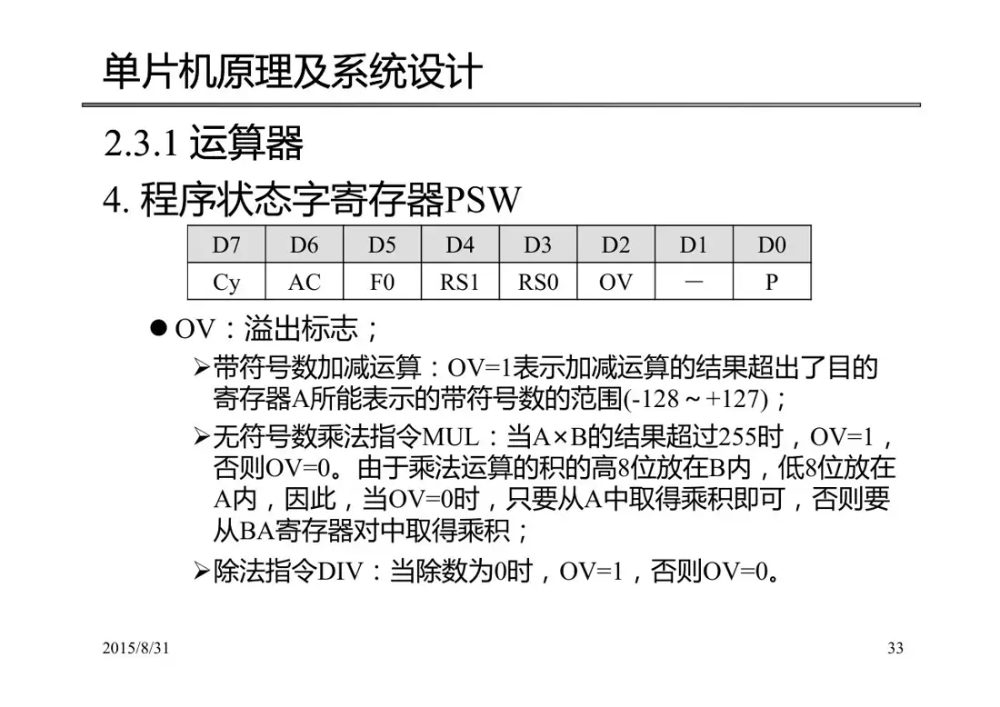

原文：

单片机原理及系统设计

2.3.1 运算器

4. 程序状态字寄存器PSW

<table><tr><td>D7</td><td>D6</td><td>D5</td><td>D4</td><td>D3</td><td>D2</td><td>D1</td><td>D0</td></tr><tr><td>Cy</td><td>AC</td><td>F0</td><td>RS1</td><td>RS0</td><td>OV</td><td>—</td><td>P</td></tr></table>

OV：溢出标志；

带符号数加减运算：OV=1表示加减运算的结果超出了目的寄存器A所能表示的带符号数的范围(-128～+127)；

无符号数乘法指令MUL：当A×B的结果超过255时，OV=1，否则OV=0。由于乘法运算的积的高8位放在B内，低8位放在A内，因此，当OV=0时，只要从A中取得乘积即可，否则要从BA寄存器对中取得乘积；

除法指令DIV：当除数为0时，OV=1，否则OV=0。

2015/8/31

33

### 单片机原理及系统设计

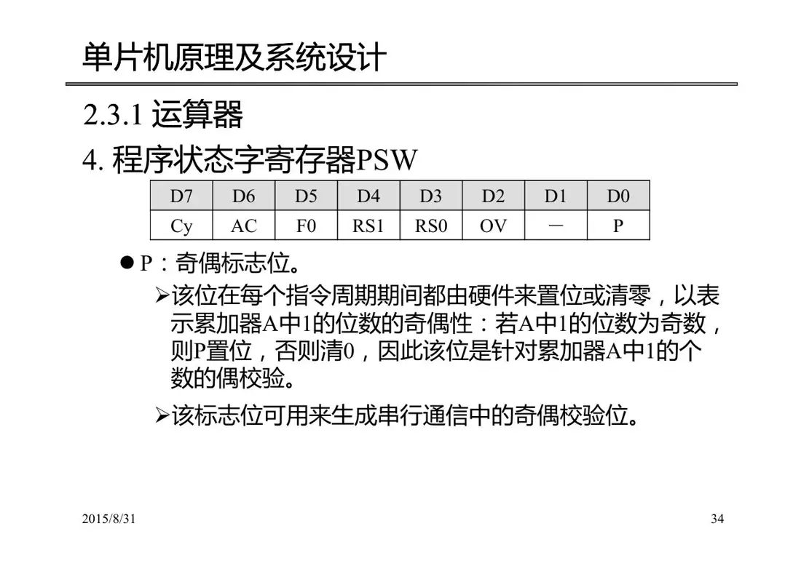

原文：

单片机原理及系统设计

2.3.1 运算器

4. 程序状态字寄存器PSW

<table><tr><td>D7</td><td>D6</td><td>D5</td><td>D4</td><td>D3</td><td>D2</td><td>D1</td><td>D0</td></tr><tr><td>Cy</td><td>AC</td><td>F0</td><td>RS1</td><td>RS0</td><td>OV</td><td>—</td><td>P</td></tr></table>

P：奇偶标志位。

该位在每个指令周期期间都由硬件来置位或清零，以表示累加器A中1的位数的奇偶性：若A中1的位数为奇数，则P置位，否则清0，因此该位是针对累加器A中1的个数的偶校验。

该标志位可用来生成串行通信中的奇偶校验位。

2015/8/31

34

### 单片机原理及系统设计

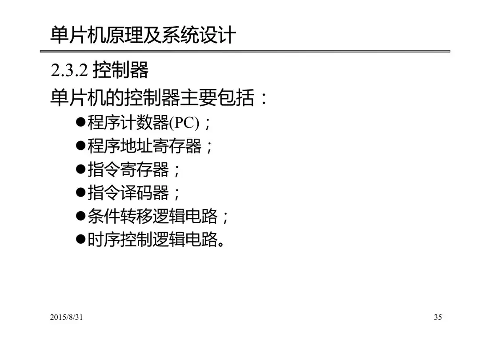

原文：

单片机原理及系统设计

2.3.2 控制器

单片机的控制器主要包括：

程序计数器(PC)；

程序地址寄存器；

指令寄存器；

指令译码器；

条件转移逻辑电路；

时序控制逻辑电路。

2015/8/31

35

### 单片机原理及系统设计

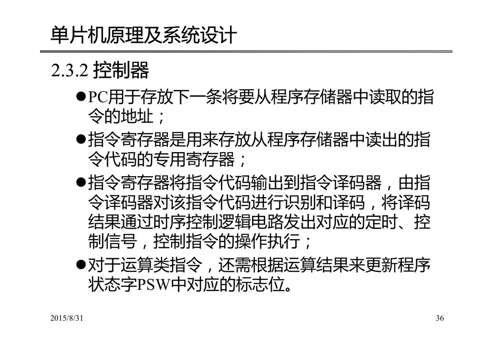

原文：

单片机原理及系统设计

2.3.2 控制器

PC用于存放下一条将要从程序存储器中读取的指令的地址；

指令寄存器是用来存放从程序存储器中读出的指令代码的专用寄存器；

指令寄存器将指令代码输出到指令译码器，由指令译码器对该指令代码进行识别和译码，将译码结果通过时序控制逻辑电路发出对应的定时、控制信号，控制指令的操作执行；

对于运算类指令，还需根据运算结果来更新程序状态字PSW中对应的标志位。

2015/8/31

36

### 单片机原理及系统设计

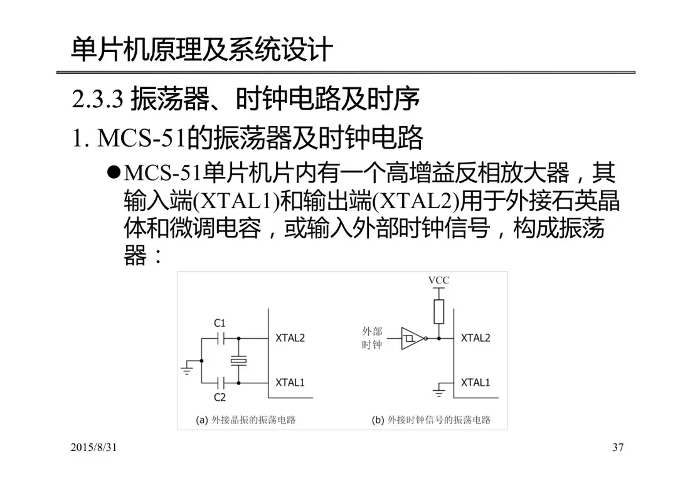

原文：

单片机原理及系统设计

2.3.3 振荡器、时钟电路及时序

1. MCS-51的振荡器及时钟电路

MCS-51单片机片内有一个高增益反相放大器，其输入端(XTAL1)和输出端(XTAL2)用于外接石英晶体和微调电容，或输入外部时钟信号，构成振荡器：

2015/8/31

37

### 单片机原理及系统设计

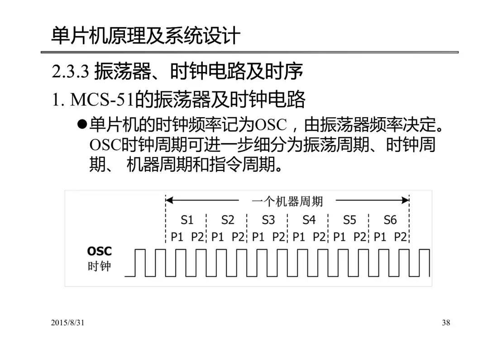

原文：

单片机原理及系统设计

2.3.3 振荡器、时钟电路及时序

1. MCS-51的振荡器及时钟电路

单片机的时钟频率记为OSC，由振荡器频率决定。OSC时钟周期可进一步细分为振荡周期、时钟周期、 机器周期和指令周期。

2015/8/31

38

### 单片机原理及系统设计

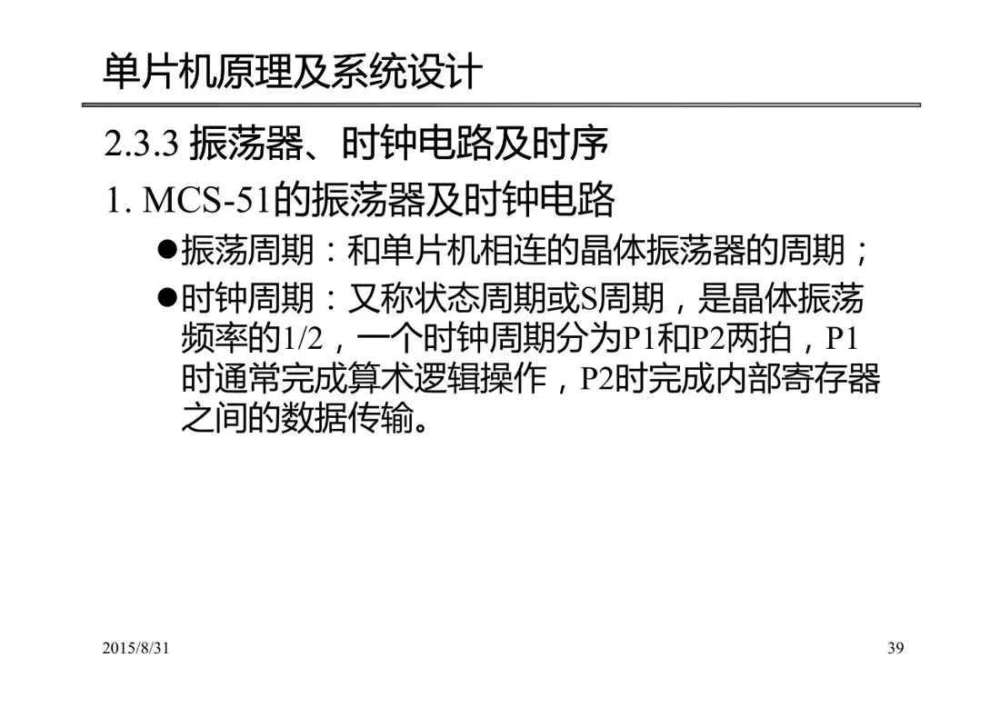

原文：

单片机原理及系统设计

2.3.3 振荡器、时钟电路及时序

1. MCS-51的振荡器及时钟电路

振荡周期：和单片机相连的晶体振荡器的周期；

时钟周期：又称状态周期或S周期，是晶体振荡频率的1/2，一个时钟周期分为P1和P2两拍，P1时通常完成算术逻辑操作，P2时完成内部寄存器之间的数据传输。

2015/8/31

39

### 单片机原理及系统设计

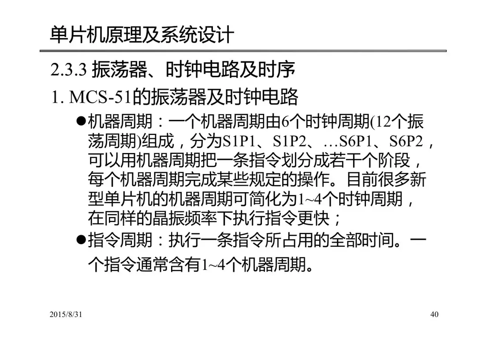

原文：

单片机原理及系统设计

2.3.3 振荡器、时钟电路及时序

1. MCS-51的振荡器及时钟电路

机器周期：一个机器周期由6个时钟周期(12个振荡周期)组成，分为S1P1、S1P2、…S6P1、S6P2可以用机器周期把一条指令划分成若干个阶段，每个机器周期完成某些规定的操作。目前很多新型单片机的机器周期可简化为1\~4个时钟周期，在同样的晶振频率下执行指令更快；

指令周期：执行一条指令所占用的全部时间。一个指令通常含有1\~4个机器周期。

2015/8/31

40

### 单片机原理及系统设计

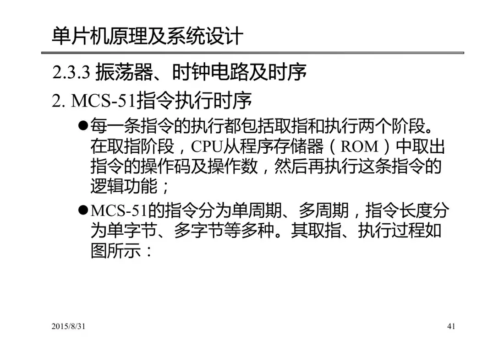

原文：

单片机原理及系统设计

2.3.3 振荡器、时钟电路及时序

2. MCS-51指令执行时序

每一条指令的执行都包括取指和执行两个阶段。在取指阶段，CPU从程序存储器（ROM）中取出指令的操作码及操作数，然后再执行这条指令的逻辑功能；

MCS-51的指令分为单周期、多周期，指令长度分为单字节、多字节等多种。其取指、执行过程如图所示：

2015/8/31

41

### 单片机原理及系统设计

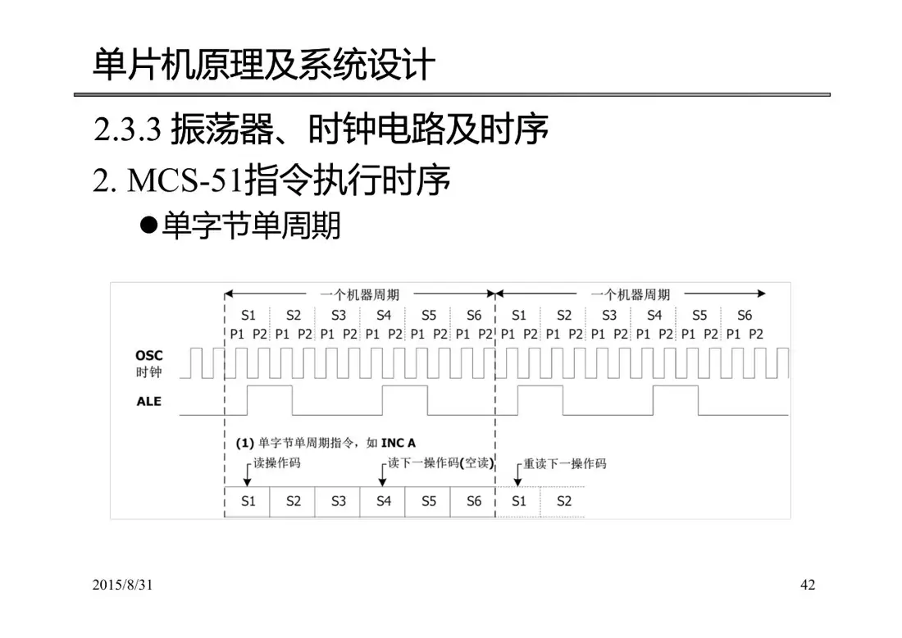

原文：

单片机原理及系统设计

2.3.3 振荡器、时钟电路及时序

2. MCS-51指令执行时序

单字节单周期

2015/8/31

42

### 单片机原理及系统设计

原文：

单片机原理及系统设计

2.3.3 振荡器、时钟电路及时序

2. MCS-51指令执行时序

双字节单周期

2015/8/31

43

### 单片机原理及系统设计

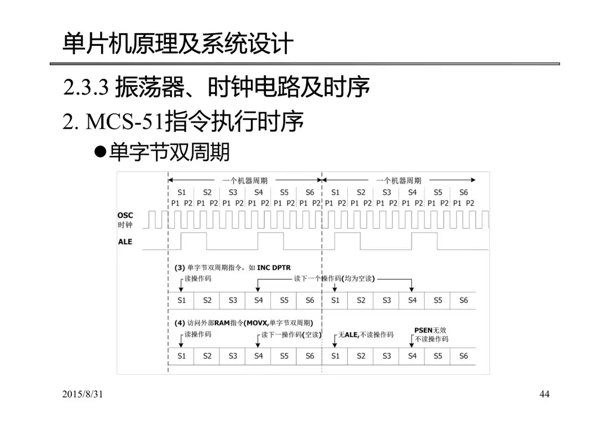

原文：

单片机原理及系统设计

2.3.3 振荡器、时钟电路及时序

2. MCS-51指令执行时序

单字节双周期

2015/8/31

44

### 单片机原理及系统设计

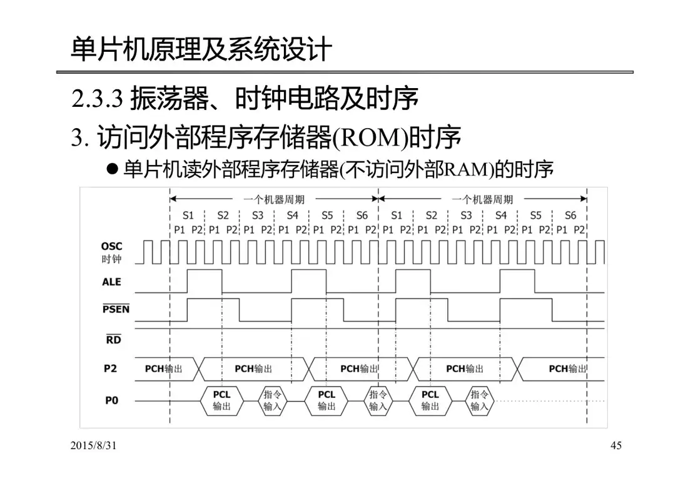

原文：

单片机原理及系统设计

2.3.3 振荡器、时钟电路及时序

3. 访问外部程序存储器(ROM)时序

 单片机读外部程序存储器(不访问外部RAM)的时序

2015/8/31

45

### 单片机原理及系统设计

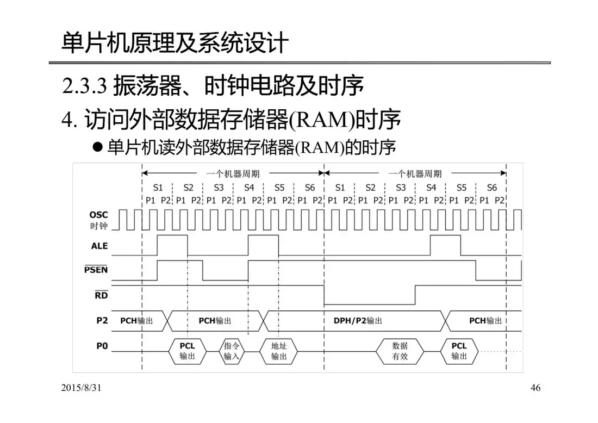

原文：

单片机原理及系统设计

2.3.3 振荡器、时钟电路及时序

4. 访问外部数据存储器(RAM)时序

单片机读外部数据存储器(RAM)的时序

2015/8/31

46

### 第二章 MCS-51单片机的硬件结构及工作原理

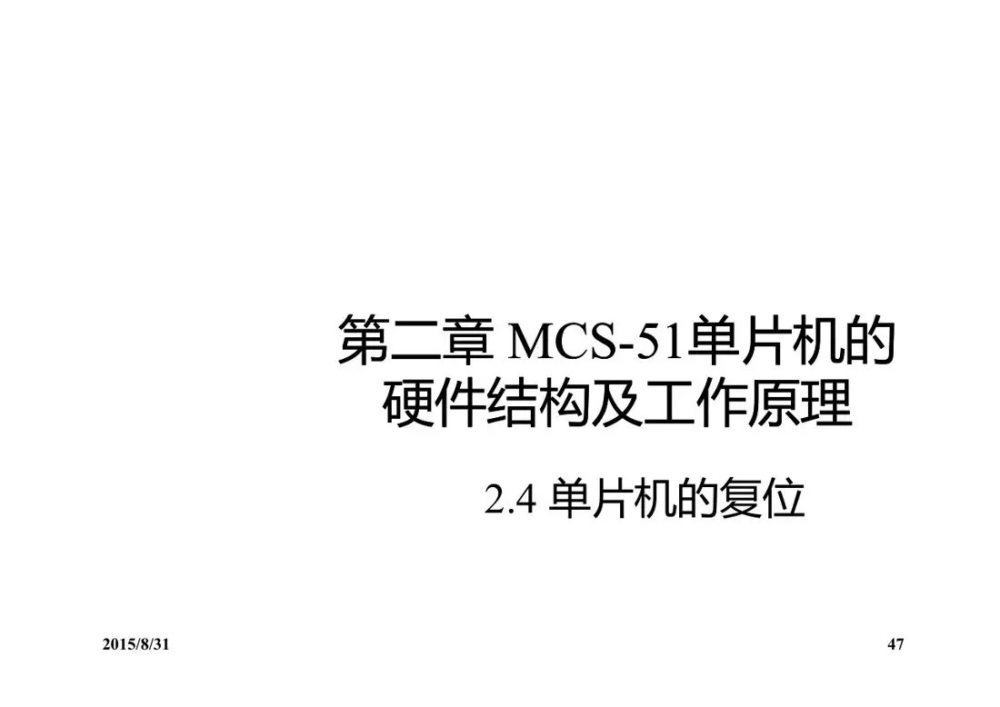

原文：

第二章 MCS-51单片机的硬件结构及工作原理

2.4 单片机的复位

2015/8/31

47

### 单片机原理及系统设计

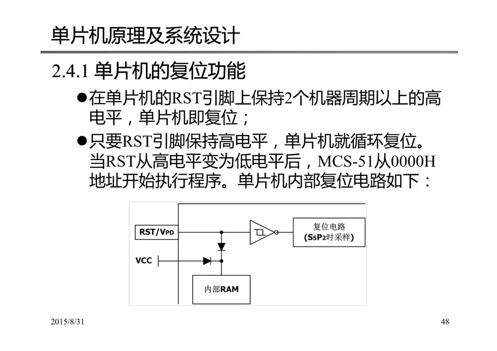

原文：

单片机原理及系统设计

2.4.1 单片机的复位功能

在单片机的RST引脚上保持2个机器周期以上的高电平，单片机即复位；

只要RST引脚保持高电平，单片机就循环复位。当RST从高电平变为低电平后，MCS-51从0000H地址开始执行程序。单片机内部复位电路如下：

2015/8/31

48

### 单片机原理及系统设计

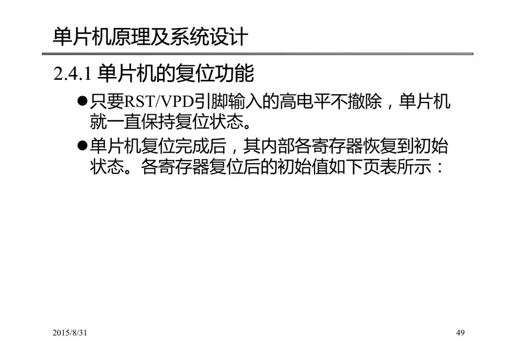

原文：

单片机原理及系统设计

2.4.1 单片机的复位功能

只要RST/VPD引脚输入的高电平不撤除，单片机就一直保持复位状态。

单片机复位完成后，其内部各寄存器恢复到初始状态。各寄存器复位后的初始值如下页表所示：

2015/8/31

49

### 单片机原理及系统设计

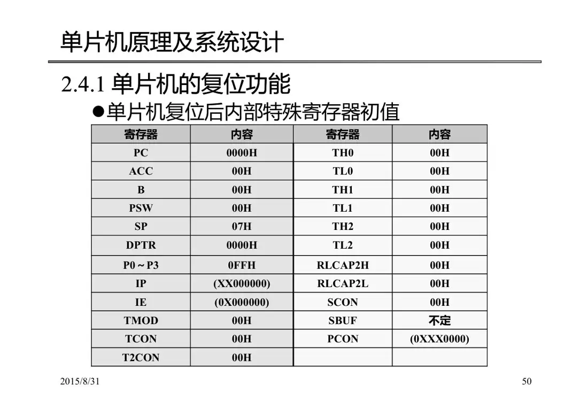

原文：

单片机原理及系统设计

2.4.1 单片机的复位功能

单片机复位后内部特殊寄存器初值

<table><tr><td>寄存器</td><td>内容</td><td>寄存器</td><td>内容</td></tr><tr><td>PC</td><td>0000H</td><td>TH0</td><td>00H</td></tr><tr><td>ACC</td><td>00H</td><td>TL0</td><td>00H</td></tr><tr><td>B</td><td>00H</td><td>TH1</td><td>00H</td></tr><tr><td>PSW</td><td>00H</td><td>TL1</td><td>00H</td></tr><tr><td>SP</td><td>07H</td><td>TH2</td><td>00H</td></tr><tr><td>DPTR</td><td>0000H</td><td>TL2</td><td>00H</td></tr><tr><td>P0 ~ P3</td><td>0FFH</td><td>RLCAP2H</td><td>00H</td></tr><tr><td>IP</td><td>(XX000000)</td><td>RLCAP2L</td><td>00H</td></tr><tr><td>IE</td><td>(0X000000)</td><td>SCON</td><td>00H</td></tr><tr><td>TMOD</td><td>00H</td><td>SBUF</td><td>不定</td></tr><tr><td>TCON</td><td>00H</td><td>PCON</td><td>(0XXX0000)</td></tr><tr><td>T2CON</td><td>00H</td><td></td><td></td></tr></table>

2015/8/31

50

### 单片机原理及系统设计

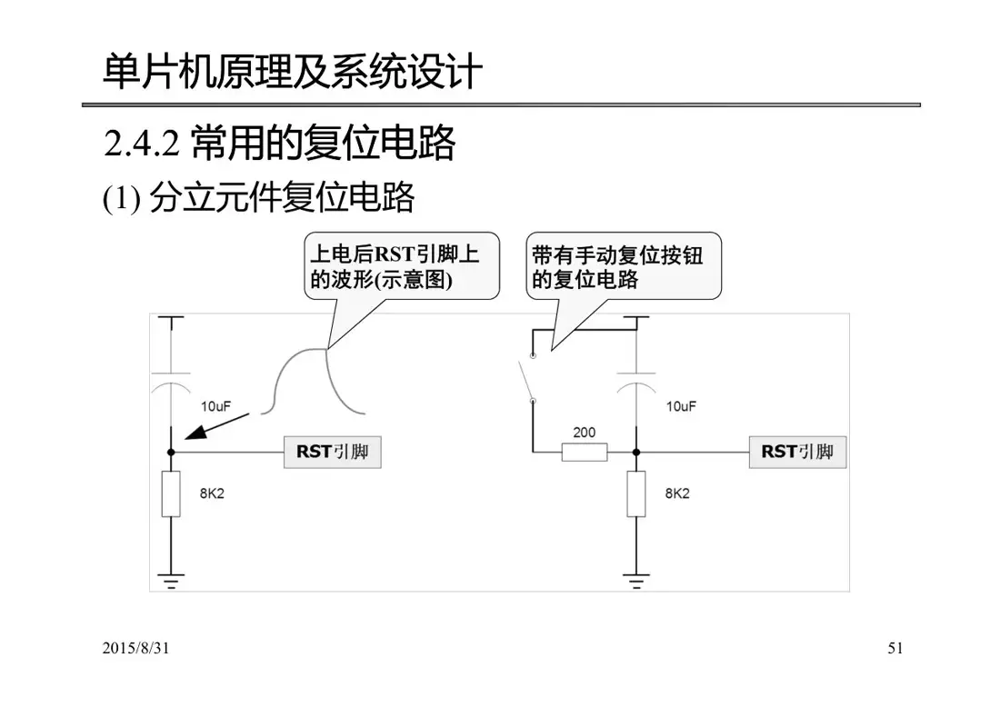

原文：

单片机原理及系统设计

2.4.2 常用的复位电路

(1) 分立元件复位电路

2015/8/31

51

### 单片机原理及系统设计

原文：

单片机原理及系统设计

2.4.2 常用的复位电路

(2) 专用复位集成电路

 MAX811

有多种供电电压及复位门槛电压版本；

支持手动复位；

有高低两种电平的复位信号输出；

体积小，可靠性高。

 X5045/25045

有多种供电电压及复位门槛电压版本；

支持手动复位；

包含4Kb的E2PROM；

具有看门狗功能。

2015/8/31

52

### 第二章 MCS-51单片机的硬件结构及工作原理

原文：

第二章 MCS-51单片机的硬件结构及工作原理

2.5 单片机的存储系统

2015/8/31

53

### 单片机原理及系统设计

原文：

单片机原理及系统设计

2.5.1 单片机存储系统结构

存储器是组成计算机的三大主要部件之一。

存储器的功能是存储信息，包括程序和数据，存储这两种信息的存储器分别被称为程序存储器和数据存储器。

单片机的存储系统的结构有两种类型：

冯•诺依曼结构：程序存储器和数据存储器在一个存储地址区间统一编址；

哈佛结构：程序存储器和数据存储器在不同的存储空间各自独立编址；

MCS-51采用的是哈佛结构。它的存储系统分为多个存储空间，结构较为复杂。

2015/8/31

54

### 单片机原理及系统设计

原文：

单片机原理及系统设计

2.5.1 单片机存储系统结构

1. MCS-51存储系统的特点

程序存储器和数据存储器分开，有各自的寻址系统、控制信号和特定的功能。

程序存储器和数据存储器、内部存储器和外部存储器、字节地址和位地址的编址都从零开始，因此在编址上有重叠CPU通过不同的指令形式及控制信号来区分寻址的存储空间。

CPU使用内部RAM作为工作寄存器空间，I/O接口采用存储器对应方式。工作寄存器、I/O口锁存器和内部RAM统一编址。

 具有一个功能很强的布尔处理器，位寻址空间为256位。

2015/8/31

55

### 单片机原理及系统设计

原文：

单片机原理及系统设计

2.5.1 单片机存储系统结构

2. MCS-51存储系统的编址

MCS-51的存储系统结构如下图所示：

2015/8/31

56

### 单片机原理及系统设计

原文：

单片机原理及系统设计

2.5.1 单片机存储系统结构

2. MCS-51存储系统的编址

MCS-51单片机具有6个存储器编址空间，分别是：

片内程序存储器空间，又称片内ROM；

 片外64K字节的程序存储器空间，又称片外ROM；

 片内128字节(MCS-51)或256字节(MCS-52)的数据存储器空间，称为内部RAM；

 片外64K字节的数据存储器空间，又称外部RAM；

特殊功能寄存器空间，又称SFR空间；

位寻址空间，又称位存储空间。

2015/8/31

57

### 单片机原理及系统设计

原文：

单片机原理及系统设计

2.5.2 程序存储器

 程序存储器用于存放程序、常数及表格。程序存储器由片内和片外两部分组成；

MCS-51的内部和外部的程序存储器的编址范围是0000H～0FFFFH，共64KB，由nEA(External Access，外部程序存储器访问控制，低有效)信号来选择：

nEA = 1：选择访问内部程序存储器。当PC的值在内部程序存储器范围之内，CPU访问内部程序存储器；而当PC的值大于内部程序存储器编址范围时，CPU自动生成有效的nPSEN信号，访问外部程序存储器;

nEA = 0：时选择访问外部程序存储器。此时不管PC值的大小或有无内部程序存储器，CPU总是访问外部程序存储器。

2015/8/31

58

### 单片机原理及系统设计

原文：

单片机原理及系统设计

2.5.3 数据存储器

1. 外部数据存储器

外部数据存储器以16位的特殊功能寄存器DPTR作为地址指针，可寻址64K字节空间，也可以使用8位地址作为指针，访问外部数据存储器的低256字节。nRD/nWR作为外部数据存储器的读/写选通信号。

2015/8/31

59

### 单片机原理及系统设计

原文：

单片机原理及系统设计

2.5.3 数据存储器

2. 内部数据存储器

 MCS-51单片机内部有128个字节的数据存储器(RAM)；

 MCS-52单片机内部有256个字节的数据存储器(RAM)；

内部RAM可以用作数据缓冲器、堆栈、工作寄存器组和软件标志等；

CPU对内部RAM有丰富的操作指令；

 内部RAM地址范围为00H～7FH(MCS-51)或00H～0FFH(MCS-52)。

2015/8/31

60

### 单片机原理及系统设计

原文：

单片机原理及系统设计

2.5.3 数据存储器

2. 内部数据存储器

(1) 工作寄存器组

MCS-51单片机内部有4个工作寄存器组，每组8个工作寄存器，都记为R0～R7；

工作寄存器可以直接和累加器A以及内部RAM之间进行数据传送、算术及逻辑运算等操作，也可以在寄存器间接寻址时提供地址；

单片机的工作寄存器组包含在内部数据存储器中，占用地址为00H～1FH共32字节的内部RAM单元。

2015/8/31

61

### 单片机原理及系统设计

原文：

单片机原理及系统设计

2.5.3 数据存储器

2. 内部数据存储器

(1) 工作寄存器组

用户可以通过改变程序状态字PSW中的RS1、RS0两位来任选一个工作寄存器区，RS1、RS0和工作寄存器区的对应关系如下表所示：

<table><tr><td>RS1</td><td>RS0</td><td>当前工作寄存器组</td><td>R0 ~ R7占用内部RAM单元地址</td></tr><tr><td>0</td><td>0</td><td>工作寄存器组0</td><td>00H ~ 07H</td></tr><tr><td>0</td><td>1</td><td>工作寄存器组1</td><td>08H ~ 0FH</td></tr><tr><td>1</td><td>0</td><td>工作寄存器组2</td><td>10H ~ 17H</td></tr><tr><td>1</td><td>1</td><td>工作寄存器组3</td><td>18H ~ 1FH</td></tr></table>

2015/8/31

62

### 单片机原理及系统设计

原文：

单片机原理及系统设计

2.5.3 数据存储器

2. 内部数据存储器

(2) 位寻址空间

对字节内部的每一个位(bit)都独立编址且每一位都可以独立置位、复位的存储空间，称为位寻址空间；

 MCS-51单片机内部RAM的20H～2FH共16个字节的RAM单元除了可以字节寻址外，还具有位寻址功能；

16个字节共128位（bit）的位地址分别编址为00H～7FH，CPU能直接寻址并置位或复位这些位。字节地址、位地址的对应关系及低128字节RAM的地址分配如下图所示：

2015/8/31

63

### 单片机原理及系统设计

原文：

单片机原理及系统设计

2.5.3 数据存储器

2. 内部数据存储器

(2) 位寻址空间

MCS-51单片机片内低128字节RAM地址分配图

<table><tr><td colspan="8">工作寄存器区0(00H~07H)</td></tr><tr><td colspan="8">工作寄存器区1(08H~0FH)</td></tr><tr><td colspan="8">工作寄存器区2(10H~17H)</td></tr><tr><td colspan="8">工作寄存器区3(18H~1FH)</td></tr><tr><td>07H</td><td>06H</td><td>05H</td><td>04H</td><td>03H</td><td>02H</td><td>01H</td><td>00H</td></tr><tr><td>0FH</td><td>0EH</td><td>0DH</td><td>0CH</td><td>0BH</td><td>0AH</td><td>09H</td><td>08H</td></tr><tr><td>17H</td><td>16H</td><td>15H</td><td>14H</td><td>13H</td><td>12H</td><td>11H</td><td>10H</td></tr><tr><td colspan="8"></td></tr><tr><td>6FH</td><td>6EH</td><td>6DH</td><td>6CH</td><td>6BH</td><td>6AH</td><td>69H</td><td>68H</td></tr><tr><td>77H</td><td>76H</td><td>75H</td><td>74H</td><td>73H</td><td>72H</td><td>71H</td><td>70H</td></tr><tr><td>7FH</td><td>7EH</td><td>7DH</td><td>7CH</td><td>7BH</td><td>7AH</td><td>79H</td><td>78H</td></tr><tr><td colspan="8">字节寻址RAM区</td></tr></table>

2015/8/31

64

### 单片机原理及系统设计

原文：

单片机原理及系统设计

2.5.3 数据存储器

2. 内部数据存储器

(3) 堆栈和数据区

MCS-51单片机使用内部RAM作为堆栈；

堆栈可以设在内部RAM的任意区域内，但是要避开单片机的工作寄存器组和程序的变量区；

栈顶的位置由堆栈指针SP指出；

堆栈指针SP为8位寄存器，数据入栈时SP递增。

2015/8/31

65

### 单片机原理及系统设计

原文：

单片机原理及系统设计

2.5.4 特殊功能寄存器

MCS-51单片机内除程序计数器(PC)和4个工作寄存器区外，所有其它寄存器如I/O端口数据锁存器、定时器/计数器、状态寄存器、串行口数据缓冲器和各种控制寄存器都是以特殊功能寄存器(SFR)的形式出现的。

 MCS-51及52系列单片机共有25个特殊功能寄存器，它们离散地分布在80H～0FFH的地址空间内。程序可以使用直接寻址的方式访问特殊功能寄存器，也可以对这些特殊功能寄存器进行算术及逻辑运算。

MCS-51及52系列单片机特殊功能寄存器的符号及字节地址见下页表。

2015/8/31

66

### 单片机原理及系统设计

原文：

单片机原理及系统设计

2.5.4 特殊功能寄存器

 MCS-51/52单片机特殊功能寄存器的符号及字节地址表

<table><tr><td>SFR符号</td><td>名称</td><td>字节地址</td></tr><tr><td>ACC</td><td>累加器</td><td>0E0H</td></tr><tr><td>B</td><td>B寄存器</td><td>0F0H</td></tr><tr><td>PSW</td><td>程序状态字</td><td>0D0H</td></tr><tr><td>SP</td><td>堆栈指针</td><td>81H</td></tr><tr><td>DPTR</td><td>数据指针(分为DPH、DPL两个8位SFR)</td><td>83H, 82H</td></tr><tr><td>P0</td><td>P0端口数据锁存器</td><td>80H</td></tr><tr><td>P1</td><td>P1端口数据锁存器</td><td>90H</td></tr><tr><td>P2</td><td>P2端口数据锁存器</td><td>0A0H</td></tr><tr><td>P3</td><td>P3端口数据锁存器</td><td>0B0H</td></tr></table>

2015/8/31

67

### 单片机原理及系统设计

原文：

单片机原理及系统设计

2.5.4 特殊功能寄存器

 MCS-51/52单片机特殊功能寄存器的符号及字节地址表

<table><tr><td>SFR符号</td><td>名称</td><td>字节地址</td></tr><tr><td>IP</td><td>中断优先级控制寄存器</td><td>0B8H</td></tr><tr><td>IE</td><td>中断允许控制寄存器</td><td>0A8H</td></tr><tr><td>TMOD</td><td>定时器/计数器方式控制寄存器</td><td>89H</td></tr><tr><td>T2CON</td><td>定时器/计数器2控制寄存器(仅52系列有)</td><td>0C8H</td></tr><tr><td>TCON</td><td>定时器/计数器0、1的控制寄存器</td><td>88H</td></tr><tr><td>TH0</td><td>定时器/计数器0(高字节)计数器</td><td>8CH</td></tr><tr><td>TL0</td><td>定时器/计数器0(低字节)计数器</td><td>8AH</td></tr><tr><td>TH1</td><td>定时器/计数器1(高字节)计数器</td><td>8DH</td></tr><tr><td>TL1</td><td>定时器/计数器1(低字节)计数器</td><td>8BH</td></tr></table>

2015/8/31

68

### 单片机原理及系统设计

原文：

单片机原理及系统设计

2.5.4 特殊功能寄存器

 MCS-51/52单片机特殊功能寄存器的符号及字节地址表

<table><tr><td>SFR符号</td><td>名称</td><td>字节地址</td></tr><tr><td>TH2</td><td>定时器/计数器2(高字节)计数器(仅52系列有)</td><td>0CDH</td></tr><tr><td>TL2</td><td>定时器/计数器2(低字节)计数器(仅52系列有)</td><td>0CCH</td></tr><tr><td>RCAP2H</td><td>定时器/计数器2捕获寄存器(高字节)计数器(仅52系列有)</td><td>0CBH</td></tr><tr><td>RCAP2L</td><td>定时器/计数器2捕获寄存器(低字节)计数器(仅52系列有)</td><td>0CAH</td></tr><tr><td>SCON</td><td>串行口控制寄存器</td><td>98H</td></tr><tr><td>SBUF</td><td>串行口数据缓冲寄存器</td><td>99H</td></tr><tr><td>PCON</td><td>节电控制寄存器</td><td>97H</td></tr></table>

2015/8/31

69

### 单片机原理及系统设计

原文：

单片机原理及系统设计

2.5.4 特殊功能寄存器

近期推出的一些新型的MCS-51/52系列单片机内部集成了更多的片上外设，例如A/D及D/A转换器、看门狗定时器、PWM控制器等；

 新增片上外设的功能控制基本都是通过增加新的SFR实现的，设计时应仔细参考所选芯片的数据手册。

2015/8/31

70

### 第二章 MCS-51单片机的硬件结构及工作原理

原文：

第二章 MCS-51单片机的硬件结构及工作原理

2.6 MCS-51单片机并行I/O端口结构及其功能

2015/8/31

71

### 单片机原理及系统设计

原文：

单片机原理及系统设计

2.6 MCS -51单片机并行I/O端口结构及其功能

MCS-51单片机共有4个8位双向并行I/O端口，分别命名为P0～P3；

4个端口共32个引脚。每一位引脚均由各自的锁存器、输出驱动器和输入缓冲器组成；

每个端口锁存器都作为单片机的一个SFR，可由程序操作、控制（读/写）。

2015/8/31

72

### 单片机原理及系统设计

原文：

单片机原理及系统设计

2.6.1 并行I/O端口的内部结构

1、P0端口的内部结构及其功能描述

P0端口的8个引脚分别表示为P0.0～P0.7；

P0为多功能端口；

功能一：为双向的、可位寻址的8位I/O端口，既可按字节进行8位的数据输入/输出，又可以按位单独进行输入/输出操作；

功能二：在单片机扩展系统总线时，它分时提供低8位地址总线及数据总线；

 P0端口的一位结构如下页图所示：

2015/8/31

73

### 单片机原理及系统设计

原文：

单片机原理及系统设计

2.6.1 并行I/O端口的内部结构

1、P0端口的内部结构及其功能描述

 P0端口的一位结构图：

2015/8/31

74

### 单片机原理及系统设计

原文：

单片机原理及系统设计

2.6.1 并行I/O端口的内部结构

1、P0端口的内部结构及其功能描述

 P0端口作为I/O口使用时的工作特点：

硬件电路自动使“控制”线为0，二选一复用器倒向锁存器的#Q端；

此时场效应管(FET)Q2的控制端与#Q接通；

与门(4)输出为0，使场效应管Q1截止；

根据上述分析，输出级Q2是漏极开路的开漏电路；

P0用作输出端口时，必须外接上拉电阻才能保证高电平的输出；

P0用作输入端口时，必须先输出1，使Q2截止，才能正确输入端口引脚上的电平。

2015/8/31

75

### 单片机原理及系统设计

原文：

单片机原理及系统设计

2.6.1 并行I/O端口的内部结构

2、P1端口的内部结构及其功能描述

 P1端口的一位结构图：

2015/8/31

76

### 单片机原理及系统设计

原文：

单片机原理及系统设计

2.6.1 并行I/O端口的内部结构

2、P1端口的内部结构及其功能描述

 P1端口的工作特点：

P1端口是一个标准的准双向端口；

P1内部取消了上拉的FET，而以一个上拉电阻代替；

因P1内部上拉电阻阻值较大，故上拉驱动能力较弱，除了有低功耗要求的应用系统，最好外接10K左右的上拉电阻；

P1内部下拉FET仍存在，因此P1在作为输入时，仍需先向端口数据锁存器输出1，使输出驱动FET截止，保证数据读入的正确性；

在MCS-52系列单片机中，P1.0和P1.1具有第二功能，分别是作为定时器/计数器2的外部输入端和定时器/计数器2的外部控制输入，分别以T2和T2EX表示。MCS-51系列单片机无此功能。

2015/8/31

77

### 单片机原理及系统设计

原文：

单片机原理及系统设计

2.6.1 并行I/O端口的内部结构

3、P2端口的内部结构及其功能描述

 P2端口的一位结构图：

2015/8/31

78

### 单片机原理及系统设计

原文：

单片机原理及系统设计

2.6.1 并行I/O端口的内部结构

3、P2端口的内部结构及其功能描述

 P2端口的工作特点：

P2端口是一个准双向端口；

P2端口在系统扩展外围总线时输出高8位地址，此时P2不可作为通用I/O端口使用；

P2端口输出高8位地址时，硬件电路自动设置“控制”线使二选一复用器倒向“地址”端，使输出的高8位地址输出到P2.x引脚；

当P2端口作为通用I/O使用时，单片机控制二选一复用器倒向P2.x锁存器的Q端，此时P2端口的功能和使用方法都类似于P1端口；

系统复位时，端口锁存器自动置1，输出的下拉驱动器截止，P2端口可直接作为输入口使用。

2015/8/31

79

### 单片机原理及系统设计

原文：

单片机原理及系统设计

2.6.1 并行I/O端口的内部结构

4、P3端口的内部结构及其功能描述

P3端口的一位结构图：

2015/8/31

80

### 单片机原理及系统设计

原文：

单片机原理及系统设计

2.6.1 并行I/O端口的内部结构

4、P3端口的内部结构及其功能描述

 P3端口的工作特点：

当P3端口使用第一功能(通用I/O口)输出数据时，“第二输出功能”信号应保持高电平，使与非门开锁，此时端口数据锁存器的输出端Q可以控制P3.x引脚上的输出电平；

当P3端口使用第二输出功能时，P3端口对应位的数据锁存器应置1，使与非门开锁，此时“第二输出功能”输出的信号可控制P3.x引脚上的输出电平；

当P3端口作为输入端口时，无论输入的是第一功能还是第二功能的信号，相应位的输出锁存器和“第二输出功能”信号都应保持为1，使下拉驱动器截止；

输入部分有两个缓冲器，第二功能专用信息的输入取自和P3.x引脚直接相连的缓冲器，而通用I/O端口的输入信息则取自由“读引脚”信号控制的三态缓冲器的输入，经内部总线送至CPU。

2015/8/31

81

### 单片机原理及系统设计

原文：

单片机原理及系统设计

2.6.1 并行I/O端口的内部结构

5、并行I/O端口的读-修改-回写操作

单片机对端口的读写操作有两种不同的形式：对端口锁存器的读写操作和对引脚的读操作；

在CPU发出写锁存器信号时，将来自内部总线的数据写入锁存器；在CPU发出读锁存器信号时，锁存器的输出Q被送到内部总线上；

 在CPU发出读引脚信号时，端口引脚上的电平信号被传送到内部总线上；

有些指令在执行中需要先读入锁存器的值，经过运算，然 后把运算结果重新写入锁存器。这类指令称为读-修改-回 写指令。

2015/8/31

82

### 单片机原理及系统设计

原文：

单片机原理及系统设计

2.6.1 并行I/O端口的内部结构

5、并行I/O端口的读-修改-回写操作

下表中的指令在执行过程中都是读入端口锁存器的值而不是读引脚的电平。通常这类指令的目的操作数为一个端口或端口的某一位。

<table><tr><td>指令名称</td><td>指令功能</td><td>指令举例</td></tr><tr><td>ANL</td><td>逻辑与指令</td><td>ANL P1, A</td></tr><tr><td>ORL</td><td>逻辑或指令</td><td>ORL P2, A</td></tr><tr><td>XRL</td><td>逻辑异或指令</td><td>XRL P3, A</td></tr><tr><td>CPL</td><td>寻址位取反指令</td><td>CPL P1.0</td></tr></table>

2015/8/31

83

### 单片机原理及系统设计

原文：

单片机原理及系统设计

2.6.1 并行I/O端口的内部结构

5、并行I/O端口的读-修改-回写操作

<table><tr><td>指令名称</td><td>指令功能</td><td>指令举例</td></tr><tr><td>INC</td><td>加1指令</td><td>INC P2</td></tr><tr><td>DEC</td><td>减1指令</td><td>DEC P2</td></tr><tr><td>JBC</td><td>如果寻址位为1,转移并清零该位</td><td>JBC P1.1, LABEL</td></tr><tr><td>DJNZ</td><td>减1,不为零则转移</td><td>DJNZ P3, LABEL</td></tr><tr><td>MOV Px.y,C</td><td>进位位送端口Px的第y位</td><td>MOV P1.0,C</td></tr><tr><td>CLR Px.y</td><td>清零Px端口的第y位</td><td>CLR P1.0</td></tr><tr><td>SETB Px.y</td><td>置位Px端口的第y位</td><td>SETB P1.0</td></tr></table>

2015/8/31

84

### 单片机原理及系统设计

原文：

单片机原理及系统设计

2.6.1 并行I/O端口的内部结构

总结

 单片机的I/O端口可以字节操作或位操作，使用灵活；

P1端口通常作为通用I/O端口使用；

系统扩展外部总线时，P0端口分时复用为外部数据总线和低8位地址总线，P2端口作为高8位地址总线使用，P3.6和P3.7作为读写控制信号使用；

P3端口其它引脚经常使用第二功能；

P0～P3驱动能力各不相同，设计电路时需注意外接上拉电路的使用。

2015/8/31

85

### 第二章 MCS-51单片机的硬件结构及工作原理

原文：

第二章 MCS-51单片机的硬件结构及工作原理

2.7 单片机外部总线扩展

2015/8/31

86

### 单片机原理及系统设计

原文：

单片机原理及系统设计

2.7.1 单片机外部总线扩展

单片机的内部集成了组成计算机的基本功能部件，一块单片机就相当于一个基本的计算机系统；

对于智能仪器、仪表、小型测控等简单应用系统，可直接使用单片机而不必扩展外围芯片，极为方便高效；

对于一些较大的应用系统，单片机芯片内集成的资源往往就显得不足，这时就要在其外围扩展一些器件，以适应系统的需要；

 单片机应用系统中扩展的器件必须从属于单片机，受单片机的支配和指挥，扩展器件和单片机之间必须互相连接并交换必要的信息；

 用于连接CPU和扩展器件的公用信息通路称为总线。

2015/8/31

87

### 单片机原理及系统设计

原文：

单片机原理及系统设计

2.7.1 单片机外部总线扩展

 单片机的总线分为地址总线、数据总线和控制总线；

 系统总线扩展时，单片机的P0端口分时作为地址总线低8位和数据总线；P2端口作为地址总线的高8位；

单片机的控制总线包括#WR、#RD和#PSEN；

#WR为数据总线写选通信号；

#RD为数据总线读选通信号；

#PSEN为程序存储器读选通信号。

 单片机通过ALE引脚控制地址锁存器(74373或74573等8D锁存器)实现单片机P0端口的地址总线/数据总线的时分复用。

2015/8/31

88

### 单片机原理及系统设计

原文：

单片机原理及系统设计

2.7.1 单片机外部总线扩展

MCS-51/52单片机扩展三总线结构图

2015/8/31

89

### 单片机原理及系统设计

原文：

单片机原理及系统设计

2.7.2 地址空间的分配及译码

地址空间的分配，是在16位地址线所决定的64KB可寻址范围内，给外部扩展的可编程或可寻址的器件划分有效地址空间范围的过程；

在扩展了多个外围器件的单片机系统中，单片机是通过地址总线和控制总线来选择和确定具体的被寻址器件或存储单元的。要完成这一操作功能需进行两方面的寻址：

片选：选择并确定被寻址的器件（芯片）；

字选：在片选信号有效的情况下，寻址该器件（芯片）内部的某个存储单元或功能寄存器。

地址空间的分配有两种方法：

线选法；

地址译码法。

2015/8/31

90

### 单片机原理及系统设计

原文：

单片机原理及系统设计

2.7.2 地址空间的分配及译码

1. 线选法

线选法的原理：

将多余的地址线(即除去系统正常功能所需占用的地址线外)作为片选信号线的地址分配方法，某根地址线有效，则对应的某个器件(芯片)被选中并激活，处于工作状态。

 优点：

硬件实现简单，不需附加其他器件(例如译码器之类)，可减少硬件的成本；

 缺点：

每根地址线只能用于选通一个设备，占用地址范围大，可扩展器件数量少。

2015/8/31

91

### 单片机原理及系统设计

原文：

单片机原理及系统设计

2.7.2 地址空间的分配及译码

2. 地址译码法

地址译码法的原理：

根据应用系统扩展资源的配置情况，有选择地占用一定量的地址线，经译码逻辑生成片选信号线；

 优点：

地址空间安排灵活，可减少每个扩展器件占用的地址空间范围，增加扩展器件的数量；

 缺点：

电路较线选法复杂，成本高。

2015/8/31

92

### 单片机原理及系统设计

原文：

单片机原理及系统设计

2.7.2 地址空间的分配及译码

 3-8译码器 74LS138

<table><tr><td>1</td><td>A</td><td> $\overline{Y0}$ </td><td>15</td></tr><tr><td>2</td><td>B</td><td> $\overline{Y1}$ </td><td>14</td></tr><tr><td>3</td><td>C</td><td> $\overline{Y2}$ </td><td>13</td></tr><tr><td></td><td></td><td> $\overline{Y3}$ </td><td>12</td></tr><tr><td>6</td><td>G1</td><td> $\overline{Y4}$ </td><td>11</td></tr><tr><td>4</td><td> $\overline{G2A}$ </td><td> $\overline{Y5}$ </td><td>10</td></tr><tr><td>5</td><td> $\overline{G2B}$ </td><td> $\overline{Y6}$ </td><td>9</td></tr><tr><td></td><td></td><td> $\overline{Y7}$ </td><td>7</td></tr></table>

<table><tr><td colspan="6">译码器输入</td><td rowspan="3">译码器输出</td></tr><tr><td colspan="3">控制端</td><td colspan="3">地址端</td></tr><tr><td>G1</td><td>/G2A</td><td>/G2B</td><td>C</td><td>B</td><td>A</td></tr><tr><td rowspan="8">1</td><td rowspan="8">0</td><td rowspan="8">0</td><td>0</td><td>0</td><td>0</td><td>/Y0=0,其余均为1</td></tr><tr><td>0</td><td>0</td><td>1</td><td>/Y1=0,其余均为1</td></tr><tr><td>0</td><td>1</td><td>0</td><td>/Y2=0,其余均为1</td></tr><tr><td>0</td><td>1</td><td>1</td><td>/Y3=0,其余均为1</td></tr><tr><td>1</td><td>0</td><td>0</td><td>/Y4=0,其余均为1</td></tr><tr><td>1</td><td>0</td><td>1</td><td>/Y5=0,其余均为1</td></tr><tr><td>1</td><td>1</td><td>0</td><td>/Y6=0,其余均为1</td></tr><tr><td>1</td><td>1</td><td>1</td><td>/Y7=0,其余均为1</td></tr><tr><td>0</td><td>×</td><td>×</td><td rowspan="3">×</td><td rowspan="3">×</td><td rowspan="3">×</td><td rowspan="3">Y0~Y7均为1</td></tr><tr><td>×</td><td>1</td><td>×</td></tr><tr><td>×</td><td>×</td><td>1</td></tr></table>

2015/8/31

93

### 单片机原理及系统设计

原文：

单片机原理及系统设计

2.7.2 地址空间的分配及译码

 具体译码实例

<table><tr><td>A10</td><td>1</td><td>A</td><td> $\overline{Y0}$ </td><td>15</td></tr><tr><td>A11</td><td>2</td><td>B</td><td> $\overline{Y1}$ </td><td>14</td></tr><tr><td>A12</td><td>3</td><td>C</td><td> $\overline{Y2}$ </td><td>13</td></tr><tr><td></td><td></td><td></td><td> $\overline{Y3}$ </td><td>12</td></tr><tr><td>A15</td><td>6</td><td>G1</td><td> $\overline{Y4}$ </td><td>11</td></tr><tr><td>A14</td><td>4</td><td> $\overline{G2A}$ </td><td> $\overline{Y5}$ </td><td>10</td></tr><tr><td>A13</td><td>5</td><td> $\overline{G2B}$ </td><td> $\overline{Y6}$ </td><td>9</td></tr><tr><td></td><td></td><td></td><td> $\overline{Y7}$ </td><td>7</td></tr></table>
74LS138

<table><tr><td> $A_{15}$ </td><td> $A_{14}$ </td><td> $A_{13}$ </td><td> $A_{12}$ </td><td> $A_{11}$ </td><td> $A_{10}$ </td><td rowspan="2"> $A_{9}\sim A_{0}$ </td><td rowspan="2">有效输出</td><td rowspan="2">有效地址范围</td></tr><tr><td>G1</td><td>/G2A</td><td>/G2B</td><td>C</td><td>B</td><td>A</td></tr><tr><td rowspan="8">1</td><td rowspan="8">0</td><td rowspan="8">0</td><td>0</td><td>0</td><td>0</td><td rowspan="8">×</td><td>/Y0</td><td>8000H~83FFH</td></tr><tr><td>0</td><td>0</td><td>1</td><td>/Y1</td><td>8400H~87FFH</td></tr><tr><td>0</td><td>1</td><td>0</td><td>/Y2</td><td>8800H~8BFFH</td></tr><tr><td>0</td><td>1</td><td>1</td><td>/Y3</td><td>8C00H~8FFFH</td></tr><tr><td>1</td><td>0</td><td>0</td><td>/Y4</td><td>9000H~93FFH</td></tr><tr><td>1</td><td>0</td><td>1</td><td>/Y5</td><td>9400H~97FFH</td></tr><tr><td>1</td><td>1</td><td>0</td><td>/Y6</td><td>9800H~9BFFH</td></tr><tr><td>1</td><td>1</td><td>1</td><td>/Y7</td><td>9C00H~9FFFH</td></tr></table>

2015/8/31

94

### 单片机原理及系统设计

原文：

单片机原理及系统设计

2.7.3 扩展外部程序存储器的电路设计

单片机扩展外部程序存储器电路原理图

2015/8/31

95

### 单片机原理及系统设计

原文：

单片机原理及系统设计

2.7.4 扩展外部数据存储器的电路设计

单片机扩展外部数据存储器电路原理图

2015/8/31

96

### 单片机原理及系统设计

原文：

单片机原理及系统设计

2.7.4 扩展外部数据存储器的电路设计

单片机扩展外部数据存储器的读写时序

2015/8/31

97

### 第二章 MCS-51单片机的硬件结构及工作原理

原文：

第二章 MCS-51单片机的硬件结构及工作原理

2.8 单片机定时器/计数器的结构及功能

2015/8/31

98

### 单片机原理及系统设计

原文：

单片机原理及系统设计

2.8.1 定时器/计数器的结构及工作原理

51单片机有两个16位定时器/计数器，分别为T0和T1。T0和T1又分别可分为两个8位定时器/计数器，名为TH0/TL0和TH1/TL1；

定时器/计数器的本质是计数器：

当选择单片机的机器周期作为计数对象时，由于机器周期出现的频率和晶振频率之间的关系是固定的，对固定频率的信号进行计数实际上就是定时器；

当对通过T0引脚（P3.4）或T1引脚（P3.5）引入的外部脉冲作为计数对象时，它们是计数器。

 定时器/计数器的工作方式由单片机内部的特殊功能寄存器TMOD指定；定时/计数的开始/停止以及状态变化监控则由特殊功能寄存器TCON来指定/保存；

2015/8/31

99

### 单片机原理及系统设计

原文：

单片机原理及系统设计

2.8.1 定时器/计数器的结构及工作原理

51单片机定时器/计数器结构

2015/8/31

100

### 单片机原理及系统设计

原文：

单片机原理及系统设计

2.8.1 定时器/计数器的结构及工作原理

当T0或T1用做定时器时，其计数脉冲来源于晶振时钟输出信号的12分频，即每个机器周期使计数器加1；

 因此只要单片机的晶振频率选定，机器周期也就随之确定，从而使对机器周期的计数转换为对确定时间的计数；

例如，当单片机晶振频率选择为12MHz时，一个机器周期就是1μs，即计数器对机器周期每计数一次，就是1μs。

当T0或T1用做计数器时，只要T0或T1引脚上有一个从1到0的负跳变，相应的计数器就加1；

 由于单片机只在每个机器周期的S5P2状态对T0及T1引脚上的电平进行一次采样，同时单片机需要用两个机器周期来识别一次负跳变，所以单片机计数器的最高计数频率为晶振频率的1/24。

2015/8/31

101

### 单片机原理及系统设计

原文：

单片机原理及系统设计

2.8.1 定时器/计数器的结构及工作原理

不管是作为定时器还是计数器，T0和T1的计数器都只能递增计数；

当16位计数器的计数值增加到0FFFFH时，下一次计数脉冲的到达将会使计数器的值回到0000H，计数器产生溢出信号，置位相应的标志位，并向主机申请中断；

由于递增计数的特性，当设定计数次数时，必须以计数器的计数量程减去要设置的计数次数作为初值赋给计数器，才能在设定的计数次数后置位标志位，向CPU申请中断。

T0和T1分别由两个8位特殊功能寄存器THx和TLx(x=0或1)组成，它们可被软件编程设置为不同的组合状态（13位、16位或两个独立的8位计数器），从而形成定时器/计数器的4种工作方式，这些工作方式的选择及控制都由两个特殊功能寄存器TMOD和TCON中的内容来决定。

2015/8/31

102

### 单片机原理及系统设计

原文：

单片机原理及系统设计

2.8.2 定时器/计数器的控制与状态寄存器

1、工作方式控制寄存器TMOD

<table><tr><td colspan="4">T1方式控制</td><td colspan="4">T0方式控制</td></tr><tr><td>D7</td><td>D6</td><td>D5</td><td>D4</td><td>D3</td><td>D2</td><td>D1</td><td>D0</td></tr><tr><td>GATE</td><td>C/T</td><td>M1</td><td>M0</td><td>GATE</td><td>C/T</td><td>M1</td><td>M0</td></tr></table>

位宽8位的TMOD寄存器分成高低两部分，各4位，分别用于定义T1和T0的工作模式及选择工作方式，对应位的功能相同；

TMOD的字节地址为89H，位于单片机内部RAM高128字节的SFR区中；

TMOD不能位寻址(由于其地址不能被8整除)；

复位后TMOD中的所有位均为0。

2015/8/31

103

### 单片机原理及系统设计

原文：

单片机原理及系统设计

2.8.2 定时器/计数器的控制与状态寄存器

(1) $\mathbf { M } _ { 1 } \mathbf { M } _ { 0 }$ ：工作模式选择位

 $\mathbf { M } _ { 1 } \mathbf { M } _ { 0 }$ 两位共可定义四种定时器/计数器的工作方式

<table><tr><td>M1</td><td>M0</td><td>工作方式</td><td>功能说明</td></tr><tr><td>0</td><td>0</td><td>方式0</td><td>13位定时器/计数器</td></tr><tr><td>0</td><td>1</td><td>方式1</td><td>16位定时器/计数器</td></tr><tr><td>1</td><td>0</td><td>方式2</td><td>具有自动重装入功能的8位定时器/计数器</td></tr><tr><td>1</td><td>1</td><td>方式3</td><td>T0分成两个8位计数器,T1无此功能</td></tr></table>

2015/8/31

104

### 单片机原理及系统设计

原文：

单片机原理及系统设计

2.8.2 定时器/计数器的控制与状态寄存器

(2) C/T：定时器/计数器功能选择位

当该位为0时为选择定时（Timer）功能，即定时器/计数器的内部计数器对单片机的机器周期进行计数，从而实现定时功能；

当该位为1时为选择计数（Counter）功能，即定时器/计数器的内部计数器对单片机的T0或T1引脚引入的外部脉冲进行计数。

2015/8/31

105

### 单片机原理及系统设计

原文：

单片机原理及系统设计

2.8.2 定时器/计数器的控制与状态寄存器

(3) GATE：门控位

当GATE=0时，TCON寄存器中的TR0或TR1（定时器/计数器运行控制位）为1则可立即启动定时器/计数器0或1；

当GATE=1时，不但要求TR0或TR1为1，而且要求单片机的#INT0或#INT1引脚的输入也为高电平时，才能启动定时器/计数器0或1。

2015/8/31

106

### 单片机原理及系统设计

原文：

<table><tr><td></td><td>D7</td><td>D6</td><td>D5</td><td>D4</td><td>D3</td><td>D2</td><td>D1</td><td>D0</td></tr><tr><td rowspan="2">TCON:(88H)</td><td>8FH</td><td>8EH</td><td>8DH</td><td>8CH</td><td>8BH</td><td>8AH</td><td>89H</td><td>88H</td></tr><tr><td>TF1</td><td>TR1</td><td>TF0</td><td>TR0</td><td>IE1</td><td>IT1</td><td>IE0</td><td>IT0</td></tr></table>

单片机原理及系统设计

2.8.2 定时器/计数器的控制与状态寄存器

2、定时器控制寄存器TCON

TCON寄存器的高4位存放定时器/计数器的运行控制位和溢出标志位，其余4位为外部中断的触发方式控制位和中断请求标志，暂不介绍。

2015/8/31

107

### 单片机原理及系统设计

原文：

单片机原理及系统设计

2.8.2 定时器/计数器的控制与状态寄存器

TF1：定时器/计数器1(T1)的溢出标志。当T1计数溢出时，由硬件将此位置1。TF1可供程序查询，同时也是定时器/计数器1的中断请求标志。如果中断系统被设置允许该中断，则当CPU响应中断，进入中断服务程序后，由硬件将TF1自动清0，不需要软件处理；

TF0：定时器/计数器0(T0)的溢出标志。其功能和操作方式同TF1。

 TR1：定时器/计数器1(T1)的运行控制位。通过软件置1或清0来启动或停止T1内部计数器的计数;

TR0：定时器/计数器0（T0）的运行控制位。其功能和操作方式同TR0。

单片机复位后，TCON寄存器的所有位均为0。

2015/8/31

108

### 单片机原理及系统设计

原文：

单片机原理及系统设计

2.8.3 MCS -51定时器/计数器0和1的工作方式

 方式0：13位定时器/计数器

C/#T=0,对OSC/12计数,为定时器C/#T=1,对Tx引脚引入的负脉冲计数

此方式下定时时间的计算：

$$
\mathrm{T} = \frac {(2 ^ {1 3} - \mathrm{Tx} \text {初值}) \times 1 2}{\mathrm{fosc}}
$$

特别注意：

此方式为TL的5bit + TH的8bit计数，初始化时容易出错。

2015/8/31

109

### 单片机原理及系统设计

原文：

单片机原理及系统设计

2.8.3 MCS-51定时器/计数器0和1的工作方式

方式1：16位定时器/计数器

此方式除了TLx、THx共16位都参与计数外，其余的和方式0完全相同。此方式下定时时间的计算：

$$
\mathrm{T} = \frac {(2 ^ {1 6} - \mathrm{Tx} \text {初值}) \times 1 2}{\mathrm{fosc}}
$$

2015/8/31

110

### 单片机原理及系统设计

原文：

单片机原理及系统设计

2.8.3 MCS -51定时器/计数器0和1的工作方式

方式2：自动重装入8位定时器/计数器

TLx计数溢出的同时,自动控制将THx中的值重新装入TLx

此方式下定时时间的计算：

$( 2 ^ { 8 } - \mathrm { T L } \mathbf { x }$ 初值)×12

$$
\mathbf {T} =
$$

fosc

采用此工作方式，可以避免用程序重新装入初值所引起的定时误差，适用于需要精确定时的应用场合，通常用作串口的波特率发生器。

2015/8/31

111

### 单片机原理及系统设计

原文：

单片机原理及系统设计

2.8.3 MCS -51定时器/计数器0和1的工作方式

方式3：双8位定时器/计数器

 在这种方式下，T0被拆分成两个独立的8位计数器。T1无此功能。

2015/8/31

112

### 单片机原理及系统设计

原文：

单片机原理及系统设计

2.8.4 MCS -51定时器/计数器2的工作方式

增强型的MCS-52单片机除了定时器/计数器0和1之外，还集成了一个功能极强的定时器/计数器2，命名为T2；

T2是一个16位位宽的定时器/计数器，分为TH2和TL2两个8位计数器，由特殊功能寄存器T2CON和T2MOD来设置与控制。

2015/8/31

113

### 单片机原理及系统设计

原文：

单片机原理及系统设计

2.8.4 MCS -51定时器/计数器2的工作方式

1. 定时器/计数器2的控制寄存器T2CON

T2CON寄存器用于控制定时器/计数器2的启动和停止，还包括溢出标志及工作方式选择位等，字节地址为0C8H，可以位寻址。其格式及各位定义如下：

$$
\mathrm{D} _ {7}
$$

$$
\mathrm{D} _ {6}
$$

$$
\mathrm{D} _ {5}
$$

$$
\mathrm{D} _ {4}
$$

$$
\mathrm{D} _ {3}
$$

$$
\mathrm{D} _ {2}
$$

$$
\mathrm{D} _ {1}
$$

$$
\mathbf {D} _ {0}
$$

<table><tr><td>0CFH</td><td>0CEH</td><td>0CDH</td><td>0CCH</td><td>0CBH</td><td>0CAH</td><td>0C9H</td><td>0C8H</td></tr><tr><td>TF2</td><td>EXF2</td><td>RCLK</td><td>TCLK</td><td>EXEN2</td><td>TR2</td><td>C/T2</td><td>CP/RL2</td></tr></table>

2015/8/31

114

### 单片机原理及系统设计

原文：

单片机原理及系统设计

2.8.4 MCS -51定时器/计数器2的工作方式

1. 定时器/计数器2的控制寄存器T2CON

TF2(T2CON.7)：定时器/计数器2溢出中断请求标志位。当定时器/计数器2加1计数计满回0溢出时由内部硬件置TF2为1，向CPU请求中断处理。但当RCLK位或TCLK位为1时将不置位。该位置位后必须由软件进行复位；

EXF2(T2CON.6)：定时器/计数器2外部中断请求标志位。当引脚T2EX（P1.1）上的电平由高电平变成低电平（负跳变）引起T2的“捕获”或“重装”操作且EXEN2位为1时，将置EXF2位为1，向CPU申请中断。同样，EXF2位必须由软件复位为0。

2015/8/31

115

### 单片机原理及系统设计

原文：

单片机原理及系统设计

2.8.4 MCS -51定时器/计数器2的工作方式

1. 定时器/计数器2的控制寄存器T2CON

 RCLK(T2CON.5)：串行通信接收时钟允许位。当RCLK位被置位为1时，单片机的串行口使用T2的溢出信号作为串行口工作方式1或3的接收时钟；当RLCK位被复位为0时，单片机的串行口使用T1的溢出信号作为接收时钟；

 TCLK(T2CON.4)：串行通信发送时钟允许位。当TCLK位被置位为1时，单片机的串行口使用T2的溢出信号作为串行口工作方式1和3的发送时钟；当TCLK位被复位为0时，单片机的串行口使用T1的溢出信号作为发送时钟。

2015/8/31

116

### 单片机原理及系统设计

原文：

单片机原理及系统设计

2.8.4 MCS-51定时器/计数器2的工作方式

1. 定时器/计数器2的控制寄存器T2CON

 EXEN2(T2CON.3)：定时器/计数器2外部采样允许位。如果T2没有被用于串行口时钟发生器，则当EXEN2位被置位为1时，T2EX（P1.1）引脚上的负跳变将激活T2的“捕获”或“重装”操作；当EXEN2位被清0时，T2忽略T2EX引脚上的信号；

TR2(T2CON.2)：定时器/计数器2运行控制位。当软件设置TR2为1时，启动T2，开始计数运行；当TR2被置为0时，则停止计数操作；

C/#T2(T2CON.1)：定时器/计数器2的工作方式选择位。当C/#T2被置为1时，选择对从T2引脚（P1.0）引脚引入的外部脉冲进行计数操作；当C/#T2被位置为0时，则选择对机器周期进行计数的定时器模式。

2015/8/31

117

### 单片机原理及系统设计

原文：

单片机原理及系统设计

2.8.4 MCS -51定时器/计数器2的工作方式

1. 定时器/计数器2的控制寄存器T2CON

 CP/#RL2(T2CON.0)：T2的捕获或重装模式选择位。

当CP/#RL2为1且EXEN2也为1时，在T2EX(P1.1)引脚上的负跳变将激活T2的捕获操作；

当CP/#RL2为0且EXEN2为1时，则T2计数溢出，或者T2EX端(P1.1)输入负跳变，都将引起T2的重装操作；

当RCLK位为1或TCLK位为1时，CP/#RL2位不起作用。当T2计数溢出时，将迫使T2自动进行重装操作。T2的自动重装寄存器是16位的，和T0、T1的自动重装模式相比，可进行更长时间的精确定时。

2015/8/31

118

### 单片机原理及系统设计

原文：

单片机原理及系统设计

2.8.4 MCS-51定时器/计数器2的工作方式

2. 定时器/计数器2的工作方式

 T2是一个16位的计数器，可工作在定时方式或对外部脉冲的计数方式。

 当计数器溢出时，置位中断请求标志位TF2，向CPU请求中断处理。它通过特殊功能寄存器T2CON的相关位进行设置。

<table><tr><td>RCLK+TCLK</td><td>CP/#RL2</td><td>TR2</td><td>工作方式说明</td></tr><tr><td>0</td><td>0</td><td>1</td><td>16位自动重装方式</td></tr><tr><td>0</td><td>1</td><td>1</td><td>16位捕获方式</td></tr><tr><td>1</td><td>×</td><td>1</td><td>波特率发生器</td></tr><tr><td>×</td><td>×</td><td>0</td><td>关闭</td></tr></table>

2015/8/31

119

### 单片机原理及系统设计

原文：

单片机原理及系统设计

2.8.4 MCS-51定时器/计数器2的工作方式

1). 自动重装方式

T2的16位自动重装方式和T2CON中的EXEN2标志位有关。同时，特殊功能寄存器T2MOD中的DCEN位还可选择加1计数（DCEN=1）或者减1计数（DCEN=0）方式。特殊功能寄存器T2MOD的格式及其有关位的含义如下：

T2MOD(0C9H)

<table><tr><td> $D_{7}$ </td><td> $D_{6}$ </td><td> $D_{5}$ </td><td> $D_{4}$ </td><td> $D_{3}$ </td><td> $D_{2}$ </td><td> $D_{1}$ </td><td> $D_{0}$ </td></tr><tr><td>×</td><td>×</td><td>×</td><td>×</td><td>×</td><td>×</td><td>T2OE</td><td>DCEN</td></tr></table>

2015/8/31

120

### 单片机原理及系统设计

原文：

单片机原理及系统设计

2.8.4 MCS -51定时器/计数器2的工作方式

1). 自动重装方式

T2OE（T2MOD.1）：T2的输出允许位。在定时器模式下该位置1时可在T2引脚（P1.0）上输出50％占空比的可变频率方波信号；

DCEN（T2MOD.0）：此位置1时允许T2工作在递增/递减计数方式；

DCEN=0：T2工作在递增计数方式；

DCEN=1：T2EX引脚(P1.1)上的电平决定T2工作在递增计数还是递减计数方式；

 特殊功能寄存器T2MOD的字节地址为0C9H，不可位寻址。复位后最低两位为00。

2015/8/31

121

### 单片机原理及系统设计

原文：

单片机原理及系统设计

2.8.4 MCS-51定时器/计数器2的工作方式

1). 自动重装方式

 DCEN=0时：

在这种情况下，T2CON中的EXEN2可选择两种不同的工作方式。

EXEN2=0时，T2递增计数到0FFFFH，然后因溢出而置位TF2。在溢出的同时，定时器将会自动重装保存在RCAP2H和RCAP2L中的16位的初值。此值应由软件预先设置。

EXEN2=1时，16位初值的重装既可由溢出触发，也可由外部输入引脚T2EX上的负跳变触发。这个跳变也可以置位EXF2位，只要允许T2中断，TF2、EXF2都可引发中断。

2015/8/31

122

### 单片机原理及系统设计

原文：

单片机原理及系统设计

2.8.4 MCS-51定时器/计数器2的工作方式

1). 自动重装方式

定时器/计数器2自动重装方式逻辑结构

2015/8/31

123

### 单片机原理及系统设计

原文：

单片机原理及系统设计

2.8.4 MCS-51定时器/计数器2的工作方式

1). 自动重装方式

 DCEN=1时

置位DCEN可允许T2进行递增或递减计数

2015/8/31

124

### 单片机原理及系统设计

原文：

单片机原理及系统设计

2.8.4 MCS -51定时器/计数器2的工作方式

1). 自动重装方式

 T2计数的方式（递增或递减）可由T2EX引脚控制：

T2EX为高：T2递增计数。计数器溢出时将置位TF2，同时此溢出信号还将RCAP2H和RCAP2L中的值对应重装到TH2,TL2；

T2EX为低：T2将递减计数，当TH2和TL2中的数值递减到和RCAP2H、RCAP2L中预存的数值相等时，将引发递减溢出，置位TF2申请中断，并将0FFFFH重装到TH2,TL2中。

不管T2递增溢出还是递减溢出，EXF2位总是取反，因此可用作计数的第17位。在这种模式下，只有TF2可引发T2中断，EXF2不引发中断。

2015/8/31

125

### 单片机原理及系统设计

原文：

单片机原理及系统设计

2.8.4 MCS -51定时器/计数器2的工作方式

2). 捕获方式

只有在T2CON中的EXEN2标志为1的时候，才能进行捕获操作；

当EXEN2位设置为1时，T2除具有计数功能之外，还增加了捕获功能；

在T2运行的过程中，T2EX引脚(P1.1)上电平信号的负跳变将会把TL2和TH2中当前的计数值分别捕获到RCAP2L和RCAP2H中(即进行一次捕获操作)，同时将置位T2CON寄存器中的EXF2中断请求标志位，向CPU请求中断处理；

由于中断请求标志位TF2和EXF2通过相或的方式向CPU提出中断申请，因此，CPU只能在中断服务程序中通过读相应的标志位来判断引起中断的中断源，所以TF2和EXF2中断请求标志只能通过软件方式复位。

2015/8/31

126

### 单片机原理及系统设计

原文：

单片机原理及系统设计

2.8.4 MCS-51定时器/计数器2的工作方式

3). 波特率发生器方式

当T2CON中的RCLK和TCLK任何一位为1时，定时器/计数器2都工作在波特率发生器方式，具体内容将在下一节进行介绍。

2015/8/31

127

### 第二章 MCS-51单片机的硬件结构及工作原理

原文：

第二章 MCS-51单片机的硬件结构及工作原理

2.9 串行通信

2015/8/31

128

### 单片机原理及系统设计

原文：

单片机原理及系统设计

2.9.1 串行通信概论

串行通信与并行通信

串行通信的特点：数据字节的各位按一定顺序逐位传送。

优点：需要较少的通信线，通信距离较并行方式远

缺点：速度慢

并行通信的特点：数据字节的各位同时传送。

优点：速度快

缺点：需要较多的通信线，且传输距离短

2015/8/31

129

### 单片机原理及系统设计

原文：

单片机原理及系统设计

2.9.1 串行通信概论

1. 串行通信的种类

 串行通信通常分为：同步通信方式和异步通信方式。

1) 同步串行通信方式

 同步串行通信通常用来传送连续的数据块；

 同步通信时字符与字符之间连续传输，不需要停顿，字符之间和字符内部各位之间都要进行同步；

 通信双方的同步可通过收发同步字符或同步时钟实现；

 发送数据中如有同步字符，则必须用其它字符或字符序列来代替它，这个过程称为字符的转义处理；

 同步串行通信方式常用于传输信息量大、传输速度高的场合；

 由于同步通信需要通过判断同步字符实现同步并对传输数据中包含的同步字符进行转义处理，因此其硬件设备较为复杂，成本较高。

2015/8/31

130

### 单片机原理及系统设计

原文：

单片机原理及系统设计

2.9.1 串行通信概论

2) 异步通信方式

不需要固定的同步字符，发送多个数据时也不要求保持数据流的连续性。收发双方在传送每个数据时进行一次同步，且每组数据均以相同的帧格式进行传输。 停止位可为1、

2015/8/31

131

### 单片机原理及系统设计

原文：

单片机原理及系统设计

2.9.1 串行通信概论

串行通信的每一帧由起始位、数据位、校验位和停止位构成；

 帧和帧之间可以连续发送，也可以用高电平间隔；

线路上没有数据传输时也保持高电平；

起始位：发送方发送一帧数据前首先发送的一位低电平信号；接收端一旦检测到一个高电平低电平的负跳变后，就开始做接收数据的准备。起始位的作用就是控制收发双方的同步，表示一帧数据传输的开始。

数据位：紧跟起始位之后的就是数据位。数据位是串行输出的待传送数据的各个二进制位。常见的数据位可以由5、6、7或8位二进制数据组成(现在基本都是8位数据位的方式)。串行数据在传送时从最低位(LSB)开始，例如对于8位数据，先发送D0，最后发送D7。

2015/8/31

132

### 单片机原理及系统设计

原文：

单片机原理及系统设计

2.9.1 串行通信概论

校验位：紧跟数据位之后的一位可选位。校验位的作用是对发送的数据进行校验。一般在串行通信中多采用奇偶校验位方式，即根据被传送的数据位中所有1的个数的奇偶性，选择校验位为1或0，保证数据位中1的个数和校验位中1的个数相加为奇数(奇校验方式)或偶数(偶校验方式)。串行通信中还可以选择固定校验位，如Space方式(固定为0)和Mark方式(固定为1)。参与串行通信双方应在通信前就约定使用一致的校验方式；

停止位：紧接校验位之后的是停止位，串行帧必须通过停止位来表示一帧的结束。停止位可以是1位、1.5位或2位，用固定的高电平表示。

2015/8/31

133

### 单片机原理及系统设计

原文：

单片机原理及系统设计

2.9.1 串行通信概论

异步串行通信中收发双方有两项设定必须保持一致：

帧格式的设定必须一致。即一帧数据中的数据长度、校验方式以及停止位个数的设定都必须一致，才能互相通信；

波特率的设定必须一致。串行通信实际上是按位传输数据的，只在每一帧开始时通过起始位同步。所以通信过程中每一位发送数据的持续时间必须和接收方的接收时间保持一致才能保证接收的正确。波特率就是衡量这个持续时间的单位，表示信息的传输速率，即单位时间内传输的信息位(bit)的个数，其单位是波特，1波特=1位/秒(1 bps)；

串行通信控制器在接收数据时采用过采样的方式对线路进行扫描，判断线路的状态及串行通信帧中的各个功能位。过采样的速率一般是波特率的8、16或32倍，在数据位的中点采用三中取二的方式判决数据位的高低。

2015/8/31

134

### 单片机原理及系统设计

原文：

单片机原理及系统设计

2.9.1 串行通信概论

2. 串行通信的数据传送方向

 数据在两个节点之间的串行传送有多种方式：

 单工方式

 如果通信双方只有一根通信线路，数据只能从发送方送往接收方，这样的通信方式称为单工方式；

 半双工方式

 如果通信双方只有一根通信线路，通信双方可以互为发送方和接收方，但同一时刻数据仍然只能单向传输，这种通信方式称为半双工方式；

 全双工方式

 如果用两根通信线路分别连接通信双方，每根通信线路只承担一个方向上的数据传送，显然，对于通信双方，数据的发送和接收都能同时进行，这种通信方式称为全双工。

2015/8/31

135

### 单片机原理及系统设计

原文：

单片机原理及系统设计

2.9.1 串行通信概论

3. 串行通信中数据差错的检测

串行通信中常用的差错检测方法大致有：

1). 奇偶校验法

 奇偶校验是一种最简单的检错码，它又可分为奇校验和偶校验两种。它是在n-1位信息码的后面附加一位校验码，使整个数据中的1(或0)的数目保持奇数个或偶数个；

 奇偶校验码能检测出一个码字内的奇数个错误，但不能发现偶数个错误，也不能纠正错误。因为每个码字中只有一个校验码，所以编码效率较高。奇偶校验法在干扰持续时间很短，差错常常为单个状态出现的状态下较为可靠。

2015/8/31

136

### 单片机原理及系统设计

原文：

单片机原理及系统设计

2.9.1 串行通信概论

3. 串行通信中数据差错的检测

2). 累加和校验法

 累加和校验法一般用在对数据块进行校验的场合。它的编码方法是对各码字作异或累加或无进位算术累加，将最后的累加和放入数据块中一同传输。接收方采用同样的累加算法计算累加和，如果和发送方送达的累加和一致，说明通信无误。采用累加和校验码可以避免一部分奇偶校验法不能检测出的多位错误；

2015/8/31

137

### 单片机原理及系统设计

原文：

单片机原理及系统设计

2.9.1 串行通信概论

3. 串行通信中数据差错的检测

3). 循环冗余(Cyclic Redandence Check)校验法

 又称CRC校验法。该算法把待校验的数据块看作是一个很长的二进制数，用一个特定的数去除它，将余数作校验码附在数据块后一起发送；

 接收方收到数据块和校验码后，对其进行同样的运算，所得余数应相同，否则出错；

 CRC校验法对任何连续的、小于除数长度的通信数据错误可100%检出，可靠性很高；

 但是这种算法较为复杂，软件实现需要一定的系统开销，在通信速率要求较高的场合通常都通过硬件自动实现校验功能。

2015/8/31

138

### 单片机原理及系统设计

原文：

单片机原理及系统设计

2.9.2 串行通信总线标准及接口

目前最常用的串行通信标准接口分为三大类，分别是：

 RS-232C；

 RS-449，RS-422，RS-423和RS-485；

 20mA电流环。

2015/8/31

139

### 单片机原理及系统设计

原文：

单片机原理及系统设计

2.9.2 串行通信总线标准及接口

选择何种串行通信接口标准，须考虑：

 通信速度和通信距离

 通信速度和传送距离之间具有相关性，适当地降低通信速度，可以提高通信距离，反之亦然。

 RS-232C通信的最大数据传输速率约为200Kbps，最大传送距离约为15米；

 RS-422或RS-485通信的最大传输速率可达10Mbps，最大传送距离约为300米，适当降低数据传输速率，传送距离可达到1200米。

2015/8/31

140

### 单片机原理及系统设计

原文：

单片机原理及系统设计

2.9.2 串行通信总线标准及接口

选择何种串行通信接口标准，须考虑：

 抗干扰能力

 通常选择的标准接口，在不超过其参数范围时都有一定的抗干扰能力。但在某些工业测控系统中，通信环境往往十分恶劣，因此在通信介质和接口标准选择时要充分注意其抗干扰能力，采取必要的抗干扰措施；

 例如在长距离传输时，使用RS-422标准，能有效地抑制共模信号干扰；使用20mA电流环技术，能大大降低对噪声的敏感程度；

 在高噪声污染环境中，通过光电隔离提高通信系统的安全性，甚至使用光纤作为传输介质以减少噪声干扰等都是一些行之有效的办法。

2015/8/31

141

### 单片机原理及系统设计

原文：

单片机原理及系统设计

2.9.2 串行通信总线标准及接口

1. RS-232C接口

 EIA RS-232C是物理层异步通信接口标准，用来规定计算机(DTE)与计算机(DTE)之间、计算机与外设(DCE)之间的数据通信；

 RS-232C标准中，DTE指的是数据终端设备，也就是具有一定数据处理能力以及数据收发能力的设备；

 RS-232C标准中，DCE则指的是数据电路端接设备，其作用是在DTE和传输线路之间提供信号变换和编码等功能，并负责建立、保持和释放数据链路的连接。

2015/8/31

142

### 单片机原理及系统设计

原文：

单片机原理及系统设计

2.9.2 串行通信总线标准及接口

1) 接口信号

 完整的RS-232C接口有22根信号线，采用标准的25芯D型插头/插座，目前最常使用的是简化的9芯D型插头/插座

<table><tr><td>引脚编号</td><td>信号名称</td><td>功能描述</td></tr><tr><td>1</td><td>DCD</td><td>数据载波检测。检测到线路上的载波后此信号有效</td></tr><tr><td>2</td><td>RxD</td><td>数据接收</td></tr><tr><td>3</td><td>TxD</td><td>数据发送</td></tr><tr><td>4</td><td>DTR</td><td>数据终端就绪,是DTE到DCE的握手信号</td></tr><tr><td>5</td><td>GND</td><td>信号地</td></tr><tr><td>6</td><td>DSR</td><td>数据装置就绪,是DCE到DTE的握手信号</td></tr><tr><td>7</td><td>RTS</td><td>请求发送,有效时表示DTE通知DCE,请求发送数据</td></tr><tr><td>8</td><td>CTS</td><td>清除发送,有效时表示DCE通知DTE,允许发送数据</td></tr><tr><td>9</td><td>RI</td><td>振铃指示,为DCE(Modem)向DTE(主机)送出的状态位</td></tr></table>

2015/8/31

143

### 单片机原理及系统设计

原文：

单片机原理及系统设计

2.9.2 串行通信总线标准及接口

2) 电气特性

 RS-232C采用负逻辑

 逻辑“1”对应接口电平为-5V～-15V；

 逻辑“0”对应电平为+5V～+15V。

2015/8/31

144

### 单片机原理及系统设计

原文：

单片机原理及系统设计

2.9.2 串行通信总线标准及接口

3) 用RS-232C接口连接系统

 使用RS-232C接口连接系统时，分为直接电缆连接方式和通过调制解调器连接方式两种；

 直接电缆连接为近程连接，低速(不超过9600bps)下连接距离不超过15米；

2015/8/31

145

### 单片机原理及系统设计

原文：

单片机原理及系统设计

2.9.2 串行通信总线标准及接口

3) 用RS-232C接口连接系统

 调制解调器连接称为远程连接，通过Modem接入电话网，可连接世界上任何接入电话网络的主机，理论上连接距离不受限制。

2015/8/31

146

### 单片机原理及系统设计

原文：

单片机原理及系统设计

2.9.2 串行通信总线标准及接口

4) 电平变换

 由于RS-232C接口的电气特性和单片机系统使用的TTL/CMOS电平并不兼容，因此当它们和TTL/CMOS电平信号线接口时，必须进行电平转换，即实现：

● TTL/CMOS电平信号“1”←→RS-232C的-5V\~-15V;

● TTL/CMOS电平信号“0”←→RS-232C的+5V\~+15V ;

2015/8/31

147

### 单片机原理及系统设计

原文：

单片机原理及系统设计

2.9.2 串行通信总线标准及接口

 典型电路

 目前常用的电平转换电路为MAX232/ MAX3232，其电路连接及接口线序如下：

2015/8/31

148

### 单片机原理及系统设计

原文：

单片机原理及系统设计

2.9.2 串行通信总线标准及接口

 典型电路

 对于需要完整的通信及控制线的场合，DTE侧一般使用MAXIM公司的MAX3243：

2015/8/31

149

### 单片机原理及系统设计

原文：

单片机原理及系统设计

2.9.2 串行通信总线标准及接口

 典型电路

 对于需要完整的通信及控制线的场合，DCE侧一般使用MAXIM公司的MAX3238：

2015/8/31

150

### 单片机原理及系统设计

原文：

单片机原理及系统设计

2.9.2 串行通信总线标准及接口

2. RS-485接口

1) 电气特性

 使用两根信号线A和B，采用差分的方式传输数据；

 RS-485接口标准规定A/B线之间的差分电平超过+200mV即表示逻辑“1”；超过-200mV即表示逻辑“0”，有效地降低了接口电平；

 由于采用平衡驱动器和差分接收器的组合，抗共模干能力得到了很大的增强，因此通信距离可达1200米，最高数据速率可达10Mbps；

 RS-485接口允许在一对传输总线上挂接多达128个收发器，极大地方便了分布式多机通信系统的构建，在分布式数据采集、工业控制等领域得到了及其广泛的应用。

2015/8/31

151

### 单片机原理及系统设计

原文：

单片机原理及系统设计

2.9.2 串行通信总线标准及接口

2) RS-485系列收发器简介

 MAX483/487/488/489：低速率的RS-485驱动器，相对较低的线路速率使它们的EMI(电磁干扰)为最少，减少了由于终端不匹配所引起的反射，可在线路速率250kbps的情况下进行无误的数据传输；

 MAX481/485/490/490：为高速驱动器，线路驱动速率可达2.5Mbps。这些收发器在工作时可吸收120～500μA之间的电流。另外，MAX481/485还有一种低电流关机模式，处于该模式时芯片仅消耗0.1μA的电流；

 上述器件均为5V供电；

 现在也有3.3V供电的RS-485收发器(如SP3485)，更加利于在低功耗系统中应用。

2015/8/31

152

### 单片机原理及系统设计

原文：

单片机原理及系统设计

2.9.2 串行通信总线标准及接口

2) RS-485系列收发器简介

 各驱动器都设有短路保护电路，芯片过热时，关机电路可将驱动器输出置成一种高阻状态；

 各接收器的输入则有防故障功能，即使在输入开路的状态下，也能保证输出为逻辑高电平，从而避免和其相连的串行接口的误接收；

 MAX487接收器的输入阻抗为四分之一单位负载，允许在一对RS-485总线上挂接多达128个MAX487收发器；

 MAX488～MAX491可用于全双工通信，而MAX481/483/485/487仅能用半双工通信。

2015/8/31

153

### 单片机原理及系统设计

原文：

单片机原理及系统设计

2.9.2 串行通信总线标准及接口

3) RS-485典型应用

 RS-485总线网络的拓扑结构采用总线方式，总线为A线和B线两根。每个RS-485收发器只需要将A、B引脚分别和A线和B线相连即可。

2015/8/31

154

### 单片机原理及系统设计

原文：

单片机原理及系统设计

2.9.3 MCS-51串行接口的组成

1. MCS-51单片机串行口的结构

两个同名的SBUF，通过读/写操作区分

2015/8/31

155

### 单片机原理及系统设计

原文：

单片机原理及系统设计

2.9.3 MCS-51串行接口的组成

2. MCS-51单片机串行接口控制与状态寄存器

 MCS-51单片机串行接口的控制与状态寄存器包括两个特殊功能寄存器SCON和PCON。

1) 串行口控制与状态寄存器SCON

<table><tr><td>D7</td><td>D6</td><td>D5</td><td>D4</td><td>D3</td><td>D2</td><td>D1</td><td>D0</td></tr><tr><td>SM0</td><td>SM1</td><td>SM2</td><td>REN</td><td>TB8</td><td>RB8</td><td>TI</td><td>RI</td></tr></table>

2015/8/31

156

### 单片机原理及系统设计

原文：

单片机原理及系统设计

2.9.3 MCS-51串行接口的组成

1) 串行口控制与状态寄存器SCON

<table><tr><td>SM0</td><td>SM1</td><td>操作模式选择位</td></tr><tr><td>0</td><td>0</td><td>模式0,同步移位寄存器,波特率为Fosc/12,数据由RxD出入,时钟由TxD提供;</td></tr><tr><td>0</td><td>1</td><td>模式1,8位UART,波特率可变;</td></tr><tr><td>1</td><td>0</td><td>模式2,9位UART,波特率为Fosc/64或Fosc/32;</td></tr><tr><td>1</td><td>1</td><td>模式3,9位UART,波特率可变;</td></tr></table>

2015/8/31

157

### 单片机原理及系统设计

原文：

单片机原理及系统设计

2.9.3 MCS-51串行接口的组成

1) 串行口控制与状态寄存器SCON

 SM2：工作方式2、3的多机通信允许位。若SM2=1，而接收到的第9位数据（RB8）为0，则不置位接收中断标志位RI（即设置RI=0）。在方式1中，如果SM2=1，则只有在接收到有效停止位时，才设置接收中断标志位RI=1。在方式0中，SM2应设置为0；

 REN：串行数据接收允许位。由软件置位或清零。REN=1时允许串行接口接收数据；REN=0时禁止串行接口接收数据。

2015/8/31

158

### 单片机原理及系统设计

原文：

单片机原理及系统设计

2.9.3 MCS-51串行接口的组成

1) 串行口控制与状态寄存器SCON

 TB8：工作方式2，3中要发送的第9位数据。该位可以作为多机通信的控制位，用来表示所发送的是地址帧还是数据帧，也可作为奇偶位。在发送一帧数据前，可通过软件对TB8置位与清零；

 RB8：工作方式2，3中所接收的第9位数据。方式0中RB8未使用。方式1中，若SM2=0，则RB8存储的是已接收到的停止位。

2015/8/31

159

### 单片机原理及系统设计

原文：

单片机原理及系统设计

2.9.3 MCS-51串行接口的组成

1) 串行口控制与状态寄存器SCON

 TI：发送中断标志

 在方式0中，发送完第8位时，硬件自动置位；

 其它方式中，在发送停止位之初，由硬件自动置位；

 TI=1时，串行口向CPU申请中断；

 也可通过程序查询TI来判断串行帧是否发送完成；

 RI：接收中断标志

 在方式0中，第8位接收完毕，由硬件置位；

 其它方式中，在接收停止位的中间点，由硬件置位；

 RI=1时，向CPU申请中断；

 也可通过程序查询RI来判断串行帧是否接收完毕。但在方式1中，SM2=1时，若未收到有效的停止位，不会对RI置位；

 由于TI和RI共用一个串行通信中断源，因此在任何方式中，TI/RI都必须由软件清零。

2015/8/31

160

### 单片机原理及系统设计

原文：

单片机原理及系统设计

2.9.3 MCS-51串行接口的组成

2) 串行口控制与状态寄存器SCON

PCON是电源控制寄存器，和串行通信相关的只有它的D7位SMOD，称为串行接口波特率系数选择位。

SMOD=1时串行通信线路采样速率为波特率的16倍；

SMOD=0时串行通信线路采样速率为波特率的32倍；

在同样的T1或T2溢出速率下，当SMOD=1时，所产生的波特率为SMOD=0时所产生的波特率的2倍，因此SMOD位通常又被称为波特率倍增位。

2015/8/31

161

### 单片机原理及系统设计

原文：

单片机原理及系统设计

2.9.4 MCS-51串行接口的工作方式

1. 串行口工作方式0

 同步移位寄存器方式。波特率固定为fosc/12，收发数据由RxD出入，同步移位脉冲由TxD输出。收发数据8Bit为一帧，低有效位(D0)在先；

 数据的发送从CPU写SBUF后的下一个机器周期开始；

 数据的接收从CPU执行程序设置REN=1且RI=0后开始。具体过程如下页图所示：

2015/8/31

162

### 单片机原理及系统设计

原文：

单片机原理及系统设计

2.9.4 MCS-51串行接口的工作方式

1. 串行口工作方式0

2015/8/31

163

### 单片机原理及系统设计

原文：

单片机原理及系统设计

2.9.4 MCS-51串行接口的工作方式

2. 串行口工作方式1

 8位异步通信方式；

 收发数据10Bit为一帧，1位起始位、8位数据位(LSB在先)和1位停止位。TxD为发送端，RxD为接收端，波特率可变，取决于T1或T2的溢出速率；

1) 数据发送

 CPU向SBUF写入一个字节，串行口自动将数据送入发送器，根据设置的工作方式移位送出到TxD引脚上；

 一帧发送完毕，置TI=1申请中断。

2015/8/31

164

### 单片机原理及系统设计

原文：

单片机原理及系统设计

2.9.4 MCS-51串行接口的工作方式

2. 串行口工作方式1

2) 数据接收

 数据从RxD端输入；

 当REN=1后，接收器以线路波特率的16倍速率速率采样RxD，当采样到首个负脉冲，启动接收器开始接收帧，同时复位内部16分频计数器，实现同步；

 在计数器的第7、8、9状态时采样RxD的输入，进行3中取2的判决；

 8位接收完毕(到停止位)，所接收的数据字节送入SBUF，同时置RI=1，申请中断。

2015/8/31

165

### 单片机原理及系统设计

原文：

单片机原理及系统设计

2.9.4 MCS-51串行接口的工作方式

2. 串行口工作方式1

 数据的收发过程

2015/8/31

166

### 单片机原理及系统设计

原文：

单片机原理及系统设计

2.9.4 MCS-51串行接口的工作方式

3. 串行口工作方式2和3

 串行口方式2和方式3均为9位异步串行通信接口；

 每帧数据都为11bit：1位起始位、8位数据(低位先发)、1位可编程位(Data Bit 9)、1位停止位。发送时，第9位放在TB8中，接收时，第9位存入RB8；

通信方式2和方式3的区别：

 方式2的波特率固定，为 fosc/32 或 fosc/64；

 方式3的波特率可变，由T1或T2溢出速率决定。

2015/8/31

167

### 单片机原理及系统设计

原文：

单片机原理及系统设计

2.9.4 MCS-51串行接口的工作方式

3. 串行口工作方式2和3

数据发送过程

 待发数据装入A，附加的第9位存入SCON中的TB8；

 CPU执行一条写SBUF指令(MOV SBUF,A)后，UART启动发送过程；

 数据逐位送到TxD引脚，一帧发送完成后，置TI=1申请中断。

2015/8/31

168

### 单片机原理及系统设计

原文：

单片机原理及系统设计

2.9.4 MCS-51串行接口的工作方式

3. 串行口工作方式2和3

数据接收过程

 REN=1时，UART以波特率的16倍对RxD采样；

 检测到起始位，启动接收器，位检测器采用3中取2的方式确定每位的状态；

 接收完最后一位时，将8位数据装入SBUF，第9位数据装入RB8，置RI=1申请中断；

 当RI=0、SM2=1或接收到的第9位数据为1的任一条件不满足时，所接收的数据帧无效。

2015/8/31

169

### 单片机原理及系统设计

原文：

单片机原理及系统设计

2.9.4 MCS-51串行接口的工作方式

3. 串行口工作方式2和3串行口工作方式2、3数据收发过程时序图

2015/8/31

170

### 单片机原理及系统设计

原文：

单片机原理及系统设计

2.9.5 MCS-51串行接口波特率的设置

 模式0的波特率固定为Fosc/12；

 模式2的波特率固定为Fosc/64或Fosc/32，取决于PCON中的SMOD位；

 模式1、3的波特率取决于T1或T2的溢出速率，当使用T1作为波特率发生器时，波特率为：

$$
B = \frac {2 ^ {S M O D} \times (\frac {F o s c}{1 2}) / (2 5 6 - T H 1)}{3 2}
$$

 或者说T1的定时常数为：

$$
\mathrm{TH1} = 2 5 6 - \left[ \left(2 ^ {\mathrm{SMOD}} \times \text {Fosc}\right) / (3 8 4 \times \mathrm{B}) \right]
$$

2015/8/31

171

### 单片机原理及系统设计

原文：

单片机原理及系统设计

2.9.5 MCS-51串行接口波特率的设置

 当使用T2作为波特率发生器时，其工作原理如图所示：

2015/8/31

172

### 单片机原理及系统设计

原文：

单片机原理及系统设计

2.9.5 MCS-51串行接口波特率的设置

 当使用T2作为波特率发生器时，波特率为：

$$
\mathrm{Baud} = \frac {\mathrm{f} _ {\mathrm{osc}}}{3 2 \times [ 6 5 5 3 6 - (\mathrm{RCAP2H} , \mathrm{RCAP2L}) ]} \mathrm{bps}
$$

 上式中，(RCAP2H,RCAP2L)是捕获寄存器中预置的定时器计数初值；

 注意当T2工作在波特率发生器方式时，其内部的计数器对fosc的2分频信号(即机器周期的每个S状态)进行递增计数，而不是对机器周期计数。因此此时T2每秒钟的计数次数为fosc/2，串行口可设置的波特率范围更宽。

2015/8/31

173

### 第二章 MCS-51单片机的硬件结构及工作原理

原文：

第二章 MCS-51单片机的硬件结构及工作原理

2.10 中断系统

2015/8/31

174

### 单片机原理及系统设计

原文：

单片机原理及系统设计

2.10.1 MCS-51中断系统的结构

所谓中断是指在计算机正常工作的过程中，由于系统内、外发生的随机事件，使计算机必须暂停现行程序的执行，而转去执行处理该事件的程序。待该处理程序执行完毕，计算机再返回到原来被中断的程序继续执行的过程；

 为实现中断功能而设定的各种硬件和软件统称为中断系统。

2015/8/31

175

### 单片机原理及系统设计

原文：

单片机原理及系统设计

2.10.1 MCS-51中断系统的结构

1. 中断源与中断优先级

 所谓中断源是向CPU申请中断的外部事件的来源；

 MCS-51/52中断系统有6个中断源，其结构如下页图所示：

2015/8/31

176

### 单片机原理及系统设计

原文：

单片机原理及系统设计

2.10.1 MCS-51中断系统的结构

 MCS-51/52中断系统结构图：

2015/8/31

177

### 单片机原理及系统设计

原文：

单片机原理及系统设计

2.10.1 MCS-51中断系统的结构

1) 中断源

 #INT0：外部中断请求0，低电平或下降沿有效，由P3.2引脚输入；

 #INT1：外部中断请求1，低电平或下降沿有效，由P3.3引脚输入；

 T0：定时器/计数器0溢出中断请求，计数来源为机器周期(T0作为定时器使用)或由P3.4输入的负脉冲(T0作为计数器使用)；

 T1：定时器/计数器1溢出中断请求，计数来源为机器周期(T0作为定时器使用)或由P3.5输入的负脉冲(T0作为计数器使用)；

2015/8/31

178

### 单片机原理及系统设计

原文：

单片机原理及系统设计

2.10.1 MCS-51中断系统的结构

1) 中断源

 Tx/Rx：串行通信中断请求。当串行口完成一帧数据的发送或接收时，请求中断；

 T2：定时器/计数器2计数溢出中断及外部中断请求，计数来源为机器周期或T2引脚输入的负脉冲，外部中断来源为T2EX引脚引入的负脉冲；

 每一个中断源都对应一个中断请求标志位，它们设置在特殊功能寄存器TCON、T2CON和SCON中。当某中断源请求中断时，分别由相应的SFR中的对应位来锁存；

 EA为总中断允许，EA=1时各中断源的中断申请方能送达CPU的中断系统。

2015/8/31

179

### 单片机原理及系统设计

原文：

单片机原理及系统设计

2.10.1 MCS-51中断系统的结构

2) 中断优先级

 当两个或两个以上的中断源同时申请中断时，CPU确定响应这些中断的顺序，称为中断优先级；

 MCS-51/52的6个中断源分为高和低两个中断优先级；

 各中断源在SFR中都有可编程位来控制允许/禁止中断；

 当设置EA=0或系统复位后，系统将屏蔽所有的中断请求，只有设置EA=1才能接受中断请求；

 各中断源在SFR中还有相应的可编程位来选择该中断源的优先级为高或低；

 两级中断可嵌套，即一个正在执行的低优先级中断服务程序能(且仅能)被高优先级中断请求所中断；

 中断处理结束返回主程序后，CPU至少要再执行一条指令，才能响应新的中断请求。

2015/8/31

180

### 单片机原理及系统设计

原文：

单片机原理及系统设计

2.10.1 MCS-51中断系统的结构

2. 中断的控制

MCS-51/52单片机中和中断控制相关的SFR有：

 TCON：定时器/计数器控制寄存器；

 SCON：串行口控制寄存器；

 IE：中断允许寄存器；

 IP：中断优先级选择寄存器；

 T2CON：定时器/计数器2控制寄存器；

 其中TCON、T2CON和SCON只有一部分位用于中断控制。通过对以上各特殊功能寄存器中和中断系统有关的位进行置位或复位操作，可实现各种中断控制功能。

2015/8/31

181

### 单片机原理及系统设计

原文：

单片机原理及系统设计

2.10.1 MCS-51中断系统的结构

1) 中断请求和控制寄存器TCON

 TCON寄存器用于控制定时器/计数器0和1的启动和停止，还包括溢出标志及中断控制标志等。它的字节地址为88H，可以位寻址。其格式为：

$$
\mathbf {D} _ {7}
$$

$$
\mathrm{D} _ {6}
$$

$$
\mathrm{D} _ {5}
$$

$$
\mathrm{D} _ {4}
$$

$$
\mathrm{D} _ {3}
$$

$$
\mathrm{D} _ {2}
$$

$$
\mathrm{D} _ {1}
$$

$$
\mathrm{D} _ {0}
$$

<table><tr><td rowspan="2">TCON(88H)</td><td>8FH</td><td>8EH</td><td>8DH</td><td>8CH</td><td>8BH</td><td>8AH</td><td>89H</td><td>88H</td></tr><tr><td>TF1</td><td>TR1</td><td>TF0</td><td>TR0</td><td>IE1</td><td>IT1</td><td>IE0</td><td>IT0</td></tr></table>

2015/8/31

182

### 单片机原理及系统设计

原文：

单片机原理及系统设计

2.10.1 MCS-51中断系统的结构

TCON寄存器中和中断请求及控制相关的位主要有：

 TF1：定时器/计数器1(T1)的溢出标志。当T1的内部计数器计数溢出时，由硬件将此位置1。TF1是定时器/计数器1的中断请求标志，也可供程序查询。当系统设置允许该中断时，CPU响应该中断进入中断服务程序后，由硬件将TF1自动清0，不需要程序再做处理。

 TF0：定时器/计数器0(T0)的溢出标志。其功能和操作方式同TF1。

 IE1：外部中断1(/INT1)的中断请求标志。当检测到外部中断1引脚(P3.3)上存在有效的中断请求信号时，由硬件使IE1置1。当CPU响应该中断请求时，同样由硬件使IE1清0。

 IE0：外部中断0的中断请求标志。其含义与IE1类同。

2015/8/31

183

### 单片机原理及系统设计

原文：

单片机原理及系统设计

2.10.1 MCS-51中断系统的结构

 IT1：外部中断1的中断触发方式控制位。

 IT1=0时，INT1为电平触发方式，CPU在每个机器周期S5P2采样INT1引脚上的输入电平。若INT1为低电平，则使IE1置1，向CPU申请中断。若该引脚为高电平，则使IE1清0。

 IT1=1时，INT1为边沿触发方式。CPU在每个机器周期S5P2期间采样外部中断1引脚上的输入电平。如果在连续两个机器周期的采样过程中，第一个机器周期采样到外部中断1引脚为高电平，第二个机器周期采样到该引脚为低电平（即采样到一个下降沿），则使IE1置1，向CPU申请中断。此后即使下降沿已经结束，IE1也一直保持为1，直到CPU响应该中断时才由硬件将IE1清0。

 IT0：外部中断0的中断触发方式控制位。其含义与IT1类同。

2015/8/31

184

### 单片机原理及系统设计

原文：

单片机原理及系统设计

2.10.1 MCS-51中断系统的结构

2) SCON中的中断标志位

 SCON为串行口控制寄存器，其D1和D0两位为TI和RI，分别用于锁存串行口的接收中断请求和发送中断请求；

 TI：串行口发送中断请求标志，当串行口完成一帧数据的发送时由硬件自动置位，向CPU申请中断；

 RI：串行口接收中断请求标志，当串行口完成一帧数据的接收时由硬件自动置位，向CPU申请中断；

 由于TI/RI共用串行口中断申请，因此这两个标志只能在CPU响应中断并查询后软件清除；

 即使CPU不允许串行口中断，TI/RI仍会有效，可供程序查询。

2015/8/31

185

### 单片机原理及系统设计

原文：

单片机原理及系统设计

2.10.1 MCS-51中断系统的结构

3) 中断允许控制寄存器IE

 MCS-51/52单片机对中断源的开放或屏蔽是由中断允许寄存器IE控制的。

$$
\mathrm{D} _ {7}
$$

$$
\mathrm{D} _ {6}
$$

$$
\mathrm{D} _ {5}
$$

$$
\mathrm{D} _ {4}
$$

$$
\mathrm{D} _ {3}
$$

$$
\mathrm{D} _ {2}
$$

$$
\mathrm{D} _ {1}
$$

$$
\mathrm{D} _ {0}
$$

<table><tr><td rowspan="2">IE(0A8H)</td><td>0AFH</td><td>0AEH</td><td>0ADH</td><td>0ACH</td><td>0ABH</td><td>0AAH</td><td>0A9H</td><td>0A8H</td></tr><tr><td>EA</td><td>×</td><td>ET2</td><td>ES</td><td>ET1</td><td>EX1</td><td>ET0</td><td>EX0</td></tr></table>

 EA：中断允许总控制位；

 $\mathrm { E A } { = } 0$ ，屏蔽所有中断请求；

 EA=1，CPU开放中断，但是否响应各中断源的中断请求，还要取决于各中断源的中断允许控制位的状态。

2015/8/31

186

### 单片机原理及系统设计

原文：

单片机原理及系统设计

2.10.1 MCS-51中断系统的结构

3) 中断允许控制寄存器IE

 ET2：T2的中断允许位；

 ES：串行口中断允许位；

 ET1：T1的中断允许位；

 EX1：INT1的中断允许位；

 ET0：T0的中断允许位；

 EX0：INT0中断允许位；

 各中断允许位为0，禁止对应中断;为1，允许对应中断。

2015/8/31

187

### 单片机原理及系统设计

原文：

单片机原理及系统设计

2.10.1 MCS-51中断系统的结构

4) 中断优先级控制寄存器IP

 MCS-51/52有两个中断优先级。只要通过程序设置中断优先级寄存器IP中的对应位，每一个中断源都可被编程为高优先级中断或低优先级中断

$$
\mathrm{D} _ {7}
$$

$$
\mathrm{D} _ {6}
$$

$$
\mathrm{D} _ {5}
$$

$$
\mathrm{D} _ {4}
$$

$$
\mathrm{D} _ {3}
$$

$$
\mathrm{D} _ {2}
$$

$$
\mathrm{D} _ {1}
$$

$$
\mathrm{D} _ {0}
$$

<table><tr><td rowspan="2">IP(0B8H)</td><td>0BFH</td><td>0BEH</td><td>0BDH</td><td>0BCH</td><td>0BBH</td><td>0BAH</td><td>0B9H</td><td>0B8H</td></tr><tr><td>×</td><td>×</td><td>PT2</td><td>PS</td><td>PT1</td><td>PX1</td><td>PT0</td><td>PX0</td></tr></table>

2015/8/31

188

### 单片机原理及系统设计

原文：

单片机原理及系统设计

2.10.1 MCS-51中断系统的结构

4) 中断优先级控制寄存器IP

 PT2：定时器/计数器2中断优先级控制位；

 PS：串行口中断优先级控制位；

 PT1：定时器/计数器1的中断优先级控制位；

 PX1：外部中断1的中断优先级控制位；

 PT0：定时器/计数器0的中断优先级控制位；

 PX0：外部中断0的中断优先级控制位；

 若某一控制位为1，则相应的中断源就规定为高优先级中断；若某一控制位为0，则相应的中断源就规定为低优先级中断。

2015/8/31

189

### 单片机原理及系统设计

原文：

单片机原理及系统设计

2.10.1 MCS-51中断系统的结构

4) 中断优先级控制寄存器IP

 当同时收到几个同一优先级的中断请求时，响应哪一个中断源则取决于内部硬件查询顺序，用户无法自行更改。其优先处理顺序排列如下：

<table><tr><td>编号</td><td>中断请求标志</td><td>中断源</td><td>优先处理顺序</td></tr><tr><td>1</td><td>IE0</td><td>外部中断0</td><td>最高</td></tr><tr><td>2</td><td>TF0</td><td>定时器/计数器0中断</td><td></td></tr><tr><td>3</td><td>IE1</td><td>外部中断1</td><td></td></tr><tr><td>4</td><td>TF1</td><td>定时器/计数器1中断</td><td></td></tr><tr><td>5</td><td>TI+RI</td><td>串行口中断</td><td></td></tr><tr><td>6</td><td>TF2+EXF2</td><td>定时器/计数器2中断</td><td>最低</td></tr></table>

2015/8/31

190

### 单片机原理及系统设计

原文：

单片机原理及系统设计

2.10.2 中断响应

1. 中断响应的条件

 在开中断的情况下，CPU在每一个机器周期的S5P2状态对中断标志采样，而在下一个机器周期对采样到的中断请求按优先级或优先处理顺序进行查询；

 下列条件中的任何一个都能封锁CPU对中断的响应：

 一个同级或高一级的中断正在处理中；

 现行的机器周期不是当前所执行指令的最后一个机器周期；

 当前正在执行的指令是中断返回（RETl）指令或对IE或IP寄存器进行读写的指令。

2015/8/31

191

### 单片机原理及系统设计

原文：

单片机原理及系统设计

2.10.2 中断响应

1. 中断响应的条件

 如果满足中断条件，CPU内部硬件将自动生成一条长调用(LCALL)指令，转到相应的中断服务程序执行中断处理；

 如不满足中断条件，则丢弃此次中断扫描结果，但只要被挂起的中断源的申请未撤销，一旦条件满足，CPU仍将响应该中断。

2015/8/31

192

### 单片机原理及系统设计

原文：

单片机原理及系统设计

2.10.2 中断响应

2. 中断响应的过程

 CPU响应中断时，先封锁同级和低级的中断；

 对于T0、T1和INT0、INT1，其中断申请标志在CPU响应中断时由硬件自动清除；

 对于T2和串行口中断的中断申请标志，因其都是由2个中断源共用的，其标志必须提供给用户程序查询以确定具体的中断源，因此必须由用户软件清除；

 此后在硬件的控制下，程序转向相应的中断向量入口地址，执行中断服务程序。

2015/8/31

193

### 单片机原理及系统设计

原文：

单片机原理及系统设计

2.10.2 中断响应

2. 中断响应的过程

 硬件调用中断服务程序时，为保证执行完中断服务程序后能返回被中断处继续执行，CPU会自动将当前的PC值压入堆栈，这个过程称为保护现场；

 在保护现场的同时，把被响应的中断服务程序的入口地址装入PC，控制程序转向中断服务程序执行。

 中断服务程序的入口地址又称为中断向量地址，在MCS-51/52单片机中，中断向量地址指向程序存储器，且有各自固定的值：

2015/8/31

194

### 单片机原理及系统设计

原文：

单片机原理及系统设计

2.10.2 中断响应

2. 中断响应的过程

 各中断向量的入口地址

<table><tr><td>中断源</td><td>中断向量地址</td></tr><tr><td>外部中断0</td><td>0003H</td></tr><tr><td>定时器/计数器0中断</td><td>000BH</td></tr><tr><td>外部中断1</td><td>0013H</td></tr><tr><td>定时器/计数器1中断</td><td>001BH</td></tr><tr><td>串行口中断</td><td>0023H</td></tr><tr><td>定时器/计数器2中断</td><td>002BH</td></tr></table>

2015/8/31

195

### 单片机原理及系统设计

原文：

单片机原理及系统设计

2.10.2 中断响应

3. 中断响应的时间

 单片机在开中断时，从中断源发出中断请求到CPU响应中断并根据中断向量转移到中断服务程序中执行是需要一定时间的。在这个过程中，可能会有如下几种情况：

(1) 经中断优先级查询，如果中断请求有效且满足中断响应的三个条件，则主机立即响应中断请求，由内部硬件自动生成并执行长调用（LCALL）指令，程序转向以对应中断向量地址为入口的中断服务程序处开始执行；

长调用（LCALL）指令是一条双周期指令，因此主机从中断采样，经中断优先级查询，生成和执行LCALL指令，共需3个机器周期，才能执行中断服务程序。这时主机响应中断速度最快，中断响应时间为3个机器周期。

2015/8/31

196

### 单片机原理及系统设计

原文：

单片机原理及系统设计

2.10.2 中断响应

3. 中断响应的时间

(2) 在中断优先级查询过程中，如果当前正在执行的指令尚未执行完成（例如对于多周期指令，当前指令周期不是该指令的最后一个机器周期），由于中断响应必须等到当前指令结束，而指令的执行时间分为单周期、双周期或4个机器周期，所以在这种情况下，中断响应时间需4～7个机器周期。

2015/8/31

197

### 单片机原理及系统设计

原文：

单片机原理及系统设计

2.10.2 中断响应

3. 中断响应的时间

(3) 在中断优先级查询过程中，如当前正在执行的是RET、RETI或访问IE、IP等和中断系统的设置及控制相关的指令，即使其他条件都满足，CPU也需等当前指令及下一条指令执行完成后才能响应中断。在这种情况下，中断响应时间需5～8个机器周期；

(4) 如果当前正在执行的是同级或高优先级中断服务程序，则该中断请求将被挂起，只有等到目前的中断服务程序执行完成后CPU才能响应该中断请求。在这种情况下，中断响应时间无法估算。

2015/8/31

198

### 单片机原理及系统设计

原文：

单片机原理及系统设计

2.10.2 中断响应

3. 中断响应的时间

 根据上述分析可见，对于MCS-51/52单片机系统，从中断申请到CPU响应之间的时间无法准确计算，一般中断响应时间总是在3～8个机器周期之间变化。对于实时性要求较高的应用场合，响应时间的不确定性所造成的随机延时可能无法接受，在系统设计时应加以注意。

2015/8/31

199

### 单片机原理及系统设计

原文：

单片机原理及系统设计

2.10.3 中断请求的撤销

1. T0和T1中断请求的撤销

 当CPU响应T0或T1的中断转向执行中断服务程序的同时，内部硬件自动复位中断请求标志位，即自动撤除了中断请求；

 只有当递增计数器再次计数溢出回0时，才会再次置位中断请求标志位，向CPU提出新的中断请求；

 因此，在设计定时器/计数器的中断服务程序时，要注意中断服务程序的执行时间一定要小于两次计数器溢出事件之间的时间间隔，否则将可能丢失后续的中断请求。

2015/8/31

200

### 单片机原理及系统设计

原文：

单片机原理及系统设计

2.10.3 中断请求的撤销

2. INT0和INT1中断请求的撤销

 当INT0或INT1被设置为电平有效中断时：

 当CPU响应中断请求并转向执行中断服务程序时，中断请求标志位IE0或IE1将由中断系统的内部硬件自动清0；

 如果此时中断申请信号仍保持有效，则CPU从中断服务程序返回后只要再执行一条指令，中断请求标志位（IE0或IE1）就会再次置位，造成同一中断申请多次被响应的情况；

 因此对于低电平有效的外部中断请求信号，应该在中断服务程序中将中断申请信号撤除。

2015/8/31

201

### 单片机原理及系统设计

原文：

单片机原理及系统设计

2.10.3 中断请求的撤销

2. INT0和INT1中断请求的撤销

 当INT0或INT1被设置为下降沿有效中断时：

 由于下降沿是一个变化的信号，因此当CPU识别出一个下降沿并因此置位了IE0或IE1后，只要没有响应该中断，IE0或IE1就一直保持为1；

 当CPU响应中断并转向对应的中断服务程序执行的同时，IE0或IE1将由内部硬件自动清0，自动撤除中断申请。

2015/8/31

202

### 单片机原理及系统设计

原文：

单片机原理及系统设计

2.10.3 中断请求的撤销

3. 串行通信中断请求的撤销

 当串行通信接口接收或发送完一帧数据后，将自动置位中断申请标志位RI(接收)或TI(发送)，向CPU申请中断；

 这两个中断源合用同一个中断向量地址(0023H)、同一个中断允许/禁止位ES以及同一个中断优先级选择位PS；

由于RI和TI都会引起串行通信中断请求，所以串行通信中断服务程序必须通过软件查询RI和TI才能确定引起本次中断的中断源，并转向对应的中断服务程序去执行，因此，串行通信中断申请就不能由中断系统内部硬件自动清0，而是在中断服务程序中判断出中断源后，由软件编程清0中断请求标志位RI或TI，完成中断请求的撤除。

2015/8/31

203

### 单片机原理及系统设计

原文：

单片机原理及系统设计

2.10.3 中断请求的撤销

4. T2中断请求的撤销

 T2有两种中断请求功能：

 16位递增计数溢出中断请求，中断请求标志位TF2；

 捕获中断请求标志位EXF2；

 两个中断请求标志位共用同一个中断向量地址。程序在转向该中断向量指向的中断服务程序后，首先应通过中断请求标志位TF2和EXF2来判断到底是哪一个中断源引起了本次中断，进而确定应执行哪一个中断服务程序；

 为了正确识别中断源，TF2和EXF2必须由软件编程复位。

2015/8/31

204

### © The End ©

原文：

© The End ©

单片机原理及系统设计

2015/8/31

205
