# 《单片机原理及系统设计》第4章 MCS-51汇编语言程序设计（课件）

原件的每一页，下面附识别出的文字。

### 第四章 MCS-51汇编语言程序设计

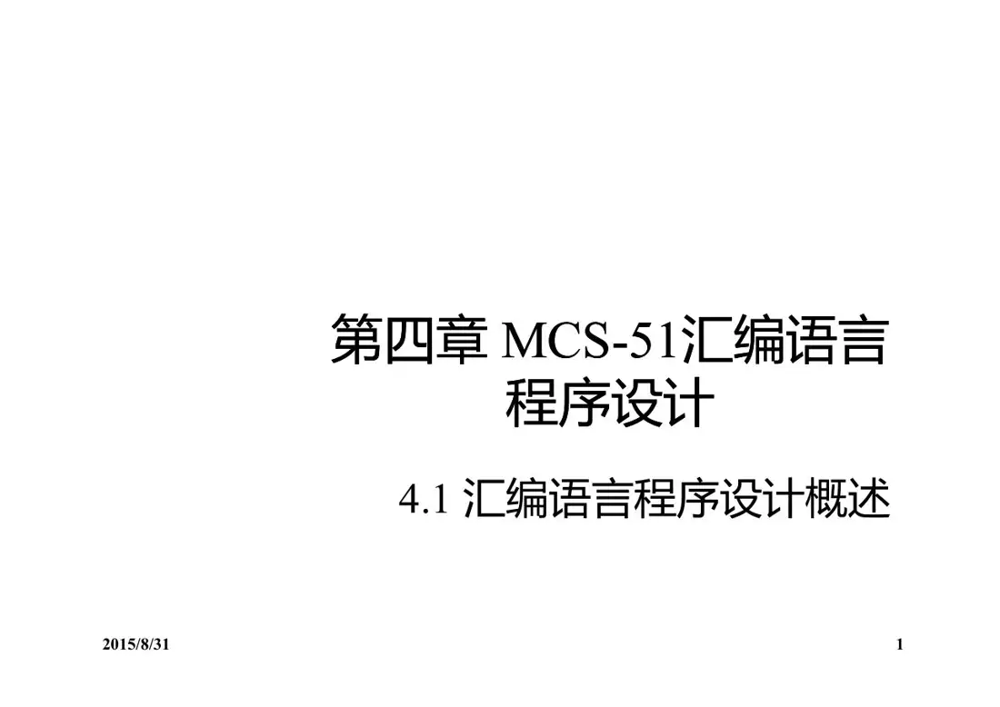

原文：

第四章 MCS-51汇编语言程序设计

4.1 汇编语言程序设计概述

2015/8/31

1

### 单片机原理及系统设计

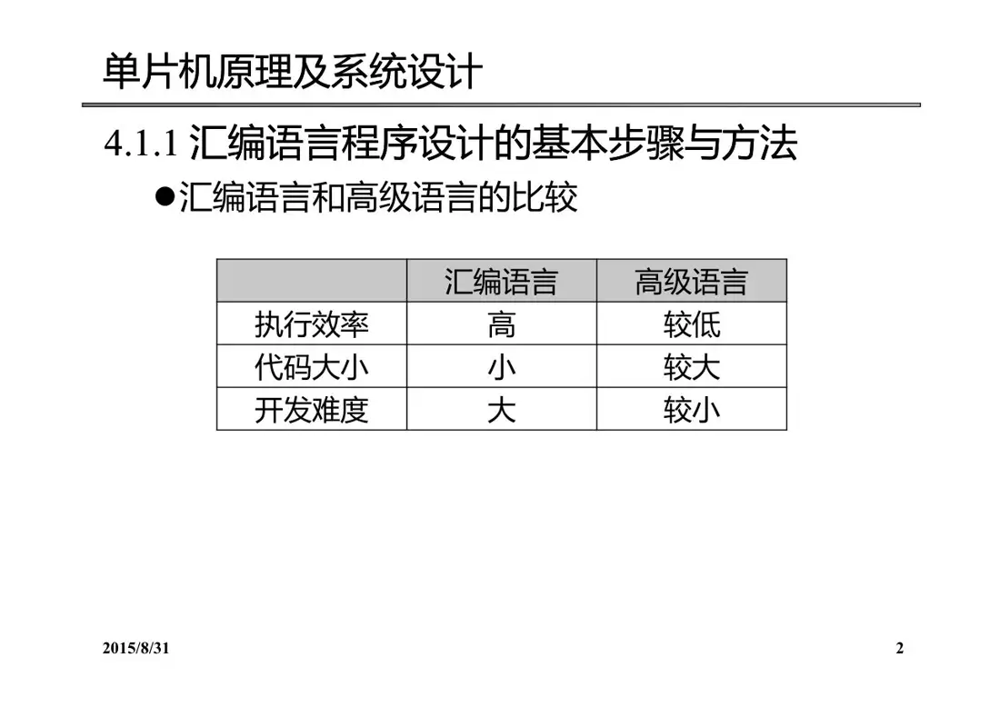

原文：

单片机原理及系统设计

4.1.1 汇编语言程序设计的基本步骤与方法

汇编语言和高级语言的比较

<table><tr><td></td><td>汇编语言</td><td>高级语言</td></tr><tr><td>执行效率</td><td>高</td><td>较低</td></tr><tr><td>代码大小</td><td>小</td><td>较大</td></tr><tr><td>开发难度</td><td>大</td><td>较小</td></tr></table>

2015/8/31

2

### 单片机原理及系统设计

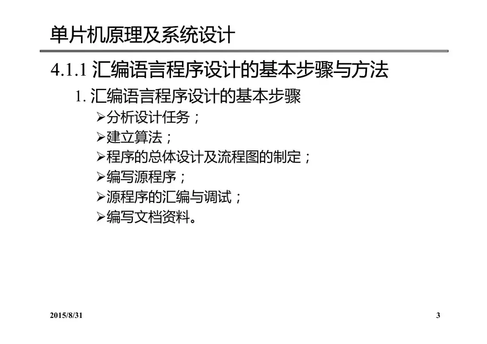

原文：

单片机原理及系统设计

4.1.1 汇编语言程序设计的基本步骤与方法

1. 汇编语言程序设计的基本步骤

分析设计任务；

建立算法；

程序的总体设计及流程图的制定；

编写源程序；

源程序的汇编与调试；

编写文档资料。

2015/8/31

3

### 单片机原理及系统设计

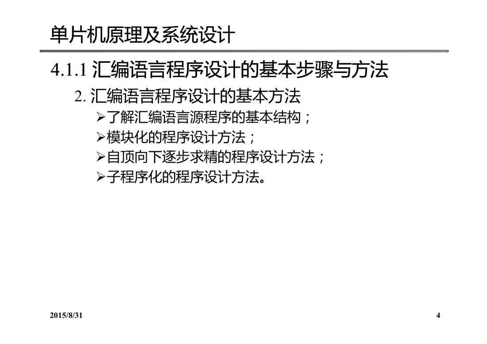

原文：

单片机原理及系统设计

4.1.1 汇编语言程序设计的基本步骤与方法

2. 汇编语言程序设计的基本方法

了解汇编语言源程序的基本结构；

模块化的程序设计方法；

自顶向下逐步求精的程序设计方法；

子程序化的程序设计方法。

2015/8/31

4

### 单片机原理及系统设计

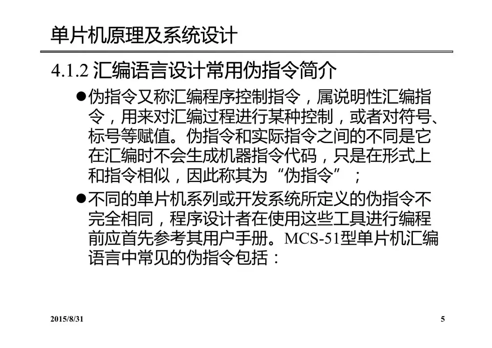

原文：

单片机原理及系统设计

4.1.2 汇编语言设计常用伪指令简介

伪指令又称汇编程序控制指令，属说明性汇编指令，用来对汇编过程进行某种控制，或者对符号、标号等赋值。伪指令和实际指令之间的不同是它在汇编时不会生成机器指令代码，只是在形式上和指令相似，因此称其为“伪指令”；

不同的单片机系列或开发系统所定义的伪指令不完全相同，程序设计者在使用这些工具进行编程前应首先参考其用户手册。MCS-51型单片机汇编语言中常见的伪指令包括：

2015/8/31

5

### 单片机原理及系统设计

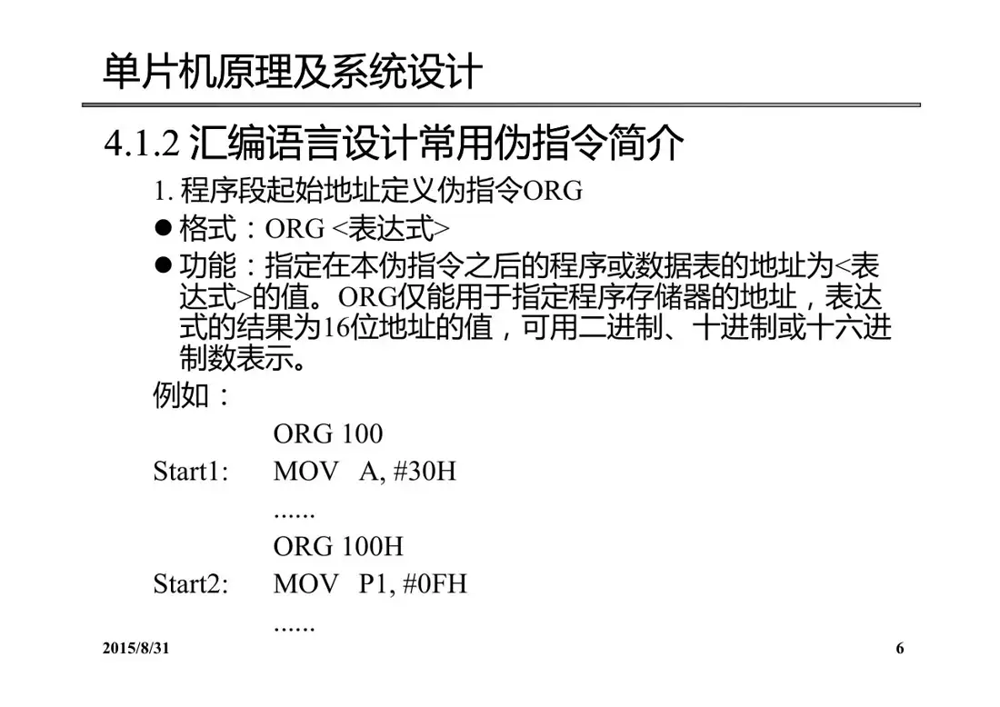

原文：

单片机原理及系统设计

4.1.2 汇编语言设计常用伪指令简介

1. 程序段起始地址定义伪指令ORG

 格式：ORG <表达式>

功能：指定在本伪指令之后的程序或数据表的地址为<表达式>的值。ORG仅能用于指定程序存储器的地址，表达式的结果为16位地址的值，可用二进制、十进制或十六进制数表示。

例如：

ORG 100

Start1: MOV A, #30H

ORG 100H

Start2: MOV P1, #0FH

2015/8/31

6

### 单片机原理及系统设计

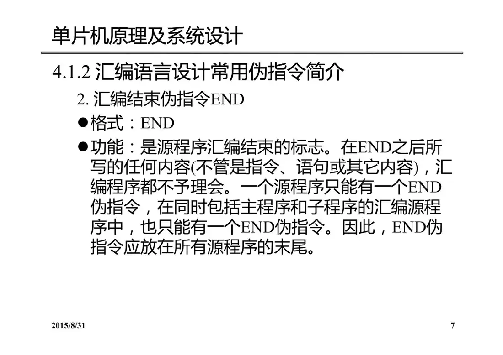

原文：

单片机原理及系统设计

4.1.2 汇编语言设计常用伪指令简介

2. 汇编结束伪指令END

格式：END

功能：是源程序汇编结束的标志。在END之后所写的任何内容(不管是指令、语句或其它内容)，汇编程序都不予理会。一个源程序只能有一个END伪指令，在同时包括主程序和子程序的汇编源程序中，也只能有一个END伪指令。因此，END伪指令应放在所有源程序的末尾。

2015/8/31

7

### 单片机原理及系统设计

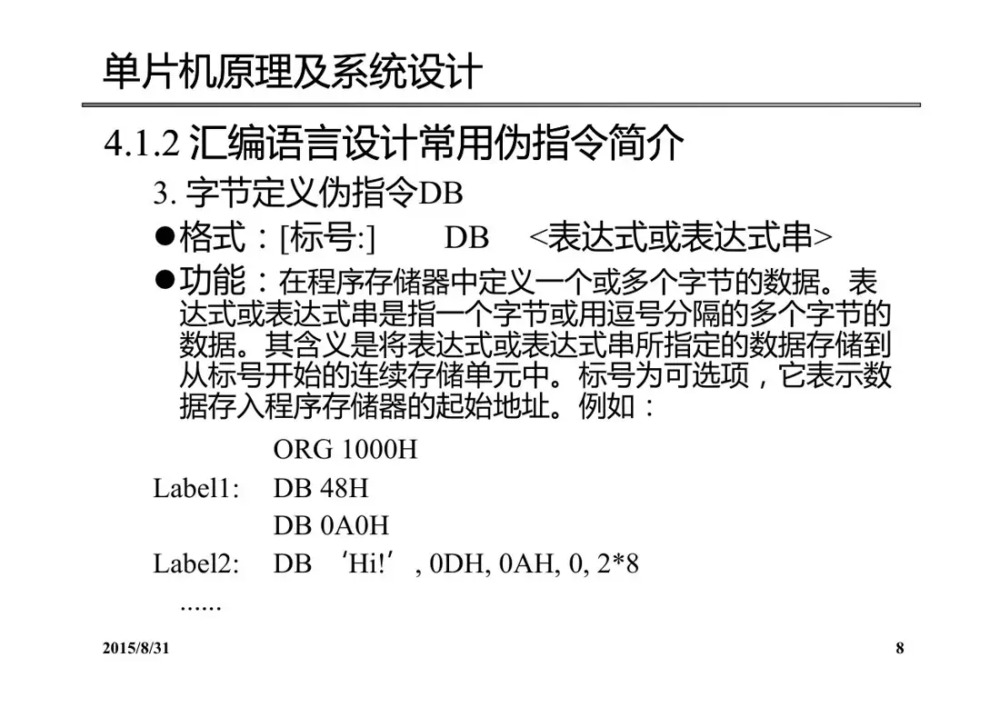

原文：

单片机原理及系统设计

4.1.2 汇编语言设计常用伪指令简介

3. 字节定义伪指令DB

格式：[标号:] DB <表达式或表达式串>

功能：在程序存储器中定义一个或多个字节的数据。表达式或表达式串是指一个字节或用逗号分隔的多个字节的数据。其含义是将表达式或表达式串所指定的数据存储到从标号开始的连续存储单元中。标号为可选项，它表示数据存入程序存储器的起始地址。例如：

ORG 1000H

Label1: DB 48H DB 0A0H

Label2: DB ‘Hi!’, 0DH, 0AH, 0, 2\*8

2015/8/31

8

### 单片机原理及系统设计

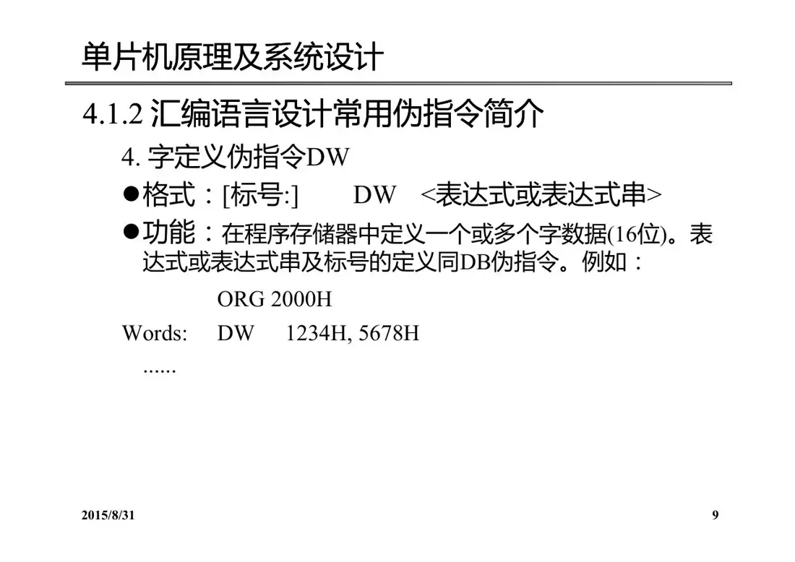

原文：

单片机原理及系统设计

4.1.2 汇编语言设计常用伪指令简介

4. 字定义伪指令DW

格式：[标号:] DW <表达式或表达式串>

功能：在程序存储器中定义一个或多个字数据(16位)。表达式或表达式串及标号的定义同DB伪指令。例如：

ORG 2000H

Words: DW 1234H, 5678H

2015/8/31

9

### 单片机原理及系统设计

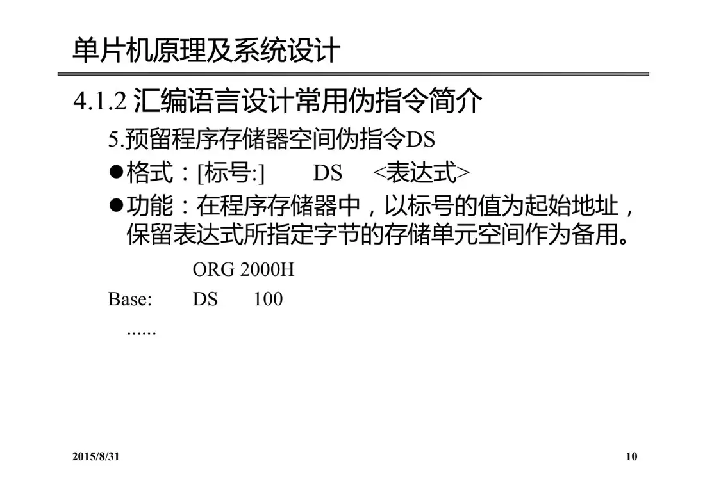

原文：

单片机原理及系统设计

4.1.2 汇编语言设计常用伪指令简介

5.预留程序存储器空间伪指令DS

格式：[标号:] DS <表达式>

功能：在程序存储器中，以标号的值为起始地址，保留表达式所指定字节的存储单元空间作为备用。

ORG 2000H

Base: DS 100

2015/8/31

10

### 单片机原理及系统设计

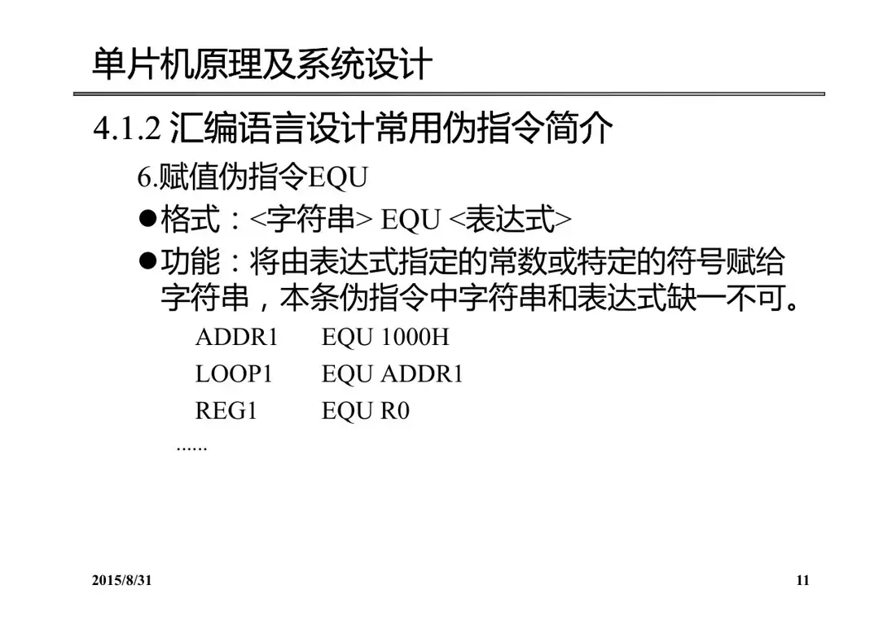

原文：

单片机原理及系统设计

4.1.2 汇编语言设计常用伪指令简介

6.赋值伪指令EQU

格式：<字符串> EQU <表达式>

功能：将由表达式指定的常数或特定的符号赋给字符串，本条伪指令中字符串和表达式缺一不可。

ADDR1 EQU 1000H

LOOP1 EQU ADDR1

REG1 EQU R0

......

2015/8/31

11

### 单片机原理及系统设计

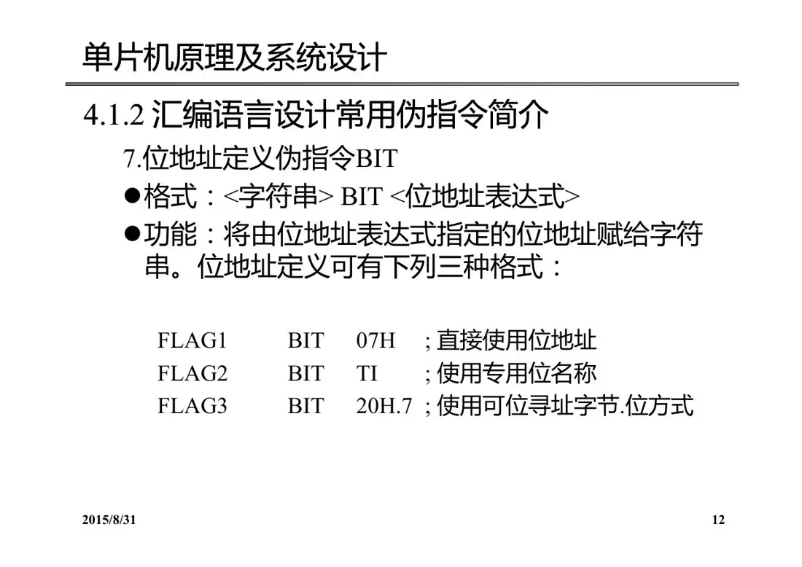

原文：

单片机原理及系统设计

4.1.2 汇编语言设计常用伪指令简介

7.位地址定义伪指令BIT

格式：<字符串> BIT <位地址表达式>

功能：将由位地址表达式指定的位地址赋给字符串。位地址定义可有下列三种格式：

FLAG1 BIT 07H ; 直接使用位地址

FLAG2 BIT TI ; 使用专用位名称

FLAG3 BIT 20H.7 ; 使用可位寻址字节.位方式

2015/8/31

12

### 单片机原理及系统设计

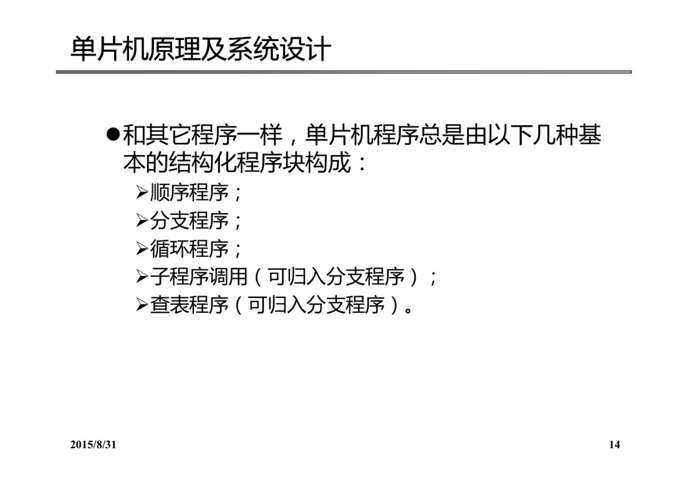

原文：

单片机原理及系统设计

和其它程序一样，单片机程序总是由以下几种基本的结构化程序块构成：

顺序程序；

分支程序；

循环程序；

子程序调用（可归入分支程序）；

查表程序（可归入分支程序）。

2015/8/31

14

### 单片机原理及系统设计

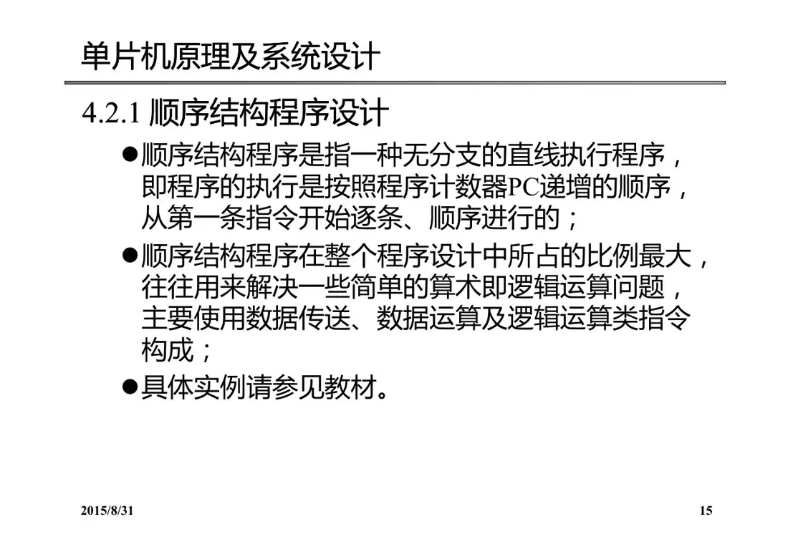

原文：

单片机原理及系统设计

4.2.1 顺序结构程序设计

顺序结构程序是指一种无分支的直线执行程序，即程序的执行是按照程序计数器PC递增的顺序，从第一条指令开始逐条、顺序进行的；

顺序结构程序在整个程序设计中所占的比例最大，往往用来解决一些简单的算术即逻辑运算问题，主要使用数据传送、数据运算及逻辑运算类指令构成；

具体实例请参见教材。

2015/8/31

15

### 单片机原理及系统设计

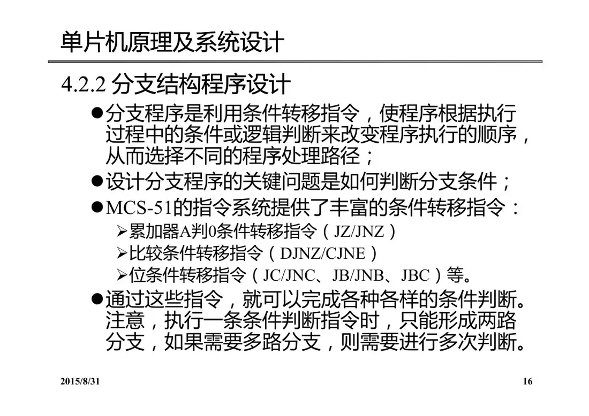

原文：

单片机原理及系统设计

4.2.2 分支结构程序设计

分支程序是利用条件转移指令，使程序根据执行过程中的条件或逻辑判断来改变程序执行的顺序，从而选择不同的程序处理路径；

设计分支程序的关键问题是如何判断分支条件；

MCS-51的指令系统提供了丰富的条件转移指令：累加器A判0条件转移指令（JZ/JNZ）比较条件转移指令（DJNZ/CJNE）位条件转移指令（JC/JNC、JB/JNB、JBC）等。

通过这些指令，就可以完成各种各样的条件判断。注意，执行一条条件判断指令时，只能形成两路分支，如果需要多路分支，则需要进行多次判断。

2015/8/31

16

### 单片机原理及系统设计

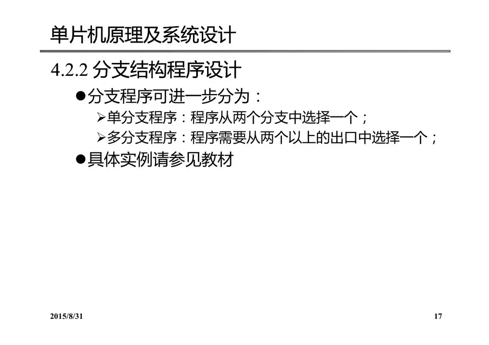

原文：

单片机原理及系统设计

4.2.2 分支结构程序设计

分支程序可进一步分为：

单分支程序：程序从两个分支中选择一个；

多分支程序：程序需要从两个以上的出口中选择一个；

具体实例请参见教材

2015/8/31

17

### 单片机原理及系统设计

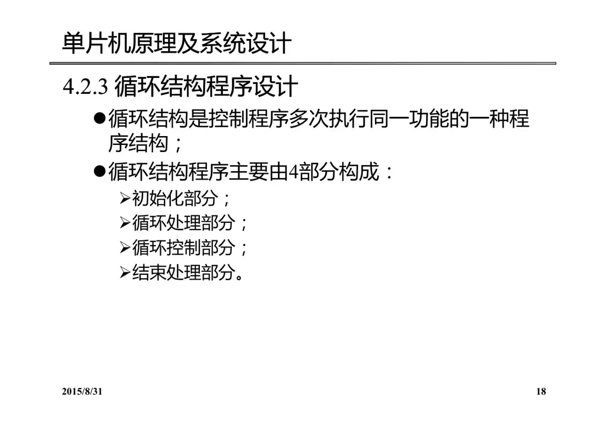

原文：

单片机原理及系统设计

4.2.3 循环结构程序设计

循环结构是控制程序多次执行同一功能的一种程序结构；

循环结构程序主要由4部分构成：

初始化部分；

循环处理部分；

循环控制部分；

结束处理部分。

2015/8/31

18

### 单片机原理及系统设计

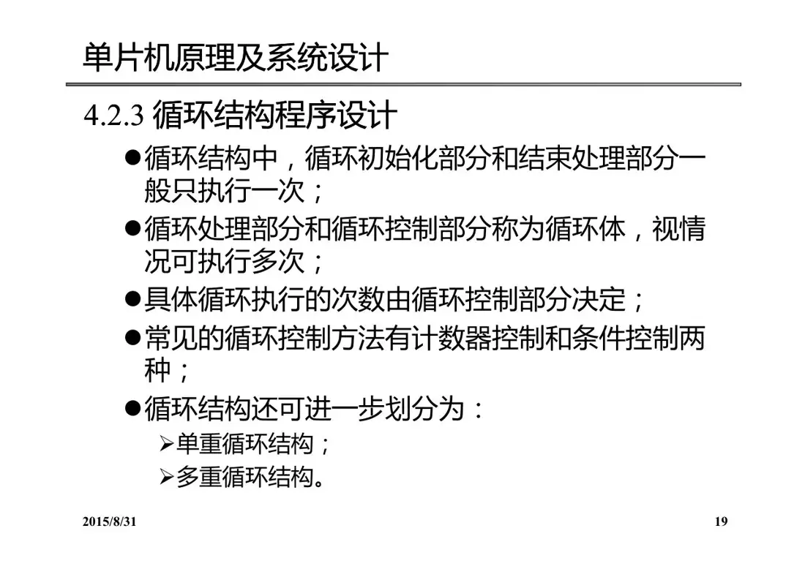

原文：

单片机原理及系统设计

4.2.3 循环结构程序设计

循环结构中，循环初始化部分和结束处理部分一般只执行一次；

循环处理部分和循环控制部分称为循环体，视情况可执行多次；

具体循环执行的次数由循环控制部分决定；

常见的循环控制方法有计数器控制和条件控制两种；

循环结构还可进一步划分为：

单重循环结构；

多重循环结构。

2015/8/31

19

### 单片机原理及系统设计

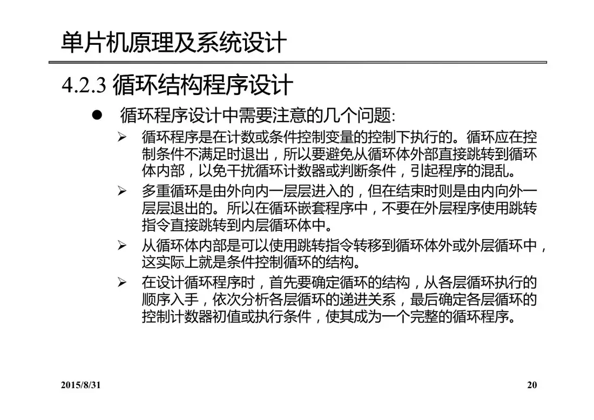

原文：

单片机原理及系统设计

4.2.3 循环结构程序设计

 循环程序设计中需要注意的几个问题:

循环程序是在计数或条件控制变量的控制下执行的。循环应在控制条件不满足时退出，所以要避免从循环体外部直接跳转到循环体内部，以免干扰循环计数器或判断条件，引起程序的混乱。

 多重循环是由外向内一层层进入的，但在结束时则是由内向外一层层退出的。所以在循环嵌套程序中，不要在外层程序使用跳转指令直接跳转到内层循环体中。

 从循环体内部是可以使用跳转指令转移到循环体外或外层循环中，这实际上就是条件控制循环的结构。

 在设计循环程序时，首先要确定循环的结构，从各层循环执行的顺序入手，依次分析各层循环的递进关系，最后确定各层循环的控制计数器初值或执行条件，使其成为一个完整的循环程序。

2015/8/31

20

### 单片机原理及系统设计

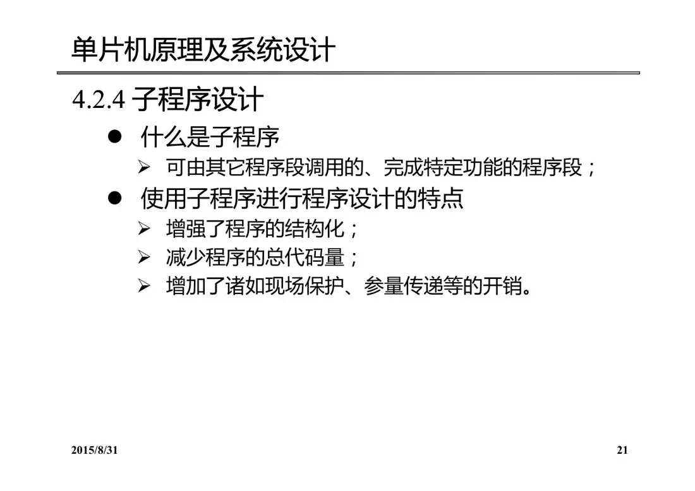

原文：

单片机原理及系统设计

4.2.4 子程序设计

 什么是子程序

 可由其它程序段调用的、完成特定功能的程序段；

 使用子程序进行程序设计的特点

 增强了程序的结构化；

 减少程序的总代码量；

 增加了诸如现场保护、参量传递等的开销。

2015/8/31

21

### 单片机原理及系统设计

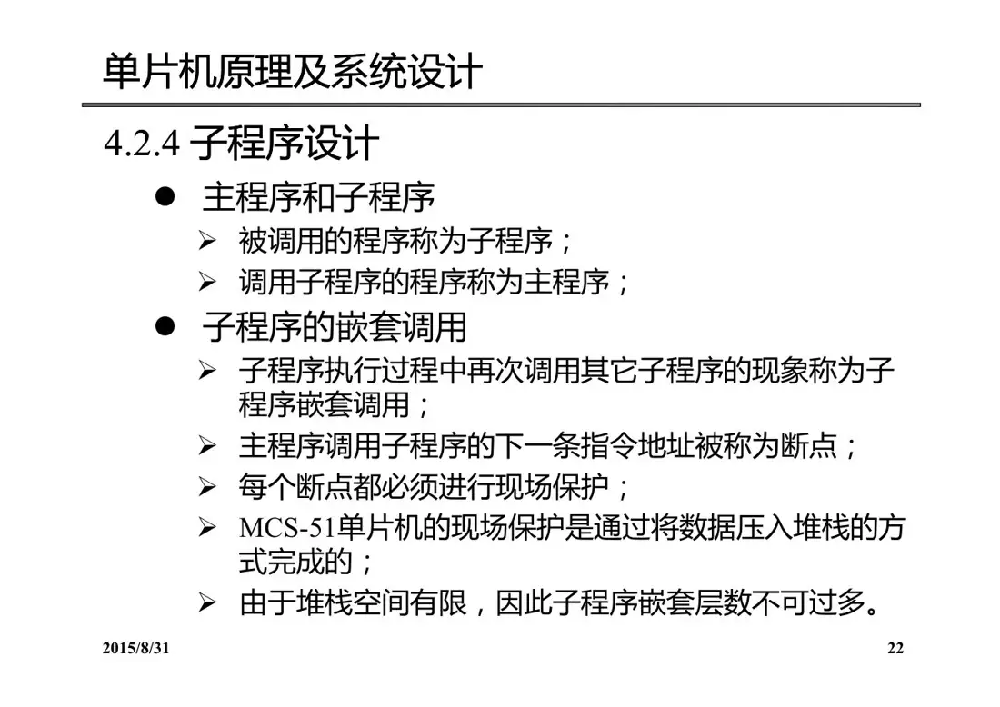

原文：

单片机原理及系统设计

4.2.4 子程序设计

 主程序和子程序

 被调用的程序称为子程序；

 调用子程序的程序称为主程序；

 子程序的嵌套调用

 子程序执行过程中再次调用其它子程序的现象称为子程序嵌套调用；

 主程序调用子程序的下一条指令地址被称为断点；

 每个断点都必须进行现场保护；

 MCS-51单片机的现场保护是通过将数据压入堆栈的方式完成的；

 由于堆栈空间有限，因此子程序嵌套层数不可过多。

2015/8/31

22

### 单片机原理及系统设计

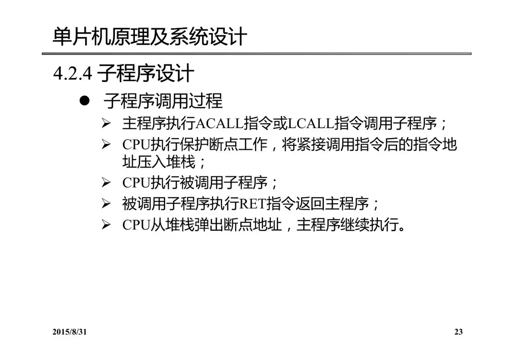

原文：

单片机原理及系统设计

4.2.4 子程序设计

 子程序调用过程

 主程序执行ACALL指令或LCALL指令调用子程序；

 CPU执行保护断点工作，将紧接调用指令后的指令地址压入堆栈；

 CPU执行被调用子程序；

 被调用子程序执行RET指令返回主程序；

 CPU从堆栈弹出断点地址，主程序继续执行。

2015/8/31

23

### 单片机原理及系统设计

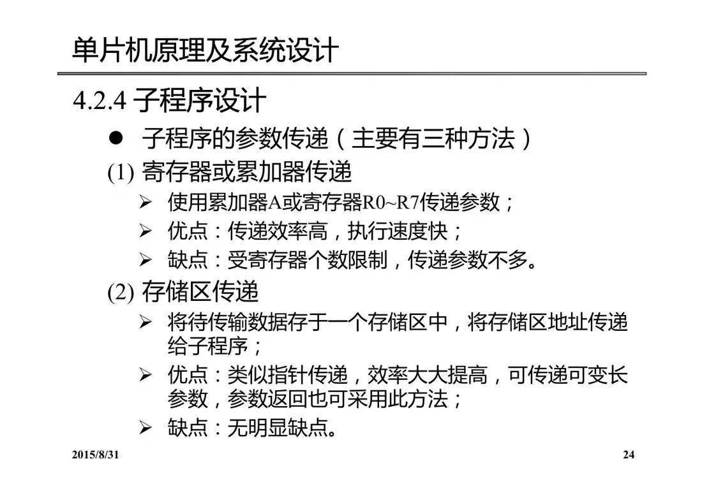

原文：

单片机原理及系统设计

4.2.4 子程序设计

 子程序的参数传递（主要有三种方法）

(1) 寄存器或累加器传递

 使用累加器A或寄存器R0\~R7传递参数；

 优点：传递效率高，执行速度快；

 缺点：受寄存器个数限制，传递参数不多。

(2) 存储区传递

 将待传输数据存于一个存储区中，将存储区地址传递给子程序；

 优点：类似指针传递，效率大大提高，可传递可变长参数，参数返回也可采用此方法；

 缺点：无明显缺点。

2015/8/31

24

### 单片机原理及系统设计

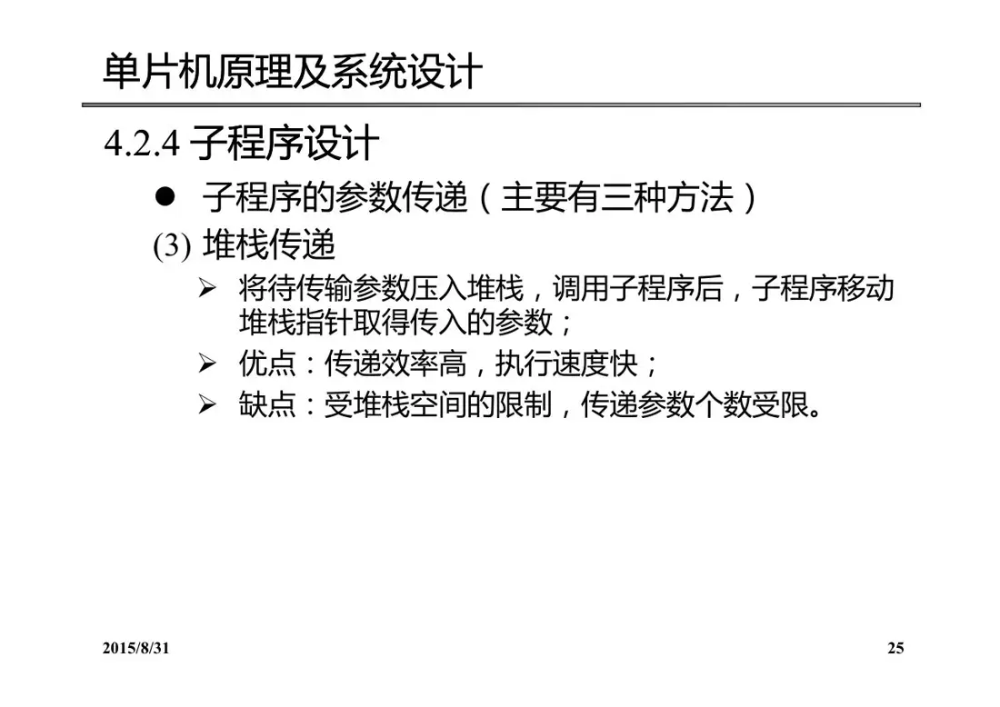

原文：

单片机原理及系统设计

4.2.4 子程序设计

 子程序的参数传递（主要有三种方法）

(3) 堆栈传递

 将待传输参数压入堆栈，调用子程序后，子程序移动堆栈指针取得传入的参数；

 优点：传递效率高，执行速度快；

 缺点：受堆栈空间的限制，传递参数个数受限。

2015/8/31

25

### 单片机原理及系统设计

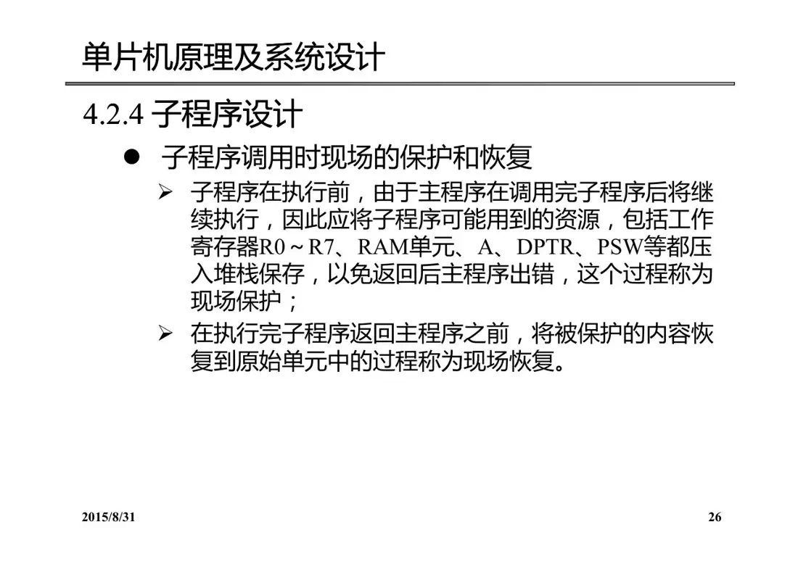

原文：

单片机原理及系统设计

4.2.4 子程序设计

 子程序调用时现场的保护和恢复

 子程序在执行前，由于主程序在调用完子程序后将继续执行，因此应将子程序可能用到的资源，包括工作寄存器R0～R7、RAM单元、A、DPTR、PSW等都压入堆栈保存，以免返回后主程序出错，这个过程称为现场保护；

 在执行完子程序返回主程序之前，将被保护的内容恢复到原始单元中的过程称为现场恢复。

2015/8/31

26

### 单片机原理及系统设计

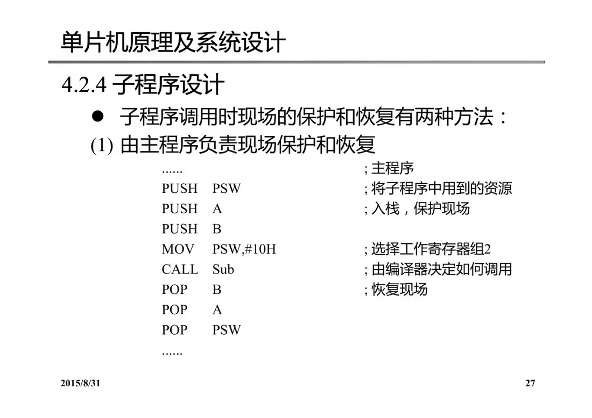

原文：

单片机原理及系统设计

4.2.4 子程序设计

 子程序调用时现场的保护和恢复有两种方法：

(1) 由主程序负责现场保护和恢复

<table><tr><td>......</td><td></td><td>;主程序</td></tr><tr><td>PUSH</td><td>PSW</td><td>;将子程序中用到的资源</td></tr><tr><td>PUSH</td><td>A</td><td>;入栈,保护现场</td></tr><tr><td>PUSH</td><td>B</td><td></td></tr><tr><td>MOV</td><td>PSW,#10H</td><td>;选择工作寄存器组2</td></tr><tr><td>CALL</td><td>Sub</td><td>;由编译器决定如何调用</td></tr><tr><td>POP</td><td>B</td><td>;恢复现场</td></tr><tr><td>POP</td><td>A</td><td></td></tr><tr><td>POP</td><td>PSW</td><td></td></tr></table>

2015/8/31

27

### 单片机原理及系统设计

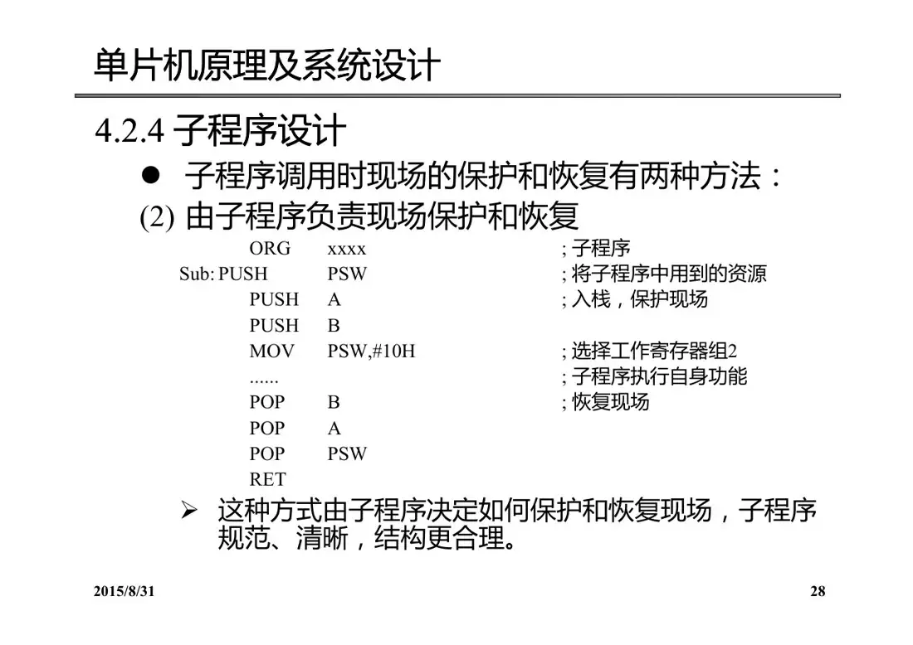

原文：

单片机原理及系统设计

4.2.4 子程序设计

 子程序调用时现场的保护和恢复有两种方法：

(2) 由子程序负责现场保护和恢复

<table><tr><td>ORG</td><td>xxxx</td><td>;子程序</td></tr><tr><td>Sub: PUSH</td><td>PSW</td><td>;将子程序中用到的资源</td></tr><tr><td>PUSH</td><td>A</td><td>;入栈,保护现场</td></tr><tr><td>PUSH</td><td>B</td><td></td></tr><tr><td>MOV</td><td>PSW,#10H</td><td>;选择工作寄存器组2</td></tr><tr><td>......</td><td></td><td>;子程序执行自身功能</td></tr><tr><td>POP</td><td>B</td><td>;恢复现场</td></tr><tr><td>POP</td><td>A</td><td></td></tr><tr><td>POP</td><td>PSW</td><td></td></tr><tr><td>RET</td><td></td><td></td></tr></table>

 这种方式由子程序决定如何保护和恢复现场，子程序规范、清晰，结构更合理。

2015/8/31

28
