# 《单片机原理及系统设计》第5章 单片机C语言程序设计（课件）

原件的每一页，下面附识别出的文字。

### 第五章 单片机C语言程序设计

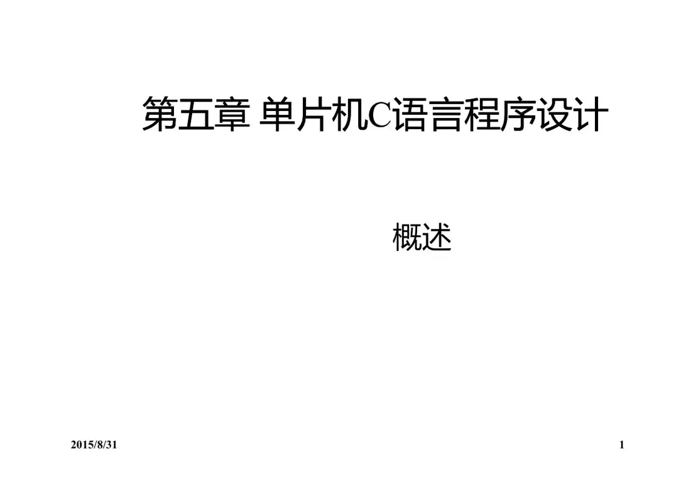

原文：

第五章 单片机C语言程序设计

概述

2015/8/31

1

### 单片机原理及系统设计

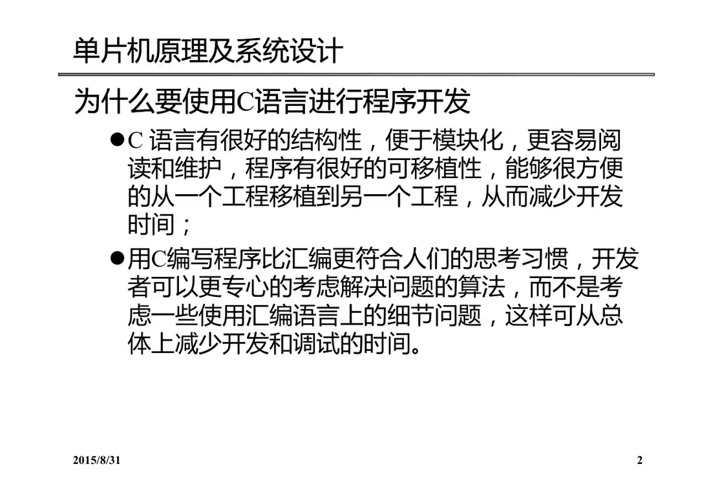

原文：

单片机原理及系统设计

为什么要使用C语言进行程序开发

C 语言有很好的结构性，便于模块化，更容易阅读和维护，程序有很好的可移植性，能够很方便的从一个工程移植到另一个工程，从而减少开发时间；

用C编写程序比汇编更符合人们的思考习惯，开发者可以更专心的考虑解决问题的算法，而不是考虑一些使用汇编语言上的细节问题，这样可从总体上减少开发和调试的时间。

2015/8/31

2

### 单片机原理及系统设计

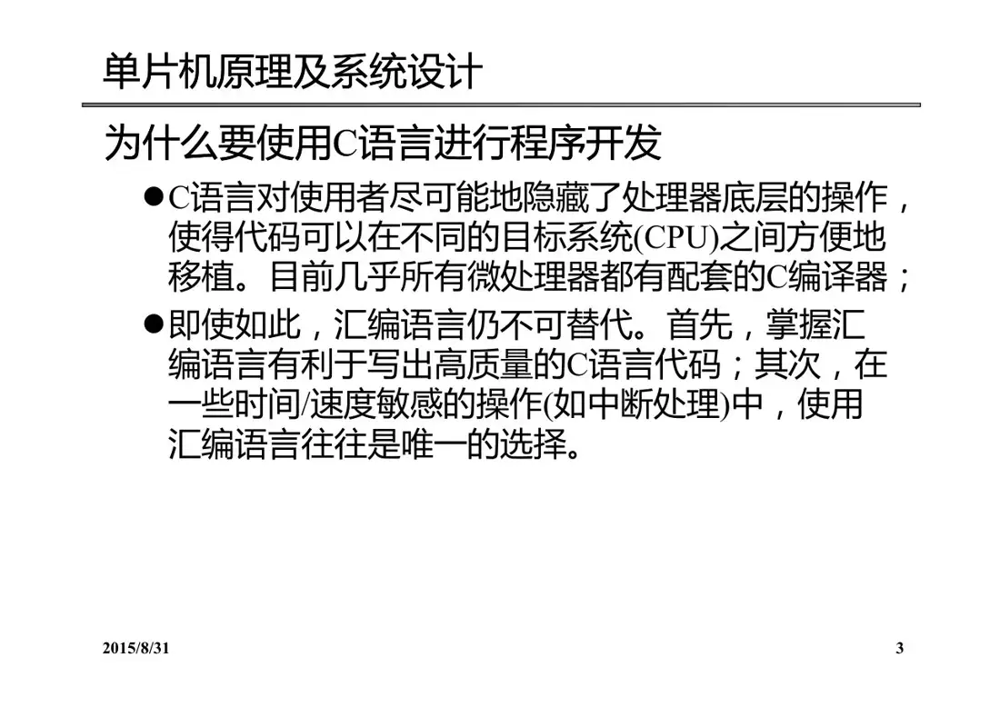

原文：

单片机原理及系统设计

为什么要使用C语言进行程序开发

C语言对使用者尽可能地隐藏了处理器底层的操作，使得代码可以在不同的目标系统(CPU)之间方便地移植。目前几乎所有微处理器都有配套的C编译器；

即使如此，汇编语言仍不可替代。首先，掌握汇编语言有利于写出高质量的C语言代码；其次，在一些时间/速度敏感的操作(如中断处理)中，使用汇编语言往往是唯一的选择。

2015/8/31

3

### 第五章 单片机C语言程序设计

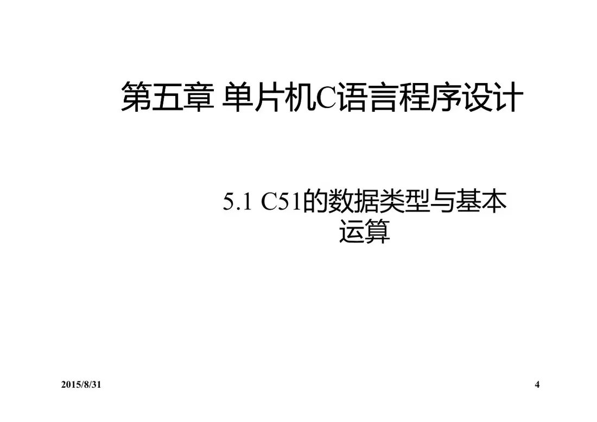

原文：

第五章 单片机C语言程序设计

5.1 C51的数据类型与基本运算

2015/8/31

4

### 单片机原理及系统设计

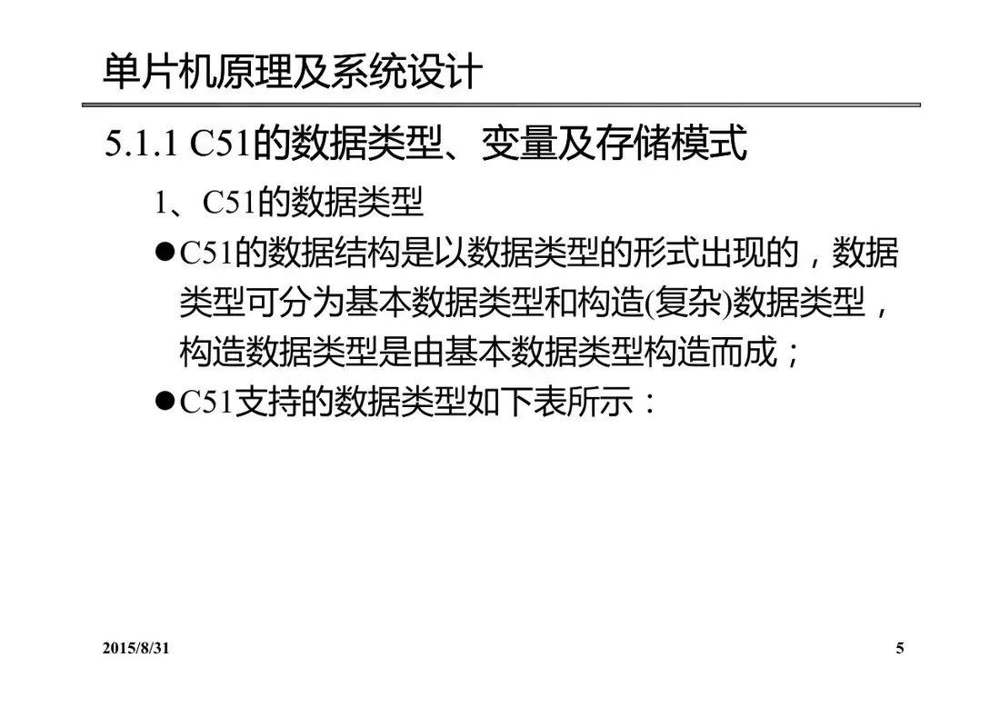

原文：

单片机原理及系统设计

5.1.1 C51的数据类型、变量及存储模式

1、C51的数据类型

C51的数据结构是以数据类型的形式出现的，数据类型可分为基本数据类型和构造(复杂)数据类型，构造数据类型是由基本数据类型构造而成；

C51支持的数据类型如下表所示：

2015/8/31

5

### 单片机原理及系统设计

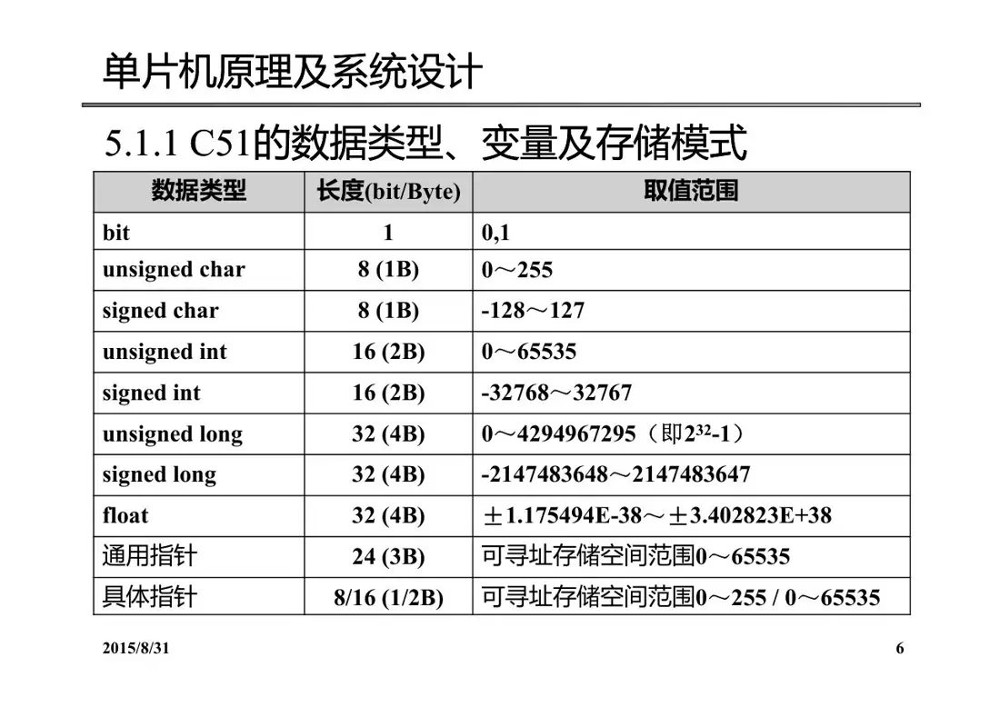

原文：

单片机原理及系统设计

5.1.1 C51的数据类型、变量及存储模式

<table><tr><td>数据类型</td><td>长度(bit/Byte)</td><td>取值范围</td></tr><tr><td>bit</td><td>1</td><td>0,1</td></tr><tr><td>unsigned char</td><td>8 (1B)</td><td>0~255</td></tr><tr><td>signed char</td><td>8 (1B)</td><td>-128~127</td></tr><tr><td>unsigned int</td><td>16 (2B)</td><td>0~65535</td></tr><tr><td>signed int</td><td>16 (2B)</td><td>-32768~32767</td></tr><tr><td>unsigned long</td><td>32 (4B)</td><td>0~4294967295(即 $2^{32}-1$ )</td></tr><tr><td>signed long</td><td>32 (4B)</td><td>-2147483648~2147483647</td></tr><tr><td>float</td><td>32 (4B)</td><td>±1.175494E-38~±3.402823E+38</td></tr><tr><td>通用指针</td><td>24 (3B)</td><td>可寻址存储空间范围0~65535</td></tr><tr><td>具体指针</td><td>8/16 (1/2B)</td><td>可寻址存储空间范围0~255 / 0~65535</td></tr></table>

2015/8/31

6

### 单片机原理及系统设计

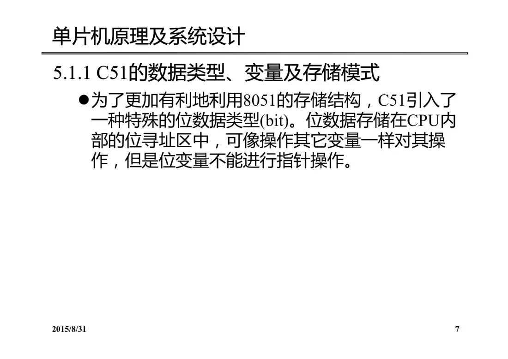

原文：

单片机原理及系统设计

5.1.1 C51的数据类型、变量及存储模式

为了更加有利地利用8051的存储结构，C51引入了一种特殊的位数据类型(bit)。位数据存储在CPU内部的位寻址区中，可像操作其它变量一样对其操作，但是位变量不能进行指针操作。

2015/8/31

7

### 单片机原理及系统设计

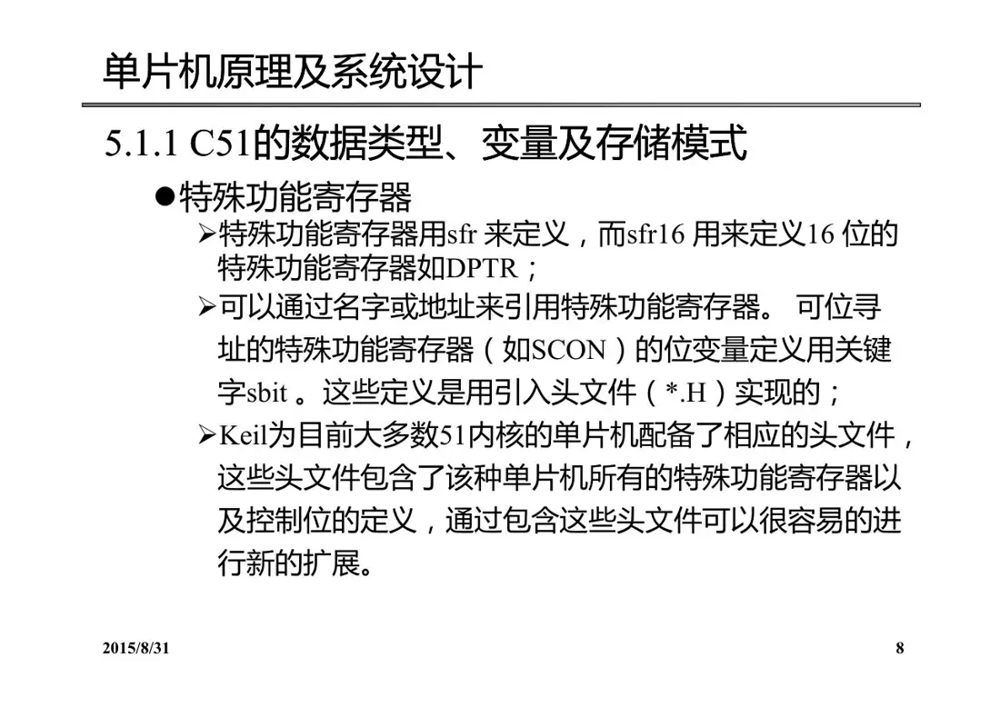

原文：

单片机原理及系统设计

5.1.1 C51的数据类型、变量及存储模式

特殊功能寄存器

特殊功能寄存器用sfr 来定义，而sfr16 用来定义16 位的特殊功能寄存器如DPTR；

可以通过名字或地址来引用特殊功能寄存器。可位寻址的特殊功能寄存器（如SCON）的位变量定义用关键字sbit 。这些定义是用引入头文件（\*.H）实现的；

Keil为目前大多数51内核的单片机配备了相应的头文件，这些头文件包含了该种单片机所有的特殊功能寄存器以及控制位的定义，通过包含这些头文件可以很容易的进行新的扩展。

2015/8/31

8

### 单片机原理及系统设计

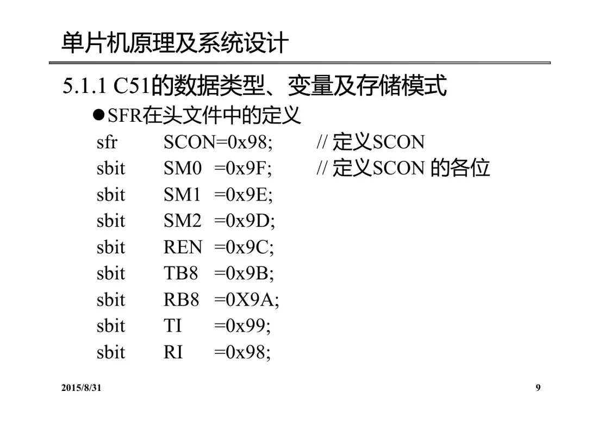

原文：

单片机原理及系统设计

5.1.1 C51的数据类型、变量及存储模式

SFR在头文件中的定义

2015/8/31

9

### 单片机原理及系统设计

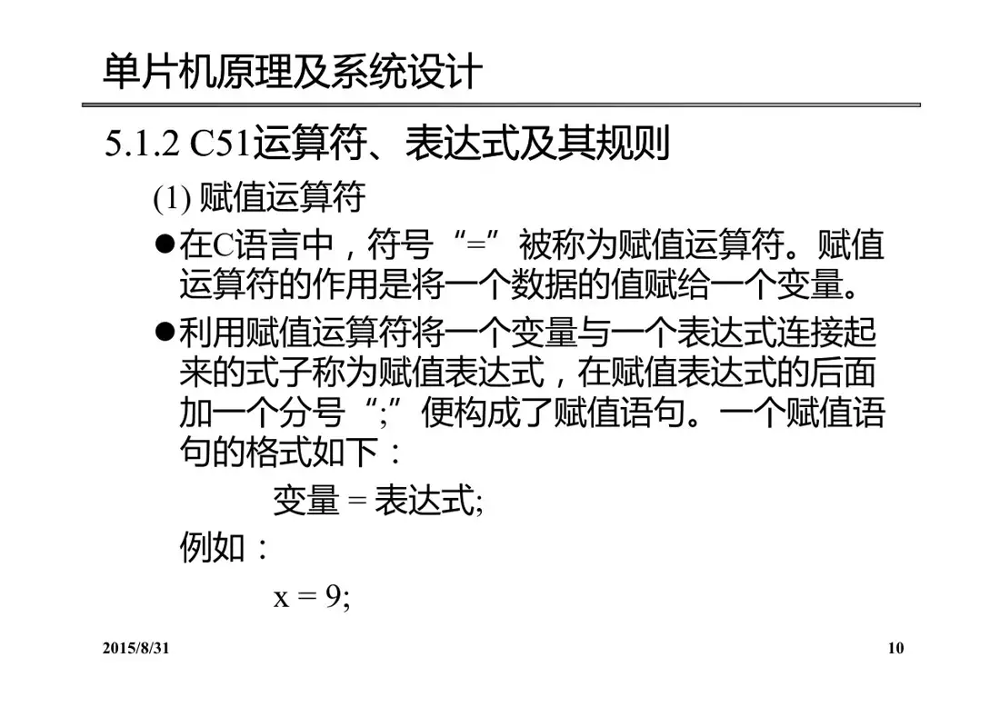

原文：

单片机原理及系统设计

5.1.2 C51运算符、表达式及其规则

(1) 赋值运算符

在C语言中，符号“=”被称为赋值运算符。赋值运算符的作用是将一个数据的值赋给一个变量。

利用赋值运算符将一个变量与一个表达式连接起来的式子称为赋值表达式，在赋值表达式的后面加一个分号“;”便构成了赋值语句。一个赋值语句的格式如下：

$$
\text { 变量 } = \text { 表达式 };
$$

例如：

$$
\mathrm{x} = 9;
$$

2015/8/31

10

### 单片机原理及系统设计

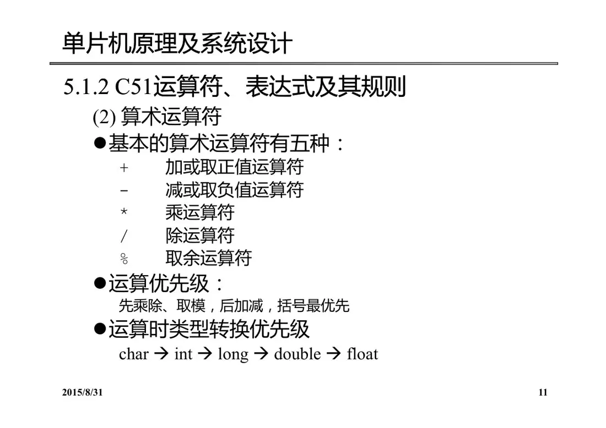

原文：

单片机原理及系统设计

5.1.2 C51运算符、表达式及其规则

(2) 算术运算符

基本的算术运算符有五种：

\+ 加或取正值运算符

减或取负值运算符

\* 乘运算符

/ 除运算符

% 取余运算符

运算优先级：

先乘除、取模，后加减，括号最优先

运算时类型转换优先级

char → int → long → double → float

2015/8/31

11

### 单片机原理及系统设计

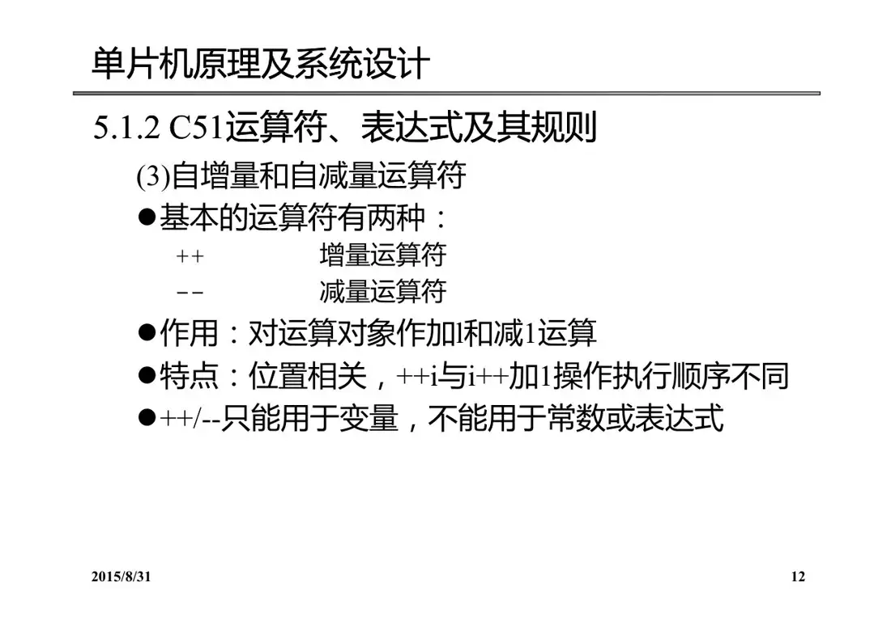

原文：

单片机原理及系统设计

5.1.2 C51运算符、表达式及其规则

(3)自增量和自减量运算符

基本的运算符有两种：

增量运算符

减量运算符

作用：对运算对象作加l和减1运算

特点：位置相关，++i与i++加1操作执行顺序不同

++/--只能用于变量，不能用于常数或表达式

2015/8/31

12

### 单片机原理及系统设计

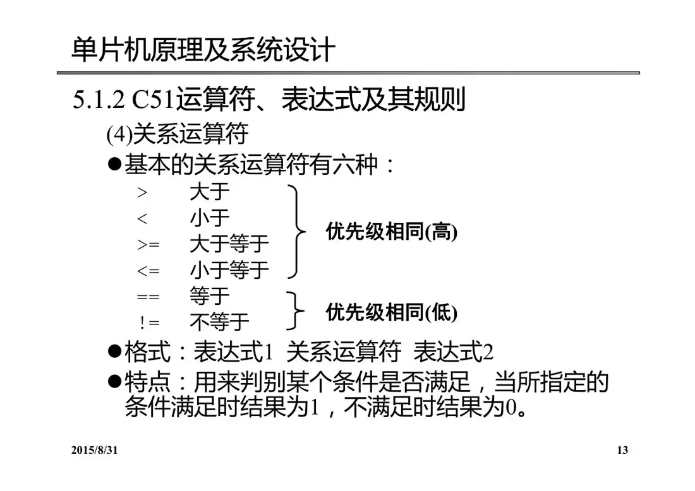

原文：

单片机原理及系统设计

5.1.2 C51运算符、表达式及其规则

(4)关系运算符

基本的关系运算符有六种：

> 大于

< 小于

>= 大于等于

<= 小于等于

优先级相同(高)

== 等于

!= 不等于

优先级相同(低)

格式：表达式1 关系运算符 表达式2

特点：用来判别某个条件是否满足，当所指定的 条件满足时结果为1，不满足时结果为0。

2015/8/31

13

### 单片机原理及系统设计

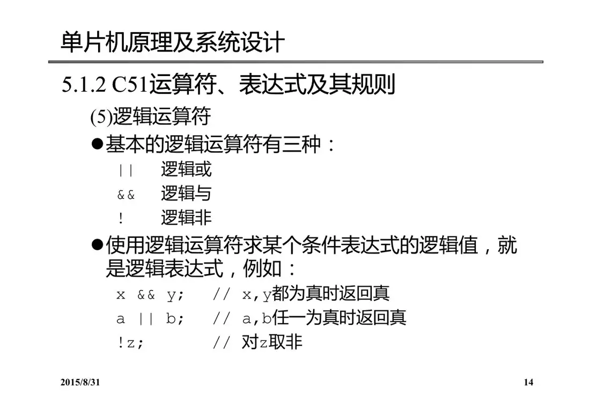

原文：

单片机原理及系统设计

5.1.2 C51运算符、表达式及其规则

(5)逻辑运算符

基本的逻辑运算符有三种：

|| 逻辑或

&& 逻辑与

! 逻辑非

使用逻辑运算符求某个条件表达式的逻辑值，就是逻辑表达式，例如：

x && y; // x,y都为真时返回真

a || b; // a,b任一为真时返回真

!z; // 对z取非

2015/8/31

14

### 单片机原理及系统设计

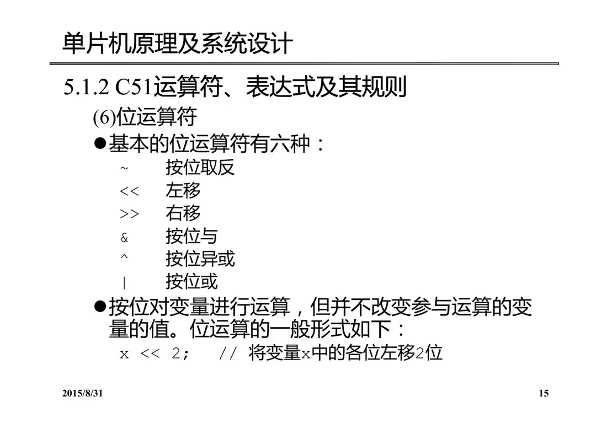

原文：

单片机原理及系统设计

5.1.2 C51运算符、表达式及其规则

(6)位运算符

基本的位运算符有六种：

按位取反

<< 左移

>> 右移

& 按位与

按位异或

| 按位或

按位对变量进行运算，但并不改变参与运算的变量的值。位运算的一般形式如下：

x << 2; // 将变量x中的各位左移2位

2015/8/31

15

### 单片机原理及系统设计

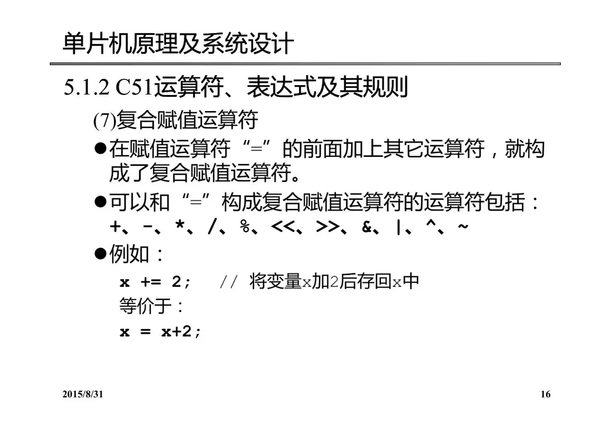

原文：

单片机原理及系统设计

5.1.2 C51运算符、表达式及其规则

(7)复合赋值运算符

在赋值运算符“=”的前面加上其它运算符，就构成了复合赋值运算符。

可以和“=”构成复合赋值运算符的运算符包括：

例如：

x += 2; // 将变量x加2后存回x中

等价于：

2015/8/31

16

### 单片机原理及系统设计

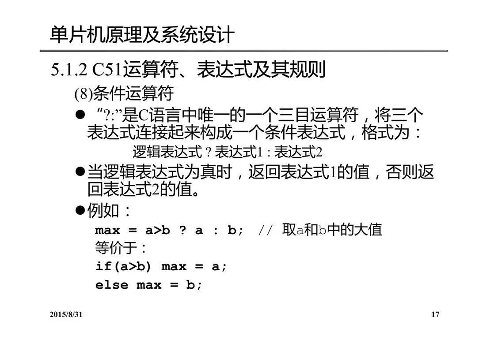

原文：

单片机原理及系统设计

5.1.2 C51运算符、表达式及其规则

(8)条件运算符

“?:”是C语言中唯一的一个三目运算符，将三个表达式连接起来构成一个条件表达式，格式为：逻辑表达式? 表达式1 : 表达式2

当逻辑表达式为真时，返回表达式1的值，否则返回表达式2的值。

2015/8/31

17

### 单片机原理及系统设计

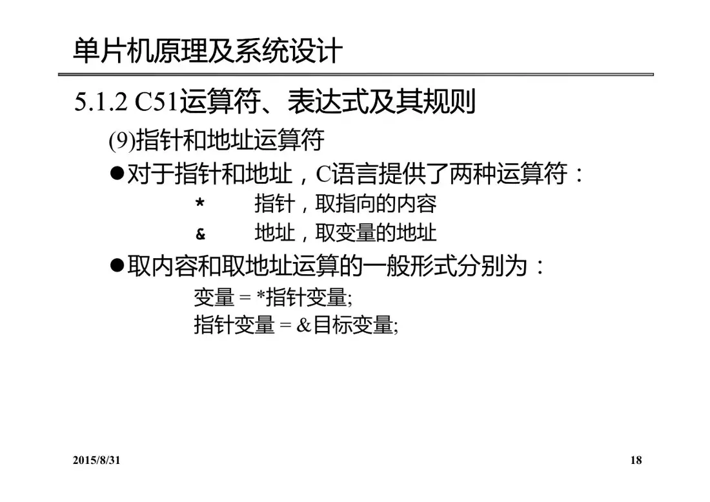

原文：

单片机原理及系统设计

5.1.2 C51运算符、表达式及其规则

(9)指针和地址运算符

对于指针和地址，C语言提供了两种运算符：

\* 指针，取指向的内容

& 地址，取变量的地址

取内容和取地址运算的一般形式分别为：

变量= \*指针变量;

指针变量= &目标变量;

2015/8/31

18

### 单片机原理及系统设计

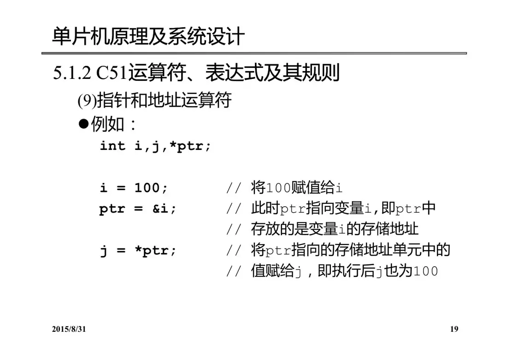

原文：

单片机原理及系统设计

5.1.2 C51运算符、表达式及其规则

(9)指针和地址运算符

2015/8/31

19

### 单片机原理及系统设计

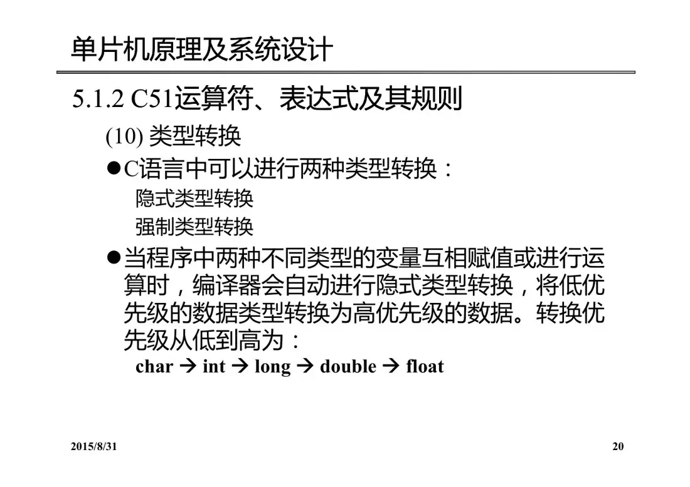

原文：

单片机原理及系统设计

5.1.2 C51运算符、表达式及其规则

(10) 类型转换

C语言中可以进行两种类型转换：

隐式类型转换

强制类型转换

当程序中两种不同类型的变量互相赋值或进行运算时，编译器会自动进行隐式类型转换，将低优先级的数据类型转换为高优先级的数据。转换优先级从低到高为：

$$
\mathrm{char} \rightarrow \mathrm{int} \rightarrow \mathrm{long} \rightarrow \mathrm{double} \rightarrow \mathrm{float}
$$

2015/8/31

20

### 单片机原理及系统设计

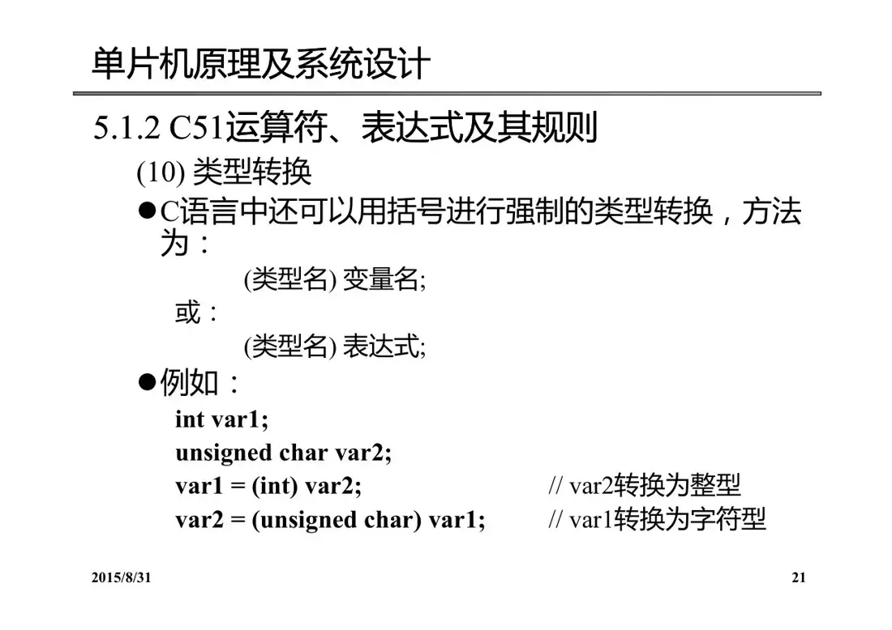

原文：

单片机原理及系统设计

5.1.2 C51运算符、表达式及其规则

(10) 类型转换

2015/8/31

21

### 单片机原理及系统设计

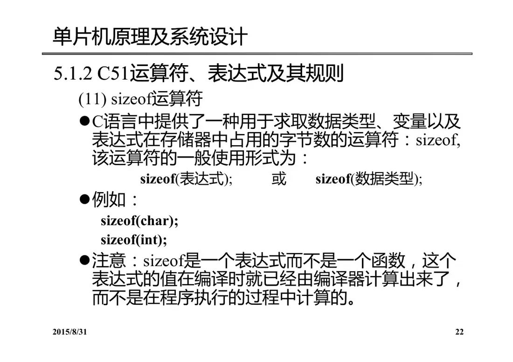

原文：

单片机原理及系统设计

5.1.2 C51运算符、表达式及其规则

(11) sizeof运算符

C语言中提供了一种用于求取数据类型、变量以及表达式在存储器中占用的字节数的运算符：sizeof,该运算符的一般使用形式为：

sizeof(表达式); 或 sizeof(数据类型);

例如：

sizeof(char);

sizeof(int);

注意：sizeof是一个表达式而不是一个函数，这个表达式的值在编译时就已经由编译器计算出来了，而不是在程序执行的过程中计算的。

2015/8/31

22

### 单片机原理及系统设计

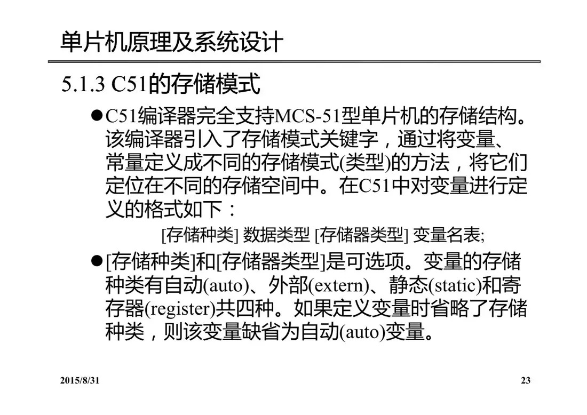

原文：

单片机原理及系统设计

5.1.3 C51的存储模式

C51编译器完全支持MCS-51型单片机的存储结构。该编译器引入了存储模式关键字，通过将变量、常量定义成不同的存储模式(类型)的方法，将它们定位在不同的存储空间中。在C51中对变量进行定义的格式如下：

[存储种类] 数据类型[存储器类型] 变量名表;

[存储种类]和[存储器类型]是可选项。变量的存储种类有自动(auto)、外部(extern)、静态(static)和寄存器(register)共四种。如果定义变量时省略了存储种类，则该变量缺省为自动(auto)变量。

2015/8/31

23

### 单片机原理及系统设计

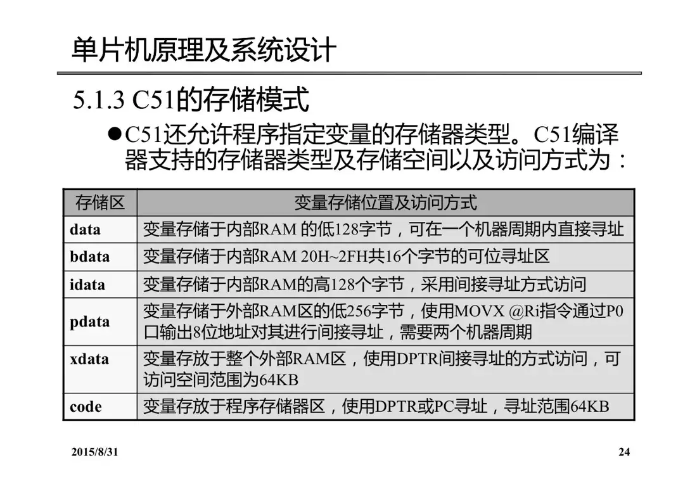

原文：

单片机原理及系统设计

5.1.3 C51的存储模式

C51还允许程序指定变量的存储器类型。C51编译器支持的存储器类型及存储空间以及访问方式为：

<table><tr><td>存储区</td><td>变量存储位置及访问方式</td></tr><tr><td>data</td><td>变量存储于内部RAM的低128字节,可在一个机器周期内直接寻址</td></tr><tr><td>bdata</td><td>变量存储于内部RAM 20H~2FH共16个字节的可位寻址区</td></tr><tr><td>idata</td><td>变量存储于内部RAM的高128个字节,采用间接寻址方式访问</td></tr><tr><td>pdata</td><td>变量存储于外部RAM区的低256字节,使用MOVX @Ri指令通过P0口输出8位地址对其进行间接寻址,需要两个机器周期</td></tr><tr><td>xdata</td><td>变量存放于整个外部RAM区,使用DPTR间接寻址的方式访问,可访问空间范围为64KB</td></tr><tr><td>code</td><td>变量存放于程序存储器区,使用DPTR或PC寻址,寻址范围64KB</td></tr></table>

2015/8/31

24

### 单片机原理及系统设计

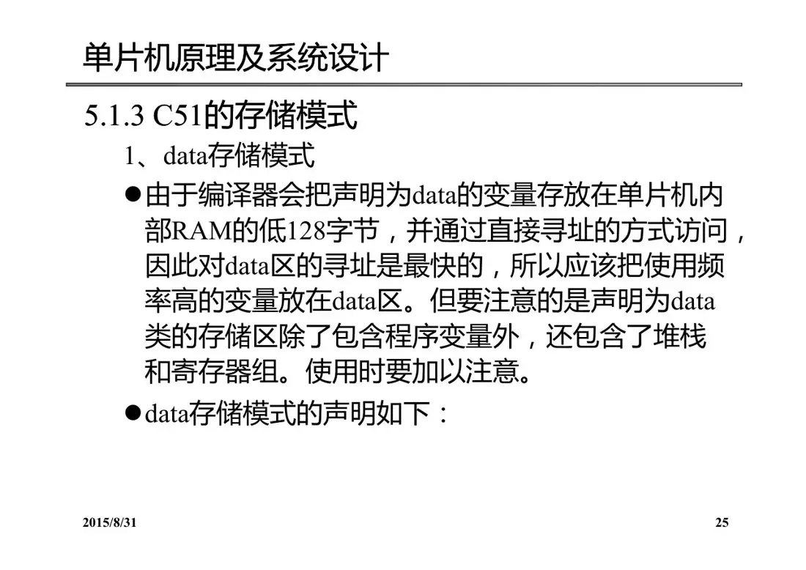

原文：

单片机原理及系统设计

5.1.3 C51的存储模式

1、data存储模式

由于编译器会把声明为data的变量存放在单片机内部RAM的低128字节，并通过直接寻址的方式访问，因此对data区的寻址是最快的，所以应该把使用频率高的变量放在data区。但要注意的是声明为data类的存储区除了包含程序变量外，还包含了堆栈和寄存器组。使用时要加以注意。

data存储模式的声明如下：

2015/8/31

25

### 单片机原理及系统设计

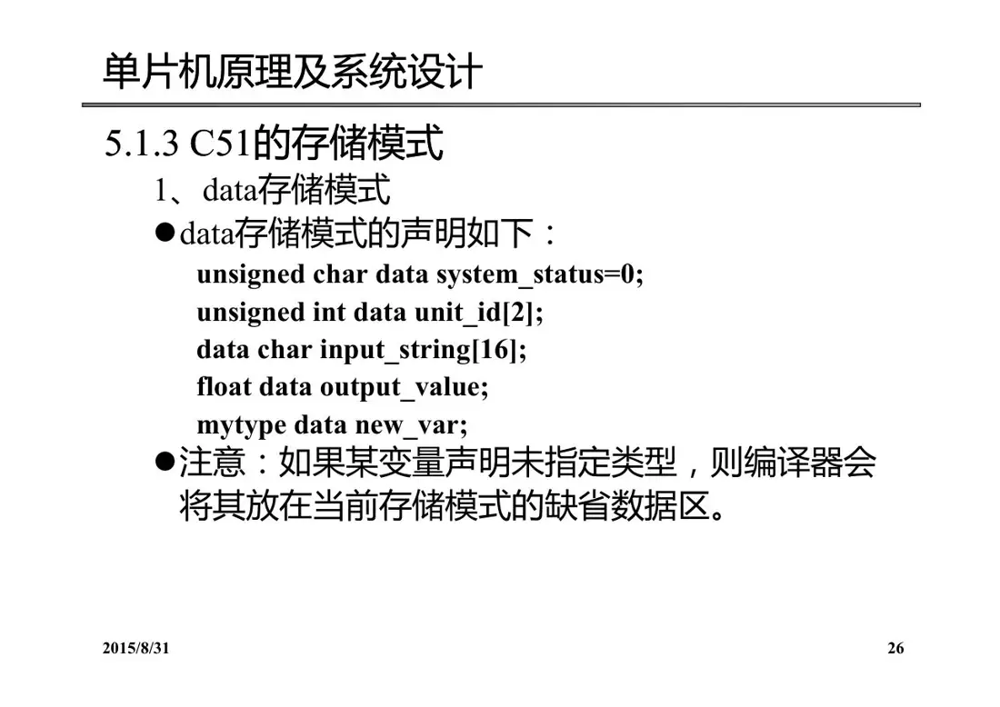

原文：

单片机原理及系统设计

5.1.3 C51的存储模式

1、data存储模式

data存储模式的声明如下：

注意：如果某变量声明未指定类型，则编译器会将其放在当前存储模式的缺省数据区。

2015/8/31

26

### 单片机原理及系统设计

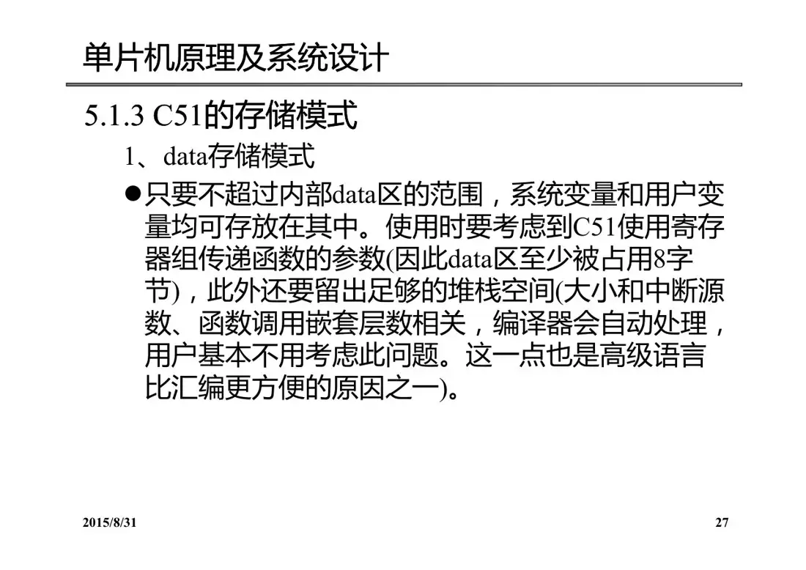

原文：

单片机原理及系统设计

5.1.3 C51的存储模式

1、data存储模式

只要不超过内部data区的范围，系统变量和用户变量均可存放在其中。使用时要考虑到C51使用寄存器组传递函数的参数(因此data区至少被占用8字节)，此外还要留出足够的堆栈空间(大小和中断源数、函数调用嵌套层数相关，编译器会自动处理，用户基本不用考虑此问题。这一点也是高级语言比汇编更方便的原因之一)。

2015/8/31

27

### 单片机原理及系统设计

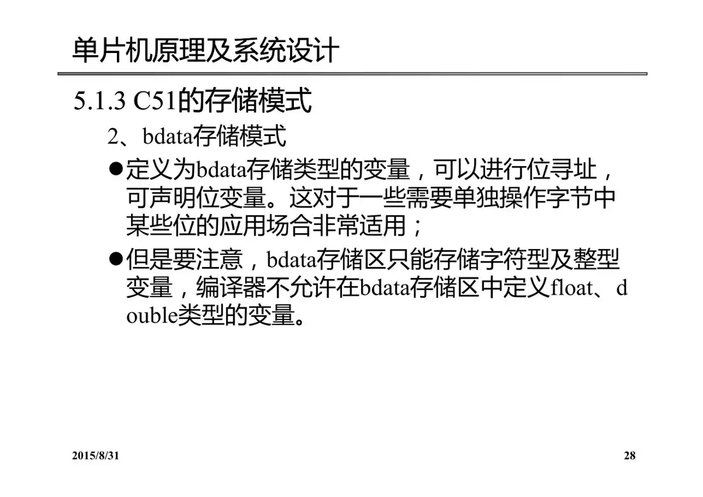

原文：

单片机原理及系统设计

5.1.3 C51的存储模式

2、bdata存储模式

定义为bdata存储类型的变量，可以进行位寻址，可声明位变量。这对于一些需要单独操作字节中某些位的应用场合非常适用；

但是要注意，bdata存储区只能存储字符型及整型变量，编译器不允许在bdata存储区中定义float、double类型的变量。

2015/8/31

28

### 单片机原理及系统设计

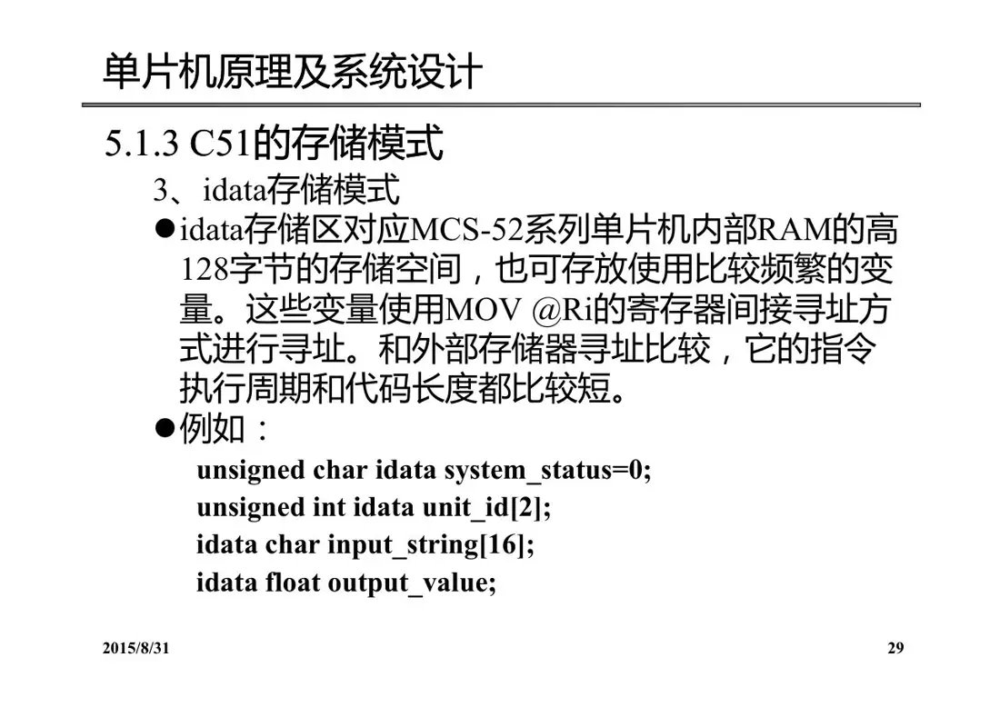

原文：

单片机原理及系统设计

5.1.3 C51的存储模式

3、idata存储模式

idata存储区对应MCS-52系列单片机内部RAM的高128字节的存储空间，也可存放使用比较频繁的变量。这些变量使用MOV @Ri的寄存器间接寻址方式进行寻址。和外部存储器寻址比较，它的指令执行周期和代码长度都比较短。

例如：

unsigned char idata system\_status=0;

unsigned int idata unit\_id[2];

idata char input\_string[16];

idata float output\_value;

2015/8/31

29

### 单片机原理及系统设计

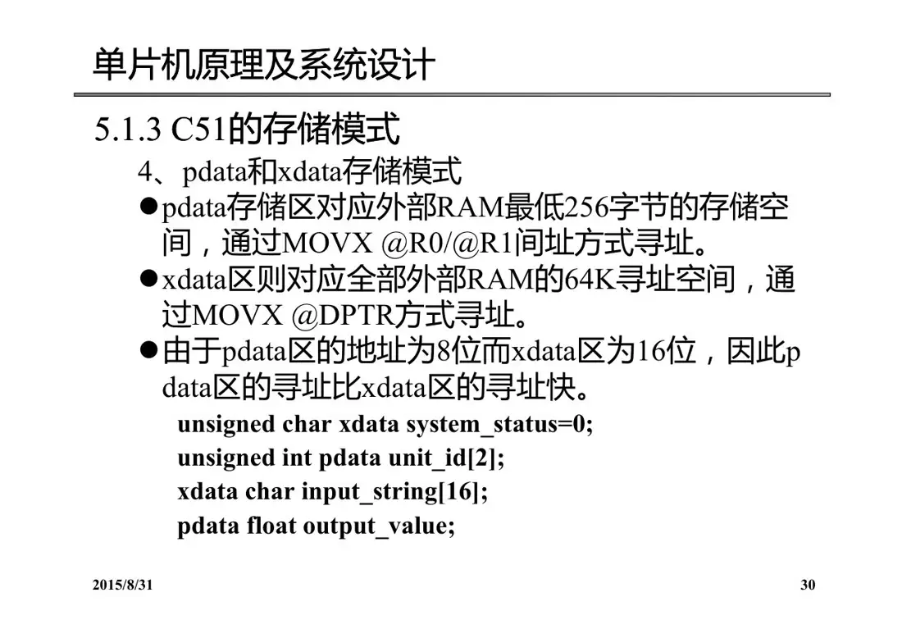

原文：

单片机原理及系统设计

5.1.3 C51的存储模式

4、pdata和xdata存储模式

pdata存储区对应外部RAM最低256字节的存储空间，通过MOVX @R0/@R1间址方式寻址。

xdata区则对应全部外部RAM的64K寻址空间，通过MOVX @DPTR方式寻址。

由于pdata区的地址为8位而xdata区为16位，因此pdata区的寻址比xdata区的寻址快。

unsigned char xdata system\_status=0;

unsigned int pdata unit\_id[2];

xdata char input\_string[16];

pdata float output\_value;

2015/8/31

30

### 单片机原理及系统设计

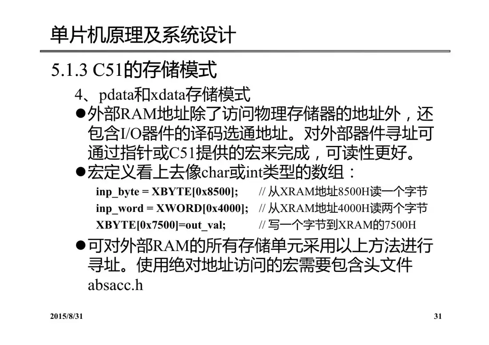

原文：

单片机原理及系统设计

5.1.3 C51的存储模式

4、pdata和xdata存储模式

外部RAM地址除了访问物理存储器的地址外，还包含I/O器件的译码选通地址。对外部器件寻址可通过指针或C51提供的宏来完成，可读性更好。

宏定义看上去像char或int类型的数组：

可对外部RAM的所有存储单元采用以上方法进行寻址。使用绝对地址访问的宏需要包含头文件absacc.h

2015/8/31

31

### 单片机原理及系统设计

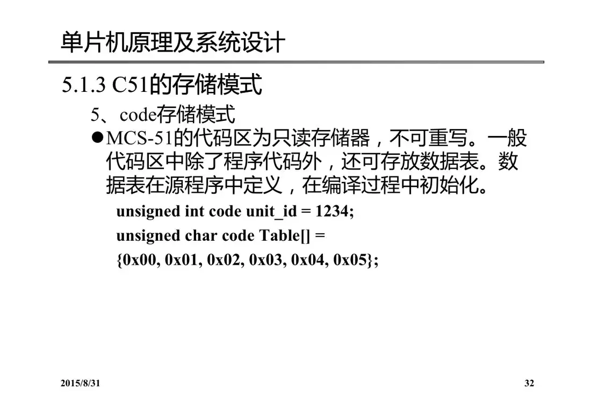

原文：

单片机原理及系统设计

5.1.3 C51的存储模式

5、code存储模式

MCS-51的代码区为只读存储器，不可重写。一般代码区中除了程序代码外，还可存放数据表。数据表在源程序中定义，在编译过程中初始化。

2015/8/31

32

### 单片机原理及系统设计

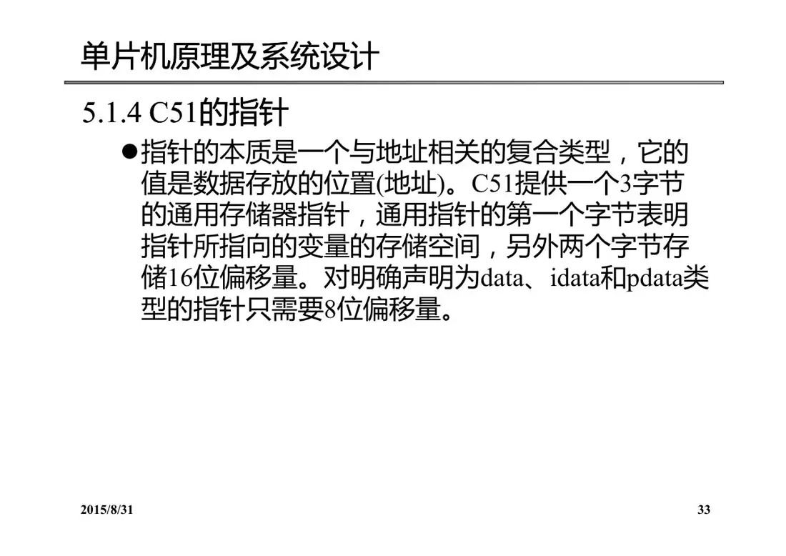

原文：

单片机原理及系统设计

5.1.4 C51的指针

指针的本质是一个与地址相关的复合类型，它的值是数据存放的位置(地址)。C51提供一个3字节的通用存储器指针，通用指针的第一个字节表明指针所指向的变量的存储空间，另外两个字节存储16位偏移量。对明确声明为data、idata和pdata类型的指针只需要8位偏移量。

2015/8/31

33

### 单片机原理及系统设计

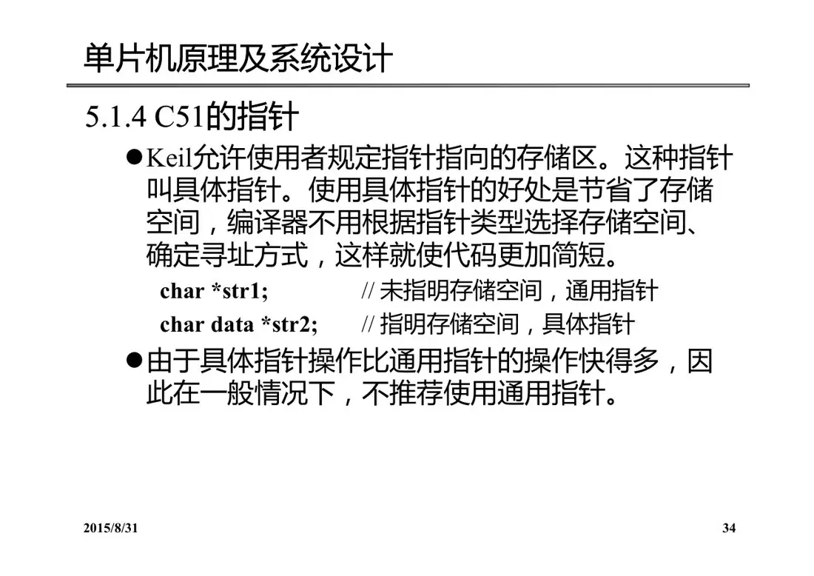

原文：

单片机原理及系统设计

5.1.4 C51的指针

Keil允许使用者规定指针指向的存储区。这种指针叫具体指针。使用具体指针的好处是节省了存储空间，编译器不用根据指针类型选择存储空间、确定寻址方式，这样就使代码更加简短。

char \*str1; // 未指明存储空间，通用指针char data \*str2; // 指明存储空间，具体指针

由于具体指针操作比通用指针的操作快得多，因此在一般情况下，不推荐使用通用指针。

2015/8/31

34

### 单片机原理及系统设计

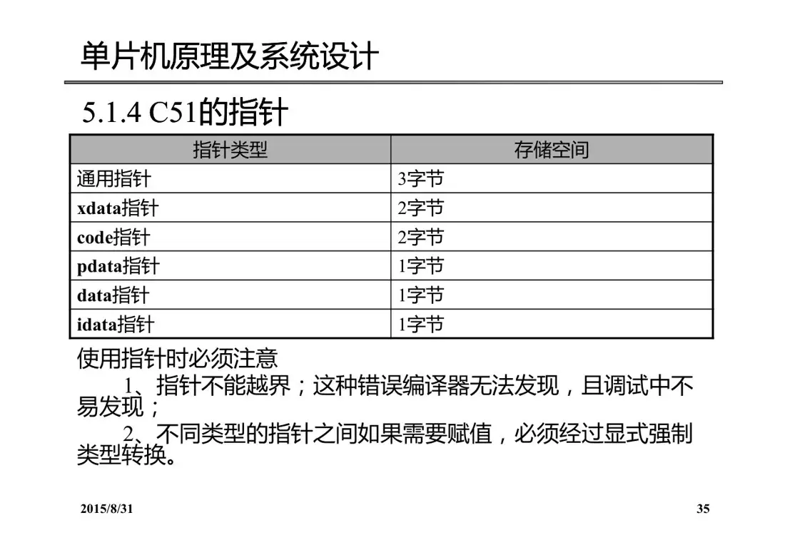

原文：

单片机原理及系统设计

5.1.4 C51的指针

<table><tr><td>指针类型</td><td>存储空间</td></tr><tr><td>通用指针</td><td>3字节</td></tr><tr><td>xdata指针</td><td>2字节</td></tr><tr><td>code指针</td><td>2字节</td></tr><tr><td>pdata指针</td><td>1字节</td></tr><tr><td>data指针</td><td>1字节</td></tr><tr><td>idata指针</td><td>1字节</td></tr></table>
使用指针时必须注意

1、指针不能越界；这种错误编译器无法发现，且调试中不易发现；

2、不同类型的指针之间如果需要赋值，必须经过显式强制类型转换。

2015/8/31

35

### 单片机原理及系统设计

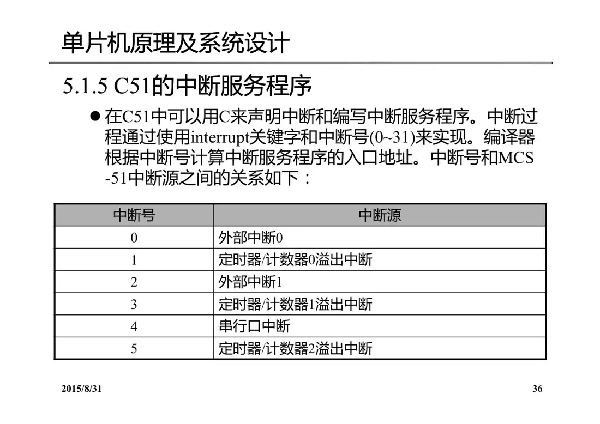

原文：

单片机原理及系统设计

5.1.5 C51的中断服务程序

在C51中可以用C来声明中断和编写中断服务程序。中断过程通过使用interrupt关键字和中断号(0\~31)来实现。编译器根据中断号计算中断服务程序的入口地址。中断号和MCS-51中断源之间的关系如下：

<table><tr><td>中断号</td><td>中断源</td></tr><tr><td>0</td><td>外部中断0</td></tr><tr><td>1</td><td>定时器/计数器0溢出中断</td></tr><tr><td>2</td><td>外部中断1</td></tr><tr><td>3</td><td>定时器/计数器1溢出中断</td></tr><tr><td>4</td><td>串行口中断</td></tr><tr><td>5</td><td>定时器/计数器2溢出中断</td></tr></table>

2015/8/31

36

### 单片机原理及系统设计

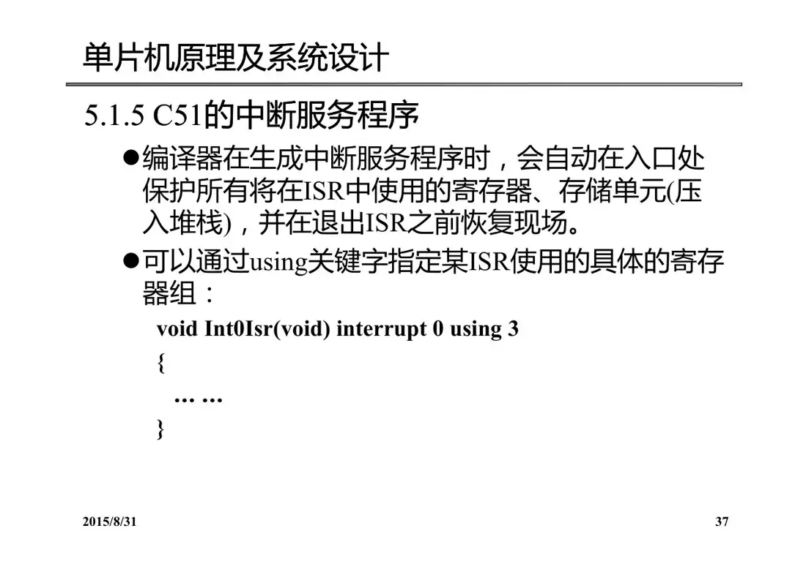

原文：

单片机原理及系统设计

5.1.5 C51的中断服务程序

编译器在生成中断服务程序时，会自动在入口处保护所有将在ISR中使用的寄存器、存储单元(压入堆栈)，并在退出ISR之前恢复现场。

可以通过using关键字指定某ISR使用的具体的寄存器组：

2015/8/31

37

### 单片机原理及系统设计

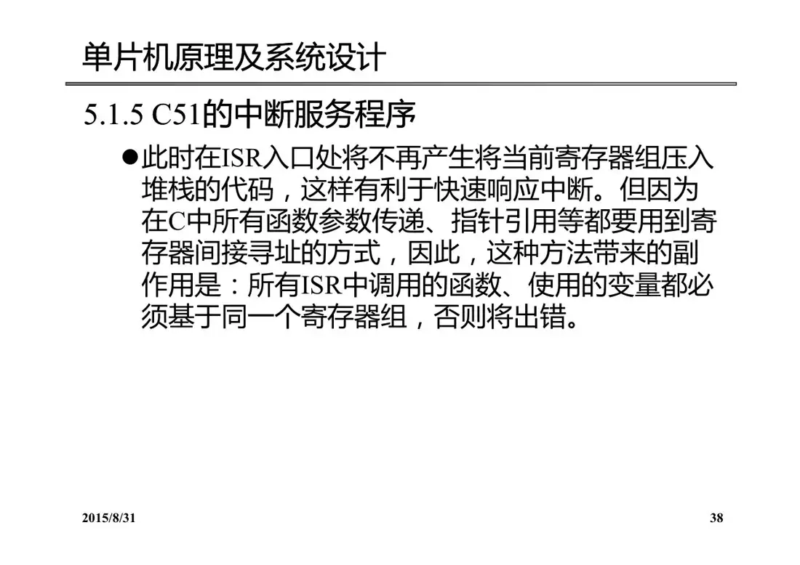

原文：

单片机原理及系统设计

5.1.5 C51的中断服务程序

此时在ISR入口处将不再产生将当前寄存器组压入堆栈的代码，这样有利于快速响应中断。但因为在C中所有函数参数传递、指针引用等都要用到寄存器间接寻址的方式，因此，这种方法带来的副作用是：所有ISR中调用的函数、使用的变量都必须基于同一个寄存器组，否则将出错。

2015/8/31

38

### 单片机原理及系统设计

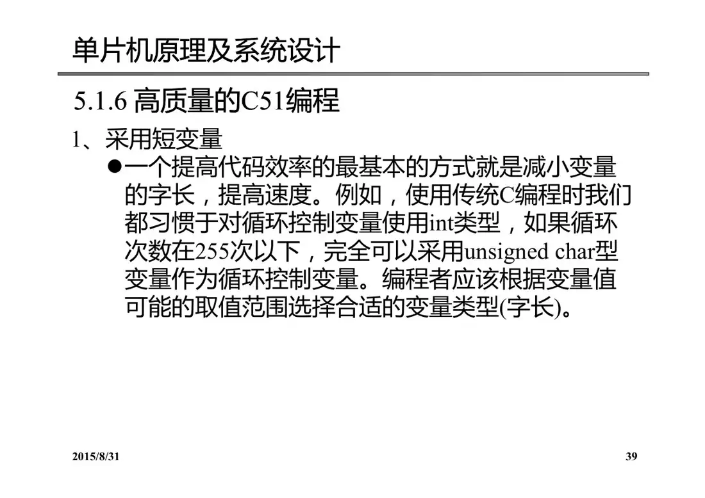

原文：

单片机原理及系统设计

5.1.6 高质量的C51编程

1、采用短变量

一个提高代码效率的最基本的方式就是减小变量的字长，提高速度。例如，使用传统C编程时我们都习惯于对循环控制变量使用int类型，如果循环次数在255次以下，完全可以采用unsigned char型变量作为循环控制变量。编程者应该根据变量值可能的取值范围选择合适的变量类型(字长)。

2015/8/31

39

### 单片机原理及系统设计

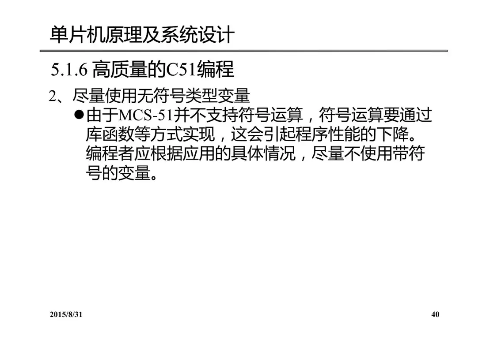

原文：

单片机原理及系统设计

5.1.6 高质量的C51编程

2、尽量使用无符号类型变量

由于MCS-51并不支持符号运算，符号运算要通过库函数等方式实现，这会引起程序性能的下降。编程者应根据应用的具体情况，尽量不使用带符号的变量。

2015/8/31

40

### 单片机原理及系统设计

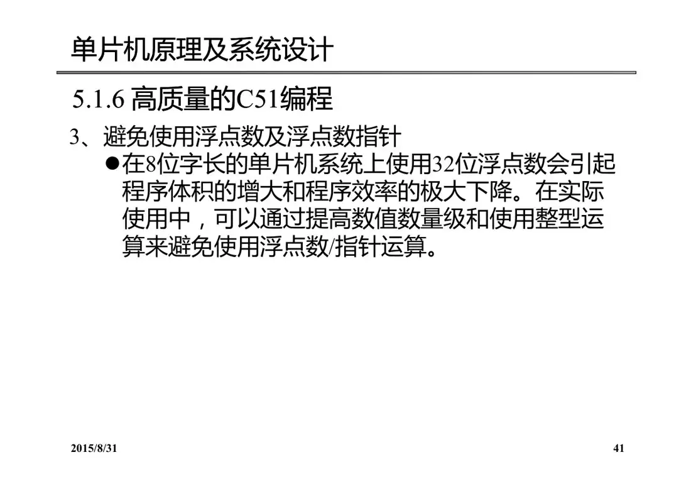

原文：

单片机原理及系统设计

5.1.6 高质量的C51编程

3、避免使用浮点数及浮点数指针

在8位字长的单片机系统上使用32位浮点数会引起程序体积的增大和程序效率的极大下降。在实际使用中，可以通过提高数值数量级和使用整型运算来避免使用浮点数/指针运算。

2015/8/31

41

### 单片机原理及系统设计

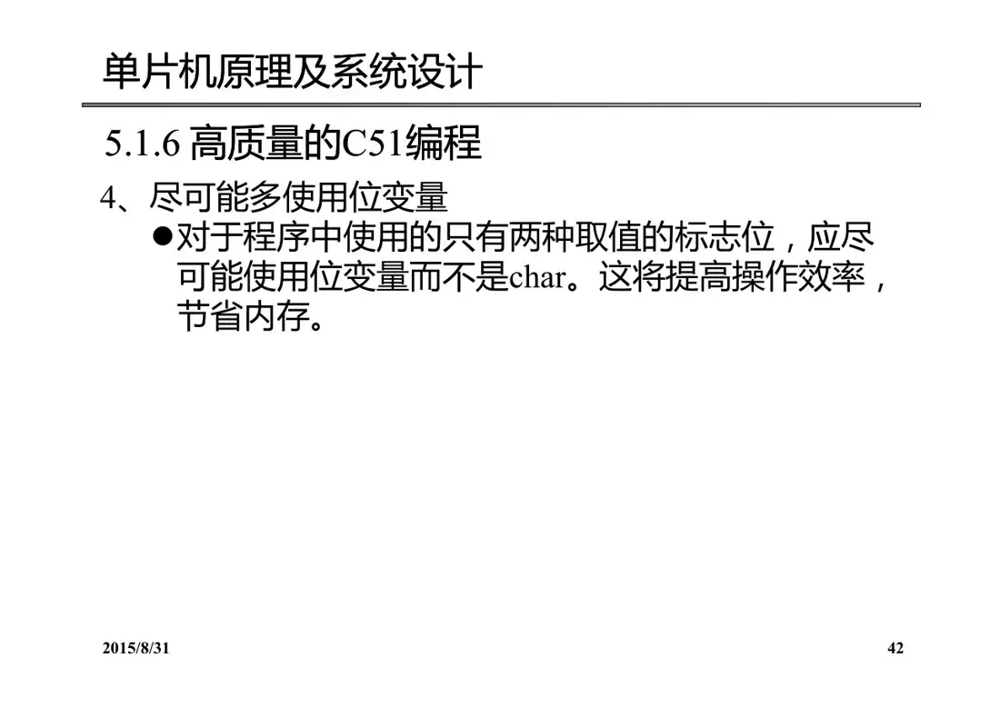

原文：

单片机原理及系统设计

5.1.6 高质量的C51编程

4、尽可能多使用位变量

对于程序中使用的只有两种取值的标志位，应尽可能使用位变量而不是char。这将提高操作效率，节省内存。

2015/8/31

42

### 单片机原理及系统设计

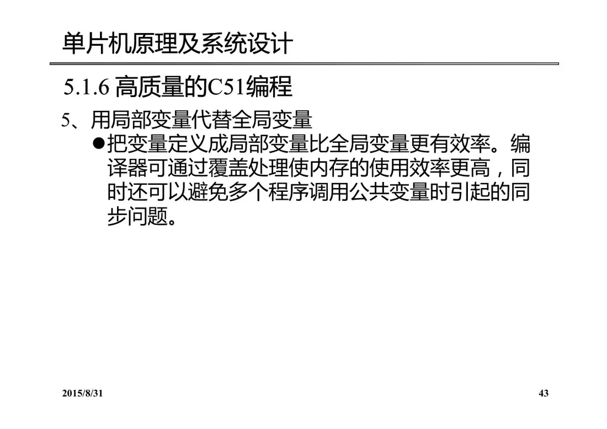

原文：

单片机原理及系统设计

5.1.6 高质量的C51编程

5、用局部变量代替全局变量

把变量定义成局部变量比全局变量更有效率。编译器可通过覆盖处理使内存的使用效率更高，同时还可以避免多个程序调用公共变量时引起的同步问题。

2015/8/31

43

### 单片机原理及系统设计

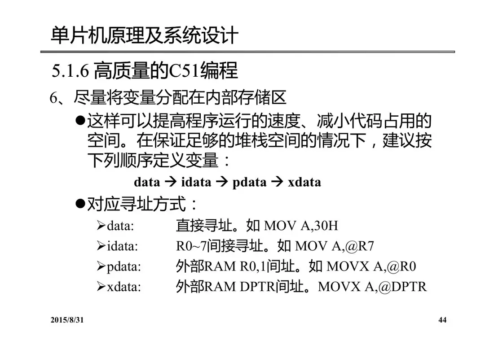

原文：

单片机原理及系统设计

5.1.6 高质量的C51编程

6、尽量将变量分配在内部存储区

这样可以提高程序运行的速度、减小代码占用的空间。在保证足够的堆栈空间的情况下，建议按下列顺序定义变量：

$$
\mathrm{data} \rightarrow \mathrm{idata} \rightarrow \mathrm{pdata} \rightarrow \mathrm{xdata}
$$

对应寻址方式：

data: 直接寻址。如 MOV A,30H

idata: R0\~7间接寻址。如 MOV A,@R7

pdata: 外部RAM R0,1间址。如 MOVX A,@R0

xdata: 外部RAM DPTR间址。MOVX A,@DPTR

2015/8/31

44

### 单片机原理及系统设计

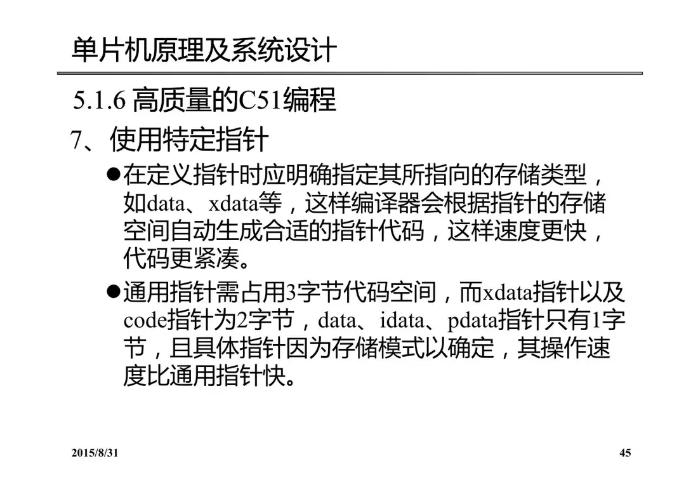

原文：

单片机原理及系统设计

5.1.6 高质量的C51编程

7、使用特定指针

在定义指针时应明确指定其所指向的存储类型，如data、xdata等，这样编译器会根据指针的存储空间自动生成合适的指针代码，这样速度更快，代码更紧凑。

通用指针需占用3字节代码空间，而xdata指针以及code指针为2字节，data、idata、pdata指针只有1字节，且具体指针因为存储模式以确定，其操作速度比通用指针快。

2015/8/31

45

### 单片机原理及系统设计

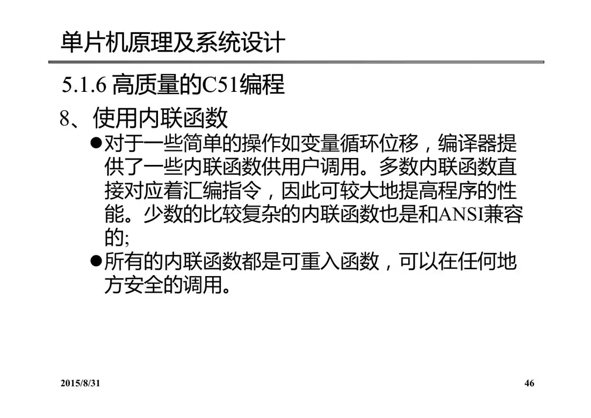

原文：

单片机原理及系统设计

5.1.6 高质量的C51编程

8、使用内联函数

对于一些简单的操作如变量循环位移，编译器提供了一些内联函数供用户调用。多数内联函数直接对应着汇编指令，因此可较大地提高程序的性能。少数的比较复杂的内联函数也是和ANSI兼容的;

所有的内联函数都是可重入函数，可以在任何地方安全的调用。

2015/8/31

46

### 单片机原理及系统设计

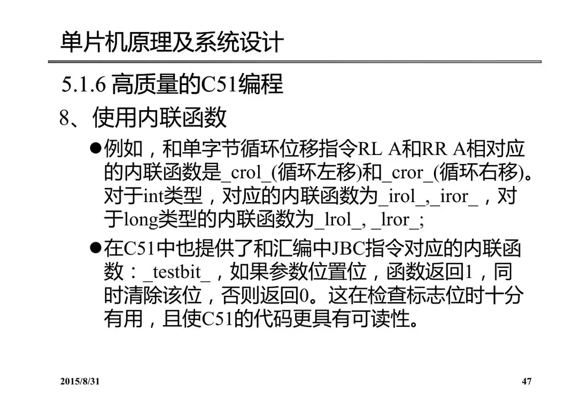

原文：

单片机原理及系统设计

5.1.6 高质量的C51编程

8、使用内联函数

例如，和单字节循环位移指令RL A和RR A相对应的内联函数是\_crol\_(循环左移)和\_cror\_(循环右移)。对于int类型，对应的内联函数为\_irol\_,\_iror\_，对于long类型的内联函数为\_lrol\_, \_lror\_;

在C51中也提供了和汇编中JBC指令对应的内联函数：\_testbit\_，如果参数位置位，函数返回1，同时清除该位，否则返回0。这在检查标志位时十分有用，且使C51的代码更具有可读性。

2015/8/31

47

### 单片机原理及系统设计

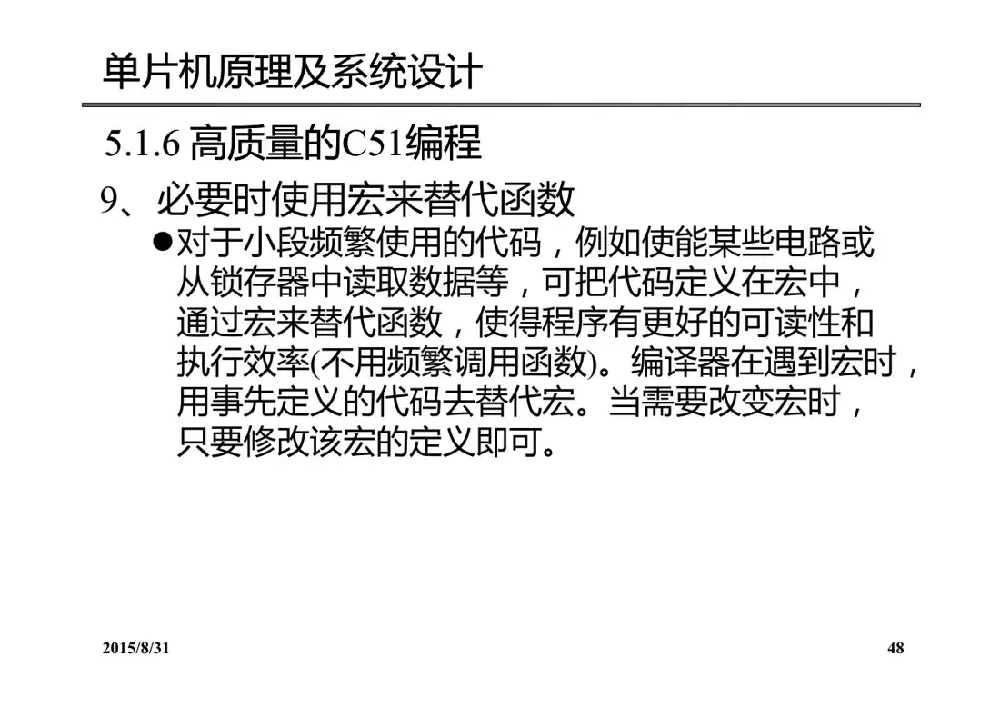

原文：

单片机原理及系统设计

5.1.6 高质量的C51编程

9、必要时使用宏来替代函数

对于小段频繁使用的代码，例如使能某些电路或从锁存器中读取数据等，可把代码定义在宏中，通过宏来替代函数，使得程序有更好的可读性和执行效率(不用频繁调用函数)。编译器在遇到宏时，用事先定义的代码去替代宏。当需要改变宏时，只要修改该宏的定义即可。

2015/8/31

48

### 单片机原理及系统设计

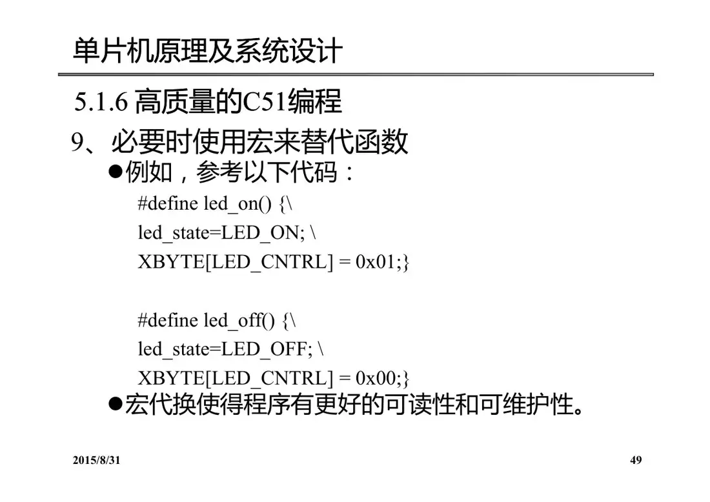

原文：

单片机原理及系统设计

2015/8/31

49

### 单片机原理及系统设计

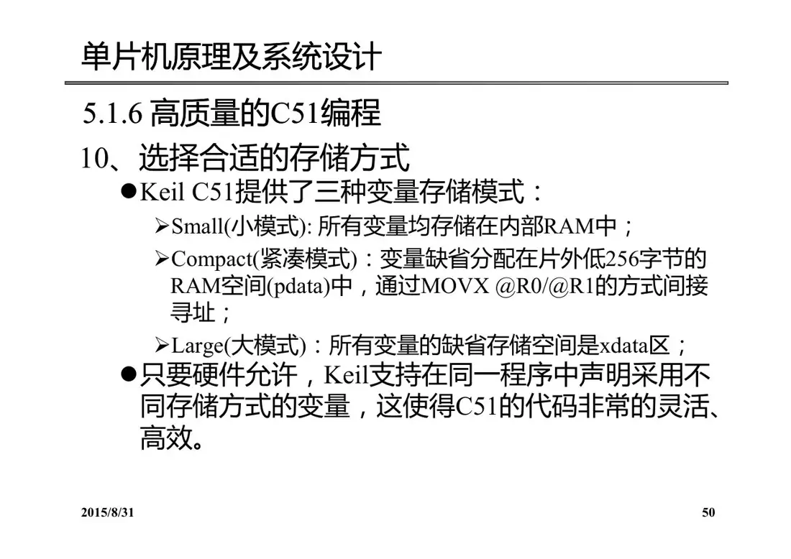

原文：

单片机原理及系统设计

5.1.6 高质量的C51编程

10、选择合适的存储方式

Keil C51提供了三种变量存储模式：

Small(小模式):所有变量均存储在内部RAM中；

Compact(紧凑模式)：变量缺省分配在片外低256字节的RAM空间(pdata)中，通过MOVX @R0/@R1的方式间接寻址；

Large(大模式)：所有变量的缺省存储空间是xdata区；

只要硬件允许，Keil支持在同一程序中声明采用不同存储方式的变量，这使得C51的代码非常的灵活、高效。

2015/8/31

50
