# 《单片机原理及系统设计》第7章 单片机串行通信接口（课件）

原件的每一页，下面附识别出的文字。

### 第七章 单片机串行通信接口

原文：

第七章 单片机串行通信接口

7.1 Hello,world!

2015/8/31

1

### 单片机原理及系统设计

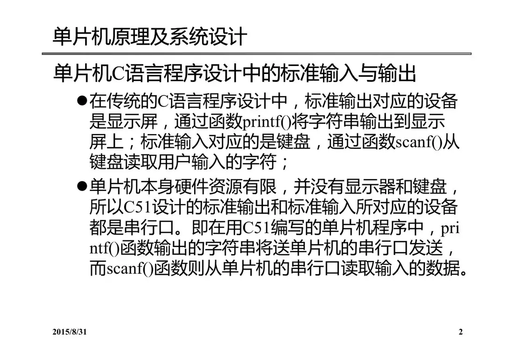

原文：

单片机原理及系统设计

单片机C语言程序设计中的标准输入与输出

在传统的C语言程序设计中，标准输出对应的设备是显示屏，通过函数printf()将字符串输出到显示屏上；标准输入对应的是键盘，通过函数scanf()从键盘读取用户输入的字符；

单片机本身硬件资源有限，并没有显示器和键盘，所以C51设计的标准输出和标准输入所对应的设备都是串行口。即在用C51编写的单片机程序中，printf()函数输出的字符串将送单片机的串行口发送，而scanf()函数则从单片机的串行口读取输入的数据。

2015/8/31

2

### 单片机原理及系统设计

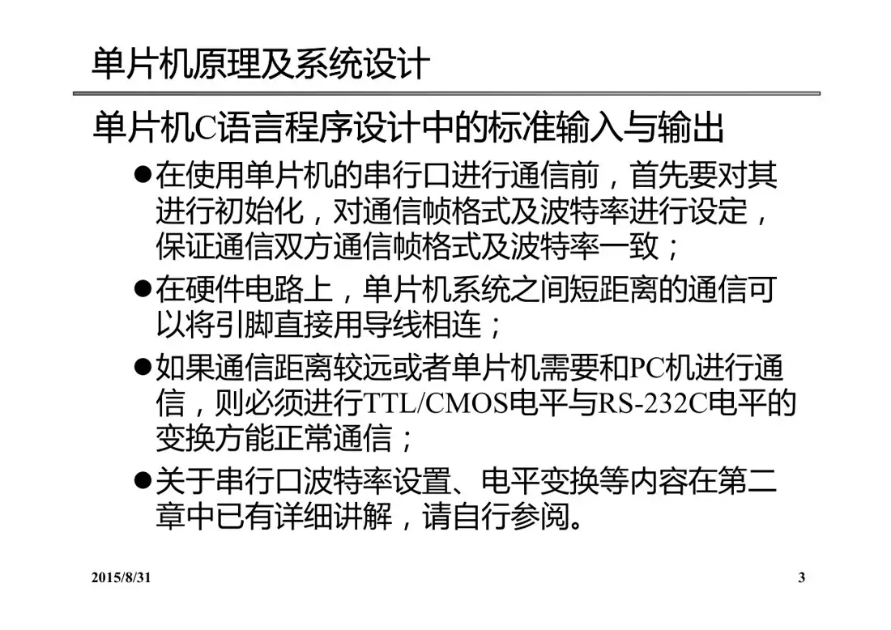

原文：

单片机原理及系统设计

单片机C语言程序设计中的标准输入与输出

在使用单片机的串行口进行通信前，首先要对其进行初始化，对通信帧格式及波特率进行设定，保证通信双方通信帧格式及波特率一致；

在硬件电路上，单片机系统之间短距离的通信可以将引脚直接用导线相连；

如果通信距离较远或者单片机需要和PC机进行通信，则必须进行TTL/CMOS电平与RS-232C电平的变换方能正常通信；

关于串行口波特率设置、电平变换等内容在第二章中已有详细讲解，请自行参阅。

2015/8/31

3

### 单片机原理及系统设计

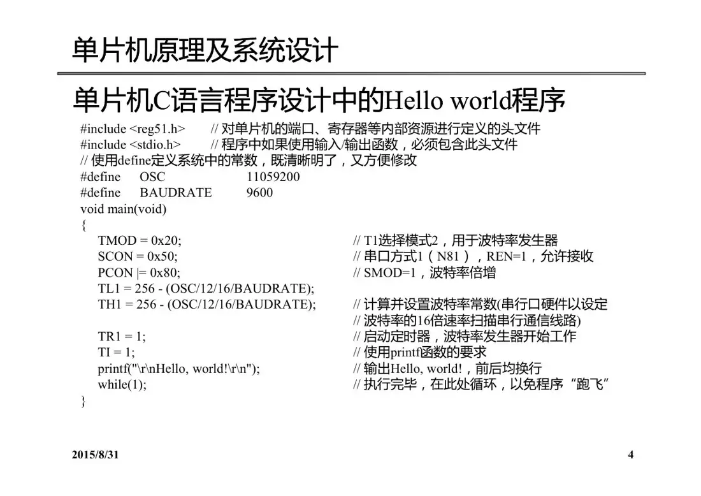

原文：

单片机原理及系统设计

单片机C语言程序设计中的Hello world程序

2015/8/31

4

### 单片机原理及系统设计

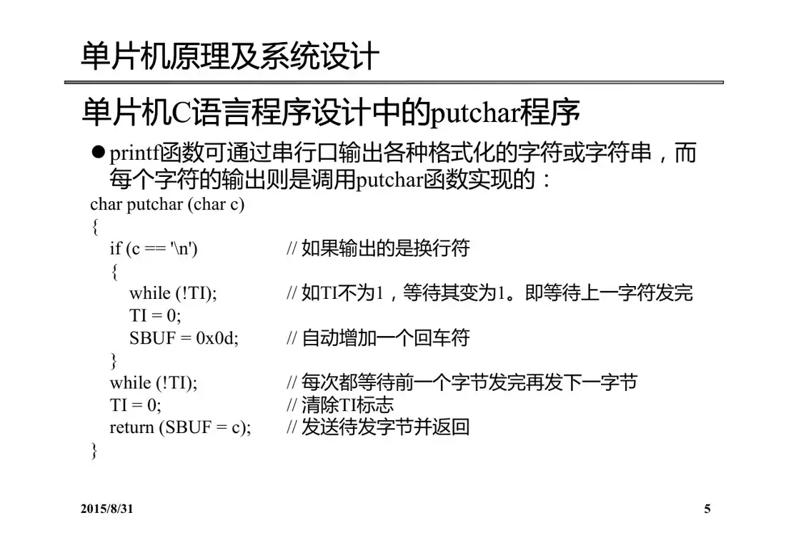

原文：

单片机原理及系统设计

单片机C语言程序设计中的putchar程序

printf函数可通过串行口输出各种格式化的字符或字符串，而每个字符的输出则是调用putchar函数实现的：

2015/8/31

5

### 单片机原理及系统设计

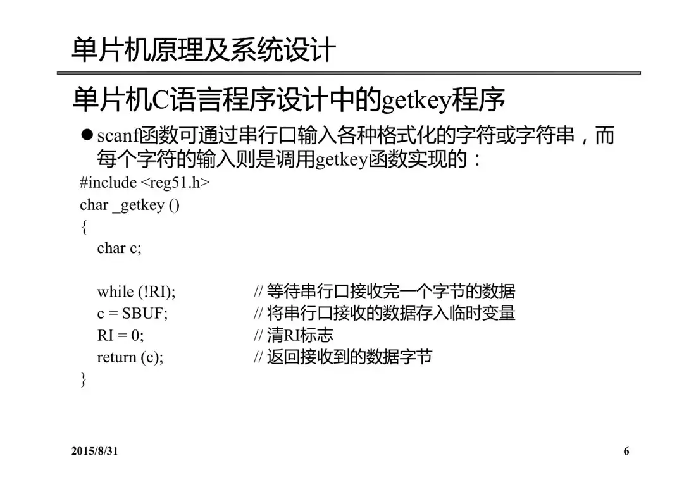

原文：

单片机原理及系统设计

单片机C语言程序设计中的getkey程序

scanf函数可通过串行口输入各种格式化的字符或字符串，而每个字符的输入则是调用getkey函数实现的：

2015/8/31

6

### 单片机原理及系统设计

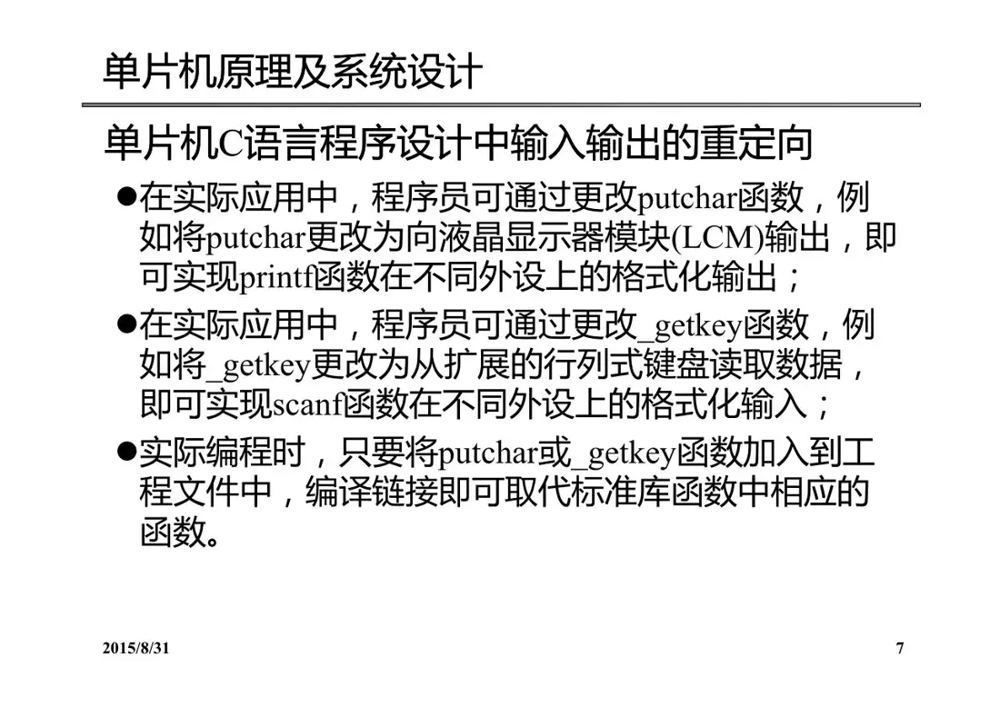

原文：

单片机原理及系统设计

单片机C语言程序设计中输入输出的重定向

在实际应用中，程序员可通过更改putchar函数，例如将putchar更改为向液晶显示器模块(LCM)输出，即可实现printf函数在不同外设上的格式化输出；

在实际应用中，程序员可通过更改\_getkey函数，例如将\_getkey更改为从扩展的行列式键盘读取数据，即可实现scanf函数在不同外设上的格式化输入；

实际编程时，只要将putchar或\_getkey函数加入到工程文件中，编译链接即可取代标准库函数中相应的函数。

2015/8/31

7

### 第七章 单片机串行通信接口

原文：

第七章 单片机串行通信接口

7.2单片机串行口查询方式通信

2015/8/31

8

### 单片机原理及系统设计

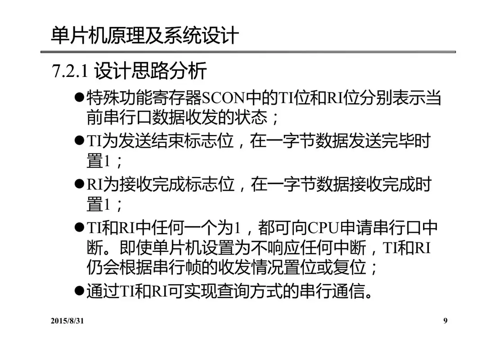

原文：

单片机原理及系统设计

7.2.1 设计思路分析

特殊功能寄存器SCON中的TI位和RI位分别表示当前串行口数据收发的状态；

TI为发送结束标志位，在一字节数据发送完毕时置1；

RI为接收完成标志位，在一字节数据接收完成时置1；

TI和RI中任何一个为1，都可向CPU申请串行口中断。即使单片机设置为不响应任何中断，TI和RI仍会根据串行帧的收发情况置位或复位；

通过TI和RI可实现查询方式的串行通信。

2015/8/31

9

### 单片机原理及系统设计

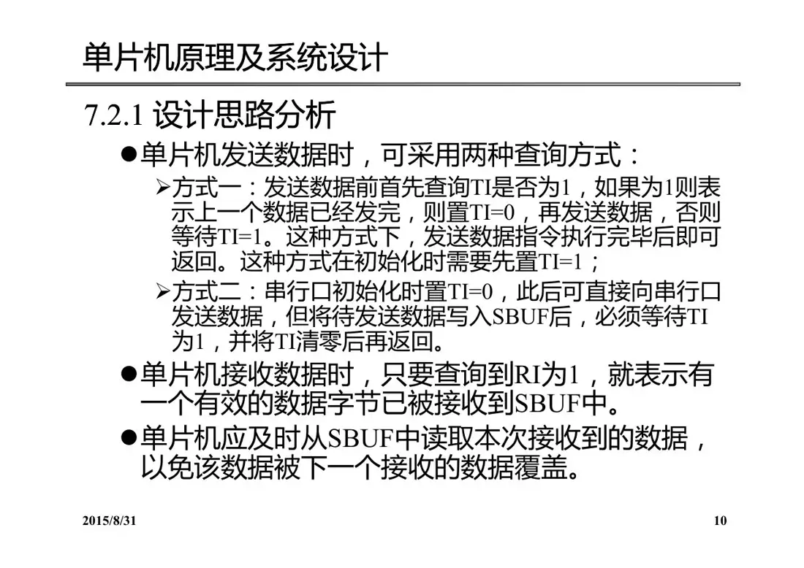

原文：

单片机原理及系统设计

7.2.1 设计思路分析

单片机发送数据时，可采用两种查询方式：

方式一：发送数据前首先查询TI是否为1，如果为1则表示上一个数据已经发完，则置TI=0，再发送数据，否则等待TI=1。这种方式下，发送数据指令执行完毕后即可返回。这种方式在初始化时需要先置TI=1；

方式二：串行口初始化时置TI=0，此后可直接向串行口发送数据，但将待发送数据写入SBUF后，必须等待TI为1，并将TI清零后再返回。

单片机接收数据时，只要查询到RI为1，就表示有一个有效的数据字节已被接收到SBUF中。

单片机应及时从SBUF中读取本次接收到的数据，以免该数据被下一个接收的数据覆盖。

2015/8/31

10

### 单片机原理及系统设计

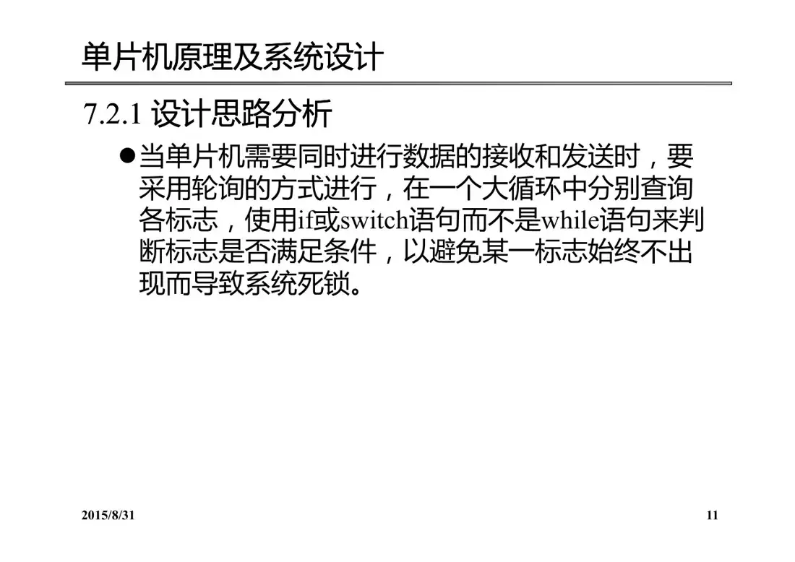

原文：

单片机原理及系统设计

7.2.1 设计思路分析

当单片机需要同时进行数据的接收和发送时，要采用轮询的方式进行，在一个大循环中分别查询各标志，使用if或switch语句而不是while语句来判断标志是否满足条件，以避免某一标志始终不出现而导致系统死锁。

2015/8/31

11

### 单片机原理及系统设计

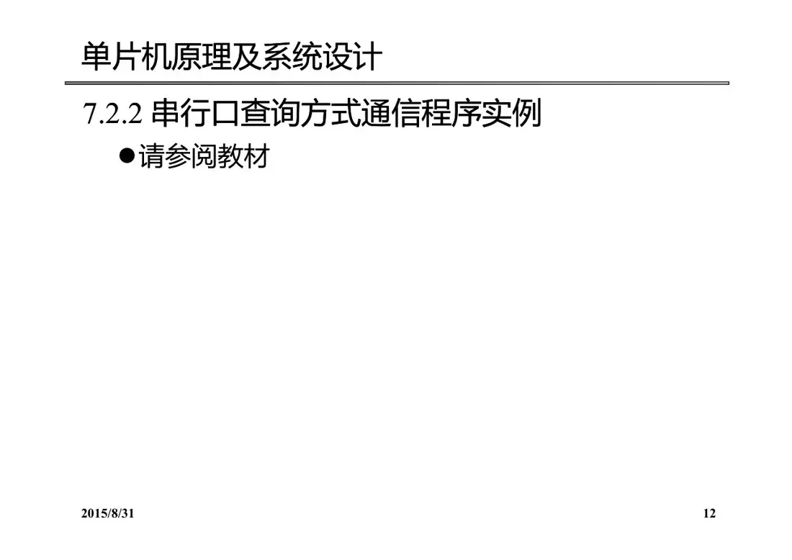

原文：

单片机原理及系统设计

7.2.2 串行口查询方式通信程序实例

请参阅教材

2015/8/31

12

### 第七章 单片机串行通信接口

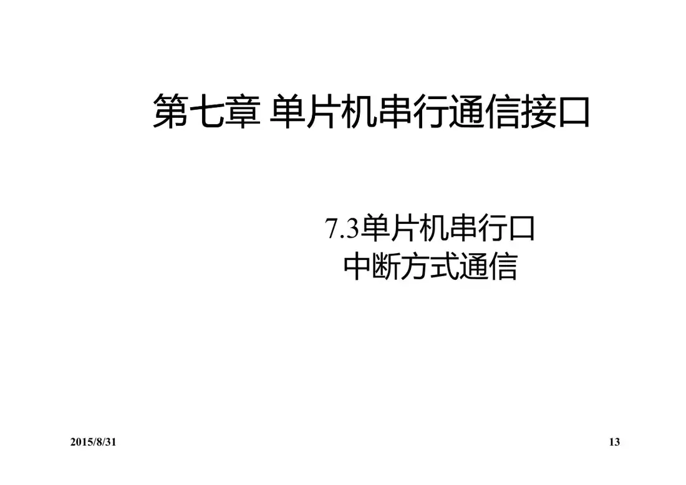

原文：

第七章 单片机串行通信接口

7.3单片机串行口中断方式通信

2015/8/31

13

### 单片机原理及系统设计

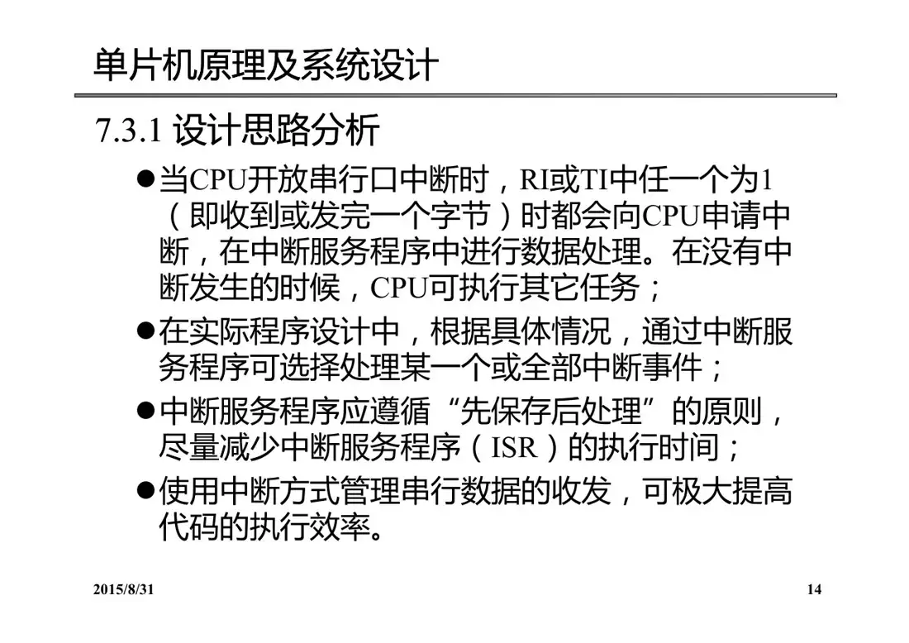

原文：

单片机原理及系统设计

7.3.1 设计思路分析

当CPU开放串行口中断时，RI或TI中任一个为1（即收到或发完一个字节）时都会向CPU申请中断，在中断服务程序中进行数据处理。在没有中断发生的时候，CPU可执行其它任务；

在实际程序设计中，根据具体情况，通过中断服务程序可选择处理某一个或全部中断事件；

中断服务程序应遵循“先保存后处理”的原则，尽量减少中断服务程序（ISR）的执行时间；

使用中断方式管理串行数据的收发，可极大提高代码的执行效率。

2015/8/31

14

### 单片机原理及系统设计

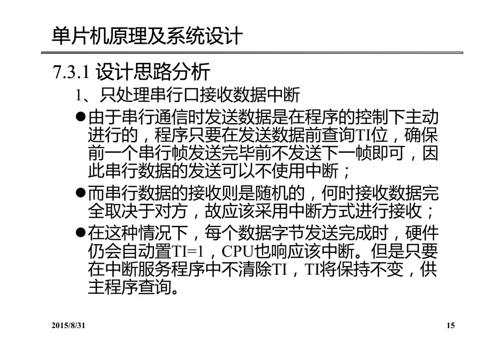

原文：

单片机原理及系统设计

7.3.1 设计思路分析

1、只处理串行口接收数据中断

由于串行通信时发送数据是在程序的控制下主动进行的，程序只要在发送数据前查询TI位，确保前一个串行帧发送完毕前不发送下一帧即可，因此串行数据的发送可以不使用中断；

而串行数据的接收则是随机的，何时接收数据完全取决于对方，故应该采用中断方式进行接收；

在这种情况下，每个数据字节发送完成时，硬件仍会自动置TI=1，CPU也响应该中断。但是只要在中断服务程序中不清除TI，TI将保持不变，供主程序查询。

2015/8/31

15

### 单片机原理及系统设计

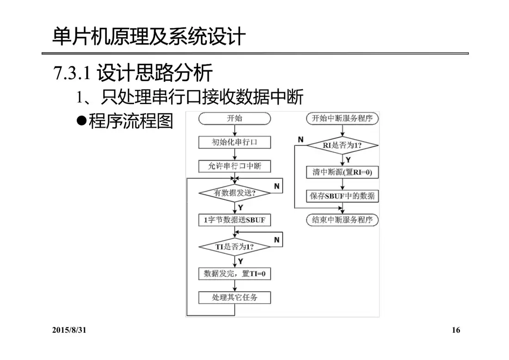

原文：

单片机原理及系统设计

7.3.1 设计思路分析

1、只处理串行口接收数据中断

程序流程图

2015/8/31

16

### 单片机原理及系统设计

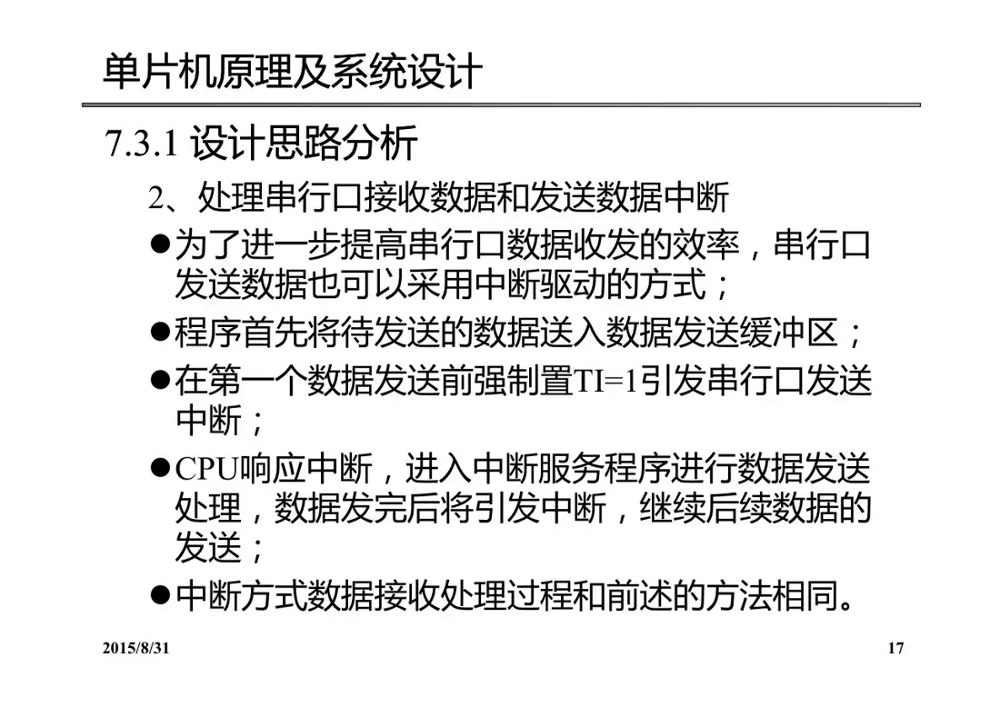

原文：

单片机原理及系统设计

7.3.1 设计思路分析

2、处理串行口接收数据和发送数据中断

为了进一步提高串行口数据收发的效率，串行口发送数据也可以采用中断驱动的方式；

程序首先将待发送的数据送入数据发送缓冲区；

在第一个数据发送前强制置TI=1引发串行口发送中断；

CPU响应中断，进入中断服务程序进行数据发送处理，数据发完后将引发中断，继续后续数据的发送；

中断方式数据接收处理过程和前述的方法相同。

2015/8/31

17

### 单片机原理及系统设计

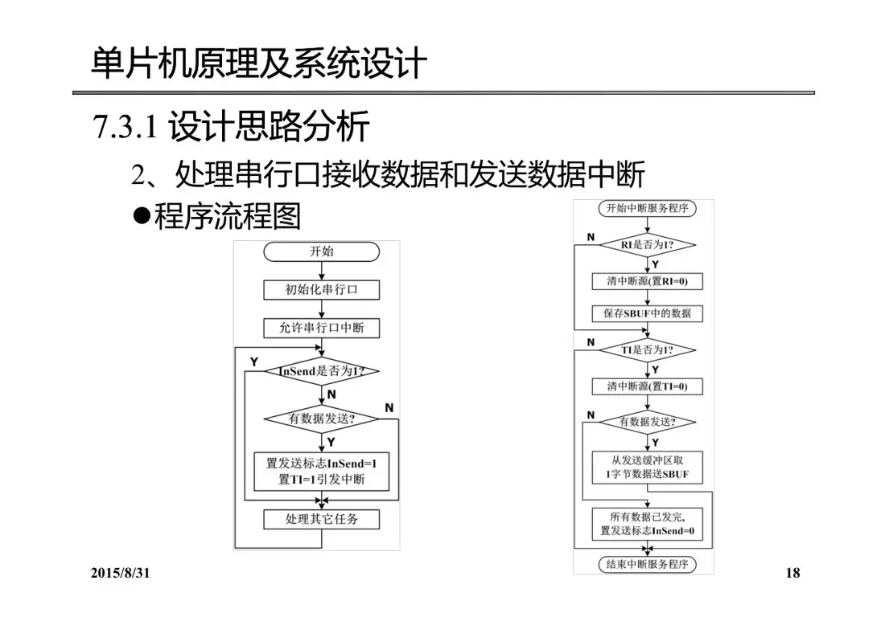

原文：

单片机原理及系统设计

7.3.1 设计思路分析

2、处理串行口接收数据和发送数据中断

程序流程图

2015/8/31

18

### 单片机原理及系统设计

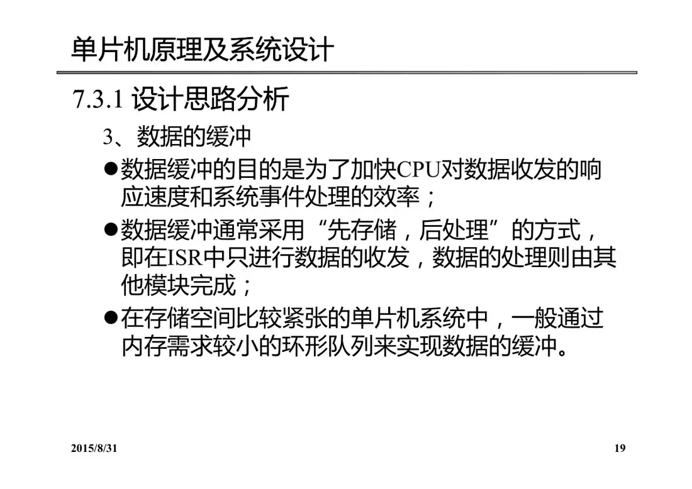

原文：

单片机原理及系统设计

7.3.1 设计思路分析

3、数据的缓冲

数据缓冲的目的是为了加快CPU对数据收发的响应速度和系统事件处理的效率；

数据缓冲通常采用“先存储，后处理”的方式，即在ISR中只进行数据的收发，数据的处理则由其他模块完成；

在存储空间比较紧张的单片机系统中，一般通过内存需求较小的环形队列来实现数据的缓冲。

2015/8/31

19

### 单片机原理及系统设计

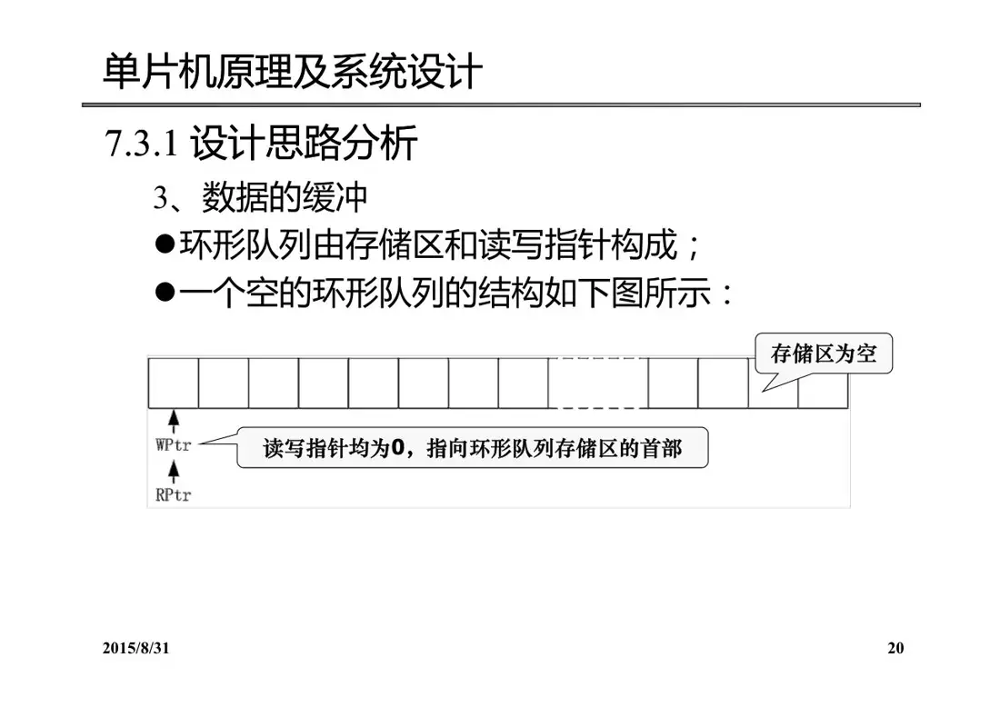

原文：

单片机原理及系统设计

7.3.1 设计思路分析

3、数据的缓冲

环形队列由存储区和读写指针构成；

一个空的环形队列的结构如下图所示：

2015/8/31

20

### 单片机原理及系统设计

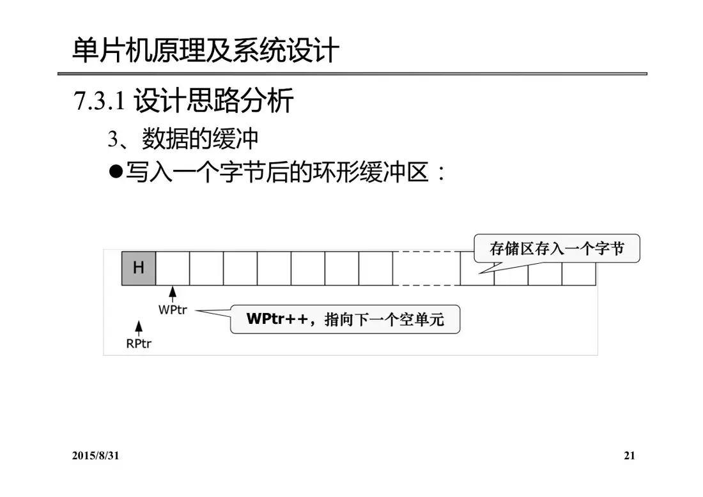

原文：

单片机原理及系统设计

7.3.1 设计思路分析

3、数据的缓冲

写入一个字节后的环形缓冲区：

2015/8/31

21

### 单片机原理及系统设计

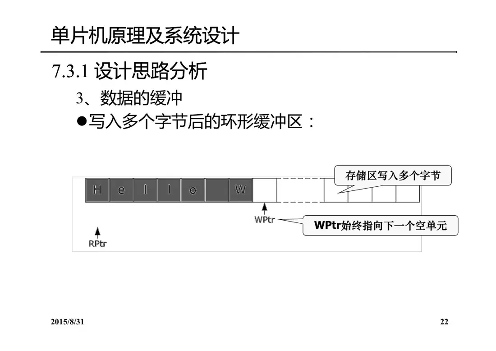

原文：

单片机原理及系统设计

7.3.1 设计思路分析

3、数据的缓冲

写入多个字节后的环形缓冲区：

2015/8/31

22

### 单片机原理及系统设计

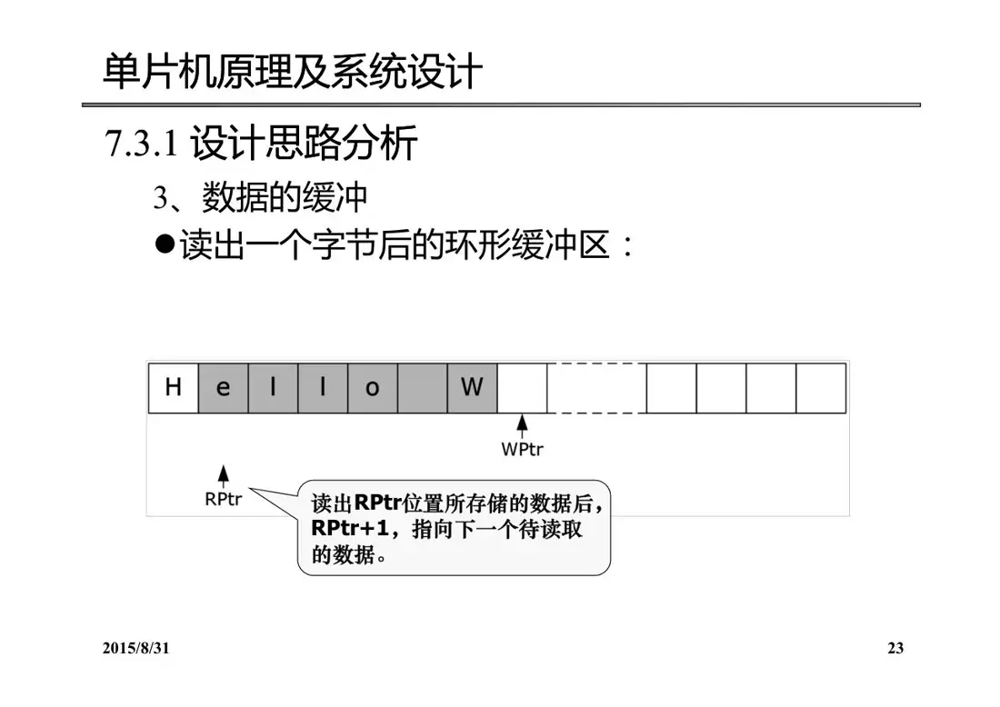

原文：

单片机原理及系统设计

7.3.1 设计思路分析

3、数据的缓冲

读出一个字节后的环形缓冲区：

读出RPtr位置所存储的数据后，RPtr+1，指向下一个待读取的数据。

2015/8/31

23

### 单片机原理及系统设计

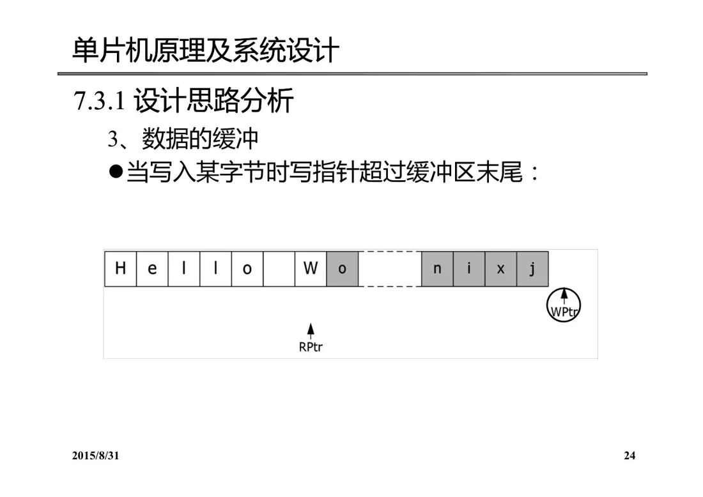

原文：

单片机原理及系统设计

7.3.1 设计思路分析

3、数据的缓冲

当写入某字节时写指针超过缓冲区末尾：

<table><tr><td>H</td><td>e</td><td>I</td><td>I</td><td>o</td><td></td><td>W</td><td>o</td><td></td><td>n</td><td>i</td><td>x</td><td>j</td></tr><tr><td colspan="13">RPtr</td></tr></table>

2015/8/31

24

### 单片机原理及系统设计

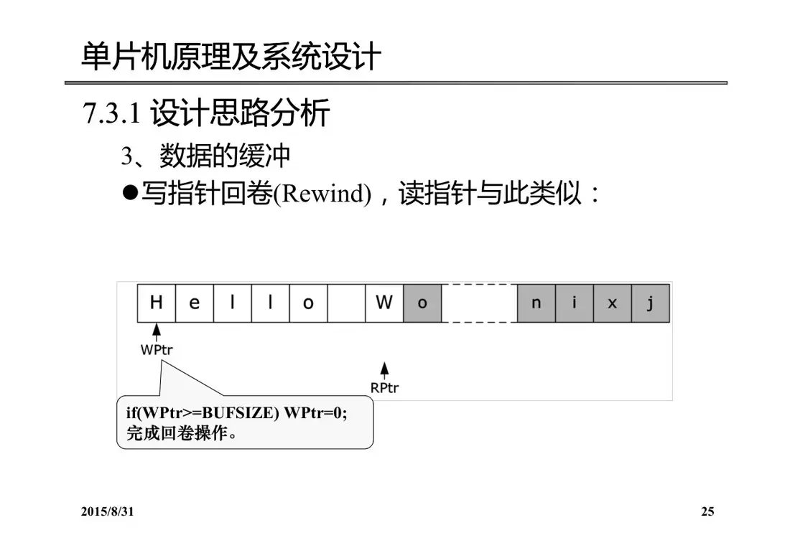

原文：

单片机原理及系统设计

7.3.1 设计思路分析

3、数据的缓冲

写指针回卷(Rewind)，读指针与此类似：

<table><tr><td>H</td><td>e</td><td>l</td><td>l</td><td>o</td><td></td><td>W</td><td>o</td><td></td><td>n</td><td>i</td><td>x</td><td>j</td></tr><tr><td colspan="13">WPtr</td></tr><tr><td colspan="13">if(WPtr&gt;=BUFSIZE) WPtr=0;完成回卷操作。</td></tr></table>

2015/8/31

25

### 单片机原理及系统设计

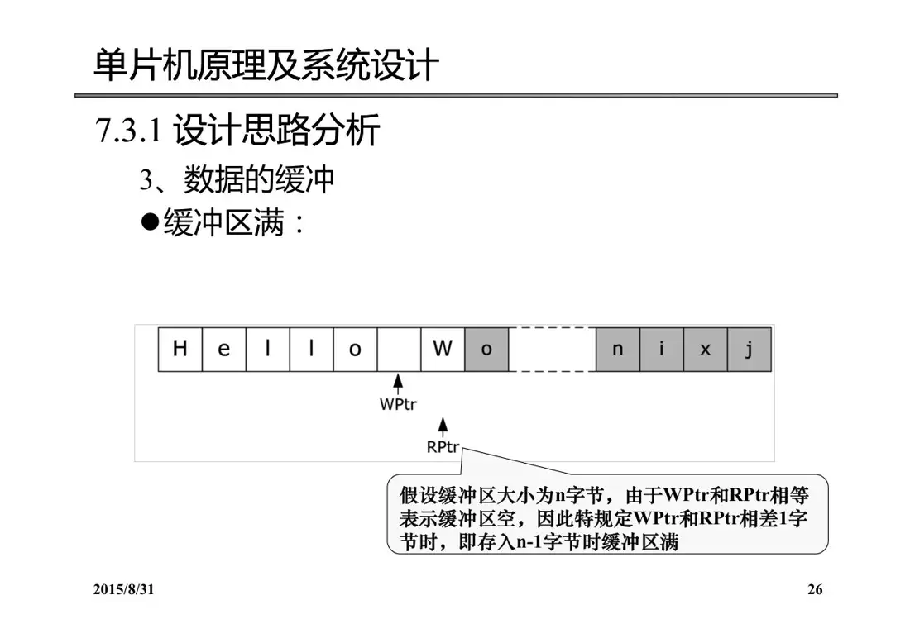

原文：

单片机原理及系统设计

7.3.1 设计思路分析

3、数据的缓冲

缓冲区满：

2015/8/31

26

### 单片机原理及系统设计

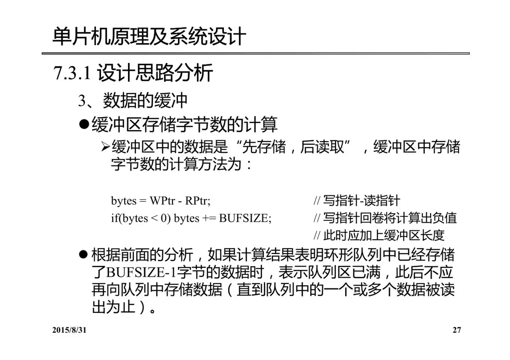

原文：

单片机原理及系统设计

7.3.1 设计思路分析

3、数据的缓冲

缓冲区存储字节数的计算

缓冲区中的数据是“先存储，后读取”，缓冲区中存储字节数的计算方法为：

根据前面的分析，如果计算结果表明环形队列中已经存储了BUFSIZE-1字节的数据时，表示队列区已满，此后不应再向队列中存储数据（直到队列中的一个或多个数据被读出为止）。

2015/8/31

27

### 单片机原理及系统设计

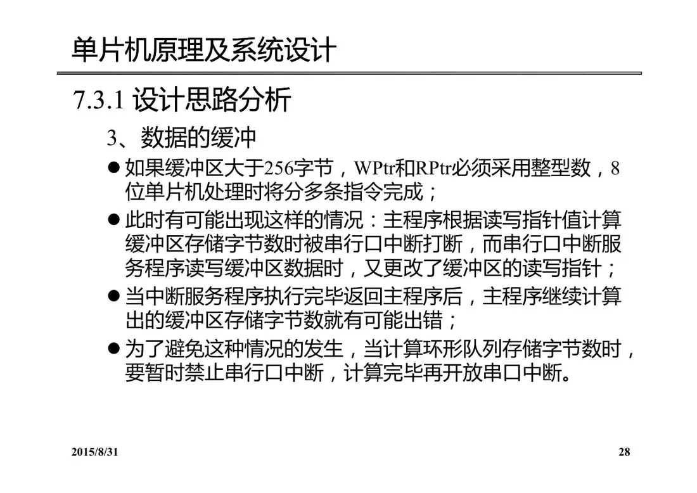

原文：

单片机原理及系统设计

7.3.1 设计思路分析

3、数据的缓冲

如果缓冲区大于256字节，WPtr和RPtr必须采用整型数，8位单片机处理时将分多条指令完成；

 此时有可能出现这样的情况：主程序根据读写指针值计算缓冲区存储字节数时被串行口中断打断，而串行口中断服务程序读写缓冲区数据时，又更改了缓冲区的读写指针；

 当中断服务程序执行完毕返回主程序后，主程序继续计算出的缓冲区存储字节数就有可能出错；

为了避免这种情况的发生，当计算环形队列存储字节数时，要暂时禁止串行口中断，计算完毕再开放串口中断。

2015/8/31

28

### 单片机原理及系统设计

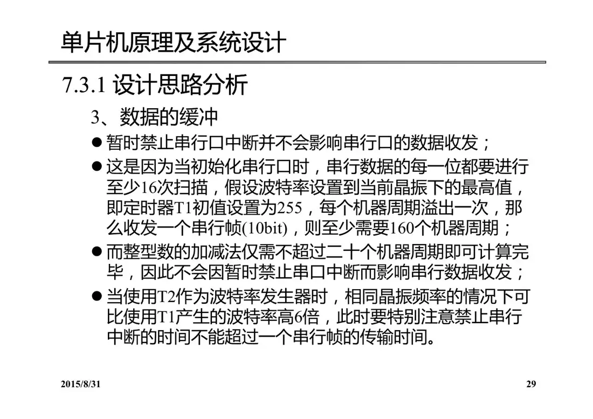

原文：

单片机原理及系统设计

7.3.1 设计思路分析

3、数据的缓冲

 暂时禁止串行口中断并不会影响串行口的数据收发；

这是因为当初始化串行口时，串行数据的每一位都要进行至少16次扫描，假设波特率设置到当前晶振下的最高值，即定时器T1初值设置为255，每个机器周期溢出一次，那么收发一个串行帧(10bit)，则至少需要160个机器周期；

而整型数的加减法仅需不超过二十个机器周期即可计算完毕，因此不会因暂时禁止串口中断而影响串行数据收发；

当使用T2作为波特率发生器时，相同晶振频率的情况下可比使用T1产生的波特率高6倍，此时要特别注意禁止串行中断的时间不能超过一个串行帧的传输时间。

2015/8/31

29

### 单片机原理及系统设计

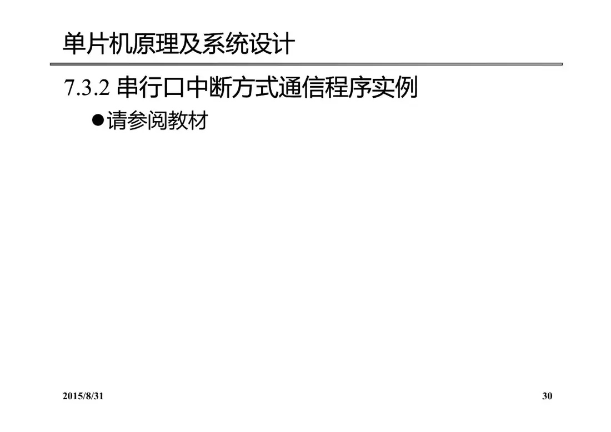

原文：

单片机原理及系统设计

7.3.2 串行口中断方式通信程序实例

请参阅教材

2015/8/31

30

### 第七章 单片机串行通信接口

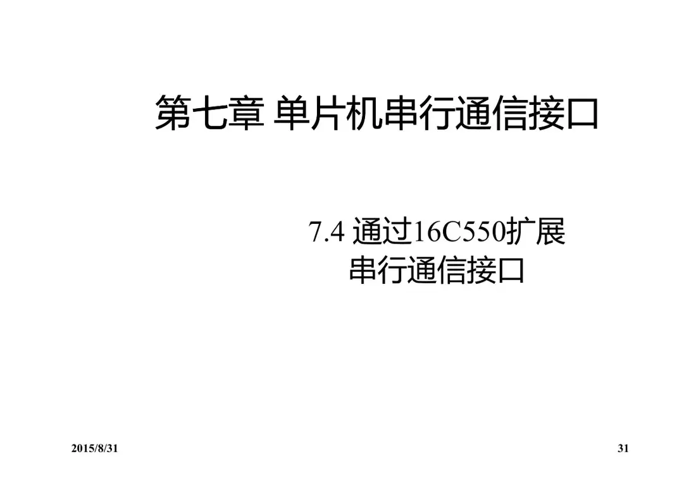

原文：

第七章 单片机串行通信接口

7.4 通过16C550扩展串行通信接口

2015/8/31

31

### 单片机原理及系统设计

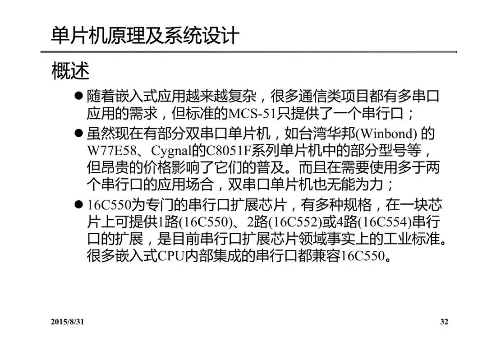

原文：

单片机原理及系统设计

概述

随着嵌入式应用越来越复杂，很多通信类项目都有多串口应用的需求，但标准的MCS-51只提供了一个串行口；

 虽然现在有部分双串口单片机，如台湾华邦(Winbond) 的W77E58、Cygnal的C8051F系列单片机中的部分型号等，但昂贵的价格影响了它们的普及。而且在需要使用多于两个串行口的应用场合，双串口单片机也无能为力；

16C550为专门的串行口扩展芯片，有多种规格，在一块芯片上可提供1路(16C550)、2路(16C552)或4路(16C554)串行口的扩展，是目前串行口扩展芯片领域事实上的工业标准。很多嵌入式CPU内部集成的串行口都兼容16C550。

2015/8/31

32

### 单片机原理及系统设计

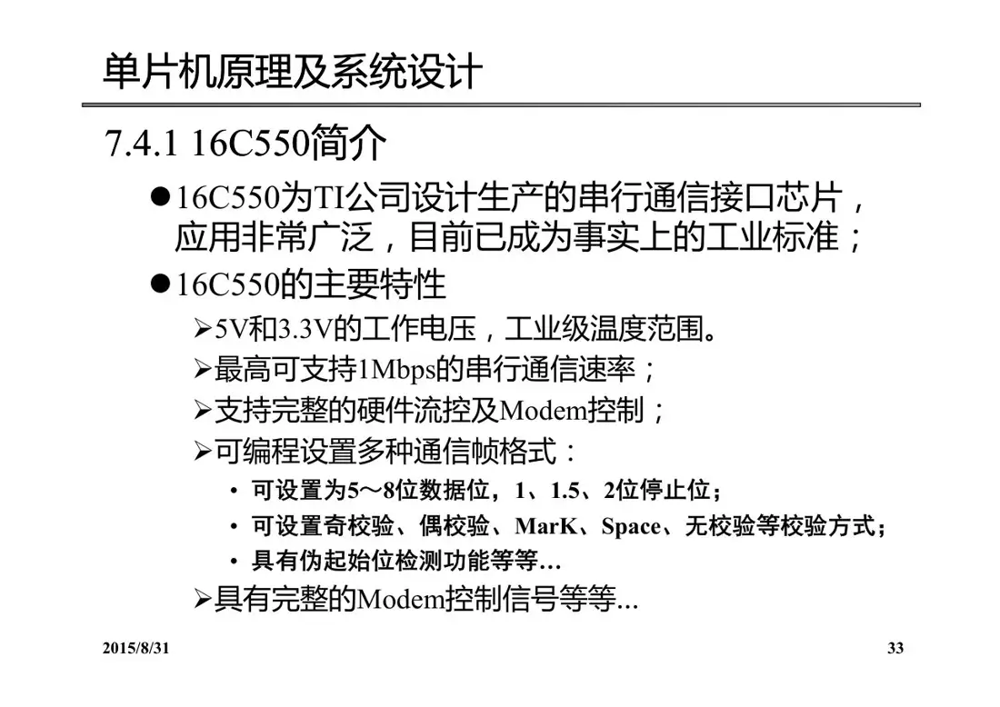

原文：

单片机原理及系统设计

7.4.1 16C550简介

16C550为TI公司设计生产的串行通信接口芯片，应用非常广泛，目前已成为事实上的工业标准；

16C550的主要特性

5V和3.3V的工作电压，工业级温度范围。

最高可支持1Mbps的串行通信速率；

支持完整的硬件流控及Modem控制；

可编程设置多种通信帧格式：

• 可设置为5～8位数据位，1、1.5、2位停止位；

• 可设置奇校验、偶校验、MarK、Space、无校验等校验方式；

• 具有伪起始位检测功能等等…

具有完整的Modem控制信号等等…

2015/8/31

33

### 单片机原理及系统设计

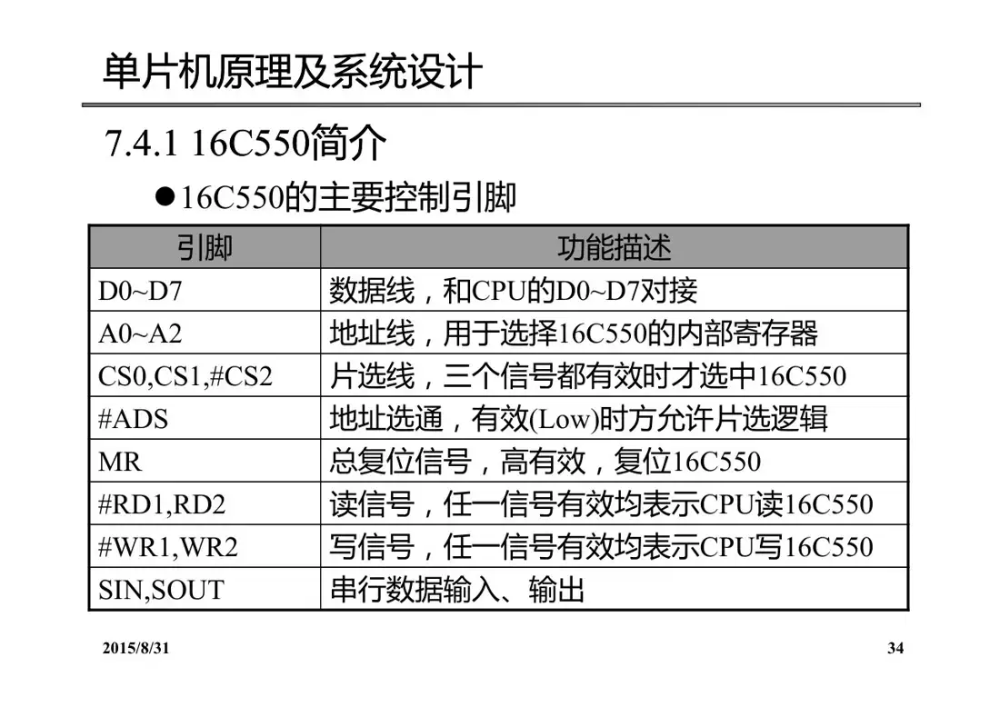

原文：

单片机原理及系统设计

7.4.1 16C550简介

16C550的主要控制引脚

<table><tr><td>引脚</td><td>功能描述</td></tr><tr><td>D0~D7</td><td>数据线,和CPU的D0~D7对接</td></tr><tr><td>A0~A2</td><td>地址线,用于选择16C550的内部寄存器</td></tr><tr><td>CS0,CS1,#CS2</td><td>片选线,三个信号都有效时才选中16C550</td></tr><tr><td>#ADS</td><td>地址选通,有效(Low)时方允许片选逻辑</td></tr><tr><td>MR</td><td>总复位信号,高有效,复位16C550</td></tr><tr><td>#RD1,RD2</td><td>读信号,任一信号有效均表示CPU读16C550</td></tr><tr><td>#WR1,WR2</td><td>写信号,任一信号有效均表示CPU写16C550</td></tr><tr><td>SIN,SOUT</td><td>串行数据输入、输出</td></tr></table>

2015/8/31

34

### 单片机原理及系统设计

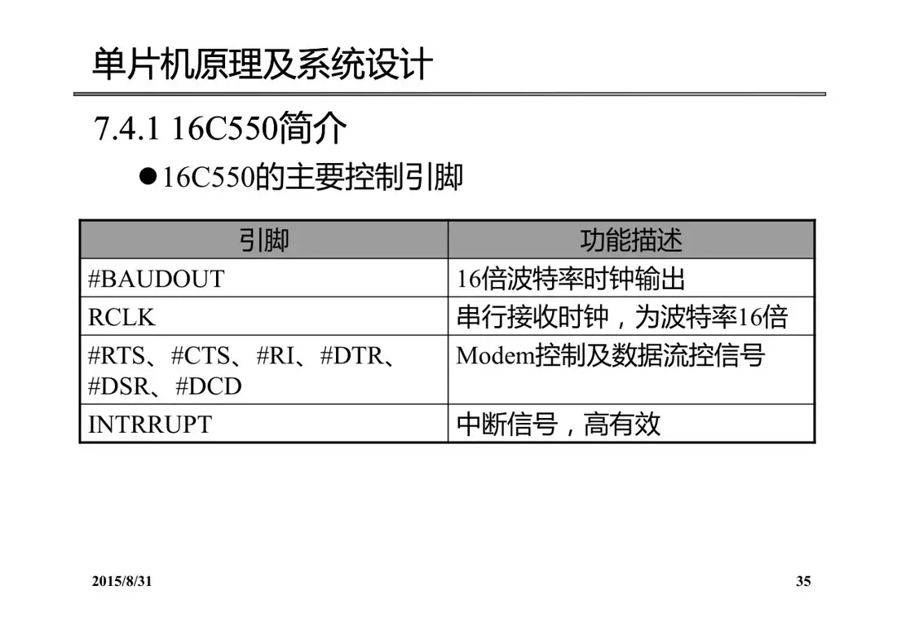

原文：

单片机原理及系统设计

7.4.1 16C550简介

16C550的主要控制引脚

<table><tr><td>引脚</td><td>功能描述</td></tr><tr><td>#BAUDOUT</td><td>16倍波特率时钟输出</td></tr><tr><td>RCLK</td><td>串行接收时钟,为波特率16倍</td></tr><tr><td>#RTS、#CTS、#RI、#DTR、#DSR、#DCD</td><td>Modem控制及数据流控信号</td></tr><tr><td>INTRRUPT</td><td>中断信号,高有效</td></tr></table>

2015/8/31

35

### 单片机原理及系统设计

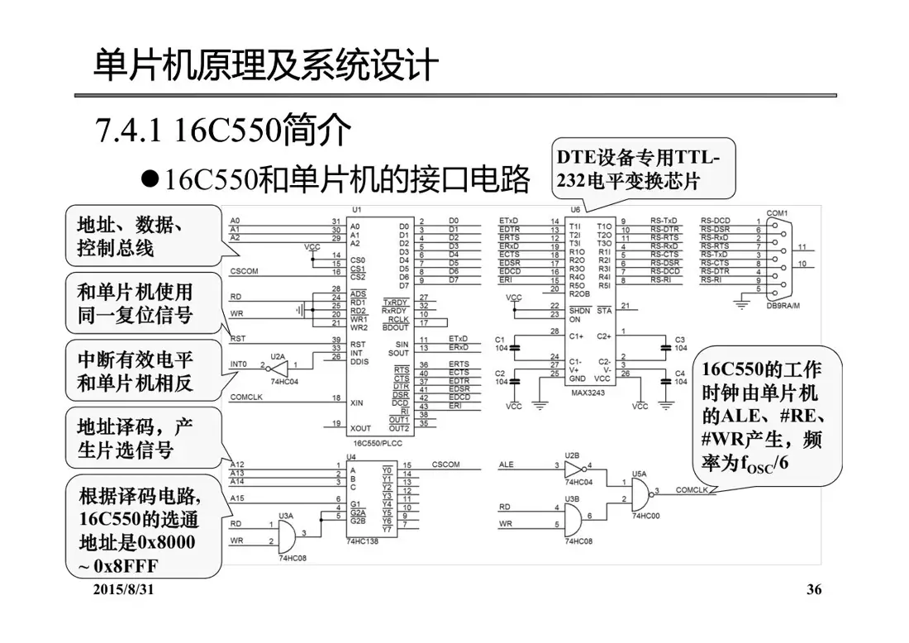

原文：

单片机原理及系统设计

7.4.1 16C550简介

16C550和单片机的接口电路

DTE设备专用TTL-232电平变换芯片

2015/8/31

36

### 单片机原理及系统设计

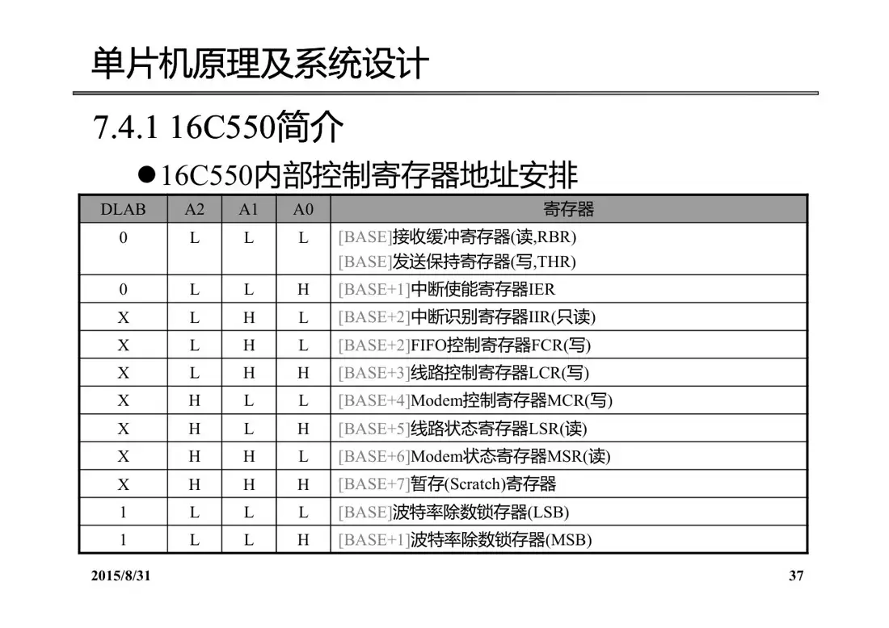

原文：

单片机原理及系统设计

7.4.1 16C550简介

16C550内部控制寄存器地址安排

<table><tr><td>DLAB</td><td>A2</td><td>A1</td><td>A0</td><td>寄存器</td></tr><tr><td>0</td><td>L</td><td>L</td><td>L</td><td>[BASE]接收缓冲寄存器(读,RBR)[BASE]发送保持寄存器(写,THR)</td></tr><tr><td>0</td><td>L</td><td>L</td><td>H</td><td>[BASE+1]中断使能寄存器IER</td></tr><tr><td>X</td><td>L</td><td>H</td><td>L</td><td>[BASE+2]中断识别寄存器IIR(只读)</td></tr><tr><td>X</td><td>L</td><td>H</td><td>L</td><td>[BASE+2]FIFO控制寄存器FCR(写)</td></tr><tr><td>X</td><td>L</td><td>H</td><td>H</td><td>[BASE+3]线路控制寄存器LCR(写)</td></tr><tr><td>X</td><td>H</td><td>L</td><td>L</td><td>[BASE+4]Modem控制寄存器MCR(写)</td></tr><tr><td>X</td><td>H</td><td>L</td><td>H</td><td>[BASE+5]线路状态寄存器LSR(读)</td></tr><tr><td>X</td><td>H</td><td>H</td><td>L</td><td>[BASE+6]Modem状态寄存器MSR(读)</td></tr><tr><td>X</td><td>H</td><td>H</td><td>H</td><td>[BASE+7]暂存Scratch)寄存器</td></tr><tr><td>1</td><td>L</td><td>L</td><td>L</td><td>[BASE]波特率除数锁存器(LSB)</td></tr><tr><td>1</td><td>L</td><td>L</td><td>H</td><td>[BASE+1]波特率除数锁存器(MSB)</td></tr></table>

2015/8/31

37

### 单片机原理及系统设计

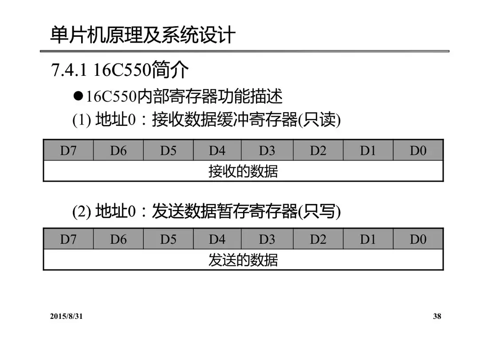

原文：

单片机原理及系统设计

7.4.1 16C550简介

16C550内部寄存器功能描述

(1) 地址0：接收数据缓冲寄存器(只读)

<table><tr><td>D7</td><td>D6</td><td>D5</td><td>D4</td><td>D3</td><td>D2</td><td>D1</td><td>D0</td></tr><tr><td colspan="8">接收的数据</td></tr></table>

(2) 地址0：发送数据暂存寄存器 (只写)

<table><tr><td>D7</td><td>D6</td><td>D5</td><td>D4</td><td>D3</td><td>D2</td><td>D1</td><td>D0</td></tr><tr><td colspan="8">发送的数据</td></tr></table>

2015/8/31

38

### 单片机原理及系统设计

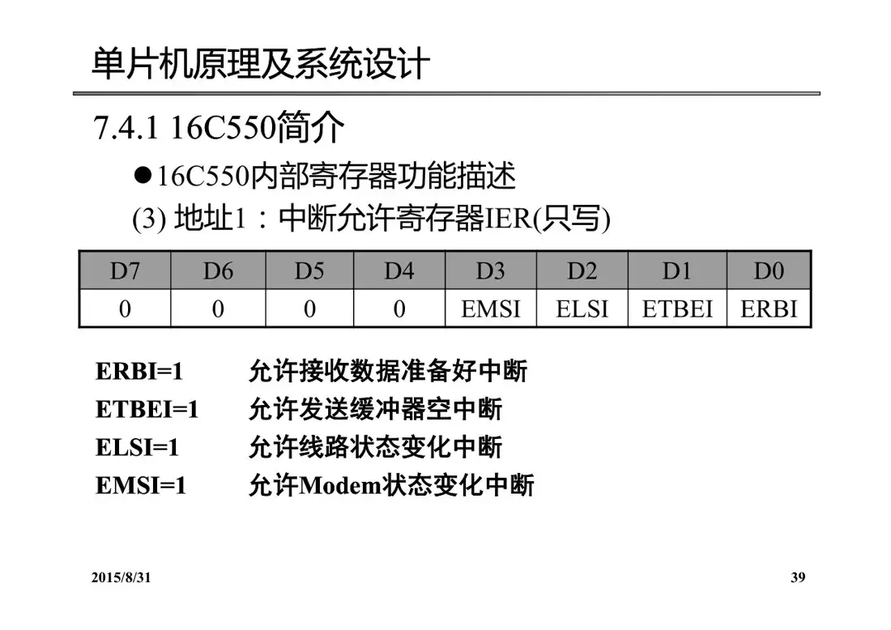

原文：

单片机原理及系统设计

7.4.1 16C550简介

16C550内部寄存器功能描述

(3) 地址1：中断允许寄存器IER(只写)

<table><tr><td>D7</td><td>D6</td><td>D5</td><td>D4</td><td>D3</td><td>D2</td><td>D1</td><td>D0</td></tr><tr><td>0</td><td>0</td><td>0</td><td>0</td><td>EMSI</td><td>ELSI</td><td>ETBEI</td><td>ERBI</td></tr></table>

ERBI=1 允许接收数据准备好中断

ETBEI=1 允许发送缓冲器空中断

ELSI=1 允许线路状态变化中断

EMSI=1 允许Modem状态变化中断

2015/8/31

39

### 单片机原理及系统设计

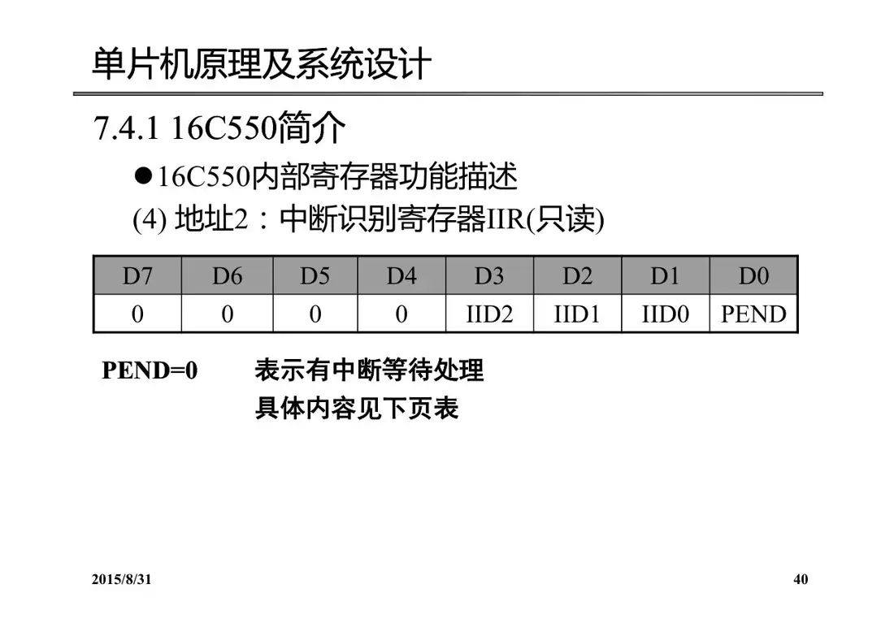

原文：

单片机原理及系统设计

7.4.1 16C550简介

16C550内部寄存器功能描述

(4) 地址2：中断识别寄存器IIR(只读)

<table><tr><td>D7</td><td>D6</td><td>D5</td><td>D4</td><td>D3</td><td>D2</td><td>D1</td><td>D0</td></tr><tr><td>0</td><td>0</td><td>0</td><td>0</td><td>IID2</td><td>IID1</td><td>IID0</td><td>PEND</td></tr></table>

PEND=0 表示有中断等待处理

具体内容见下页表

2015/8/31

40

### 单片机原理及系统设计

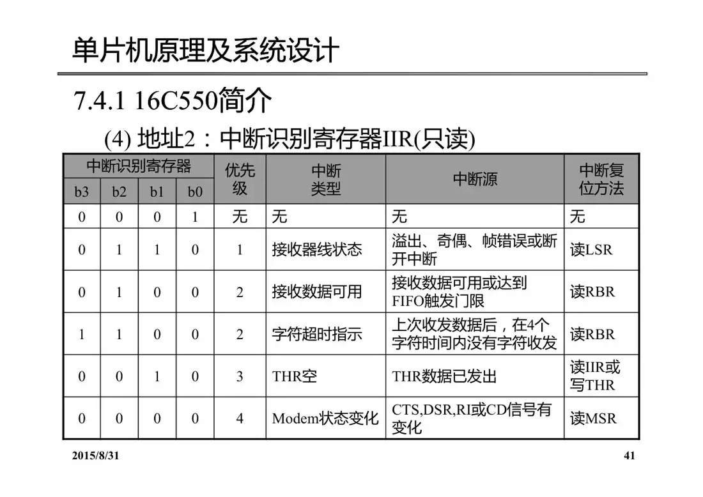

原文：

单片机原理及系统设计

7.4.1 16C550简介

(4) 地址2：中断识别寄存器IIR(只读)

<table><tr><td colspan="4">中断识别寄存器</td><td rowspan="2">优先级</td><td rowspan="2">中断类型</td><td rowspan="2">中断源</td><td rowspan="2">中断复位方法</td></tr><tr><td>b3</td><td>b2</td><td>b1</td><td>b0</td></tr><tr><td>0</td><td>0</td><td>0</td><td>1</td><td>无</td><td>无</td><td>无</td><td>无</td></tr><tr><td>0</td><td>1</td><td>1</td><td>0</td><td>1</td><td>接收器线状态</td><td>溢出、奇偶、帧错误或断开中断</td><td>读LSR</td></tr><tr><td>0</td><td>1</td><td>0</td><td>0</td><td>2</td><td>接收数据可用</td><td>接收数据可用或达到FIFO触发门限</td><td>读RBR</td></tr><tr><td>1</td><td>1</td><td>0</td><td>0</td><td>2</td><td>字符超时指示</td><td>上次收发数据后,在4个字符时间内没有字符收发</td><td>读RBR</td></tr><tr><td>0</td><td>0</td><td>1</td><td>0</td><td>3</td><td>THR空</td><td>THR数据已发出</td><td>读IIR或写THR</td></tr><tr><td>0</td><td>0</td><td>0</td><td>0</td><td>4</td><td>Modem状态变化</td><td>CTS,DSR,RI或CD信号有变化</td><td>读MSR</td></tr></table>

2015/8/31

41

### 单片机原理及系统设计

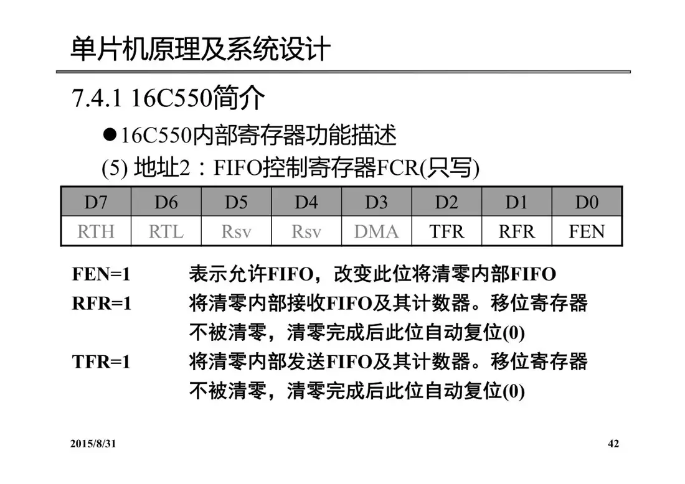

原文：

单片机原理及系统设计

7.4.1 16C550简介

16C550内部寄存器功能描述

(5) 地址2：FIFO控制寄存器FCR(只写)

<table><tr><td>D7</td><td>D6</td><td>D5</td><td>D4</td><td>D3</td><td>D2</td><td>D1</td><td>D0</td></tr><tr><td>RTH</td><td>RTL</td><td>Rsv</td><td>Rsv</td><td>DMA</td><td>TFR</td><td>RFR</td><td>FEN</td></tr></table>

FEN=1 表示允许FIFO，改变此位将清零内部FIFO

RFR=1 将清零内部接收FIFO及其计数器。移位寄存器不被清零，清零完成后此位自动复位(0)

TFR=1 将清零内部发送FIFO及其计数器。移位寄存器不被清零，清零完成后此位自动复位(0)

2015/8/31

42

### 单片机原理及系统设计

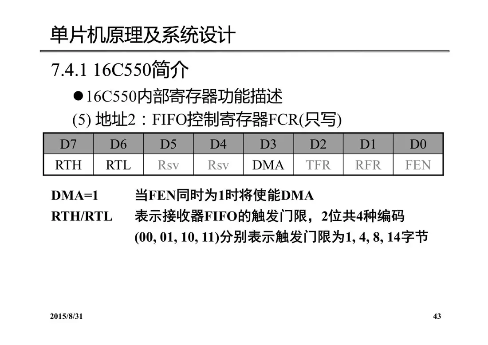

原文：

单片机原理及系统设计

7.4.1 16C550简介

16C550内部寄存器功能描述

(5) 地址2：FIFO控制寄存器FCR(只写)

<table><tr><td>D7</td><td>D6</td><td>D5</td><td>D4</td><td>D3</td><td>D2</td><td>D1</td><td>D0</td></tr><tr><td>RTH</td><td>RTL</td><td>Rsv</td><td>Rsv</td><td>DMA</td><td>TFR</td><td>RFR</td><td>FEN</td></tr></table>

DMA=1 当FEN同时为1时将使能DMA

RTH/RTL 表示接收器FIFO的触发门限，2位共4种编码(00, 01, 10, 11)分别表示触发门限为1, 4, 8, 14字节

2015/8/31

43

### 单片机原理及系统设计

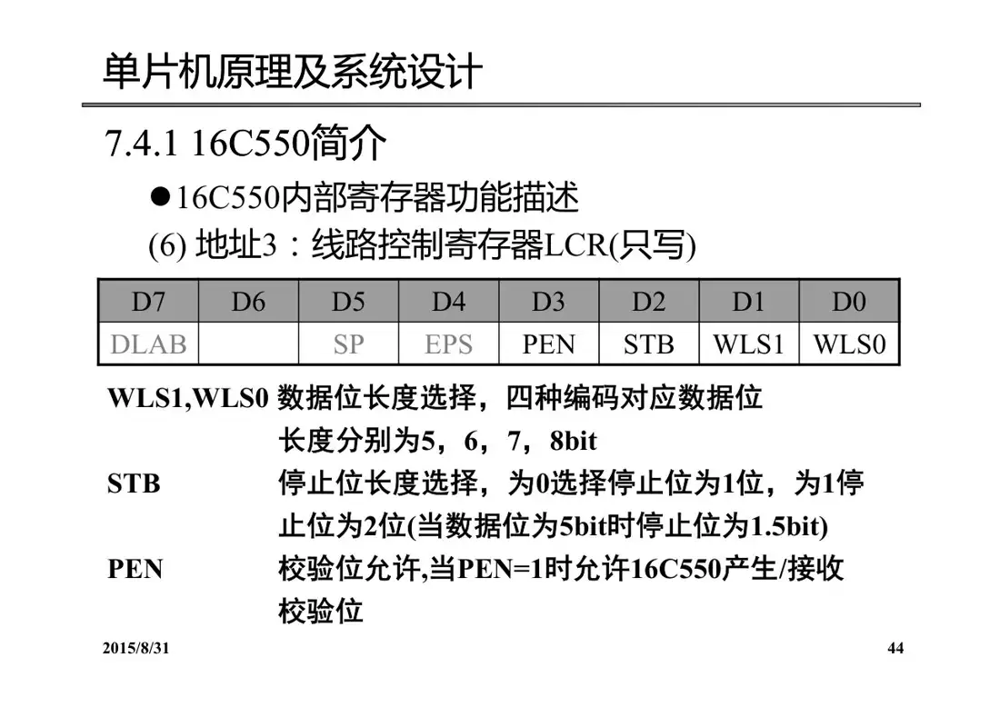

原文：

单片机原理及系统设计

7.4.1 16C550简介

16C550内部寄存器功能描述

(6) 地址3：线路控制寄存器LCR(只写)

<table><tr><td>D7</td><td>D6</td><td>D5</td><td>D4</td><td>D3</td><td>D2</td><td>D1</td><td>D0</td></tr><tr><td>DLAB</td><td></td><td>SP</td><td>EPS</td><td>PEN</td><td>STB</td><td>WLS1</td><td>WLS0</td></tr></table>

WLS1,WLS0 数据位长度选择，四种编码对应数据位 长度分别为5，6，7，8bit

STB 停止位长度选择，为0选择停止位为1位，为1停止位为2位(当数据位为5bit时停止位为1.5bit)

PEN 校验位允许,当PEN=1时允许16C550产生/接收校验位

2015/8/31

44

### 单片机原理及系统设计

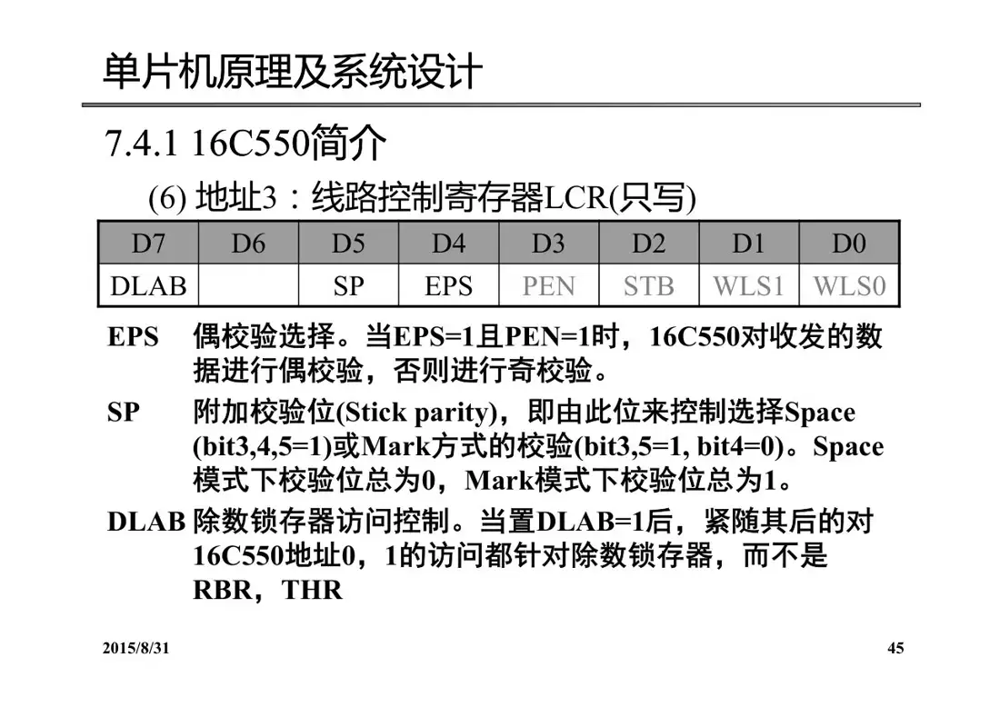

原文：

单片机原理及系统设计

7.4.1 16C550简介

(6) 地址3：线路控制寄存器LCR(只写)

<table><tr><td>D7</td><td>D6</td><td>D5</td><td>D4</td><td>D3</td><td>D2</td><td>D1</td><td>D0</td></tr><tr><td>DLAB</td><td></td><td>SP</td><td>EPS</td><td>PEN</td><td>STB</td><td>WLS1</td><td>WLS0</td></tr></table>

EPS 偶校验选择。当EPS=1且PEN=1时，16C550对收发的数据进行偶校验，否则进行奇校验。

SP 附加校验位(Stick parity)，即由此位来控制选择Space(bit3,4,5=1)或Mark方式的校验(bit3,5=1, bit4=0)。Space模式下校验位总为0，Mark模式下校验位总为1。

DLAB除数锁存器访问控制。当置DLAB=1后，紧随其后的对16C550地址0，1的访问都针对除数锁存器，而不是RBR，THR

2015/8/31

45

### 单片机原理及系统设计

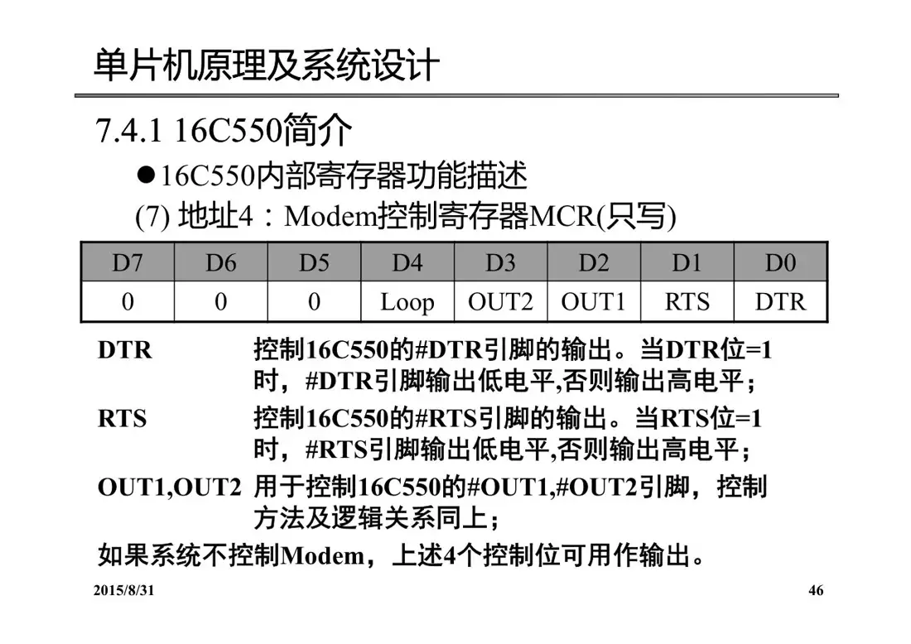

原文：

单片机原理及系统设计

7.4.1 16C550简介

16C550内部寄存器功能描述

(7) 地址4：Modem控制寄存器MCR(只写)

<table><tr><td>D7</td><td>D6</td><td>D5</td><td>D4</td><td>D3</td><td>D2</td><td>D1</td><td>D0</td></tr><tr><td>0</td><td>0</td><td>0</td><td>Loop</td><td>OUT2</td><td>OUT1</td><td>RTS</td><td>DTR</td></tr></table>

DTR 控制16C550的#DTR引脚的输出。当DTR位=1时，#DTR引脚输出低电平,否则输出高电平；RTS 控制16C550的#RTS引脚的输出。当RTS位=1时，#RTS引脚输出低电平,否则输出高电平；

OUT1,OUT2 用于控制16C550的#OUT1,#OUT2引脚，控制方法及逻辑关系同上；

如果系统不控制Modem，上述4个控制位可用作输出。

2015/8/31

46

### 单片机原理及系统设计

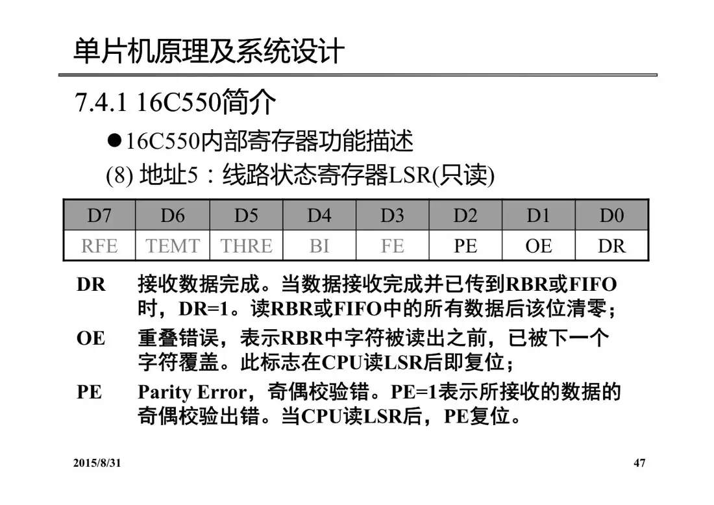

原文：

单片机原理及系统设计

7.4.1 16C550简介

16C550内部寄存器功能描述

(8) 地址5：线路状态寄存器LSR(只读)

<table><tr><td>D7</td><td>D6</td><td>D5</td><td>D4</td><td>D3</td><td>D2</td><td>D1</td><td>D0</td></tr><tr><td>RFE</td><td>TEMT</td><td>THRE</td><td>BI</td><td>FE</td><td>PE</td><td>OE</td><td>DR</td></tr></table>

DR 接收数据完成。当数据接收完成并已传到RBR或FIFO时，DR=1。读RBR或FIFO中的所有数据后该位清零；

OE 重叠错误，表示RBR中字符被读出之前，已被下一个字符覆盖。此标志在CPU读LSR后即复位；

PE Parity Error，奇偶校验错。PE=1表示所接收的数据的奇偶校验出错。当CPU读LSR后，PE复位。

2015/8/31

47

### 单片机原理及系统设计

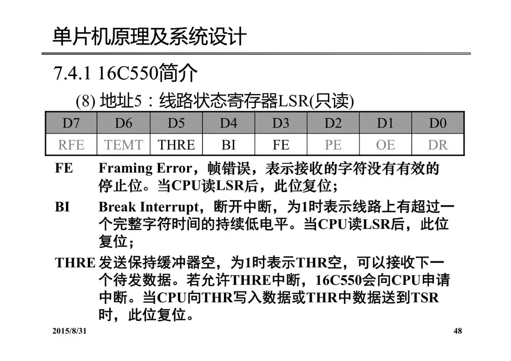

原文：

单片机原理及系统设计

7.4.1 16C550简介

(8) 地址5：线路状态寄存器LSR(只读)

<table><tr><td>D7</td><td>D6</td><td>D5</td><td>D4</td><td>D3</td><td>D2</td><td>D1</td><td>D0</td></tr><tr><td>RFE</td><td>TEMT</td><td>THRE</td><td>BI</td><td>FE</td><td>PE</td><td>OE</td><td>DR</td></tr></table>

FE Framing Error，帧错误，表示接收的字符没有有效的停止位。当CPU读LSR后，此位复位；

BI Break Interrupt，断开中断，为1时表示线路上有超过一个完整字符时间的持续低电平。当CPU读LSR后，此位复位；

THRE发送保持缓冲器空，为1时表示THR空，可以接收下一个待发数据。若允许THRE中断，16C550会向CPU申请中断。当CPU向THR写入数据或THR中数据送到TSR时，此位复位。

2015/8/31

48

### 单片机原理及系统设计

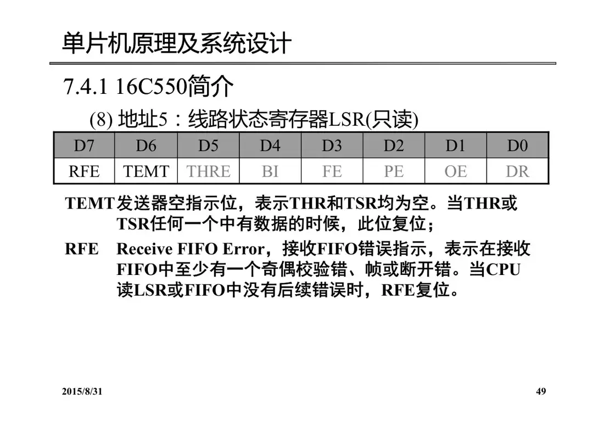

原文：

单片机原理及系统设计

7.4.1 16C550简介

(8) 地址5：线路状态寄存器LSR(只读)

<table><tr><td>D7</td><td>D6</td><td>D5</td><td>D4</td><td>D3</td><td>D2</td><td>D1</td><td>D0</td></tr><tr><td>RFE</td><td>TEMT</td><td>THRE</td><td>BI</td><td>FE</td><td>PE</td><td>OE</td><td>DR</td></tr></table>

TEMT发送器空指示位，表示THR和TSR均为空。当THR或TSR任何一个中有数据的时候，此位复位；

RFE Receive FIFO Error，接收FIFO错误指示，表示在接收FIFO中至少有一个奇偶校验错、帧或断开错。当CPU读LSR或FIFO中没有后续错误时，RFE复位。

2015/8/31

49

### 单片机原理及系统设计

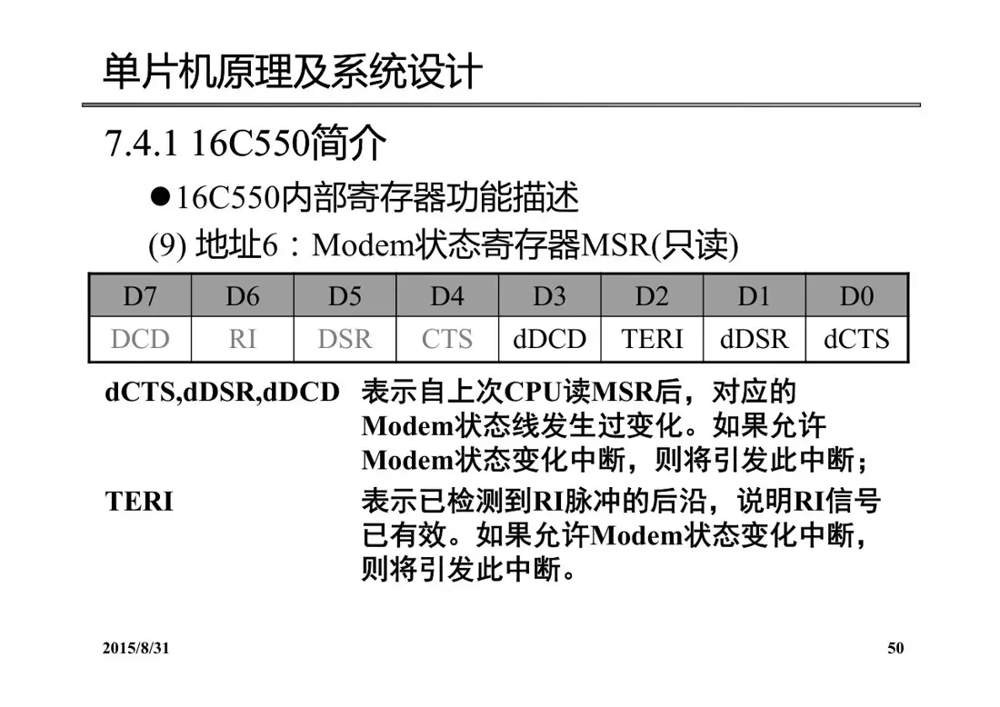

原文：

单片机原理及系统设计

7.4.1 16C550简介

16C550内部寄存器功能描述

(9) 地址6：Modem状态寄存器MSR(只读)

<table><tr><td>D7</td><td>D6</td><td>D5</td><td>D4</td><td>D3</td><td>D2</td><td>D1</td><td>D0</td></tr><tr><td>DCD</td><td>RI</td><td>DSR</td><td>CTS</td><td>dDCD</td><td>TERI</td><td>dDSR</td><td>dCTS</td></tr></table>

dCTS,dDSR,dDCD 表示自上次CPU读MSR后，对应的Modem状态线发生过变化。如果允许Modem状态变化中断，则将引发此中断；

TERI 表示已检测到RI脉冲的后沿，说明RI信号已有效。如果允许Modem状态变化中断，则将引发此中断。

2015/8/31

50

### 单片机原理及系统设计

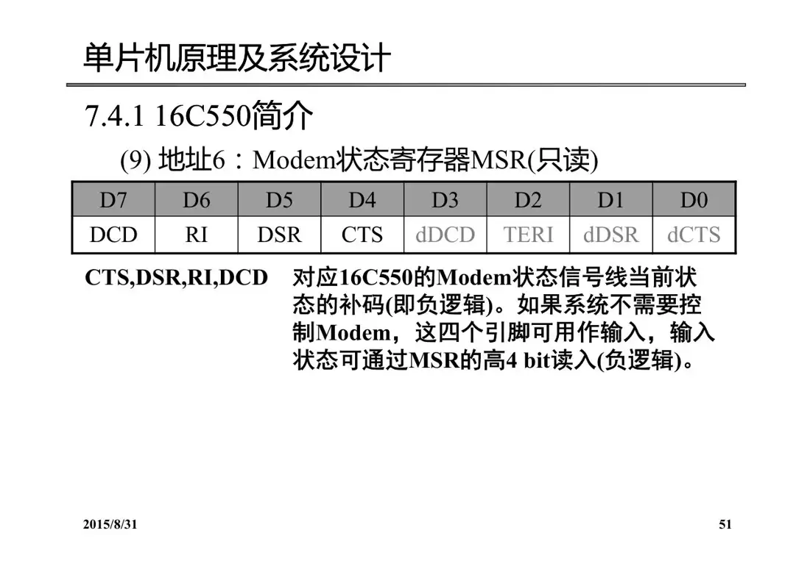

原文：

单片机原理及系统设计

7.4.1 16C550简介

(9) 地址6：Modem状态寄存器MSR(只读)

<table><tr><td>D7</td><td>D6</td><td>D5</td><td>D4</td><td>D3</td><td>D2</td><td>D1</td><td>D0</td></tr><tr><td>DCD</td><td>RI</td><td>DSR</td><td>CTS</td><td>dDCD</td><td>TERI</td><td>dDSR</td><td>dCTS</td></tr></table>

CTS,DSR,RI,DCD 对应16C550的Modem状态信号线当前状态的补码(即负逻辑)。如果系统不需要控制Modem，这四个引脚可用作输入，输入状态可通过MSR的高4 bit读入(负逻辑)。

2015/8/31

51

### 单片机原理及系统设计

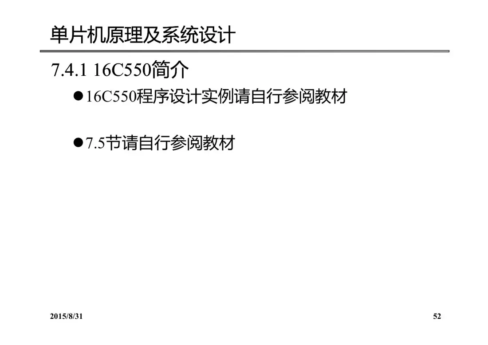

原文：

单片机原理及系统设计

7.4.1 16C550简介

16C550程序设计实例请自行参阅教材

7.5节请自行参阅教材

2015/8/31

52

### 第七章 单片机串行通信接口

原文：

第七章 单片机串行通信接口

7.6 通过RS-485总线实现单片机的多机通信

2015/8/31

53

### 单片机原理及系统设计

原文：

单片机原理及系统设计

概述

RS-485总线通信方式的特点

速度较高 ━━ 250Kbps\~1Mbps;

通信距离远 ━━ 无中继通信距离达4000英尺/1200米;

信号电平兼容━━线路采用差分方式驱动;

支持多点通信━━同一总线下可挂接多达128个节点;

目前常用的RS-485总线驱动芯片

MAX48x/148x系列、75176、SP48x等;

通信方式有半双工和全双工;

芯片等级分为商业级(0\~70℃)、工业级(-40\~85 ℃)和汽车/军事级(-55\~125 ℃);

同一总线下最多可挂接32或128个节点。

2015/8/31

54

### 单片机原理及系统设计

原文：

单片机原理及系统设计

7.6.1单片机和RS-485总线收发器的接口电路设计

带有总线保护及光电隔离的RS-485接口电路

2015/8/31

55

### 单片机原理及系统设计

原文：

单片机原理及系统设计

7.6.2 单片机主从式多机通信的原理

1、多机通信控制位

当串行口工作在方式2或3（多机通信模式）接收数据时，SCON中的SM2为多机通信控制位：

多机通信模式下，单片机串行口发送和接收数据均增加1位附加位，分别记为TB8和RB8；

单片机串行口发送一字节的数据时，TB8将紧接在该字节后发出；

TB8和RB8位于SCON中，可位寻址。

2015/8/31

56

### 单片机原理及系统设计

原文：

单片机原理及系统设计

7.6.2 单片机主从式多机通信的原理

1、多机通信控制位

当串行口工作在方式2或3（多机通信模式）接收数据时，SCON中的SM2为多机通信控制位：

SM2=1时，单片机串行口接收一个字节后，只有当紧接该字节的第9位数据RB8也为1时，该字节才会被装入SBUF，并置RI为1。否则单片机认为该数据无效，不置位RI，CPU也不会做任何处理；

SM2=0时，单片机串行口接收一个字节后，不管紧随其后的RB8是0还是1，均会将该字节装入SBUF，并置RI为1；

利用单片机串行口的上述特性，可实现主从式半双工多机通信。

2015/8/31

57

### 单片机原理及系统设计

原文：

单片机原理及系统设计

7.6.2 单片机主从式多机通信的原理

2、主从式半双工多机通信系统的构成及原理

主从式半双工多机通信系统的构成

采用RS-485总线；

采用一主机+多从机的结构；

单片机使用串口方式2或3进行多机通信；

主机采用轮询的方式访问各从机；

各从机之间的数据交换只能通过主机进行转发；

或者各节点轮流成为主机(需要协议支持)；

因为任何时候通信都只能是单向的(主机→从机或从机主机)，所以构成的是半双工的通信系统。

2015/8/31

58

### 单片机原理及系统设计

原文：

单片机原理及系统设计

7.6.2 单片机主从式多机通信的原理

2、主从式半双工多机通信系统的构成及原理

多机通信的实现

使所有从机SM2=1，等待主机发送地址；

主机置TB8=1表示发送的是地址，并发送地址字节；

所有从机都可收到此字节，各自比较地址码是否和主机发来的数据相符，地址码符合的从机置SM2=0；

主机给被寻址的从机发送数据，发送数据期间置TB8为0，此时只有SM2=0的从机可收到该数据，所有SM2=1的从机不会接收TB8=0的数据；

主机和被寻址从机间完成数据通信，各自置TB8和RB8为1，准备开始下一轮循环。

2015/8/31

59

### 单片机原理及系统设计

原文：

单片机原理及系统设计

7.6.3 单片机主从式多机通信的实例

请自行参阅教材

2015/8/31

60
