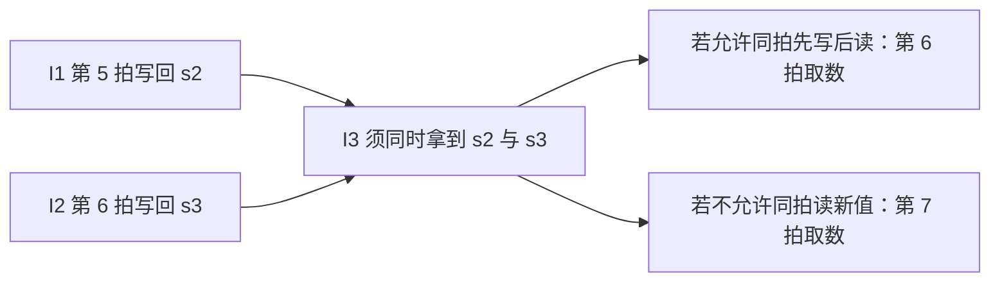

# 2021—2022 学年第二学期《计算机组成与结构》期末试卷（A）

原卷三页，计算 20 分、问答 30 分、综合应用 50 分。下面按题号保留解题条件与数值，给出独立验算的**参考解答**，不是官方评分细则。凡题面未规定的时序、编码或实现约定，均在对应题下注明。

## 一、计算题

### 1. 写回式直接映射 Cache 的总容量（8 分）

题给 32 位字节地址、64 行、每行 32 B，采用写回。**参考解答：**块内偏移占 5 位，直接映射行号占 6 位，因而标记占 $32-5-6=21$ 位。每行数据 $32\times8=256$ 位，加上标记、有效位和写回所需的脏位，共 $256+21+1+1=279$ 位。64 行合计 $279\times64=17\,856$ 位，即 **2,232 B**（只计必需的数据与标记阵列）。若只问数据容量，则是 **2,048 B**。==行号由下标隐含，不在每行另存 6 位==；直接映射也不用存路替换状态。不在原题内另加校验或对齐成本。

### 2. Cache 命中率与平均访问时间（8 分）

原卷明确给出 Cache 完成 1,960 次、主存完成 40 次，周期分别为 50 ns、200 ns；旧整理误将次数变为未知变量。**参考解答：**按题意每次请求归入完成它的一层，命中率 $1960/(1960+40)=98\%$。按该课程题的两类完成时间加权，平均时间为 $0.98\times50+0.02\times200=53\ \mathrm{ns}$。**补充：**若规定每次必先花 50 ns 查 Cache、未命中再**额外**花 200 ns，这就不是同一个时间定义，结果为 $50+0.02\times200=54\ \mathrm{ns}$。看到“额外”再用后一式，不要在默认题意上重复计费。

### 3. 总线理论带宽（4 分）

**参考解答：**每次传 4 B 却占两个时钟拍，故每秒最多 $133\times10^6/2$ 次传送，带宽为 $266\times10^6\ \mathrm{B/s}$，即十进制 **266 MB/s**。先数“每次传送”而不是把时钟拍直接当完整总线周期；题目要字节每秒，不要漏看位与字节。

## 二、问答题

### 1. 七设备、三种集中仲裁（10 分）

| 增设线路 | 参考解答 | 为什么是这个数 |
| --- | --- | --- |
| 3 根 | 链式查询 | 公用请求、总线忙、沿设备链逐级传递的授权，共三根 |
| 5 根 | 计数器定时查询 | 请求与总线忙各一根，另用 $\lceil\log_2 7\rceil=3$ 根线编码设备号 |
| 15 根 | 独立请求 | 七条请求、七条授权和一条公共忙线 |

**参考解答：**课程要填的机会均等方式是**计数器定时查询**，前提是授权后从获得者的下一个设备继续循环计数；若每次清零重扫，低编号仍可反复抢先。历史题问当代总线标准按教材填**独立请求**，它可并行判优、减小仲裁延迟；这是课件对当时集中式标准的教材判断，不代表所有现代总线均用这种物理线路。

### 2. 小端下的负数常量（10 分）

题给字节序列 <kbd>C6 95 FC 00 00 00 00</kbd>，要求将 $0$ 换成 $-375$。**参考解答：**按题意假设尾四字节仅为可替换的 32 位立即数字段：$375$ 是 <kbd>0x00000177</kbd>，其 32 位二进制补码按位取反再加 1，得 <kbd>0xFFFFFE89</kbd>。小端先放低字节，故填 <kbd>C6 95 FC 89 FE FF FF</kbd>。

> [!WARNING]
> **订正：**这是对题给字节模板做常量替换，不能宣称前缀确实是一条合法的标准 x86 32 位写入指令。若按 32 位 x86 解码，原给 <kbd>C6 95</kbd> 不构成合法的该类操作；仅凭一条 C 声明也不能唯一反推出编译字节。**补充：**在另给定目的地为 <kbd>[ebp-4]</kbd> 的 32 位 x86 示例中，<kbd>C7 45 FC 89 FE FF FF</kbd> 可表示把这枚 32 位立即数存到该位置。

### 3. 这门课为什么是芯片设计的基础（10 分）

**参考解答：**认同。指令集说的是软件看得见的状态与结果，数据通路和控制器决定这些结果怎样按时产生；例如实现一条装载指令，必须在同一份设计里协调地址计算、缓存命中或等待、寄存器写回。引入流水线后，还要处理后续指令提前读到旧值的风险。若只理解软件语义，不易定位时钟、带宽和功耗瓶颈；若只会组合门电路，又说不清整个处理器为何这样组织。课程不能替代数字电路、验证、物理设计等训练，却为这些工作建立共同的功能与性能模型。

## 三、综合应用题

### 1. 按处理优先级设计中断屏蔽字（10 分）

硬件响应优先级为 I、II、III、IV、V；要求处理优先级为 III、IV、I、V、II。按题设从 D4 到 D0 依次对应 I、II、III、IV、V，1 表示屏蔽。

| 服务程序 | 参考解答：D4–D0 | 允许抢占者 |
| --- | --- | --- |
| I | <kbd>11001</kbd> | III、IV |
| II | <kbd>01000</kbd> | I、III、IV、V |
| III | <kbd>11111</kbd> | 无 |
| IV | <kbd>11011</kbd> | III |
| V | <kbd>01001</kbd> | III、IV、I |

> [!TIP]
> 先按**处理**优先级决定哪些源可抢占当前处理程序，再到题给位序写 0；当前源及优先级更低者写 1。屏蔽字并不重排硬件判优：若五源一起待处理且最初均开放，硬件仍会先响应 I；I 设置屏蔽并开放嵌套后，III 与 IV 可在 I 完成前先完成。

### 2. 没有中间结果旁路的五级流水线（10 分）

第 1 条加法写 s2，第 2 条装载写 s3，第 3 条加法同时读取它们。**参考解答：**I1 的写回在第 5 拍、I2 在第 6 拍。按“写回在前半拍、取数在后半拍，可同拍读到新值”的常见假设，I3 的 ID/取数必须等到第 6 拍，随后第 7、8、9 拍执行、访存、写回。表中阶段号沿用原卷；“等”表示已取指但不能完成本拍的译码/取数。

| 指令／时钟 | 1 | 2 | 3 | 4 | 5 | 6 | 7 | 8 | 9 |
| --- | --- | --- | --- | --- | --- | --- | --- | --- | --- |
| I1 | ① | ② | ③ | ④ | ⑤ |  |  |  |  |
| I2 |  | ① | ② | ③ | ④ | ⑤ |  |  |  |
| I3 |  |  | ① | 等 | 等 | ② | ③ | ④ | ⑤ |

若读口必须等下一拍才看得到写回，I3 的 ② 至 ⑤ 整体再右移一拍，其余两行不变。==看两个依赖中较晚能读的那个==：不能仅从 I1 的加法完成时刻下结论，也不能无题设依据插入前推。

### 3. IEEE 754 单精度的负数编码（10 分）

**参考解答：**绝对值 $32.5=100000.1_2=1.000001_2\times 2^5$。符号位为 1；偏移指数是 $5+127=132=10000100_2$；隐含首位 1 不写入尾数字段，保留小数部分 <kbd>000001</kbd>，再补 17 个零以凑满 23 位。合并后分成四位一组，结果是 **<kbd>0xC2020000</kbd>**。这里求的是 32 位字的十六进制表示，不是该字在不同端序下的内存字节顺序。

### 4. 指令吞吐与控制存储器容量（10 分）

**参考解答（1）：**一条指令平均耗 $2.5\times2=5$ 个主频周期，故吞吐为 $200\times10^6/5=40\times10^6$ 条每秒，即 **40 MIPS**。题目给了主频周期和 CPU 周期两套单位，不能直接拿 200 除以 2.5。

**参考解答（2）：**原卷写明微指令长 **32 位**，不是旧整理的 40 位。互斥组含 2、4、8、10、3 个微命令。为允许某组“不发命令”，每组选码数为命令数再加 1；向上取整后分别要 2、3、4、4、2 位，共 15 位。两个外部条件按题设不编码，各一位；假设其余位全作断定式下地址，余 $32-15-2=15$ 位，可访问 $2^{15}$ 个微指令字。每字 4 B，容量为 **131,072 B（128 KiB）**。若另规定每组必发一个命令、无“不操作”编码，微命令字段仅 12 位，会得到 **1 MiB**；那是不同约束。题无已装载微指令数，以上求可寻址的控制存储容量。

### 5. 从同一指令格式计算五个有效地址（10 分）

原卷把 16 位分为 OP（15–10）、X（9–8）、D（7–0）；给当前 PC 为 <kbd>1234H</kbd>、X1 为 <kbd>0037H</kbd>、X2 为 <kbd>11ABH</kbd>。**参考解答：**取出位段而非直接把一个完整十六进制位当 X：$X=(W\mathbin{\gg}8)\mathbin{\&}3$。四种方式依次用零、X1、X2、题给 PC 为基准；本组 D 的最高位都是零，不会因有符号扩展而改变结果。

| 机器字 | X | D | 加法 | 有效地址 |
| --- | --- | --- | --- | --- |
| <kbd>4420H</kbd> | 0 | <kbd>20H</kbd> | 直接用 D | **<kbd>0020H</kbd>** |
| <kbd>2244H</kbd> | 2 | <kbd>44H</kbd> | <kbd>11ABH+44H</kbd> | **<kbd>11EFH</kbd>** |
| <kbd>132CH</kbd> | 3 | <kbd>2CH</kbd> | <kbd>1234H+2CH</kbd> | **<kbd>1260H</kbd>** |
| <kbd>3521H</kbd> | 1 | <kbd>21H</kbd> | <kbd>0037H+21H</kbd> | **<kbd>0058H</kbd>** |
| <kbd>6723H</kbd> | 3 | <kbd>23H</kbd> | <kbd>1234H+23H</kbd> | **<kbd>1257H</kbd>** |

这是原卷自定义的寻址格式；题目给哪个 PC 状态就用哪个，不能把另一条体系结构的固定步长额外套上去。

关联知识点：[Cache 容量与访问](../../../topics/计算机组成/cache-basic.md)、[总线性能](../../../topics/计算机组成/bus-performance.md)、[集中仲裁](../../../topics/计算机组成/bus-arbitration.md)、[补码](../../../topics/计算机组成/number-systems.md)、[中断屏蔽](../../../topics/计算机组成/interrupt-mask.md)、[流水线数据冒险](../../../topics/计算机组成/data-hazard.md)、[规格化浮点数](../../../topics/计算机组成/float-normalize.md)、[指令速率](../../../topics/计算机组成/mips-rate.md)、[微指令字段](../../../topics/计算机组成/micro-instruction-format.md)、[寻址方式](../../../topics/计算机组成/addressing-mode.md)。
