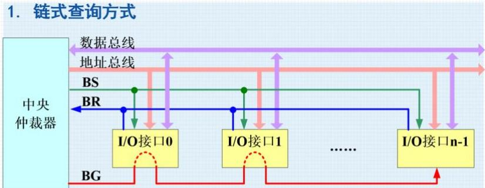
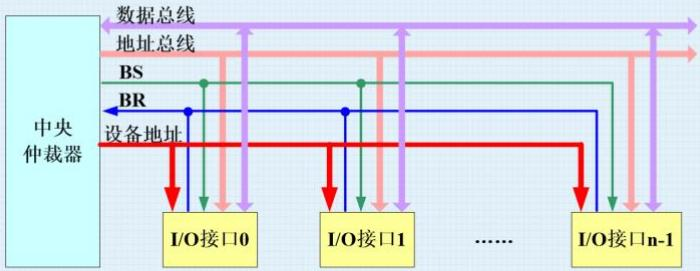
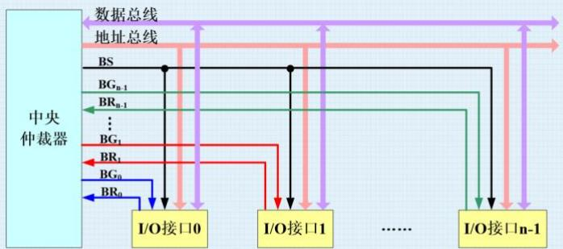

# 南京邮电大学 2021—2022 学年第二学期《计算机组成与结构》复习提纲

原件经识别和整理；“参考解答”是我们补的。

## 一、MIPS 计算

1. MIPS 的计算。

## 二、数据在内存中的存放

2. 熟悉指令和数据在内存中是如何存放的。以数据为例，负数会以补码的形式存放，可以采用小端方式或大端方式存放。

## 三、浮点数转换

3. IEEE754 单精度浮点数与相对应十进制真值的相互转换。

## 四、Cache 性能指标计算

4. Cache命中率、平均访问时间的计算。

## 五、Cache 容量计算

5. Cache 容量的计算：

例，假定主存地址为32位，按字节编址，主存和Cache之间采用直接映射方式，主存块大小为4个字，每字32位，采用回写(Write Back)方式，则能存放4K字数据的Cache的总容量的位数至少是（）。

- A. 146K
- B. 147K
- C. 148K
- D. 158K

答案：C。

解：按字节编址，块大小为 $4 \times 32\text{b} = 16\text{B} = 2^4\text{B}$ ，则块内地址占4位。Cache的存储容量为4K字，每块4个字，所以Cache共有 $1\text{K} = 2^{10}$ 个Cache行，则Cache行号占10位。因此主存标记 $= 32 - 4 - 10 = 18$ 位。Cache行标记项包含 $18 + 1 (\text{有效位}) + 1 (\text{脏位/修改位}) = 20$ 位，则标记阵列容量为：$2^{10} \times 20\text{b} = 20\text{Kb}$，存储容量为：$4\text{K} \times 32\text{b} = 128\text{Kb}$，则总容量为：$128\text{Kb} + 20\text{Kb} = 148\text{Kb}$。

9. 某计算机的主存地址位数为32位，按字节编址。假定 Cache中最多存放128个主存块，采用直接映射方式、全写法（Write Through)，块大小为64B，则该Cache的容量是多少字节？

解：块内地址为6位（$2^6=64$），cache块号7位（$2^7=128$），因此标记位 $32 - 6 - 7 = 19$ 位，加上有效位1位，共20位，因此cache标记项总大小为 $128 \times 20 = 2560$ 位 $= 320$ 字节，数据容量为 $128 \times 64\text{B} = 8192\text{B}$，因此总容量为 $8192 + 320 = 8512\text{B}$。

## 六、寻址方式

6. 熟悉各种寻址方式是如何获取数据的。

如：立即寻址中，立即数直接出现在指令中，往往紧跟着操作码；

寄存器寻址中，根据寄存器编号，就能得到相应操作数；

存储器寻址中，先要计算出操作数地址，才能取得操作数等等。

## 七、指令格式与有效地址

7. 熟悉指令的格式，熟悉有效地址的概念，能够在不同的寻址方式下计算出相应的有效地址。

## 八、控制存储器容量计算

8. 控制存储器容量的计算。

例.某机采用微程序控制方式，微指令字长24位，采用水平型编码控制的微指令格式，断定方式。共有微命令30个，构成4个互斥类，各包含5个、8个、14个和3个微命令，外部条件共3个。

1）控制存储器的容量应为多少？

2）设计出微指令的具体格式。

试题分析：

1）操作控制字段分别需要 $\lceil \log_2(5+1) \rceil = 3$ 位、$\lceil \log_2(8+1) \rceil = 4$ 位、$\lceil \log_2(14+1) \rceil = 4$ 位和 $\lceil \log_2(3+1) \rceil = 2$ 位，共13位；外部条件3个判别测试字段需3位（假设外部条件直接控制）：因此下地址字段为 $24 - 13 - 3 = 8$ 位，控制器的容量 $2^8 \times 24$ 位。

2)

| 操作控制字段 | | | | 顺序控制字段 | |
| :---: | :---: | :---: | :---: | :---: | :---: |
| 3位 | 4位 | 4位 | 2位 | 判断测试字段 | 下地址字段 |
| colspan="4">13位</td> | | | | 3位 | 8位 |

*(注：原表格结构示意如下)*

| 字段类别 | 具体组成 | 位数分配 |
| :--- | :--- | :--- |
| **操作控制字段** | 互斥类1 (5个) | 3位 |
| | 互斥类2 (8个) | 4位 |
| | 互斥类3 (14个) | 4位 |
| | 互斥类4 (3个) | 2位 |
| | **合计** | **13位** |
| **顺序控制字段** | 判断测试字段 (3个条件) | 3位 |
| | 下地址字段 | 8位 |

## 九、流水线数据相关

9. 指令流水执行时，如果发生数据相关，会对流水线造成什么影响。

### 2. 数据相关

在一个程序中，如果必须等前一条指令执行完毕后，才能执行后一条指令那么这两条指令就是数据相关的。

在流水计算机中，指令的处理是重叠进行的，前一条指令还没有结束，第二、第三条指令就陆续开始工作。

由于多条指令的重叠处理，当后继指令所需的操作数刚好是前一指令的运算结果时，便发生“先读后写”的数据相关冲突。

例如：
`ADD R1, R2, R3 ; (R₂)+(R₃)→R₁`
`SUB R4, R1, R5 ; (R₁)-(R₅)→R₄`
`AND R6, R1, R7 ; (R₁)·(R₇)→R₆`

| 指令\时钟 | 1 | 2 | 3 | 4 | 5 | 6 | 7 | 8 |
| :--- | :---: | :---: | :---: | :---: | :---: | :---: | :---: | :---: |
| ADD | IF | ID | EX | MEM | WB | | | |
| SUB | | IF | ID | EX | MEM | WB | | |
| AND | | | IF | ID | EX | MEM | WB | |

## 十、总线带宽计算

10. 总线带宽的计算。

## 十一、集中式仲裁方式

11. 集中式仲裁三种不同方式的特点：

知识点：[数据冒险与前推/旁路技术（含装载-使用型数据冒险检测与阻塞）](../../../topics/计算机组成/data-hazard.md)、[MIPS五级流水线方式（IF、ID、EX、MEM、WB）与流水线寄存器](../../../topics/计算机组成/pipeline-basic.md)、[总线的性能指标（总线带宽计算：数据宽度D×总线时钟频率f）](../../../topics/计算机组成/bus-performance.md)

### 1. 链式查询方式

总线授权信号BG串行地从一个I/O接口传送到下一个I/O接口。

假如BG到达的接口无总线请求，则继续往下查询：假如BG到达的接口有总线请求，BG信号便不再往下查询，该I/O接口获得了总线控制权。

离中央仲裁器最近的设备具有最高优先级，通过接口优先级排队电路实现。

知识点：[集中式总线仲裁方式（链式查询方式、计数器定时查询方式、独立请求方式的优缺点）](../../../topics/计算机组成/bus-arbitration.md)、[总线的基本概念、特性、标准化与结构形态](../../../topics/计算机组成/bus-concept.md)

### 2. 计数器定时查询方式

每次计数可以从“0”开始，也可以从中止点开始。如果从“0”开始，各设备的优先次序与链式查询法相同，优先级的顺序是固定的。如果从中止点开始，则每个设备使用总线的优先级相等。

计数器的初值也可用程序来设置，这可以方便地改变优先次序，但这种灵活性是以增加线数为代价的。

知识点：[集中式总线仲裁方式（链式查询方式、计数器定时查询方式、独立请求方式的优缺点）](../../../topics/计算机组成/bus-arbitration.md)

### 3. 独立请求方式

每一个共享总线的设备均有一对总线请求线BR和总线授权线 $BG_i$ 。当设备要求使用总线时，便发出该设备的请求信号。中央仲裁器中的排队电路决定首先响应哪个设备的请求，给设备以授权信号 $BG_i$ 。

## 十二、中断屏蔽字设计

12. 如何设计中断屏蔽字：

例：设某计算机有4个中断源1、2、3、4，其硬件排队优先次序按1、2、3、4降序排列。

中断源的服务程序对应的屏蔽字如下：中断源1的屏蔽字为1101，中断源2的屏蔽字为0100，中断源3的屏蔽字为1111，中断源4的屏蔽字为0101。

1）给出上述4个中断源的中断处理次序。

2）若4个中断源同时有中断请求，CPU如何处理中断。

解：1）根据屏蔽字，4个中断源的中断处理次序为：

知识点：[集中式总线仲裁方式（链式查询方式、计数器定时查询方式、独立请求方式的优缺点）](../../../topics/计算机组成/bus-arbitration.md)、[中断屏蔽字设计与中断处理优先级排队](../../../topics/计算机组成/interrupt-mask.md)

### 3→1→4→2

2）如果CPU在执行一个应用程序时有5、6、7级3个中断请求同时到达，中断请求8在6没有处理完以前到达，在处理8时中断请求2又达到CPU，试画出CPU响应这些中断的顺序示意图。

解：1）中断屏蔽码如表所示。

| | 1 | 2 | 3 | 4 | 5 | 6 | 7 | 8 |
| :---: | :---: | :---: | :---: | :---: | :---: | :---: | :---: | :---: |
| 中断1 | 1 | 1 | 1 | 1 | 1 | 1 | 1 | 1 |
| 中断2 | 0 | 1 | 0 | 1 | 0 | 1 | 1 | 0 |
| 中断3 | 0 | 1 | 1 | 1 | 0 | 1 | 1 | 0 |
| 中断4 | 0 | 0 | 0 | 1 | 0 | 1 | 1 | 0 |
| 中断5 | 0 | 1 | 1 | 1 | 1 | 1 | 1 | 1 |
| 中断6 | 0 | 0 | 0 | 0 | 0 | 1 | 1 | 0 |
| 中断7 | 0 | 0 | 0 | 0 | 0 | 0 | 1 | 0 |
| 中断8 | 0 | 1 | 1 | 1 | 0 | 1 | 1 | 1 |

此外，请复习日常作业。

考试题型说明：

计算题 20 分

问答题 30 分

综合应用题 50 分

考试须知：

本次考试为开卷考试，线下和线上混合

知识点：[中断屏蔽字设计与中断处理优先级排队](../../../topics/计算机组成/interrupt-mask.md)、[公操作与指令周期（取指、间址、执行、中断周期）](../../../topics/计算机组成/instruction-cycle.md)、[流水线中的异常和中断处理（精确异常与非精确异常）](../../../topics/计算机组成/pipeline-exception.md)

### 一、线下考试

和往常考试的要求一样，此外，不允许使用计算器。

知识点：[CPU执行时间与性能计算公式](../../../topics/计算机组成/cpu-time.md)、[CPI（每条指令平均时钟周期数）](../../../topics/计算机组成/cpi.md)、[MIPS速率与有效CPI计算](../../../topics/计算机组成/mips-rate.md)

### 二、线上考试

1. 按照学校要求，线上考试不得提前交卷；

2. 手机装一个全能扫描王 app，这段时间熟悉一下如何将图片处理后生成 PDF文件；

3. 不允许使用计算器和任何电子设备。

知识点：[总线宽度（内部总线二进制位数）](../../../topics/计算机组成/bus-width.md)、[CPU执行时间与性能计算公式](../../../topics/计算机组成/cpu-time.md)、[CPI（每条指令平均时钟周期数）](../../../topics/计算机组成/cpi.md)
