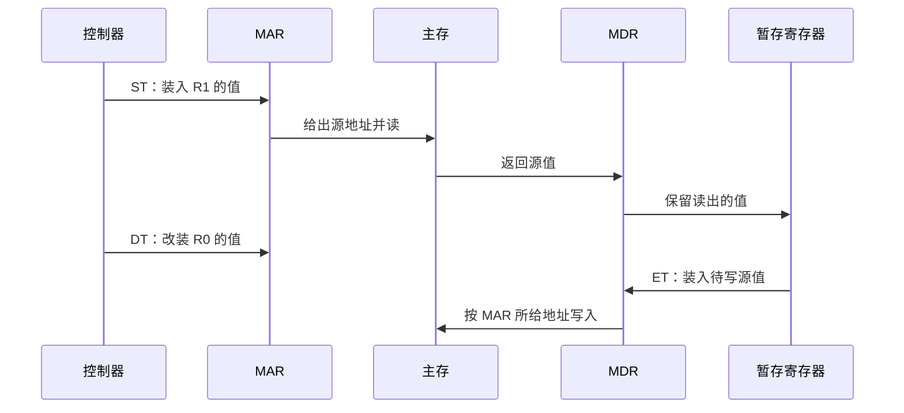

# 《计算机组成与结构》指令系统（复习PPT）

同一页里的“地址”可能指向下一条指令、某个寄存器或数据所在的内存单元。先明确哪一层正在寻址，再问以什么为单位、哪条通路会改写什么。原件第 1–4 页用教学原型机，第 5–9 页改用课堂版 MIPS32；两种机器的 MOV 写法和 PC 步长不能混在一起。原件第 3、4 页重复了两道 MOV 题，第 3 页有手写执行步骤。

## 先取哪条指令，再去取什么数据（原件第 1–4 页）

**1.1、1.2。** 原件分别勾 B、A：共同动作是取指；读取旧 PC 所指内存进入 IR，顺序地址前移一字。原件记录为 $M\to IR$、$PC\gets PC+1$，隐含旧 PC 地址已由 MAR 提供。==先确保读的是旧地址==，并不要求实现一定等到取指全部完成后才能计算新 PC；若旧地址已经锁存，两者可重叠。

**第 2 组。** 原件依序勾 A、B、C、C；最后一小题页上误重复印成“2.1”。FT 为取指，ST 取源操作数，DT 准备目的操作数或目的地址，ET 执行或完成写回。是否要单独走 ST、DT 取决于题设操作数来源，不是每条指令必须四个周期全走。目的操作数若只作写入目标，准备其地址即可，不必把旧值读进来。

| 原题 | 按原件手写规定 | 分阶段推导 |
| --- | --- | --- |
| 3.1 <kbd>MOV R0,R1</kbd> | 把 R1 的值写到 R0 | FT：从旧取指地址把指令读入 IR，更新顺序 PC；ET：$R_0\gets R_1$；按该原型机周期表将下一条机器指令地址 $PC$ 送 MAR |
| 3.2 <kbd>MOV(R0),(R1)</kbd> | 把 R1 所指内存单元的值写到 R0 所指内存单元 | FT 与前一题一致；ST：$MAR\gets R_1$，从主存读到 MDR，再把源值暂存在 C；DT：$MAR\gets R_0$；ET：$MDR\gets C$，写入 $M[MAR]$，再将 $PC$ 送 MAR 准备下次取指 |

**参考解答要点：**第二行为什么要把已有的 MDR 值暂存，而不能只用一次访存？单个 MAR 需要先装源地址、后装目的地址；在第二次访存前，既要让新地址就位，又不能把已读出的源值当作地址或覆盖掉。C 是课件给出的保值途径；本题依照手写微操作路径核对，而不宣称所有实现都必须借这个寄存器。

> [!WARNING]
> 原件的 MOV 运算采用==目的在前、源在后==。两边有括号意味着两者指向的内存参与，寄存器里存的是地址。别把其他汇编写法的顺序搬进来，也别把原型机的 <kbd>PC+1</kbd> 搬给下一节按字节编址的 MIPS32。

## 分清指令位宽、主存编址单位和寄存器编号（原件第 5–6 页）

**4.1、4.2、4.3。** 原件标答依次为 B、A/B/C、B。题中的经典定长 MIPS32 模型用 32 位机器指令，采用 RISC 风格，存储器按字节编址，有 32 个 32 位通用寄存器编号，故寄存器字段需要 $5$ 位（$2^5=32$）。32 个编号不代表 32 个都能随意改写，例如寄存器 0 读作零；一条 32 位指令在按字节编址的存储器中跨 4 个字节，顺序地址加 4 而非加 1。

| 格式 | 位段（高位到低位，每段括号内为宽度） | 怎样确定操作 |
| --- | --- | --- |
| R | op(6)、rs(5)、rt(5)、rd(5)、shamt(5)、funct(6) | 基础 R 型操作由 op 与 funct 配合，原题 5.1 选 C |
| I | op(6)、rs(5)、rt(5)、imm(16) | 原题 5.2 按教材基本格式选 A；低 16 位是立即数或位移等内容，不是 R 型 funct |
| J | op(6)、index(26) | 原题 5.2 同选 A；低 26 位存目标索引 |

**5.3。** 原件选 B：在教材的简化分配中，6 位 op 有 64 种，留一个给基本 R 型，再用这组的 6 位 funct 区分 64 种，余下至多 63 个 op 主码给 I/J 型。**补充：**这是一个编码容量算例，不是完整 MIPS32 指令条数。真实指令编码还可能有其他分派字段、保留组合和固定字段，不能从表中直接推出实际总数。

## 看到“相对”“伪直接”“基址”，先选运算，再代入位段（原件第 7 页）

原件第 6.1–6.4 题依次勾 A、B、A、C；最后一题用 R 型举寄存器直接寻址的代表例，I 型也能使用寄存器操作数。下表计算的是经典教学模型的**地址**，不针对某一实现断言分支延迟槽何时执行。

| 题面信号 | 代表指令格式 | 形成地址或取值的方法 |
| --- | --- | --- |
| 分支比较后跳到附近 | I 型 PC 相对 | 以顺序下一地址 $PC+4$ 为基准，16 位有符号位移按指令字换算为字节偏移后相加 |
| J 型跳转，有 26 位索引 | J 型伪直接 | 取 $PC+4$ 的高 4 位，拼接 26 位索引和低两位零 |
| 访存以某寄存器为基址 | I 型基址 | 寄存器基址加符号扩展的 16 位字节位移；位移不乘 4 |
| 直接用寄存器的内容 | R 型代表例 | 由编号读取寄存器值，不把该值拿去读主存，除非题面另有间接寻址 |

**补充算例与参考解答：**

1. 若分支指令在 <kbd>0x10000020</kbd>，位移字段为 <kbd>0xFFFD</kbd>，先按 16 位补码得 $-3$，换成字节位移 $-12$，以 <kbd>0x10000024</kbd> 为基准得到目标 <kbd>0x10000018</kbd>。若这同一个字段在普通基址访存题中使用，则只加 $-3$ 字节，是否符合访问对齐仍要另查。
2. 若 J 型指令在 <kbd>0x0FFFFFFC</kbd>，目标索引为 3，则 <kbd>PC+4</kbd> 是 <kbd>0x10000000</kbd>，拼出的目标是 <kbd>0x1000000C</kbd>。此例刚好跨过高四位边界，会揭出误用旧 PC 高位的算法。
3. <kbd>addu $5,$3,$4</kbd> 用典型 R 型字段 <kbd>op=0, rs=3, rt=4, rd=5, shamt=0, funct=0x21</kbd>，依位段拼得 <kbd>0x00642821</kbd>。这是字段宽度和寄存器编号的验算，不是原课件新增的考题。

> [!TIP]
> ==相对用加法，伪直接用拼接。== 位移到底以指令为单位还是以字节为单位，要从指令语义判断。无论哪一种，都先定位地址的基准，再处理补码或低位零。

## 一拍要读两个寄存器，就不能只问存储容量（原件第 8–9 页）

**7.1、7.2。** 原件均选 A。寄存器堆采用多端口组织，图中 rs 送读地址 <kbd>Ra</kbd>，rt 送读地址 <kbd>Rb</kbd>，以 R 型为例 rd 送写地址 <kbd>Rw</kbd>。因此要把 03 号读到端口 A，改 rs，而不是 rt 或 rd。写入时还要满足图中写许可与时钟边沿条件；原课件也将该教学部件的读出放在时序图语境下，不能据此一概规定所有寄存器堆的读口都是边沿触发。

**8.1、8.2、8.3。** 原件分别选 B、B、A：教学框图分开指令存储器和数据存储器；题面把前者建模为通过 PC 读指令且无写端口，后者允许数据读写。图中的时钟送到指令存储器，没有给它画数据访存的 <kbd>Mem_read</kbd> 或 <kbd>Mem_write</kbd> 控制线。分开有助于同一时刻取指与访问数据、不争一个端口；这是图中实现的接口安排，不是说 MIPS32 指令集要求机器必须有两套独立物理主存，或规定所有指令不可由软件更新。

关联知识点：[公操作与指令周期](../../../topics/计算机组成/instruction-cycle.md)、[指令执行步骤](../../../topics/计算机组成/instruction-steps.md)、[寻址方式](../../../topics/计算机组成/addressing-mode.md)、[R 型指令](../../../topics/计算机组成/mips-r-type.md)、[I 型指令](../../../topics/计算机组成/mips-i-type.md)、[J 型指令](../../../topics/计算机组成/mips-j-type.md)、[单周期数据通路](../../../topics/计算机组成/single-cycle-datapath.md)。
