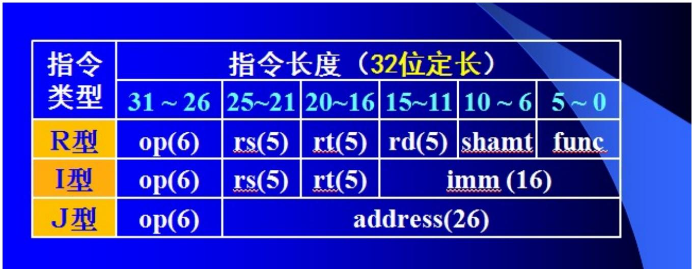
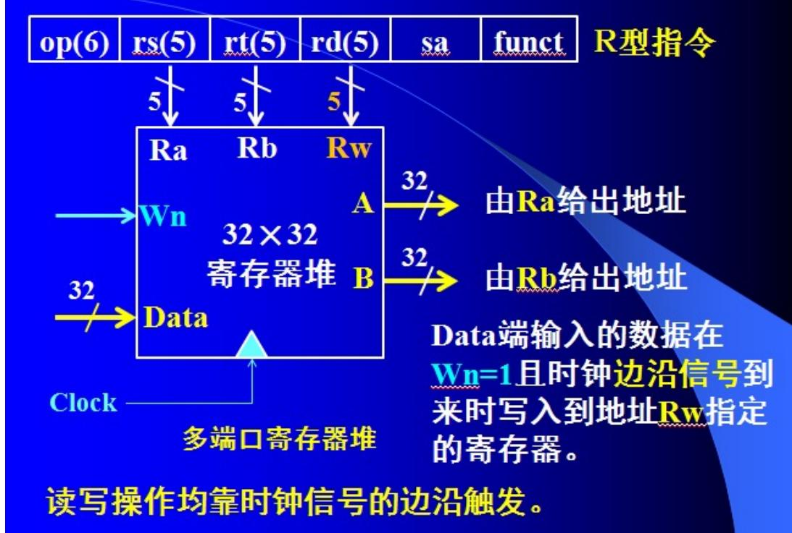
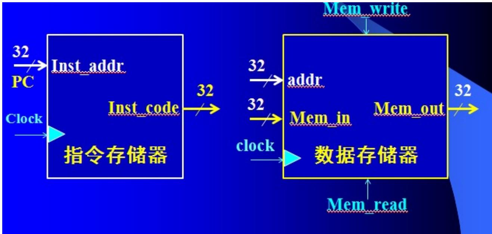

# 《计算机组成与结构》指令系统（复习PPT）

原件经识别和整理；“参考解答”是我们补的。

## 一、公操作与指令周期

### 选择 1

各条指令的公操作为

- A. 取操作数
- B. 取指令（取指）
- C. 取地址

知识点：[MIPS32 R型指令格式与功能（Register，由op配合func字段确定操作）](../../../topics/计算机组成/mips-r-type.md)、[CPU基本部件选型（PC、IR、MAR、MDR、ALU、通用寄存器堆、多路选择器）](../../../topics/计算机组成/cpu-components.md)

### 选择 2

该公操作具体动作由以下哪些具体信号构成

- A. M→IR，PC=PC+1
- B. PC=PC+1，M→IR（内存→指令寄存器）
- C. M→PC，PC=PC+1

知识点：[CPU基本部件选型（PC、IR、MAR、MDR、ALU、通用寄存器堆、多路选择器）](../../../topics/计算机组成/cpu-components.md)、[指令执行步骤与信息传送途径（地址信息、数据信息、转移地址）](../../../topics/计算机组成/instruction-steps.md)

### 选择 3

FT 周期（取指周期）为什么

- A. 取指周期
- B. 源周期
- C. 目的周期

知识点：[MIPS32 I型指令格式与功能（面向运算、访存、条件转移分支等类型）](../../../topics/计算机组成/mips-i-type.md)、[存储器的分类（按存取方式、存储介质等）](../../../topics/计算机组成/memory-classify.md)、[计算机组成五大部件（运算器、控制器、存储器、输入设备、输出设备）](../../../topics/计算机组成/computer-five-parts.md)

### 选择 4

ST 周期（源周期）为什么

- A. 取指周期
- B. 源周期（取原操作数）
- C. 目的周期

知识点：[存储器的分类（按存取方式、存储介质等）](../../../topics/计算机组成/memory-classify.md)、[CPU基本部件选型（PC、IR、MAR、MDR、ALU、通用寄存器堆、多路选择器）](../../../topics/计算机组成/cpu-components.md)

### 选择 5

DT 周期（目的周期）为什么

- A. 取指周期
- B. 源周期
- C. 目的周期（取目标操作数）

知识点：[单周期MIPS32处理器目标指令集与基本数据通路综合](../../../topics/计算机组成/single-cycle-datapath.md)、[单周期主控单元设计（ALU控制单元、PCSrc控制单元、真值表与逻辑式）](../../../topics/计算机组成/control-unit-design.md)

### 选择 6

ET 周期（执行周期）为什么

- A. 取指周期
- B. 源周期
- C. 执行周期

## 二、指令执行步骤

知识点：[MIPS32 R型指令格式与功能（Register，由op配合func字段确定操作）](../../../topics/计算机组成/mips-r-type.md)、[MIPS32 I型指令格式与功能（面向运算、访存、条件转移分支等类型）](../../../topics/计算机组成/mips-i-type.md)、[MIPS32 J型指令格式与功能（Jump跳转指令）](../../../topics/计算机组成/mips-j-type.md)

### 简答 1

写出 MOV R0，R1 指令的执行步骤

知识点：[指令执行步骤与信息传送途径（地址信息、数据信息、转移地址）](../../../topics/计算机组成/instruction-steps.md)、[公操作与指令周期（取指、间址、执行、中断周期）](../../../topics/计算机组成/instruction-cycle.md)

### 简答 2

写出 MOV (R0)，(R1) 指令的执行步骤

## 三、MIPS32 指令系统

知识点：[指令执行步骤与信息传送途径（地址信息、数据信息、转移地址）](../../../topics/计算机组成/instruction-steps.md)、[MIPS32 I型指令格式与功能（面向运算、访存、条件转移分支等类型）](../../../topics/计算机组成/mips-i-type.md)、[寻址方式（寄存器直接寻址、立即数寻址、基准地址寻址等）](../../../topics/计算机组成/addressing-mode.md)

### 选择 1

MIPS32 CPU 构架规定单条指令长度为

- A. 16 位
- B. 32 位
- C. 64 位

知识点：[MIPS32 R型指令格式与功能（Register，由op配合func字段确定操作）](../../../topics/计算机组成/mips-r-type.md)、[CPU基本部件选型（PC、IR、MAR、MDR、ALU、通用寄存器堆、多路选择器）](../../../topics/计算机组成/cpu-components.md)

### 选择 2

MIPS32 的 CPU 特点（多选）

- A. 存储器按字节编址
- B. 32 个可用的 32 位寄存器
- C. RISC 架构

补充：1 字 = 32 bit = 4 B

知识点：[CPU基本部件选型（PC、IR、MAR、MDR、ALU、通用寄存器堆、多路选择器）](../../../topics/计算机组成/cpu-components.md)、[指令执行步骤与信息传送途径（地址信息、数据信息、转移地址）](../../../topics/计算机组成/instruction-steps.md)

### 选择 3

MIPS32 CPU 的寄存器寻址需要提供多少位地址码（共 32 个寄存器）

- A. 4
- B. 5
- C. 6

知识点：[MIPS32 I型指令格式与功能（面向运算、访存、条件转移分支等类型）](../../../topics/计算机组成/mips-i-type.md)、[存储器的分类（按存取方式、存储介质等）](../../../topics/计算机组成/memory-classify.md)、[计算机组成五大部件（运算器、控制器、存储器、输入设备、输出设备）](../../../topics/计算机组成/computer-five-parts.md)

### 选择 4

MIPS32 CPU 构架下 R 型指令的结构中操作码由什么构成

- A. OP
- B. FUNC
- C. OP+FUNC

| 指令 | 指令长度（32 位定长） | 类型 | 31~26 | 25~21 | 20~16 | 15~11 | 10~6 | 5~0 |
| --- | --- | --- | --- | --- | --- | --- | --- | --- |
| R 型 | 32 位 | R | op(6) | rs(5) | rt(5) | rd(5) | shamt(5) | func(6) |
| I 型 | 32 位 | I | op(6) | rs(5) | rt(5) | imm(16) | — | — |
| J 型 | 32 位 | J | op(6) | address(26) | — | — | — | — |

知识点：[存储器的分类（按存取方式、存储介质等）](../../../topics/计算机组成/memory-classify.md)、[CPU基本部件选型（PC、IR、MAR、MDR、ALU、通用寄存器堆、多路选择器）](../../../topics/计算机组成/cpu-components.md)

### 选择 5

J 型和 I 型指令的操作码由什么构成

- A. OP
- B. FUNC
- C. OP+FUNC

补充：op 字段区分 R/I/J 型指令。

知识点：[单周期MIPS32处理器目标指令集与基本数据通路综合](../../../topics/计算机组成/single-cycle-datapath.md)、[单周期主控单元设计（ALU控制单元、PCSrc控制单元、真值表与逻辑式）](../../../topics/计算机组成/control-unit-design.md)

### 选择 6

以下哪句话是合理的

- A. R 型指令最多可以设计为 64 条，同时 I 和 J 型指令一共为 64 条
- B. R 型指令最多可以设计为 64 条，同时 I 和 J 型指令一共为 63 条
- C. R 型指令最多可以设计为 63 条，同时 I 和 J 型指令一共为 63 条

补充：例如：OP=000000 为 R 型指令，其余 $2^6-1=63$ 条为 I 和 J 型指令；R 型 func 段 $2^6=64$ 条。

知识点：[MIPS32 R型指令格式与功能（Register，由op配合func字段确定操作）](../../../topics/计算机组成/mips-r-type.md)、[MIPS32 I型指令格式与功能（面向运算、访存、条件转移分支等类型）](../../../topics/计算机组成/mips-i-type.md)、[MIPS32 J型指令格式与功能（Jump跳转指令）](../../../topics/计算机组成/mips-j-type.md)

### 选择 7

MIPS32 CPU 下 PC 相对寻址属于哪种类型指令

- A. I
- B. J
- C. R

知识点：[MIPS32 I型指令格式与功能（面向运算、访存、条件转移分支等类型）](../../../topics/计算机组成/mips-i-type.md)、[寻址方式（寄存器直接寻址、立即数寻址、基准地址寻址等）](../../../topics/计算机组成/addressing-mode.md)、[MIPS32 R型指令格式与功能（Register，由op配合func字段确定操作）](../../../topics/计算机组成/mips-r-type.md)

### 选择 8

伪直接寻址属于哪种类型指令

- A. I
- B. J
- C. R

知识点：[MIPS32 J型指令格式与功能（Jump跳转指令）](../../../topics/计算机组成/mips-j-type.md)、[寻址方式（寄存器直接寻址、立即数寻址、基准地址寻址等）](../../../topics/计算机组成/addressing-mode.md)

### 选择 9

基址寻址属于哪种类型指令

- A. I
- B. J
- C. R

知识点：[寻址方式（寄存器直接寻址、立即数寻址、基准地址寻址等）](../../../topics/计算机组成/addressing-mode.md)、[MIPS32 I型指令格式与功能（面向运算、访存、条件转移分支等类型）](../../../topics/计算机组成/mips-i-type.md)

### 选择 10

寄存器（直接）寻址属于哪种类型指令

- A. I
- B. J
- C. R

## 四、存储器结构

知识点：[寻址方式（寄存器直接寻址、立即数寻址、基准地址寻址等）](../../../topics/计算机组成/addressing-mode.md)、[MIPS32 I型指令格式与功能（面向运算、访存、条件转移分支等类型）](../../../topics/计算机组成/mips-i-type.md)

### 选择 1

MIPS32 中的寄存器组一般采用什么存储结构

- A. 多端口存储器
- B. 单端口存储器
- C. 并行存储器

知识点：[MIPS32 R型指令格式与功能（Register，由op配合func字段确定操作）](../../../topics/计算机组成/mips-r-type.md)、[CPU基本部件选型（PC、IR、MAR、MDR、ALU、通用寄存器堆、多路选择器）](../../../topics/计算机组成/cpu-components.md)

### 选择 2

如图所示寄存器堆，如果需要读出 03 地址寄存器内容给 A，则需要什么信号为 03

- A. RS=03
- B. RT=03
- C. RD=03

知识点：[CPU基本部件选型（PC、IR、MAR、MDR、ALU、通用寄存器堆、多路选择器）](../../../topics/计算机组成/cpu-components.md)、[指令执行步骤与信息传送途径（地址信息、数据信息、转移地址）](../../../topics/计算机组成/instruction-steps.md)

### 选择 3

MIPS32 的存储器一般采用

- A. 统一指令存储器+数据存储器
- B. 独立指令存储器+独立数据存储器

知识点：[MIPS32 I型指令格式与功能（面向运算、访存、条件转移分支等类型）](../../../topics/计算机组成/mips-i-type.md)、[存储器的分类（按存取方式、存储介质等）](../../../topics/计算机组成/memory-classify.md)、[计算机组成五大部件（运算器、控制器、存储器、输入设备、输出设备）](../../../topics/计算机组成/computer-five-parts.md)

### 选择 4

指令存储器和数据存储器的读写权限

- A. 指令存储器只读，数据存储器只读
- B. 指令存储器只读，数据存储器读写
- C. 指令存储器读写，数据存储器读写

知识点：[存储器的分类（按存取方式、存储介质等）](../../../topics/计算机组成/memory-classify.md)、[CPU基本部件选型（PC、IR、MAR、MDR、ALU、通用寄存器堆、多路选择器）](../../../topics/计算机组成/cpu-components.md)

### 选择 5

下图指令存储器读取信号为

- A. Clock
- B. clock+mem_write
- C. clock+mem_read

知识点：[单周期MIPS32处理器目标指令集与基本数据通路综合](../../../topics/计算机组成/single-cycle-datapath.md)、[单周期主控单元设计（ALU控制单元、PCSrc控制单元、真值表与逻辑式）](../../../topics/计算机组成/control-unit-design.md)
