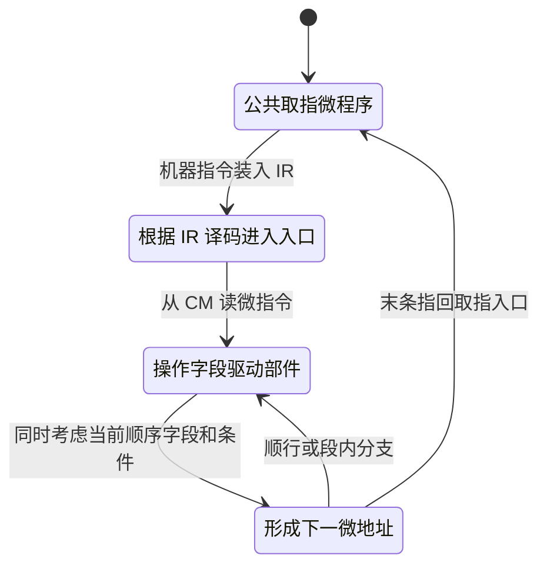

# 《计算机组成与结构》控制器 复习课件

同一条指令往往要求先读寄存器、再运算、最后选择写回位置；但总线和运算部件不是随时可供所有操作同时使用。控制器要在每个节拍给出一组不冲突的信号，同时决定下一拍做什么。原件第 1–8 页围绕这个过程复习，第 9–10 页给出教学版 MIPS32 控制器及微指令宽度，第 11 页对照硬连线和微程序。原题与另加的算例分开讨论。

## 先认两层程序、两种地址（原件第 1–5 页）

第 **1.1** 题原件标 A，即组合逻辑用电路根据指令、时序状态和条件产生控制信号。第 **1.2** 题标 B，即微程序方式先在控制存储器保存微指令，再从当下微指令产生控制信号。两种实现都靠硬件；这个区别问的是==控制时序主要由电路组织，还是由微指令序列组织==。硬连线控制器也可能用状态寄存器记住“现在是第几拍”，不是整个控制器都没有记忆。

| 对象 | 存什么、指向什么 | 对应原题 |
| --- | --- | --- |
| PC 与 IR | PC 指向程序中的机器指令，IR 暂存当前机器指令，供译码、选择操作数和进入微程序使用 | 第 2.1 题中直接相关的是 IR，不是 PC |
| 微地址寄存器 uAR / uPC | 给控制存储器 CM 选择微地址；指向的是控制状态，不是程序指令 | 第 3.1 题的组成之一 |
| CM | 保存微指令；原模型以 ROM 为 CM，按微指令字组织时，一个条目存一条微指令 | 第 2.2、2.5 题分别为 A、B |
| 微指令寄存器 uIR | 锁存当前执行的微指令；操作字段交给控制输出，顺序字段交给地址形成部件 | 第 2.3、2.4 题分别为 A、B |
| 微地址形成与微命令译码 | 前者依据 IR、PSW、I/O 条件及顺序字段选下一微地址，后者负责把操作字段变为控制信号 | 第 2.1 题为 A；两者与 CM、uIR、uAR 构成第 3.1 题的五个部件 |

> [!WARNING]
> **订正：**旧笔记把“掉电丢失数据”并到了 Flash。通常掉电丢失的是易失性 RAM，Flash 和常见 ROM 掉电后仍存数据；本题的 CM 采用 ROM 不代表控制存储器只能用 ROM。原件第 2.5 题按“一个微指令条目”设问，第 8 组另说明字节寻址时一个条目可以占多个地址，两个口径不要混用。

第 **2.6** 题标 A：在本模型中，一条机器指令由一段微程序实现，取指等公共片段可以被多种指令共享。微程序由若干条微指令组成；一条微指令可发出一个或多个相容的微命令。第 **2.7** 题原件把“指示部件运作的电信号”标为 A，意在排除机器指令与微指令。**订正：**术语上，发给寄存器的写入使能是**微命令**，寄存器实际完成一次装入是**微操作**；第 **2.8** 题按本课的一一对应口径选 A。

第 **3.2** 题问“怎样回到取指”：先用公共取指微程序把机器指令装入 IR，再依据操作码及必要的寻址信息进入对应入口；最后由本段末条微指令的顺序字段跳回公共入口。第 **4.1** 题原件标 A、B：安排入口要方便寻址，内部条目要便于规整组织。第 **4.2** 题原件标 A：问的是怎样按当前机器指令分派到**入口**，不是已经分派后怎样选段内下一条。

## 位数限制的是编码，字段决定能否同时做（原件第 6–7 页）

第 **5.1** 题原件标 A：互斥操作适合放在同一字段中，因为一个字段在一拍只能选一个码。例如 A 通路不能既选 PC 又选同一端口上的寄存器来源；而“选 A 路来源”和“把结果写入某个寄存器”可以同拍，不能只因二者都要控制就串成同一个互斥选择。

第 **5.2** 题原件标 C。图中数据通路小字段宽度依次是 A 路选择 3 位、B 路选择 3 位、运算 5 位、最低位进位控制 2 位、移位选择 2 位。三位最多区分 $2^3=8$ 个**编码**；若留一个码表示未使用或无操作，有效选择会减少。第 **5.3** 题区分==选择哪一类来源==和==该类内部选具体哪一个==：例如某编码指定“来自通用寄存器”，具体寄存器号另由 IR 的操作数地址位选择；单独的 MDR 来源则不需要寄存器编号。

第 **6.1** 题按功能细分标 A、B、C、D、E：数据通路、结果分配、访存动作、辅助控制、顺序控制。粗分则是“现在做什么”的微命令部分与“下一步去哪”的顺序/下地址部分。第 **6.2** 题标 A、B：顺序执行时用增量取得下一条，断定方式则由字段和条件决定转向，不是“一遇到条件也加固定一步”。

## 从字段统计到微地址增量（原件第 9–10 页）

第 **8.1–8.2** 题讨论的是第 9 页这一份教学版 MIPS32 设计。框图中，主存读写、IR 锁存、寄存器堆写入、ALU 来源、操作选择、PC 新值来源各需要控制；它们在微指令中形成 18 位微命令字段。其余为 4 位未使用、8 位下地址、2 位顺序控制码，合计 $18+4+8+2=32$ 位，故 **8.2 选 B**。这里的 32 位由图中字段加总得出；“MIPS32”并不规定每一种实现的微指令一定有 32 位，甚至不要求实现采用微程序。

| 原题 | CM 的地址单位 | 一条微指令占多少地址 | 紧密排列且顺序执行时 |
| --- | --- | --- | --- |
| 8.3、8.4 | 1 字节（8 位） | $32/8=4$，8.3 选 A | $uPC_{\text{next}}=uPC+4$，8.4 选 B |
| 8.5 | 1 个 16 位字 | $32/16=2$，对应 8.3 选 B | $uPC_{\text{next}}=uPC+2$，对应 8.4 选 C |
| 补充对照 | 1 个 32 位微指令字 | 1 | 顺序下一条的入口编号加 1 |

> [!TIP]
> 算增量先找==每个地址单位含多少位==，再用微指令位宽除以它。题目问分支时要找目标地址，不能再把顺序增量加到目标上。表中按紧密、固定长度的原题假设；设计另有对齐、空洞或变长格式时要据其布局重算。

**补充：**假设同一片 CM 中字节偏移 24、28、32 依次有三条微指令，公共取指入口在偏移 0。第一条必顺行，第二条在 PSW 的零条件成立时跳转至入口，否则顺行，第三条无条件回入口。零条件成立时，按字节编址的访问序列为 $24\to28\to0$，不成立时为 $24\to28\to32\to0$；换成 16 位字编址则分别为 $12\to14\to0$ 与 $12\to14\to16\to0$。两组编号访问的是同一批物理字节，改变的是记地址的单位，不是执行了更多或更少微指令。

## 一条微指令读得快，整台处理器就一定快吗（原件第 8、11 页）

硬连线方式常少一次保存微指令的存储器读取，控制路径有机会更短；设计改动则可能涉及重新设计状态转换和译码。微程序把变化集中到规整的表项，便于系统化设计、扩展一系列兼容机器、诊断和维护；代价是增加控制存储和取微指令的路径，有的机器也会把一条机器指令拆成更多拍。课件把“成本较高”“CPI 会变大”列为这种教学方案下的代价；两者不应当成普遍定律，实际取决于微指令条数、时钟周期、控制存储容量与电路复杂度。比较整条机器指令的时间，需同时核对使用的周期数和每一周期的时长。

相关知识点：[硬连线控制](../../../topics/计算机组成/hardwired-control.md)、[微程序控制](../../../topics/计算机组成/microprogram-control.md)、[微指令格式](../../../topics/计算机组成/micro-instruction-format.md)、[微地址形成](../../../topics/计算机组成/micro-address-form.md)、[多周期控制系统](../../../topics/计算机组成/multi-cycle-control.md)、[指令流程与微命令](../../../topics/计算机组成/instruction-flow.md)。
