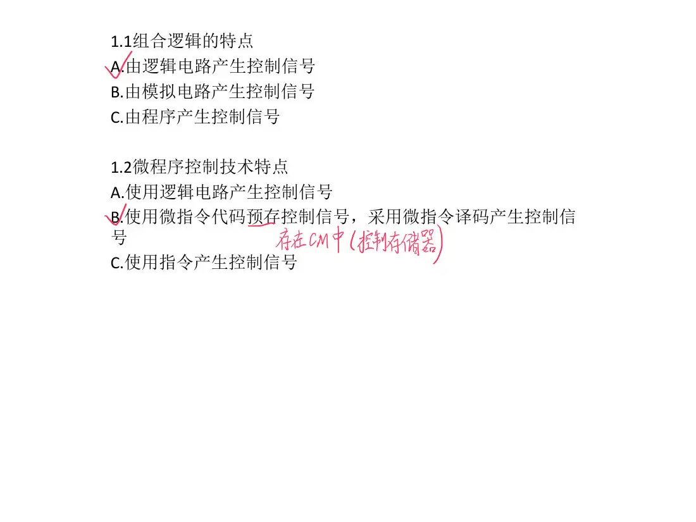
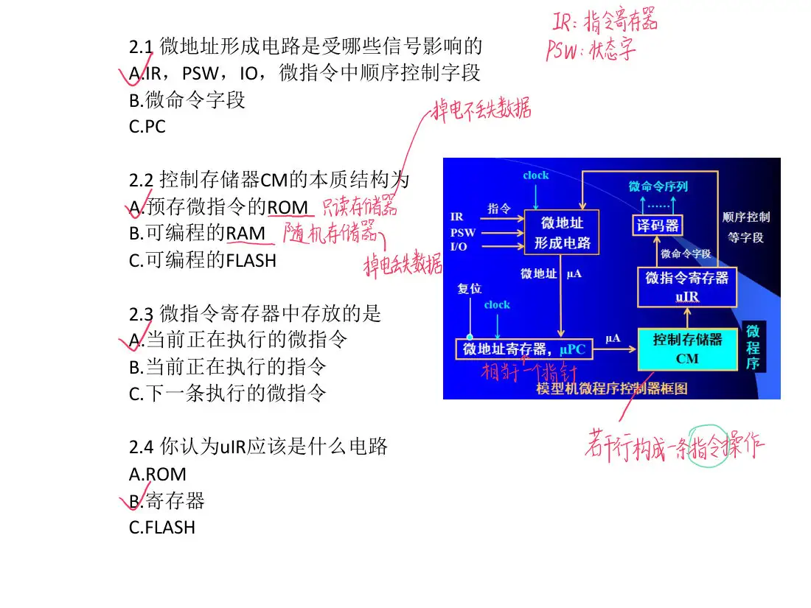
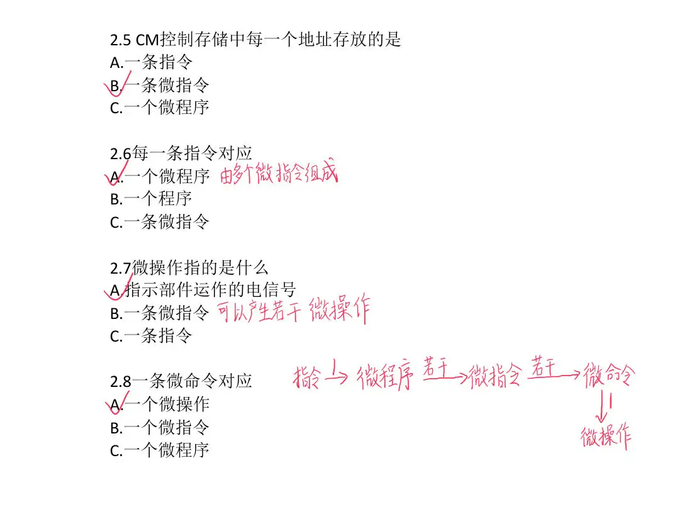
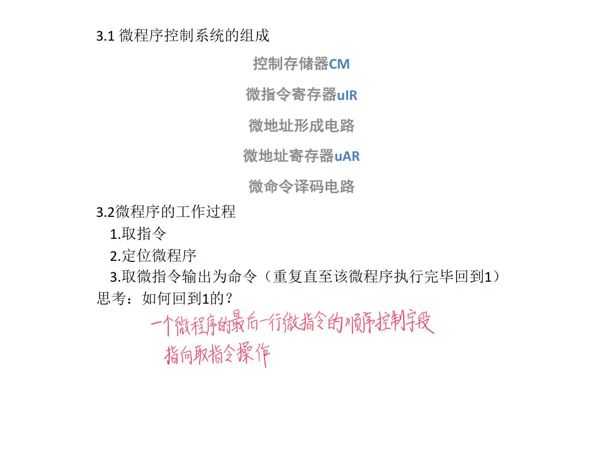
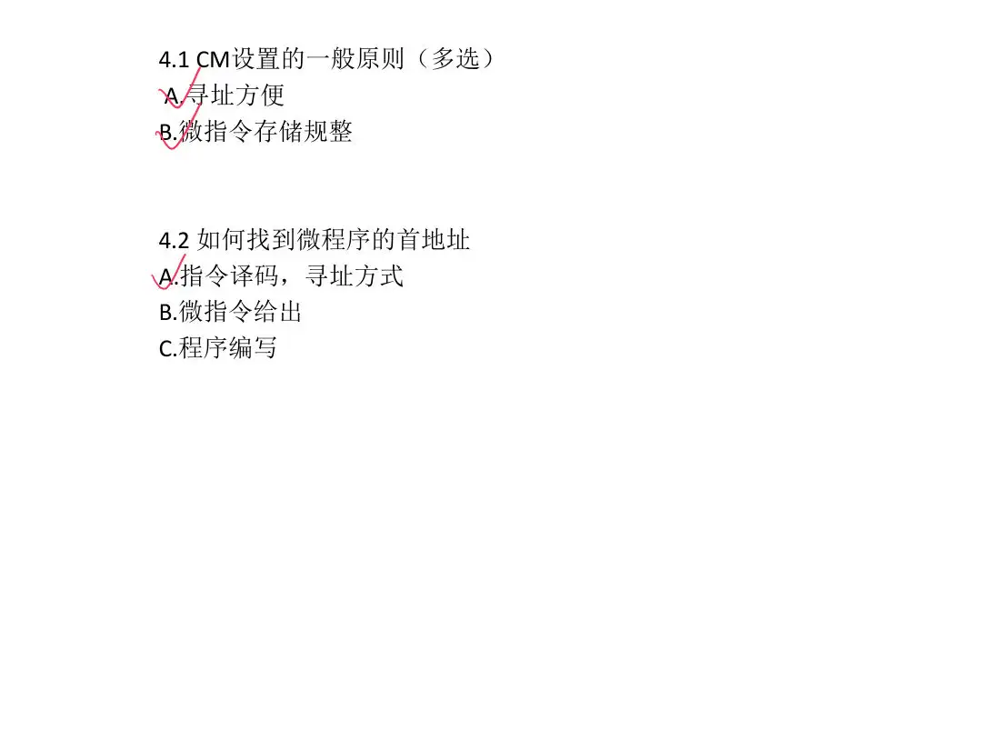
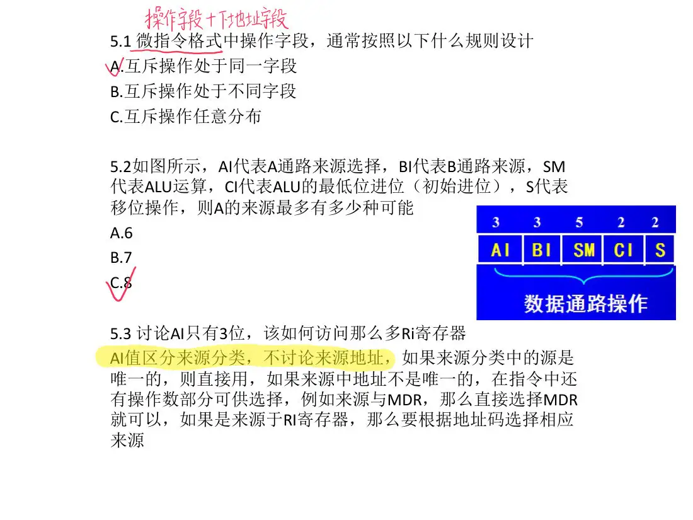
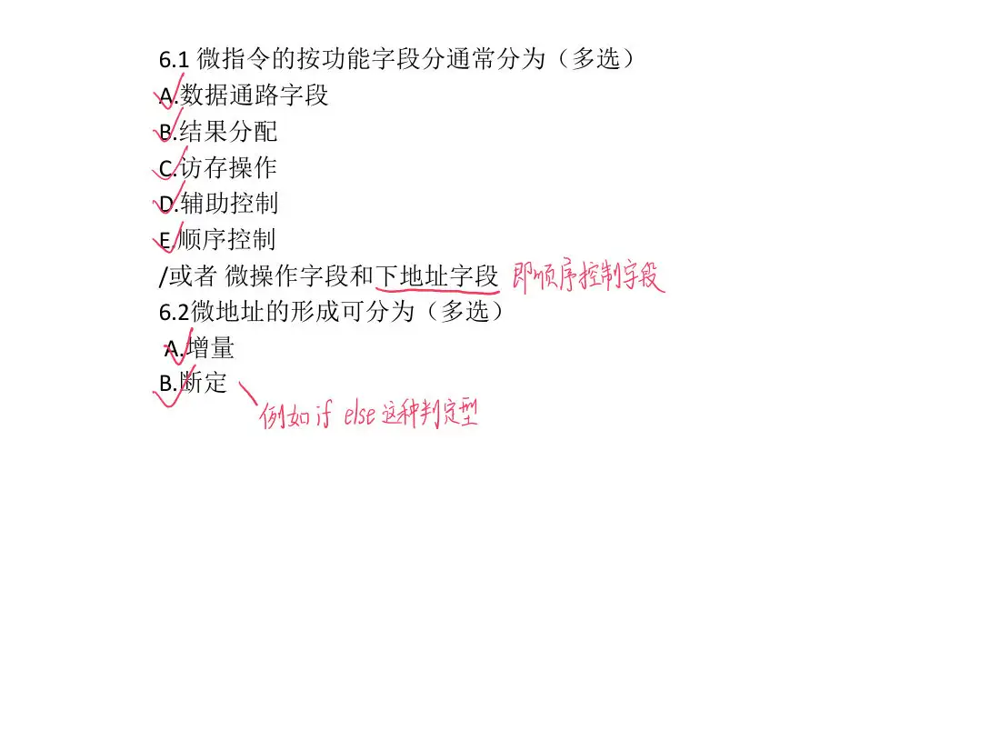
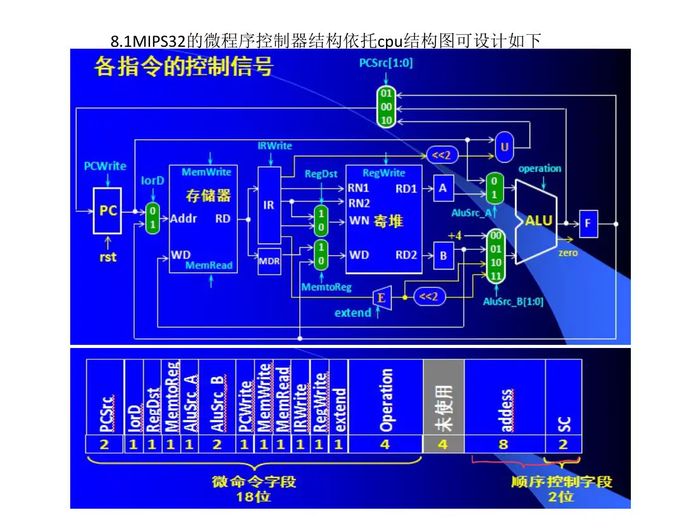
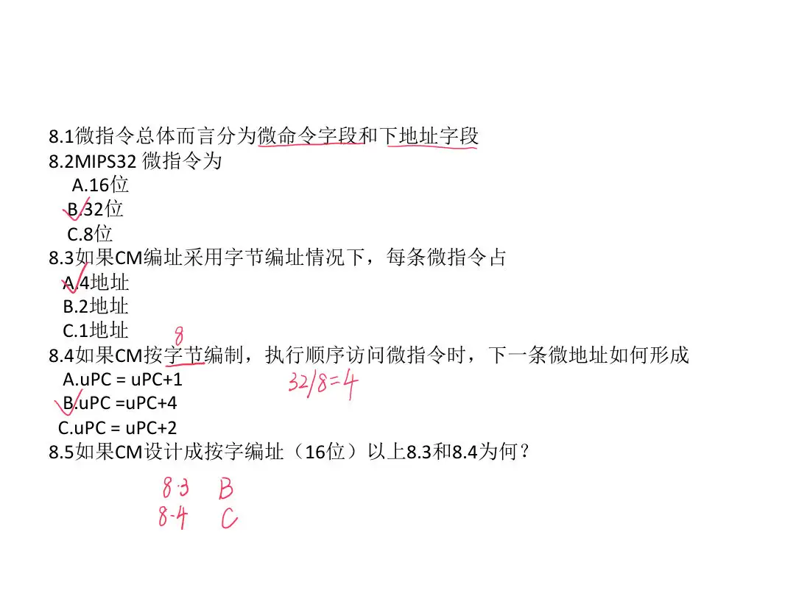
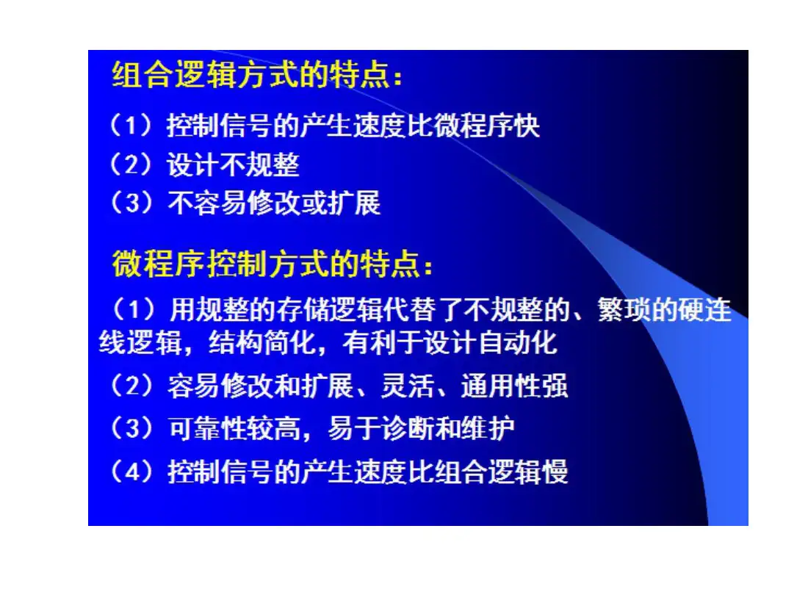

# 《计算机组成与结构》控制器 复习课件

原件的每一页，下面附识别出的文字。

### 1.1 组合逻辑的特点

原文：

1.1 组合逻辑的特点
A. 由逻辑电路产生控制信号
B. 由模拟电路产生控制信号
C. 由程序产生控制信号

1.2微程序控制技术特点
A.使用逻辑电路产生控制信号
B.使用微指令代码预存控制信号，采用微指令译码产生控制信号
存在CM中(控制存储器)
C.使用指令产生控制信号

### 2.1 微地址形成电路是受哪些信号影响的

原文：

2.1 微地址形成电路是受哪些信号影响的
A. IR, PSW, IO, 微指令中顺序控制字段
B. 微命令字段
C. PC

2.4 你认为uIR应该是什么电路
A. ROM
B. 寄存器
C. FLASH

IR: 指令寄存器
PSW: 状态字

2.2 控制存储器CM的本质结构为
A. 预存微指令的ROM 只读存储器
B. 可编程的RAM 随机存储器
C. 可编程的FLASH 掉电丢失数据

2.3 微指令寄存器中存放的是
A. 当前正在执行的微指令
B. 当前正在执行的指令
C. 下一条执行的微指令

若干行构成一条指令操作

### 2.5 CM控制存储中每一个地址存放的是

原文：

2.5 CM控制存储中每一个地址存放的是
A. 一条指令
B. 一条微指令
C. 一个微程序

2.6 每一条指令对应
A. 一个微程序 由多个微指令组成
B. 一个程序
C. 一条微指令

2.7微操作指的是什么
A.指示部件运作的电信号
B.一条微指令可以产生若干微操作
C.一条指令

2.8一条微命令对应
A.一个微操作
B.一个微指令
C.一个微程序

### 3.1 微程序控制系统的组成

原文：

3.1 微程序控制系统的组成

控制存储器CM

微指令寄存器uIR

微地址形成电路

微地址寄存器uAR

微命令译码电路

3.2微程序的工作过程

1. 取指令

2. 定位微程序

3. 取微指令输出为命令（重复直至该微程序执行完毕回到1）思考：如何回到1的？
一个微程序的最后一行微指令的顺序控制字段
指向取指令操作

### 4.1 CM设置的一般原则（多选）

原文：

4.1 CM设置的一般原则（多选）
A. 寻址方便
B. 微指令存储规整

4.2 如何找到微程序的首地址
A. 指令译码，寻址方式
B. 微指令给出
C. 程序编写

### 操作字段+下地址字段

原文：

操作字段+下地址字段

5.1 微指令格式中操作字段，通常按照以下什么规则设计
A. 互斥操作处于同一字段
B. 互斥操作处于不同字段
C. 互斥操作任意分布

5.2如图所示，AI代表A通路来源选择，BI代表B通路来源，SM代表ALU运算，CI代表ALU的最低位进位（初始进位），S代表

移位操作, 则A的来源最多有多少种可能 A.6 B.7 C.8

5.3 讨论AI只有3位，该如何访问那么多Ri寄存器

AI值区分来源分类，不讨论来源地址，如果来源分类中的源是唯一的，则直接用，如果来源中地址不是唯一的，在指令中还有操作数部分可供选择，例如来源与MDR，那么直接选择MDR就可以，如果是来源于RI寄存器，那么要根据地址码选择相应来源

### 6.1 微指令的按功能字段分通常分为（多选）

原文：

6.1 微指令的按功能字段分通常分为（多选）

A.数据通路字段

B. 结果分配

C.访存操作

D.辅助控制

E.顺序控制

/或者 微操作字段和下地址字段 即顺序控制字段

6.2微地址的形成可分为（多选）

A.增量

B. 断定

例如 if else 这种判定型

### 7.1 微程序控制方式的优点

原文：

7.1 微程序控制方式的优点

用规整的存储逻辑结构代替了不规整的、复杂的硬连接逻辑，

结构得到了简化，有利于设计自动化

容易修改和扩展、灵活、通用性强

适合做系列机的控制器

可靠性较高，易于诊断和维护

涉及访存，故速度慢，CPI会变大。

硬件成本高。

### 第 9 页

### 8.1微指令总体而言分为微命令字段和下地址字段

原文：

8.1微指令总体而言分为微命令字段和下地址字段
8.2MIPS32 微指令为
A.16位
B.32位
C.8位

8.3如果CM编址采用字节编址情况下，每条微指令占
A.4地址
B.2地址
C.1地址

8.4如果CM按字节编制,执行顺序访问微指令时,下一条微地址如何形成
A.uPC = uPC + 1
B.uPC = uPC + 4
C.uPC = uPC + 2 $32/8 = 4$

8.5如果CM设计成按字编址（16位）以上8.3和8.4为何？
8.3 B
8.4 C

### 组合逻辑方式的特点:

原文：

组合逻辑方式的特点:

(1) 控制信号的产生速度比微程序快

(2) 设计不规整

(3) 不容易修改或扩展

微程序控制方式的特点：

(1) 用规整的存储逻辑代替了不规整的、繁琐的硬连线逻辑，结构简化，有利于设计自动化

(2) 容易修改和扩展、灵活、通用性强

(3) 可靠性较高, 易于诊断和维护

(4) 控制信号的产生速度比组合逻辑慢
