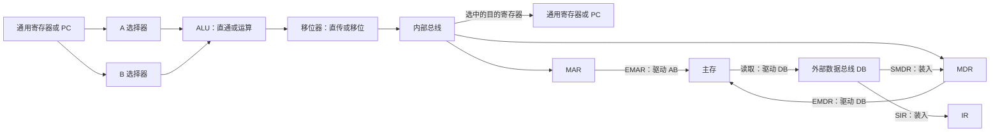
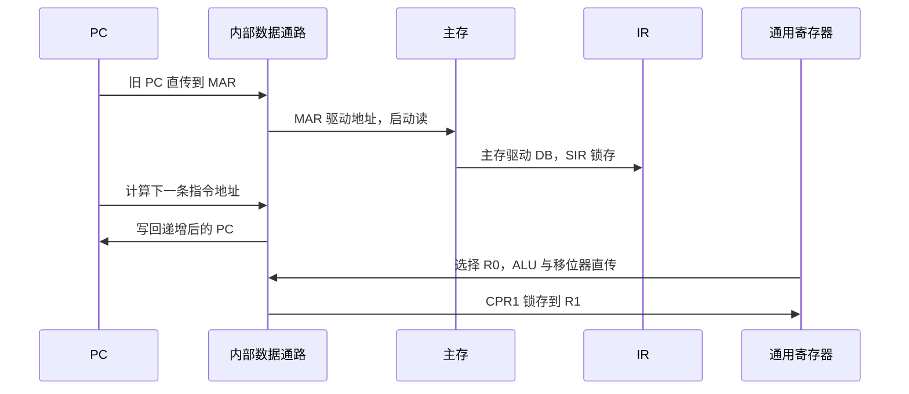

# 《计算机组成与结构》数据通路复习题

这组题用原件图 3-43 的教学模型，追踪数据**从哪个部件出发、沿哪条总线传播、最后由谁接收**。不要把其他机器的习惯线路套进来：本图允许从主存数据总线直接装入指令寄存器，并不规定指令一定先经过主存数据寄存器。下文按题号核对；原件第 11、12 页是同一题的两版批注，按一题计。

## 读图的起点：先认地址、数据与控制

| 部件 | 在本图中的职责 | 易混点 |
| --- | --- | --- |
| PC、SP、PSW | PC 给出取指地址；SP 记录栈顶相关地址；PSW 保存处理器状态 | 程序由别处转入时要改 PC，不是改 SP 或 PSW。 |
| MAR | 锁存主存地址，经地址总线 AB 向主存提供地址 | 放进去的应该是“存到哪里”或“从哪里读”。 |
| MDR、IR | MDR 可收发主存数据信息；IR 保存当前指令，向控制逻辑提供译码信息 | 两者都可从 DB 接收，但锁存到哪个由控制信号决定。 |
| A、B 选择器，ALU，移位器 | 左右输入分别选择来源，运算后经移位器到内总线 | 一路只能选择一个源；直传仍须选对 ALU 输入和结果接收端。 |

## 逐题核对：把选项还原为微操作

### 第 1–4 题：同是传送，目的端为什么不同

- **第 1 题，参考解答：A，PC。** 原件选项是 PC、SP、PSW，并勾选 A；旧识别将后续选项字母并入前一项，曾误给 B。程序计数器用于提出取指地址，栈指针不承担这项职责。
- **第 2 题，参考解答：A。** MAR 是地址寄存器，MDR 是数据寄存器；图中分别连向 AB、DB。看到“地址总线”和“数据总线”即可定位，不必仅背缩写。
- **第 3 题，参考解答：A。** 将 R0 的值交给 A 路，ALU 选 A 直通、移位器直传，结果通过内总线写到 R1。IR 负责当前指令，不是通用数据过路点。第 7 题将用另一条也存在的通路实现同一目的。
- **第 4 题，参考解答：A。** ==“R1 所指”意味着 R1 提供地址，不是提供欲写的数据==。先将 R1 的值经 A 路装入 MAR，再将 R0 的值经 A 路装入 MDR，最后按 MAR 指定的地址把 MDR 写到主存。原件红笔勾形靠近 B，但旁边手写的两条路径分别为 R1 到 MAR、R0 到 MDR，与选项 A 一致。**订正：**按题意和实际连线，交换两个角色的 B 不成立。

### 第 5–6 题：执行完 MOV 和决定下一条指令不是同一步

**第 5 题，参考解答：A、B 两种路径均成立。** 原件在 A、B 前均有红勾并标出 PC 递增。PC 可作为 A 或 B 的输入；先通过直通运算把旧 PC 送到 MAR，再从主存经 DB 直接装入 IR。PC 回写时需要改选“递增到下一条指令地址”的运算，而不是再次直传旧 PC。最后按第 3 题完成 R0 到 R1。这里把微操作按依赖顺序描述，不假定一定几个时钟，也不假定所有指令架构的 PC 步长相同。

**订正：**旧识别把“PC 递增”的批注当成某选项最后额外的一步，并选 C。原图的 IR 有自身锁存信号，取指不必先装 MDR；若有意用 MDR 中转，必须额外安排锁存与重新驱动总线的操作，不能把选项 C 写出的箭头当作这道题的指定直接路径。

**第 6 题，参考解答：A。** 此题给的是“R0 已经是转移目标地址”，只需 B 路直通、移位器直传后写入 PC。不应把 R0 送 MAR 再取主存中的某个目标值，那会变成不同的寻址。PC 更新完成后，下一次取指才按新 PC 访问程序存储器。

### 第 7–11 题：驱动总线和锁存总线不能互换

| 题号 | 参考解答 | 如何由电路验算 |
| --- | --- | --- |
| 7：R0 传给 R1 | B | B 路取 R0，ALU 直通 B，移位器直传，结果分配 CPR1。A 的来源与直通一致，却写入 R2；印刷版 C 只给 A 路装入 R0，却直通 B 路。原件另以红笔示意把 C 的直通改为 A，改后能走通，但不是 C 的原印文字。 |
| 8：R1 与 R0 相加写 R2 | A、B | 图中的两路均可选 R0 或 R1；对本题加法而言，交换两个输入仍得到同一值，最后均使能 CPR2。C 让同一个 A 选择器同时选两源，线路不成立。 |
| 9：从 MDR 写主存 | B | EMDR 使 MDR 驱动 DB；原图的 $R/W=0/1$ 才让主存写入。完整写周期还须让 MAR 驱动有效地址。旧识别选择 C，正好反转了读写方向。 |
| 10：从 MAR 输出地址 | A | 选项中只有 A 使能 EMAR。它给的是一种写的组合；若问一般地址阶段，则读和写都需要地址，EMAR 不会决定读写方向。 |
| 11：主存数据进 IR | A | 本图读模式是 $R/W=1/0$，主存驱动 DB，SIR 使 IR 接收。SMDR 是让 MDR 接收；EMDR 则是让 MDR **输出**，不应在主存同时驱动 DB 时开启。 |

> [!TIP]
> ==E 是让部件把值送上总线，S 是让部件从总线接收==，但仅在这份题的命名口径内使用。把 $R/W$ 看成图中两根信号线的组合，不要当成一个标着“读写”的高低电平：$0/0$ 禁用，$0/1$ 写，$1/0$ 读；原件没有规定 $1/1$ 可用。

## 补充算例：从取指地址到下一条地址

在按字寻址、这条指令占一字的教学模型中，假设 <kbd>PC=0x0100</kbd>，<kbd>R0=0x002A</kbd>，且 <kbd>M[0x0100]=0xAA55</kbd> 仅用作令控制器执行题中 MOV 的示意字样，并非真实指令编码。

**参考解答：**取指时 MAR 为 <kbd>0x0100</kbd>，IR 锁存 <kbd>0xAA55</kbd>；在所设步长下 PC 更新为 <kbd>0x0101</kbd>，执行后 R1 为 <kbd>0x002A</kbd>。MOV 不改写内存。如果改为第 4 题，设 R1 初值是 <kbd>0x0200</kbd>，则执行阶段将 <kbd>0x002A</kbd> 写到 <kbd>M[0x0200]</kbd>，R1 仍为 <kbd>0x0200</kbd>。

> [!WARNING]
> 普通寄存器传送与寄存器间接写主存都可能出现 R0 和 R1。找准最后一条边即可自检：前者的终点是 R1 本身，后者的终点是由 R1 值定位的主存单元。若把“改了 R1”和“改了 R1 所指的值”混在一起，运算器直通得再对也答错题。

相关知识点：[CPU 基本部件](../../../topics/计算机组成/cpu-components.md)、[原型机的数据通路](../../../topics/计算机组成/data-path-16bit.md)、[寻址方式](../../../topics/计算机组成/addressing-mode.md)、[指令周期](../../../topics/计算机组成/instruction-cycle.md)、[指令执行步骤](../../../topics/计算机组成/instruction-steps.md)、[指令流程与微命令](../../../topics/计算机组成/instruction-flow.md)。
