# 《计算机组成与结构》第1章 绪论（课件）

原件的每一页，下面附识别出的文字。

### COMPUTER ORGANIZATION AND ARCHITECTURE

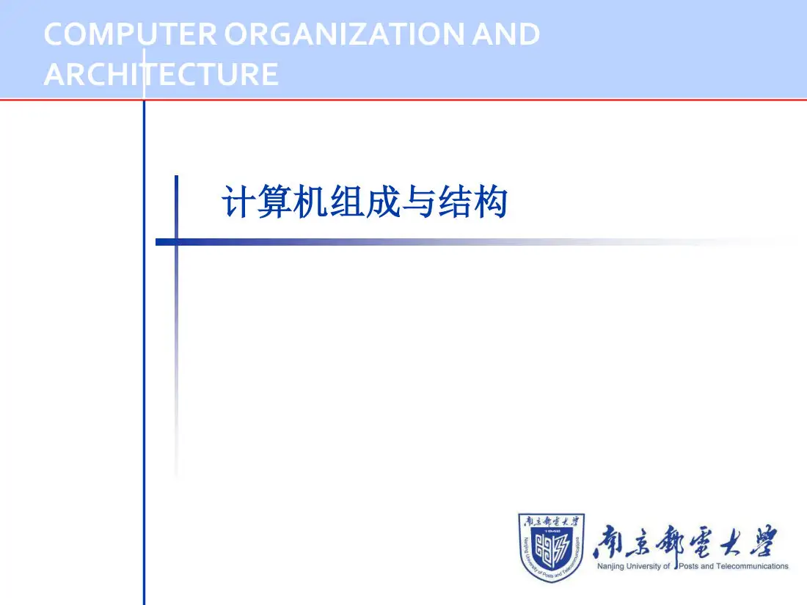

原文：

COMPUTER ORGANIZATION AND ARCHITECTURE

计算机组成与结构

南京郵電大學 Nanijing O 圆 nons 南京郵電大学 Nanjing University of Posts and Telecommunications ty o Posts and T

### 纲要

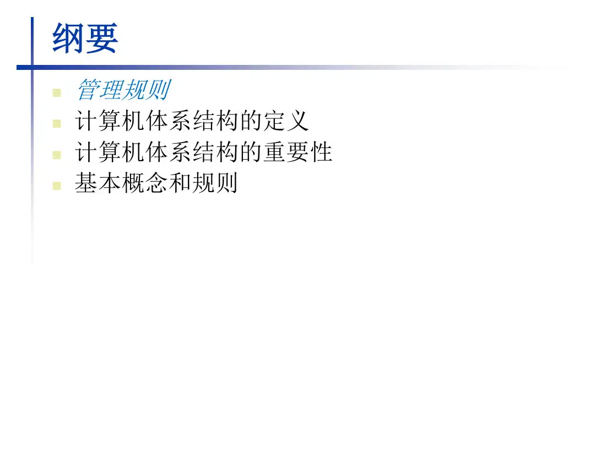

原文：

纲要

管理规则

◼ 计算机体系结构的定义

◼ 计算机体系结构的重要性

◼ 基本概念和规则

### 教科书

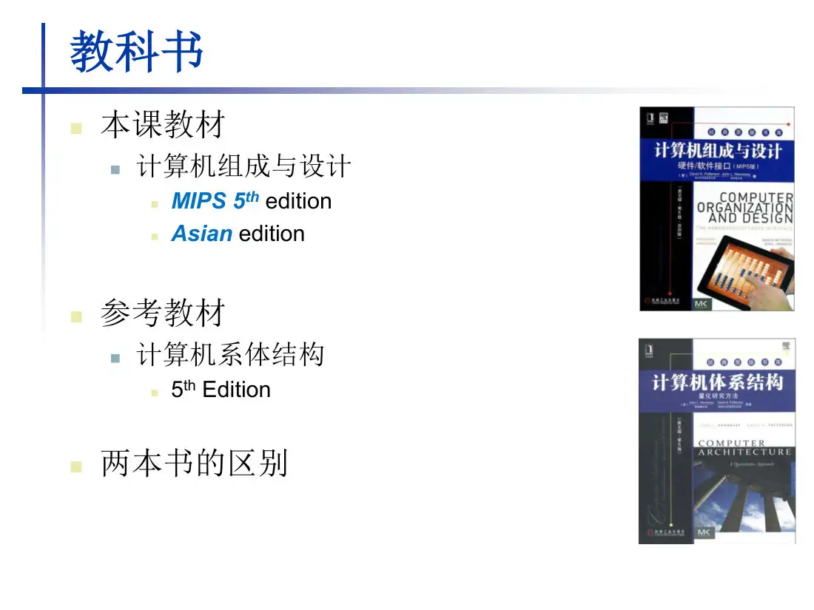

原文：

教科书

◼ 本课教材

◼ 计算机组成与设计

◼ MIPS 5th edition

◼ Asian edition

◼ 参考教材

◼ 计算机系体结构 ◼ 5th Edition

◼ 两本书的区别

### 学习目标

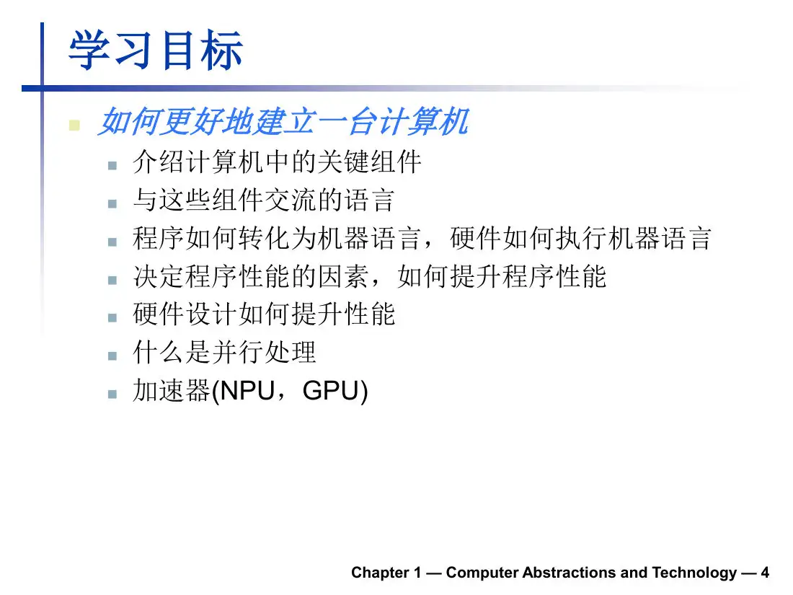

原文：

学习目标

如何更好地建立一台计算机

◼ 介绍计算机中的关键组件

◼ 与这些组件交流的语言

◼ 程序如何转化为机器语言，硬件如何执行机器语言

◼ 决定程序性能的因素，如何提升程序性能

◼ 硬件设计如何提升性能

◼ 什么是并行处理

◼ 加速器(NPU，GPU)

Chapter 1 — Computer Abstractions and Technology — 4

### 第一章

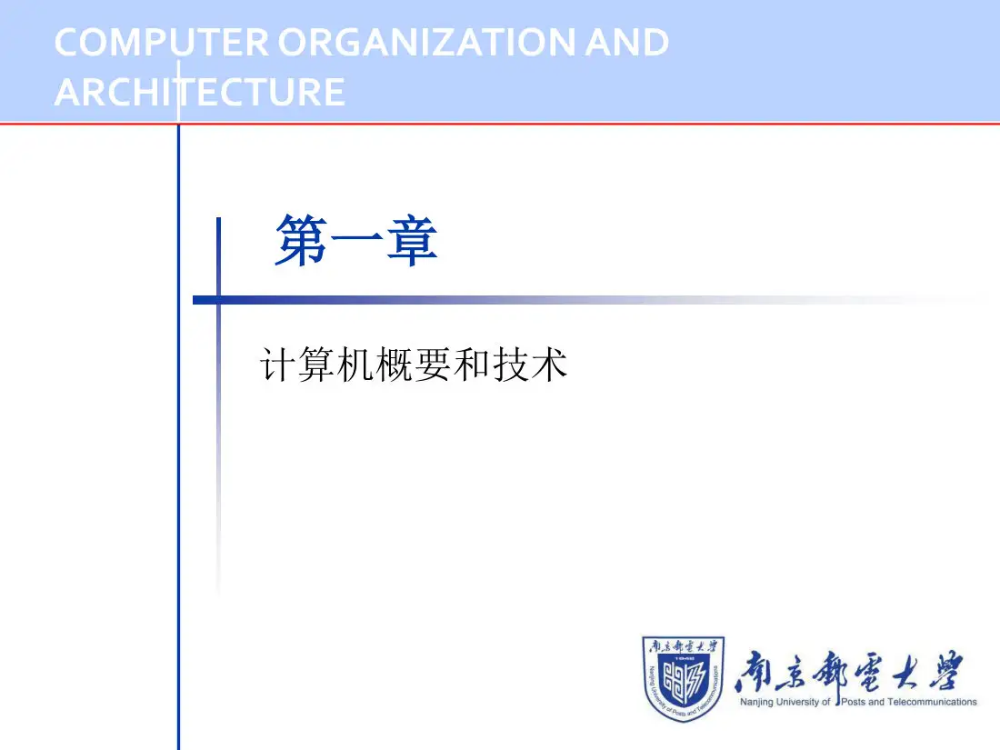

原文：

第一章

计算机概要和技术

COMPUTER ORGANIZATION AND ARCHITECTURE

南京郵電大學 Nanijing O 圆 nons 南京郵電大学 Nanjing University of Posts and Telecommunications ty o Posts and T

### 电子计算机的定义

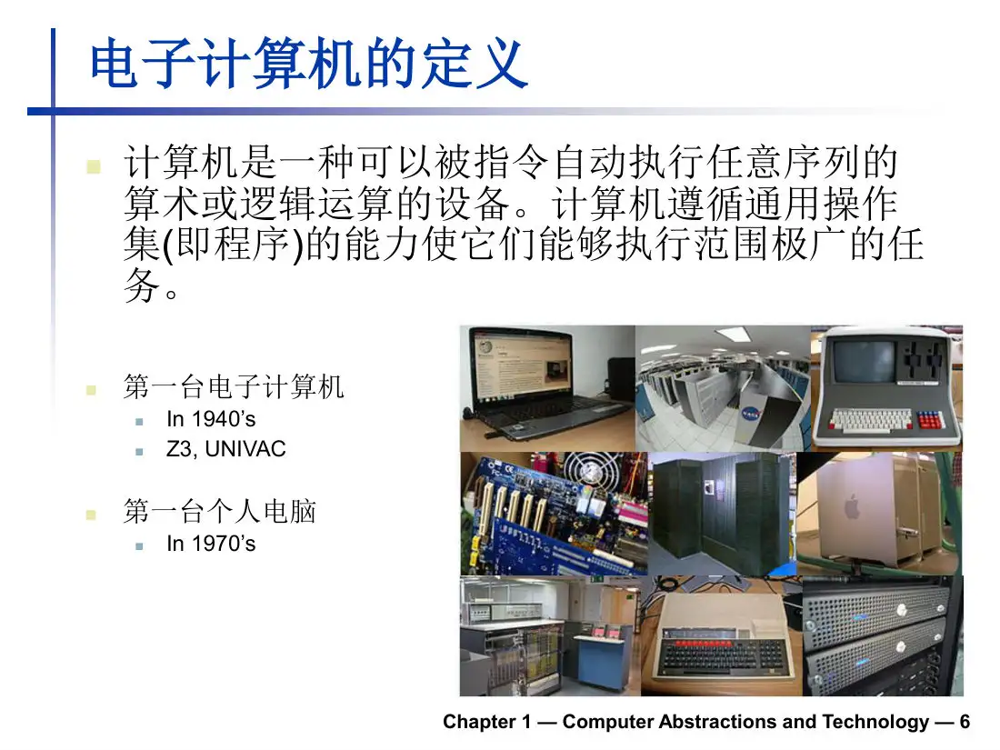

原文：

电子计算机的定义

◼ 计算机是一种可以被指令自动执行任意序列的算术或逻辑运算的设备。计算机遵循通用操作集(即程序)的能力使它们能够执行范围极广的任务。

◼ 第一台电子计算机◼ In 1940’s◼ Z3, UNIVAC

◼ 第一台个人电脑◼ In 1970’s

### 计算机分类

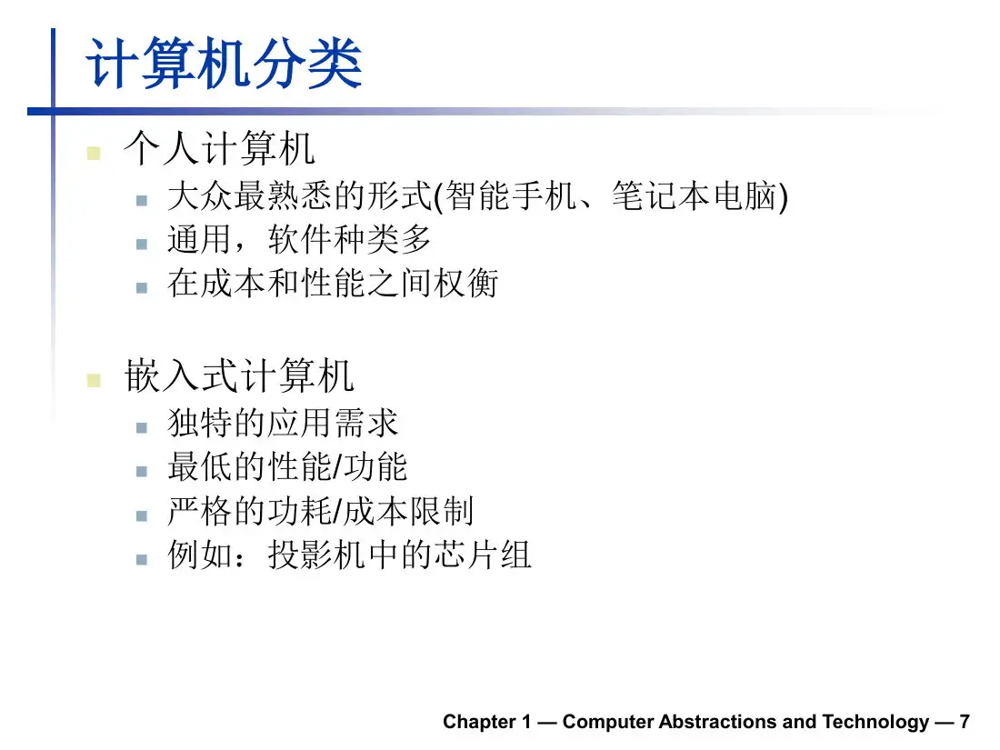

原文：

计算机分类

◼ 个人计算机

◼ 大众最熟悉的形式(智能手机、笔记本电脑)

◼ 通用，软件种类多

在成本和性能之间权衡

◼ 嵌入式计算机

◼ 独特的应用需求

◼ 最低的性能/功能

◼ 严格的功耗/成本限制

◼ 例如：投影机中的芯片组

Chapter 1 — Computer Abstractions and Technology

7

### 计算机分类

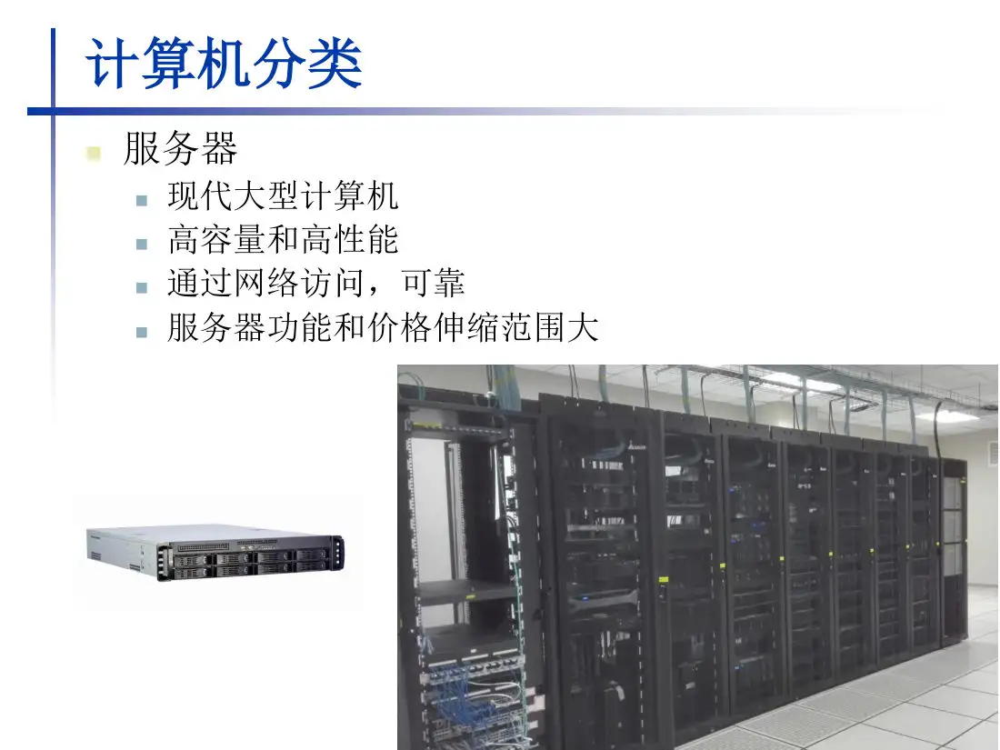

原文：

计算机分类

◼ 服务器

◼ 现代大型计算机

◼ 高容量和高性能

◼ 通过网络访问，可靠

◼ 服务器功能和价格伸缩范围大

### 计算机分类

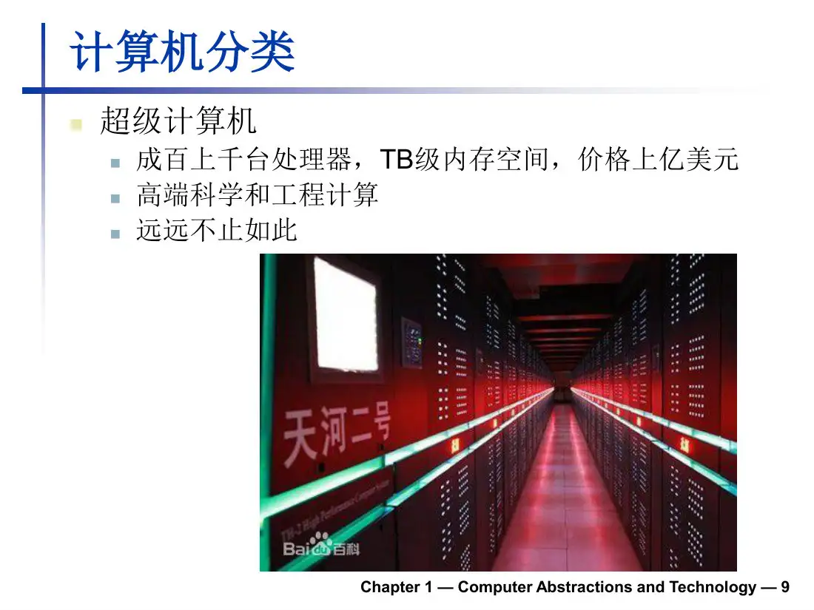

原文：

计算机分类

◼ 超级计算机

◼ 成百上千台处理器，TB级内存空间，价格上亿美元

◼ 高端科学和工程计算

◼ 远远不止如此

### 中国超算

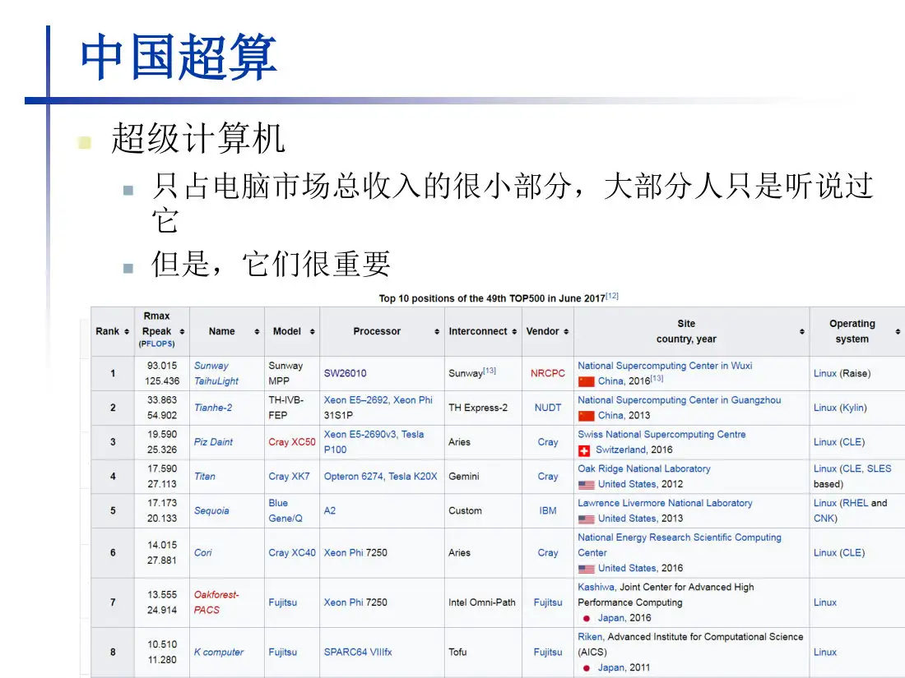

原文：

中国超算

◼ 超级计算机

◼ 只占电脑市场总收入的很小部分，大部分人只是听说过它

◼ 但是，它们很重要

Top 10 positions of the 49th TOP500 in June 2017[12]
<table><tr><td>Rank</td><td>RmaxRpeak(PFLOPS)</td><td>Name</td><td>Model</td><td>Processor</td><td>Interconnect</td><td>Vendor</td><td>Site country, year</td><td>Operating system</td></tr><tr><td>1</td><td>93.015125.436</td><td>SunwayTaihuLight</td><td>SunwayMPP</td><td>SW26010</td><td> $Sunway^{[13]}$ </td><td>NRCPC</td><td>National Supercomputing Center in WuxiChina, 2016[13]</td><td>Linux (Raise)</td></tr><tr><td>2</td><td>33.86354.902</td><td>Tianhe-2</td><td>TH-IVB-FEP</td><td>Xeon E5–2692, Xeon Phi 31S1P</td><td>TH Express-2</td><td>NUDT</td><td>National Supercomputing Center in GuangzhouChina, 2013</td><td>Linux (Kylin)</td></tr><tr><td>3</td><td>19.59025.326</td><td>Piz Daint</td><td>Cray XC50</td><td>Xeon E5-2690v3, Tesla P100</td><td>Aries</td><td>Cray</td><td>Swiss National Supercomputing CentreSwitzerland, 2016</td><td>Linux (CLE)</td></tr><tr><td>4</td><td>17.59027.113</td><td>Titan</td><td>Cray XK7</td><td>Opteron 6274, Tesla K20X</td><td>Gemini</td><td>Cray</td><td>Oak Ridge National LaboratoryUnited States, 2012</td><td>Linux (CLE, SLES based)</td></tr><tr><td>5</td><td>17.17320.133</td><td>Sequoia</td><td>BlueGene/Q</td><td>A2</td><td>Custom</td><td>IBM</td><td>Lawrence Livermore National LaboratoryUnited States, 2013</td><td>Linux (RHEL and CNK)</td></tr><tr><td>6</td><td>14.01527.881</td><td>Cori</td><td>Cray XC40</td><td>Xeon Phi 7250</td><td>Aries</td><td>Cray</td><td>National Energy Research Scientific Computing CenterUnited States, 2016</td><td>Linux (CLE)</td></tr><tr><td>7</td><td>13.55524.914</td><td>Oakforest-PACS</td><td>Fujitsu</td><td>Xeon Phi 7250</td><td>Intel Omni-Path</td><td>Fujitsu</td><td>Kashiwa, Joint Center for Advanced High Performance ComputingJapan, 2016</td><td>Linux</td></tr><tr><td>8</td><td>10.51011.280</td><td>K computer</td><td>Fujitsu</td><td>SPARC64 VIIIfx</td><td>Tofu</td><td>Fujitsu</td><td>Riken, Advanced Institute for Computational Science (AICS)Japan, 2011</td><td>Linux</td></tr></table>

### 计算机革命

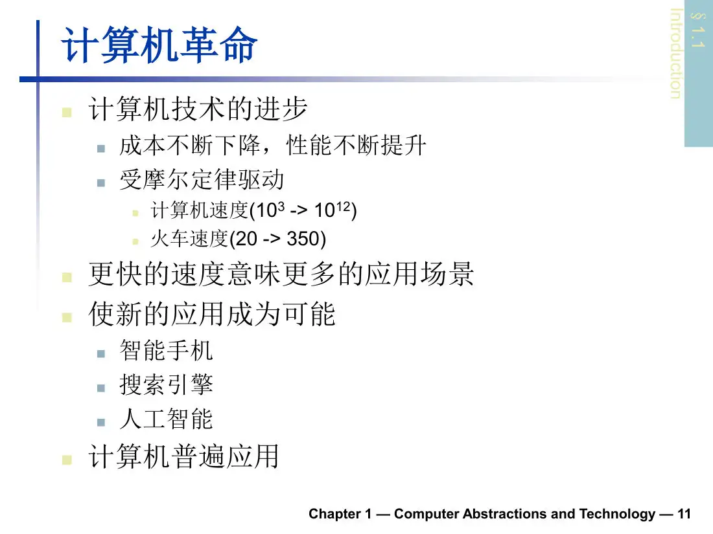

原文：

计算机革命

◼ 计算机技术的进步

◼ 成本不断下降，性能不断提升

◼ 受摩尔定律驱动

◼ 计算机速度(103 -> 1012)

◼ 火车速度(20 -> 350)

◼ 更快的速度意味更多的应用场景

◼ 使新的应用成为可能

智能手机

◼ 搜索引擎

◼ 人工智能

◼ 计算机普遍应用

∞
1
-

Introduction

Chapter 1 — Computer Abstractions and Technology

11

### 后PC时代

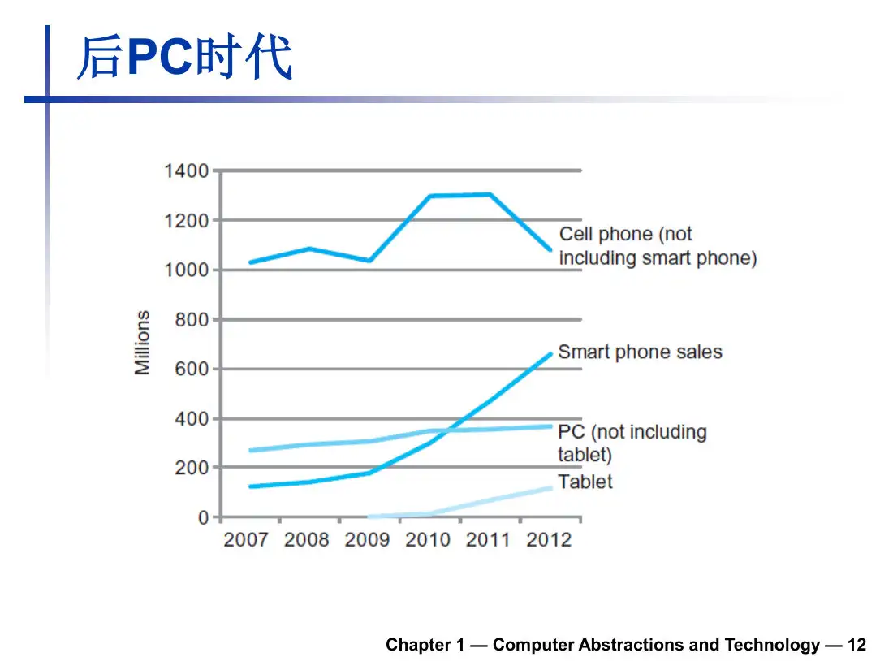

原文：

后PC时代

Chapter 1 — Computer Abstractions and Technology

12

### COMMON CASE FAST

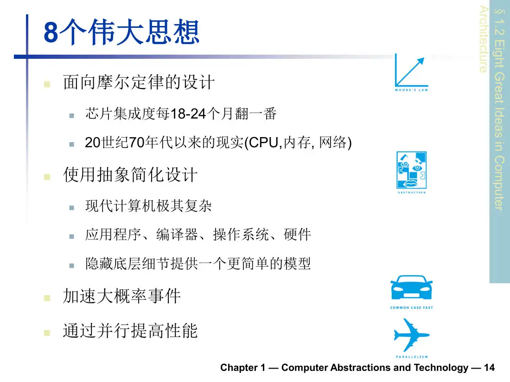

原文：

COMMON CASE FAST

8个伟大思想

◼ 面向摩尔定律的设计

◼ 芯片集成度每18-24个月翻一番

◼ 20世纪70年代以来的现实(CPU,内存, 网络)

◼ 使用抽象简化设计

◼ 现代计算机极其复杂

◼ 应用程序、编译器、操作系统、硬件

◼ 隐藏底层细节提供一个更简单的模型

◼ 加速大概率事件

◼ 通过并行提高性能

Architecture

§ 1.2 Eight Great Ideas in Computer

Chapter 1 — Computer Abstractions and Technology —

14

### PIPELINING

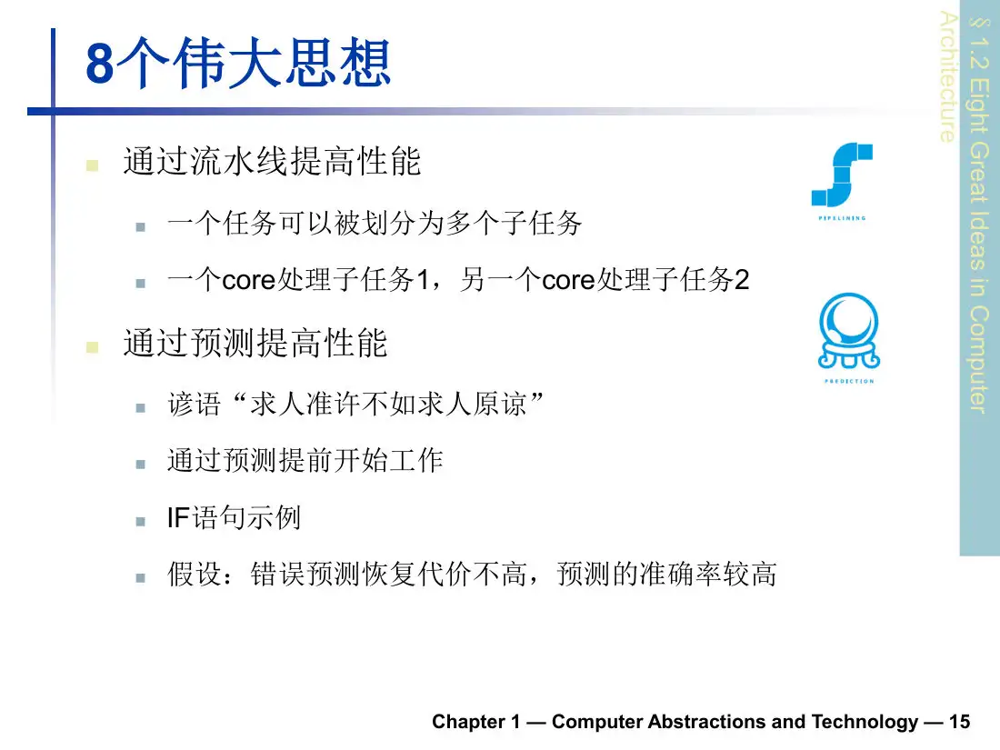

原文：

PIPELINING

8个伟大思想

◼ 通过流水线提高性能

◼ 一个任务可以被划分为多个子任务

◼ 一个core处理子任务1，另一个core处理子任务2

◼ 通过预测提高性能

◼ 谚语“求人准许不如求人原谅”

◼ 通过预测提前开始工作

◼ IF语句示例

◼ 假设：错误预测恢复代价不高，预测的准确率较高

Architecture

§ 1.2 Eight Great Ideas in Computer

Chapter 1 — Computer Abstractions and Technology

15

### 8个伟大思想

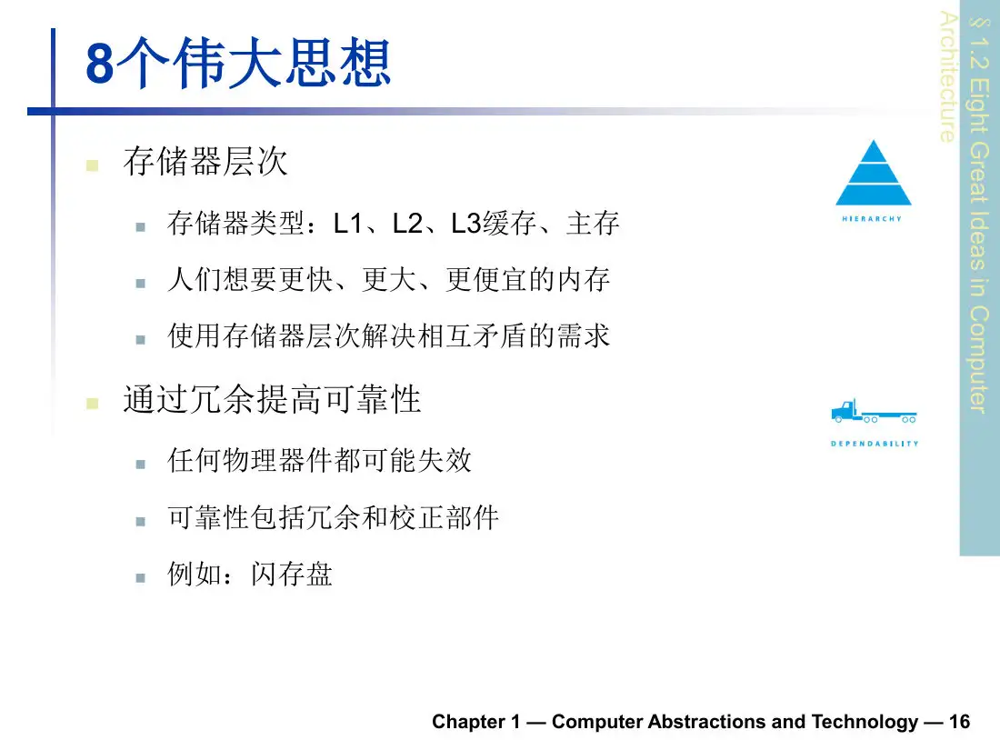

原文：

8个伟大思想

◼ 存储器层次

◼ 存储器类型：L1、L2、L3缓存、主存

◼ 人们想要更快、更大、更便宜的内存

◼ 使用存储器层次解决相互矛盾的需求

◼ 通过冗余提高可靠性

◼ 任何物理器件都可能失效

◼ 可靠性包括冗余和校正部件

◼ 例如：闪存盘

Architecture

Chapter 1 — Computer Abstractions and Technology

§ 1.2 Eight Great Ideas in Computer

16

### 程序概念入门

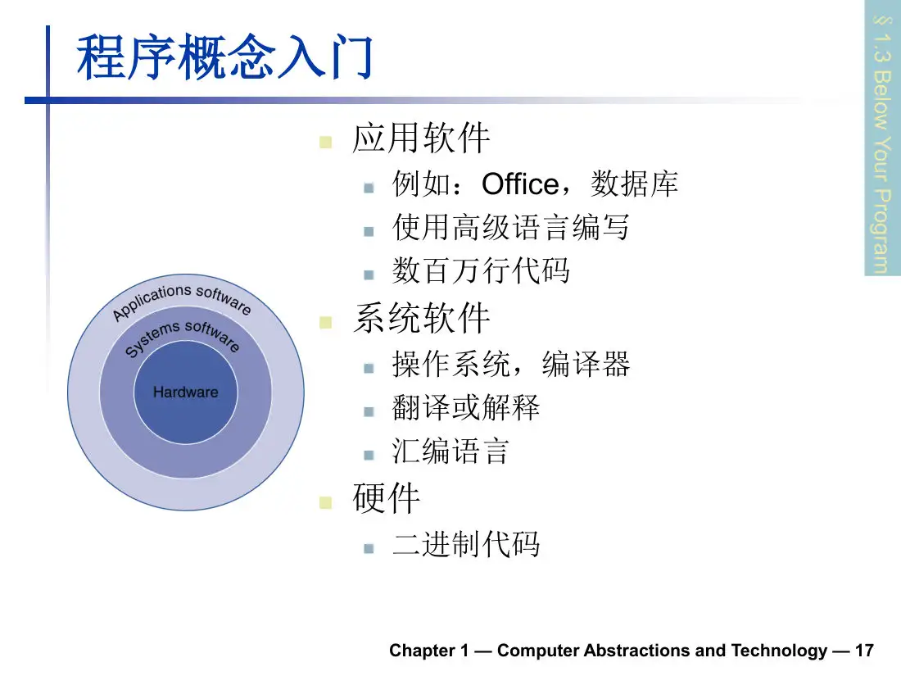

原文：

程序概念入门

§ 1.3 Below Your Program

Chapter 1 — Computer Abstractions and Technology

17

### 程序代码级别

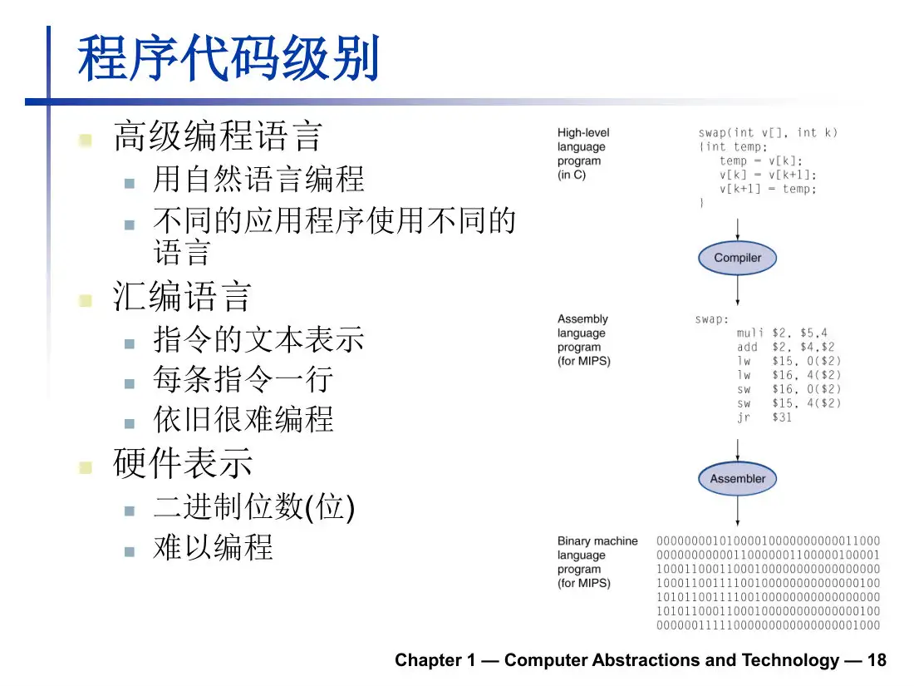

原文：

程序代码级别

◼ 高级编程语言

◼ 用自然语言编程

◼ 不同的应用程序使用不同的语言

◼ 汇编语言

◼ 指令的文本表示

◼ 每条指令一行

◼ 依旧很难编程

◼ 硬件表示

◼ 二进制位数(位)

◼ 难以编程

High-level language program (in C)

Assembly language program (for MIPS)

swap(int v[], int k) {int temp; temp = v[k]; v[k] = v[k+1]; v[k+1] = temp;

Binary machine language program (for MIPS)

muli \$2, \$5,4 add \$2, \$4,\$2 1w \$15, 0(\$2) 1w \$16, 4(\$2) SW \$16, 0(\$2) SW \$15, 4(\$2) \$31

00000000101000010000000000011000 00000000000110000001100000100001 10001100011000100000000000000000 10001100111100100000000000000100 10101100111100100000000000000000 10101100011000100000000000000100 00000011111000000000000000001000

Chapter 1 — Computer Abstractions and Technology

18

### 计算机组成部分

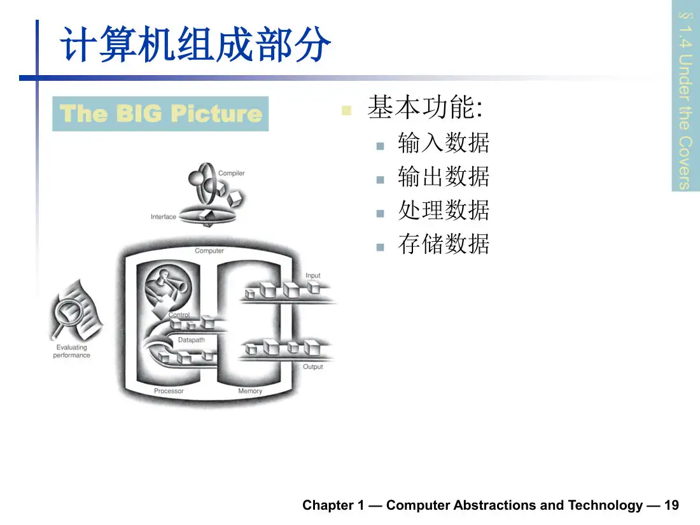

原文：

计算机组成部分

The BIG Picture

◼ 基本功能:

◼ 输入数据

输出数据

◼ 处理数据

◼ 存储数据

§ 1.4 Under the Covers

Chapter 1 — Computer Abstractions and Technology

19

### 计算机组成五大部件

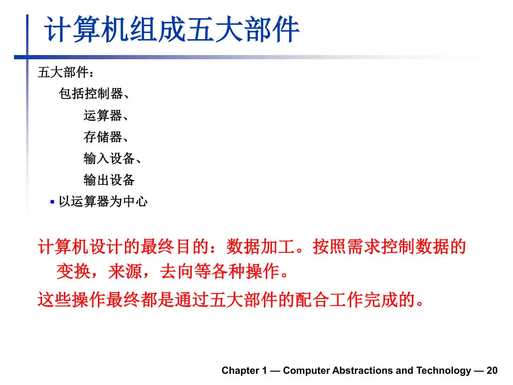

原文：

计算机组成五大部件

五大部件：

包括控制器、运算器、存储器、输入设备、输出设备

以运算器为中心

计算机设计的最终目的：数据加工。按照需求控制数据的变换，来源，去向等各种操作。

这些操作最终都是通过五大部件的配合工作完成的。

Chapter 1 — Computer Abstractions and Technology

20

### 运算器

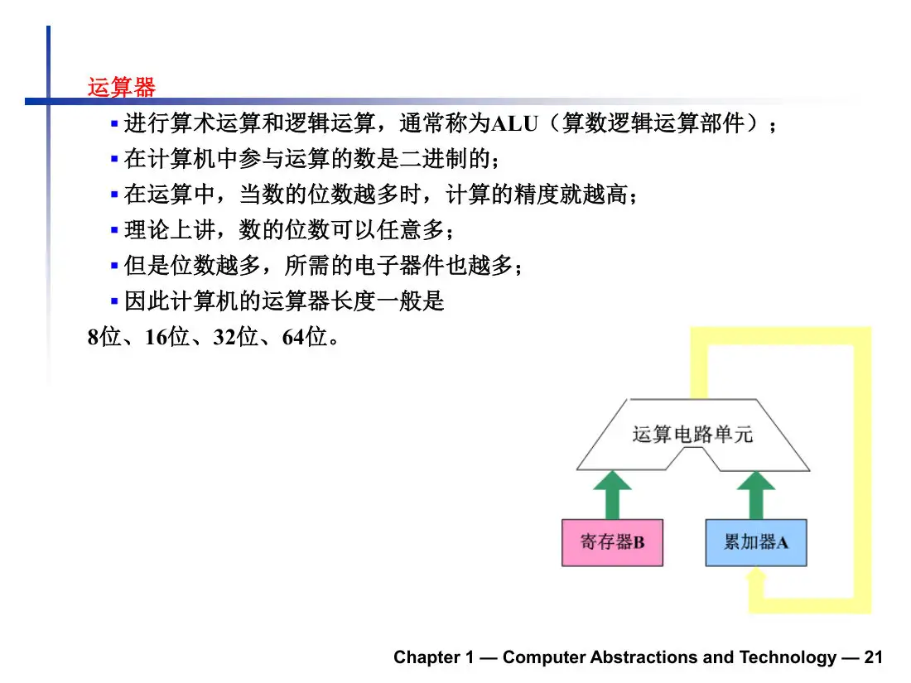

原文：

运算器

进行算术运算和逻辑运算，通常称为ALU（算数逻辑运算部件）；

在计算机中参与运算的数是二进制的；

在运算中，当数的位数越多时，计算的精度就越高；

理论上讲，数的位数可以任意多；

但是位数越多，所需的电子器件也越多；

因此计算机的运算器长度一般是

8位、16位、32位、64位。

### 控制器

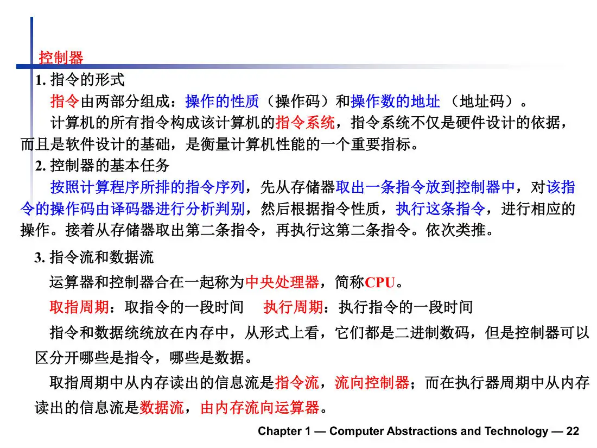

原文：

控制器

1. 指令的形式

指令由两部分组成：操作的性质（操作码）和操作数的地址 （地址码）。

计算机的所有指令构成该计算机的指令系统，指令系统不仅是硬件设计的依据，而且是软件设计的基础，是衡量计算机性能的一个重要指标。

2. 控制器的基本任务

按照计算程序所排的指令序列，先从存储器取出一条指令放到控制器中，对该指令的操作码由译码器进行分析判别，然后根据指令性质，执行这条指令，进行相应的操作。接着从存储器取出第二条指令，再执行这第二条指令。依次类推。

3. 指令流和数据流

运算器和控制器合在一起称为中央处理器，简称CPU。

取指周期：取指令的一段时间 执行周期：执行指令的一段时间

指令和数据统统放在内存中，从形式上看，它们都是二进制数码，但是控制器可以区分开哪些是指令，哪些是数据。

取指周期中从内存读出的信息流是指令流，流向控制器；而在执行器周期中从内存读出的信息流是数据流，由内存流向运算器。

Chapter 1 — Computer Abstractions and Technology

22

### 存储器

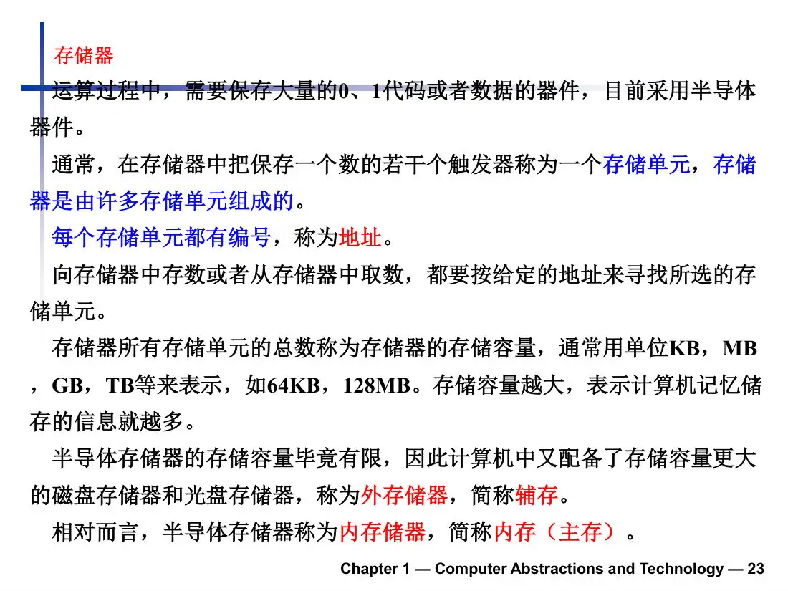

原文：

存储器

运算过程中，需要保存大量的0、1代码或者数据的器件，目前采用半导体器件。

通常，在存储器中把保存一个数的若干个触发器称为一个存储单元，存储器是由许多存储单元组成的。

每个存储单元都有编号，称为地址。

向存储器中存数或者从存储器中取数，都要按给定的地址来寻找所选的存储单元。

存储器所有存储单元的总数称为存储器的存储容量，通常用单位KB，MB，GB，TB等来表示，如64KB，128MB。存储容量越大，表示计算机记忆储存的信息就越多。

半导体存储器的存储容量毕竟有限，因此计算机中又配备了存储容量更大的磁盘存储器和光盘存储器，称为外存储器，简称辅存。

相对而言，半导体存储器称为内存储器，简称内存（主存）。

Chapter 1 — Computer Abstractions and Technology

23

### 输入输出设备

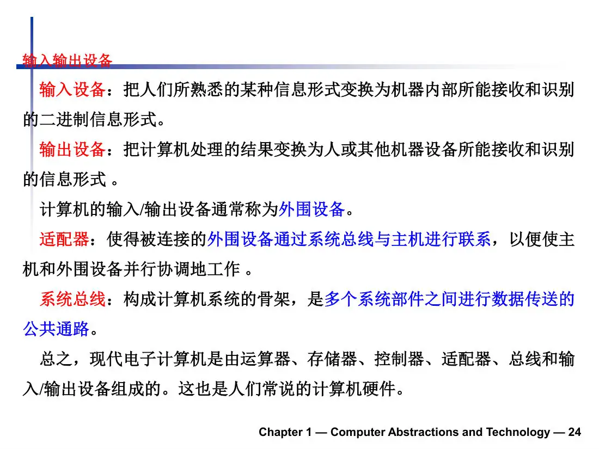

原文：

输入输出设备

输入设备：把人们所熟悉的某种信息形式变换为机器内部所能接收和识别的二进制信息形式。

输出设备：把计算机处理的结果变换为人或其他机器设备所能接收和识别的信息形式。

计算机的输入/输出设备通常称为外围设备。

适配器：使得被连接的外围设备通过系统总线与主机进行联系，以便使主机和外围设备并行协调地工作。

系统总线：构成计算机系统的骨架，是多个系统部件之间进行数据传送的公共通路。

总之，现代电子计算机是由运算器、存储器、控制器、适配器、总线和输入/输出设备组成的。这也是人们常说的计算机硬件。

Chapter 1 — Computer Abstractions and Technology

24

### 内部的处理器 (CPU)

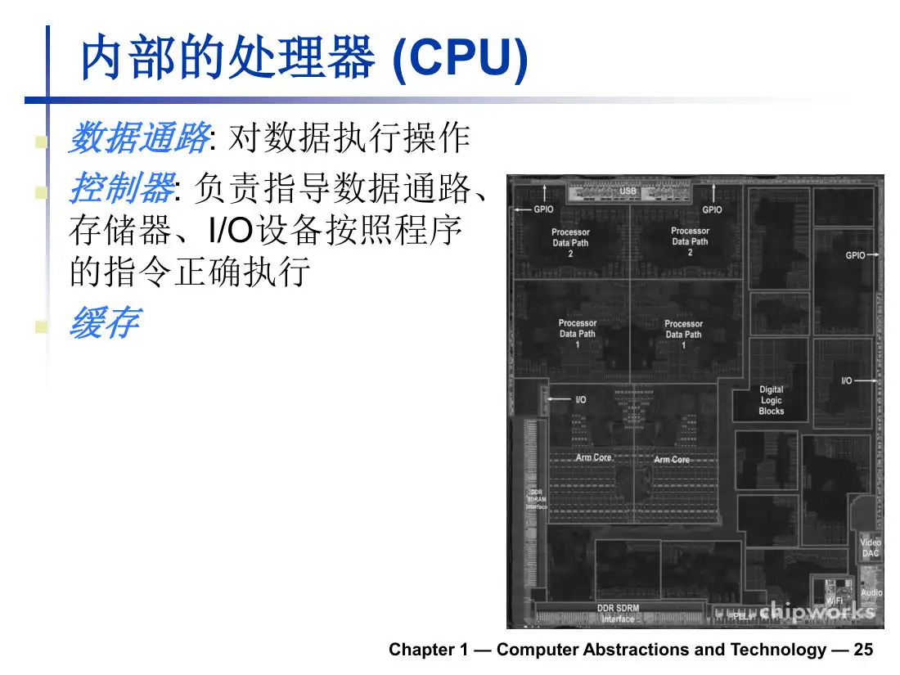

原文：

内部的处理器 (CPU)

数据通路: 对数据执行操作

控制器: 负责指导数据通路、存储器、I/O设备按照程序的指令正确执行

缓存

Chapter 1 — Computer Abstractions and Technology — 25

### 数据安全

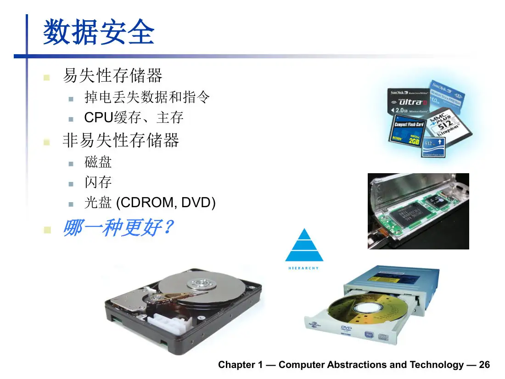

原文：

数据安全

◼ 易失性存储器

◼ 掉电丢失数据和指令

◼ CPU缓存、主存

◼ 非易失性存储器

◼ 磁盘

◼ 闪存

◼ 光盘 (CDROM, DVD)

哪一种更好？

Chapter 1 — Computer Abstractions and Technology

26

### 通信与网络

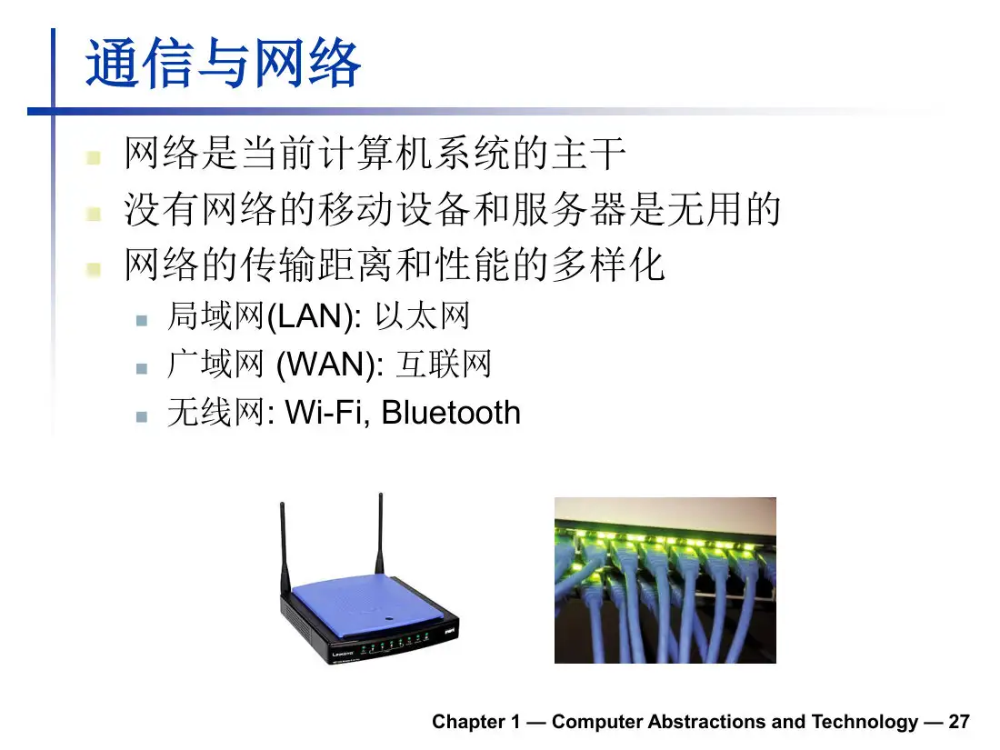

原文：

通信与网络

◼ 网络是当前计算机系统的主干

◼ 没有网络的移动设备和服务器是无用的

◼ 网络的传输距离和性能的多样化

◼ 局域网(LAN): 以太网

◼ 广域网 (WAN): 互联网

◼ 无线网: Wi-Fi, Bluetooth

Chapter 1 — Computer Abstractions and Technology

27

### 技术发展趋势

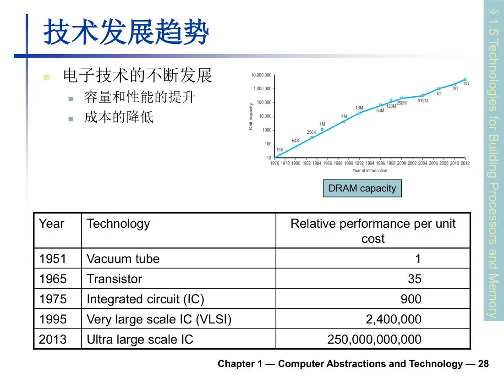

原文：

技术发展趋势

◼ 电子技术的不断发展

◼ 容量和性能的提升

◼ 成本的降低

<table><tr><td>Year</td><td>Technology</td><td>Relative performance per unit cost</td></tr><tr><td>1951</td><td>Vacuum tube</td><td>1</td></tr><tr><td>1965</td><td>Transistor</td><td>35</td></tr><tr><td>1975</td><td>Integrated circuit (IC)</td><td>900</td></tr><tr><td>1995</td><td>Very large scale IC (VLSI)</td><td>2,400,000</td></tr><tr><td>2013</td><td>Ultra large scale IC</td><td>250,000,000,000</td></tr></table>

Chapter 1 — Computer Abstractions and Technology

§ 1.5 Technologies for Building Processors and Memory

28

### 半导体技术

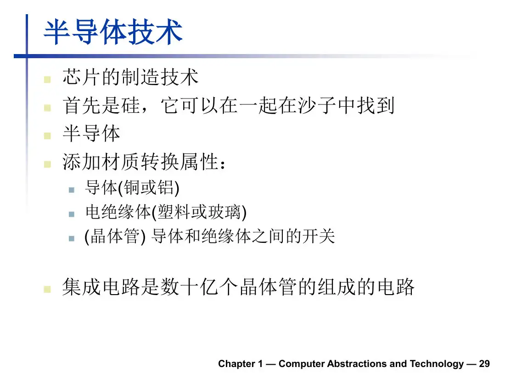

原文：

半导体技术

◼ 芯片的制造技术

◼ 首先是硅，它可以在一起在沙子中找到

◼ 半导体

◼ 添加材质转换属性：

◼ 导体(铜或铝)

◼ 电绝缘体(塑料或玻璃)

◼ (晶体管) 导体和绝缘体之间的开关

◼ 集成电路是数十亿个晶体管的组成的电路

Chapter 1 — Computer Abstractions and Technology

29

### 集成电路的制造过程

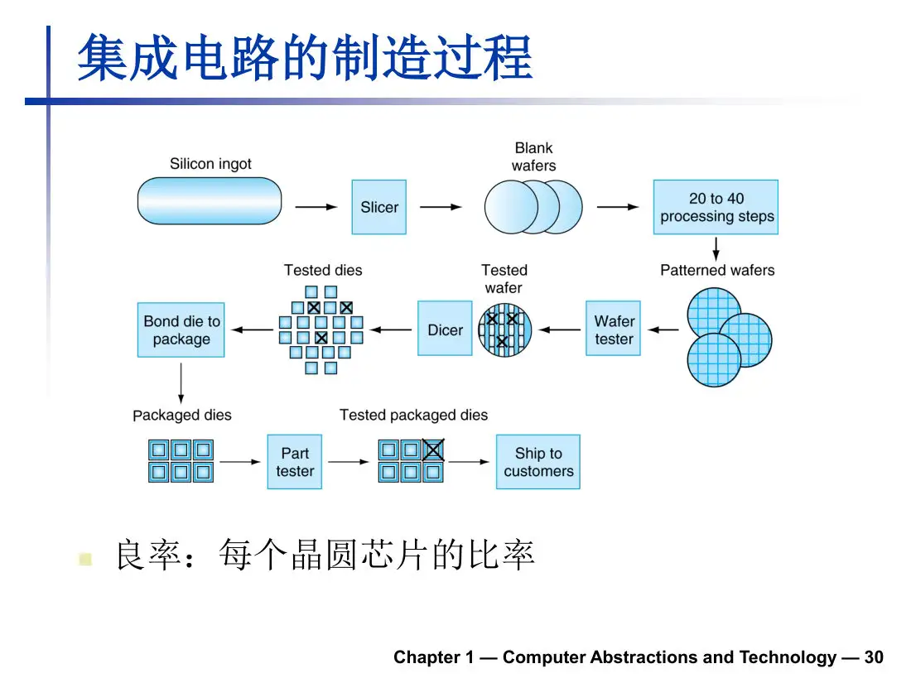

原文：

集成电路的制造过程

◼ 良率：每个晶圆芯片的比率

Chapter 1 — Computer Abstractions and Technology

30

### 集成电路的成本

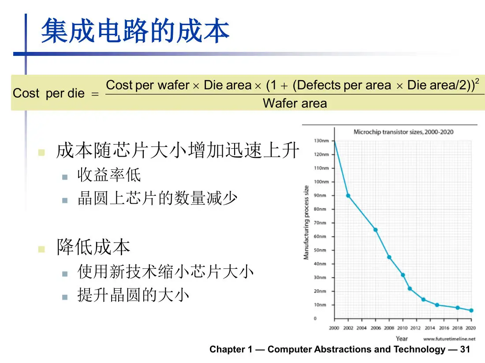

原文：

集成电路的成本

Cost per wafer × Die area × (1 + (Defects per area × Die area/2))² Cost per die = Wafer area

◼ 成本随芯片大小增加迅速上升

◼ 收益率低

◼ 晶圆上芯片的数量减少

◼ 降低成本

◼ 使用新技术缩小芯片大小

◼ 提升晶圆的大小

Chapter 1 — Computer Abstractions and Technology — 31

### 功耗墙的限制

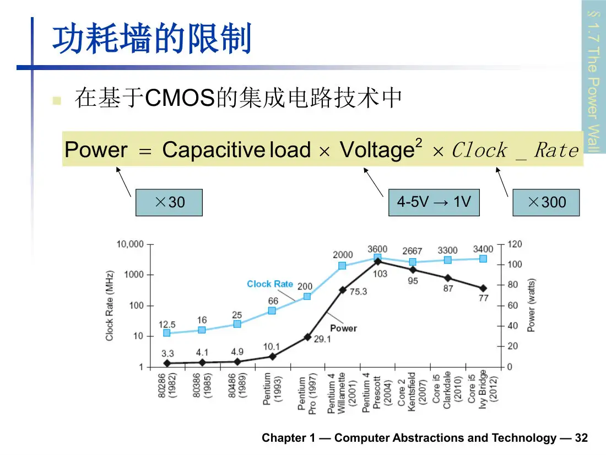

原文：

功耗墙的限制

◼ 在基于CMOS的集成电路技术中

Power = Capacitiveload × Voltage² × Clock \_ Rate

×300

§ 1.7 The Power Wall

Chapter 1 — Computer Abstractions and Technology —

32

### 影响计算机性能的关键部分

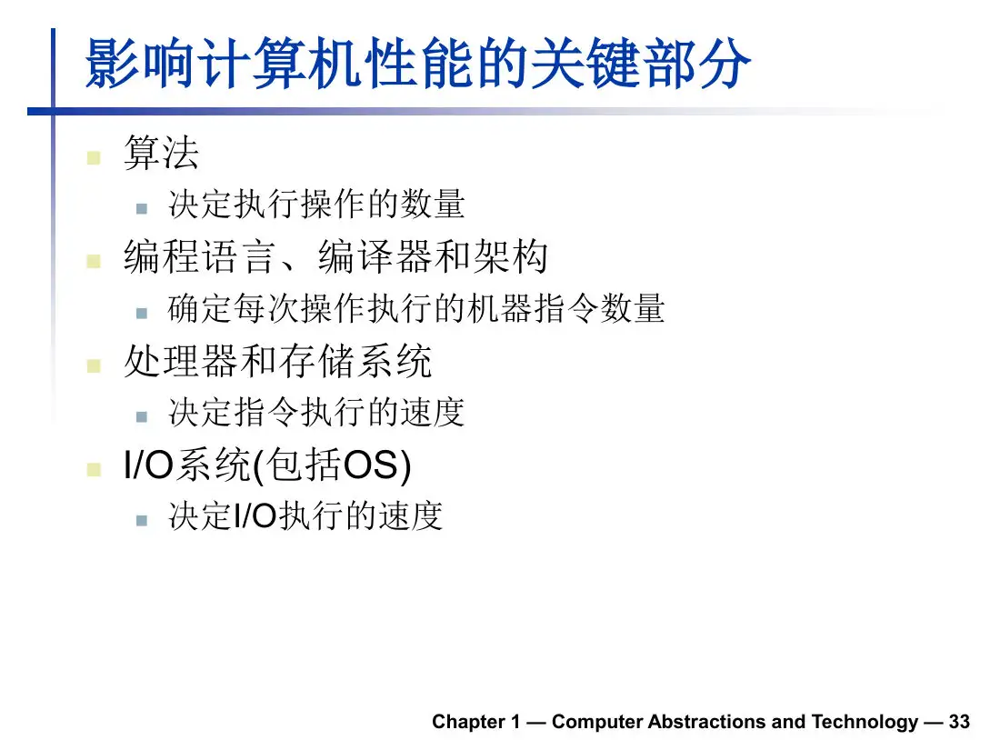

原文：

影响计算机性能的关键部分

\- 算法
  - 决定执行操作的数量
- 编程语言、编译器和架构
  - 确定每次操作执行的机器指令数量
- 处理器和存储系统
  - 决定指令执行的速度
- I/O系统(包括OS)
  - 决定I/O执行的速度

Chapter 1 — Computer Abstractions and Technology

33

### 计算机的性能指标

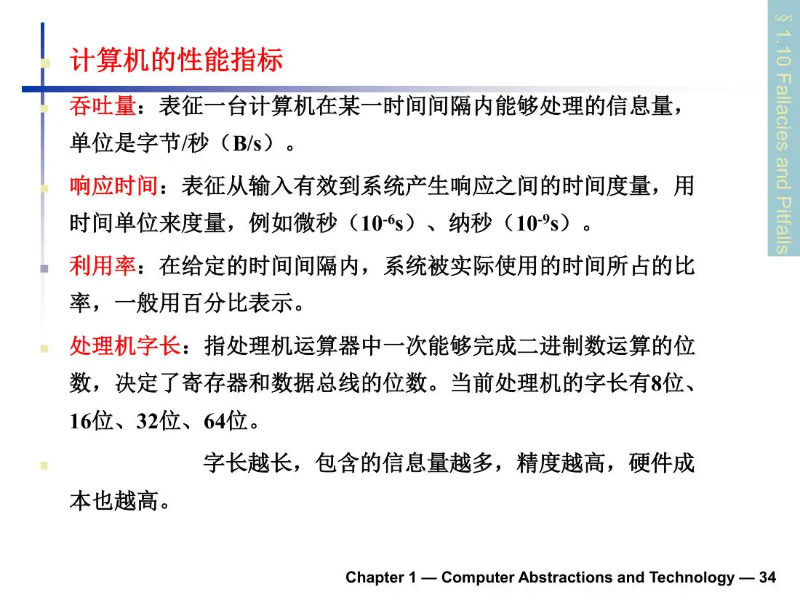

原文：

计算机的性能指标

吞吐量：表征一台计算机在某一时间间隔内能够处理的信息量，单位是字节/秒（B/s）。

响应时间：表征从输入有效到系统产生响应之间的时间度量，用时间单位来度量，例如微秒（10-6s）、纳秒 $( 1 0 ^ { - 9 } \mathsf { s } )$

◼ 利用率：在给定的时间间隔内，系统被实际使用的时间所占的比率，一般用百分比表示。

◼ 处理机字长：指处理机运算器中一次能够完成二进制数运算的位数，决定了寄存器和数据总线的位数。当前处理机的字长有8位、16位、32位、64位。

字长越长，包含的信息量越多，精度越高，硬件成本也越高。

§ 1.10 Fallacies and Pitfalls

Chapter 1 — Computer Abstractions and Technology

34

### 总线宽度：一般指CPU中运算器与存储器之间进行互连的内部总线二进制位数。

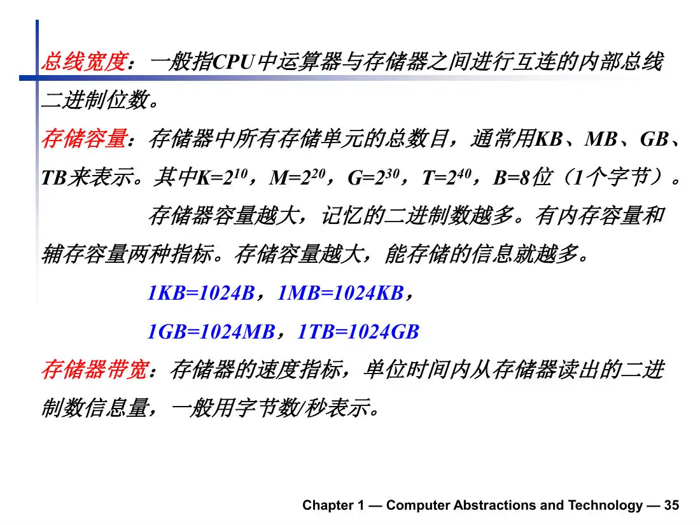

原文：

总线宽度：一般指CPU中运算器与存储器之间进行互连的内部总线二进制位数。

存储容量：存储器中所有存储单元的总数目，通常用KB、MB、GB、TB来表示。 其中 $\hbar { \bf { = } } 2 ^ { 1 0 }$ $M { = } 2 ^ { 2 \theta }$ $G { = } 2 ^ { 3 \theta }$ ${ \cal T } { = } 2 ^ { 4 0 }$ $\scriptstyle { B = 8 }$ 位（1个字节）。

存储器容量越大，记忆的二进制数越多。有内存容量和辅存容量两种指标。存储容量越大，能存储的信息就越多。

1KB=1024B， 1MB=1024KB，

$$
1 \mathrm{GB} = 1 0 2 4 \mathrm{MB}, 1 \mathrm{TB} = 1 0 2 4 \mathrm{GB}
$$

存储器带宽：存储器的速度指标，单位时间内从存储器读出的二进制数信息量，一般用字节数/秒表示。

Chapter 1 — Computer Abstractions and Technology

35

### CPU执行时间： 表示CPU执行一段程序所占用的CPU时间， 可用下式计算：

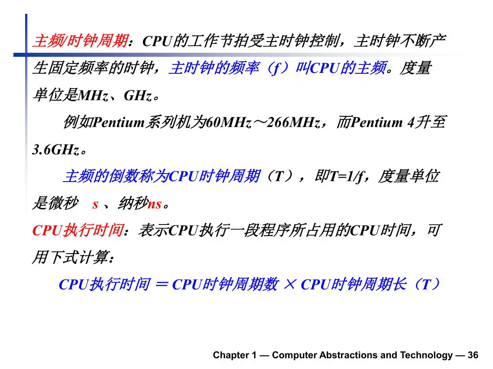

原文：

主频/时钟周期：CPU的工作节拍受主时钟控制，主时钟不断产生固定频率的时钟，主时钟的频率（f）叫CPU的主频。度量MHz $G H z$ 0

Pentium 60MHz 266MHz Pentium 4$3 . 6 G H z$ 。

主频的倒数称为CPU时钟周期（T）， ${ \cal E } / / { \cal T } / = { \cal I } / f$ ，度量单位 s ns

CPU执行时间： 表示CPU执行一段程序所占用的CPU时间， 可用下式计算：

$$
C P U \text {执行时间} = C P U \text {时钟周期数} \times C P U \text {时钟周期长(T)}
$$

Chapter 1 — Computer Abstractions and Technology

36

### CPI： 每条指令周期数， 即执行一条指令所需的平均时钟周期数。

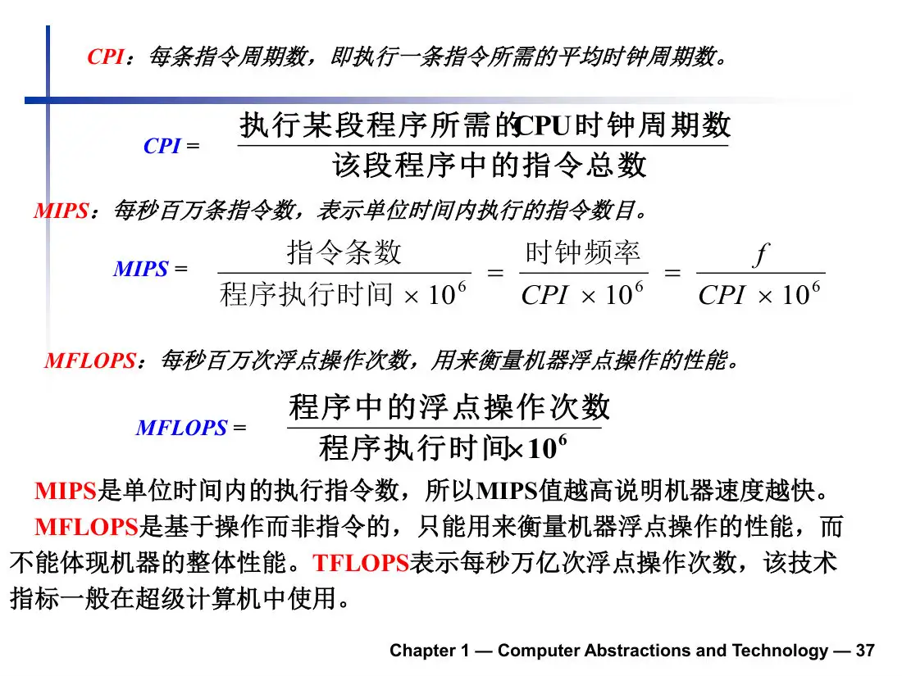

原文：

CPI： 每条指令周期数， 即执行一条指令所需的平均时钟周期数。

$$
C P I = \frac {\text {执行某段程序所需的CPU时钟周期数}}{\text {该段程序中的指令总数}}
$$

MIPS： 每秒百万条指令数， 表示单位时间内执行的指令数目。

$$
M I P S = \frac {\text {指令条数}}{\text {程序执行时间} \times 1 0 ^ {6}} = \frac {\text {时钟频率}}{C P I \times 1 0 ^ {6}} = \frac {f}{C P I \times 1 0 ^ {6}}
$$

MFLOPS： 每秒百万次浮点操作次数， 用来衡量机器浮点操作的性能。

$$
M F L O P S = \frac {\text {程序中的浮点操作次数}}{\text {程序执行时间} \times 1 0 ^ {6}}
$$

MIPS是单位时间内的执行指令数，所以MIPS值越高说明机器速度越快。

MFLOPS是基于操作而非指令的，只能用来衡量机器浮点操作的性能，而不能体现机器的整体性能。TFLOPS表示每秒万亿次浮点操作次数，该技术指标一般在超级计算机中使用。

Chapter 1 — Computer Abstractions and Technology

37

### 求有效CPI、MIPS速率、处理机程序执行时间tCPU。

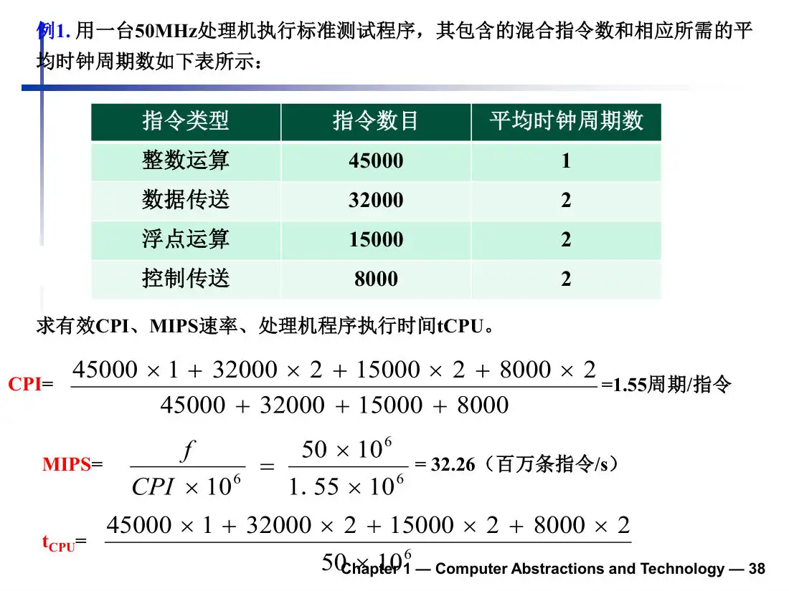

原文：

例1. 用一台50MHz处理机执行标准测试程序，其包含的混合指令数和相应所需的平均时钟周期数如下表所示：

<table><tr><td>指令类型</td><td>指令数目</td><td>平均时钟周期数</td></tr><tr><td>整数运算</td><td>45000</td><td>1</td></tr><tr><td>数据传送</td><td>32000</td><td>2</td></tr><tr><td>浮点运算</td><td>15000</td><td>2</td></tr><tr><td>控制传送</td><td>8000</td><td>2</td></tr></table>

求有效CPI、MIPS速率、处理机程序执行时间tCPU。

$$
\mathrm{CPI} = \frac {4 5 0 0 0 \times 1 + 3 2 0 0 0 \times 2 + 1 5 0 0 0 \times 2 + 8 0 0 0 \times 2}{4 5 0 0 0 + 3 2 0 0 0 + 1 5 0 0 0 + 8 0 0 0} = 1. 5 5,
$$

$$
\mathrm{MIPS} = \frac {f}{C P I \times 1 0 ^ {6}} = \frac {5 0 \times 1 0 ^ {6}}{1 . 5 5 \times 1 0 ^ {6}} = 3 2. 2 6
$$

$$
\mathrm{t} _ {\mathrm{CPU}} = \frac {4 5 0 0 0 \times 1 + 3 2 0 0 0 \times 2 + 1 5 0 0 0 \times 2 + 8 0 0 0 \times 2}{7 6 - 1 0 ^ {6}}
$$

$5 0 c m ^ { \prime } = p l e ^ { 0 }$ — Computer Abstractions and Technology

38

### 本章总结

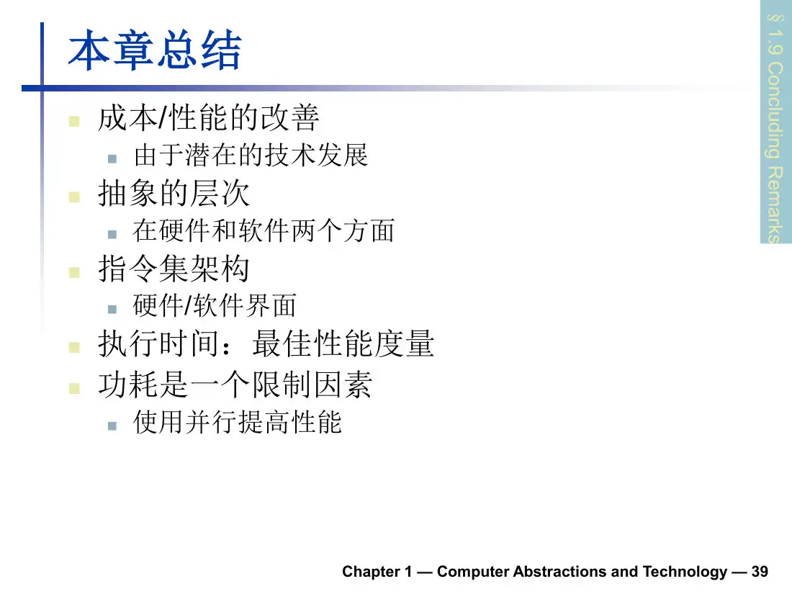

原文：

本章总结

成本/性能的改善
由于潜在的技术发展
抽象的层次
在硬件和软件两个方面
指令集架构
硬件/软件界面
执行时间：最佳性能度量
功耗是一个限制因素
使用并行提高性能

§ 1.9 Concluding Remarks

Chapter 1 — Computer Abstractions and Technology

39
