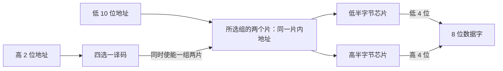
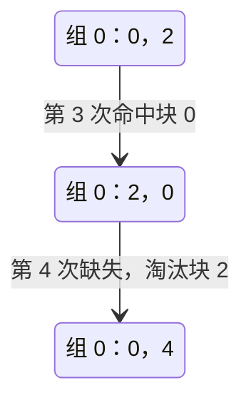

# 《计算机组成与结构》第2章 存储系统（复习PPT）

原件共五页，依次复习存储层次、介质和存取方式、SRAM/DRAM、芯片扩展、Cache 与虚拟存储器。以下按原件的题号指出已标明的答案；新给的计算数据和图另标为**补充**。

## 一次访问为什么不直接去外存（原件第 1 页）

寄存器、Cache、主存、外存并非只差容量。最常用的字节若留在较快的层次，多数访问可以低代价完成；其余内容仍由容量大的层次保存。这个策略只有在访问具有局部性时才有效：刚访问某块又访问它是时间局部性；依次读取邻近地址是空间局部性。相反，循环扫过远大于 Cache 的数据且每块只用一次，不会因为存在快层就接近快层延迟。

| 原件题号 | 原件标答或要点 | 判断理由 |
| --- | --- | --- |
| 1.1 | A，寄存器 | 本题采用 Cache、主存、外存三层的教材口径；在更广义的性能存储层次中，也常把寄存器列为最快的一层。 |
| 1.2、1.3 | A，Cache 最快；C，外存容量最大 | 在同一时期、给定三层之间比较，而不是比较不同时代或装置的单项规格。 |
| 1.4、1.7 | 理想上兼顾高层速度与低层容量，依据程序和数据的局部性 | 快层命中率高时平均访问才可能接近快层；“接近”并非最坏延迟保证。 |
| 1.5、1.6 | Cache/主存选 A，主存/辅存选 B | 典型 Cache 命中、装入和替换由硬件自动完成；虚拟内存的换入换出需操作系统参与，地址翻译通常有硬件支持。 |

## 两个分类角度，一条时间轴（原件第 2–3 页）

- **2.1、2.2 原件标答均为 A、B、C。** 分类问“存在哪种介质上”，可答半导体、磁介质、光介质；问“如何到目标位置”，则有随机存取（如主存）、顺序存取（如磁带）、直接存取（如硬盘，先定位到相关位置再访问）。这两套维度不能互相替代。
- **2.3 参考解答：**常规 SRAM、DRAM 断电后失去数据；掩膜 ROM、PROM、EPROM、EEPROM 和 Flash 属于非易失性器件。除了“断电能不能保住”，还要问“能不能改、以多大单位擦除”：EEPROM 可支持细粒度擦除或重写，Flash 通常以块或扇区擦除。==擦除粒度不等于写入粒度==；能编程一个字节不代表可以单独擦除它。
- **2.4 原件定义：**存取时间是指令收到到结果读出或数据写入所需的时间；存取周期是简单连续模型中两次访问能开始的最短间隔。原件在非重叠模型下给出“周期＝存取时间＋恢复时间”。在交叉编址、流水化等系统中，首个结果的延迟与连续吞吐量还要分开算。
- **3.1–3.4 原件标答：**SRAM 的典型应用是 Cache 和可采用 SRAM 型单元的寄存器阵列，选 A、B；DRAM 通常承担主存，选 C；同时期、同工艺下 SRAM 较快；需要周期性刷新的选项是 B，DRAM。电容电荷会泄漏，所以不能把“没访问”当成“状态一定保持”；SRAM 通电后以双稳态保持，不需这种刷新。
- **3.5 原件要点：**集中式在一段时间集中刷新，分散式把刷新插入访问安排中。若刷新次数与单次开销一致，总刷新负担可相同；但访问被挡住的分布不同，集中刷新可形成较长的连续不可用时段。

> [!TIP]
> 题目问“第一个数据什么时候出来”，找存取时间；问“连续开动两次相同操作至少隔多久”，找存取周期。见到“失去电源”才比较易失性，见到“仍在供电却需补电荷”则是 DRAM 刷新。

## 同时选几片，还是分时选其中一组（原件第 4 页）

| 扩展方向 | 小片地址 | 小片数据线 | 片选如何组织 |
| --- | --- | --- | --- |
| 位扩展：同一个地址要提供更多位 | 同名地址线全接在一起 | 每片提供不同位段，拼出一个更宽的字 | 这一组小片同时选中 |
| 字扩展：相同位宽要有更多个地址 | 低位并接，决定所选片内哪个字 | 不同片复用同一数据位段 | 上位地址先译码，同一时刻只选一片 |
| 字位扩展 | 先按低位在各组内统一寻址 | 同组拼位宽，跨组复用总线 | 同组同选，组间互斥 |

**补充：**用 $1\mathrm{K}\times4$ 位芯片组成 $4\mathrm{K}\times8$ 位、按字寻址的存储器，地址和数据线如何接？每个小片有 10 根地址线、4 根数据线，不计电源等其他端子；每组两片拼 8 位，共四组，因此需要 $4\times2=8$ 片。目标的低 10 位 $A_9$ 至 $A_0$ 在各片上并接，高 2 位 $A_{11},A_{10}$ 经译码选择其中一组，组内两片分别驱动 $D_3$ 至 $D_0$ 和 $D_7$ 至 $D_4$。例如地址 <kbd>0xABC</kbd> 选从零编号的第 2 组、组内 <kbd>0x2BC</kbd>；若高、低半字节分别为 <kbd>A</kbd>、<kbd>C</kbd>，输出 <kbd>0xAC</kbd>。误把各组全选时，它们会争用同一数据总线；只把两片的同名数据线相连，也得不到 8 位字。

## 放在哪里与踢掉谁，是两个问题（原件第 5 页）

Cache 针对处理器和主存的速度差。映射回答“主存块能放到哪里”，替换回答“允许的地方已经满了，拿掉谁”。对按字节寻址、每块 $B$ 字节、共 $S$ 组的常见模型，先用 $b=\lfloor a/B\rfloor$ 从字节地址 $a$ 求块号，再求组号 $b\bmod S$、标记 $\lfloor b/S\rfloor$ 和块内偏移 $a\bmod B$。有效位与标记共同判断是否命中；组号相等只说明竞争同一组，不说明是同一个块。

| 映射方式 | 给定主存块的可放位置 | 满时的选择 |
| --- | --- | --- |
| 直接映射 | 恰好一条 Cache 行；也可写成每组一条 | 没有候选可选 |
| 全相联映射 | 可放到任一行；可视作只有一组 | 在全部行中比较 |
| 组相联映射 | 由块号确定一组，在组内任一路放置 | 只在本组内比较 |

组内有空路就先放空路。FIFO 淘汰最早**装入**的块，命中不改变装入次序；LRU 淘汰最近一次**访问**最久以前的块，命中也要刷新次序；LFU 看被访问的次数，计数相同时须另定平局规则；随机策略从满组的候选中随机挑。原件要求能画 LRU 替换图；按“最久 → 最新”排，命中或调入都把该块移到最新一端，比机械背计数器步骤更容易验算。

> [!WARNING]
> ==同组不是同块，命中也不是无事发生。== 两个地址落在一行内时可能共用一个块；同组不同标记则可能冲突。在 LRU 上漏掉一次命中更新，就可能在下一次缺失时淘汰错误的块。

### 补充：十次访问手算 FIFO、LRU、LFU

初始为空；Cache 共有 4 行，为 2 组 2 路，每块 4 字节，地址宽 5 位。每条地址的格式是 2 位标记、1 位组号、2 位块内偏移。例如 <kbd>0x09</kbd> 属于块 2，即标记 1、组 0、偏移 1；<kbd>0x10</kbd> 属于块 4，即标记 2、组 0、偏移 0。下表按 LRU 计算；每格只列访问后本次所访问组的驻留块，按从最久到最新排列。

| 次序 | 字节地址 | 块号/组号 | LRU 命中？ | 访问后的该组 |
| --- | --- | --- | --- | --- |
| 1 | <kbd>00</kbd> | 0 / 0 | 否 | 0 |
| 2 | <kbd>08</kbd> | 2 / 0 | 否 | 0, 2 |
| 3 | <kbd>01</kbd> | 0 / 0 | 是 | 2, 0 |
| 4 | <kbd>10</kbd> | 4 / 0 | 否 | 0, 4 |
| 5 | <kbd>08</kbd> | 2 / 0 | 否 | 4, 2 |
| 6 | <kbd>00</kbd> | 0 / 0 | 否 | 2, 0 |
| 7 | <kbd>09</kbd> | 2 / 0 | 是 | 0, 2 |
| 8 | <kbd>04</kbd> | 1 / 1 | 否 | 1 |
| 9 | <kbd>10</kbd> | 4 / 0 | 否 | 2, 4 |
| 10 | <kbd>11</kbd> | 4 / 0 | 是 | 2, 4 |

**验算：**LRU 在第 3、7、10 次命中，命中率 30%；FIFO 则在第 3、5、10 次命中，也是 30%，但淘汰路径不同。第 4 次访问时，FIFO 因块 0 最早装入而淘汰它，LRU 因第 3 次刚访问块 0 而保留它。LFU 若装入时计 1、重新装入清除旧计数，同频时逐出较早装入者，则命中第 3、6、7、10 次，得 40%。这只是各算法在**这一段访问**上的结果，而非算法命中率排名；同样 4 行容量若改用直接映射，则此段访问的命中为第 3、5、7、10 次。容量、块长、映射和替换之外，访问序列本身也是命中率的条件：大块能借空间局部性，却可能在固定容量下减少可同时驻留的块数。

课件最后列出页式、段式、段页式管理。页式按固定大小分块，段式按程序的逻辑单位组织；段页式先定位段，再在段内做分页。它们做的是虚拟地址翻译与受保护的空间管理，不是上述 Cache 的块位置选择；==TLB 缺失不能直接推出发生缺页==，因为页表中的转换可能仍然有效。

相关知识点：[多级存储与局部性](../../../topics/计算机组成/memory-hierarchy.md)、[存储器分类](../../../topics/计算机组成/memory-classify.md)、[SRAM 与 DRAM](../../../topics/计算机组成/sram-dram.md)、[DRAM 刷新](../../../topics/计算机组成/dram-refresh.md)、[容量扩展](../../../topics/计算机组成/memory-expand.md)、[Cache 基本原理](../../../topics/计算机组成/cache-basic.md)、[地址映射](../../../topics/计算机组成/cache-mapping.md)、[替换策略](../../../topics/计算机组成/cache-replace.md)、[虚拟存储器](../../../topics/计算机组成/virtual-memory.md)。
