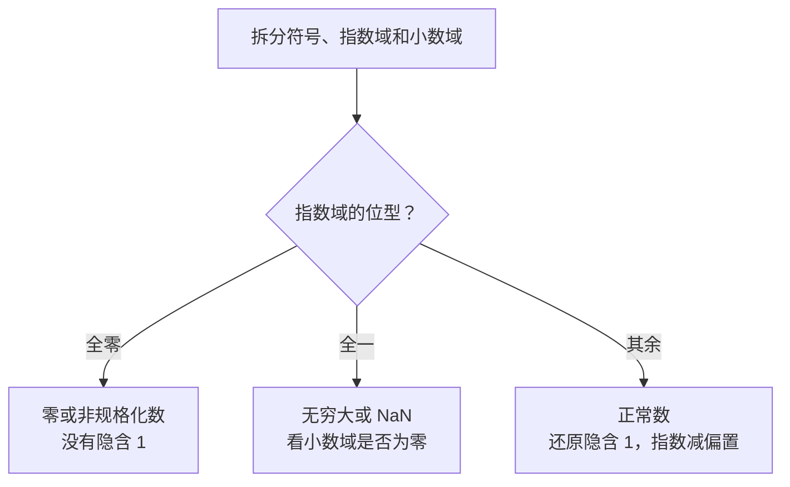

# 《计算机组成与结构》第2章 运算方法和运算器（课件）

同一串位既可以是负数，也可以是非负整数，还可以是一个字符的编码。电路不能从位型猜出含义，必须先知道格式再解释结果。第 2–7 页区分数制、数值编码和字符编码；第 8–30 页在此基础上讨论如何计算、检错与表示数量级。如果题目只给位串，先问它==用什么格式、占几位==。

## 从位型到真值

进位制负责分配位权：二进制转八进制或十六进制时，从小数点向两侧分别每三位或四位分组，缺位补在整数的最左或小数的最右。十进制转二进制时，整数部分反复除以 2，逆序读余数；小数部分反复乘以 2，顺序读整数位，不保证有限步结束。编码则回答另一个问题：在固定位宽内怎样表示数字、字符与检查位。逐位 BCD 用四位分别编码一个十进制数字，不是把整个十进制数作为二进制整数来编码。字符也应区分码值、输入方法和显示字形。[数制与编码](../../../topics/计算机组成/number-systems.md)可作为解读位型的检查表。

第 5–6 页的 8 位移码把真值加 128，再按无符号码读。真值由 $-128$ 增到 $127$，码值就由 $0$ 增到 $255$，因此比较真值可以直接比较码值。在这个偏置下，移码与补码恰好相差最高位：

| 真值 | 8 位补码 | 偏置 128 的 8 位移码 |
| ---: | --- | --- |
| -128 | `10000000` | `00000000` |
| -1 | `11111111` | `01111111` |
| 0 | `00000000` | `10000000` |
| 1 | `00000001` | `10000001` |
| 127 | `01111111` | `11111111` |

**补充：** 补码适合固定宽度加减，因为码字可看成真值对 $2^n$ 的余数；偏置码适合排序，因为加固定偏置不改变真值顺序。最高位翻转的关系依赖特殊偏置，不可搬到 IEEE 754 的指数偏置 127 或 1023。

## 加法器不替你选解释

第 8–15 页的[定点补码加减](../../../topics/计算机组成/fixed-point-add-sub.md)可以共用算术通路：计算 $A-B$ 时把 $B$ 按位取反，并令最低位进位输入为 1。一位全加器的和位是 $a_i\oplus b_i\oplus c_i$，进位是 $a_i b_i+(a_i\oplus b_i)c_i$（此处加号表示逻辑或）。把进位逐级接到下一位，就得到[行波进位加法器](../../../topics/计算机组成/ripple-carry-adder.md)：若低位恰好连续传播进位，最高位就要等这一整条链，位数增加也可能增加关键路径的延迟。

> [!TIP]
> 题目如果出现==是否溢出==，先看它要求无符号还是有符号解释。最高位进位能判断无符号加法越界，却不等于补码的溢出标志。

**补充：** 只用 4 位观察：$0111+0001=1000$ 没有最高位进位，却把有符号的 $7+1$ 算成了负码型；$1111+0001=0000$（丢掉最高位进位）有无符号溢出，却正好是有符号的 $-1+1=0$。补码加法看进入与离开符号位的进位是否不同，也可看同号输入是否产生异号输出。将两个输入先符号扩展一位再相加，合法结果的最高两位相同；`01` 表示正溢出，`10` 表示负溢出。[溢出判定](../../../topics/计算机组成/overflow-detect.md)把这三种视角连了起来。

**订正（第 9 页的适用边界）：** 全位取反加 1 在模 $2^n$ 下总能给出加法逆元，但最小补码真值的数学相反数在同位宽内不可表示。用减法加法器的进位差，或直接用原始操作数的符号规则判断溢出；不要把已回绕的中间负数当作数学真值。

## 乘除怎样复用少量硬件

第 16–19 页的[定点乘除](../../../topics/计算机组成/fixed-point-mul-div.md)把按位展开的操作拆成加、减、移位。乘法逐位消费乘数，只在该位为 1 时加被乘数；课件的串行硬件把部分积和剩余乘数放进组合寄存器，决定本拍加或不加后整体右移。恢复余数除法先试减：若新余数为负，商位写 0 并恢复余数；否则写 1 保留差，再继续下一位。二者复用运算电路，代价是按位重复的时钟周期。

**参考解答（第 16–17 页乘法原例）：** `1101` 和 `1011` 在本例是无符号幅值，分别是 13 和 11；后者的非零位权是 1、2、8，所以结果为 $13(1+2+8)=143$，即 `10001111`。如果把两个 4 位操作数误读为补码，乘积会变成 $(-3)(-5)=15$；算出 15 并不是移位器错了，而是输入解释变了。

## 检出损坏与定位损坏不是同一件事

第 20–24 页依次介绍[奇偶校验](../../../topics/计算机组成/parity-check.md)、[海明码](../../../topics/计算机组成/hamming-code.md)和 [CRC](../../../topics/计算机组成/crc-check.md)。奇偶校验能检出奇数个翻转，两处翻转会互相抵消；偶校验位就是各数据位的异或，奇校验位则取其反。海明码让每个位属于不同的校验组组合，将失败的组号拼成位置；CRC 用生成多项式做模 2 除法，发送端把余数附在数据后，接收端检查完整码字余数，检错保证取决于多项式与错误模式。

**参考解答（第 23 页，信息位 `0110001`）：** 原题未约定奇偶或书写方向。下表从左向右编号 1 到 11，按给出顺序将数据填入 3、5、6、7、9、10、11。$2^3<7+3+1$，而 $2^4\ge 7+4+1$，因此最少需四个校验位。偶校验时用各组其他位的异或决定校验位。

| 位置 | 1 | 2 | 3 | 4 | 5 | 6 | 7 | 8 | 9 | 10 | 11 |
| --- | ---: | ---: | ---: | ---: | ---: | ---: | ---: | ---: | ---: | ---: | ---: |
| 类型 | 校 | 校 | 数 | 校 | 数 | 数 | 数 | 校 | 数 | 数 | 数 |
| 偶校验码字 | 0 | 0 | 0 | 0 | 1 | 1 | 0 | 1 | 0 | 0 | 1 |

按上述方向得到 `00001101001`；同方向配奇时四个校验位各取反，得到 `11011100001`。例如偶校码字的位置 10 翻转，编号为 2、8 的校验组失败，$2+8=10$ 恰好定位它。

> [!WARNING]
> **订正（第 22 页）：** 普通海明码的非零综合征虽能表明两位翻转所得字不合法，却不能同时可靠地区分一位错和两位错。翻转位置 1、2 的综合征与只翻转位置 3 相同，若当作单错修正，反会翻错第三位。若要同时纠单错并明确检双错，应另加整体奇偶位，使用扩展海明码。

## 阶码先分类，隐藏位随后还原

第 25–30 页讨论[浮点表示](../../../topics/计算机组成/float-representation.md)和[规格化](../../../topics/计算机组成/float-normalize.md)。移动二进制小数点并反向调整指数，可以得到等值表示；正常数把有效数归一到 $[1,2)$，其前导 1 可不存，精度配额留给后面的位。IEEE 754 binary32 有 1 位符号、8 位指数和 23 位小数域；正常数的实际指数是 $E-127$。课件还给出了 binary64 的偏置 1023。

**参考解答（第 30 页，`41360000`）：** 题给十六进制存储位型，故先拆字段而不是把整个数当无符号整数。`0 | 10000010 | 01101100000000000000000` 的指数域是 130，属于正常数，实际指数为 3；补回隐藏位得 $1+1/4+1/8+1/32+1/64=91/64$，再乘 $2^3$，得到 $91/8=11.375$。

**订正（第 28 页的适用边界）：** “非零就补隐藏位 1”不能推广到所有 IEEE 754 位型。指数域为零时，非规格化数的有效数没有隐含 1，其尺度取最小正常指数；例如 binary32 位型 `00000001` 是 $2^{-149}$ 而非最小正常数 $2^{-126}$。指数域全一时必须单独解释，不进入正常数公式。
