# 《计算机组成与结构》第2章 运算方法和运算器（课件）

原件的每一页，下面附识别出的文字。

### COMPUTER ORGANIZATION AND ARCHITECTURE

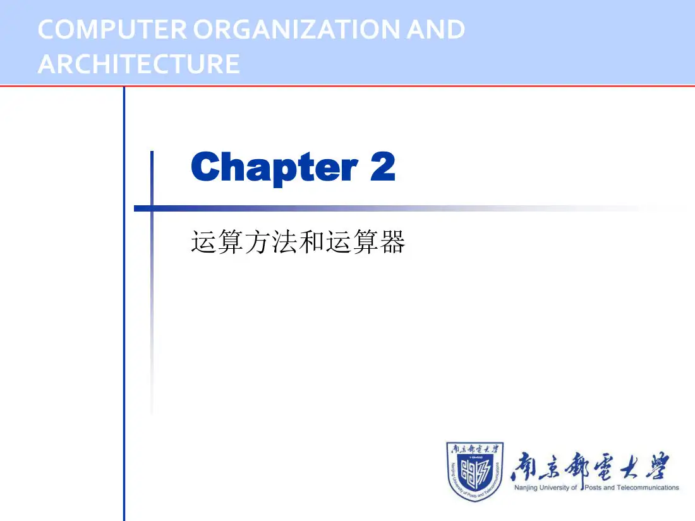

原文：

COMPUTER ORGANIZATION AND ARCHITECTURE

Chapter 2

运算方法和运算器

南京郵電大學 Nanijing O 圆 nons 南京郵電大学 Nanjing University of Posts and Telecommunications ty o Posts and T

### 数据与文字的表示方法

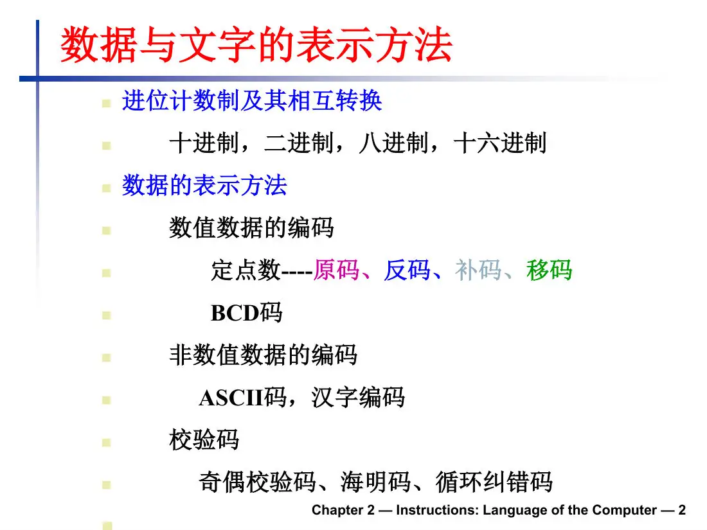

原文：

数据与文字的表示方法

进位计数制及其相互转换

◼ 十进制，二进制，八进制，十六进制

数据的表示方法

数值数据的编码

定点数----原码、反码、补码、移码

BCD码

◼ 非数值数据的编码

ASCII码，汉字编码

校验码

奇偶校验码、海明码、循环纠错码

Chapter 2 — Instructions: Language of the Computer — 2

### 数制

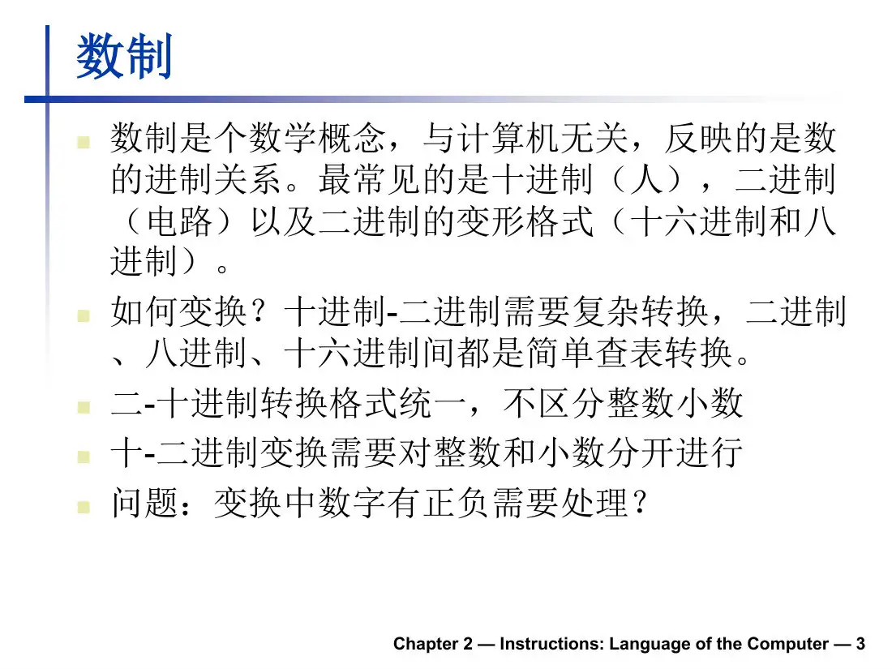

原文：

数制

◼ 数制是个数学概念，与计算机无关，反映的是数的进制关系。最常见的是十进制（人），二进制（电路）以及二进制的变形格式（十六进制和八进制）。

◼ 如何变换？十进制-二进制需要复杂转换，二进制、八进制、十六进制间都是简单查表转换。

◼ 二-十进制转换格式统一，不区分整数小数

◼ 十-二进制变换需要对整数和小数分开进行

◼ 问题：变换中数字有正负需要处理？

Chapter 2 — Instructions: Language of the Computer

3

### 码制

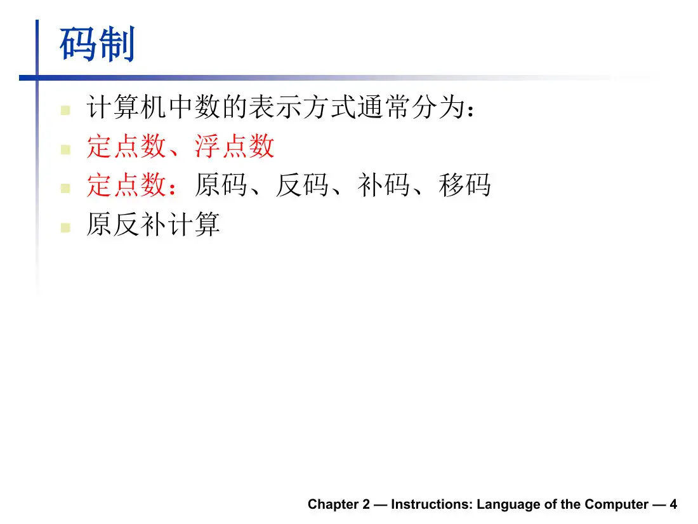

原文：

码制

◼ 计算机中数的表示方式通常分为：

定点数、浮点数

◼ 定点数：原码、反码、补码、移码

◼ 原反补计算

Chapter 2 — Instructions: Language of the Computer — 4

### 移码表示法

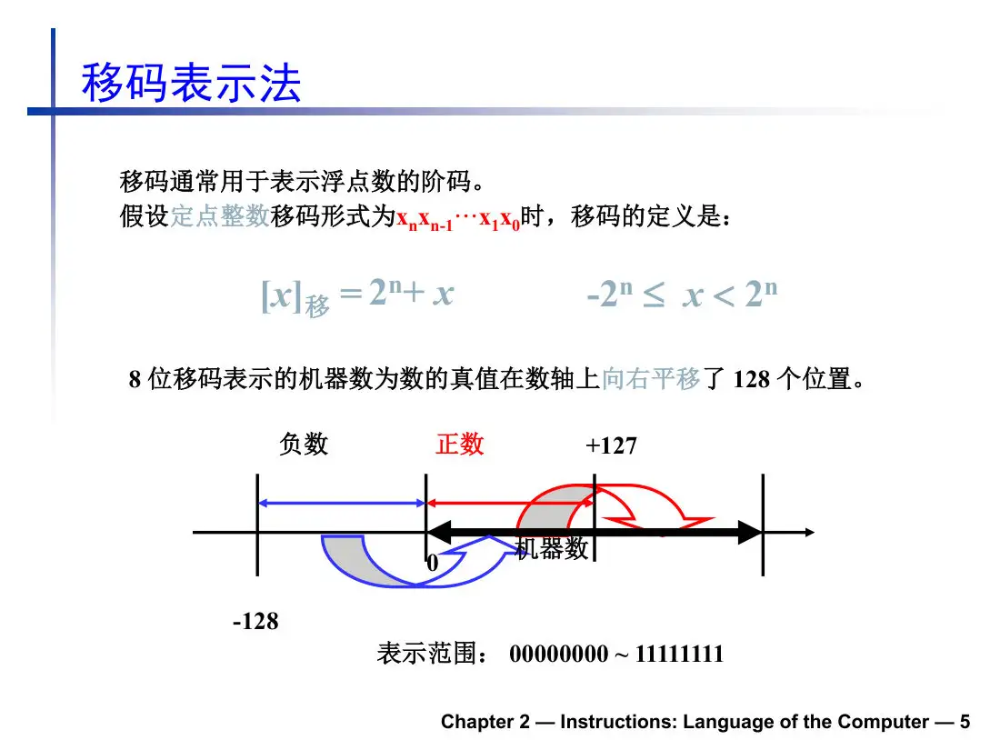

原文：

移码表示法

移码通常用于表示浮点数的阶码。

假设定点整数移码形式为 $\mathbf { X _ { n } X _ { n - 1 } } ^ { \mathbf { \theta _ { \cdots } } \mathbf { \theta _ { X _ { 1 } } X _ { 0 } } }$ 时，移码的定义是：

$$
[ x ] _ {\text {移}} = 2 ^ {\mathrm{n}} + x \quad - 2 ^ {\mathrm{n}} \leq x <   2 ^ {\mathrm{n}}
$$

8 位移码表示的机器数为数的真值在数轴上向右平移了 128 个位置。

### ◼ 移码和补码的关系：∴ 补码与移码只差一个符号位

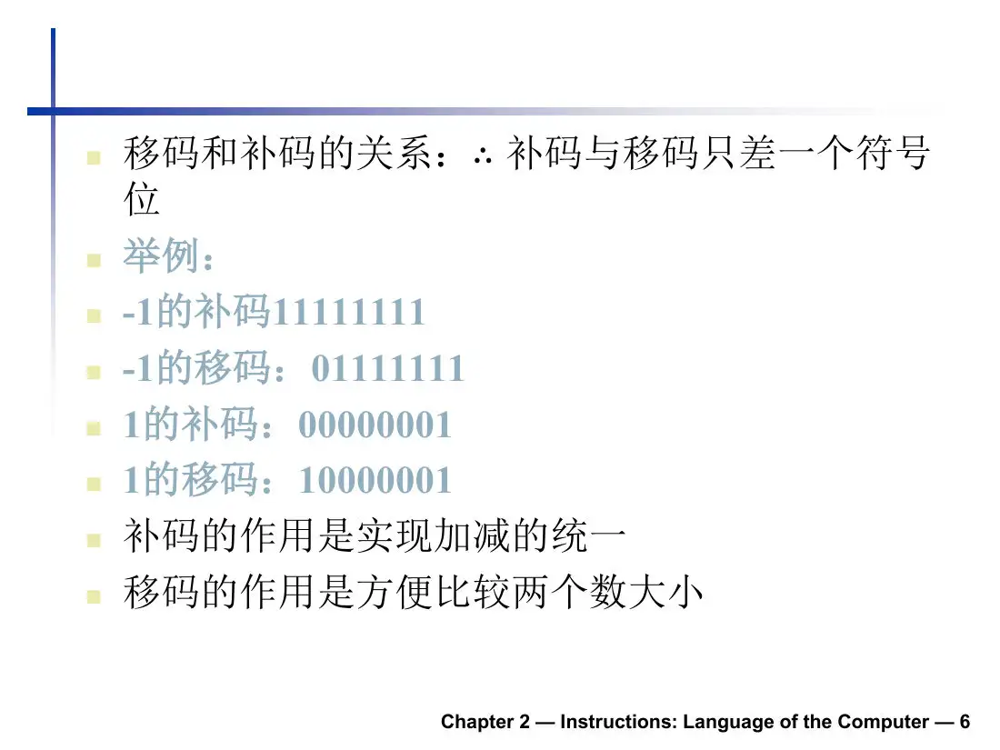

原文：

◼ 移码和补码的关系：∴ 补码与移码只差一个符号位

◼ 举例：

◼ -1的补码11111111

◼ -1的移码：01111111

◼ 1的补码：00000001

◼ 1的移码：10000001

◼ 补码的作用是实现加减的统一

◼ 移码的作用是方便比较两个数大小

Chapter 2 — Instructions: Language of the Computer

6

### 非数值数据

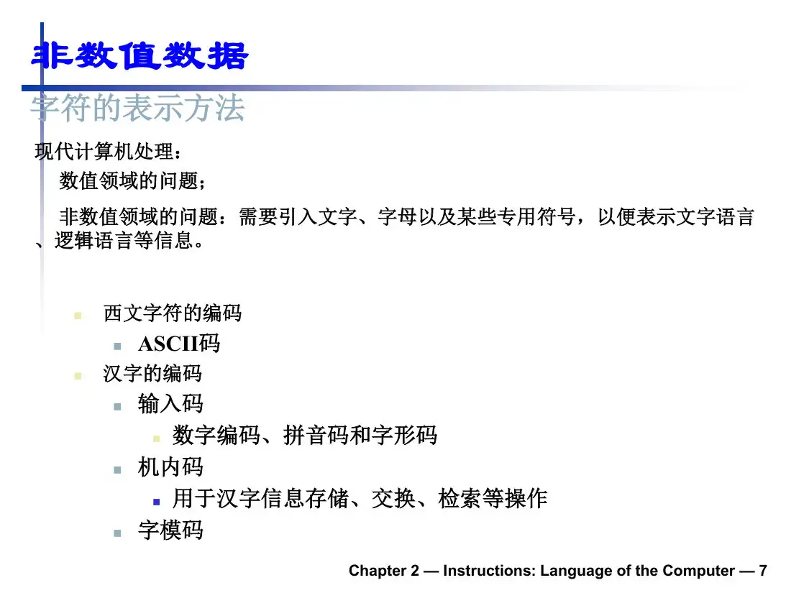

原文：

非数值数据

字符的表示方法

现代计算机处理：

数值领域的问题；

非数值领域的问题：需要引入文字、字母以及某些专用符号，以便表示文字语言逻辑语言等信息。

◼ 西文字符的编码

◼ ASCII码

◼ 汉字的编码

◼ 输入码

◼ 数字编码、拼音码和字形码

◼ 机内码

◼ 用于汉字信息存储、交换、检索等操作

◼ 字模码

Chapter 2 — Instructions: Language of the Computer — 7

### 定点加减法运算与溢出判断

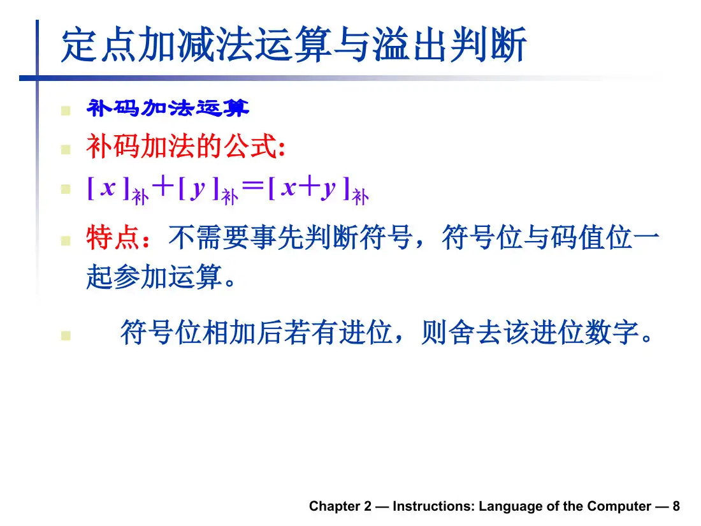

原文：

定点加减法运算与溢出判断

补码加法运算

补码加法的公式:

◼ $[ \left. x \right] _  \ast \} + [ \left. y \right] _  \ast \} = [ \left. x + y \right] _ { \ast }$

特点：不需要事先判断符号，符号位与码值位一起参加运算。

◼ 符号位相加后若有进位，则舍去该进位数字。

Chapter 2 — Instructions: Language of the Computer — 8

### 补码减法运算的公式：

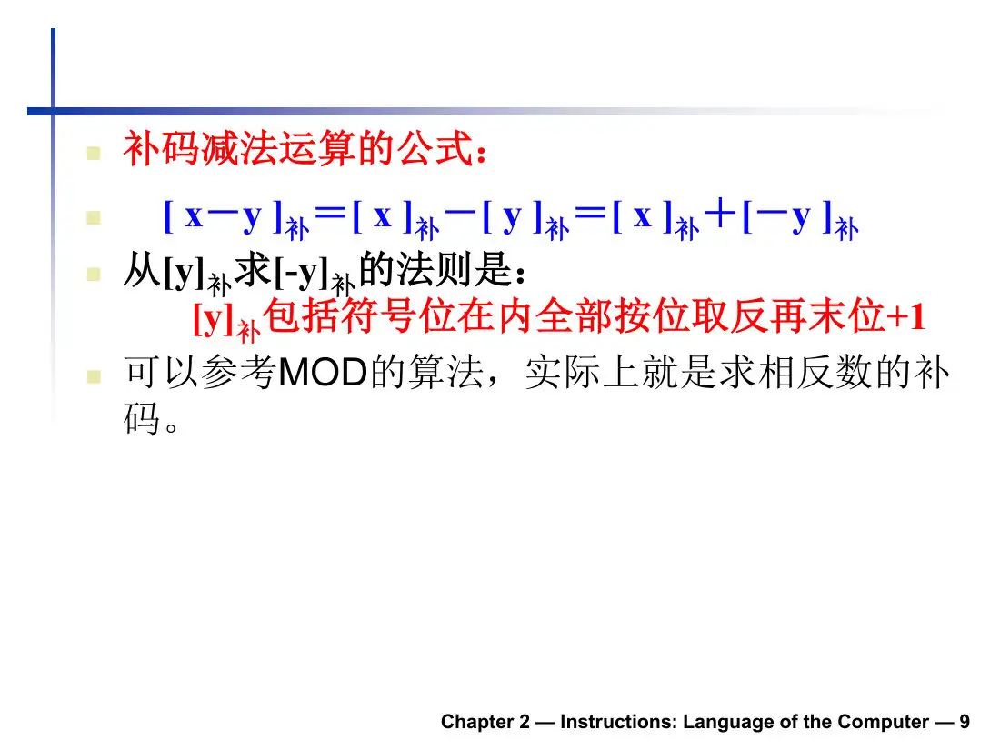

原文：

补码减法运算的公式：

◼ $[ \mathbf { \ x } - \mathbf { y } ] _ { \vec { * } \vec { \vdash } } = [ \mathbf { \Delta x } ] _ { \vec { * } \vec { \vdash } } - [ \mathbf { \Delta y } ] _ { \vec { * } \vec { \vdash } } = [ \mathbf { \Delta x } ] _ { \vec { * } \vec { \vdash } } + [ - \mathbf { y } ] _ { \vec { * } \vec { \vdash } }$

◼ $[ \mathbf { y } ] _ { \sharp \mathfrak { k } }$ 求 $[ - \mathbf { y } ] _ { \sharp \mathfrak { k } }$ 的法则是：

$[ \mathbf { y } ] _ { \sharp \mathfrak { k } }$ 包括符号位在内全部按位取反再末位+1

◼ 可以参考 $M O D$ 的算法，实际上就是求相反数的补码。

Chapter 2 — Instructions: Language of the Computer — 9

### 溢出及其判定

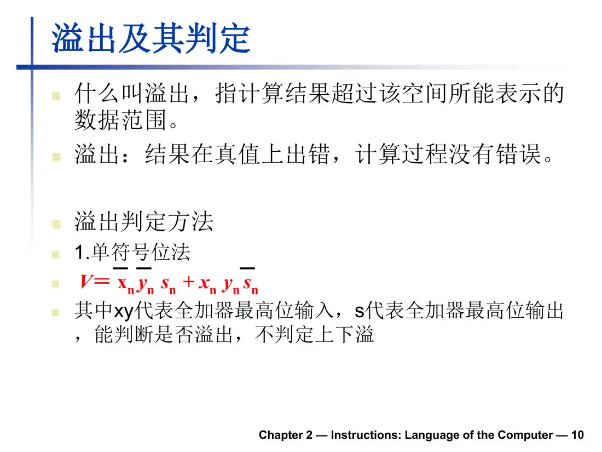

原文：

溢出及其判定

◼ 什么叫溢出，指计算结果超过该空间所能表示的数据范围。

◼ 溢出：结果在真值上出错，计算过程没有错误。

◼ 溢出判定方法

◼ 1.单符号位法

◼ $V { = } \mathrm { x } _ { \mathrm { n } } y _ { \mathrm { n } } s _ { \mathrm { n } } + { x } _ { \mathrm { n } } y _ { \mathrm { n } } s _ { \mathrm { n } }$

◼ 其中xy代表全加器最高位输入，s代表全加器最高位输出，能判断是否溢出，不判定上下溢

Chapter 2 — Instructions: Language of the Computer

10

### ◼ 2.双符号位法

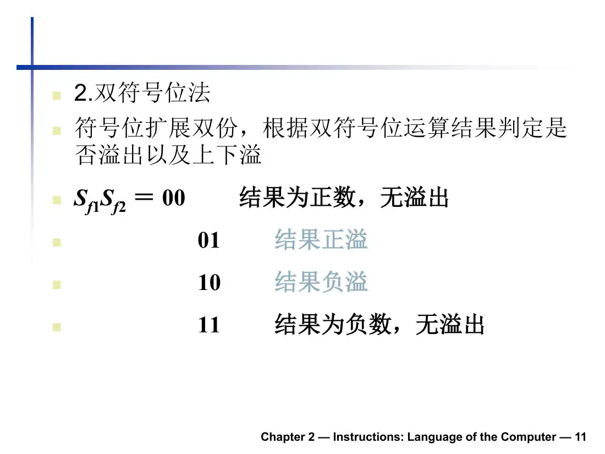

原文：

◼ 2.双符号位法

◼ 符号位扩展双份，根据双符号位运算结果判定是否溢出以及上下溢

◼ $S _ { f 1 } S _ { f 2 } = 0 0$ 结果为正数，无溢出

01 结果正溢

10 结果负溢

11 结果为负数，无溢出◼ 3.利用进位值的判别法——加法器中实际使用的方法

Chapter 2 — Instructions: Language of the Computer

11

### ◼ 最高位进位与次高位进位的异或值

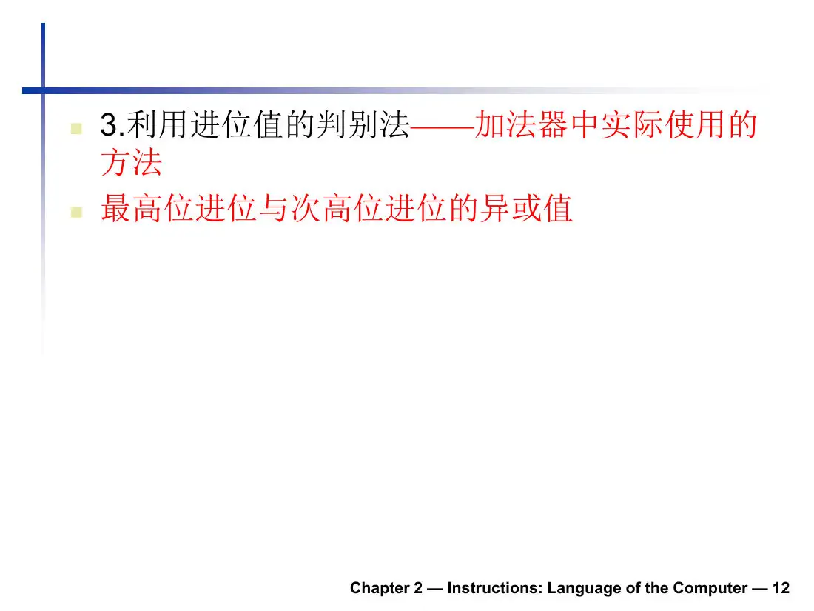

原文：

◼ 最高位进位与次高位进位的异或值

Chapter 2 — Instructions: Language of the Computer

12

### 基本的二进制加法/减法器

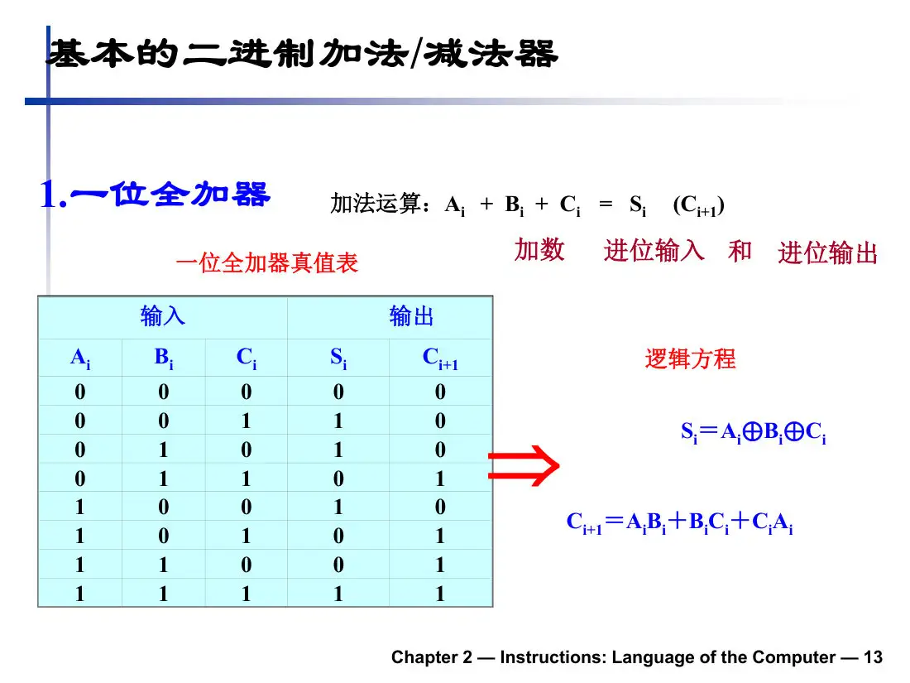

原文：

基本的二进制加法/减法器

.一位全加器

加法运算： $\mathrm { \bf ~ A } _ { \mathrm { i } } \mathrm { ~ \bf ~ + ~ } \mathrm { \bf ~ B } _ { \mathrm { i } } + \mathrm { \bf ~ C } _ { \mathrm { i } } = \mathrm { \bf ~ S } _ { \mathrm { i } } ( \mathrm { \bf ~ C } _ { \mathrm { i + 1 } } )$

一位全加器真值表

加数 进位输入 和 进位输出

<table><tr><td colspan="3">输入</td><td colspan="2">输出</td></tr><tr><td> $A_i$ </td><td> $B_i$ </td><td> $C_i$ </td><td> $S_i$ </td><td> $C_{i+1}$ </td></tr><tr><td>0</td><td>0</td><td>0</td><td>0</td><td>0</td></tr><tr><td>0</td><td>0</td><td>1</td><td>1</td><td>0</td></tr><tr><td>0</td><td>1</td><td>0</td><td>1</td><td>0</td></tr><tr><td>0</td><td>1</td><td>1</td><td>0</td><td>1</td></tr><tr><td>1</td><td>0</td><td>0</td><td>1</td><td>0</td></tr><tr><td>1</td><td>0</td><td>1</td><td>0</td><td>1</td></tr><tr><td>1</td><td>1</td><td>0</td><td>0</td><td>1</td></tr><tr><td>1</td><td>1</td><td>1</td><td>1</td><td>1</td></tr></table>

Chapter 2 — Instructions: Language of the Computer

13

### 常用的全加器逻辑电路

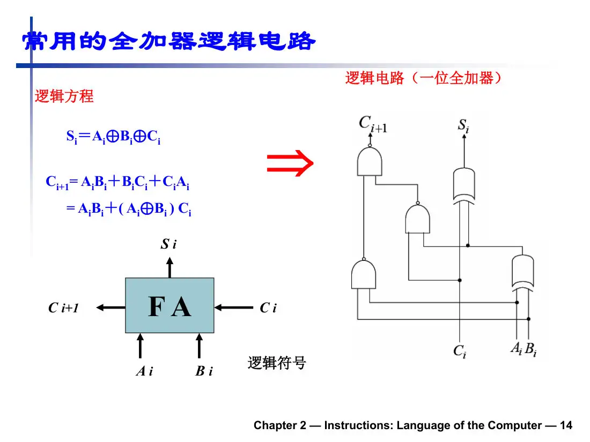

原文：

常用的全加器逻辑电路

逻辑方程

$$
\mathbf {S} _ {\mathrm{i}} = \mathbf {A} _ {\mathrm{i}} \oplus \mathbf {B} _ {\mathrm{i}} \oplus \mathbf {C} _ {\mathrm{i}}
$$

$$
\begin{array}{r l} \mathbf {C} _ {\mathrm{i+1}} & = \mathbf {A} _ {\mathrm{i}} \mathbf {B} _ {\mathrm{i}} + \mathbf {B} _ {\mathrm{i}} \mathbf {C} _ {\mathrm{i}} + \mathbf {C} _ {\mathrm{i}} \mathbf {A} _ {\mathrm{i}} \\ & = \mathbf {A} _ {\mathrm{i}} \mathbf {B} _ {\mathrm{i}} + (\mathbf {A} _ {\mathrm{i}} \oplus \mathbf {B} _ {\mathrm{i}}) \mathbf {C} _ {\mathrm{i}} \end{array}
$$

逻辑电路（一位全加器）

Chapter 2 — Instructions: Language of the Computer

14

### n位的行波进位加减器

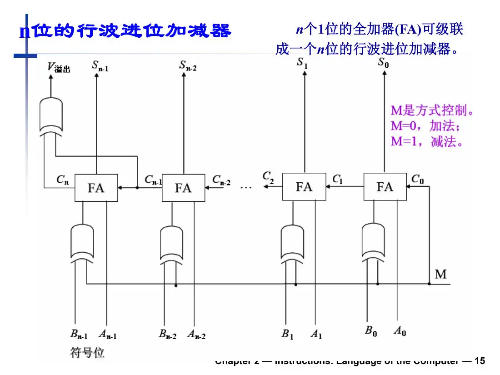

原文：

n位的行波进位加减器

n个1位的全加器(FA)可级联成一个n位的行波进位加减器。

Chapter 2 — Instructions: Language of the Compute

15

### 定点乘法运算

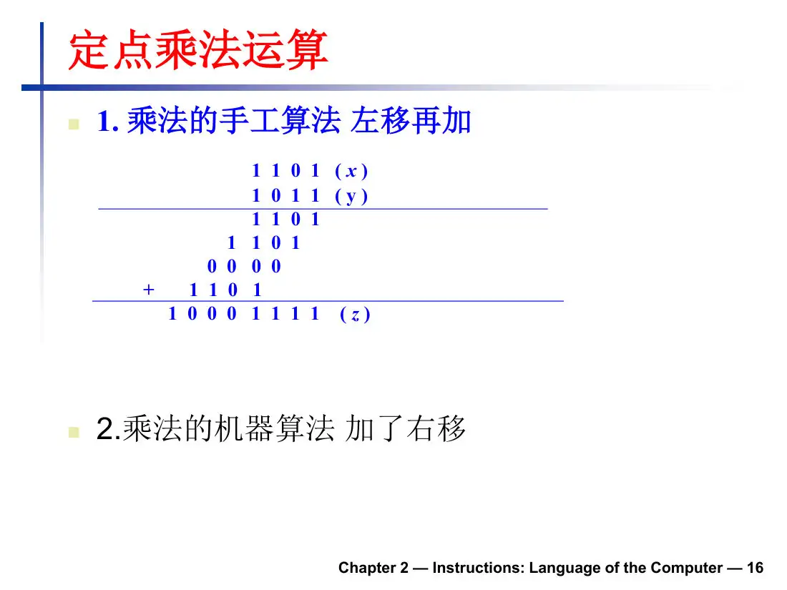

原文：

定点乘法运算

1. 乘法的手工算法 左移再加

$$
\begin{array}{r} {1 1 0 1 (x)} \\ {1 0 1 1 (y)} \\ {\hline 1 1 0 1} \\ {1 1 0 1} \\ {0 0 0 0} \\ {+ 1 1 0 1} \\ {\hline 1 0 0 0 1 1 1 1 (z)} \end{array}
$$

2.乘法的机器算法 加了右移

Chapter 2 — Instructions: Language of the Computer

16

### 2.乘法的机器算法 加了右移

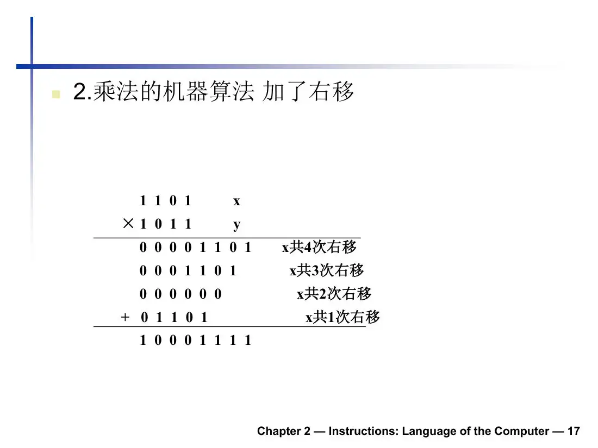

原文：

2.乘法的机器算法 加了右移

<table><tr><td colspan="2">1 1 0 1 x</td></tr><tr><td colspan="2">× 1 0 1 1 y</td></tr><tr><td>0 0 0 0 1 1 0 1</td><td>x共4次右移</td></tr><tr><td>0 0 0 1 1 0 1</td><td>x共3次右移</td></tr><tr><td>0 0 0 0 0 0</td><td>x共2次右移</td></tr><tr><td>+ 0 1 1 0 1</td><td>x共1次右移</td></tr><tr><td>1 0 0 0 1 1 1 1</td><td></td></tr></table>

Chapter 2 — Instructions: Language of the Computer

17

### 一位原码乘法器原理图

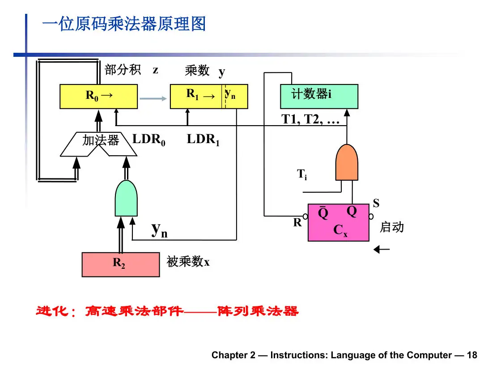

原文：

一位原码乘法器原理图

Chapter 2 — Instructions: Language of the Computer

18

### 一位除法器

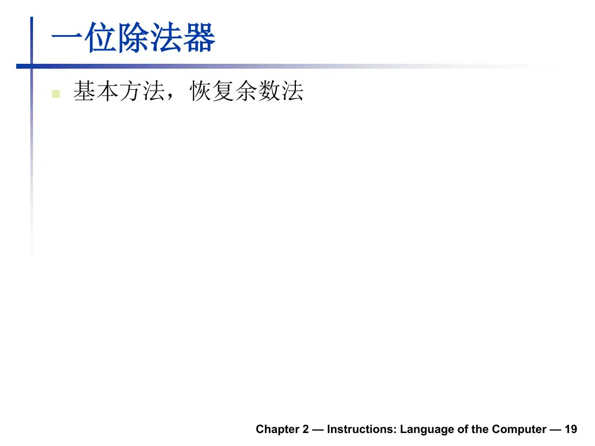

原文：

一位除法器

◼ 基本方法，恢复余数法

Chapter 2 — Instructions: Language of the Computer

19

### 校验码

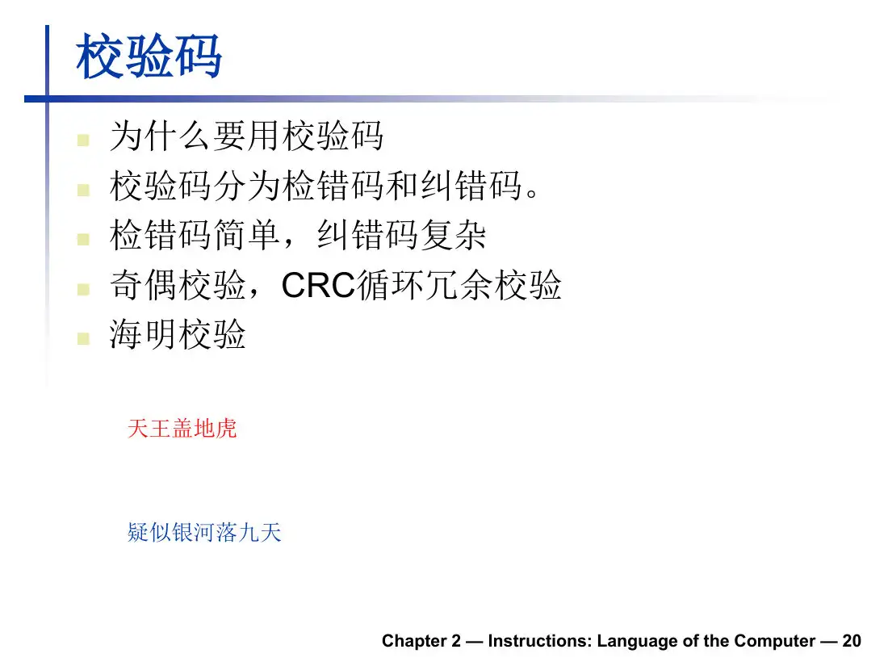

原文：

校验码

◼ 为什么要用校验码

◼ 校验码分为检错码和纠错码。

◼ 检错码简单，纠错码复杂

◼ 奇偶校验，CRC循环冗余校验

◼ 海明校验

天王盖地虎

疑似银河落九天

Chapter 2 — Instructions: Language of the Computer

20

### 奇偶校验

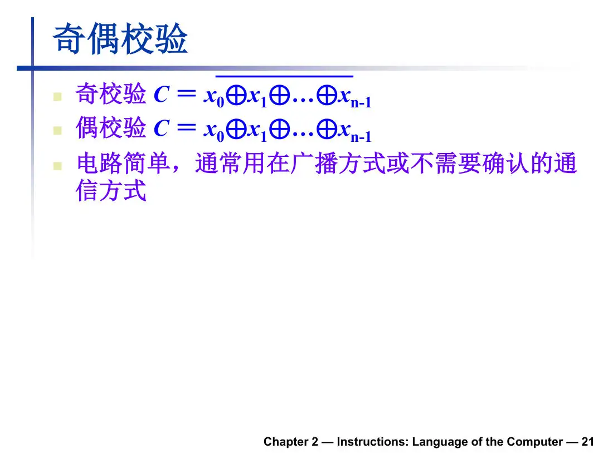

原文：

奇偶校验

◼ 奇校验 $\begin{array} { r } { C = x _ { 0 } \oplus x _ { 1 } \oplus \ldots \oplus x _ { { \mathrm { n - 1 } } } } \end{array}$

◼ 偶校验 $\begin{array} { r } { C = x _ { 0 } \oplus x _ { 1 } \oplus \ldots \oplus x _ { { \mathrm { n - 1 } } } } \end{array}$

电路简单，通常用在广播方式或不需要确认的通信方式

Chapter 2 — Instructions: Language of the Computer

21

### 海明码

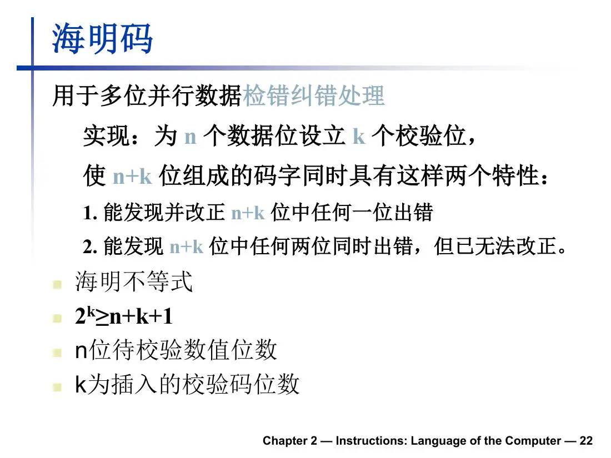

原文：

海明码

用于多位并行数据检错纠错处理

实现：为 n 个数据位设立 k 个校验位，

使 n+k位组成的码字同时具有这样两个特性：

1. 能发现并改正 n+k 位中任何一位出错

2. 能发现 n+k 位中任何两位同时出错，但已无法改正。

◼ 海明不等式

◼ $2 ^ { \mathbf { k } } { \ge } \mathbf { n } { + } \mathbf { k } { + } \mathbf { 1 }$

◼ n位待校验数值位数

◼ k为插入的校验码位数

Chapter 2 — Instructions: Language of the Computer

22

### 例：设有一个7位信息码位0110001，求它的海明码。

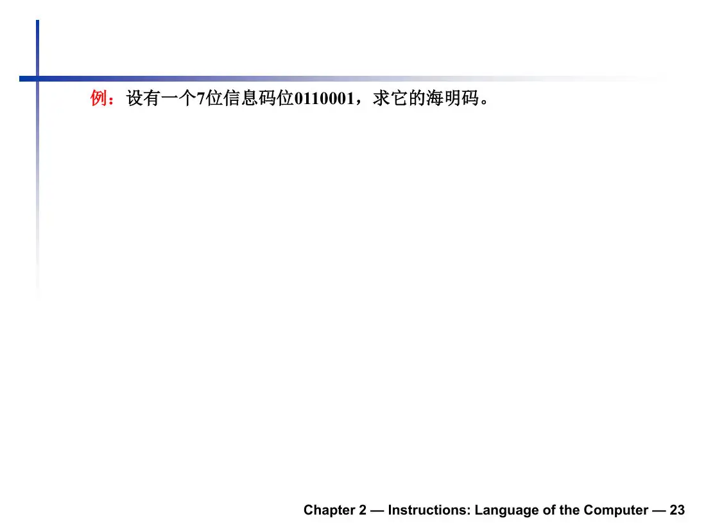

原文：

例：设有一个7位信息码位0110001，求它的海明码。

Chapter 2 — Instructions: Language of the Computer

23

### CRC校验（循环冗余）

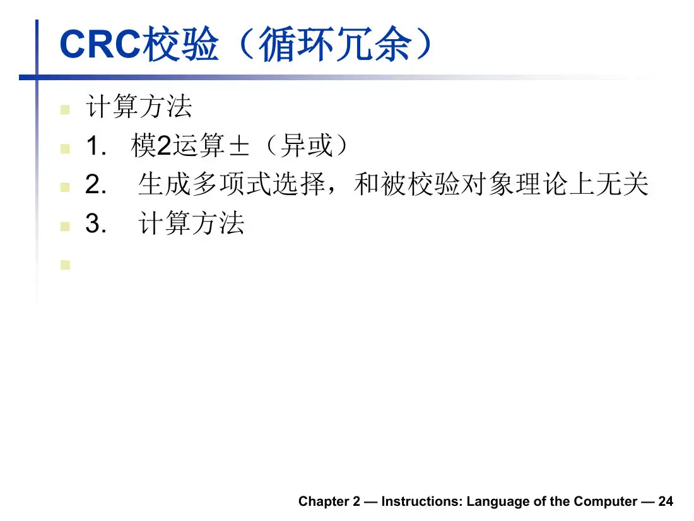

原文：

CRC校验（循环冗余）

◼ 计算方法

◼ 1. 模2运算±（异或）

◼ 2. 生成多项式选择，和被校验对象理论上无关

◼ 3. 计算方法

Chapter 2 — Instructions: Language of the Computer

24

### 浮点数的表示方法

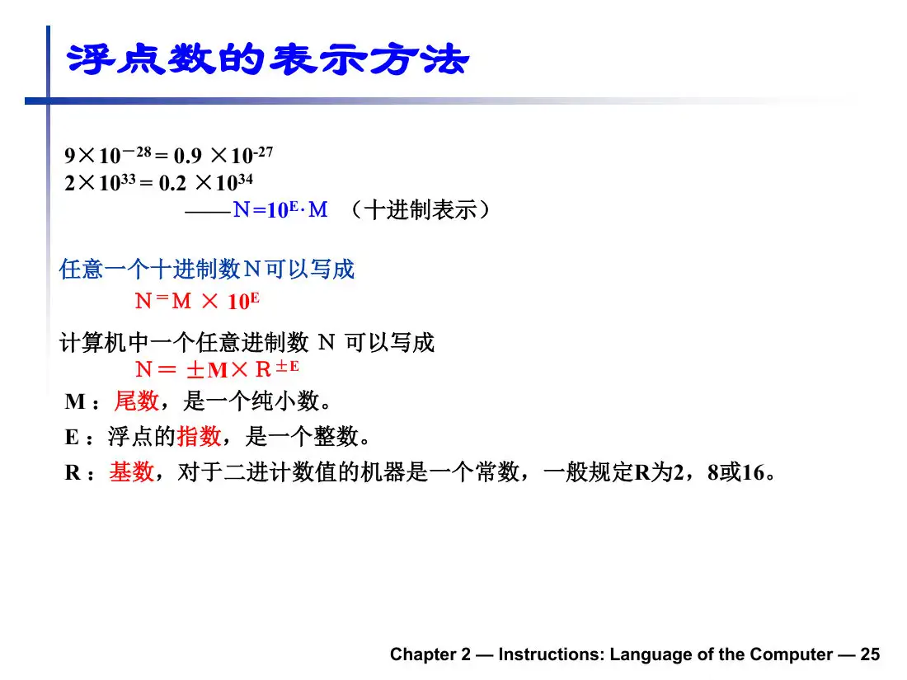

原文：

浮点数的表示方法

$$
9 \times 1 0 ^ {- 2 8} = 0. 9 \times 1 0 ^ {- 2 7}
$$

$$
2 \times 1 0 ^ {3 3} = 0. 2 \times 1 0 ^ {3 4}
$$

$$
- \mathrm{N} = 1 0 ^ {\mathrm{E}} \cdot \mathrm{M} \quad (\text {十进制表示})
$$

任意一个十进制数N可以写成

$$
\mathbf {N} = \mathbf {M} \times \mathbf {1 0 ^ {E}}
$$

计算机中一个任意进制数 N 可以写成

$$
\mathbf {N} = \pm \mathbf {M} \times \mathbf {R} ^ {\pm \mathbf {E}}
$$

M ：尾数，是一个纯小数。

E ：浮点的指数，是一个整数。

R ：基数，对于二进计数值的机器是一个常数，一般规定R为2，8或16。

Chapter 2 — Instructions: Language of the Computer

25

### 一个机器浮点数由阶码和尾数及其符号位组成：

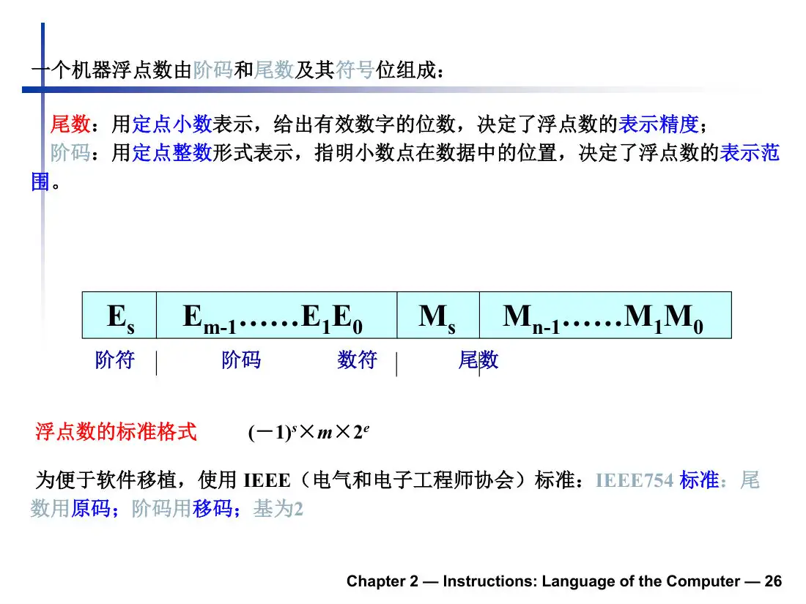

原文：

一个机器浮点数由阶码和尾数及其符号位组成：

尾数：用定点小数表示，给出有效数字的位数，决定了浮点数的表示精度；

阶码：用定点整数形式表示，指明小数点在数据中的位置，决定了浮点数的表示范围。

$$
\mathbf {E _ {s}}
$$

$$
\mathbf {E} _ {\mathrm{m-1}} \dots \dots . \mathbf {E} _ {1} \mathbf {E} _ {0}
$$

$$
\mathbf {M _ {s}}
$$

$$
\mathbf {M} _ {\mathbf {n - 1}} \dots\dots \mathbf {M} _ {1} \mathbf {M} _ {0}
$$

浮点数的标准格式 $( - 1 ) ^ { s } \times m \times 2 ^ { e }$

为便于软件移植，使用 IEEE（电气和电子工程师协会）标准：IEEE754 标准：尾数用原码；阶码用移码；基为2

Chapter 2 — Instructions: Language of the Computer

26

### 浮点数的规格化

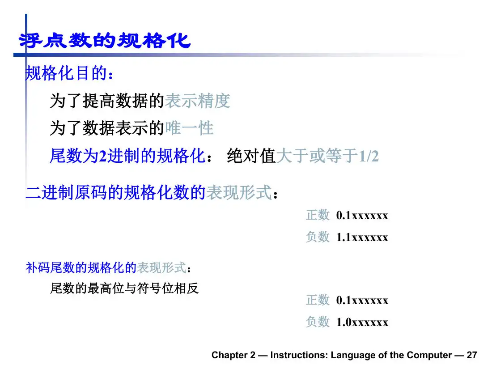

原文：

浮点数的规格化

规格化目的：

为了提高数据的表示精度

为了数据表示的唯一性

尾数为2进制的规格化： 绝对值大于或等于1/2

二进制原码的规格化数的表现形式：

补码尾数的规格化的表现形式：

尾数的最高位与符号位相反

正数 0.1xxxxxx

负数 1.1xxxxxx

正数 0.1xxxxxx负数 1.0xxxxxx

Chapter 2 — Instructions: Language of the Computer

27

### 规格化处理：

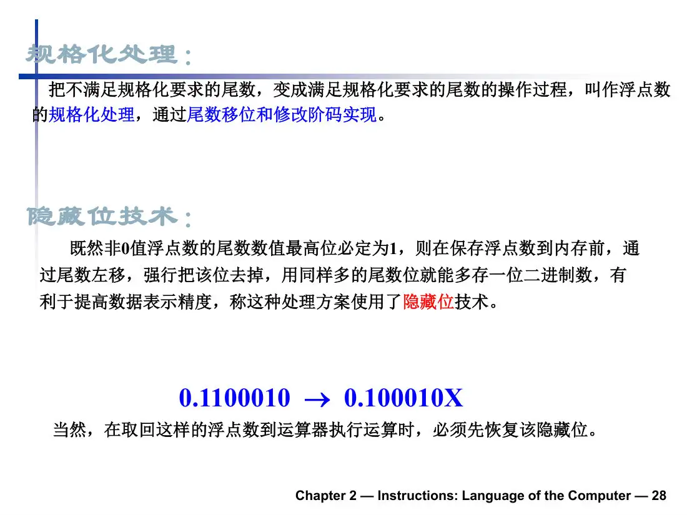

原文：

规格化处理：

把不满足规格化要求的尾数，变成满足规格化要求的尾数的操作过程，叫作浮点数的规格化处理，通过尾数移位和修改阶码实现。

隐藏位技术：

既然非0值浮点数的尾数数值最高位必定为1，则在保存浮点数到内存前，通过尾数左移，强行把该位去掉，用同样多的尾数位就能多存一位二进制数，有利于提高数据表示精度，称这种处理方案使用了隐藏位技术。

$$
0. 1 1 0 0 0 1 0 \rightarrow 0. 1 0 0 0 1 0 X
$$

当然，在取回这样的浮点数到运算器执行运算时，必须先恢复该隐藏位。

Chapter 2 — Instructions: Language of the Computer

28

### 规格化浮点数的真值

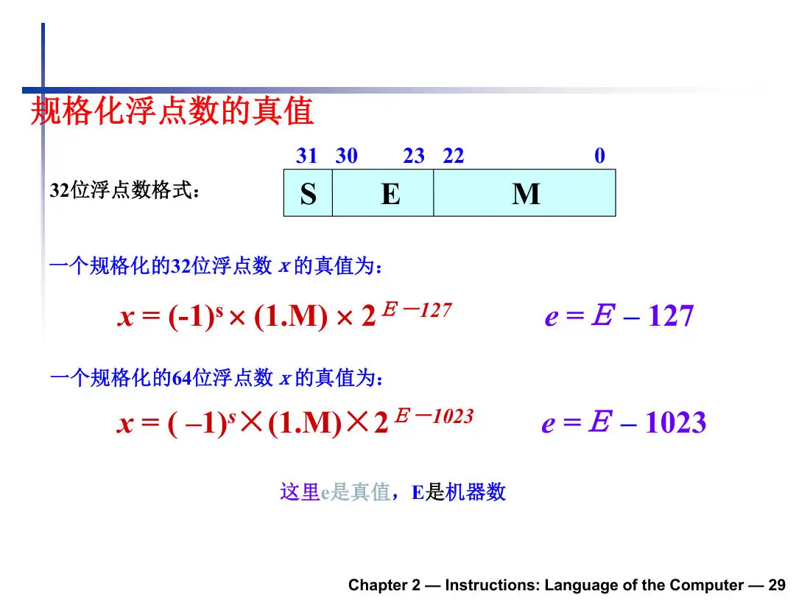

原文：

规格化浮点数的真值

32位浮点数格式：

<table><tr><td>31</td><td>30</td><td>23</td><td>22</td><td>0</td></tr><tr><td>S</td><td colspan="2">E</td><td colspan="2">M</td></tr></table>

一个规格化的32位浮点数 x的真值为：

$$
x = (- 1) ^ {s} \times (1. M) \times 2 ^ {E - 1 2 7}
$$

$$
e = E - 1 2 7
$$

一个规格化的64位浮点数 x的真值为：

$$
x = (- 1) ^ {s} \times (1. M) \times 2 ^ {E - 1 0 2 3}
$$

$$
e = E - 1 0 2 3
$$

这里e是真值，E是机器数

Chapter 2 — Instructions: Language of the Computer

29

### 数符：0

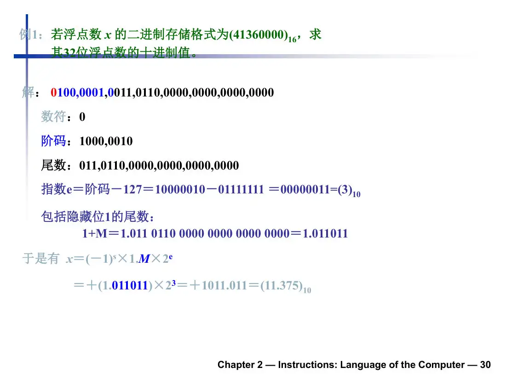

原文：

例1：若浮点数x 的二进制存储格式为 $( 4 1 3 6 0 0 0 0 ) _ { 1 6 } ,$ 求其32位浮点数的十进制值

数符：0

阶码：1000,0010

尾数：011,0110,0000,0000,0000,0000

包括隐藏位1的尾数：

$$
1 + \mathrm{M} = 1. 0 1 1 0 1 1 0 0 0 0 0 0 0 0 0 0 0 0 0 0 0 0 = 1. 0 1 1 0 1 1
$$

于是有 $\scriptstyle x = ( - 1 ) ^ { \mathrm { s } } \times 1 . M \times 2 ^ { \mathbf { e } }$

$$
= + (1. 0 1 1 0 1 1) \times 2 ^ {3} = + 1 0 1 1. 0 1 1 = (1 1. 3 7 5) _ {1 0}
$$

Chapter 2 — Instructions: Language of the Computer

30
