# 《计算机组成与结构》第3章 指令：计算机的语言（课件）

原件的每一页，下面附识别出的文字。

### Chapter 3

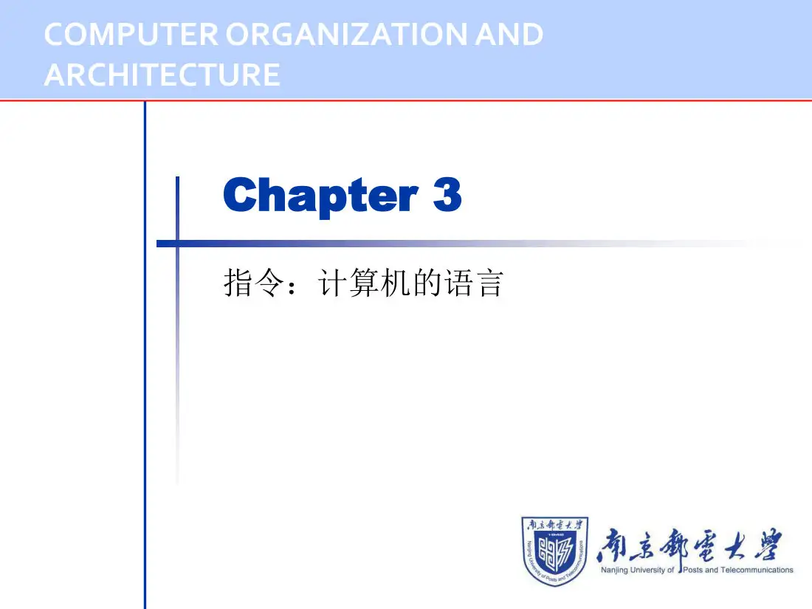

原文：

Chapter 3

指令：计算机的语言

COMPUTER ORGANIZATION AND ARCHITECTURE

南京郵電大學 Nanijing O 圆 nons 南京郵電大学 Nanjing University of Posts and Telecommunications ty o Posts and T

### 计算机的语言

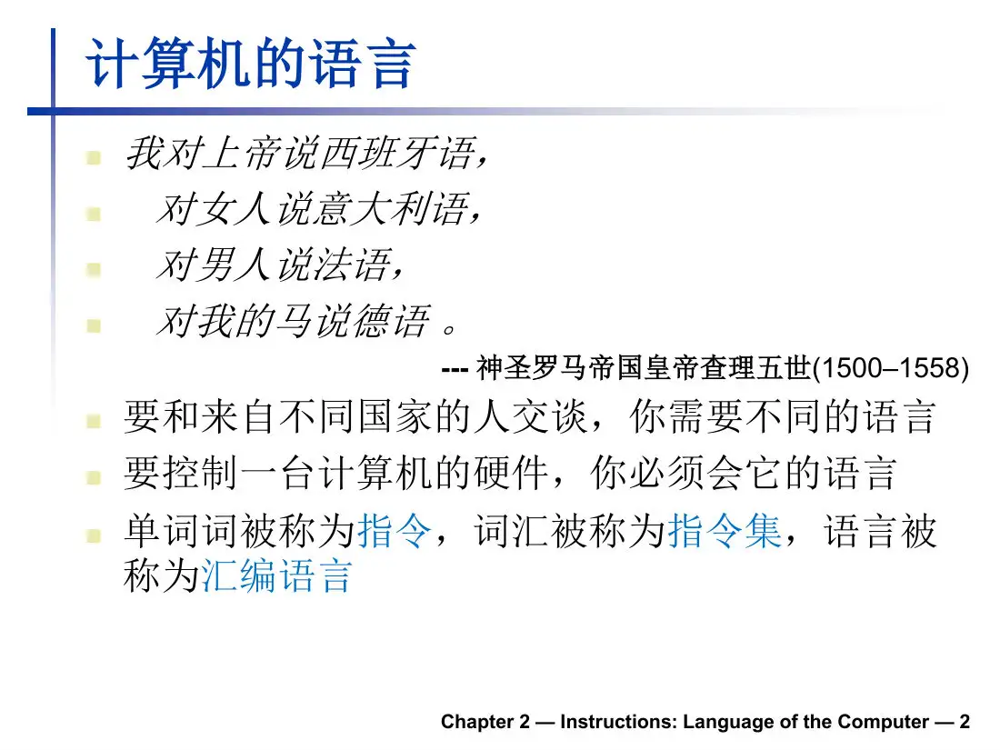

原文：

计算机的语言

◼ 我对上帝说西班牙语，

◼ 对女人说意大利语，

◼ 对男人说法语，

◼ 对我的马说德语。

--- 神圣罗马帝国皇帝查理五世(1500–1558)

◼ 要和来自不同国家的人交谈，你需要不同的语言

◼ 要控制一台计算机的硬件，你必须会它的语言

◼ 单词词被称为指令，词汇被称为指令集，语言被 称为汇编语言

Chapter 2 — Instructions: Language of the Computer — 2

### 我们关注的汇编语言：MIPS

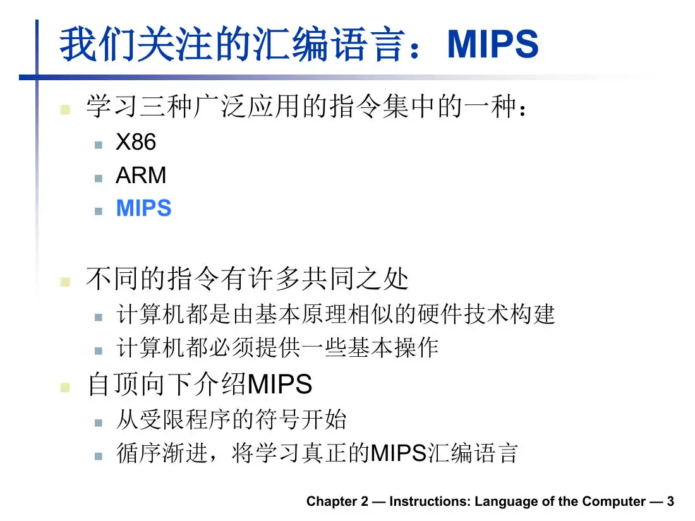

原文：

我们关注的汇编语言：MIPS

◼ 学习三种广泛应用的指令集中的一种：

◼ X86

◼ ARM

◼ MIPS

◼ 不同的指令有许多共同之处

◼ 计算机都是由基本原理相似的硬件技术构建

◼ 计算机都必须提供一些基本操作

◼ 自顶向下介绍MIPS

◼ 从受限程序的符号开始

◼ 循序渐进，将学习真正的MIPS汇编语言

Chapter 2 — Instructions: Language of the Computer — 3

### 常见编程语言

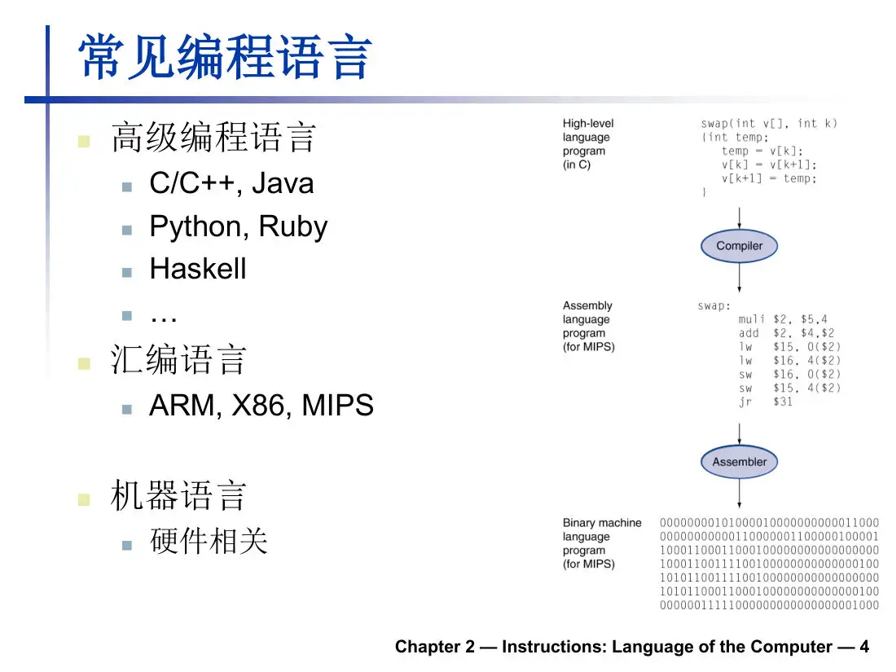

原文：

常见编程语言

◼ 高级编程语言

◼ C/C++, Java

◼ Python, Ruby

◼ Haskell

◼ 汇编语言

◼ ARM, X86, MIPS

◼ 机器语言

◼ 硬件相关

High-level language program (in C)

swap(int v[], int k) {int temp; temp = v[k]; v[k] = v[k+1]; v[k+1] = temp;

Binary machine language program (for MIPS)

00000000101000010000000000011000 00000000000110000001100000100001 10001100011000100000000000000000 10001100111100100000000000000100 10101100111100100000000000000000 10101100011000100000000000000100 00000011111000000000000000001000

Chapter 2 — Instructions: Language of the Computer — 4

### 常见编程语言

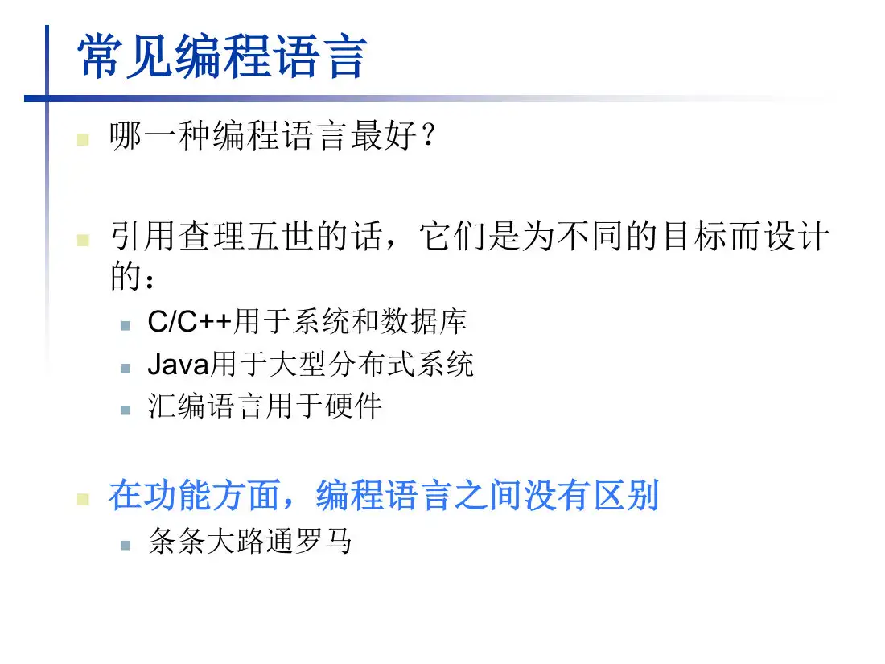

原文：

常见编程语言

◼ 哪一种编程语言最好？

◼ 引用查理五世的话，它们是为不同的目标而设计的：

◼ C/C++用于系统和数据库

◼ Java用于大型分布式系统

◼ 汇编语言用于硬件

◼ 在功能方面，编程语言之间没有区别

◼ 条条大路通罗马

### MIPS指令集

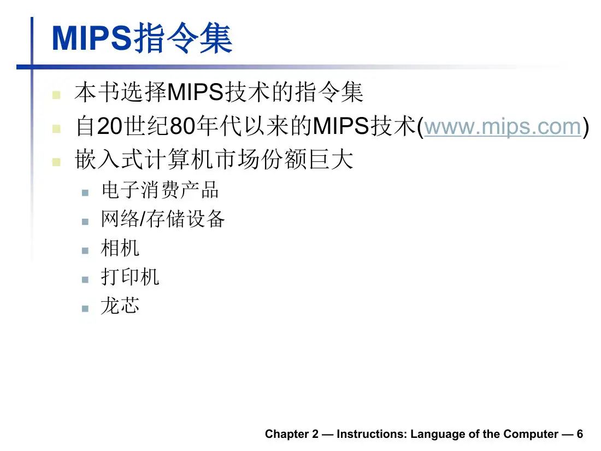

原文：

MIPS指令集

◼ 本书选择MIPS技术的指令集

◼ 自20世纪80年代以来的MIPS技术(www.mips.com)

◼ 嵌入式计算机市场份额巨大

◼ 电子消费产品

◼ 网络/存储设备

◼ 相机

◼ 打印机

◼ 龙芯

Chapter 2 — Instructions: Language of the Computer — 6

### 算术运算

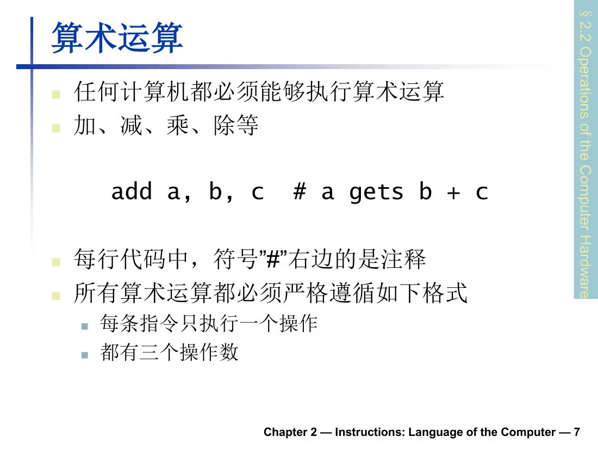

原文：

算术运算

◼ 任何计算机都必须能够执行算术运算

◼ 加、减、乘、除等

add a, b, c # a gets b + c

◼ 每行代码中，符号”#”右边的是注释

◼ 所有算术运算都必须严格遵循如下格式

◼ 每条指令只执行一个操作

◼ 都有三个操作数

§ 2.2 Operations of the Computer Hardware

Chapter 2 — Instructions: Language of the Computer — 7

### 严格算数运算

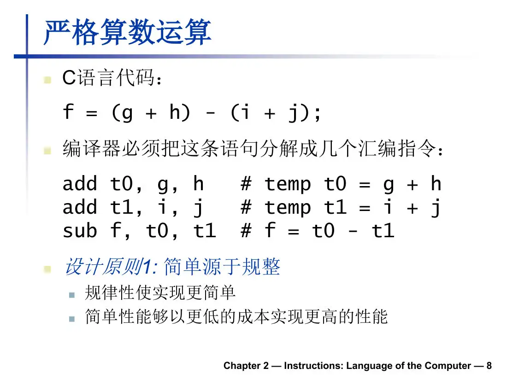

原文：

严格算数运算

◼ C语言代码：

f = (g + h) - (i + j);

◼ 编译器必须把这条语句分解成几个汇编指令：

$$
\begin{array}{l l} \text {add t0,g,h} & \# \text {temp t0 = g + h} \\ \text {add t1,i,j} & \# \text {temp t1 = i + j} \\ \text {sub f,t0,t1} & \# \text {f = t0 - t1} \end{array}
$$

设计原则1: 简单源于规整

◼ 规律性使实现更简单

◼ 简单性能够以更低的成本实现更高的性能

Chapter 2 — Instructions: Language of the Computer — 8

### 内存层次结构

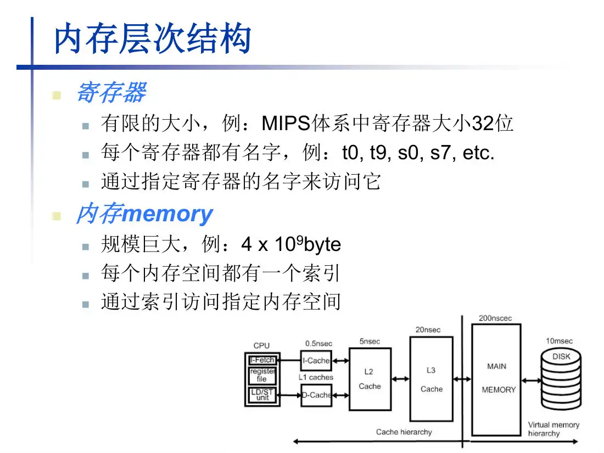

原文：

内存层次结构

寄存器

◼ 有限的大小，例：MIPS体系中寄存器大小32位

◼ 每个寄存器都有名字，例：t0, t9, s0, s7, etc.

◼ 通过指定寄存器的名字来访问它

内存memory

◼ 规模巨大，例： $4 \times 1 0 ^ { 9 } \mathrm { b y t e }$

每个内存空间都有一个索引

◼ 通过索引访问指定内存空间

### 寄存器操作数

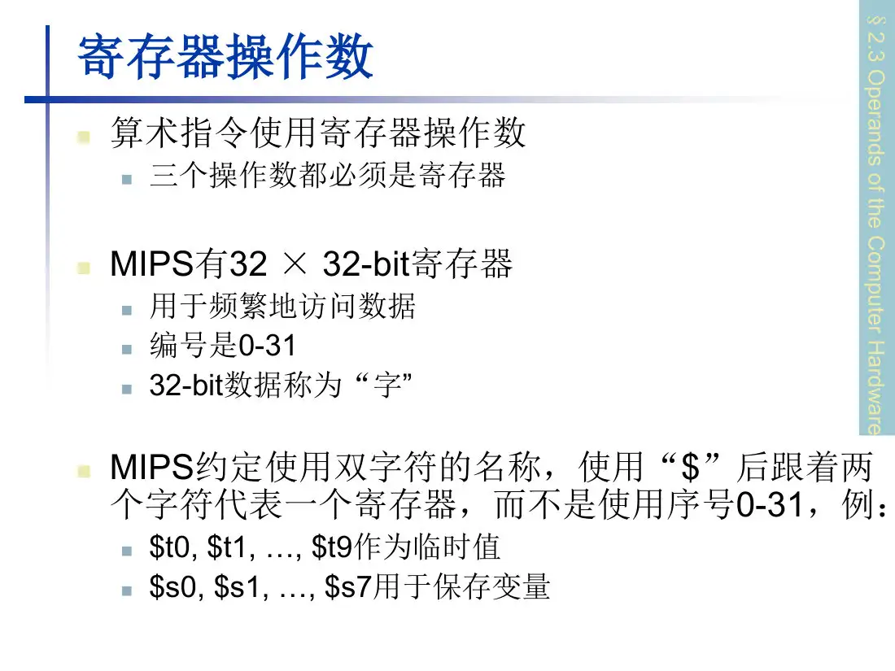

原文：

寄存器操作数

◼ 算术指令使用寄存器操作数

◼ 三个操作数都必须是寄存器

◼ MIPS有32 × 32-bit寄存器

◼ 用于频繁地访问数据

◼ 编号是0-31

◼ 32-bit数据称为“字”

◼ MIPS约定使用双字符的名称，使用“\$”后跟着两个字符代表一个寄存器，而不是使用序号0-31，例：

\$t0, \$t1, …, \$t9作为临时值

◼ \$s0, \$s1, …, \$s7用于保存变量

§ 2.3 Operands of the Computer Hardware

### 寄存器操作数

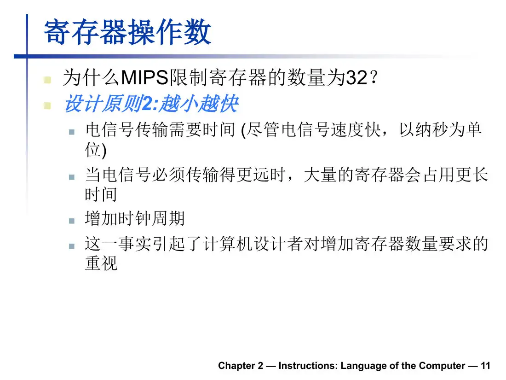

原文：

寄存器操作数

◼ 为什么MIPS限制寄存器的数量为32？

设计原则2:越小越快

◼ 电信号传输需要时间 (尽管电信号速度快，以纳秒为单位)

◼ 当电信号必须传输得更远时，大量的寄存器会占用更长时间

◼ 增加时钟周期

这一事实引起了计算机设计者对增加寄存器数量要求的重视

Chapter 2 — Instructions: Language of the Computer

11

### 寄存器操作数示例

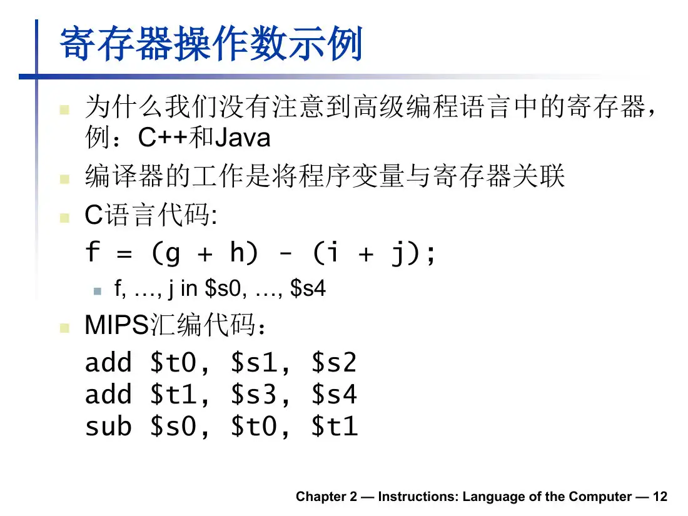

原文：

寄存器操作数示例

◼ 为什么我们没有注意到高级编程语言中的寄存器，例：C++和Java

◼ 编译器的工作是将程序变量与寄存器关联

◼ C语言代码:

◼ MIPS汇编代码：

Chapter 2 — Instructions: Language of the Computer

12

### 内存操作数

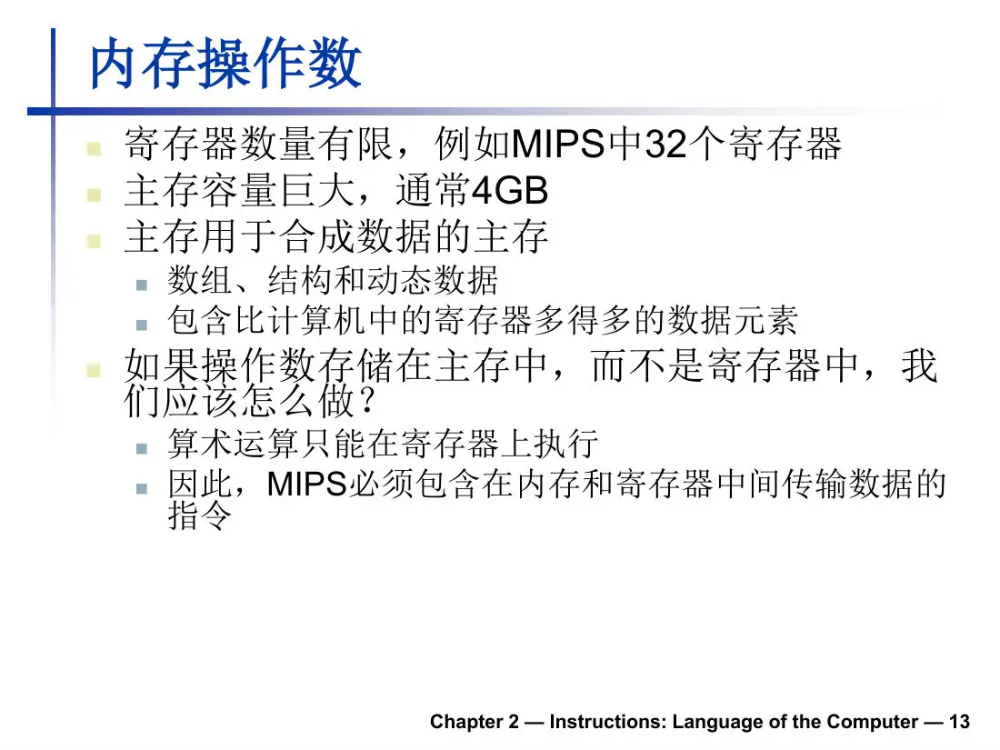

原文：

内存操作数

◼ 寄存器数量有限，例如MIPS中32个寄存器

◼ 主存容量巨大，通常4GB

◼ 主存用于合成数据的主存

◼ 数组、结构和动态数据

◼ 包含比计算机中的寄存器多得多的数据元素

◼ 如果操作数存储在主存中，而不是寄存器中，我们应该怎么做？

◼ 算术运算只能在寄存器上执行

◼ 因此，MIPS必须包含在内存和寄存器中间传输数据的指令

Chapter 2 — Instructions: Language of the Computer

13

### 取数和存数指令

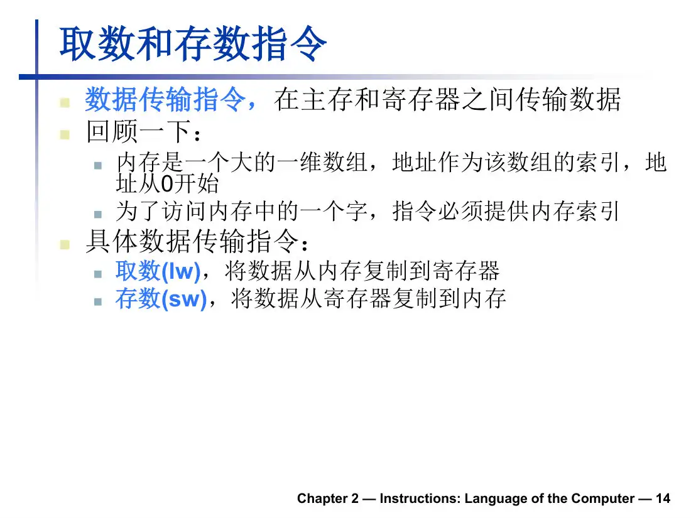

原文：

取数和存数指令

◼ 数据传输指令，在主存和寄存器之间传输数据

◼ 回顾一下：

◼ 内存是一个大的一维数组，地址作为该数组的索引，地址从0开始

◼ 为了访问内存中的一个字，指令必须提供内存索引

◼ 具体数据传输指令：

◼ 取数(lw)，将数据从内存复制到寄存器

◼ 存数(sw)，将数据从寄存器复制到内存

Chapter 2 — Instructions: Language of the Computer

14

### 内存操作数

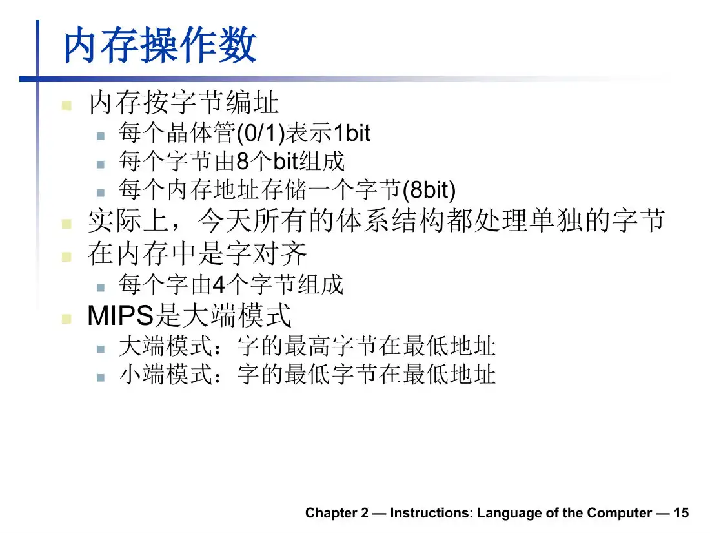

原文：

内存操作数

◼ 内存按字节编址

◼ 每个晶体管(0/1)表示1bit

◼ 每个字节由8个bit组成

◼ 每个内存地址存储一个字节(8bit)

◼ 实际上，今天所有的体系结构都处理单独的字节

◼ 在内存中是字对齐

◼ 每个字由4个字节组成

◼ MIPS是大端模式

◼ 大端模式：字的最高字节在最低地址

◼ 小端模式：字的最低字节在最低地址

Chapter 2 — Instructions: Language of the Computer

15

### 内存操作数示例

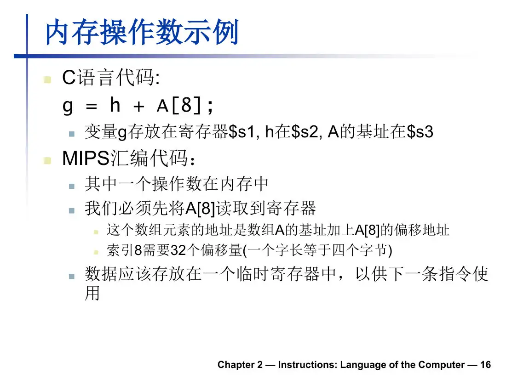

原文：

内存操作数示例

◼ C语言代码:

g = h + A[8];

◼ 变量g存放在寄存器\$s1, h在\$s2, A的基址在\$s3

◼ MIPS汇编代码：

◼ 其中一个操作数在内存中

◼ 我们必须先将A[8]读取到寄存器

◼ 这个数组元素的地址是数组A的基址加上A[8]的偏移地址

◼ 索引8需要32个偏移量(一个字长等于四个字节)

◼ 数据应该存放在一个临时寄存器中，以供下一条指令使用

Chapter 2 — Instructions: Language of the Computer

16

### 内存操作数

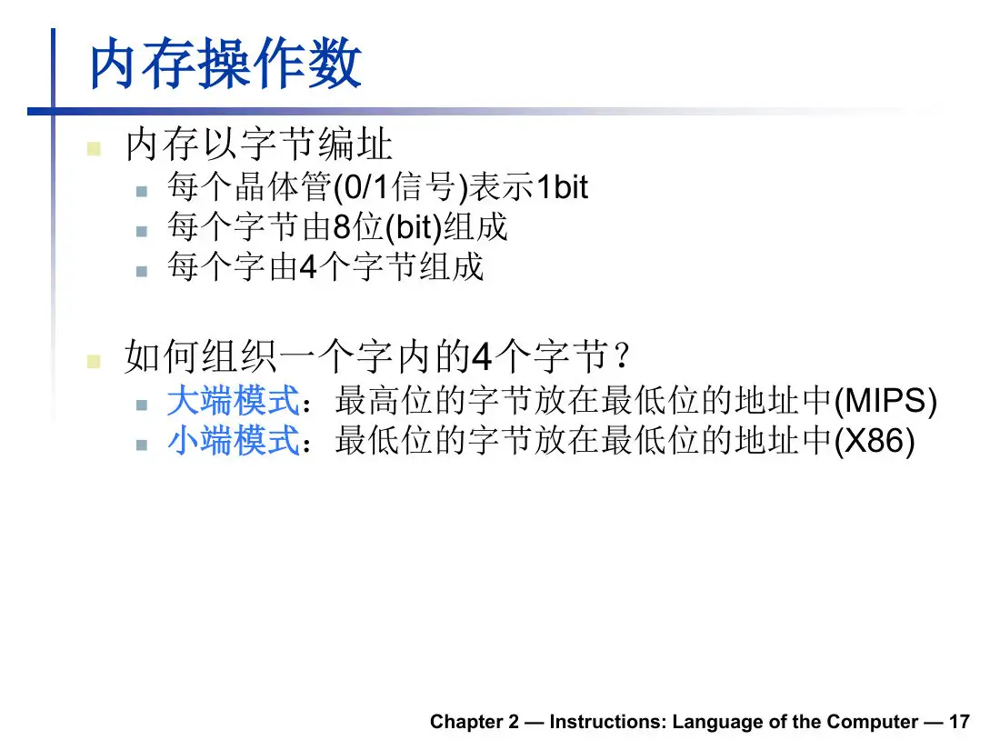

原文：

内存操作数

◼ 内存以字节编址

◼ 每个晶体管(0/1信号)表示1bit

◼ 每个字节由8位(bit)组成

◼ 每个字由4个字节组成

◼ 如何组织一个字内的4个字节？

◼ 大端模式：最高位的字节放在最低位的地址中(MIPS)

◼ 小端模式：最低位的字节放在最低位的地址中(X86)

Chapter 2 — Instructions: Language of the Computer

17

### 内存操作数(续)

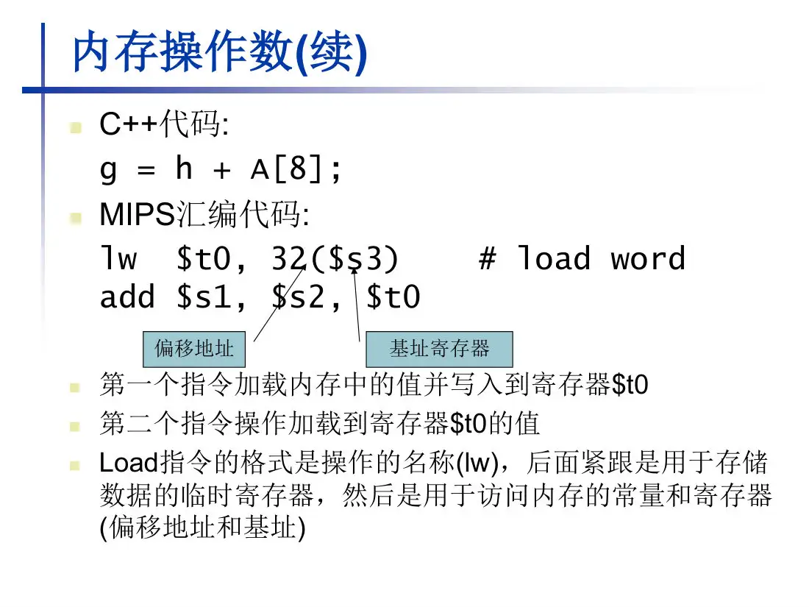

原文：

内存操作数(续)

◼ C++代码:

g = h + A[8];

◼ MIPS汇编代码:

lw \$t0, 32(\$s3) # load wordadd \$s1, \$s2, \$t0偏移地址 基址寄存器

◼ 第一个指令加载内存中的值并写入到寄存器\$t0

◼ 第二个指令操作加载到寄存器\$t0的值

◼ Load指令的格式是操作的名称(lw)，后面紧跟是用于存储数据的临时寄存器，然后是用于访问内存的常量和寄存器(偏移地址和基址)

### 内存操作数

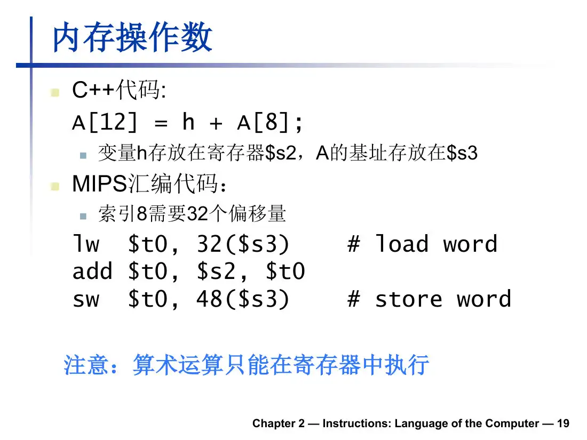

原文：

内存操作数

◼ C++代码:

A[12] = h + A[8];

◼ 变量h存放在寄存器\$s2，A的基址存放在\$s3

◼ MIPS汇编代码：

◼ 索引8需要32个偏移量

$$
\text { lw } \quad t 0, 3 2 (s 3)
$$

$$
\text { add } t 0, s 2, t 0
$$

$$
\text { sw } \quad t 0, 4 8 (s 3)
$$

\# load word

\# store word

注意：算术运算只能在寄存器中执行

Chapter 2 — Instructions: Language of the Computer

19

### 寄存器vs内存

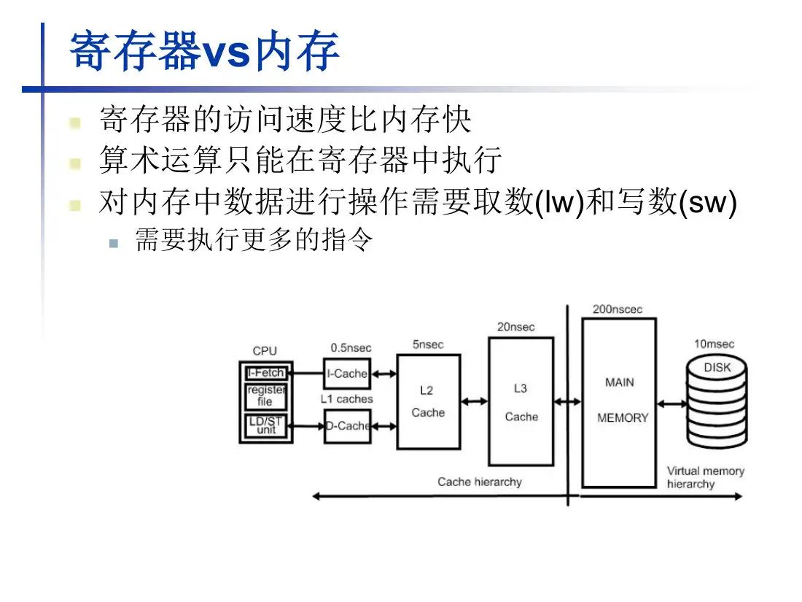

原文：

寄存器vs内存

◼ 寄存器的访问速度比内存快

◼ 算术运算只能在寄存器中执行

◼ 对内存中数据进行操作需要取数(lw)和写数(sw)◼ 需要执行更多的指令

### 寄存器vs内存

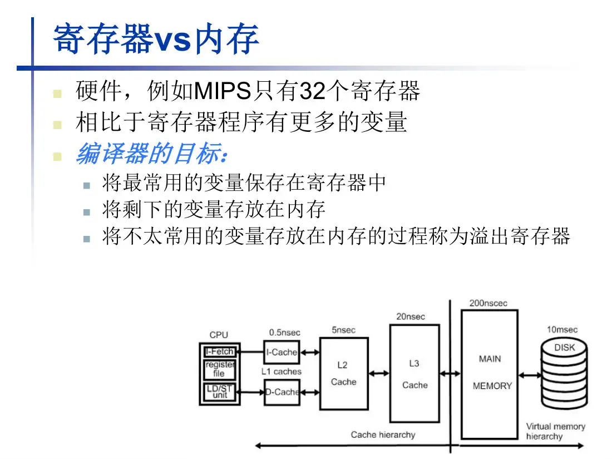

原文：

寄存器vs内存

◼ 硬件，例如MIPS只有32个寄存器

◼ 相比于寄存器程序有更多的变量

编译器的目标：

◼ 将最常用的变量保存在寄存器中

◼ 将剩下的变量存放在内存

◼ 将不太常用的变量存放在内存的过程称为溢出寄存器

### 立即操作数

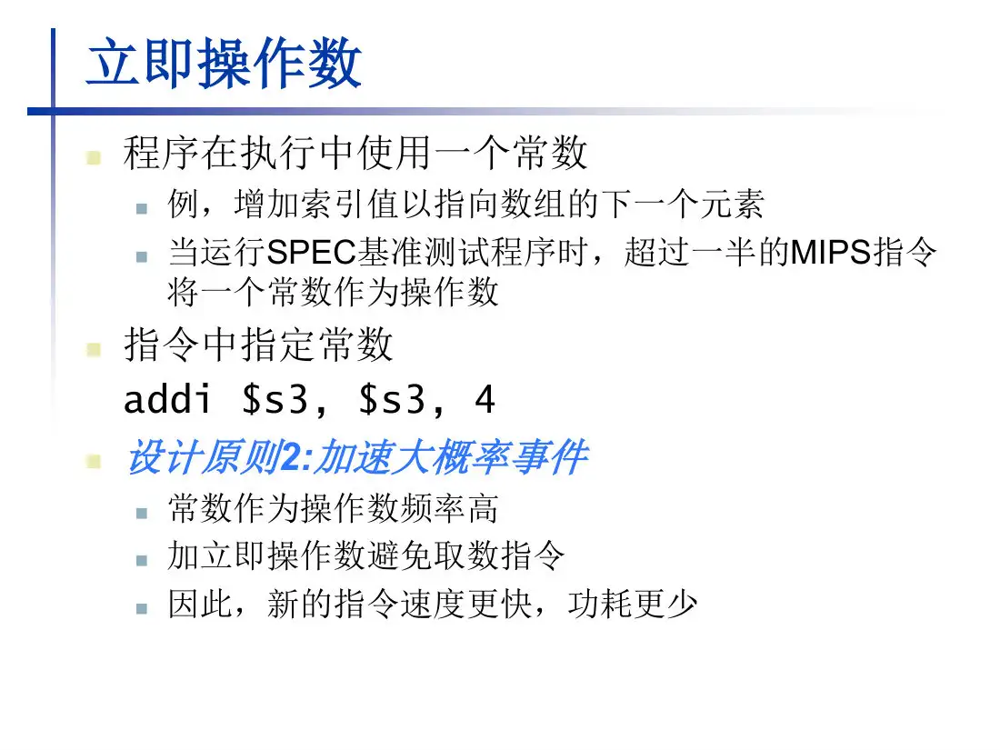

原文：

立即操作数

◼ 程序在执行中使用一个常数

◼ 例，增加索引值以指向数组的下一个元素

◼ 当运行SPEC基准测试程序时，超过一半的MIPS指令将一个常数作为操作数

◼ 指令中指定常数

addi \$s3, \$s3, 4

设计原则2:加速大概率事件

◼ 常数作为操作数频率高

◼ 加立即操作数避免取数指令

◼ 因此，新的指令速度更快，功耗更少

### 加速大概率事件

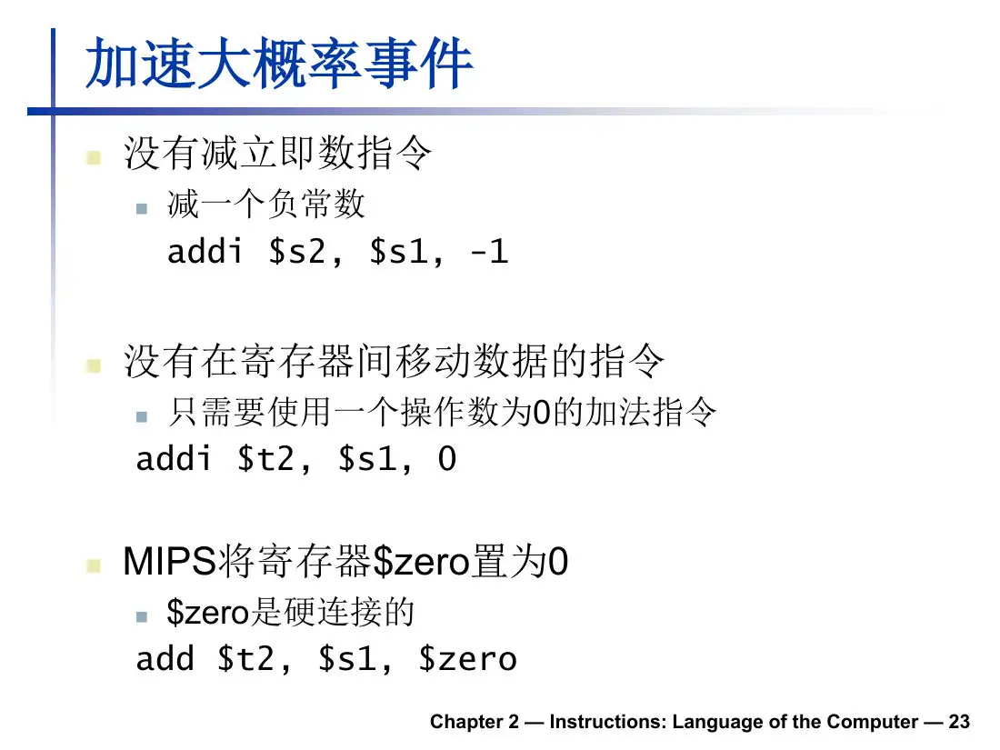

原文：

加速大概率事件

◼ 没有减立即数指令

◼ 减一个负常数

addi \$s2, \$s1, -1

◼ 没有在寄存器间移动数据的指令

◼ 只需要使用一个操作数为0的加法指令addi \$t2, \$s1, 0

◼ MIPS将寄存器\$zero置为0

\$zero是硬连接的 add \$t2, \$s1, \$zero

Chapter 2 — Instructions: Language of the Computer

23

### 求反的捷径

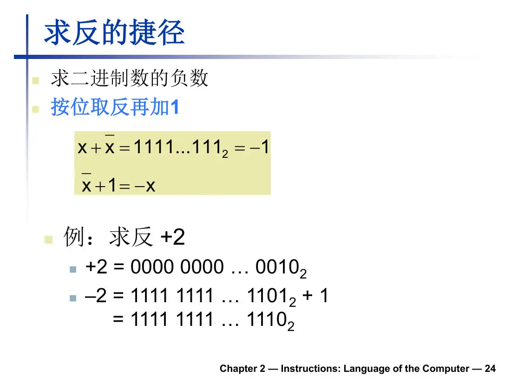

原文：

求反的捷径

求二进制数的负数

按位取反再加1

$$
\begin{array}{l} \mathbf {x} + \overline {{\mathbf {x}}} = 1 1 1 1 \dots 1 1 1 _ {2} = - 1 \\ \overline {{\mathbf {x}}} + 1 = - \mathbf {x} \end{array}
$$

◼ 例：求反 +2

$$
+ 2 = 0 0 0 0 0 0 0 0 \dots 0 0 1 0 _ {2}
$$

$$
\begin{array}{r} - 2 = 1 1 1 1 1 1 1 1 \dots 1 1 0 1 _ {2} + 1 \\ = 1 1 1 1 1 1 1 1 \dots 1 1 1 0 _ {2} \end{array}
$$

Chapter 2 — Instructions: Language of the Computer

24

### 指令的表示

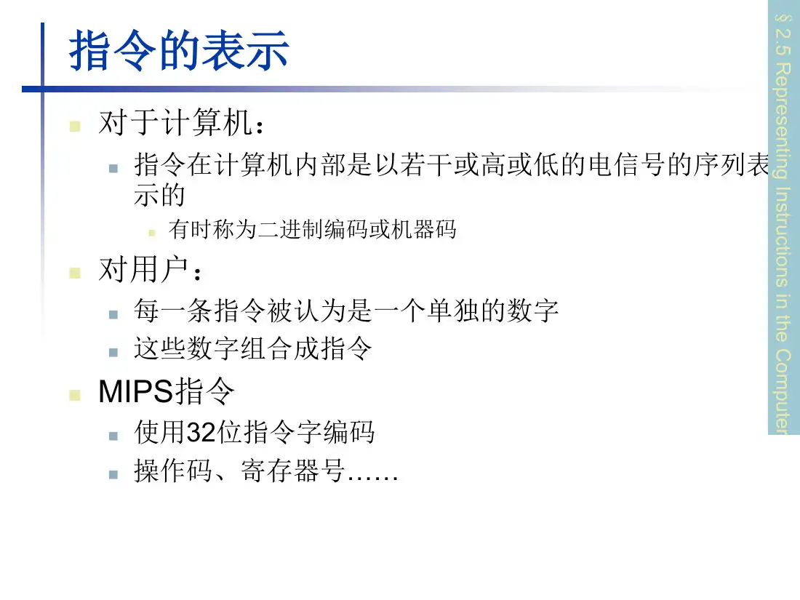

原文：

指令的表示

◼ 对于计算机：

指令在计算机内部是以若干或高或低的电信号的序列表示的

◼ 有时称为二进制编码或机器码

◼ 对用户：

◼ 每一条指令被认为是一个单独的数字

◼ 这些数字组合成指令

◼ MIPS指令

◼ 使用32位指令字编码

◼ 操作码、寄存器号……

§ 2.5 Representing Instructions in the Computer

### 指令的表示

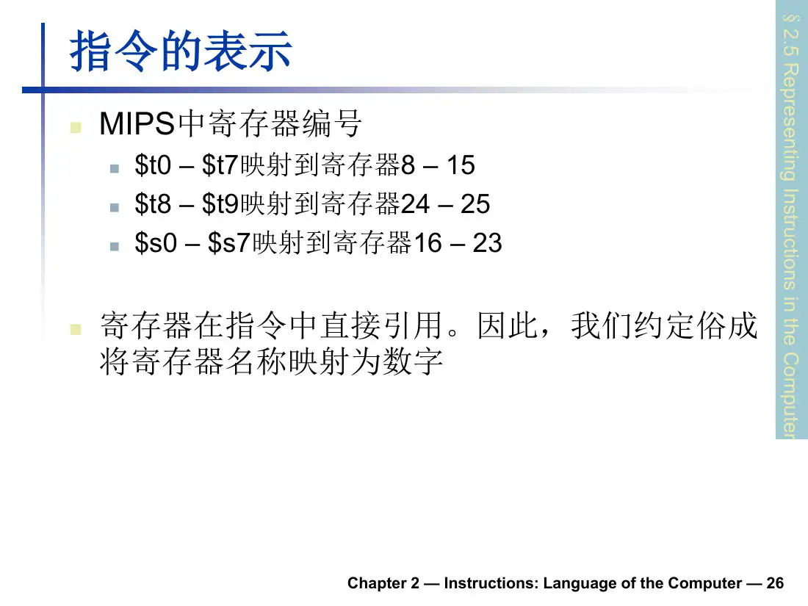

原文：

指令的表示

◼ MIPS中寄存器编号

◼ \$t0 – \$t7映射到寄存器8 – 15

◼ \$t8 – \$t9映射到寄存器24 – 25

◼ \$s0 – \$s7映射到寄存器16 – 23

◼ 寄存器在指令中直接引用。因此，我们约定俗成将寄存器名称映射为数字

§ 2.5 Representing Instructions in the Computer

Chapter 2 — Instructions: Language of the Computer

26

### MIPS R型指令

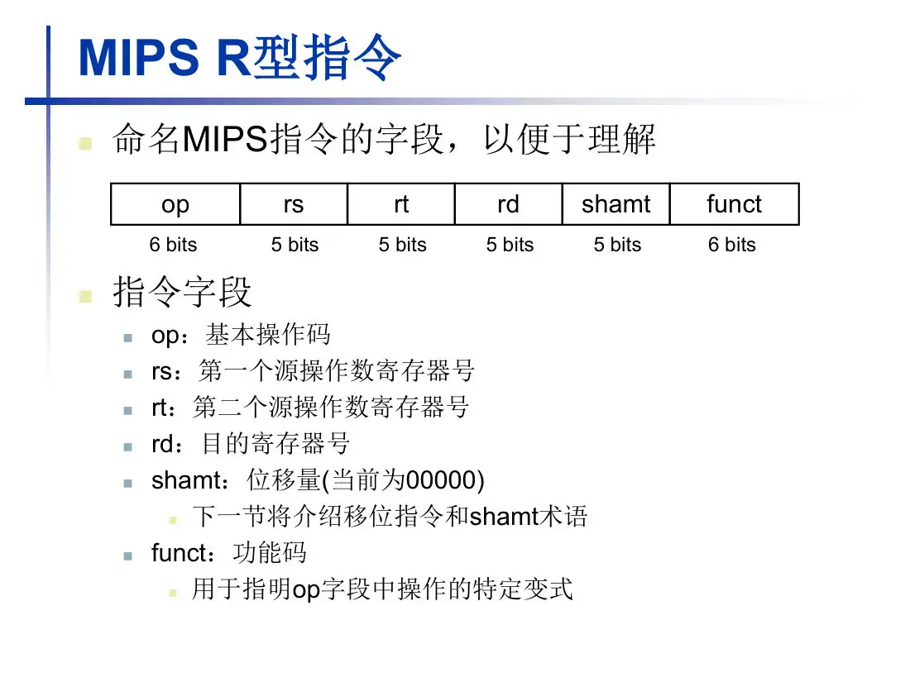

原文：

MIPS R型指令

◼ 命名MIPS指令的字段，以便于理解

<table><tr><td>op</td><td>rs</td><td>rt</td><td>rd</td><td>shamt</td><td>funct</td></tr><tr><td>6 bits</td><td>5 bits</td><td>5 bits</td><td>5 bits</td><td>5 bits</td><td>6 bits</td></tr></table>

◼ 指令字段

◼ op：基本操作码

rs：第一个源操作数寄存器号

rt：第二个源操作数寄存器号

◼ rd：目的寄存器号

◼ shamt：位移量(当前为00000)

◼ 下一节将介绍移位指令和shamt术语

◼ funct：功能码

◼ 用于指明op字段中操作的特定变式

### R型指令

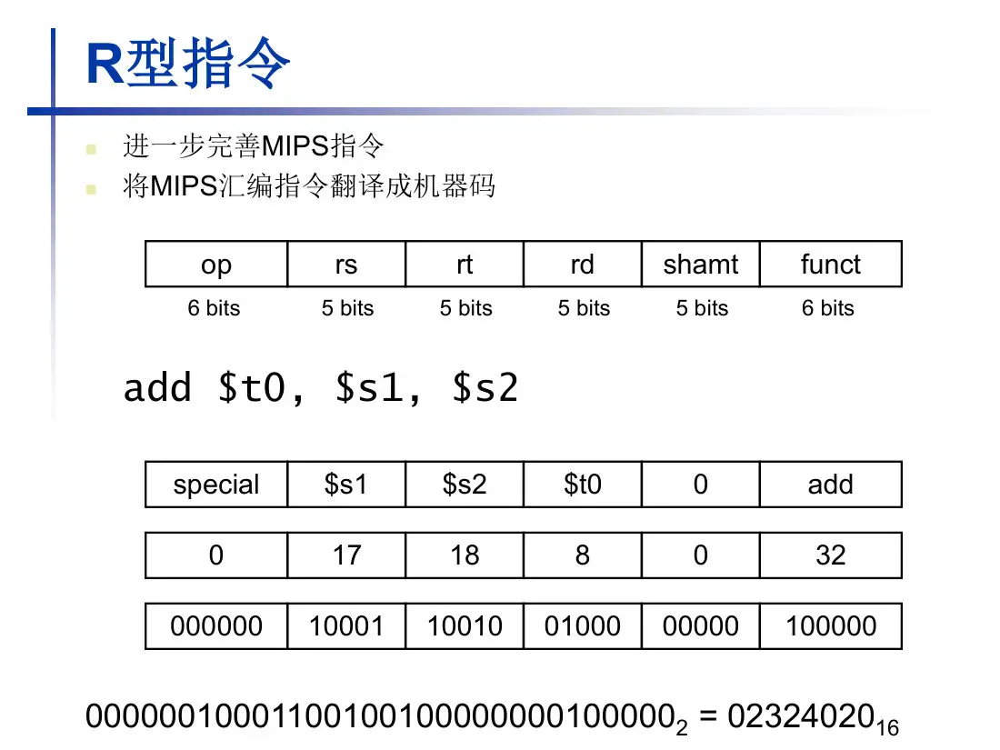

原文：

R型指令

◼ 进一步完善MIPS指令

◼ 将MIPS汇编指令翻译成机器码

<table><tr><td>op</td><td>rs</td><td>rt</td><td>rd</td><td>shamt</td><td>funct</td></tr><tr><td>6 bits</td><td>5 bits</td><td>5 bits</td><td>5 bits</td><td>5 bits</td><td>6 bits</td></tr></table>

add \$t0, \$s1, \$s2

<table><tr><td>special</td><td>$s1</td><td>$s2</td><td>$t0</td><td>0</td><td>add</td></tr></table>

<table><tr><td>0</td><td>17</td><td>18</td><td>8</td><td>0</td><td>32</td></tr></table>

<table><tr><td>000000</td><td>10001</td><td>10010</td><td>01000</td><td>00000</td><td>100000</td></tr></table>

$$
0 0 0 0 0 0 1 0 0 0 1 1 0 0 1 0 0 1 0 0 0 0 0 0 0 0 1 0 0 0 0 0 _ {2} = 0 2 3 2 4 0 2 0 _ {1 6}
$$

### 十六进制

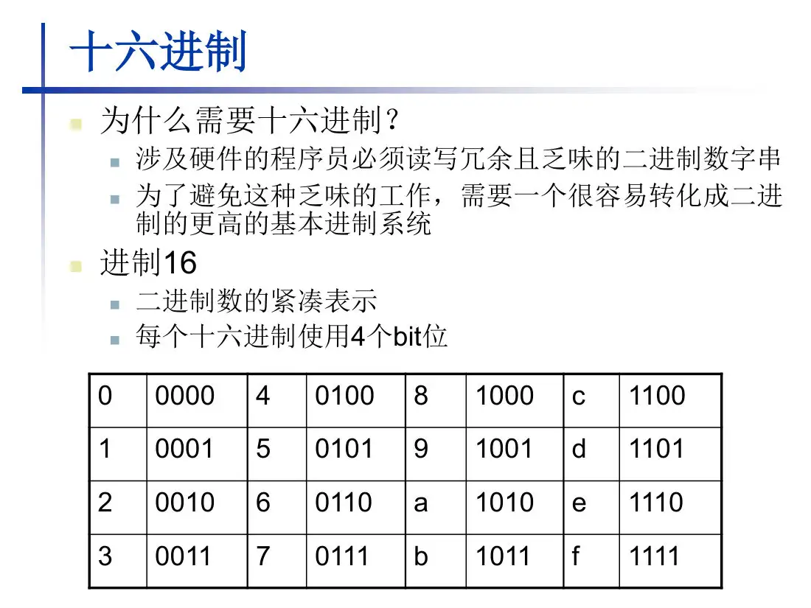

原文：

十六进制

◼ 为什么需要十六进制？

◼ 涉及硬件的程序员必须读写冗余且乏味的二进制数字串

◼ 为了避免这种乏味的工作，需要一个很容易转化成二进制的更高的基本进制系统

进制16

◼ 二进制数的紧凑表示

◼ 每个十六进制使用4个bit位

<table><tr><td>0</td><td>0000</td><td>4</td><td>0100</td><td>8</td><td>1000</td><td>c</td><td>1100</td></tr><tr><td>1</td><td>0001</td><td>5</td><td>0101</td><td>9</td><td>1001</td><td>d</td><td>1101</td></tr><tr><td>2</td><td>0010</td><td>6</td><td>0110</td><td>a</td><td>1010</td><td>e</td><td>1110</td></tr><tr><td>3</td><td>0011</td><td>7</td><td>0111</td><td>b</td><td>1011</td><td>f</td><td>1111</td></tr></table>

### 十六进制

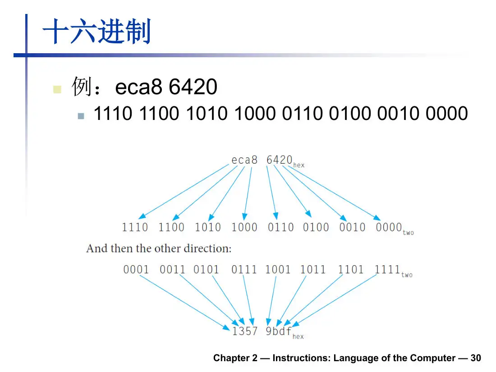

原文：

十六进制

◼ 例：eca8 6420

◼ 1110 1100 1010 1000 0110 0100 0010 0000

### MIPS I型指令

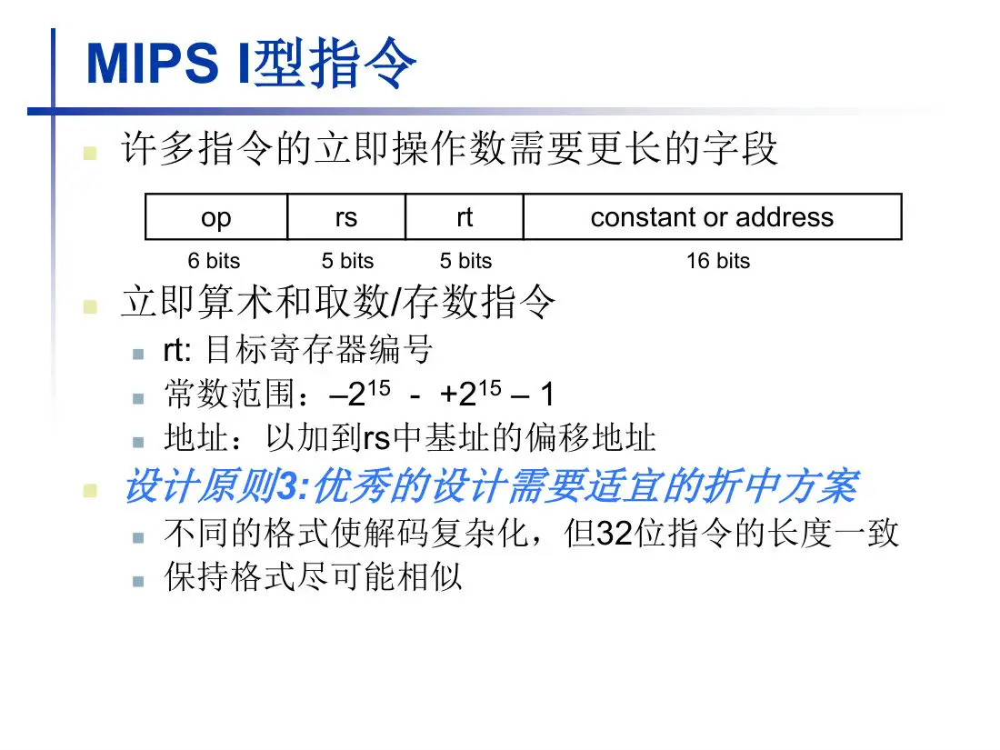

原文：

MIPS I型指令

◼ 许多指令的立即操作数需要更长的字段

<table><tr><td>op</td><td>rs</td><td>rt</td><td>constant or address</td></tr><tr><td>6 bits</td><td>5 bits</td><td>5 bits</td><td>16 bits</td></tr></table>

◼ 立即算术和取数/存数指令

◼ rt: 目标寄存器编号

◼ 常数范围： $- 2 ^ { 1 5 } - + 2 ^ { 1 5 } - 1$

◼ 地址：以加到rs中基址的偏移地址

◼ 设计原则3:优秀的设计需要适宜的折中方案

◼ 不同的格式使解码复杂化，但32位指令的长度一致

◼ 保持格式尽可能相似

### 逻辑操作

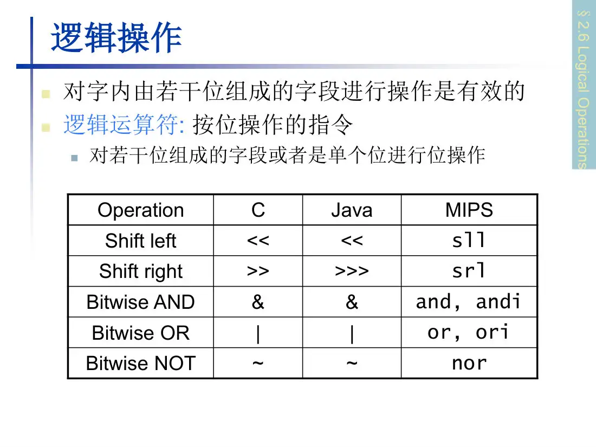

原文：

逻辑操作

◼ 对字内由若干位组成的字段进行操作是有效的

逻辑运算符: 按位操作的指令

◼ 对若干位组成的字段或者是单个位进行位操作

<table><tr><td>Operation</td><td>C</td><td>Java</td><td>MIPS</td></tr><tr><td>Shift left</td><td>&lt;&lt;</td><td>&lt;&lt;</td><td>s11</td></tr><tr><td>Shift right</td><td>&gt;&gt;</td><td>&gt;&gt;&gt;</td><td>srl</td></tr><tr><td>Bitwise AND</td><td>&amp;</td><td>&amp;</td><td>and, andi</td></tr><tr><td>Bitwise OR</td><td>|</td><td>|</td><td>or, ori</td></tr><tr><td>Bitwise NOT</td><td>~</td><td>~</td><td>nor</td></tr></table>

§ 2.6 Logical Operations

### 移位操作

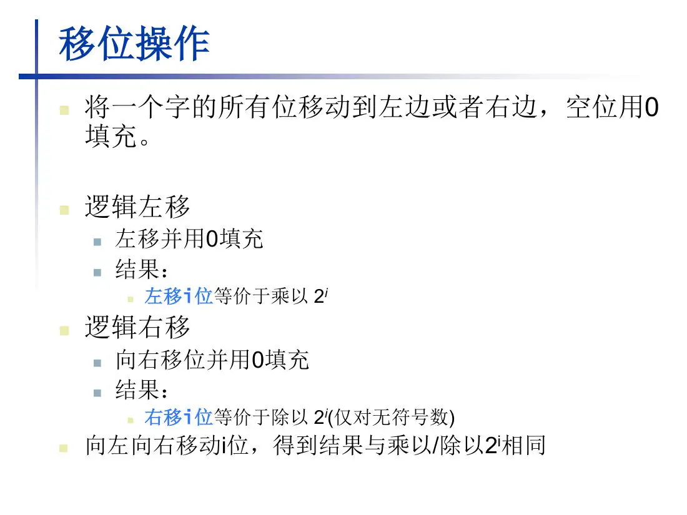

原文：

移位操作

◼ 将一个字的所有位移动到左边或者右边，空位用0 填充。

◼ 逻辑左移

◼ 左移并用0填充

◼ 结果：

◼ 左移i位等价于乘以 2i

◼ 逻辑右移

◼ 向右移位并用0填充

◼ 结果：

◼ 右移i位等价于除以 2i(仅对无符号数)

◼ 向左向右移动i位，得到结果与乘以/除以2i相同

### 移位操作

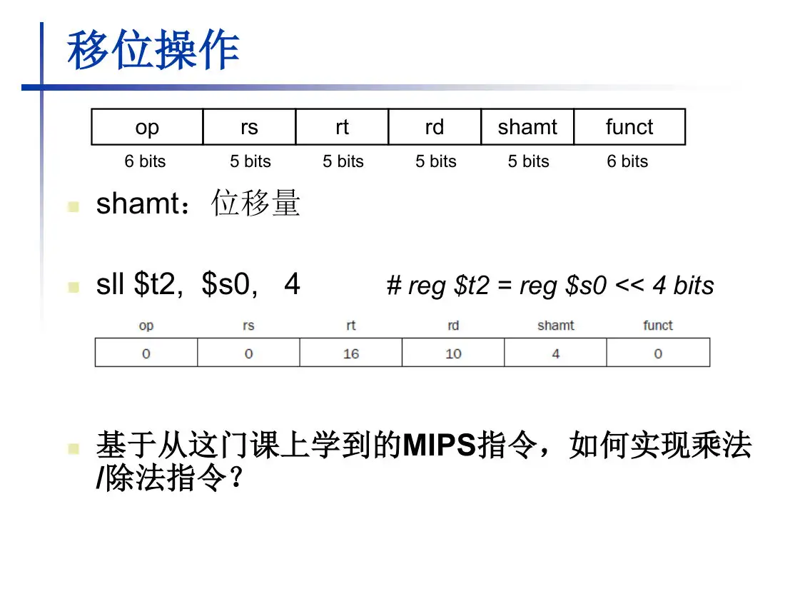

原文：

移位操作

<table><tr><td>op</td><td>rs</td><td>rt</td><td>rd</td><td>shamt</td><td>funct</td></tr><tr><td>6 bits</td><td>5 bits</td><td>5 bits</td><td>5 bits</td><td>5 bits</td><td>6 bits</td></tr></table>

◼ shamt：位移量

◼ sll \$t2, \$s0, 4

\# reg \$t2 = reg \$s0 << 4 bits

<table><tr><td>op</td><td>rs</td><td>rt</td><td>rd</td><td>shamt</td><td>funct</td></tr><tr><td>0</td><td>0</td><td>16</td><td>10</td><td>4</td><td>0</td></tr></table>

◼ 基于从这门课上学到的MIPS指令，如何实现乘法/除法指令？

### 按位与操作

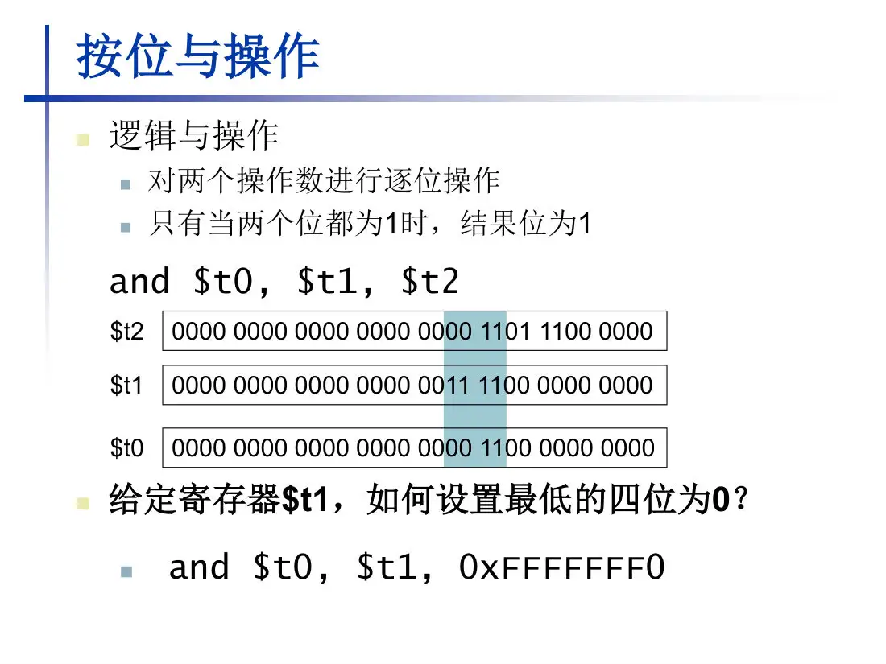

原文：

按位与操作

◼ 逻辑与操作

◼ 对两个操作数进行逐位操作

◼ 只有当两个位都为1时，结果位为1

and \$t0, \$t1, \$t2

◼ 给定寄存器\$t1，如何设置最低的四位为0？

◼ and \$t0, \$t1, 0xFFFFFFF0

### 按位或操作

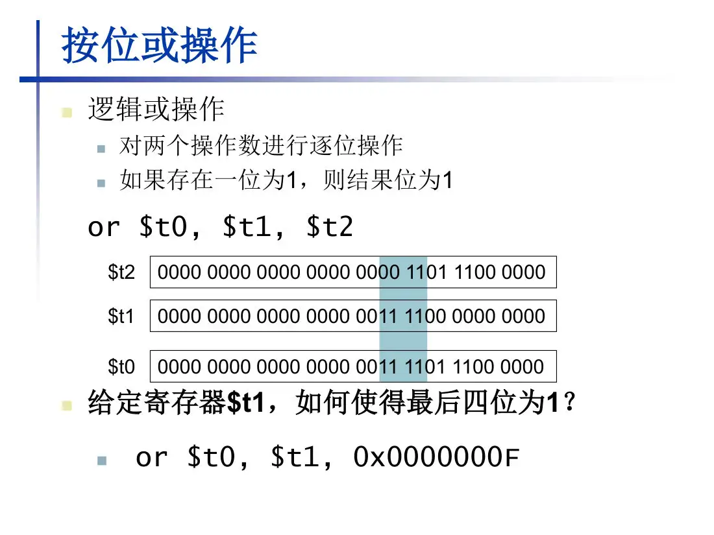

原文：

按位或操作

◼ 逻辑或操作

◼ 对两个操作数进行逐位操作

◼ 如果存在一位为1，则结果位为1

or \$t0, \$t1, \$t2

0000 0000 0000 0000 0000 1101 1100 0000\$t2

0000 0000 0000 0000 0011 1100 0000 0000\$t1

\$t0 0000 0000 0000 0000 0011 1101 1100 0000

◼ 给定寄存器\$t1，如何使得最后四位为1？

◼ or \$t0, \$t1, 0x0000000F

### 取反操作

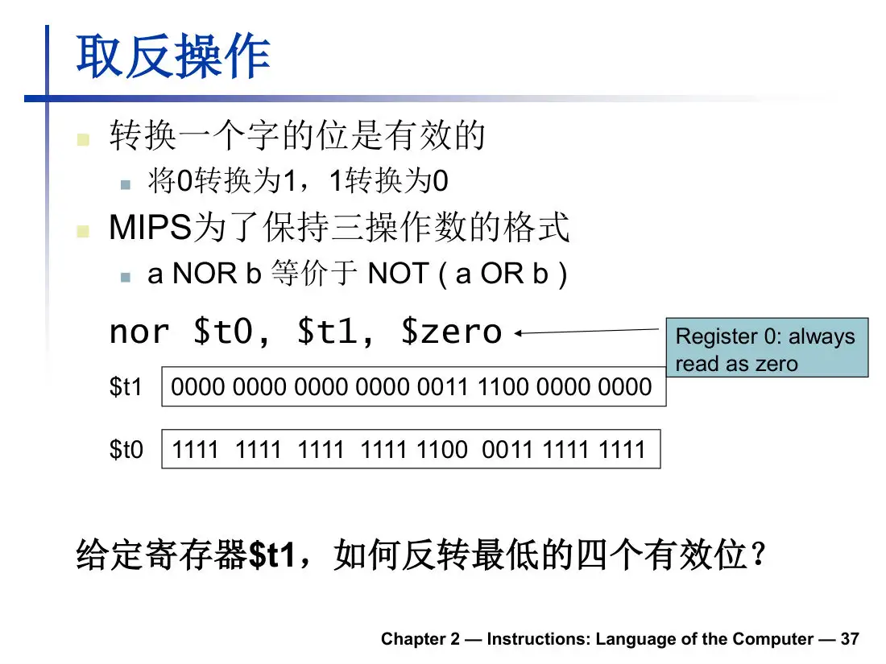

原文：

取反操作

◼ 转换一个字的位是有效的

◼ 将0转换为1，1转换为0

◼ MIPS为了保持三操作数的格式

◼ a NOR b 等价于 NOT ( a OR b )

nor \$t0, \$t1, \$zero

Register 0: always read as zero

\$t1 0000 0000 0000 0000 0011 1100 0000 0000

\$t0 1111 1111 1111 1111 1100 0011 1111 1111

给定寄存器\$t1，如何反转最低的四个有效位？

Chapter 2 — Instructions: Language of the Computer

37

### 编译if语句

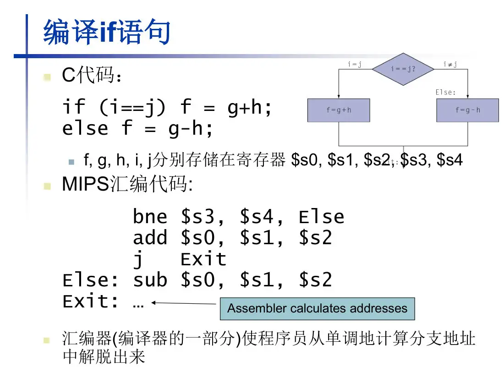

原文：

编译if语句

◼ C代码：

if (i==j) f = g+h; else f = g-h;

◼ f, g, h, i, j分别存储在寄存器 \$s0, \$s1, \$s2, \$s3, \$s4

◼ MIPS汇编代码:

bne \$s3, \$s4, Else add \$s0, \$s1, \$s2 j Exit Else: sub \$s0, \$s1, \$s2

Exit: 1 Assembler calculates addresses

◼ 汇编器(编译器的一部分)使程序员从单调地计算分支地址中解脱出来

### 编译循环条件

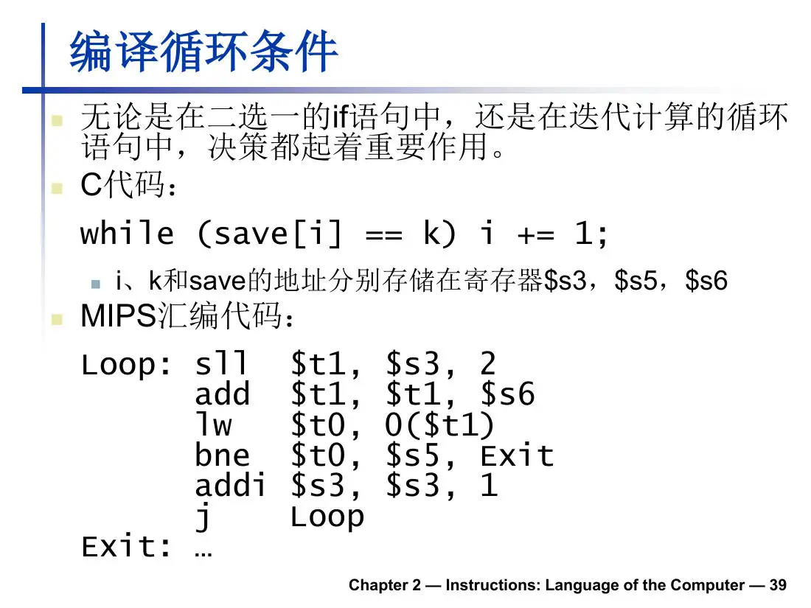

原文：

编译循环条件

◼ 无论是在二选一的if语句中，还是在迭代计算的循环语句中，决策都起着重要作用。

◼ C代码：

while (save[i] == k) i += 1;

◼ i、k和save的地址分别存储在寄存器\$s3，\$s5，\$s6

◼ MIPS汇编代码：

Loop: sll \$t1, \$s3, 2 add \$t1, \$t1, \$s6 lw \$t0, 0(\$t1) bne \$t0, \$s5, Exit addi \$s3, \$s3, 1 j Loop

Exit: …

Chapter 2 — Instructions: Language of the Computer

39

### 无符号 vs 有符号

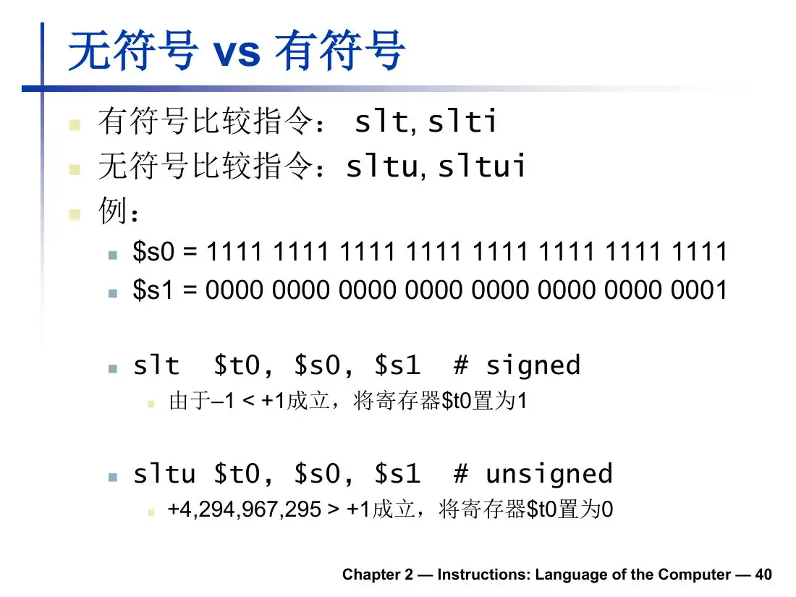

原文：

无符号 vs 有符号

◼ 有符号比较指令： slt, slti

◼ 无符号比较指令：sltu, sltui

◼ 例：

◼ \$s0 = 1111 1111 1111 1111 1111 1111 1111 1111

◼ \$s1 = 0000 0000 0000 0000 0000 0000 0000 0001

slt \$t0, \$s0, \$s1 # signed

◼ 由于–1 < +1成立，将寄存器\$t0置为1

◼ sltu \$t0, \$s0, \$s1 # unsigned ◼ +4,294,967,295 > +1成立，将寄存器\$t0置为0

Chapter 2 — Instructions: Language of the Computer

40

### 寄存器用法

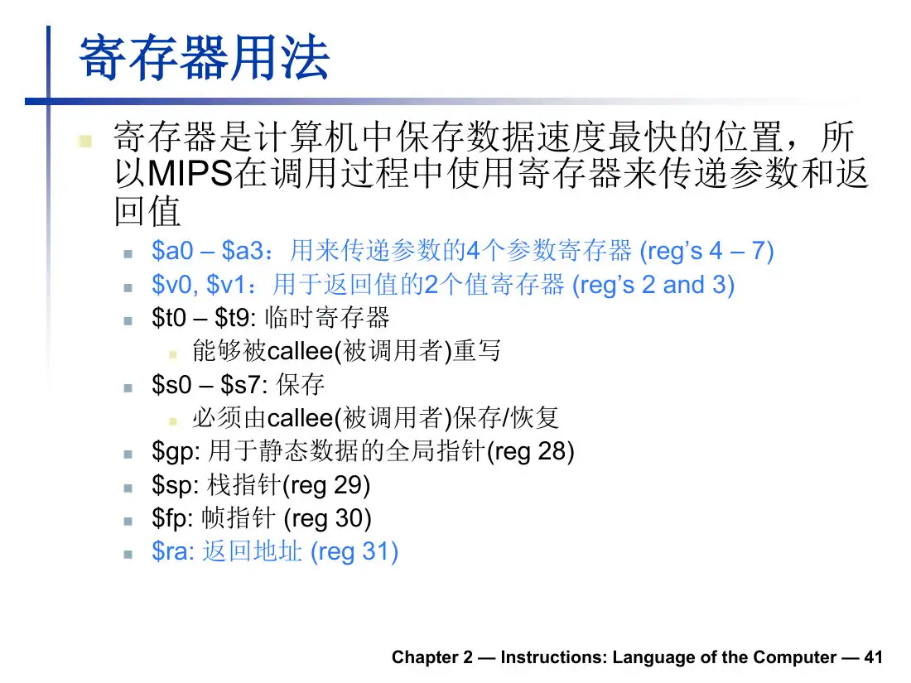

原文：

寄存器用法

◼ 寄存器是计算机中保存数据速度最快的位置，所以MIPS在调用过程中使用寄存器来传递参数和返回值

◼ \$a0 – \$a3：用来传递参数的4个参数寄存器 (reg’s 4 – 7)

\$v0, \$v1：用于返回值的2个值寄存器 (reg’s 2 and 3)

◼ \$t0 – \$t9: 临时寄存器

能够被callee(被调用者)重写

◼ \$s0 – \$s7: 保存

◼ 必须由callee(被调用者)保存/恢复

◼ \$gp: 用于静态数据的全局指针(reg 28)

◼ \$sp: 栈指针(reg 29)

◼ \$fp: 帧指针 (reg 30)

◼ \$ra: 返回地址 (reg 31)

Chapter 2 — Instructions: Language of the Computer

41

### ◼ 将数据保存在栈中，一个位于内存的存储空间

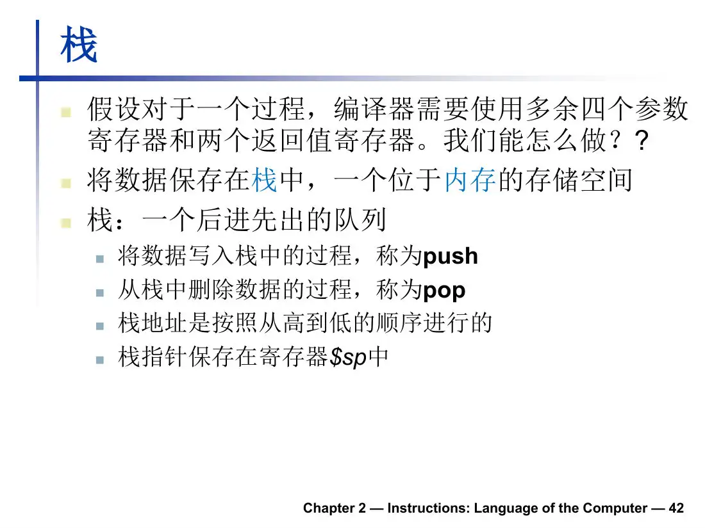

原文：

栈

◼ 假设对于一个过程，编译器需要使用多余四个参数寄存器和两个返回值寄存器。我们能怎么做？?

◼ 将数据保存在栈中，一个位于内存的存储空间

◼ 栈：一个后进先出的队列

◼ 将数据写入栈中的过程，称为push

◼ 从栈中删除数据的过程，称为pop

◼ 栈地址是按照从高到低的顺序进行的

◼ 栈指针保存在寄存器\$sp中

Chapter 2 — Instructions: Language of the Computer

42

### 16位原型机的设计

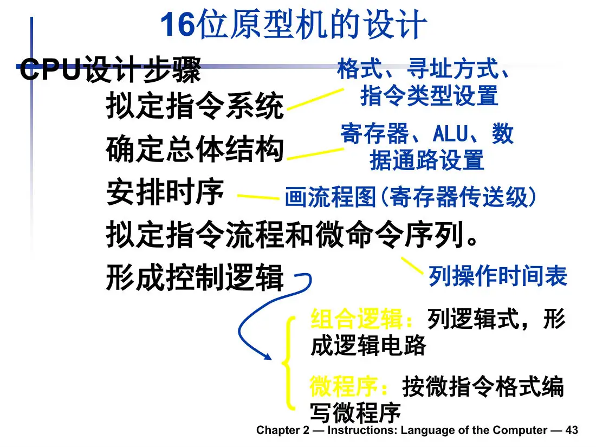

原文：

16位原型机的设计

CPU设计步骤

拟定指令系统

确定总体结构格式、寻址方式、指令类型设置

寄存器、ALU、数据通路设置

安排时序 画流程图(寄存器传送级)拟定指令流程和微命令序列。

形成控制逻辑

列操作时间表

组合逻辑：列逻辑式，形成逻辑电路

微程序：按微指令格式编 写微程序

Chapter 2 — Instructions: Language of the Computer

43

### 指令系统的设计

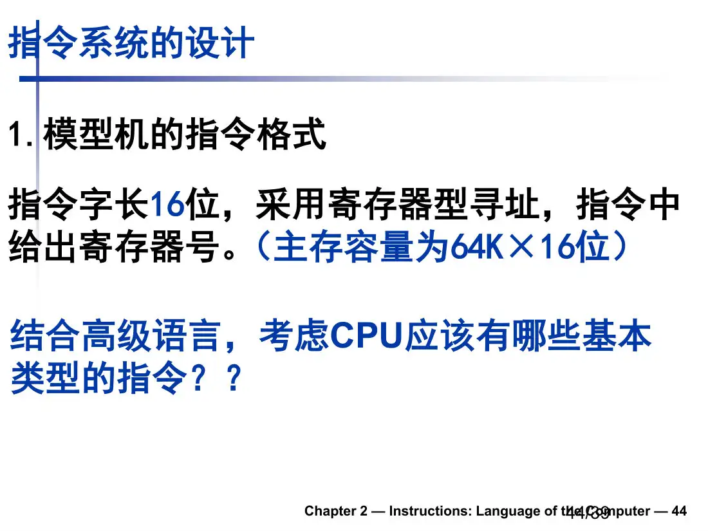

原文：

指令系统的设计

1.模型机的指令格式

指令字长16位，采用寄存器型寻址，指令中给出寄存器号。（主存容量为64K×16位）

结合高级语言，考虑CPU应该有哪些基本类型的指令？？

Chapter 2 — Instructions: Language of the Computer44/39

44

### 双地址指令格式：

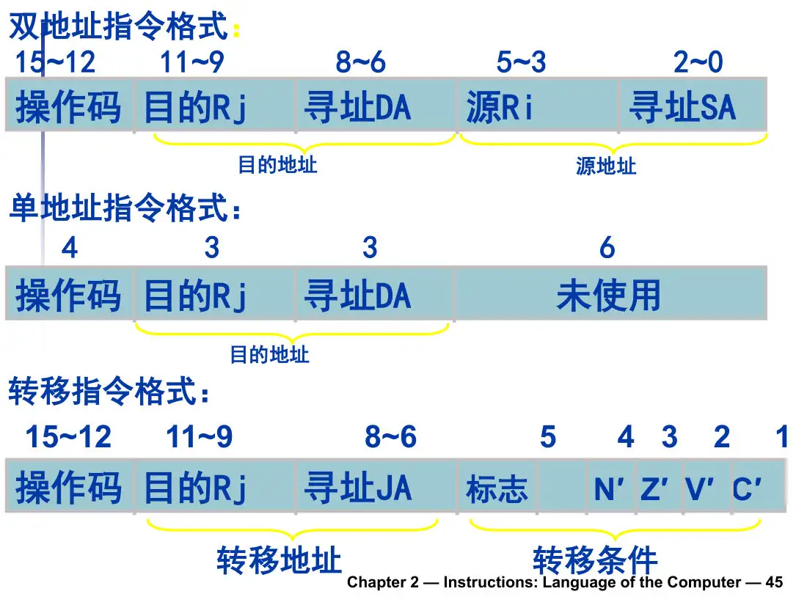

原文：

双地址指令格式：

15\~12

11\~9

目的地址

单地址指令格式：

4

3

操作码 目的Rj 寻址DA

寻址DA

目的地址

转移指令格式：

11\~9

3

15\~12

0操作码

8\~6

目的Rj

源地址

5\~3

源Ri

未使用

8\~6

寻址JA

6

2\~0

寻址SA

转移地址

5

2

标志

N′ Z′ V′ C′

转移条件

Chapter 2 — Instructions: Language of the Computer — 45

### 46

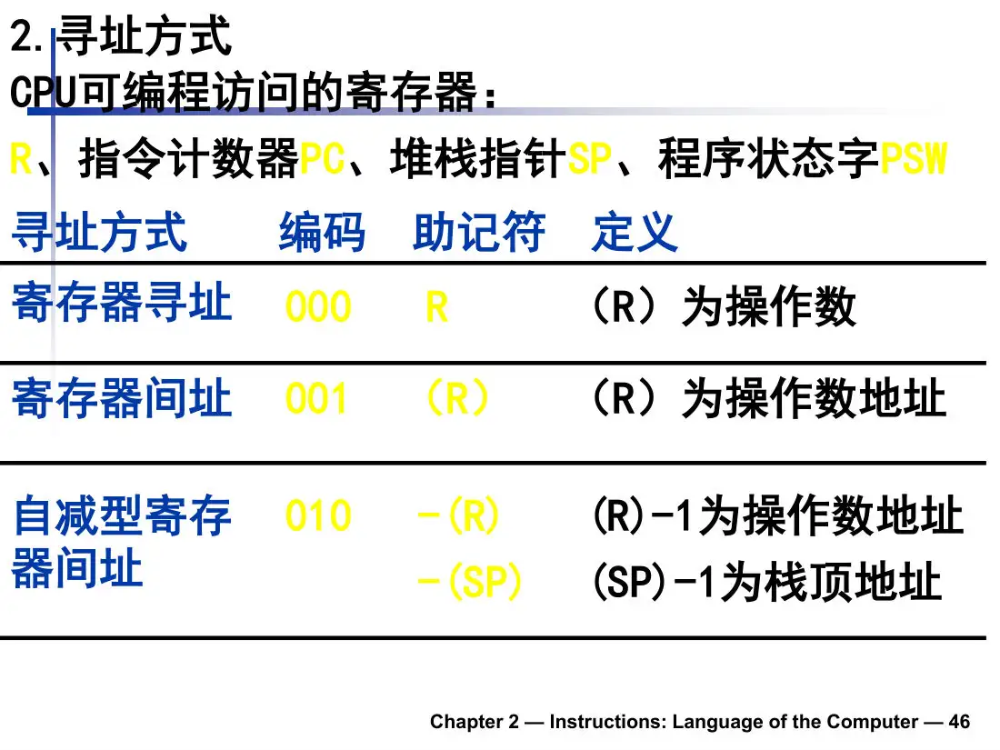

原文：

<table><tr><td>寻址方式</td><td>编码</td><td>助记符</td><td>定义</td></tr><tr><td>寄存器寻址</td><td>000</td><td>R</td><td>(R)为操作数</td></tr><tr><td>寄存器间址</td><td>001</td><td>(R)</td><td>(R)为操作数地址</td></tr><tr><td>自减型寄存器间址</td><td>010</td><td>-(R)- (SP)</td><td>(R)-1为操作数地址(SP)-1为栈顶地址</td></tr><tr><td>立即/自增型寄存器间址</td><td>011</td><td>(R) + (SP) + (PC) +</td><td>(R)为操作数地址,访问后(R)+1(SP)为栈顶地址,出栈后(SP)+1(PC)为立即数地址,取数后(PC)+1</td></tr><tr><td>变址/相对寻址</td><td>101</td><td>X(R)X(PC)</td><td>(R)+d为有效地址(PC)+d为有效地址</td></tr><tr><td>跳步</td><td>110</td><td>SKP</td><td>跳过下条指令执行</td></tr></table>
Chapter 2 — Instructions: Language of the Computer — 47

Chapter 2 — Instructions: Language of the Computer

46

### 第 47 页

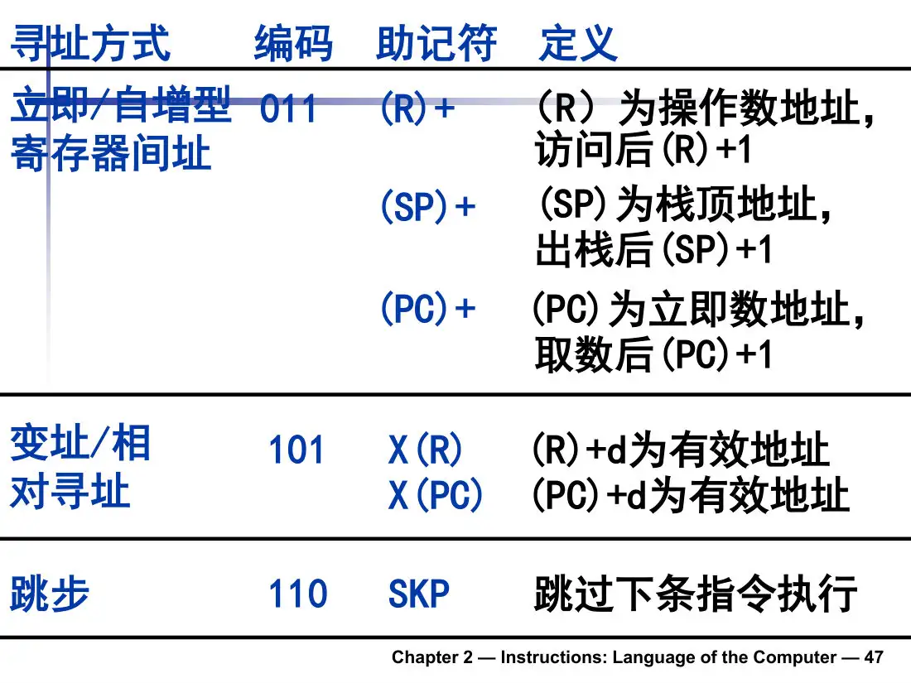

### 结束语

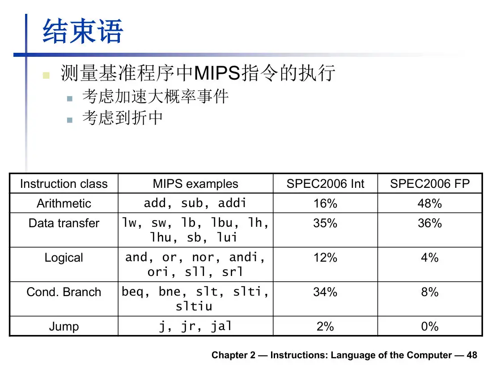

原文：

结束语

◼ 测量基准程序中MIPS指令的执行

◼ 考虑加速大概率事件

◼ 考虑到折中

<table><tr><td>Instruction class</td><td>MIPS examples</td><td>SPEC2006 Int</td><td>SPEC2006 FP</td></tr><tr><td>Arithmetic</td><td>add, sub, addi</td><td>16%</td><td>48%</td></tr><tr><td>Data transfer</td><td>lw, sw, lb, lbu, lh, lhu, sb, lui</td><td>35%</td><td>36%</td></tr><tr><td>Logical</td><td>and, or, nor, andi, ori, sll, srl</td><td>12%</td><td>4%</td></tr><tr><td>Cond. Branch</td><td>beq, bne, slt, slti, sltiu</td><td>34%</td><td>8%</td></tr><tr><td>Jump</td><td>j, jr, jal</td><td>2%</td><td>0%</td></tr></table>

Chapter 2 — Instructions: Language of the Computer

48

### 指令集

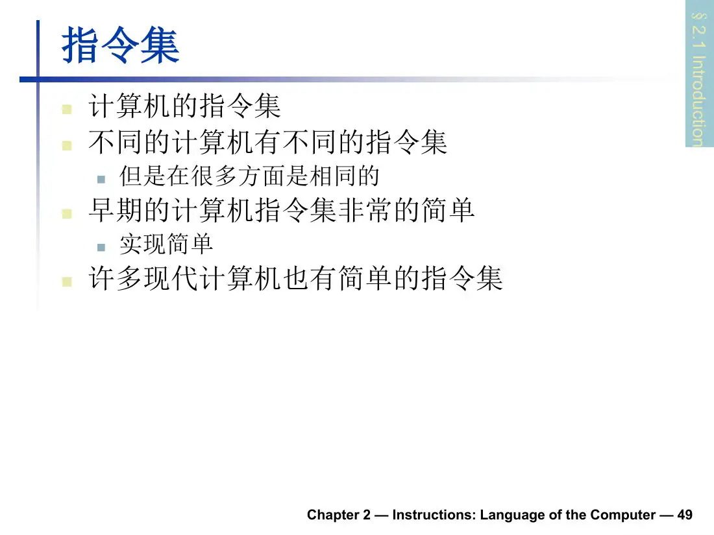

原文：

指令集

◼ 计算机的指令集

◼ 不同的计算机有不同的指令集

◼ 但是在很多方面是相同的

◼ 早期的计算机指令集非常的简单

◼ 实现简单

◼ 许多现代计算机也有简单的指令集

§ 2.1 Introduction

Chapter 2 — Instructions: Language of the Computer

49

### 有符号拓展

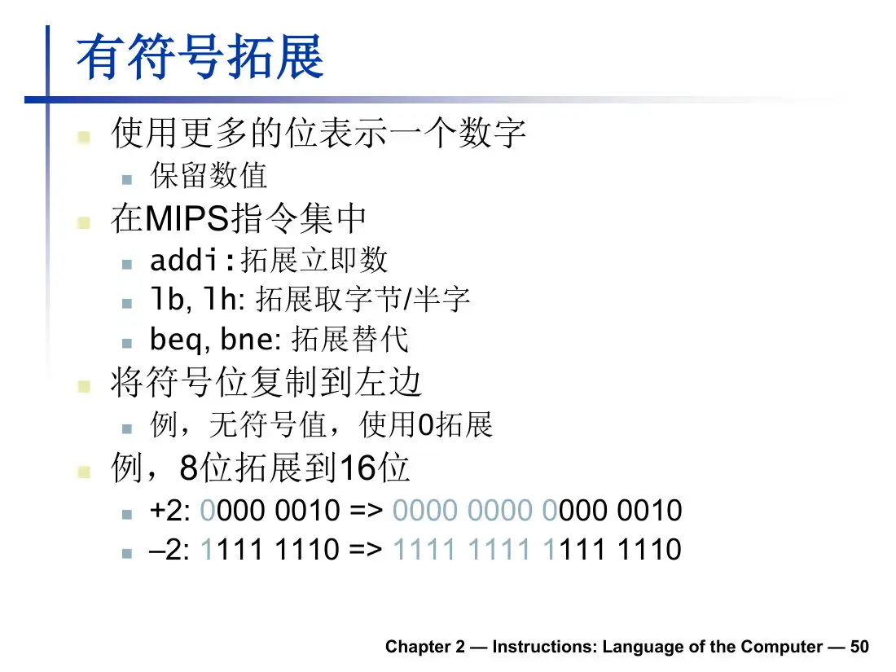

原文：

有符号拓展

◼ 使用更多的位表示一个数字

◼ 保留数值

◼ 在MIPS指令集中

◼ addi:拓展立即数

◼ lb, lh: 拓展取字节/半字

◼ beq, bne: 拓展替代

◼ 将符号位复制到左边

◼ 例，无符号值，使用0拓展

◼ 例，8位拓展到16位

◼ +2: 0000 0010 => 0000 0000 0000 0010

◼ –2: 1111 1110 => 1111 1111 1111 1110

Chapter 2 — Instructions: Language of the Computer

50
