# 《计算机组成与结构》第4章 16位处理器设计（课件）

原件的每一页，下面附识别出的文字。

### COMPUTER ORGANIZATION AND ARCHITECTURE

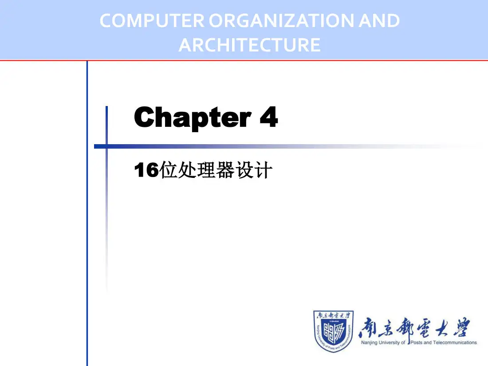

原文：

COMPUTER ORGANIZATION AND ARCHITECTURE

Chapter 4

16位处理器设计

南京郵電大學 Nanijing O 圆 nons 南京郵電大学 Nanjing University ofPosts and Telecommunications ty o Posts and T

### 介绍

原文：

介绍

◼ 处理器是计算机中最复杂且最重要的部分

A DATA CENTRE

High performance computing: USA issue an embargo on China

D L t X li: By

The United States has just place 4 Chinese research centres on their blacklist. Manufacturers of components dedicated to HPC now have ban on exporting their chips. The United States want to curb

The U.S. Department of Commerce refused export licences to Întel

The information was confirmed by Intel a few days from HPCwire. This summer, the Department of commerce served industry should apply an export permit to ship its chips Xeon and Xeon Phi to Inspur, constructor of Chinese supercomputers. It is this constructor who had built the center of Guangzhou Tianhe-2. A machine operated by the National University of defense technology Chinese. The export licence having been rejected by the Ministry of trade, Intel has the Cancel shipment of its chips.

§ 4.1 Introduction

### 16位原型机的设计

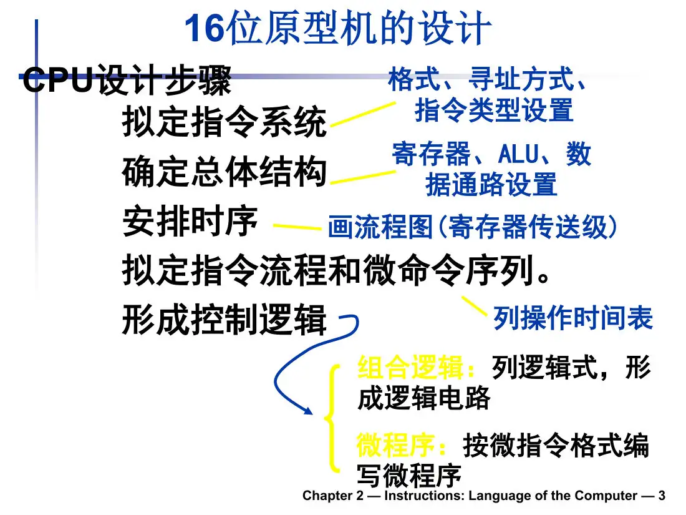

原文：

16位原型机的设计

CPU设计步骤

拟定指令系统

确定总体结构格式、寻址方式、指令类型设置

寄存器、ALU、数据通路设置

安排时序 画流程图(寄存器传送级)拟定指令流程和微命令序列。

形成控制逻辑

列操作时间表

组合逻辑：列逻辑式，形成逻辑电路

微程序：按微指令格式编 写微程序

Chapter 2 — Instructions: Language of the Computer — 3

### 部件与与数据通路

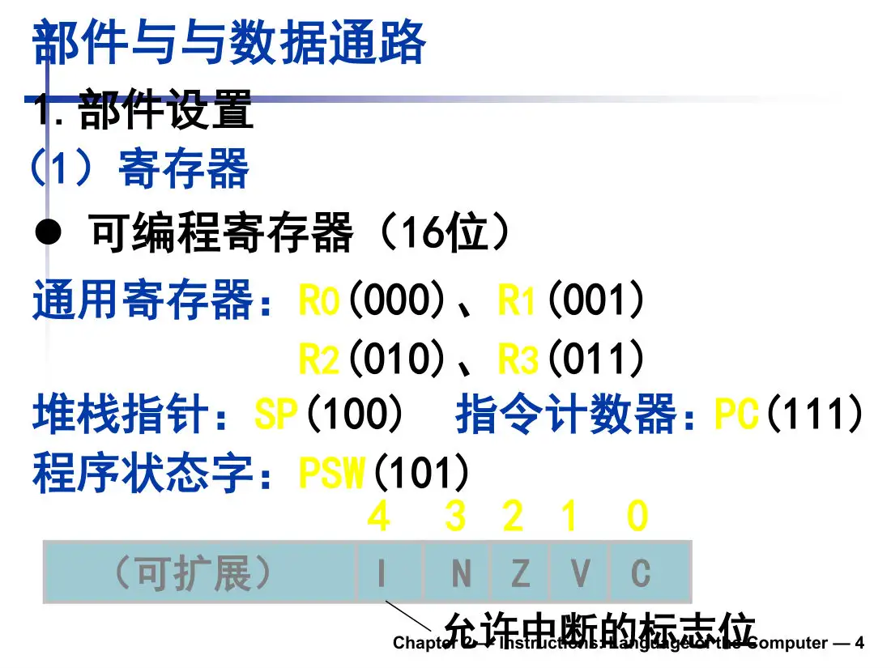

原文：

部件与与数据通路

1.部件设置

（1）寄存器

可编程寄存器（16位）

通用寄存器：R0(000)、R1(001)R2(010)、R3(011)

PC(111)堆栈指针：SP(100) 指令计数器：

程序状态字：PSW(101)4 3 2 1 0

（可扩展）

Chapter 2 — Instructions: Language of the Computer — 4允许中断的标志位

### 非编程寄存器（16位）

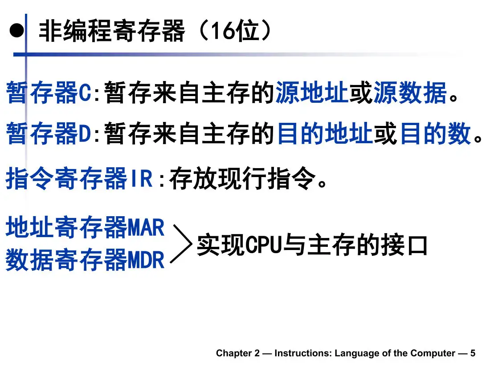

原文：

非编程寄存器（16位）

暂存器C:暂存来自主存的源地址或源数据。

暂存器D:暂存来自主存的目的地址或目的数。

指令寄存器IR:存放现行指令。

地址寄存器MAR实现CPU与主存的接口数据寄存器MDR

Chapter 2 — Instructions: Language of the Computer — 5

### (2) 运算部件设置（16位）

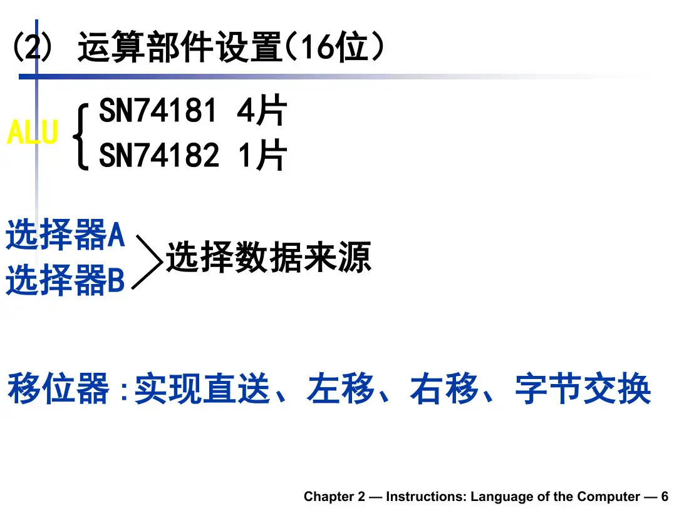

原文：

(2) 运算部件设置（16位）

SN74181 4片ALUSN74182 1片

选择器A选择数据来源选择器B

移位器:实现直送、左移、右移、字节交换

Chapter 2 — Instructions: Language of the Computer — 6

### 2.总线与数据通路结构

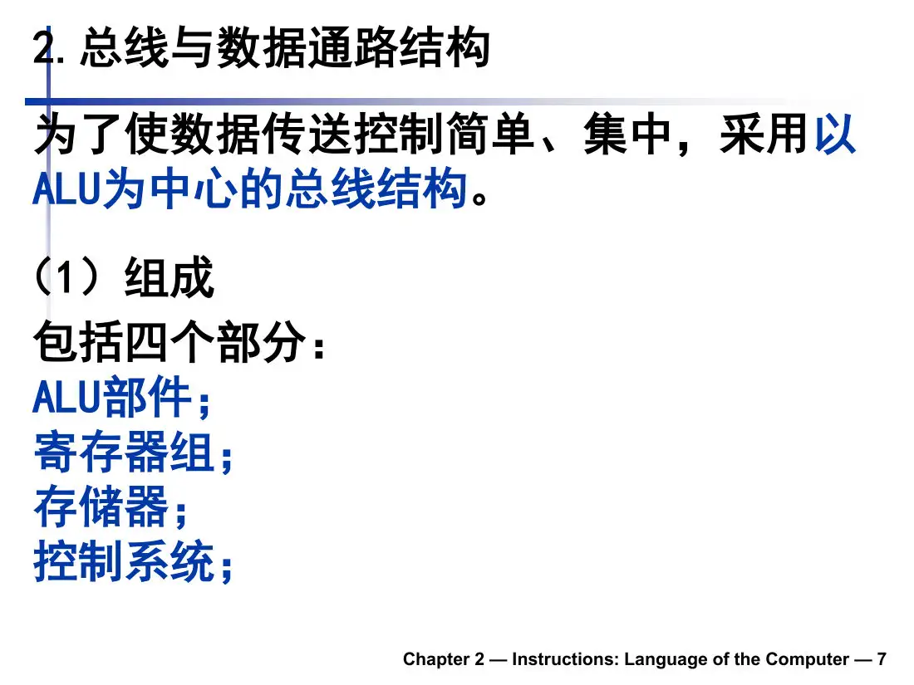

原文：

2.总线与数据通路结构

为了使数据传送控制简单、集中，采用以ALU为中心的总线结构。

（1）组成

包括四个部分：

ALU部件；

寄存器组；

存储器；

控制系统；

Chapter 2 — Instructions: Language of the Computer —

7

### （2）特点

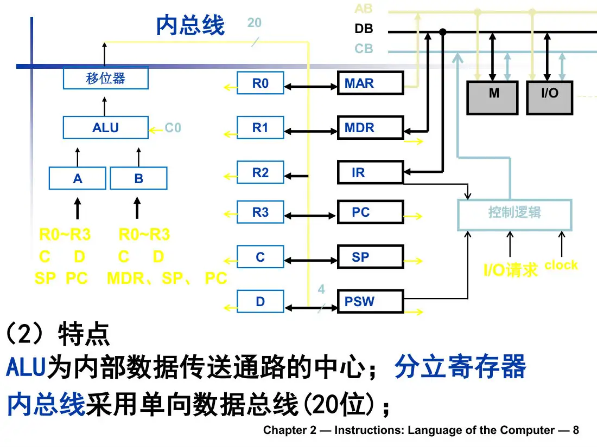

原文：

（2）特点

ALU为内部数据传送通路的中心；分立寄存器内总线采用单向数据总线(20位)；

Chapter 2 — Instructions: Language of the Computer — 8

### 与系统总线的连接通过MAR、MDR实现。

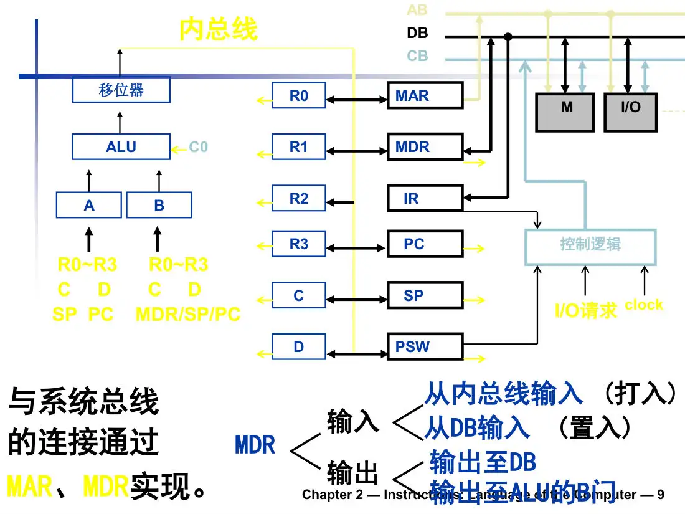

原文：

与系统总线的连接通过MAR、MDR实现。

从内总线输入 (打入) 输入 从DB输入 (置入) MDR 输出 输出至DB Chapter 2 — Instructions: Language of the Computer — 9输出至ALU的B门

### 3.各类信息传送途径

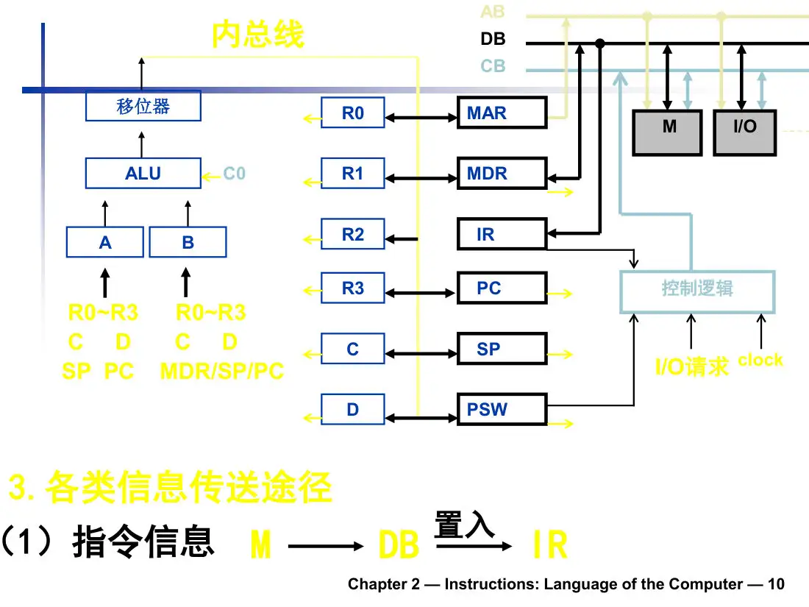

原文：

3.各类信息传送途径

（1）指令信息

Chapter 2 — Instructions: Language of the Computer — 10

### （2）地址信息

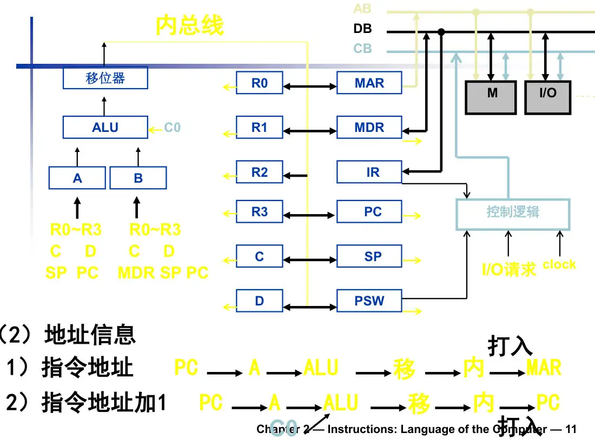

原文：

（2）地址信息

1）指令地址 PC A ALU 移 内 MAR

2）指令地址加1 PC A ALU 移 内 PC

Chapter 2 — Instructions: Language of the Computer — 11C0 打入

### 3）转移地址

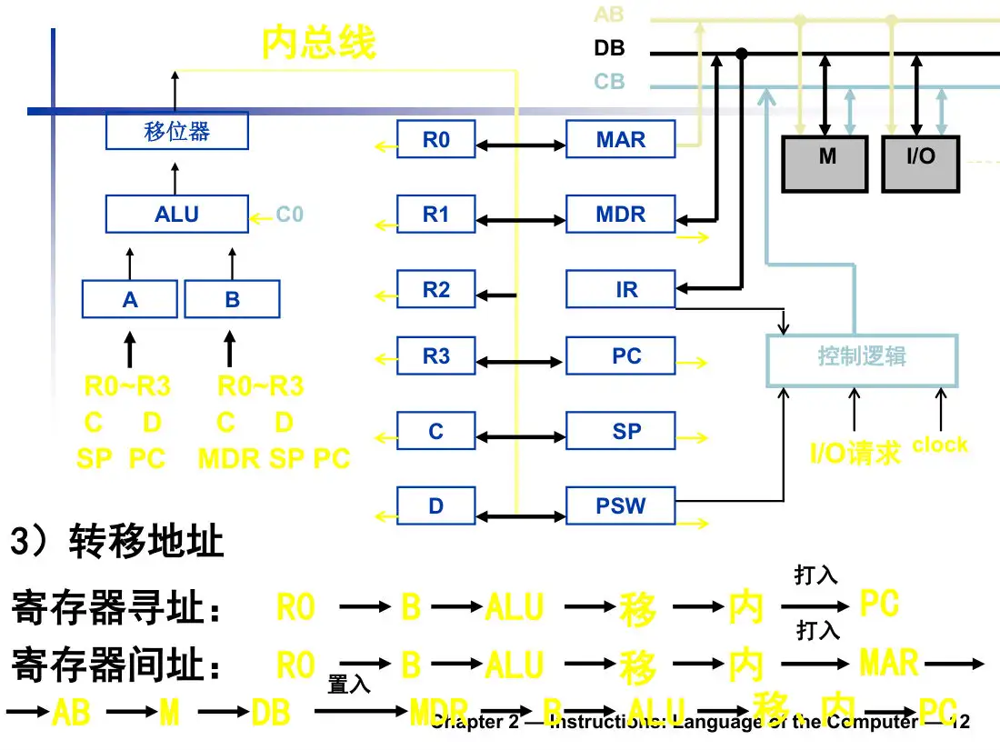

原文：

3）转移地址

寄存器寻址： $\begin{array} { r } { \begin{array} { r } { \longrightarrow \mathbb { B } \longrightarrow \mathbb { A } \mathbb { U } \longrightarrow \mathbb { \longrightarrow } \mathbb { \longrightarrow } \mathbb { \longrightarrow } \frac { \cdots } { \mathbb { H } \lambda } } \end{array} } \end{array}$

寄存器间址： $\overrightarrow { \overrightarrow { \mathbf { a } } } \cdot \overrightarrow { \mathbf { \Gamma } } \overrightarrow { \mathbf { a } } \cdot \overrightarrow { \mathbf { \Gamma } } \mathbf { \overrightarrow { \mathbf { a } } } \cdot \overrightarrow { \mathbf { \Gamma } } \mathbf { \overrightarrow { \mathbf { a } } } \cdot \mathbf { \Gamma } \overrightarrow { \mathbf { \Gamma } } \mathbf { \overrightarrow { \mathbf { a } } } \cdot \mathbf { \Gamma } \overrightarrow { \mathbf { \Gamma } } \mathbf { \overrightarrow { \mathbf { a } } } \cdot \mathbf { \Gamma } \mathbf { \overrightarrow { \mathbf { a } } } \cdot \mathbf { \Gamma } \mathbf { \overrightarrow { \mathbf { a } } } \cdot \mathbf { \Gamma } \mathbf { \overrightarrow { \mathbf { b } } } \cdot \mathbf { \nabla } \mathbf { \overrightarrow { \mathbf { b } } } \cdot \mathbf { \nabla } \mathbf { \overrightarrow { \mathbf { b } } } \cdot \mathbf { \nabla } \mathbf { \overrightarrow { \mathbf { b } } } \cdot \mathbf { \nabla } \mathbf { \overrightarrow { \mathbf { b } } } \cdot \mathbf { \nabla } \mathbf { \overrightarrow { \mathbf { b } } } \cdot \mathbf { \nabla } \mathbf { \overrightarrow { \Gamma } } \mathbf { \overrightarrow { \mathbf { b } } } \cdot \mathbf { \nabla } \mathbf { \overrightarrow { \Gamma \mathbf { b } } } \cdot \mathbf { \nabla } \mathbf { \overrightarrow { \Gamma \Psi } } \mathbf { \overrightarrow { \mathbf { b } } } \cdot \mathbf { \nabla } \mathbf { \Psi } \mathbf { \Psi } \mathbf { \Bigg { \Gamma \Psi } } \mathbf  \Bigg \Bigg { \Gamma } \overrightarrow { \Psi \mathbf { \Gamma } } \mathbf { \Psi } \mathbf { \Psi } \mathbf { \Psi } \Psi \mathbf { \Psi } \Psi \Psi \Psi \Psi \Psi \Psi \Psi \Psi \Psi \Psi \Psi \Psi \Psi \Psi \Psi \Psi \Psi \Psi \Psi \Psi \Psi \Psi \Psi \Psi \Psi \Psi \Psi \Psi \Psi \Psi \Psi \Psi \Psi \Psi \Psi \Psi \Psi \Psi \Psi \Psi \Psi \Psi \Psi \Psi \Psi \Psi \Psi \Psi \Psi \Psi \Psi \Psi \Psi \Psi \Psi \Psi \Psi \Psi \Psi \Psi \Psi \Psi \Psi \Psi \Psi \Psi \Psi \Psi \Psi \Psi \Psi \Psi \Psi \Psi \Psi \Psi \Psi \Psi \Psi \Psi \Psi \Psi \Psi \Psi \Psi \Psi \Psi \Psi \Psi \Psi \Psi \Psi \Psi \Psi \Psi \Psi \Psi \Psi \Psi \Psi \Psi \Psi \Psi \Psi \Psi \Psi \Psi \Psi \Psi \Psi \Psi \Psi \Psi \Psi \Psi \Psi$

Chapter 2 — Instructions: Language of the Computer — 12AB M DB MDR B ALU 移、内 PC

### 4）操作数地址

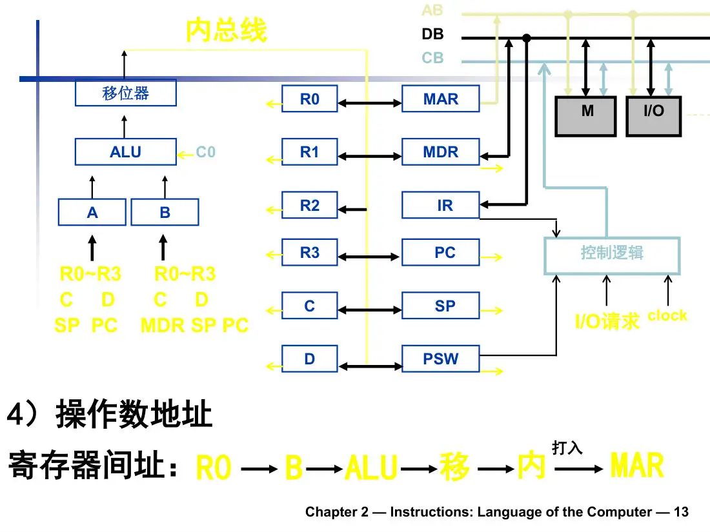

原文：

4）操作数地址

Chapter 2 — Instructions: Language of the Computer — 13

### 内总线

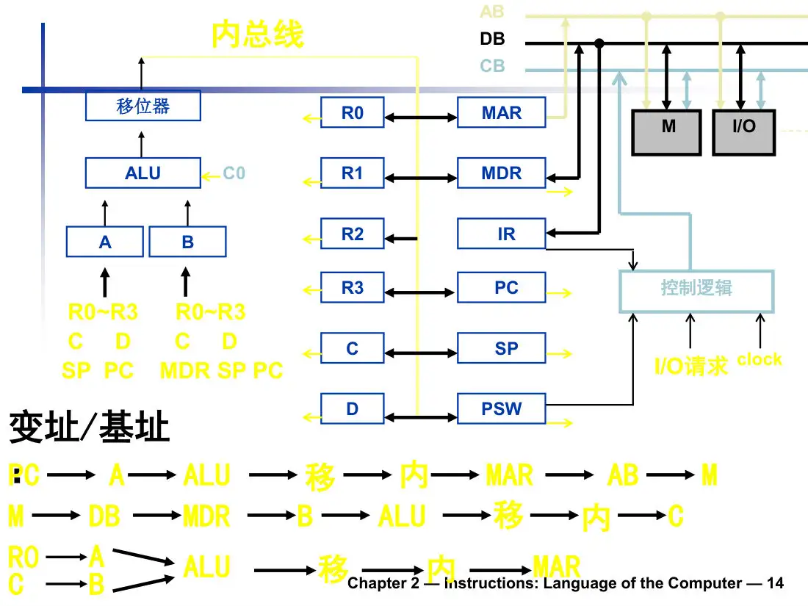

原文：

内总线

变址/基址

$$
\begin{array}{l} \text {PC} \longrightarrow \text {A} \longrightarrow \text {ALU} \longrightarrow \text {移} \longrightarrow \text {内} \longrightarrow \text {MAR} \longrightarrow \text {AB} \longrightarrow \text {M} \\ \text {M} \longrightarrow \text {DB} \longrightarrow \text {MDR} \longrightarrow \text {B} \longrightarrow \text {ALU} \longrightarrow \text {移} \longrightarrow \text {内} \longrightarrow \text {C} \end{array}
$$

移

Chapter 2 — Instructions: Language of the Computer —

14

### （3）数据信息

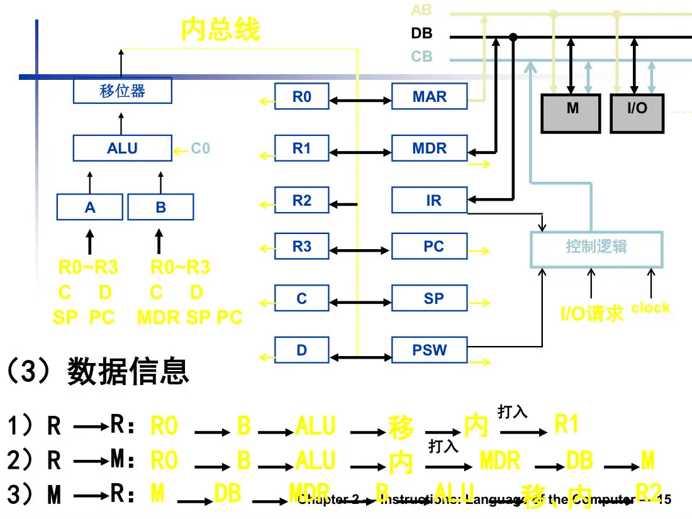

原文：

（3）数据信息

1）R R：R0 打入 B ALU 移 内 R1

DB M2）R M：R0  B ALU 内 MDR

Chapter 2 — Instructions: Language of the Computer — 15DB MDR B ALU 移、内 R23）M R：M

### (计算目的地址) $--- - { } \_$

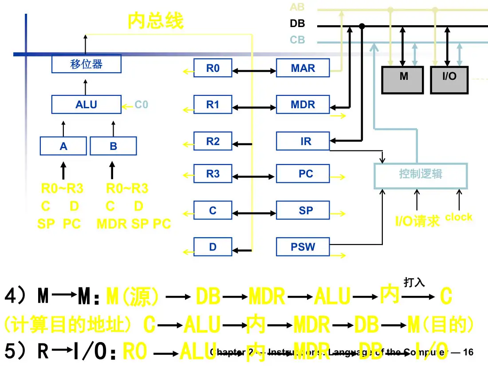

原文：

4） $M \longrightarrow M _ { 1 } \pmod { 2 } \dotsc \dotsc \dotsc \dotsc \dotsc \dotsc \dotsc \dotsc \dotsc \dotsc \dotsc \dotsc \dotsc \dotsc \dotsc \dotsc \dotsc \dotsc \dotsc$

(计算目的地址) $--- - { } \_$

5） $\mathrm { R } { \longrightarrow } | / 0 _ { 1 } | \longrightarrow | | \langle \mathrm { h } \scriptscriptstyle { \mathrm { a p s i g h } } | \rangle \cdots | / 0 _ { \mathrm { i } } | / \langle \mathrm { h } \scriptscriptstyle { \mathrm { a p s i g h } } | \rangle \cdots | / 0 _ { \mathrm { i } } \langle \mathrm { h } \scriptscriptstyle { \mathrm { a p s i g h } } | \mathrm { t e r } \rangle \cdots | 6 _ { \mathrm { i } } \langle \mathrm { h } \scriptscriptstyle { \mathrm { a p s i g h } } | \mathrm { t e r } \rangle \cdots | / 0 _ { \mathrm { i } } \langle \mathrm { h } \scriptscriptstyle { \mathrm { a p s i g h } } | \rangle \cdots | / 0 _ { \mathrm { i } } | / \mathrm { a b s i g h } | | \mathrm { t e r } \rangle \cdots | / 6 _ { \mathrm { i } }$

### DBDMA方式：I/O7）I/O M M

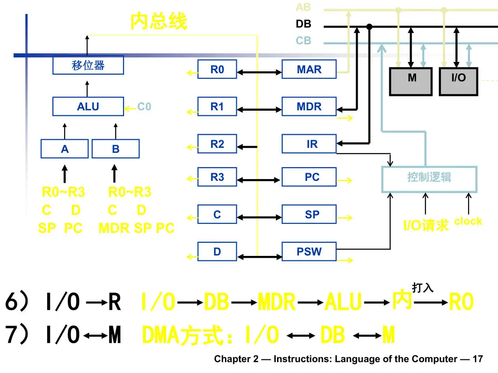

原文：

DBDMA方式：I/O7）I/O M M

Chapter 2 — Instructions: Language of the Computer —

17

### 指令流程与微命令

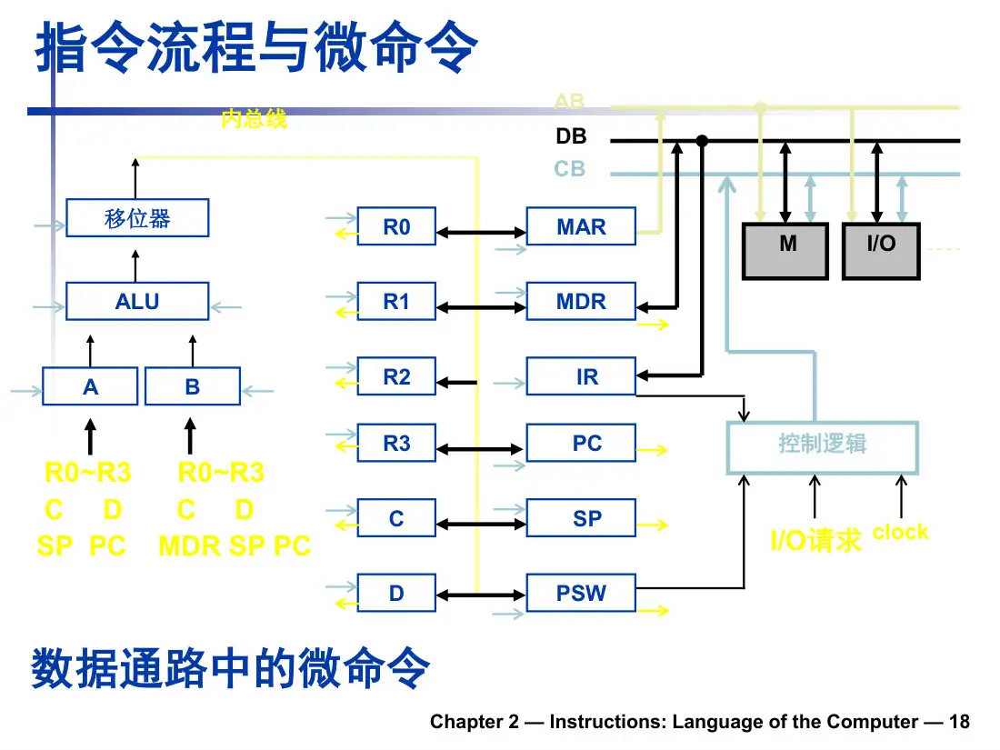

原文：

指令流程与微命令

数据通路中的微命令

Chapter 2 — Instructions: Language of the Computer

18

### (1)通路选择

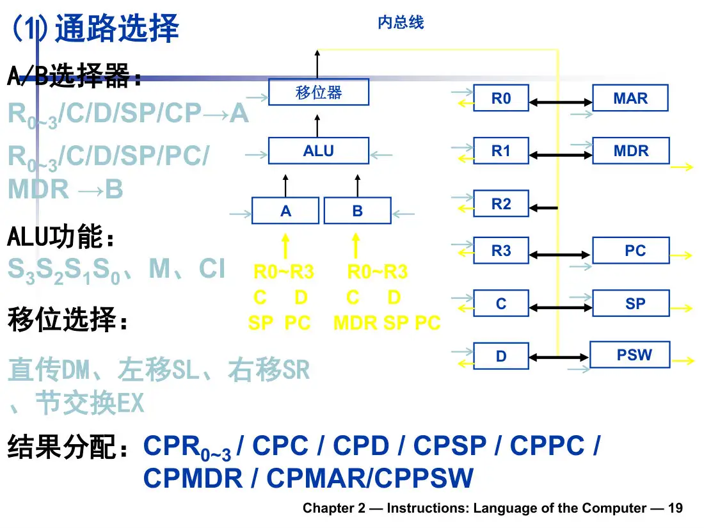

原文：

(1)通路选择

A/B选择器：

R0\~3/C/D/SP/CP→ R0\~3/C/D/SP/PC/ MDR →B

ALU功能：

$$
\mathsf {S} _ {3} \mathsf {S} _ {2} \mathsf {S} _ {1} \mathsf {S} _ {0},
$$

移位选择：

直传DM、左移SL、右移SR、节交换EX

内总线

结果分配： $\mathsf { C P R } _ { 0 \sim 3 }$ / CPC / CPD / CPSP / CPPC /CPMDR / CPMAR/CPPSW

Chapter 2 — Instructions: Language of the Computer (2)访存操作 地址使能 EMAR

19

### 0: MAR与地址线断开

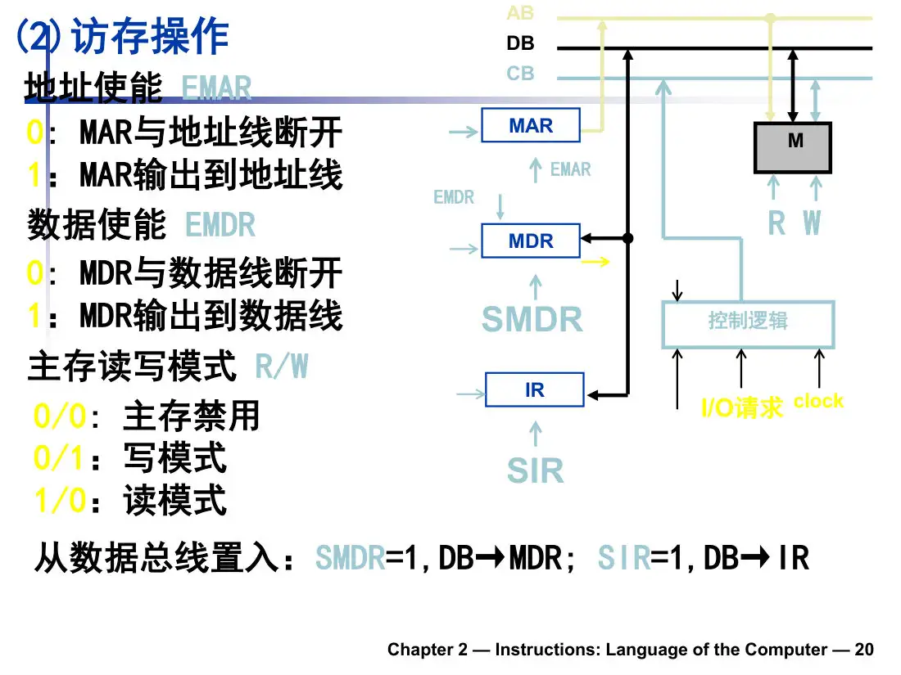

原文：

0: MAR与地址线断开

1：MAR输出到地址线

数据使能 EMDR

0: MDR与数据线断开

1：MDR输出到数据线

主存读写模式 R/W

0/0: 主存禁用

0/1：写模式

1/0：读模式

从数据总线置入：SMDR=1,DB→MDR; SIR=1,DB→IR

Chapter 2 — Instructions: Language of the Computer

20

### 常见缩写描述

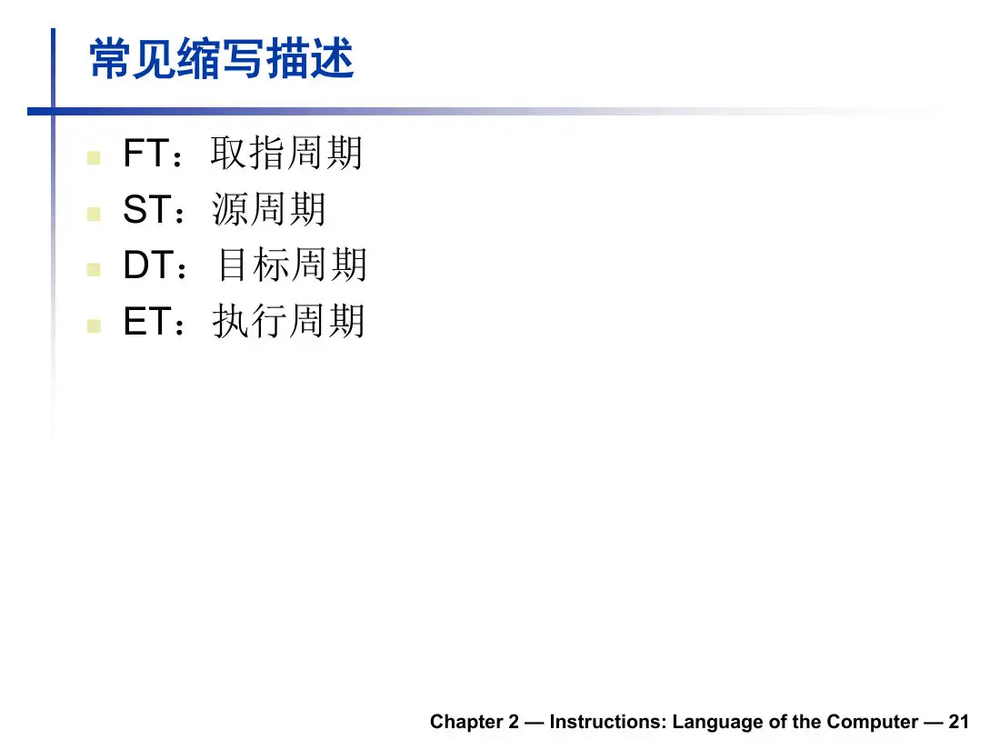

原文：

常见缩写描述

◼ FT：取指周期

◼ ST：源周期

◼ DT：目标周期

◼ ET：执行周期

Chapter 2 — Instructions: Language of the Computer

21

### 指令流程及微命令

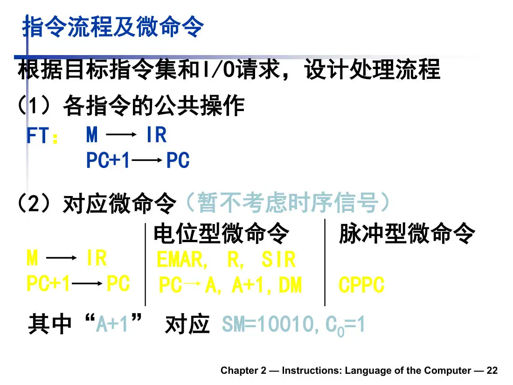

原文：

指令流程及微命令

根据目标指令集和I/O请求，设计处理流程

（1）各指令的公共操作

FT： $\begin{array} { l } { { \mathsf { N } \longrightarrow \mathsf { I R } } } \\ { { \mathsf { P } 0 { + } 1 { \longrightarrow } \mathsf { P } 0 } } \end{array}$

（2）对应微命令（暂不考虑时序信号）

电位型微命令

脉冲型微命令

$$
\begin{array}{c} \text { M } \longrightarrow \text { IR } \\ \text { PC + 1 } \longrightarrow \text { PC } \end{array}
$$

$$
\begin{array}{l} \text {EMAR, R, SIR} \\ \text {PC\longrightarrow A, A + 1 , DM} \end{array}
$$

CPPC

其中 $^ { 6 6 } A + 1 ^ { 5 9 }$ 对应 $\mathrm { \sf { S i } } = 1 0 0 1 0 , 0 _ { 0 } = 1$

Chapter 2 — Instructions: Language of the Computer

22

### 操作时间表中各微命令的含义:

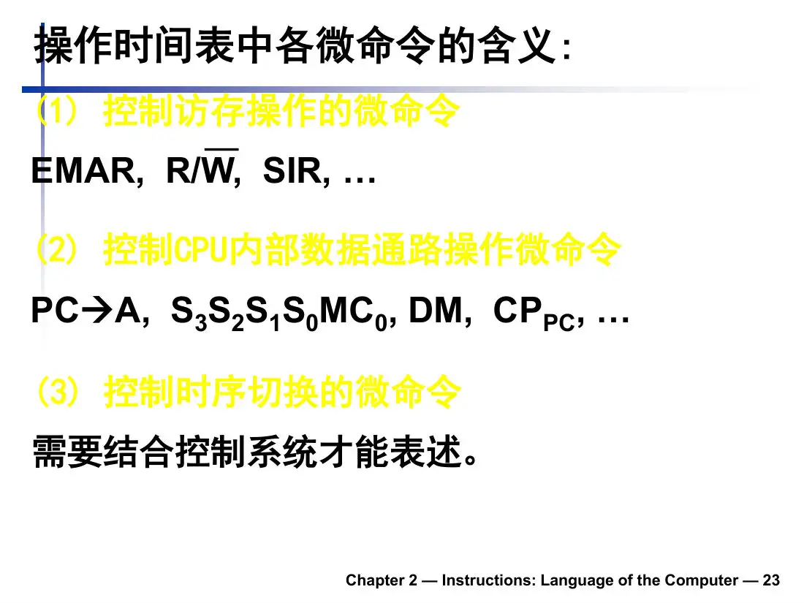

原文：

操作时间表中各微命令的含义:

(1) 控制访存操作的微命令EMAR, R/W, SIR, …

(2) 控制CPU内部数据通路操作微命令$\mathsf { P C } \Rightarrow \mathsf { A }$ $\mathsf { S } _ { 3 } \mathsf { S } _ { 2 } \mathsf { S } _ { 1 } \mathsf { S } _ { 0 } \mathsf { M } \mathsf { C } _ { 0 }$ , DM, $\mathbf { C P _ { p c } } , \ldots$

(3) 控制时序切换的微命令需要结合控制系统才能表述。

Chapter 2 — Instructions: Language of the Computer

23

### （2）传送指令

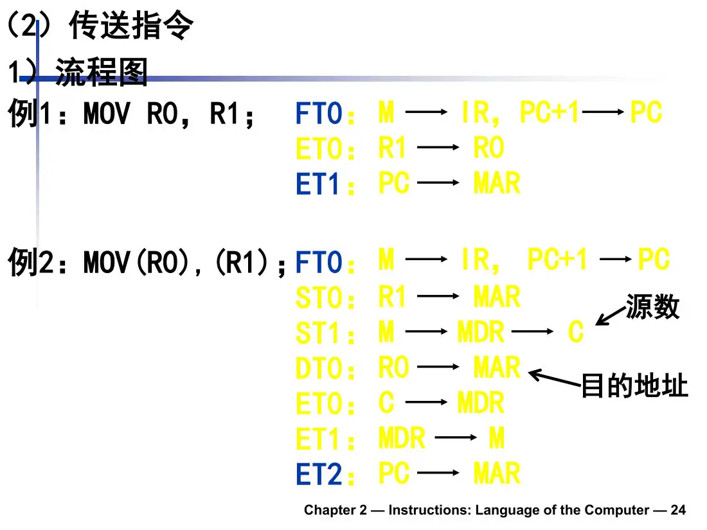

原文：

（2）传送指令

1）流程图

FT0：M IR，例1：MOV R0，R1； PC+1 PCET0：R1 R0ET1：PC MAR

例2：MOV(R0),(R1)；FT0：M IR， PC+1 PCST0：R1 MAR 源数ST1：M MDR CDT0：R0 MAR 目的地址ET0：C MDRET1：MDR MET2：PC MAR

Chapter 2 — Instructions: Language of the Computer

24

### 例3：MOV X(R0),X(R1)；FT0： $\yen 12$

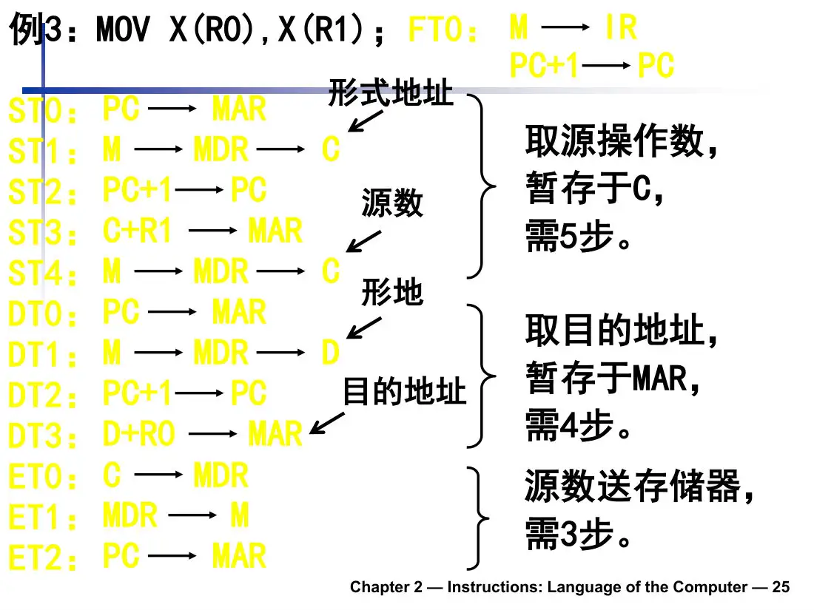

原文：

例3：MOV X(R0),X(R1)；FT0： $\yen 12$

ST0：PC MAR

形式地址

PC+1 PCST2：

C+R1 MARST3：

DT0：PC MAR

DT3：D+R0 MAR

C MDRET0：

ET1：MDR M

ET2：PC MAR

源数

目的地址取源操作数，暂存于C，需5步。

取目的地址，暂存于MAR，需4步。

源数送存储器，需3步。

Chapter 2 — Instructions: Language of the Computer

25
