# 《计算机组成与结构》第5章 大容量和高速度：开发存储器层次结构（课件）

原件的每一页，下面附识别出的文字。

### Chapter 5

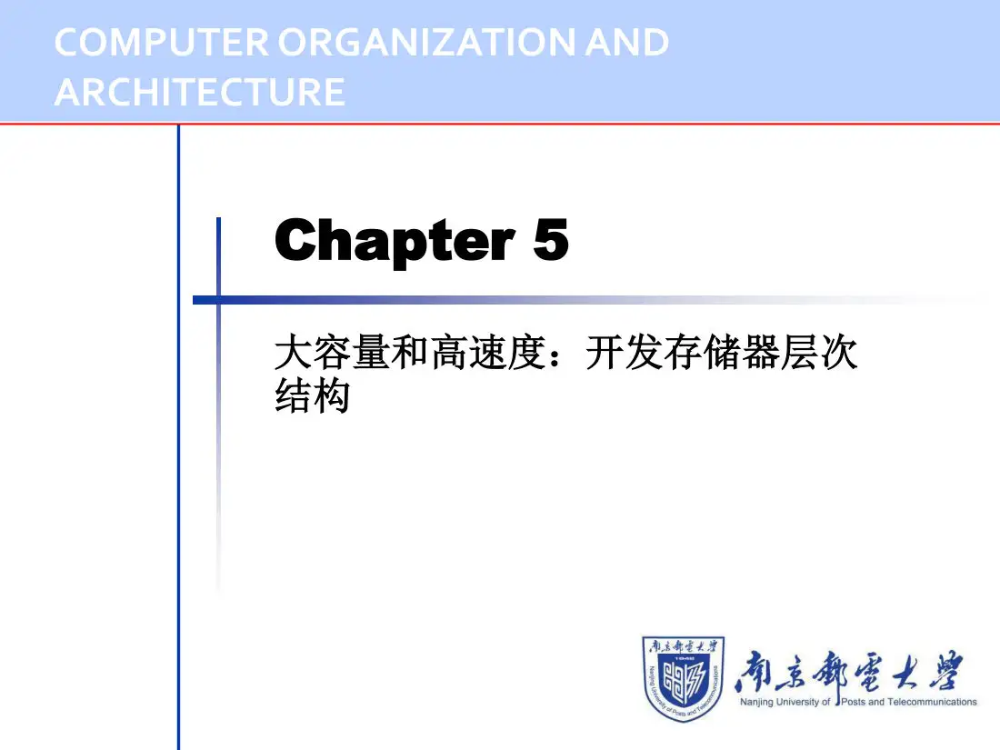

原文：

Chapter 5

大容量和高速度：开发存储器层次结构

COMPUTER ORGANIZATION AND ARCHITECTURE

南京郵電大學 Nanijing O 圆 nons 南京郵電大学 Nanjing University of Posts and Telecommunications ty o Posts and T

### 存储器层次结构

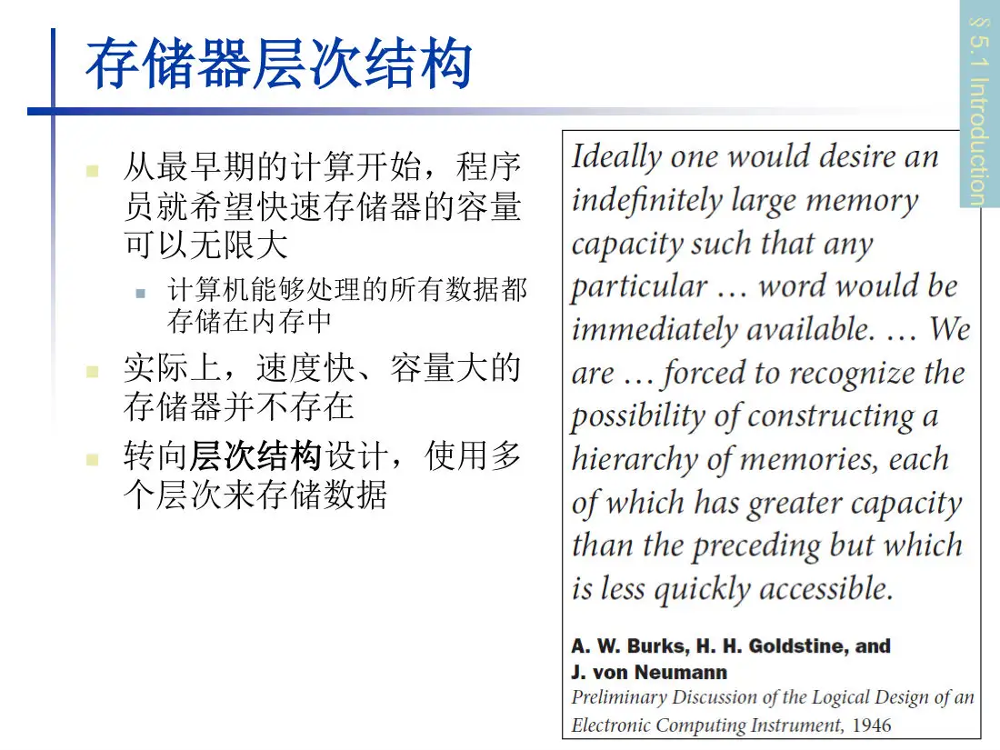

原文：

存储器层次结构

◼ 从最早期的计算开始，程序员就希望快速存储器的容量可以无限大

◼ 计算机能够处理的所有数据都存储在内存中

◼ 实际上，速度快、容量大的存储器并不存在

◼ 转向层次结构设计，使用多个层次来存储数据

Ideally one would desire an indefinitely large memory capacity such that any particular ... word would be immediately available. ... We are ... forced to recognize the possibility of constructing a hierarchy of memories, each of which has greater capacity than the preceding but which is less quickly accessible.

A. W. Burks, H. H. Goldstine, and J. von Neumann Preliminary Discussion of the Logical Design of an Electronic Computing Instrument, 1946

§ 5.1 Introduction

### 存储器层次结构概述

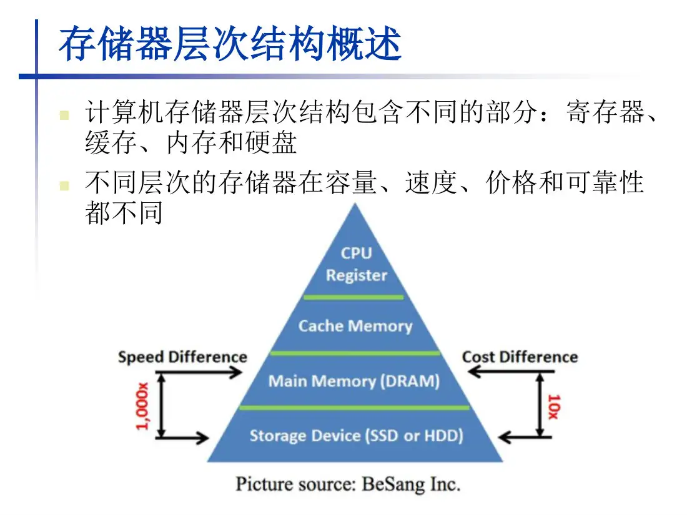

原文：

存储器层次结构概述

◼ 计算机存储器层次结构包含不同的部分：寄存器、缓存、内存和硬盘

◼ 不同层次的存储器在容量、速度、价格和可靠性都不同

### 局部性原理

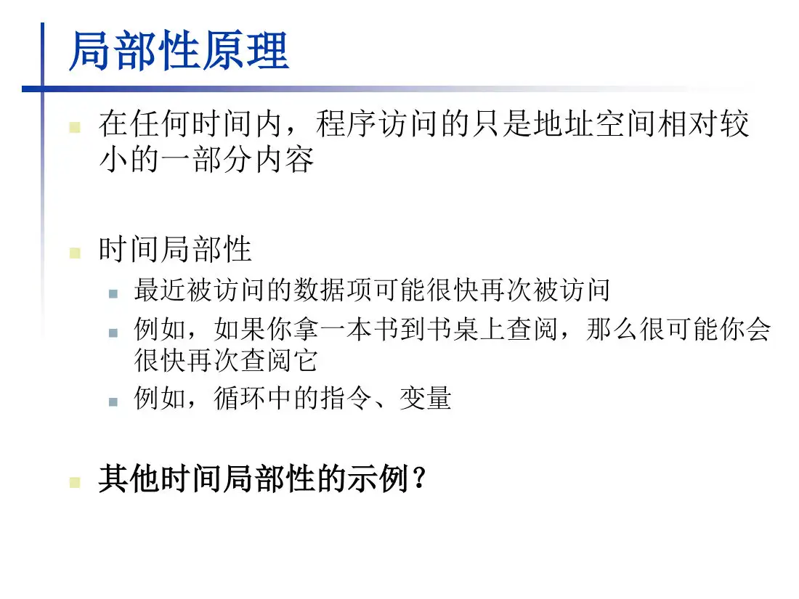

原文：

局部性原理

◼ 在任何时间内，程序访问的只是地址空间相对较小的一部分内容

◼ 时间局部性

◼ 最近被访问的数据项可能很快再次被访问

◼ 例如，如果你拿一本书到书桌上查阅，那么很可能你会很快再次查阅它

◼ 例如，循环中的指令、变量

◼ 其他时间局部性的示例？

### 局部性原理

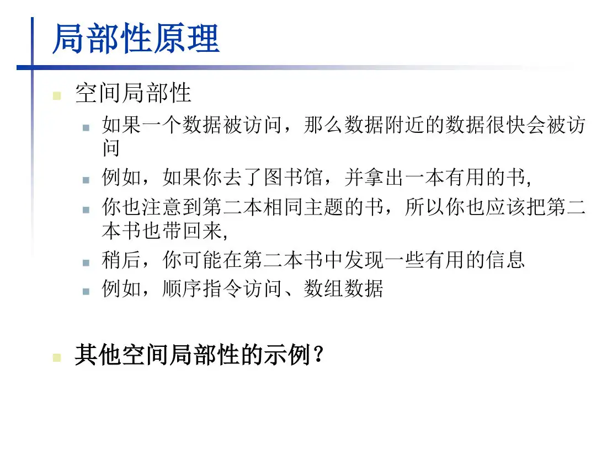

原文：

局部性原理

◼ 空间局部性

◼ 如果一个数据被访问，那么数据附近的数据很快会被访问

◼ 例如，如果你去了图书馆，并拿出一本有用的书,

◼ 你也注意到第二本相同主题的书，所以你也应该把第二本书也带回来,

◼ 稍后，你可能在第二本书中发现一些有用的信息

例如，顺序指令访问、数组数据

◼ 其他空间局部性的示例？

### 充分利用局部性原理

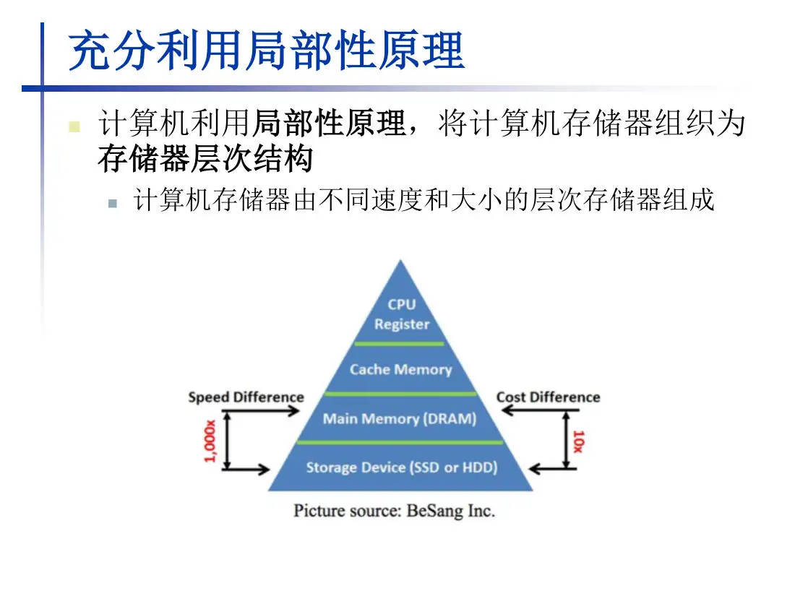

原文：

充分利用局部性原理

◼ 计算机利用局部性原理，将计算机存储器组织为存储器层次结构

◼ 计算机存储器由不同速度和大小的层次存储器组成

### 利用局部性原理

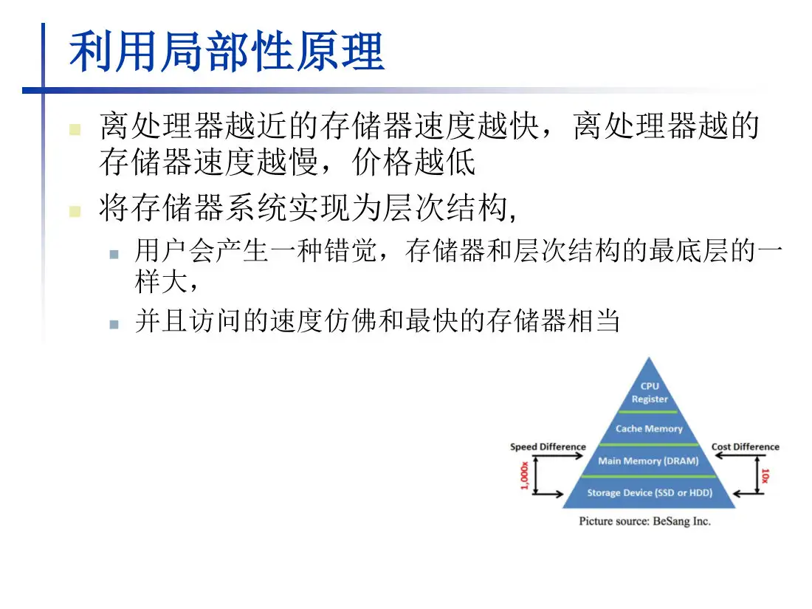

原文：

利用局部性原理

◼ 离处理器越近的存储器速度越快，离处理器越的存储器速度越慢，价格越低

◼ 将存储器系统实现为层次结构,

◼ 用户会产生一种错觉，存储器和层次结构的最底层的一样大，

◼ 并且访问的速度仿佛和最快的存储器相当

### 存储器工作原理(概述)

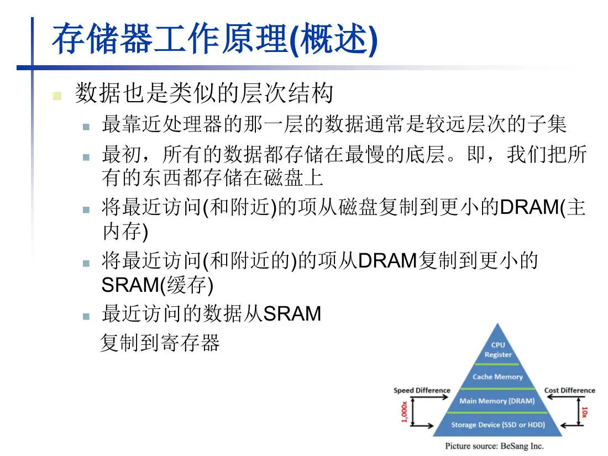

原文：

存储器工作原理(概述)

◼ 数据也是类似的层次结构

最靠近处理器的那一层的数据通常是较远层次的子集

◼ 最初，所有的数据都存储在最慢的底层。即，我们把所有的东西都存储在磁盘上

将最近访问(和附近)的项从磁盘复制到更小的DRAM(主内存)

◼ 将最近访问(和附近的)的项从DRAM复制到更小的SRAM(缓存)

◼ 最近访问的数据从SRAM

复制到寄存器

### 存储器工作原理

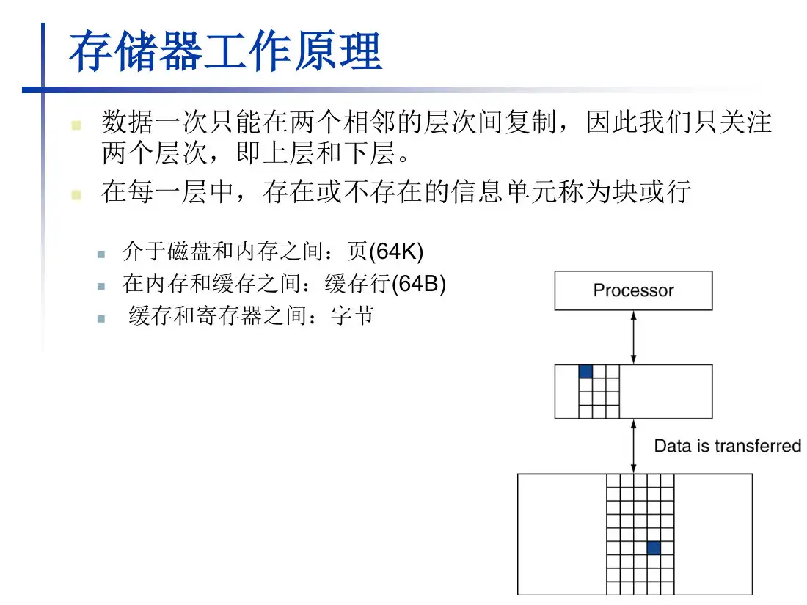

原文：

存储器工作原理

◼ 数据一次只能在两个相邻的层次间复制，因此我们只关注两个层次，即上层和下层。

◼ 在每一层中，存在或不存在的信息单元称为块或行

◼ 介于磁盘和内存之间：页(64K)

◼ 在内存和缓存之间：缓存行(64B)

◼ 缓存和寄存器之间：字节

### 存储器工作原理

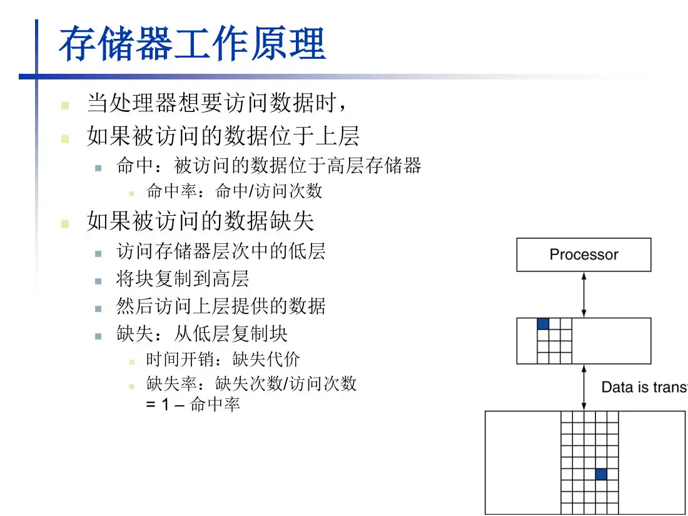

原文：

存储器工作原理

◼ 当处理器想要访问数据时，

◼ 如果被访问的数据位于上层

◼ 命中：被访问的数据位于高层存储器

◼ 命中率：命中/访问次数

◼ 如果被访问的数据缺失

◼ 访问存储器层次中的低层

◼ 将块复制到高层

◼ 然后访问上层提供的数据

◼ 缺失：从低层复制块

◼ 时间开销：缺失代价

◼ 缺失率：缺失次数/访问次数 = 1 – 命中率

### 存储技术

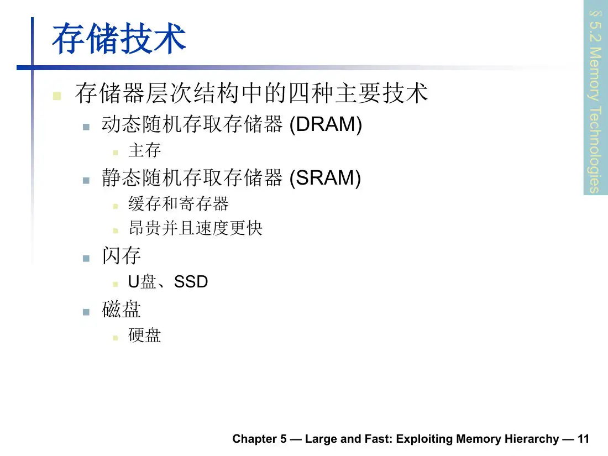

原文：

存储技术

◼ 存储器层次结构中的四种主要技术

◼ 动态随机存取存储器 (DRAM)

◼ 主存

◼ 静态随机存取存储器 (SRAM)

◼ 缓存和寄存器

◼ 昂贵并且速度更快

◼ 闪存

◼ U盘、SSD

◼ 磁盘

◼ 硬盘

§ 5.2 Memory Technologies

Chapter 5 — Large and Fast: Exploiting Memory Hierarchy

11

### 存储器技术

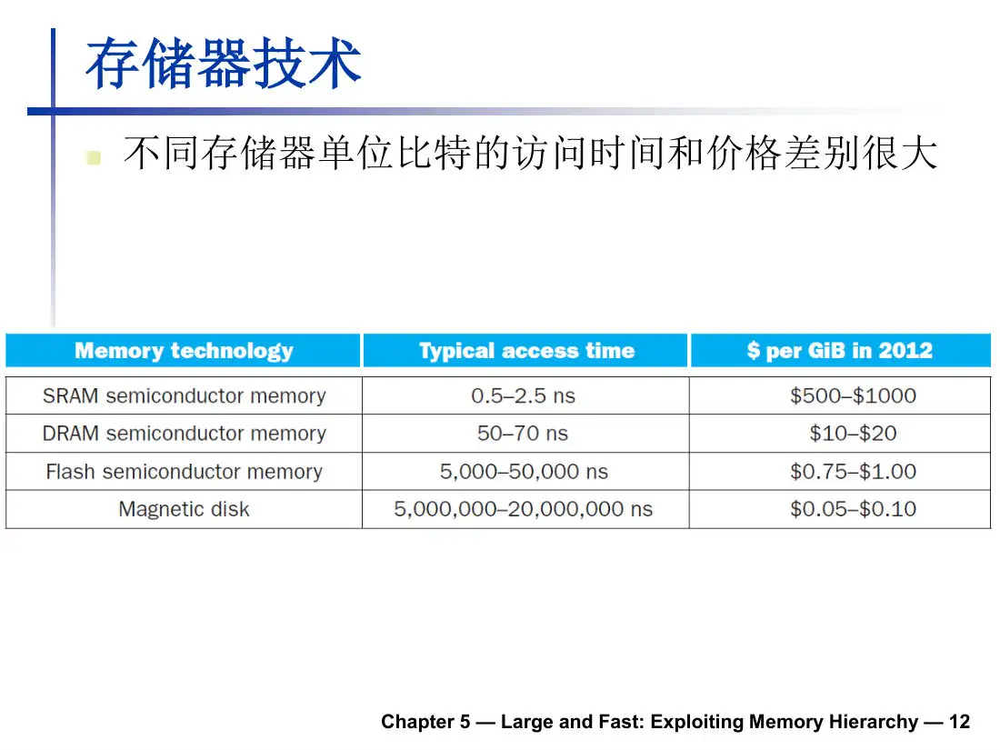

原文：

存储器技术

◼ 不同存储器单位比特的访问时间和价格差别很大

<table><tr><td>Memory technology</td><td>Typical access time</td><td>$ per GiB in 2012</td></tr><tr><td>SRAM semiconductor memory</td><td>0.5–2.5 ns</td><td>$500–$1000</td></tr><tr><td>DRAM semiconductor memory</td><td>50–70 ns</td><td>$10–$20</td></tr><tr><td>Flash semiconductor memory</td><td>5,000–50,000 ns</td><td>$0.75–$1.00</td></tr><tr><td>Magnetic disk</td><td>5,000,000–20,000,000 ns</td><td>$0.05–$0.10</td></tr></table>

Chapter 5 — Large and Fast: Exploiting Memory Hierarchy

12

### DRAM技术

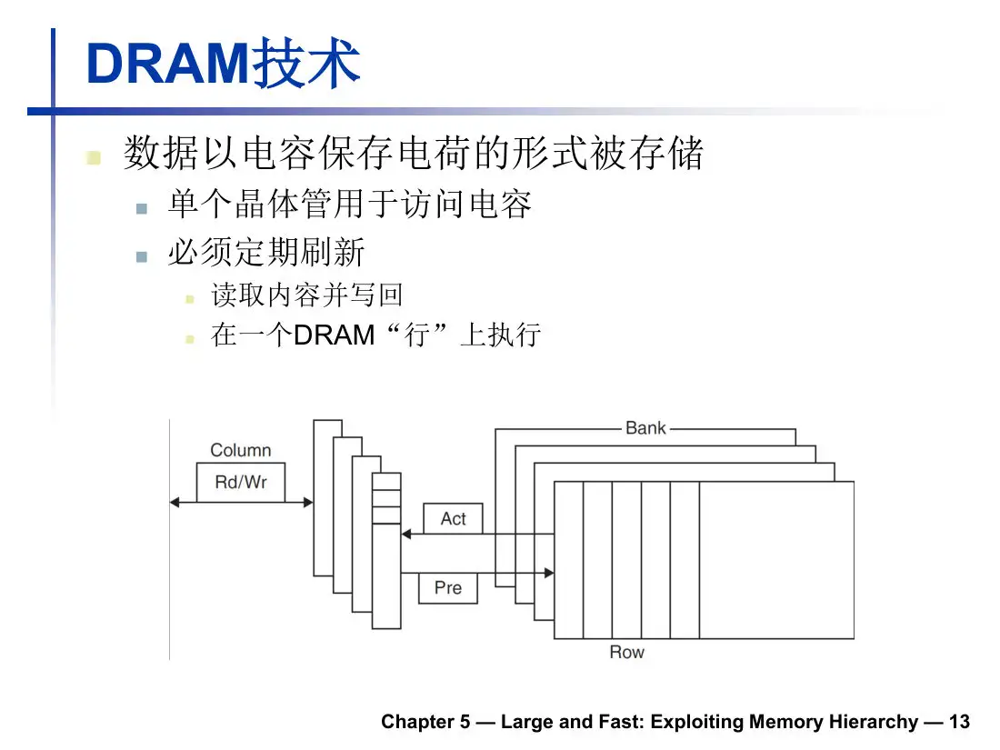

原文：

DRAM技术

◼ 数据以电容保存电荷的形式被存储

◼ 单个晶体管用于访问电容

◼ 必须定期刷新

◼ 读取内容并写回

◼ 在一个DRAM“行”上执行

Chapter 5 — Large and Fast: Exploiting Memory Hierarchy —

13

### DRAM的发展

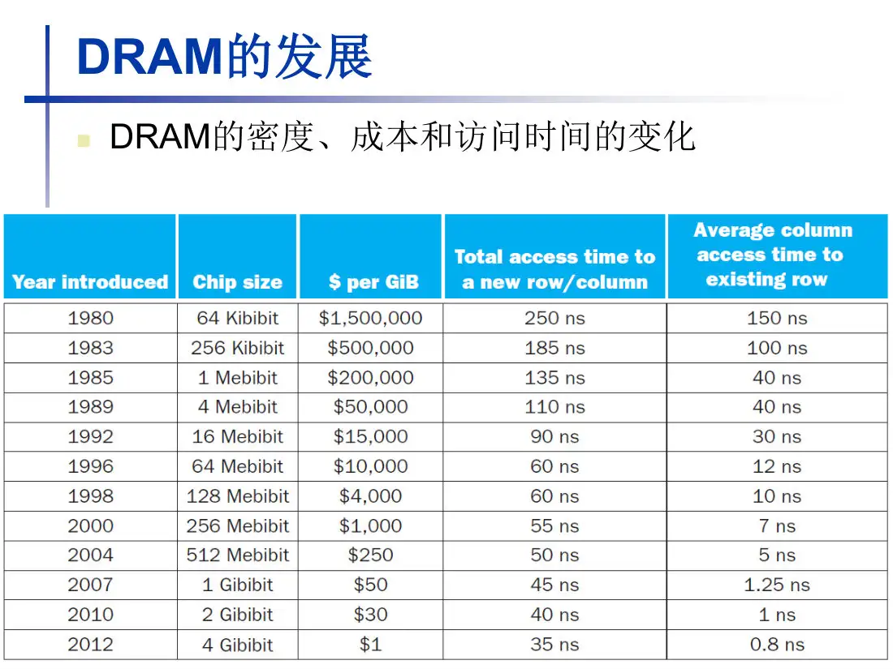

原文：

DRAM的发展

◼ DRAM的密度、成本和访问时间的变化

<table><tr><td>Year introduced</td><td>Chip size</td><td>$ per GiB</td><td>Total access time to a new row/column</td><td>Average column access time to existing row</td></tr><tr><td>1980</td><td>64 Kibibit</td><td>$1,500,000</td><td>250 ns</td><td>150 ns</td></tr><tr><td>1983</td><td>256 Kibibit</td><td>$500,000</td><td>185 ns</td><td>100 ns</td></tr><tr><td>1985</td><td>1 Mebibit</td><td>$200,000</td><td>135 ns</td><td>40 ns</td></tr><tr><td>1989</td><td>4 Mebibit</td><td>$50,000</td><td>110 ns</td><td>40 ns</td></tr><tr><td>1992</td><td>16 Mebibit</td><td>$15,000</td><td>90 ns</td><td>30 ns</td></tr><tr><td>1996</td><td>64 Mebibit</td><td>$10,000</td><td>60 ns</td><td>12 ns</td></tr><tr><td>1998</td><td>128 Mebibit</td><td>$4,000</td><td>60 ns</td><td>10 ns</td></tr><tr><td>2000</td><td>256 Mebibit</td><td>$1,000</td><td>55 ns</td><td>7 ns</td></tr><tr><td>2004</td><td>512 Mebibit</td><td>$250</td><td>50 ns</td><td>5 ns</td></tr><tr><td>2007</td><td>1 Gibibit</td><td>$50</td><td>45 ns</td><td>1.25 ns</td></tr><tr><td>2010</td><td>2 Gibibit</td><td>$30</td><td>40 ns</td><td>1 ns</td></tr><tr><td>2012</td><td>4 Gibibit</td><td>$1</td><td>35 ns</td><td>0.8 ns</td></tr></table>

### DRAM性能因素

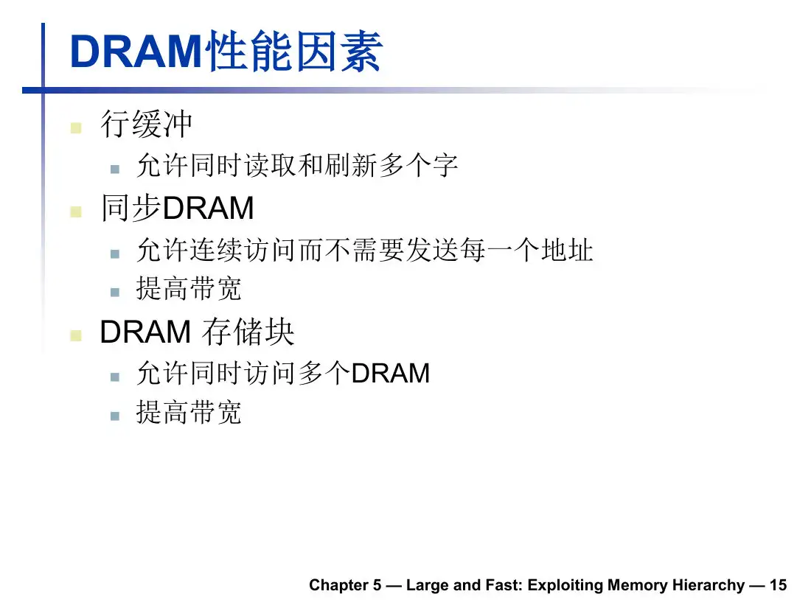

原文：

DRAM性能因素

◼ 行缓冲

◼ 允许同时读取和刷新多个字

◼ 同步DRAM

◼ 允许连续访问而不需要发送每一个地址

◼ 提高带宽

◼ DRAM 存储块

◼ 允许同时访问多个DRAM

◼ 提高带宽

Chapter 5 — Large and Fast: Exploiting Memory Hierarchy

15

### 闪存

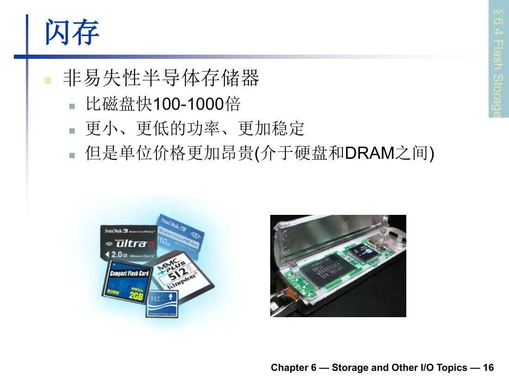

原文：

闪存

◼ 非易失性半导体存储器

◼ 比磁盘快100-1000倍

◼ 更小、更低的功率、更加稳定

◼ 但是单位价格更加昂贵(介于硬盘和DRAM之间)

§ 6.4 Flash Storage

Chapter 6 — Storage and Other I/O Topics

16

### 磁盘存储器

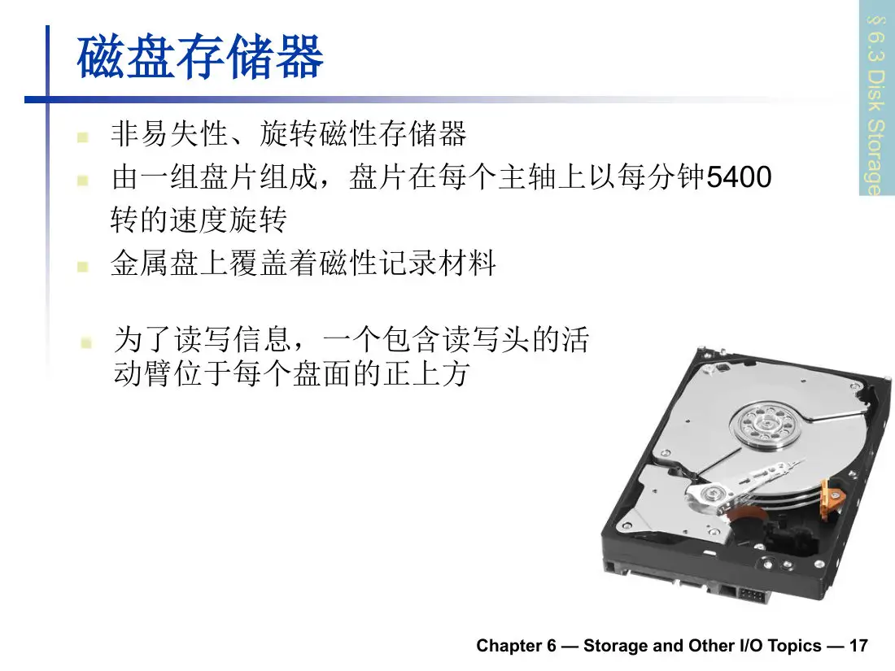

原文：

磁盘存储器

◼ 非易失性、旋转磁性存储器

◼ 由一组盘片组成，盘片在每个主轴上以每分钟5400转的速度旋转

◼ 金属盘上覆盖着磁性记录材料

◼ 为了读写信息，一个包含读写头的活动臂位于每个盘面的正上方

§ 6.3 Disk Storage

### 磁盘存储器

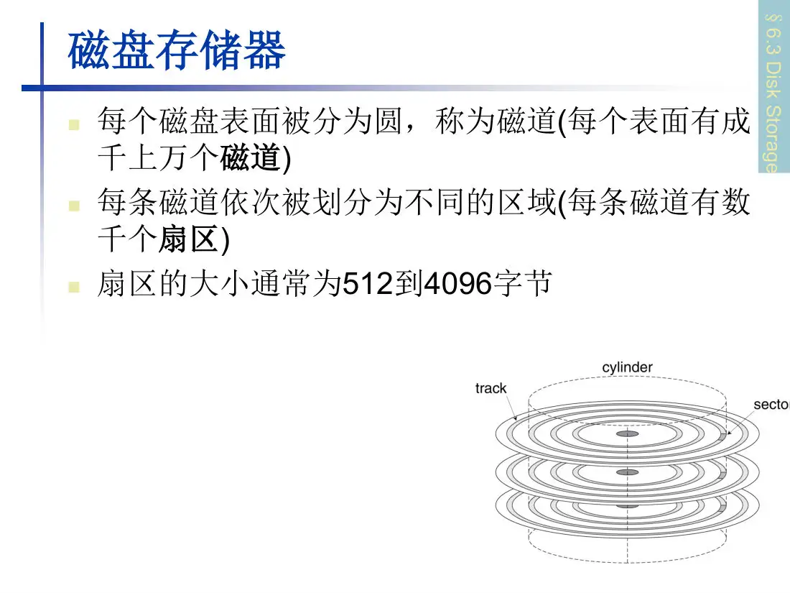

原文：

磁盘存储器

◼ 每个磁盘表面被分为圆，称为磁道(每个表面有成千上万个磁道)

◼ 每条磁道依次被划分为不同的区域(每条磁道有数千个扇区)

◼ 扇区的大小通常为512到4096字节

§ 6.3 Disk Storage

### 磁盘存储器

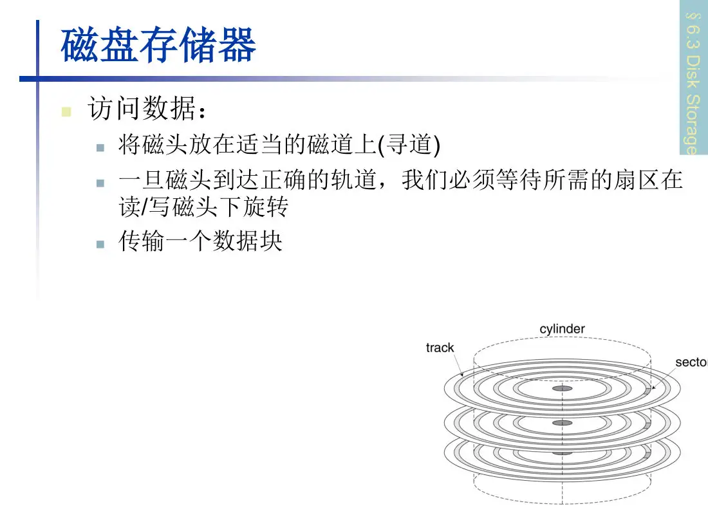

原文：

磁盘存储器

◼ 访问数据：

◼ 将磁头放在适当的磁道上(寻道)

◼ 一旦磁头到达正确的轨道，我们必须等待所需的扇区在 读/写磁头下旋转

◼ 传输一个数据块

§ 6.3 Disk Storage

### 磁盘性能问题

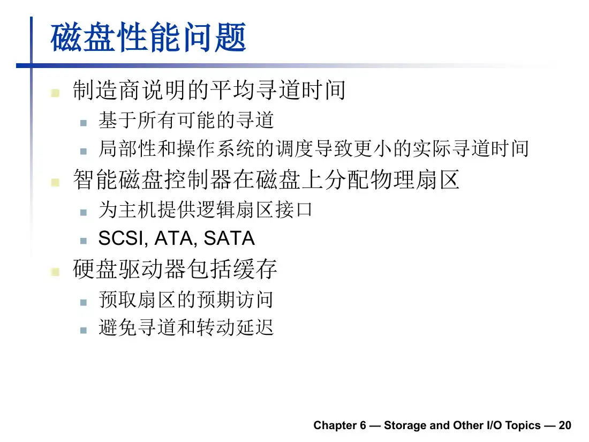

原文：

磁盘性能问题

◼ 制造商说明的平均寻道时间

◼ 基于所有可能的寻道

◼ 局部性和操作系统的调度导致更小的实际寻道时间

◼ 智能磁盘控制器在磁盘上分配物理扇区

◼ 为主机提供逻辑扇区接口

◼ SCSI, ATA, SATA

◼ 硬盘驱动器包括缓存

◼ 预取扇区的预期访问

◼ 避免寻道和转动延迟

Chapter 6 — Storage and Other I/O Topics

20

### 缓存的介绍

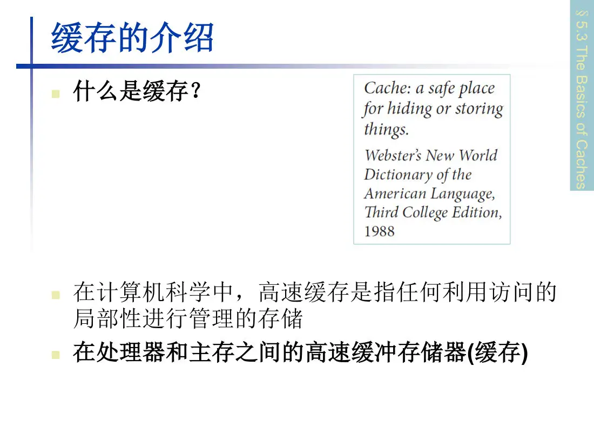

原文：

缓存的介绍

<table><tr><td>什么是缓存?</td><td>Cache: a safe place for hiding or storing things.Webster&#x27;s New World Dictionary of the American Language, Third College Edition, 1988</td></tr></table>

◼ 在计算机科学中，高速缓存是指任何利用访问的局部性进行管理的存储

◼ 在处理器和主存之间的高速缓冲存储器(缓存)

§ 5.3 The Basics of Caches

### 存储器的读、写周期

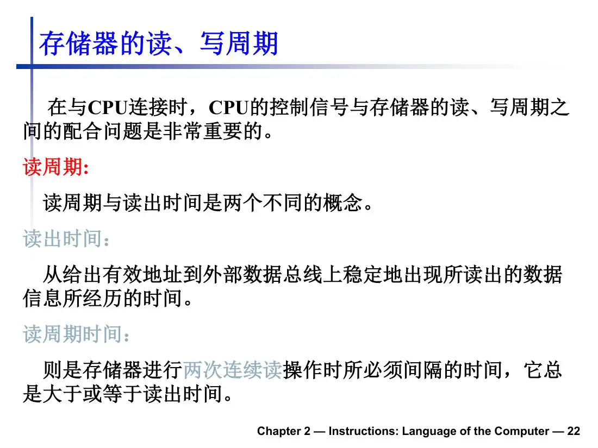

原文：

存储器的读、写周期

在与CPU连接时，CPU的控制信号与存储器的读、写周期之间的配合问题是非常重要的。

读周期:

读周期与读出时间是两个不同的概念。

读出时间：

从给出有效地址到外部数据总线上稳定地出现所读出的数据信息所经历的时间。

读周期时间：

则是存储器进行两次连续读操作时所必须间隔的时间，它总是大于或等于读出时间。

Chapter 2 — Instructions: Language of the Computer

22

### 在读周期中，地址线先有效，以便进行地址译码，选中存储单元。

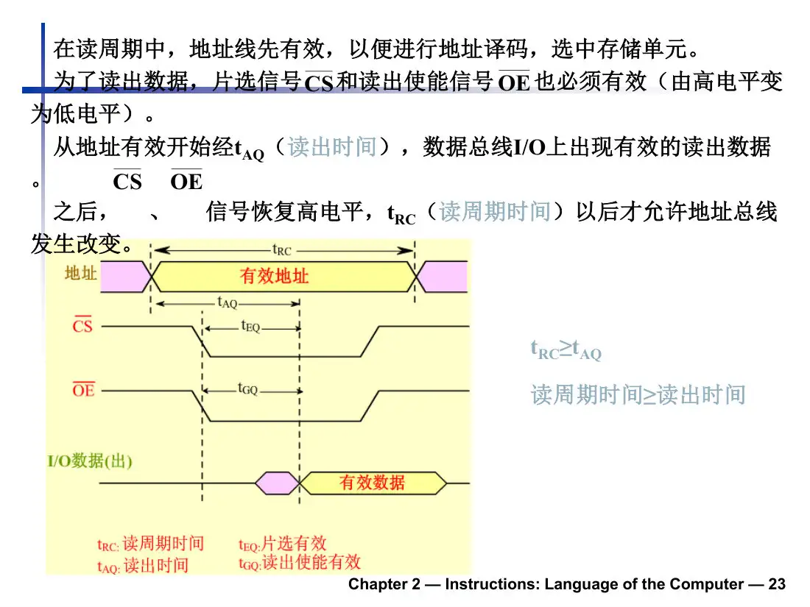

原文：

在读周期中，地址线先有效，以便进行地址译码，选中存储单元。

为了读出数据，片选信号 $\overline { { \mathbf { C } \mathbf { S } } }$ 和读出使能信号 $\mathbf { \overline { { O E } } }$ 也必须有效（由高电平变为低电平）。

从地址有效开始经t （读出时间），数据总线I/O上出现有效的读出数据 $\bf t _ { A Q }$ 。 CS OE

之后， 、 信号恢复高电平， $\mathbf { t } _ { \mathbf { R C } }$ （读周期时间）以后才允许地址总线

发生改变。

$$
\mathbf {t} _ {\mathrm{RC}} \geq \mathbf {t} _ {\mathrm{AQ}}
$$

读周期时间≥读出时间

$\mathrm { { t } _ { R C : } }$ 读周期时间 tEQ:片选有效$\mathrm { t _ { A Q } } \mathrm { : }$ 读出时间 tGQ:读出使能有效

Chapter 2 — Instructions: Language of the Computer

23

### Chapter 2 — Instr

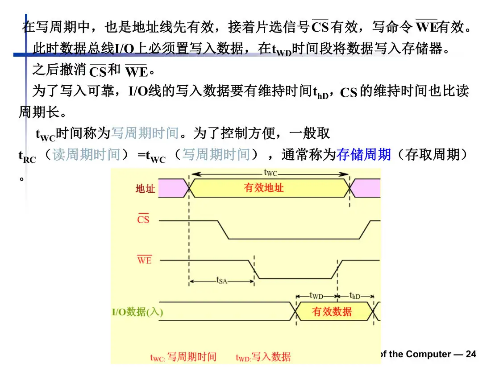

原文：

在写周期中，也是地址线先有效，接着片选信号 $\overline { { \mathbf { C } \mathbf { S } } }$ 有效，写命令 $\mathbf { \overline { { W E } } }$ 有效。此时数据总线I/O上必须置写入数据，在 $\mathbf { t _ { W D } }$ 时间段将数据写入存储器。

之后撤消 $\overline { { \mathbf { C } \mathbf { S } } }$ 和 $\mathbf { \overline { { W E } } }$

为了写入可靠，I/O线的写入数据要有维持时间 $\mathbf { t _ { h D } }$ ， $\overline { { \mathbf { C } \mathbf { S } } }$ 的维持时间也比读周期长。

$\mathbf { t } _ { \mathbf { W C } }$ 时间称为写周期时间。为了控制方便，一般取

$\mathbf { t } _ { \mathbf { R C } }$ （读周期时间） $\mathbf { \Pi = t _ { W C } }$ （写周期时间），通常称为存储周期（存取周期）

Chapter 2 — Instr

of the Computer

24

### 解： 写入存储器的时序信号必须同步

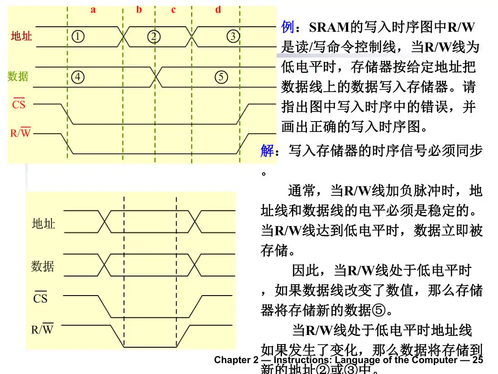

原文：

例：SRAM的写入时序图中R/W是读/写命令控制线，当R/W线为低电平时，存储器按给定地址把数据线上的数据写入存储器。请指出图中写入时序中的错误，并画出正确的写入时序图。

解： 写入存储器的时序信号必须同步

通常，当R/W线加负脉冲时，地址线和数据线的电平必须是稳定的。当R/W线达到低电平时，数据立即被存储。

因此，当R/W线处于低电平时，如果数据线改变了数值，那么存储器将存储新的数据⑤。

当R/W线处于低电平时地址线如果发生了变化，那么数据将存储到— Instructions: Language of the Computer — 25新的地址②或③中。

Chapter 2

### （1）增加了行地址锁存器和列地址锁存器。

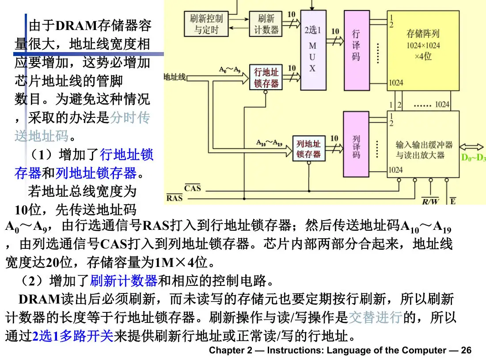

原文：

由于DRAM存储器容量很大，地址线宽度相应要增加，这势必增加芯片地址线的管脚数目。为避免这种情况，采取的办法是分时传送地址码。

（1）增加了行地址锁存器和列地址锁存器。

若地址总线宽度为10位，先传送地址码

${ \bf A _ { 0 } } \sim { \bf A _ { 9 } }$ ，由行选通信号RAS打入到行地址锁存器；然后传送地址码 $\bf { A _ { 1 0 } } \{ \alpha \mathrm { { A _ { 1 9 } } }$ ，由列选通信号CAS打入到列地址锁存器。芯片内部两部分合起来，地址线宽度达20位，存储容量为1M×4位。

（2）增加了刷新计数器和相应的控制电路。

DRAM读出后必须刷新，而未读写的存储元也要定期按行刷新，所以刷新计数器的长度等于行地址锁存器。刷新操作与读/写操作是交替进行的，所以通过2选1多路开关来提供刷新行地址或正常读/写的行地址。

Chapter 2 — Instructions: Language of the Computer

26

### DRAM时序

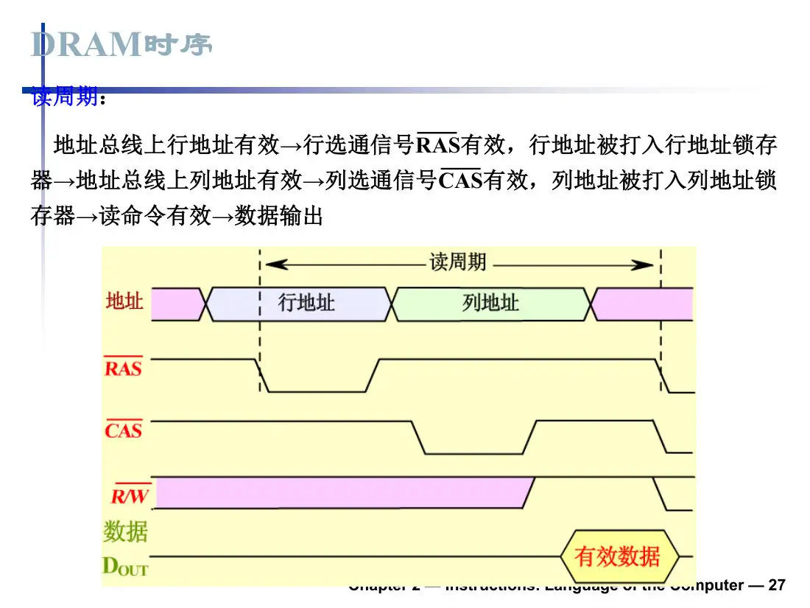

原文：

DRAM时序

读周期：

地址总线上行地址有效→行选通信号 $\mathbf { \overline { { R A S } } }$ 有效，行地址被打入行地址锁存器→地址总线上列地址有效→列选通信号 $\mathbf { \overline { { C A S } } }$ 有效，列地址被打入列地址锁存器→读命令有效→数据输出

of the Computer

27

### DRAM时序

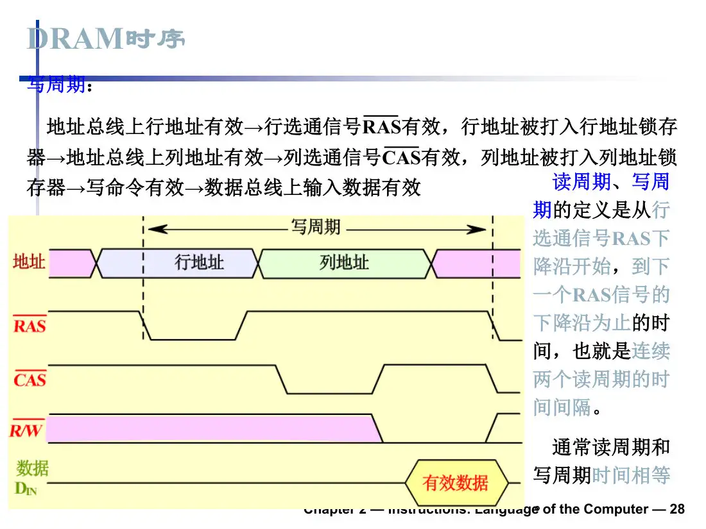

原文：

DRAM时序

写周期：

地址总线上行地址有效→行选通信号 $\mathbf { \overline { { R A S } } }$ 有效，行地址被打入行地址锁存器→地址总线上列地址有效→列选通信号 $\mathbf { \overline { { C A S } } }$ 有效，列地址被打入列地址锁

存器→写命令有效→数据总线上输入数据有效

读周期、写周期的定义是从行选通信号RAS下降沿开始，到下一个RAS信号的下降沿为止的时间，也就是连续两个读周期的时间间隔。

通常读周期和写周期时间相等

age of the Computer

28

### 3.DRAM的刷新

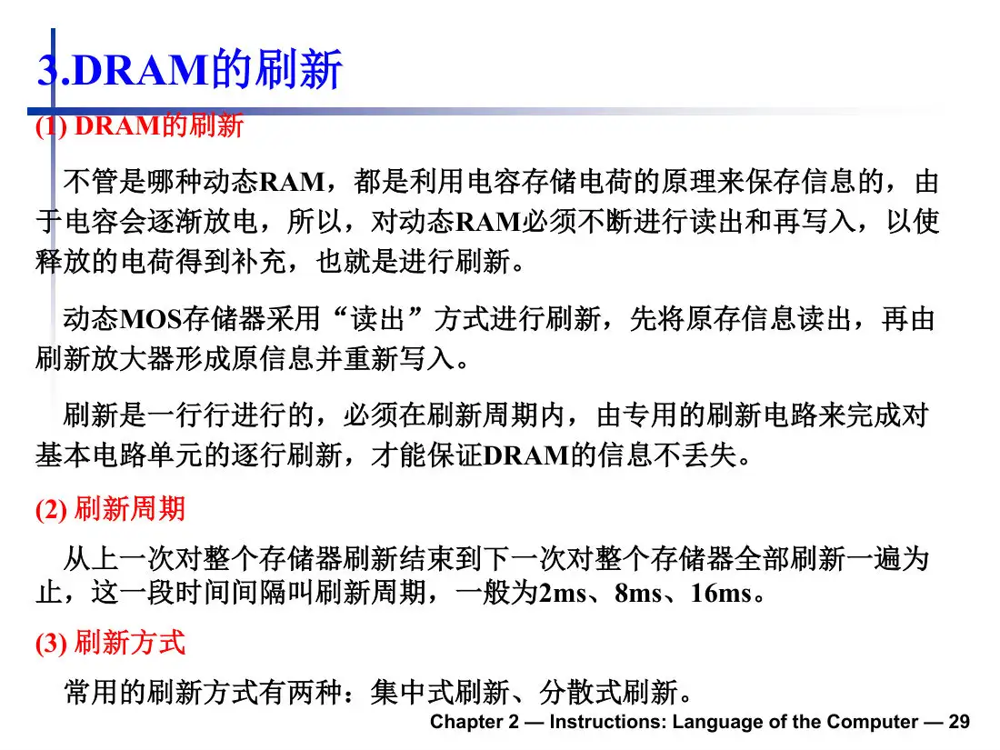

原文：

3.DRAM的刷新

(1) DRAM的刷新

不管是哪种动态RAM，都是利用电容存储电荷的原理来保存信息的，由于电容会逐渐放电，所以，对动态RAM必须不断进行读出和再写入，以使释放的电荷得到补充，也就是进行刷新。

动态MOS存储器采用“读出”方式进行刷新，先将原存信息读出，再由刷新放大器形成原信息并重新写入。

刷新是一行行进行的，必须在刷新周期内，由专用的刷新电路来完成对基本电路单元的逐行刷新，才能保证DRAM的信息不丢失。

(2) 刷新周期

从上一次对整个存储器刷新结束到下一次对整个存储器全部刷新一遍为止，这一段时间间隔叫刷新周期，一般为2ms、8ms、16ms。

(3) 刷新方式

常用的刷新方式有两种：集中式刷新、分散式刷新。

Chapter 2 — Instructions: Language of the Computer

29

### 集中式刷新

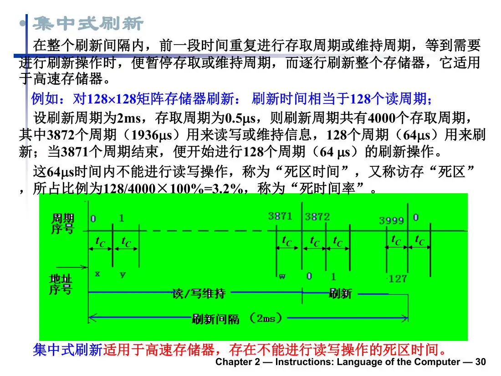

原文：

集中式刷新

在整个刷新间隔内，前一段时间重复进行存取周期或维持周期，等到需要进行刷新操作时，便暂停存取或维持周期，而逐行刷新整个存储器，它适用于高速存储器。

例如：对128128矩阵存储器刷新：刷新时间相当于128个读周期；

设刷新周期为2ms，存取周期为0.5s，则刷新周期共有4000个存取周期，其中3872个周期（1936s）用来读写或维持信息，128个周期 $( 6 4 \mu \mathbf { s } )$ 用来刷新；当3871个周期结束，便开始进行128个周期（ $( 6 4 \mu \mathrm { s } )$ 的刷新操作。

这 ${ \bf 6 4 \mu s }$ 时间内不能进行读写操作，称为“死区时间”，又称访存“死区”，所占比例为 $1 2 8 / 4 0 0 0 \times 1 0 0 \% { = } 3 . 2 \%$ ，称为“死时间率”。

集中式刷新适用于高速存储器，存在不能进行读写操作的死区时间。

Chapter 2 — Instructions: Language of the Computer

30

### 分散式刷新

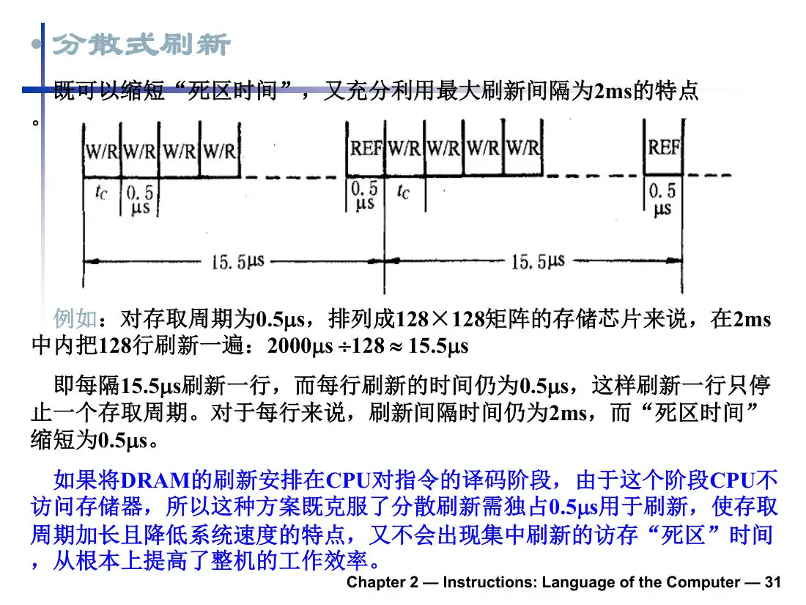

原文：

分散式刷新

既可以缩短“死区时间”，又充分利用最大刷新间隔为2ms的特点

例如：对存取周期为0.5s，排列成 $\mathbf { 1 2 8 } \times \mathbf { 1 2 8 }$ 矩阵的存储芯片来说，在2ms中内把128行刷新一遍： $2 0 0 0 \mu \mathrm { s } \div 1 2 8 \approx 1 5 . 5 \mu \mathrm { s }$

即每隔15.5μs刷新一行，而每行刷新的时间仍为0.5μs，这样刷新一行只停止一个存取周期。对于每行来说，刷新间隔时间仍为2ms，而“死区时间”缩短为0.5s。

如果将DRAM的刷新安排在CPU对指令的译码阶段，由于这个阶段CPU不访问存储器，所以这种方案既克服了分散刷新需独占 ${ \bf 0 . 5 \mu s } _ { \cdot }$ 用于刷新，使存取周期加长且降低系统速度的特点，又不会出现集中刷新的访存“死区”时间，从根本上提高了整机的工作效率。

Chapter 2 — Instructions: Language of the Computer

31

### DRAM和SRAM的比较

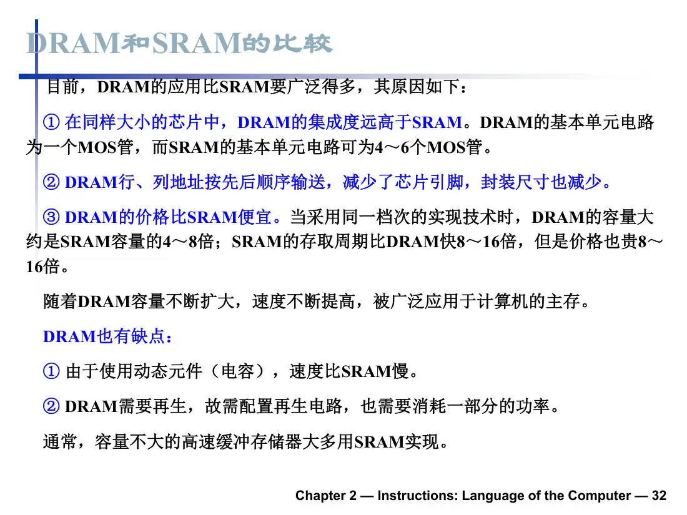

原文：

DRAM和SRAM的比较

目前，DRAM的应用比SRAM要广泛得多，其原因如下：

① 在同样大小的芯片中，DRAM的集成度远高于SRAM。DRAM的基本单元电路为一个MOS管，而SRAM的基本单元电路可为4～6个MOS管。

② DRAM行、列地址按先后顺序输送，减少了芯片引脚，封装尺寸也减少。

③ DRAM的价格比SRAM便宜。当采用同一档次的实现技术时，DRAM的容量大约是SRAM容量的4～8倍；SRAM的存取周期比DRAM快8～16倍，但是价格也贵8～16倍。

随着DRAM容量不断扩大，速度不断提高，被广泛应用于计算机的主存。

DRAM也有缺点：

① 由于使用动态元件（电容），速度比SRAM慢。

② DRAM需要再生，故需配置再生电路，也需要消耗一部分的功率。

通常，容量不大的高速缓冲存储器大多用SRAM实现。

Chapter 2 — Instructions: Language of the Computer

32

### 存储器容量的扩充

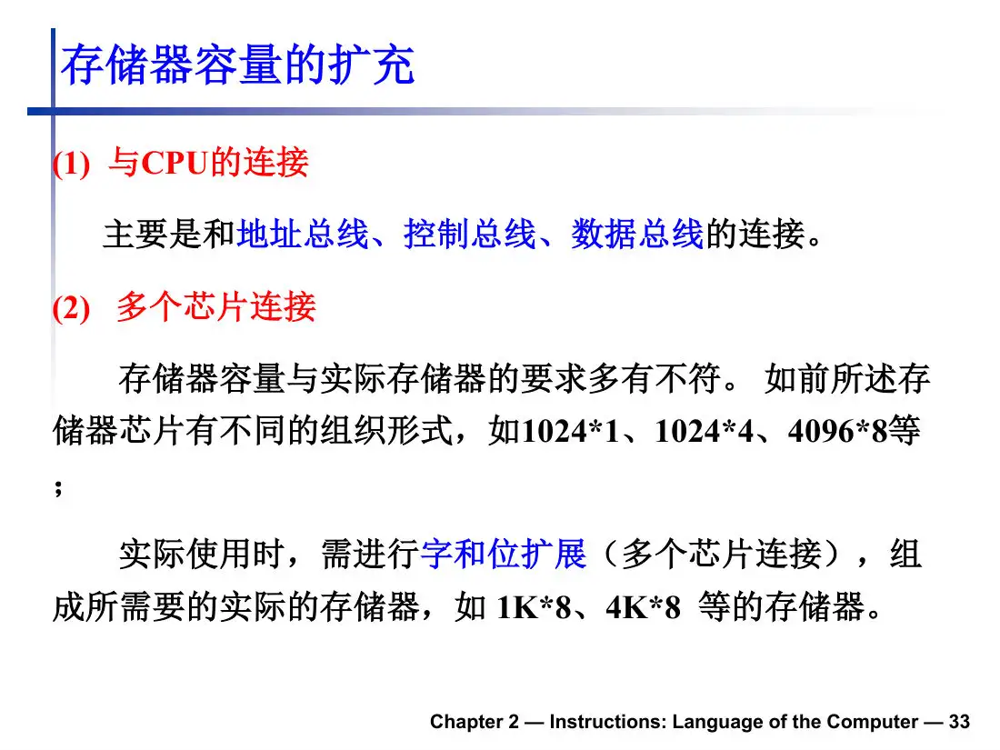

原文：

存储器容量的扩充

(1) 与CPU的连接

主要是和地址总线、控制总线、数据总线的连接。

(2) 多个芯片连接

存储器容量与实际存储器的要求多有不符。 如前所述存储器芯片有不同的组织形式，如1024\*1、1024\*4、4096\*8等

实际使用时，需进行字和位扩展（多个芯片连接），组成所需要的实际的存储器，如 1K\*8、 $4 \mathbf { K } ^ { * } \mathbf { 8 }$ 等的存储器。

Chapter 2 — Instructions: Language of the Computer

33

### 位扩展法（字长位数扩展）

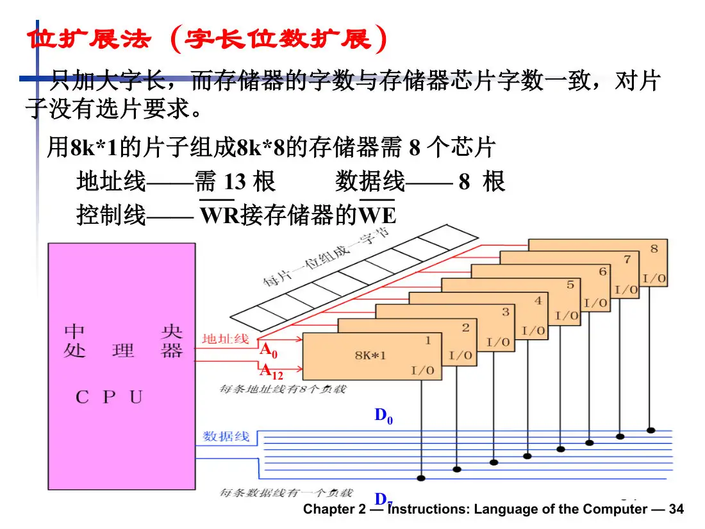

原文：

位扩展法（字长位数扩展）

只加大字长，而存储器的字数与存储器芯片字数一致，对片子没有选片要求。

用 $\mathbf { 8 } \mathbf { k } ^ { * 1 }$ 的片子组成 $[ 8 ] k ^ { * } 8$ 的存储器需 8 个芯片

地址线——需 13 根 数据线—— 8 根

控制线—— WR接存储器的WE

Chapter 2 — Instructions: Language of the ComputerD7

34

### 字扩展法

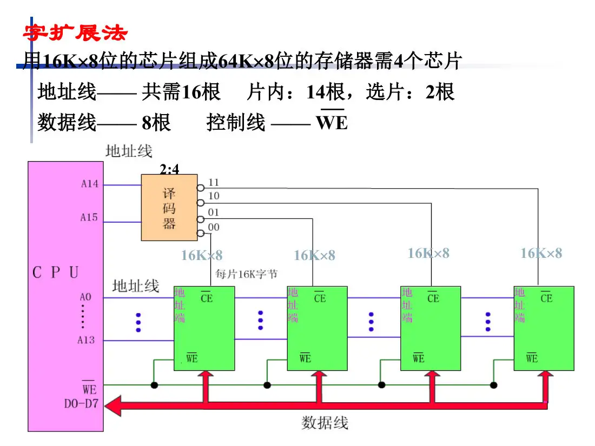

原文：

字扩展法

用16K×8位的芯片组成64K×8位的存储器需4个芯片地址线— —共需16根 片内：14根，选片：2根数据线— —8根 控制线——WE

### cache存储器

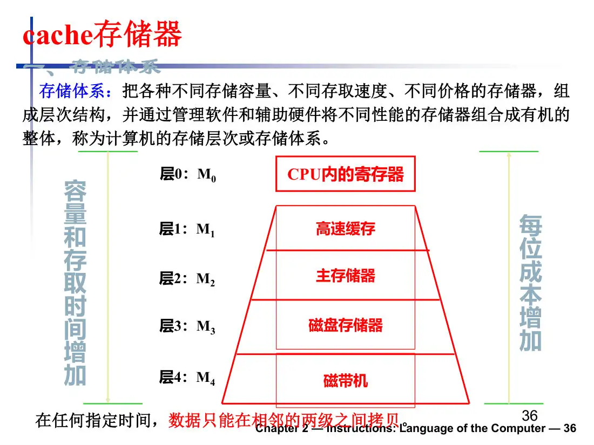

原文：

cache存储器

、存储体系

存储体系：把各种不同存储容量、不同存取速度、不同价格的存储器，组成层次结构，并通过管理软件和辅助硬件将不同性能的存储器组合成有机的整体，称为计算机的存储层次或存储体系。

容

量

和

存

取

时

间

增

加

### 存储体系的实现原理：程序访问的局部性原理

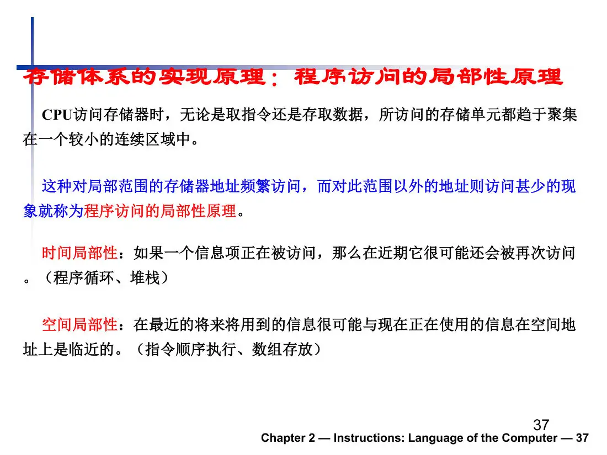

原文：

存储体系的实现原理：程序访问的局部性原理

CPU访问存储器时，无论是取指令还是存取数据，所访问的存储单元都趋于聚集在一个较小的连续区域中。

这种对局部范围的存储器地址频繁访问，而对此范围以外的地址则访问甚少的现象就称为程序访问的局部性原理。

时间局部性：如果一个信息项正在被访问，那么在近期它很可能还会被再次访问。（程序循环、堆栈）

空间局部性：在最近的将来将用到的信息很可能与现在正在使用的信息在空间地址上是临近的。（指令顺序执行、数组存放）

37

Chapter 2 — Instructions: Language of the Computer — 37

### 程序访问的局部性原理主要表现：

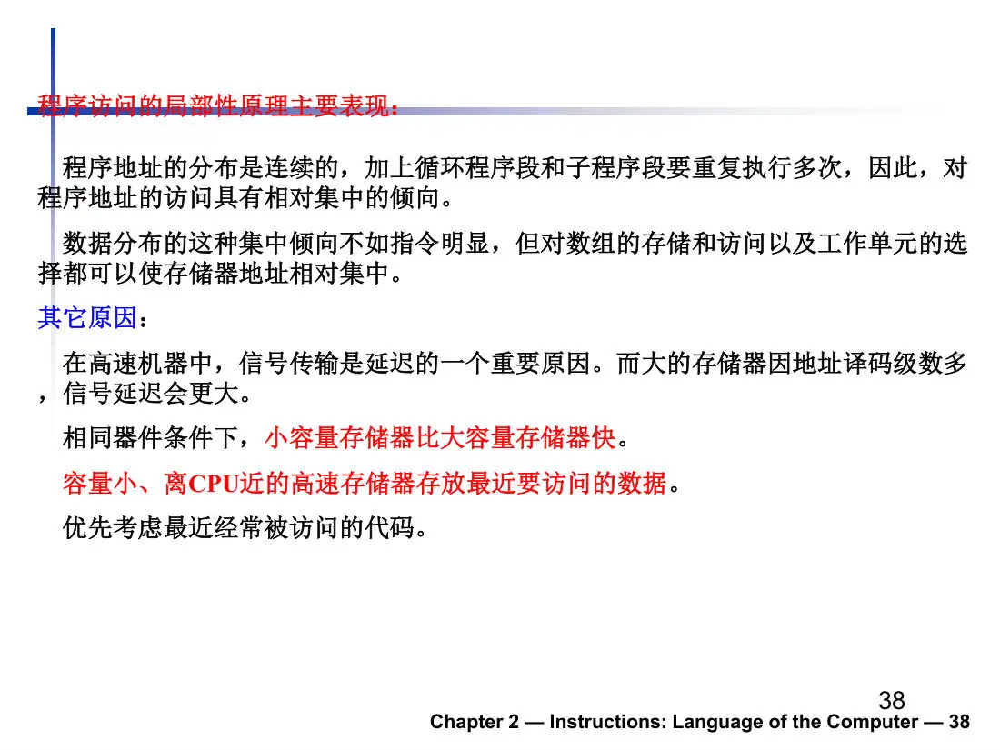

原文：

程序访问的局部性原理主要表现：

程序地址的分布是连续的，加上循环程序段和子程序段要重复执行多次，因此，对程序地址的访问具有相对集中的倾向。

数据分布的这种集中倾向不如指令明显，但对数组的存储和访问以及工作单元的选择都可以使存储器地址相对集中。

其它原因：

在高速机器中，信号传输是延迟的一个重要原因。而大的存储器因地址译码级数多，信号延迟会更大。

相同器件条件下，小容量存储器比大容量存储器快。

容量小、离CPU近的高速存储器存放最近要访问的数据。

优先考虑最近经常被访问的代码。

38

Chapter 2 — Instructions: Language of the Computer — 38

### 存储体系结构特点：

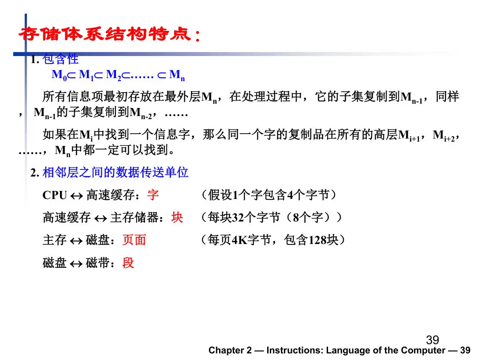

原文：

存储体系结构特点：

1. 包含性

$$
\mathbf {M _ {0}} \subset \mathbf {M _ {1}} \subset \mathbf {M _ {2}} \subset \dots \dots \subset \mathbf {M _ {n}}
$$

所有信息项最初存放在最外层 $\mathbf { M } _ { \mathbf { n } } \mathrm { . }$ ，在处理过程中，它的子集复制到 $\mathbf { M } _ { \mathbf { n } - 1 } ,$ 同样$\mathbf { M _ { n - 1 } }$ 的子集复制到 $\mathbf { M } _ { \mathbf { n } - 2 } ,$

如果在 $\mathbf { M _ { i } }$ 中找到一个信息字，那么同一个字的复制品在所有的高层 $\mathbf { M } _ { \mathrm { i } + 1 } , \mathbf { M } _ { \mathrm { i } + 2 } ,$ $\mathbf { M _ { n } }$ 中都一定可以找到。

2. 相邻层之间的数据传送单位

CPU  高速缓存：字 （假设1个字包含4个字节）

高速缓存 主存储器：块 （每块32个字节（8个字））

主存  磁盘：页面 （每页4K字节，包含128块）

磁盘 磁带：段

39

Chapter 2 — Instructions: Language of the Computer — 39

### 第 40 页

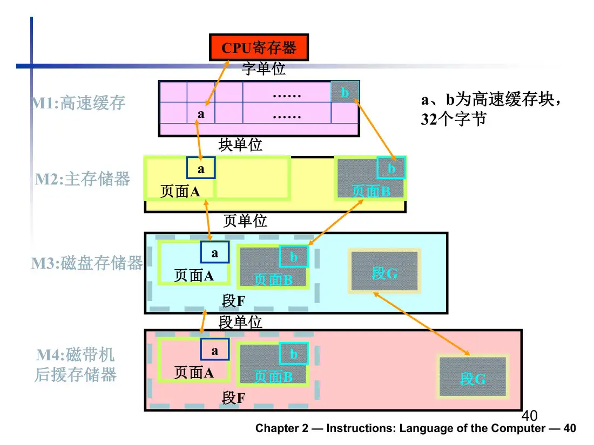

### 存储体系的性能

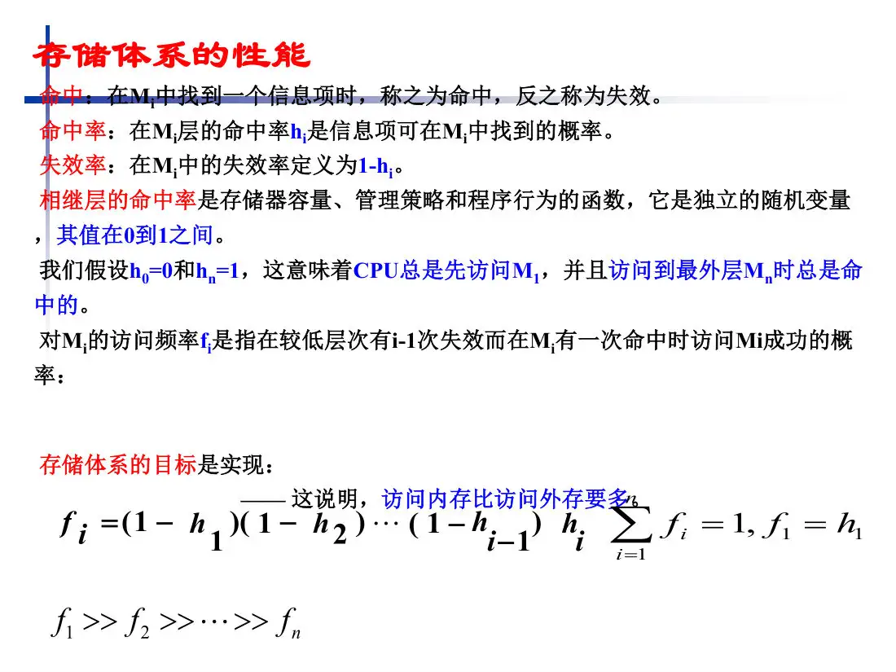

原文：

存储体系的性能

命中：在M中找到一个信息项时，称之为命中，反之称为失效。

命中率：在 $\mathbf { M _ { i } }$ 层的命中率 $\mathbf { \cdot h _ { i } }$ 是信息项可在 $\mathbf { M _ { i } }$ 中找到的概率。

失效率：在 $\mathbf { M _ { i } }$ 中的失效率定义为 $\mathbf { 1 - h _ { i } }$ 。

相继层的命中率是存储器容量、管理策略和程序行为的函数，它是独立的随机变量，其值在0到1之间。

我们假设 $\bf h _ { 0 } { = } 0$ 和 $\bf h _ { n } { = } 1$ ，这意味着CPU总是先访问 $\mathbf { M _ { 1 } }$ ，并且访问到最外层 $\mathbf { M _ { n } }$ 时总是命中的。

对 $\mathbf { M _ { i } }$ 的访问频率 $\mathbf { f _ { i } }$ 是指在较低层次有i-1次失效而在 $\mathbf { M _ { i } }$ 有一次命中时访问Mi成功的概率：

存储体系的目标是实现：

$$
f _ {i} = (1 - h _ {1}) ^ {\text {——这说明，访问内存比访问外存要多} n _ {b}} (1 - h _ {2}) \dots (1 - h _ {i - 1}) h _ {i} \sum_ {i = 1} f _ {i} = 1, f _ {1} = h _ {1}
$$

$$
f _ {1} > > f _ {2} > > \dots > > f _ {n}
$$

### $$

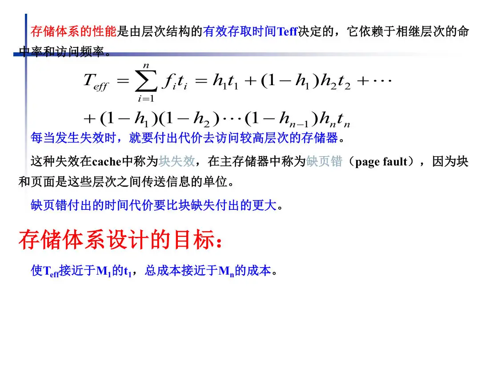

原文：

存储体系的性能是由层次结构的有效存取时间Teff决定的，它依赖于相继层次的命中率和访问频率。

$$
\begin{array}{l} T _ {e f f} = \sum_ {i = 1} ^ {n} f _ {i} t _ {i} = h _ {1} t _ {1} + (1 - h _ {1}) h _ {2} t _ {2} + \dots \\ + (1 - h _ {1}) (1 - h _ {2}) \dots (1 - h _ {n - 1}) h _ {n} t _ {n} \end{array}
$$

每当发生失效时，就要付出代价去访问较高层次的存储器。

这种失效在cache中称为块失效，在主存储器中称为缺页错（page fault），因为块和页面是这些层次之间传送信息的单位。

缺页错付出的时间代价要比块缺失付出的更大。

存储体系设计的目标：

使 $\mathbf { T _ { e f f } }$ 接近于 $\mathbf { M } _ { 1 }$ 的 $\mathbf { t _ { 1 } }$ ，总成本接近于 $\mathbf { M } _ { \mathbf { n } }$ 的成本。

### 二、cache基本原理

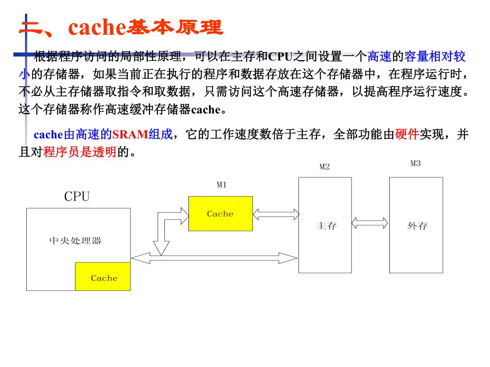

原文：

二、cache基本原理

根据程序访问的局部性原理，可以在主存和CPU之间设置一个高速的容量相对较小的存储器，如果当前正在执行的程序和数据存放在这个存储器中，在程序运行时，不必从主存储器取指令和取数据，只需访问这个高速存储器，以提高程序运行速度。这个存储器称作高速缓冲存储器cache。

cache由高速的SRAM组成，它的工作速度数倍于主存，全部功能由硬件实现，并且对程序员是透明的。

### 1）CPU与主存储器之间的一种高速缓冲装置

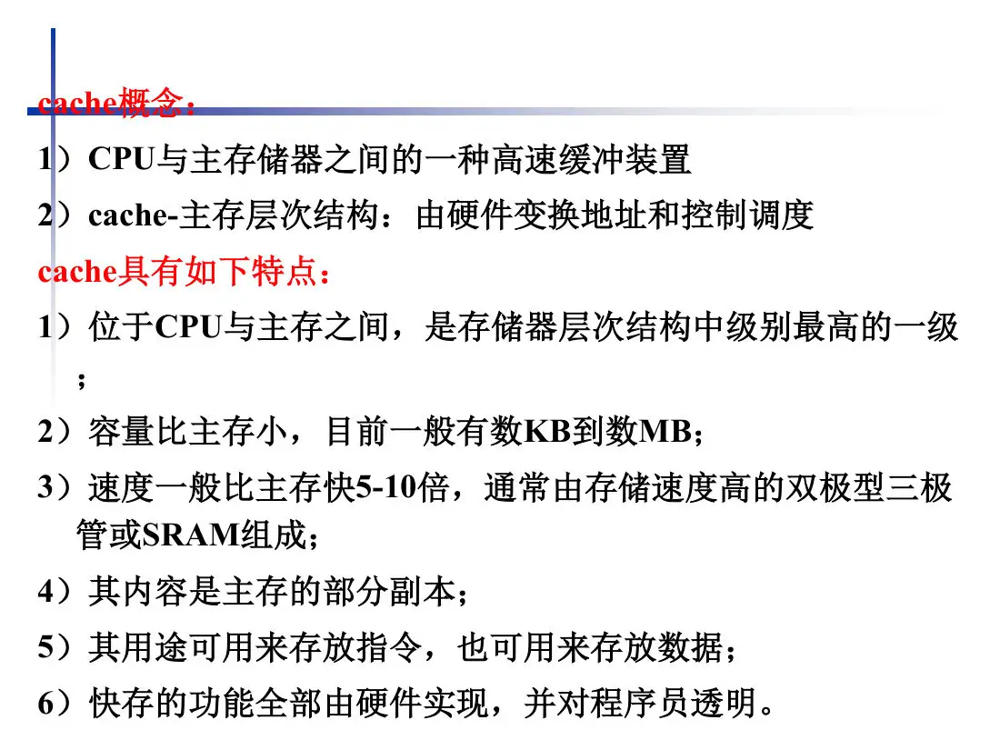

原文：

1）CPU与主存储器之间的一种高速缓冲装置

2）cache-主存层次结构：由硬件变换地址和控制调度cache具有如下特点：

1）位于CPU与主存之间，是存储器层次结构中级别最高的一级；

2）容量比主存小，目前一般有数KB到数MB；

3）速度一般比主存快5-10倍，通常由存储速度高的双极型三极管或SRAM组成；

4）其内容是主存的部分副本；

5）其用途可用来存放指令，也可用来存放数据；

6）快存的功能全部由硬件实现，并对程序员透明。

### \- CPU与cache之间的数据传送是以字为单位。

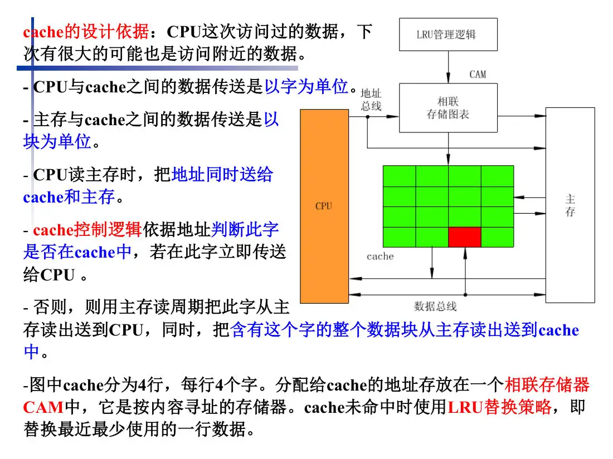

原文：

cache的设计依据：CPU这次访问过的数据，下次有很大的可能也是访问附近的数据。

\- CPU与cache之间的数据传送是以字为单位。

-主存与cache之间的数据传送是以块为单位。

-CPU读主存时，把地址同时送给cache和主存。

-cache控制逻辑依据地址判断此字是否在cache中，若在此字立即传送给CPU 。

-否则，则用主存读周期把此字从主

存读出送到CPU，同时，把含有这个字的整个数据块从主存读出送到cache中。

-图中cache分为4行，每行4个字。分配给cache的地址存放在一个相联存储器CAM中，它是按内容寻址的存储器。cache未命中时使用LRU替换策略，即替换最近最少使用的一行数据。

### cache的命中

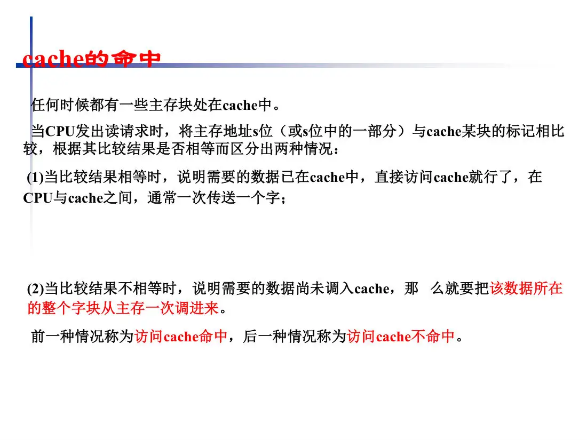

原文：

cache的命中

任何时候都有一些主存块处在cache中。

当CPU发出读请求时，将主存地址s位（或s位中的一部分）与cache某块的标记相比较，根据其比较结果是否相等而区分出两种情况：

(1)当比较结果相等时，说明需要的数据已在cache中，直接访问cache就行了，在CPU与cache之间，通常一次传送一个字；

(2)当比较结果不相等时，说明需要的数据尚未调入cache，那 么就要把该数据所在的整个字块从主存一次调进来。

前一种情况称为访问cache命中，后一种情况称为访问cache不命中。

### . cache的基本结构

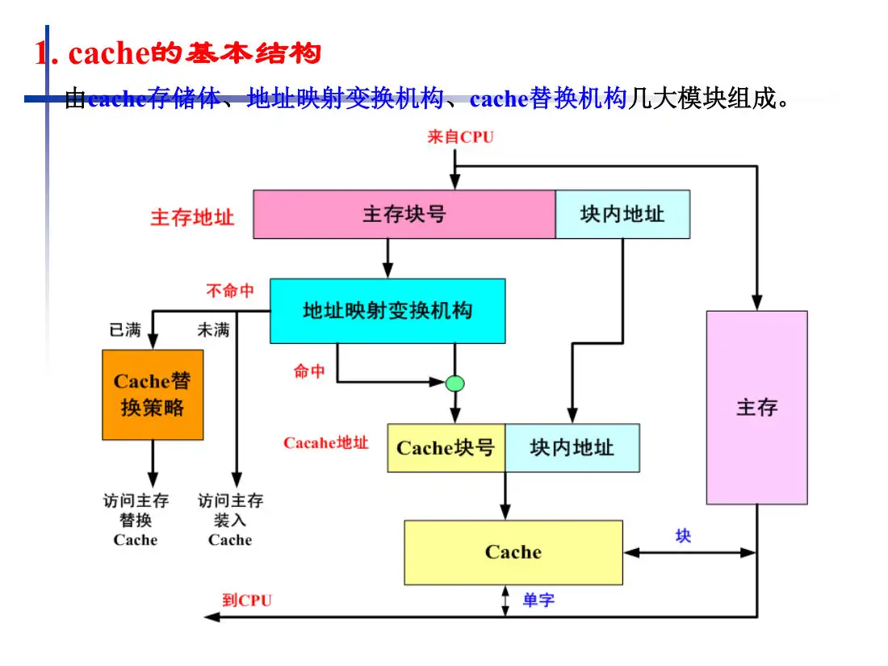

原文：

. cache的基本结构

由cache存储体、地址映射变换机构、cache替换机构几大模块组成。

### 2. cache的命中率

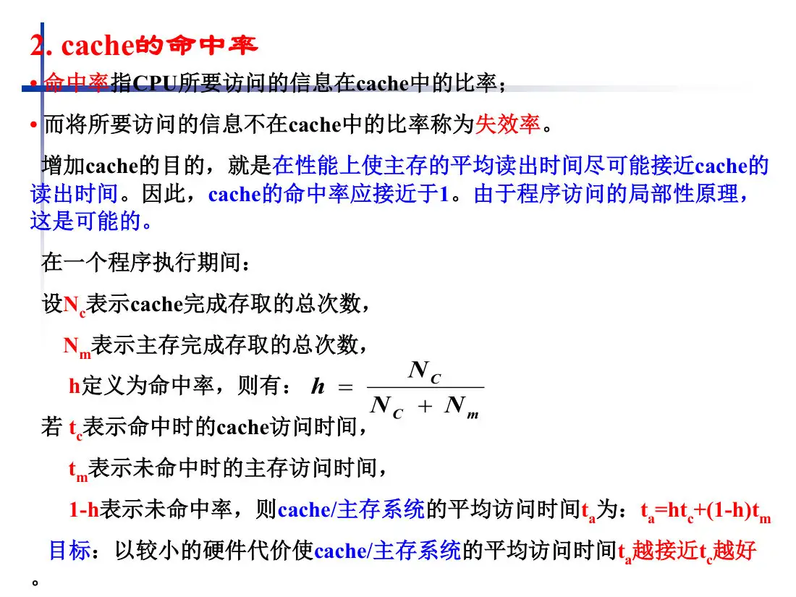

原文：

2. cache的命中率

• 命中率指CPU所要访问的信息在cache中的比率；

• 而将所要访问的信息不在cache中的比率称为失效率。

增加cache的目的，就是在性能上使主存的平均读出时间尽可能接近cache的读出时间。因此，cache的命中率应接近于1。由于程序访问的局部性原理，这是可能的。

在一个程序执行期间：

设 $\mathbf { N _ { c } }$ 表示cache完成存取的总次数，

$\mathbf { N _ { m } }$ 表示主存完成存取的总次数，

h定义为命中率，则有： $\textbf { \em h } = \frac { N _ { c } } { N _ { c } \mathrm { ~ + ~ } N _ { m } }$ 若 $\mathbf { t _ { c } }$ 表示命中时的cache访问时间，

${ \bf { t } } _ { \bf { m } }$ 表示未命中时的主存访问时间，

1-h表示未命中率，则cache/主存系统的平均访问时间 $\mathbf { t _ { a } } .$ 为： $\mathbf { t _ { a } } { = } \mathbf { h } \mathbf { t _ { c } } { + } ( \mathbf { 1 } { - } \mathbf { h } ) \mathbf { t _ { m } }$ 目标：以较小的硬件代价使cache/主存系统的平均访问时间 $\mathbf { t _ { a } }$ 越接近 $\mathbf { t } _ { \mathrm { c } }$ 越好

o

### e表示访问效率，则有：

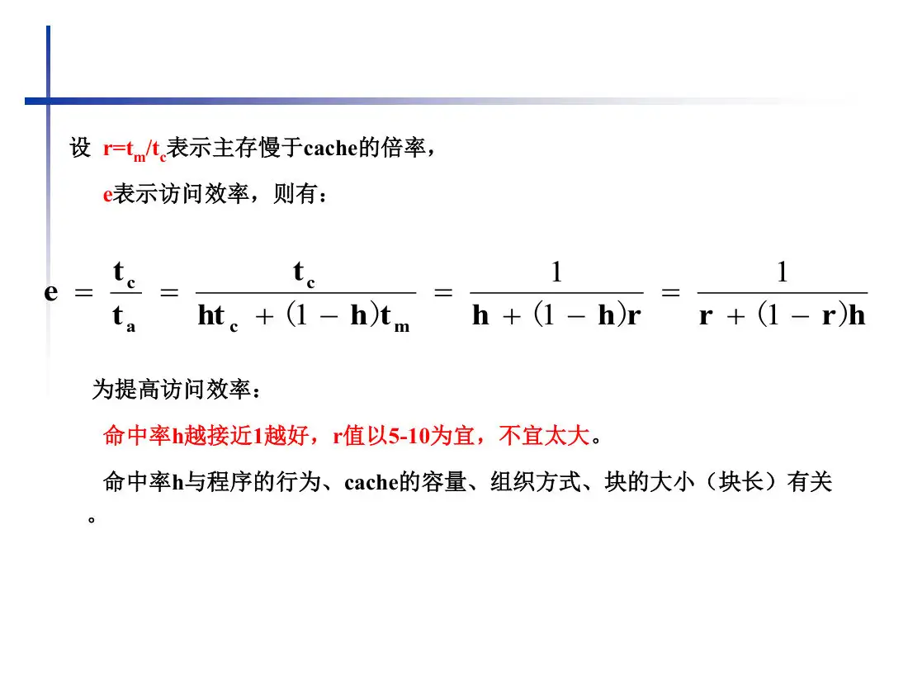

原文：

设 $\bf { r } \mathrm { { = } } \bf { t } _ { \mathrm { m } } / \mathrm { t _ { c } }$ 表示主存慢于cache的倍率，

e表示访问效率，则有：

$$
\mathbf {e} = \frac {\mathbf {t} _ {\mathrm{c}}}{\mathbf {t} _ {\mathrm{a}}} = \frac {\mathbf {t} _ {\mathrm{c}}}{\mathbf {h t} _ {\mathrm{c}} + (1 - \mathbf {h}) \mathbf {t} _ {\mathrm{m}}} = \frac {1}{\mathbf {h} + (1 - \mathbf {h}) \mathbf {r}} = \frac {1}{\mathbf {r} + (1 - \mathbf {r}) \mathbf {h}}
$$

为提高访问效率：

命中率h越接近1越好，r值以5-10为宜，不宜太大。

命中率h与程序的行为、cache的容量、组织方式、块的大小（块长）有关

### cache容量与命中率

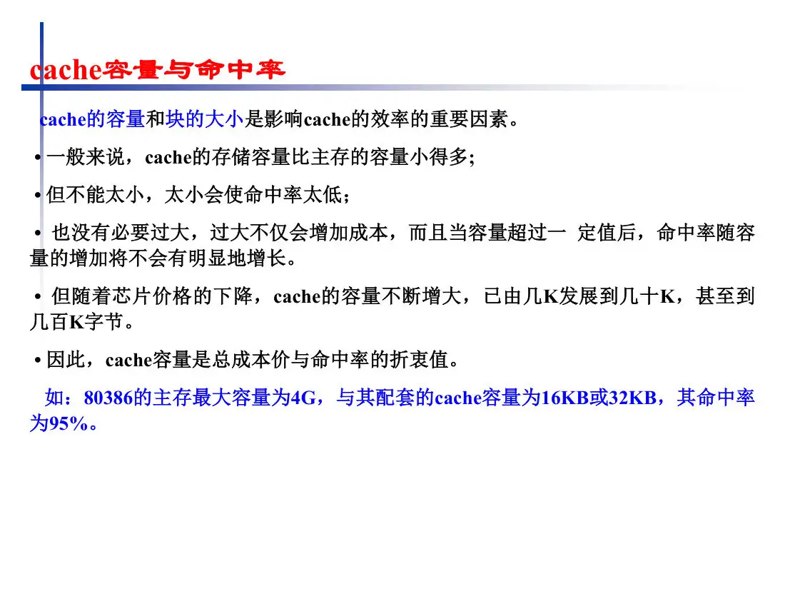

原文：

cache容量与命中率

cache的容量和块的大小是影响cache的效率的重要因素。

• 一般来说，cache的存储容量比主存的容量小得多;

• 但不能太小，太小会使命中率太低；

• 也没有必要过大，过大不仅会增加成本，而且当容量超过一 定值后，命中率随容量的增加将不会有明显地增长。

• 但随着芯片价格的下降，cache的容量不断增大，已由几K发展到几十K，甚至到几百K字节。

•因此，cache容量是总成本价与命中率的折衷值。

如：80386的主存最大容量为4G，与其配套的cache容量为16KB或32KB，其命中率为95%。

### 块长与命中率

原文：

块长与命中率

块长与命中率的关系更为复杂，它取决于程序的局部特性。块长的最优值很难确定，通常：

• 每块取4至8个可编址单位（字或字节）较好；

• 也可取一个主存周期所能调出主存的信息长度。

例如，CARY-1的主存是16个交叉体，每个体为单字宽，其指令cache的块长为16个字；

IBM 370/168机主存是4体交叉，每个体宽为64位（8个字），其cache块长为32个字。

### $$

原文：

例：CPU执行一段程序时，cache完成存取的次数为1900次，主存完成存取的次数为100次，已知cache存取周期为50ns，主存存取周期为250ns，求cache/主存系统的效率和平均访问时间。

$$
\begin{array}{l} \mathrm {h = N_ {c} /(N_ {c} + N_ {m}) = 1900 / (1900 + 100) = 0.95} \\ \mathrm {r = t_ {m} / t_ {c} = 250ns / 50ns = 5} \\ \mathrm {e = 1 / (r + (1- r) h) = 1 / (5 + (1 - 5)\times 0.95) = 83.3\%} \\ \mathrm {t_ {a} = t_ {c} / e = 50ns / 0.833 = 60ns} \end{array}
$$

例：已知cache存储周期为40ns，主存存储周期为200ns，cache /主存系统平均访问时间为50ns，求cache的命中率是多少?

解: 因为 $\mathbf { t _ { a } } { = } \mathbf { h } \mathbf { t _ { c } } { + } ( \mathbf { 1 } { - } \mathbf { h } ) \mathbf { t _ { m } }$

所以 $\bf { h } \mathrm { = } ( \mathrm { t _ { a } } \mathrm { - } \mathrm { t _ { m } } ) / ( \mathrm { t _ { c } } \mathrm { - } \mathrm { t _ { m } } ) \mathrm { = } ( 5 0 \mathrm { - } 2 0 0 ) / ( 4 0 \mathrm { - } 2 0 0 ) \mathrm { = } 1 5 / 1 6$

### cache结构设计必须解决的问题：

原文：

cache结构设计必须解决的问题：

如何存放，如何访问，如何替换，如何改写？

1）数据块在cache中存放在哪个位置？即定位问题（地址映射） 。如果一个块存放在某一cache中，怎样确定并找到该块，即寻址问题（地址变换）。

2）不命中时将从主存储器中访问，并将该块调入cache中，但是如果cache中已无空闲空间，则势必将cache中的某一块调出，但应调出那一块，即替换问题。

3）在写访问时，写入cache必须在适当的时候写回主存储器，何时写？写操作时采用什么策略保证两级存储器间的数据一致性。

### 1. 地址映射（映象）与地址变换

原文：

1. 地址映射（映象）与地址变换

• 地址映射

把主存块按照某种规则（函数或方法）装入或定位到cache中的过程。

• 地址变换

信息按这种映射关系装入cache后，执行程序时，将主存地址变换成 cache地址的变换过程叫做地址变换。

地址映射和地址变换密切相关。

• 使用cache的动力在于它的高速，因此也要求这个地址变换过程尽可能地快，故此过程是以硬件完成的。这带来的另一好处是cache的透明性，除了程序运行速度提高之外，用户包括系统软件编制人员，丝毫未感觉到cache的存在。

基本的地址映射方式：全相联映射；直接映射；组相联映射。

### 全相联映射

原文：

全相联映射

主存中的任何一个块均可以映射装入到Cache中任何一个块的位置上，比较灵活Cache的块冲突概率最低、空间利用率最高，但是地址变换速度慢，成本高，实现困难；

直接映射

主存中的每一个块只能被放置到Cache中唯一的一个指定位置，若这个位置已有内容，则产生块冲突，原来的块被无条件替换出去。直接映射是最简单的地址映射方式，成本低，易实现，地址变换速度块，但该方法不够灵活，Cache的块冲突概率最高、空间利用率最低；

组相联映射

是全相联映射和直接映射的折中方案，其优点和缺点介于全相联和直接映射方式之间。

### cache和主存机械等分为相同大小的块，每一块是由若干个字（或字节）组成。

原文：

cache和主存机械等分为相同大小的块，每一块是由若干个字（或字节）组成。

例：某机主存容量为1MB，划分为2048块，每块512B；cache容量为8KB划分为16块；每块512B。

主存地址共20位，块内地址9位，主存块号11位。

由于cache的块数远小于主存的块数，因此一个cache不能唯一地、永久地只对应一个存储块，在cache中，每一块外加有一个标记，指明它是主存的哪一块的副本（拷贝）。

### 标记的有效位

原文：

标记的有效位

每个标记设置有一个有效位。机器加电启动时Reset信号将所有标记的有效位置“0”，即无效

程序执行过程中，cache未命中时，逐步将指令块或数据块从主存调入cache中的某一块，并将这一块标记

的有效位置“1”，当再次用到这一

块中的指令或数据时，可直接从cache中取指令或数据。

因刚加电时所有标记位都为“0”，开始执行程序时，命中率较低。另外cache的命中率还与程序本身有关，即不同的程序，其命中率可能不同。

### 1）全相联映射

原文：

1）全相联映射

Cache标记容量大，需要11位；访问Cache时，需要和Cache的全部标记进行“比较”才能判断出所访问主存地址的内容是否已经在Cache中。

允许主存中的每一个字块映射到cache的任何一个字块位置上，同时比较所有标记（使用相联存储器），最灵活但成本最高的一种方式。

### 直接映射

原文：

直接映射

也是一种多对一的映射关系，但一个主存块只能映射到cache的一个特定块位置上去。

cache的第i块和主存的第j块有如下函数关系：

在给出的示例中，在这种映射方式中：

主存的第0块，第16块，第32块，…，只能映射到cache的第0块；

而主存的第1块，第17块，第33块，…，只能映射到cache的第1块；……按字段直接根据主存地址去主存中找判断，就可知命中与否。

### TagCacheV标记块0V标记块1⋮⋮⋮V标记块15

原文：

<table><tr><td></td><td>Tag</td><td>Cache</td></tr><tr><td>V</td><td>标记</td><td>块0</td></tr><tr><td>V</td><td>标记</td><td>块1</td></tr><tr><td>⋮</td><td>⋮</td><td>⋮</td></tr><tr><td>V</td><td>标记</td><td>块15</td></tr></table>

优点：硬件实现简单，成本低。

缺点：主存多个块对应唯一的cache块，

即使cache别的地址空着也不能占用。

cache空间无法充分利用，降低了命中率。

### 例：设有一个cache的容量为2K字，每个块为16字，求

原文：

例：设有一个cache的容量为2K字，每个块为16字，求

(1) 该cache可容纳多少个块？

(2) 如果主存的容量是256K字，则有多少个块？

(3) 主存的地址有多少位？cache地址有多少位？

(4) 在直接映射方式下，主存中的第i块映射到cache中哪一个块中？

(5) 进行地址映射时，存储器的地址分成哪几段？各段分别有多少位？

解：(1) cache中有2048/16=128个块。

(2) 主存有256K/16=16384个块。

(3) cache容量为 ${ \bf \Lambda } ^ { \bf \Lambda } \mathbf { 2 \mathbf K } { \bf = } { \bf 2 } ^ { \bf 1 1 }$ 字，所以cache字地址为11位。

(4) 主存中的第i块映射到cache中第 i mod 128个块中。

(5) 存储器的字地址分成三段：标记、cache块号（行号）、块内字地址。标记的长度为18-11=7位，块号为7位。块内字地址为4位。

### 替换

原文：

例：设一个cache中有8个块，访问主存进行读操作的块地址序列为22、26、22、26、16、4、16、18，求直接映射下每次访问后cache中的内容。

替换

命中

调进

调进

命中

操作状态 调进

命中

调进

### 组相联映射

原文：

组相联映射

Cache与主存均分组，主存中一个组内的块数与Cache的分组数相同，主存中的各块与Cache的组号有固定的映射关系，但可以自由映射到对应的Cache组中的任一块。

当只有一个组，并且每组16块时，为全相联映射；

当有16组，并且每组一个块时，为直接映射。

### 2. 替换策略

原文：

2. 替换策略

当一个新的主存块要调入到cache，而允许存放此块的行位置都被其它主存块占满时就要产生替换，因为cache工作原理要求它尽量保存最新的数据。

• 替换问题与cache的组织方式紧密相关

(1) 对于采用直接映射方式的cache来说：

因一个主存块只有一个特定的行位置可存放，所以问题解决很简单，把此特定行位置上的原主存块妥善处理后，换出cache即可。

(2) 对于全相联的cache来说，它的全部行都是可被替换的特定行；而组相联的cache中同组各路的行都是可被替换的特定行：这样就要从允许存放新主存块的若干特定行中选取一行换出。

### 1）LFU（最不经常使用 ）算法

原文：

如何选取就涉及到采用何种替换策略（替换算法），以硬件实现的常用算法主要有以下三种。

1）LFU（最不经常使用 ）算法

将一段时间内被访问次数最少的那行数据换出。

每行设置一个计数器，新行建立后从0开始计数；

每访问一次，被访问的行计数器增加1；

当需要替换时，对这些特定行的计数值进行比较，将计数值最小的行换出，同时将这些行的计数器清零。

缺点：不能反映近期cache的访问情况，

### 2）LRU（近期最少使用）算法

原文：

2）LRU（近期最少使用）算法

将近期内长久未被访问过的行换出。

每行设置一个计数器，cache每命中一次，命中行计数器清零，其它各行计数器增1。

该计数器是未访问次数计数器。

当需要替换时，比较各特定行的计数值，将计数值最大的行换出。

这种算法保护了刚拷贝到cache中的新数据行，符合cache工作原理，因而使cache有较高的命中率。

例如：两路组相联的cache。

因为一个主存块只能在一个特定组的两行中来做替换选择，二选一完全不需要计数器，一组两行只需要一个二进制位即可。

如规定一组中的A行拷贝进新数据将此位置“1”，B行拷贝进新数据将此位置“0”。

当需要替换时只需检查此二进制位的状态即可，为“0”换出A行，为“1”换出B行，实现了保护新行的原则。

Pentium片内的数据cache是一个两路组相联结构，采用的就是这种简捷的LRU替换策略。

### 3）随机替换

原文：

3）随机替换

从特定的行位置中随机地选取一行换出即可。

硬件实现最容易，而且速度也比前两种策略快。

缺点：随意换出的数据很可能马上又要用，从而增加了映射次数，降低了命中率和cache 的工作效率。

这个缺点可以用增大cache的容量来克服。

实验统计表明，随机替换策略的功效只是稍逊于前两种策略。

### 时间:123456789101112块地址流:232152453252

原文：

例：一访cache的地址流为：2 3 2 1 5 2 4 5 3 2 5 2，假设cache只有3块，分别采用先进先出FIFO算法和LRU算法，cache的命中如何？

<table><tr><td>时间:</td><td>1</td><td>2</td><td>3</td><td>4</td><td>5</td><td>6</td><td>7</td><td>8</td><td>9</td><td>10</td><td>11</td><td>12</td></tr><tr><td>块地址流:</td><td>2</td><td>3</td><td>2</td><td>1</td><td>5</td><td>2</td><td>4</td><td>5</td><td>3</td><td>2</td><td>5</td><td>2</td></tr></table>

FIFO

$$
\begin{array}{c c c c c c c c c c c c c} \hline 2 & 2 & 2 & 2 & 5 & 5 & 5 & 5 & 3 & 3 & 3 & 3 \\ \hline & 3 & 3 & 3 & 3 & 2 & 2 & 2 & 2 & 2 & 5 & 5 \\ \hline & & & 1 & 1 & 1 & 4 & 4 & 4 & 4 & 4 & 2 \\ \hline \text {调调命调替替替命替命替替} \end{array}
$$

LRU

<table><tr><td>2</td><td>2</td><td>2</td><td>2</td><td>2</td><td>2</td><td>2</td><td>2</td><td>3</td><td>3</td><td>3</td><td>3</td></tr><tr><td></td><td>3</td><td>3</td><td>3</td><td>5</td><td>5</td><td>5</td><td>5</td><td>5</td><td>5</td><td>5</td><td>5</td></tr><tr><td></td><td></td><td></td><td>1</td><td>1</td><td>1</td><td>4</td><td>4</td><td>4</td><td>2</td><td>2</td><td>2</td></tr><tr><td>调</td><td>调</td><td>命</td><td>调</td><td>替</td><td>命</td><td>替</td><td>命</td><td>替</td><td>替</td><td>命</td><td>命</td></tr></table>

### 3. 写操作策略

原文：

3. 写操作策略

因为cache的内容是部分主存内容的副本，应该与主存内容保持一致。而CPU对cache的写入更改了cache内容，如何与主存内容保持一致就有几种写操作工作方式可供选择，统称为写策略。

1）写回法（write--back）

当CPU对cache写命中时，只修改cache的内容，不立即写入主存，只当此行被换出时才写回主存。

对一个cache行的多次写命中都在cache中快速完成修改，只是需被替换时才写回速度较慢的主存，减少了访问主存的次数从而提高了效率。

方法：每个cache行必须配置一个修改位，以反映此行是否被CPU修改过。当某行被换出时，根据此行修改位为1还是为0，决定是将该行内容写回主存还是简单弃去。

对于cache写未命中，为包含欲写字的主存块在cache分配一行，将此块整个拷贝到cache后在cache中对其进行修改；拷贝主存块时虽已访问到主存，但此时并不对主存块修改，统一地将主存写修改操作留待换出时进行。

优点：写cache与写主存分开进行方式可显著减少写主存次数。

缺点：存在cache/主存不一致性的隐患。

### 2）全写法

原文：

2）全写法

当cache写命中时：cache与主存同时发生写修改。

这种策略显然较好地维护了cache与主存的内容一致性。

当cache写未命中时：直接向主存写，但此时是否将修改过的主存块取到cache，有两种选择：

• 一种是取主存块到cache并为它分配一个行位置；

• 另一种是不取主存块到cache。

优点：cache每行无需设置一个修改位以及相应的判测逻辑。

缺点：cache对CPU向主存的写操作无高速缓存功能，降低了cache的功效o

3）写一次法

一种基于写回法又结合了全写法的写策略，即写命中和写未命中的处理与写回法基本相同，只是第一次写命中时要同时写入主存。

在第一次片内cache写命中时，CPU在总线上启动一个存储器写周期。其他cache监听到此主存块地址及写信号后，即可把它们各自保存可能有的该块拷贝及时作废（无效处理），便于维护系统全部cache的一致性。

### 虚拟存储器

原文：

虚拟存储器

一个用户的程序不再分配连续的内存空间，而是把物理存储器分成多个比较小的存储块，每块的大小相等且长度固定不变，称为页面或页框。

每个进程所需的存储空间被划分成小的固定长度的程序块，称为页。

页的长度和页面相等。

分页技术引申出一种非常重要的存储管理策略——虚拟存储器（简称虚存）。

在存储管理部件（MMU）的支持下，虚拟存储器技术可以彻底解决存储器的调度与管理问题。

Chapter 2 — Instructions: Language of the Computer

71

### 虚拟存储器的基本概念

原文：

虚拟存储器的基本概念

虚拟存储器是建立在主存-辅存（外存）物理结构基础上的，由负责信息划分及主存-辅存之间信息调度的辅助硬件及操作系统的存储管理软件所组成的一种存储体系。

将主存和辅存的地址空间统一编址，形成一个庞大的存储空间。在这个大空间里，用户自由编程，完全不必考虑程序在主存中是否装得下，或者放在辅存中的程序将来在主存中的位置。

编好的程序由计算机操作系统装入辅助存储器，程序运行时附加的辅助硬件机构和存储管理软件会把辅存的程序一块块自动调入内存由CPU执行或调出内存。

用户感觉到的不再是处处受到主存容量限制的存储系统，而是好像具有一个容量充分大的存储器，这样的存储体系称为“虚拟存储器”。

Chapter 2 — Instructions: Language of the Computer

72

### 它能使计算机具有辅存的容量，而接近于主存的速度。

原文：

虚拟存储器只是一个容量非常大的存储器的逻辑模型，不是任何实际的物理存储器。它借助于磁盘等辅助存储器来扩大主存容量，使之为更大或更多的程序所使用。

虚拟存储器指的是主存-辅存层次。以透明的方式给用户提供了一个比实际主存空间大得多的程序地址空间。

它能使计算机具有辅存的容量，而接近于主存的速度。

对应用程序员来说，好象有一个比实际主存大得多的、可使编程空间不受限制的虚存空间存在。

Chapter 2 — Instructions: Language of the Computer

73

### 2. 虚地址和实地址

原文：

2. 虚地址和实地址

虚拟存储器的辅存部分也能让用户象内存一样使用，用户编程时的指令地址允许涉及辅存大小的空间范围，这种指令地址称为“虚拟地址”（虚地址或“逻辑地址”。对应的存储空间称为“虚存空间”或“逻辑地址空间”

实际的主存储器地址则称为“物理地址”（实地址）。它由CPU引脚送出，是用于访问主存的地址。对应的存储空间称为“物理存储空间”或“主存空间”。

程序进行虚地址到实地址转换的过程成为程序的再定位。

虚拟存储器的用户程序以虚拟地址编址并存放在辅存中。

程序运行时，由地址变换机构依据当时分配给该程序的实地址空间把程序的一部分调入实存。

每次访存时，首先判断该虚地址所对应的部分是否在实存中：如果是，则进行地址转换并用实地址访问主存 $| \dot { \mathsf { a } } _ { } \pmb { \rho } |$ 否则 $\therefore \vert n \vert$ 74按照某种算法将辅存中的部分程序调度进内存更按同样的方法访问主存

### 虚拟存储器对设计存储管理软件的系统程序员是不透明的，但对应用程序员而言是透明的。

原文：

由此可见，每个程序的虚地址空间可以远大于实地址空间，也可以远小于实地址空间。前一种情况以提高存储容量为目的，后一种情况则以地址变换为目的。后者通常出现在多用户或多任务系统中：实存空间较大，而单个任务并不需要很大的地址空间，较小的虚存空间则可以缩短指令中地址字段的长度。

每个程序可以拥有一个虚拟的存储器，它具有辅存的容量和接近主存的访问速度。但这个虚拟存储器是由主存和辅存管理部件构成的概念模型，不是实际的物理存储器。

虚拟存储器对设计存储管理软件的系统程序员是不透明的，但对应用程序员而言是透明的。

Chapter 2 — Instructions: Language of the Computer

75

### cache与虚存的异同

原文：

cache与虚存的异同

从虚存的概念可以看出，主存-辅存的访问机制与cache-主存的访问机制是类似的。这是由cache存储器、主存和辅存构成的三级存储体系中的两个层次。

cache-主存之间以及主存-辅存之间分别有辅助硬件和辅助软硬件负责地址变换与管理，以便各级存储器能够组成有机的三级存储体系。

cache-主存构成了系统的内存，而主存-辅存依靠辅助软硬件的支持构成了虚拟存储器。

在三级存储体系中，cache-主存和主存-辅存这两个存储层次有许多相同点：

1）出发点相同：两者都是为了提高存储系统的性价比而构造的分层存储体系，都力图使存储系统的性能接近高速存储器，而价格和容量接近低速存储器。

2）原理相同：都是利用了程序运行时的局部性原理把最近常用的信息块从相对慢速而大容量的存储器调入相对高速而小容量的存储器。

Chapter 2 — Instructions: Language of the Computer

76

### cache-主存和主存-辅存这两个存储层次也有许多不同之处：

原文：

cache-主存和主存-辅存这两个存储层次也有许多不同之处：

1）侧重点不同：cache主要解决主存与CPU的速度差异问题；虚存主要解决存储容量问题。

2）数据通路不同：CPU与cache和主存之间均有直接访问通路，cache不命中时可直接访问主存；而虚存所依赖的辅存与CPU之间不存在直接的数据通路，当主存不命中时只能通过调页解决，CPU最终还是要访问主存。

3）透明性不同：cache的管理完全由硬件完成，对系统程序员和应用程序员均透明；而虚存管理由软件（操作系统）和硬件共同完成，对实现存储管理的系统程序员不透明，而对应用程序员透明。

4）未命中时的损失不同：由于主存的存取时间是cache的存取时间的5～10倍，而主存的存取速度通常比辅存的存取速度快上千倍，故主存未命中时系统的性能损失要远大于cache未命中时的损失。

Chapter 2 — Instructions: Language of the Computer

77

### 虚存机制要解决的关键问题

原文：

虚存机制要解决的关键问题

1）调度问题：决定哪些程序和数据应被调入主存。

2）地址映射问题：在访问主存时把虚地址变为主存物理地址；在访问辅存时把虚地址变成辅存的物理地址，以便换页。

此外还要解决主存分配、存储保护与程序再定位等问题。

3）替换问题：决定哪些程序和数据应被调出主存。

4）更新问题：确保主存与辅存的一致性。

Chapter 2 — Instructions: Language of the Computer

78

### 几种虚拟存储器

原文：

几种虚拟存储器

虚存通过增设地址映射表机构来实现程序在主存中的定位。

这种定位技术是把程序分割成若干个较小的段或页，用相应的映射表机构，来指明该程序的某段或某页是否已装入主存：

若已装入主存，则应同时指明其在主存中所处的开始位置；

若未装入主存，则应到辅存中去调段或页，并建立起程序空间和实存空间的地址映射关系。这样，程序执行时通过查映射表，将程序（虚）地址变成主存地址再访问主存。

由于采用的存储映射算法不同，形成了采用多种存储器管理方式的虚拟存储器，其中主要有页式、段式、段页式三种。

Chapter 2 — Instructions: Language of the Computer

79

### 缓存的介绍

原文：

缓存的介绍

◼ 缓存最早出现在20世纪60年代早期的计算机研究中

◼ 在同一年代后期出现的生产计算机中

◼ 如今，从服务器到低功耗嵌入式处理器，每台通用计算机都有缓存

### 缓存工作原理(概述)

原文：

缓存工作原理(概述)

这个图展示了一个非常简单的缓存

◼ 在请求之前，缓存包含最近最近引用 X1, X2, …, Xn-1

处理器请求字X2

◼ 处理器请求一个不在缓存中的字Xn

◼ 将数据从内存带到缓存中，并为CPU服务

<table><tr><td> $X_{4}$ </td></tr><tr><td> $X_{1}$ </td></tr><tr><td> $X_{n-2}$ </td></tr><tr><td></td></tr><tr><td> $X_{n-1}$ </td></tr><tr><td> $X_{2}$ </td></tr><tr><td></td></tr><tr><td> $X_{3}$ </td></tr></table>

<table><tr><td> $X_{4}$ </td></tr><tr><td> $X_{1}$ </td></tr><tr><td> $X_{n-2}$ </td></tr><tr><td></td></tr><tr><td> $X_{n-1}$ </td></tr><tr><td> $X_{2}$ </td></tr><tr><td> $X_{n}$ </td></tr><tr><td> $X_{3}$ </td></tr></table>

◼ 我们如何知道数据是否能存在？

◼ 我们去哪里找？

a. Before the reference to $\mathsf { X } _ { \boldsymbol { \eta } }$

b. After the reference to $\mathsf { X } _ { n }$

### 主存到缓存的映射

原文：

主存到缓存的映射

◼ 给定一个8块高速缓存和一个32块内存，如何将地址映射到高速缓存？

◼ 最简单的方法是根据内存中字的地址分配缓存位置(直接映射)

◼ 直接映射：

缓存地址 = (内存地址) modulo (缓存中的块数)

◼ 例子，内存地址$0 0 1 0 1 _ { 2 } , \quad 0 1 1 0 1 _ { 2 }$ 和$1 0 1 0 1 _ { 2 }$ 都映射到缓存$1 0 1 _ { 2 }$ 条目上

### 直接映射

原文：

直接映射

◼ 直接映射：只有一个选择

缓存地址 = (内存地址) modulo (缓存中的块数)

◼ 如果缓存的块数是2的幂，

◼然后只需要使用地址低阶 $\ 1 0 9 _ { 2 }$ (块中cache容量)位就可以计算出来模

◼ 因此8块缓存地址使用块地址的最低3位 $( 8 = 2 ^ { 3 } )$

### 标记

原文：

标记

◼ 直接映射缓存允许每个条目包含许多不同内存位置的内容

◼ 我么如何知道请求的字是否在缓存中？

向缓存添加一组标记

◼ 标记包含了在缓存中识别与请求的内存地址相对应的字的信息

◼ 标记的确切价值是什么？

◼ 内存地址的上半部分，对应于不用作缓存索引的位

例，我们只需要知道在标记中有5个地址位前2位，因为地址的低3位索引字段选择了块

### 有效位

原文：

有效位

◼ 缓存还需要一种方法来识别缓存块没有有效信息◼ 例，当处理器启动时，缓存没有好的数据，标签字段和数据将毫无意义

◼ 因此，我们需要知道对于缓存中的此类项应该忽略标记和数据

◼ 最常见的方法是添加一个有效的位来指示一个条目是否包含一个有效地址

有效位1 = 存在，0 = 不存在

### 缓存示例

原文：

缓存示例

◼ 8块，直接映射

◼ 缓存最初是空的，所有的有效位(缓存中的V项)都被关闭(N)

◼ 地址的低阶三位给出了块号

<table><tr><td>Index</td><td>V</td><td>Tag</td><td>Data</td></tr><tr><td>000</td><td>N</td><td></td><td></td></tr><tr><td>001</td><td>N</td><td></td><td></td></tr><tr><td>010</td><td>N</td><td></td><td></td></tr><tr><td>011</td><td>N</td><td></td><td></td></tr><tr><td>100</td><td>N</td><td></td><td></td></tr><tr><td>101</td><td>N</td><td></td><td></td></tr><tr><td>110</td><td>N</td><td></td><td></td></tr><tr><td>111</td><td>N</td><td></td><td></td></tr></table>

Chapter 5 — Large and Fast: Exploiting Memory Hierarchy

86

### 缓存示例

原文：

缓存示例

<table><tr><td>Word addr</td><td>Binary addr</td><td>Hit/miss</td><td>Cache block</td></tr><tr><td>22</td><td>10 110</td><td>Miss</td><td>110</td></tr></table>

Chapter 5 — Large and Fast: Exploiting Memory Hierarchy
<table><tr><td>Index</td><td>V</td><td>Tag</td><td>Data</td></tr><tr><td>000</td><td>N</td><td></td><td></td></tr><tr><td>001</td><td>N</td><td></td><td></td></tr><tr><td>010</td><td>N</td><td></td><td></td></tr><tr><td>011</td><td>N</td><td></td><td></td></tr><tr><td>100</td><td>N</td><td></td><td></td></tr><tr><td>101</td><td>N</td><td></td><td></td></tr><tr><td>110</td><td>Y</td><td>10</td><td>Mem[10110]</td></tr><tr><td>111</td><td>N</td><td></td><td></td></tr></table>

87

### 缓存示例

原文：

缓存示例

<table><tr><td>Word addr</td><td>Binary addr</td><td>Hit/miss</td><td>Cache block</td></tr><tr><td>26</td><td>11 010</td><td>Miss</td><td>010</td></tr></table>

Chapter 5 — Large and Fast: Exploiting Memory Hierarchy
<table><tr><td>Index</td><td>V</td><td>Tag</td><td>Data</td></tr><tr><td>000</td><td>N</td><td></td><td></td></tr><tr><td>001</td><td>N</td><td></td><td></td></tr><tr><td>010</td><td>Y</td><td>11</td><td>Mem[11010]</td></tr><tr><td>011</td><td>N</td><td></td><td></td></tr><tr><td>100</td><td>N</td><td></td><td></td></tr><tr><td>101</td><td>N</td><td></td><td></td></tr><tr><td>110</td><td>Y</td><td>10</td><td>Mem[10110]</td></tr><tr><td>111</td><td>N</td><td></td><td></td></tr></table>

88

### 缓存示例

原文：

缓存示例

<table><tr><td>Word addr</td><td>Binary addr</td><td>Hit/miss</td><td>Cache block</td></tr><tr><td>22</td><td>10 110</td><td>Hit</td><td>110</td></tr><tr><td>26</td><td>11 010</td><td>Hit</td><td>010</td></tr></table>

Chapter 5 — Large and Fast: Exploiting Memory Hierarchy
<table><tr><td>Index</td><td>V</td><td>Tag</td><td>Data</td></tr><tr><td>000</td><td>N</td><td></td><td></td></tr><tr><td>001</td><td>N</td><td></td><td></td></tr><tr><td>010</td><td>Y</td><td>11</td><td>Mem[11010]</td></tr><tr><td>011</td><td>N</td><td></td><td></td></tr><tr><td>100</td><td>N</td><td></td><td></td></tr><tr><td>101</td><td>N</td><td></td><td></td></tr><tr><td>110</td><td>Y</td><td>10</td><td>Mem[10110]</td></tr><tr><td>111</td><td>N</td><td></td><td></td></tr></table>

89

### 缓存示例

原文：

缓存示例

<table><tr><td>Word addr</td><td>Binary addr</td><td>Hit/miss</td><td>Cache block</td></tr><tr><td>16</td><td>10 000</td><td>Miss</td><td>000</td></tr><tr><td>3</td><td>00 011</td><td>Miss</td><td>011</td></tr><tr><td>16</td><td>10 000</td><td>Hit</td><td>000</td></tr></table>

Chapter 5 — Large and Fast: Exploiting Memory Hierarchy
<table><tr><td>Index</td><td>V</td><td>Tag</td><td>Data</td></tr><tr><td>000</td><td>Y</td><td>10</td><td>Mem[10000]</td></tr><tr><td>001</td><td>N</td><td></td><td></td></tr><tr><td>010</td><td>Y</td><td>11</td><td>Mem[11010]</td></tr><tr><td>011</td><td>Y</td><td>00</td><td>Mem[00011]</td></tr><tr><td>100</td><td>N</td><td></td><td></td></tr><tr><td>101</td><td>N</td><td></td><td></td></tr><tr><td>110</td><td>Y</td><td>10</td><td>Mem[10110]</td></tr><tr><td>111</td><td>N</td><td></td><td></td></tr></table>

90

### 缓存示例

原文：

缓存示例

<table><tr><td>Word addr</td><td>Binary addr</td><td>Hit/miss</td><td>Cache block</td></tr><tr><td>18</td><td>10 010</td><td>Miss</td><td>010</td></tr></table>

Chapter 5 — Large and Fast: Exploiting Memory Hierarchy
<table><tr><td>Index</td><td>V</td><td>Tag</td><td>Data</td></tr><tr><td>000</td><td>Y</td><td>10</td><td>Mem[10000]</td></tr><tr><td>001</td><td>N</td><td></td><td></td></tr><tr><td>010</td><td>Y</td><td>11-&gt;10</td><td>Mem[11010]-&gt;Mem[10010]</td></tr><tr><td>011</td><td>Y</td><td>00</td><td>Mem[00011]</td></tr><tr><td>100</td><td>N</td><td></td><td></td></tr><tr><td>101</td><td>N</td><td></td><td></td></tr><tr><td>110</td><td>Y</td><td>10</td><td>Mem[10110]</td></tr><tr><td>111</td><td>N</td><td></td><td></td></tr></table>

91

### 访问缓存

原文：

访问缓存

◼ 一个内存地址被划分为不同的字段

### 访问缓存

原文：

访问缓存

◼ 字被对齐为4字节的倍数，每个地址中最不重要的两位指定字内的一个字节

◼ 在块中选择一个字时，最不重要的两位置将被忽略

◼ 因为缓存有1024(210)数据项，所以使用10位来索引缓存

◼ 剩下的32 − 10 − 2 = 20位，与标记进行比较

### 访问缓存

原文：

访问缓存

◼ 使用内存地址访问缓存

◼ 读取由索引指定的项

◼ 与标记值进行比较

◼ 检查有效位

◼ 如果标签和有效位是开着的，然后请求命中缓存，这个字提供给处理器

◼ 否则，就会出现缺失错误

### 访问缓存

原文：

访问缓存

### 缓存缺失

原文：

缓存缺失

◼ 缓存命中时，CPU正常执行，就像什么都没有发生一样

◼ 缓存缺失处理是处理器控制单元和独立的控制器协助完成的

◼ 缓存丢失时

◼ 阻塞CPU管道

◼ 从下一层层次结构中获取块

◼ 指令缓存丢失

◼ 重新获取指令

◼ 数据缓存丢失

◼ 完整的数据访问

Chapter 5 — Large and Fast: Exploiting Memory Hierarchy

96

### 写直达

原文：

写直达

对于存储指令，我们直接将数据写入缓存内存中的值与缓存中值不同缓存和内存被认为是不一致的如何解决不一致的问题？总是将数据写入内存和缓存这种方式称为写直达简单，但是不够有效每次写操作都是将数据写入主存访问内存比访问缓存慢10倍

### 写缓冲

原文：

写缓冲

◼ 如何解决写直达方案中出现的性能问题？

◼ 解决方案：在数据等待写入内存时写入缓冲区来存储数据

◼ CPU将数据写入缓存和写入缓冲区，然后继续执行程序

◼ 写缓冲区将数据写入主存

◼ 当对主存的写入完成时，写缓冲区中的项被释放

◼ 写缓冲区合适大小是多少？

◼ 再多的缓冲区也不够

◼ 如果内存完成写操作的速度小于处理器生成写操作的速度

### 写回

原文：

写回

◼ 替代方案：回写

◼ 当写入发生时，新值只写入缓存中的块。

◼ 当块被替换时，修改后的块被写入内存

◼ 能够提升性能,

◼ 当处理器生成写的速度比主存写的速度快时

◼ 实现起来比直写要复杂的多

### 灵活的块放置策略

原文：

灵活的块放置策略

◼ 在直接映射方案中，

◼ 当我们在缓存中放置一个块时，这个块刚好可以放置在缓存中的一个位置

◼ 缺点：即使存在其他空块，也需要从热块中踢出数据

### 全相联

原文：

全相联

◼ 如何解决直接映射方案的性能问题？

◼ 全相联

◼ 块可以放置在缓存中的任意位置

◼ 内存中的块可以与缓存中的任意项相关联

### 全相联

原文：

全相联

◼ 优点：避免热块

◼ 缺点？

◼ 要在全相联的缓存中查找给定块,

◼ 必须搜索缓存中的所有项，因为块可以放置在任意位置

◼ 为了搜索切实可行，它是与每个缓存项相关联的比较器并行执行的

◼ 大大增加成本

◼ 只适用小型块

### 组相联cache

原文：

组相联cache

◼ 如何利用直接映射和全相联模式的优点？?

◼ 组相联缓存

◼ 前面两种方案的中间设计

◼ 每一个块都有固定数量的位置可以放置

### 组相联cache

原文：

组相联cache

◼ 组相联映射

◼ 具有n个位置的集合称为n路组相联映射

◼ 内存中每一个的块映射到由index字段给定的缓存中的唯一的集合

◼ 一个块可以放置在该集合中的任意位置

◼ 直接映射和全相联映射的组合

◼ 一个块可以直接映射到一个集合中

◼ 搜索集合中的所有块以寻找匹配项

### 组相联cache

原文：

组相联cache

◼ 在直接映射中，内存块的位置由下列公式计算得出：

(块号) modulo (cache中的块数)

◼ 在组相联映射中，内存块在集合的位置由下列公式得出：

(块号) modulo (cache中的组数)

◼ 提高关联度的好处是可以降低缺失率

### 组相联cache示例

原文：

组相联cache示例

◼ 查找缓存中的数据

◼ 块的内存地址是12

◼ 缓存中的块数是8

Chapter 5 — Large and Fast: Exploiting Memory Hierarchy — 106

### 组相联cache示例

原文：

组相联cache示例

◼ 假设有3个小的缓存

◼ 由4个块组成Consisting of 4 block

◼ 直接映射、2路组相联和全相联

◼ 块访问序列：0, 8, 0, 6, 8

◼ 直接映射

<table><tr><td rowspan="2">Block address</td><td rowspan="2">Cache index</td><td rowspan="2">Hit/miss</td><td colspan="4">Cache content after access</td></tr><tr><td>0</td><td>1</td><td>2</td><td>3</td></tr><tr><td>0</td><td>0</td><td>miss</td><td>Mem[0]</td><td></td><td></td><td></td></tr><tr><td>8</td><td>0</td><td>miss</td><td>Mem[8]</td><td></td><td></td><td></td></tr><tr><td>0</td><td>0</td><td>miss</td><td>Mem[0]</td><td></td><td></td><td></td></tr><tr><td>6</td><td>2</td><td>miss</td><td>Mem[0]</td><td></td><td>Mem[6]</td><td></td></tr><tr><td>8</td><td>0</td><td>miss</td><td>Mem[8]</td><td></td><td>Mem[6]</td><td></td></tr></table>

Chapter 5 — Large and Fast: Exploiting Memory Hierarchy —

107

### 组相联示例

原文：

组相联示例

◼ 块访问序列：0, 8, 0, 6, 8

◼ 2-路组相联

<table><tr><td rowspan="2">Block address</td><td rowspan="2">Cache index</td><td rowspan="2">Hit/miss</td><td colspan="4">Cache content after access</td></tr><tr><td colspan="2">Set 0</td><td colspan="2">Set 1</td></tr><tr><td>0</td><td>0</td><td>miss</td><td>Mem[0]</td><td></td><td></td><td></td></tr><tr><td>8</td><td>0</td><td>miss</td><td>Mem[0]</td><td>Mem[8]</td><td></td><td></td></tr><tr><td>0</td><td>0</td><td>hit</td><td>Mem[0]</td><td>Mem[8]</td><td></td><td></td></tr><tr><td>6</td><td>0</td><td>miss</td><td>Mem[0]</td><td>Mem[6]</td><td></td><td></td></tr><tr><td>8</td><td>0</td><td>miss</td><td>Mem[8]</td><td>Mem[6]</td><td></td><td></td></tr></table>

全相联

<table><tr><td>Block address</td><td></td><td>Hit/miss</td><td colspan="4">Cache content after access</td></tr><tr><td>0</td><td></td><td>miss</td><td>Mem[0]</td><td></td><td></td><td></td></tr><tr><td>8</td><td></td><td>miss</td><td>Mem[0]</td><td>Mem[8]</td><td></td><td></td></tr><tr><td>0</td><td></td><td>hit</td><td>Mem[0]</td><td>Mem[8]</td><td></td><td></td></tr><tr><td>6</td><td></td><td>miss</td><td>Mem[0]</td><td>Mem[8]</td><td>Mem[6]</td><td></td></tr><tr><td>8</td><td></td><td>hit</td><td>Mem[0]</td><td>Mem[8]</td><td>Mem[6]</td><td></td></tr></table>

### 组相联cache组织结构

原文：

组相联cache组织结构

### 结论

原文：

结论

◼ 速度快的存储器容量小，容量大的存储器速度慢◼ 我们想要速度快、大容量存储器

◼ 存储器层次结构设计给了这样的感受 ☺

◼ 局部性原理

◼ 程序经常使用一小部分内存空间

◼ 内存层次结构

◼ L1缓存↔L2缓存↔...↔DRAM存储器  硬盘

◼ 存储器系统的设计是多处理器的关键

§ 5.16 Concluding Remarks

Chapter 5 — Large and Fast: Exploiting Memory Hierarchy

110

### 磁盘

原文：

磁盘

◼ 磁盘：存储器层次结构中的最后一层

◼ 设计目标

◼ 容量

◼ 单位比特的价格

◼ 可靠性

◼ 我们如何实现这些目标？

◼ 在20世纪90年代以前，可供选择磁盘更大、更可靠、更昂贵 A

### 廉价磁盘冗余阵列

原文：

廉价磁盘冗余阵列

◼ 磁盘设计的挑战：

◼ 磁盘和CPU之间速度的差距越来越大

◼ 复杂的磁盘设备十分昂贵

其他实现目标的方法？(容量大，便宜、可靠)

◼ 廉价磁盘冗余阵列 (RAID)

◼ 将一些大的(昂贵的)磁盘替换为小的(便宜的)磁盘

◼ 通过编排一组磁盘可以提高性能/可靠性

### 组相联的大小

原文：

组相联的大小

◼ 关联度的增加降低了缺失率

◼ 但是降低了查找效率

◼ 模拟系统由64KB D-cache，16字块，SPEC2000

◼ 1-way: 10.3%

◼ 2-way: 8.6%

◼ 4-way: 8.3%

◼ 8-way: 8.1%

Chapter 5 — Large and Fast: Exploiting Memory Hierarchy

113

### 多级缓存

原文：

多级缓存

附加到CPU的主缓存
■ 小，但是快
■ 二级缓存服务主缓存中缺失
■ 更大、更慢，但是比主存快
■ 主存服务二级缓存丢失
■ 一些高端系统包括三级缓存

Chapter 5 — Large and Fast: Exploiting Memory Hierarchy

114

### 多级缓存示例

原文：

多级缓存示例

◼ 假设

◼ CPU基础 $\mathsf { C P } | = 1$ ，频率 = 4GHz

◼ 缺失率 = 2%

◼ 主存访问时间 = 100ns

◼ 只有主缓存

◼ 缺失代价 $= 1 0 0 { \mathsf { n s } } / 0 . 2 5 { \mathsf { n s } } = 4 0 0 ~ { \mathsf { c y c l e s } }$

◼ 有效 $\mathsf { C P } | = 1 + 0 . 0 2 \times 4 0 0 = 9$

Chapter 5 — Large and Fast: Exploiting Memory Hierarchy

115

### 示例

原文：

示例

◼ 现在增加二级缓存

◼ 访问时间 = 5ns

◼ 全局内存丢失率 = 0.5%

◼ 主缓存丢失但是二级缓存命中

◼ 代价 = 5ns/0.25ns = 20 cycles

◼ 主缓存和二级缓存都丢失

◼ 额外的代价 = 500 cycles

◼ CPI = 1 + 0.02 × 20 + 0.005 × 400 = 3.4

◼ 性能比 $= 9 / 3 . 4 = 2 . 6$

Chapter 5 — Large and Fast: Exploiting Memory Hierarchy

116

### 多级缓存

原文：

多级缓存

◼ 主缓存

◼ 关注最小命中时间

◼ 二级缓存

◼ 关注低丢失率，减少主内存访问

◼ 命中时间对整体影响比较小

◼ 结果

◼ 一级缓存通常比单个缓存小

◼ 一级缓存块的大小小于二级缓存块

Chapter 5 — Large and Fast: Exploiting Memory Hierarchy

117

### 与高级CPU的交互

原文：

与高级CPU的交互

◼ 无序CPU可以在缓存丢失期间执行指令

◼ 挂起的存储在读取/存储单元中

◼ 相关指令在保存站等待

◼ 独立指令继续

◼ 缺失的影响取决于程序的数据流

◼ 更难分析

◼ 使用系统模拟

Chapter 5 — Large and Fast: Exploiting Memory Hierarchy

118

### 与软件的交互

原文：

与软件的交互

◼ 缺失取决于内存访问的模式

◼ 算法的行为

◼ 编译器优化内存访问

Chapter 5 — Large and Fast: Exploiting Memory Hierarchy —

119

### 通过阻塞进行软件优化

原文：

通过阻塞进行软件优化

◼ 目标：在数据被替换之前最大限度地访问数据

Chapter 5 — Large and Fast: Exploiting Memory Hierarchy —

120

### DGEMM访问模式

原文：

DGEMM访问模式

◼ A，B和C数组

Chapter 5 — Large and Fast: Exploiting Memory Hierarchy —

121

### 缓存阻塞的DGEMM

原文：

缓存阻塞的DGEMM

Chapter 5 — Large and Fast: Exploiting Memory Hierarchy —

122

### 阻塞的DGEMM访问模式

原文：

阻塞的DGEMM访问模式

### 可靠性

原文：

可靠性

◼ 故障：组件的故障◼ 可能会导致系统故障

§ 5.5 Dependable Memory Hierarchy

Chapter 6 — Storage and Other I/O Topics —

124

### 可靠的措施

原文：

可靠的措施

◼ 可靠性：平均故障时间 (MTTF)

◼ 服务中断：平均修复时间 (MTTR)

◼ 平均故障时间间隔

◼ MTBF = MTTF + MTTR

◼ 可用性 = MTTF / (MTTF + MTTR)

◼ 提升可用性

◼ 增加MTTF：故障避免、容错和故障预测

◼ 减少MTTR：改进诊断和修复的工具和过程

Chapter 6 — Storage and Other I/O Topics

125

### 汉明码

原文：

汉明码

◼ 汉明距离

◼ 两个位模式之间不同的位的数目

◼ 最小距离 = 2：提供单个比特错误检测

◼ 例如，奇偶校验码

◼ 最小距离 = 3：提供单个错误校正，2比特错误检测

Chapter 5 — Large and Fast: Exploiting Memory Hierarchy

126

### SEC编码

原文：

SEC编码

◼ 计算汉明码：

对数据部分从左到右由1开始编号

◼ 将所有编号为2的整数次幂的位标记为奇偶校验位

◼ 奇偶校验位的位置决定了其对应的数据位置

<table><tr><td colspan="2">Bit position</td><td>1</td><td>2</td><td>3</td><td>4</td><td>5</td><td>6</td><td>7</td><td>8</td><td>9</td><td>10</td><td>11</td><td>12</td></tr><tr><td colspan="2">Encoded date bits</td><td>p1</td><td>p2</td><td>d1</td><td>p4</td><td>d2</td><td>d3</td><td>d4</td><td>p8</td><td>d5</td><td>d6</td><td>d7</td><td>d8</td></tr><tr><td rowspan="4">Parity bit coverate</td><td>p1</td><td>X</td><td></td><td>X</td><td></td><td>X</td><td></td><td>X</td><td></td><td>X</td><td></td><td>X</td><td></td></tr><tr><td>p2</td><td></td><td>X</td><td>X</td><td></td><td></td><td>X</td><td>X</td><td></td><td></td><td>X</td><td>X</td><td></td></tr><tr><td>p4</td><td></td><td></td><td></td><td>X</td><td>X</td><td>X</td><td>X</td><td></td><td></td><td></td><td></td><td>X</td></tr><tr><td>p8</td><td></td><td></td><td></td><td></td><td></td><td></td><td></td><td>X</td><td>X</td><td>X</td><td>X</td><td>X</td></tr></table>

Chapter 5 — Large and Fast: Exploiting Memory Hierarchy —

127

### SEC解码

原文：

SEC解码

◼ 奇偶校验位的值表示哪些位是错误的

◼ 使用编码过程中的编号

◼ 例子：

◼ 奇偶校验位 = 0000 表示没有错位

◼ 奇偶校验位 = 1010 表示位10发生翻转

Chapter 5 — Large and Fast: Exploiting Memory Hierarchy —

128

### SEC/DEC 编码

原文：

SEC/DEC 编码

◼ 为整个字 $( \mathsf { p } _ { \mathsf { n } } )$ 添加额外的奇偶校验位

◼ 使得汉明距离为 4

◼ 解码：

◼ $\mathsf { L e t H } = \mathsf { S E C }$ 奇偶校验位

◼ H为偶， ${ \mathsf p } _ { \mathsf n }$ 为偶，没有错误

◼ H为奇， ${ \mathsf p } _ { \mathsf n }$ 为偶，可修正的1比特错误

◼ H为偶， $\mathsf { p } _ { \mathsf { n } }$ 为奇，在 $\mathsf { p } _ { \mathsf { n } }$ 位内的错误

◼ H为奇， $\mathsf { p } _ { \mathsf { n } }$ 为偶，两个错误,

◼ 注意:ECC DRAM使用8位SEC/DEC保护每个64位

Chapter 5 — Large and Fast: Exploiting Memory Hierarchy —

129

### Backup

原文：

Backup

Chapter 2 — Instructions: Language of the Computer

130

### 虚拟机

原文：

虚拟机

◼ 主机模拟用户端操作系统和机器资源

◼ 改进了多个用户机的隔离

◼ 避免安全性和可靠性问题

◼ 目的是共享资源

◼ 虚拟化对性能有一定的影响

◼ 使用现代高性能计算机是可行的

◼ 示例

◼ IBM VM/370 (1970年代技术！)

◼ VMWare

◼ Microsoft Virtual PC

§ 5.6 Virtual Machines

Chapter 5 — Large and Fast: Exploiting Memory Hierarchy

131

### 虚拟机监视器

原文：

虚拟机监视器

◼ 将虚拟资源映射到物理内存

◼ 存储器，I/O设备，CPUs

◼ 用户代码在本地机器上以用户模式运行

◼ 在特权指令和对受保护资源的访问上设置VMM陷阱

◼ 用户操作系统可能与主机操作系统不一致

◼ VMM处理实际的 I/O 设备

◼ 为用户模拟通用虚拟I/O设备

Chapter 5 — Large and Fast: Exploiting Memory Hierarchy

132

### 示例：定时器虚拟化

原文：

示例：定时器虚拟化

◼ 在本机中，定时中断

◼ 操作系统挂起当前进程，处理中断，选择并继续下一个进程

◼ 使用虚拟机监视器

◼ VMM挂机当前VM，处理中断，选择并继续下一个VM

◼ 如果VM需要一个虚拟计时器

◼ VMM模拟一个虚拟计时

◼ 当物理计时器中断发生时，为VM模拟中断

Chapter 5 — Large and Fast: Exploiting Memory Hierarchy

133

### 指令集的支持

原文：

指令集的支持

◼ 用户和系统模式

◼ 特权指令仅在系统模式下可用

◼ 如果在用户模式下执行，系统将陷入陷阱

◼ 所有物理资源只能使用特权指令访问

◼ 包括页表、中断控制和I/O寄存器

◼ 虚拟化支持的复兴

◼ 当前ISAs(例如，x86)

Chapter 5 — Large and Fast: Exploiting Memory Hierarchy

134

### 虚拟存储器

原文：

虚拟存储器

◼ 使用主存作为辅助(磁盘)存储的缓存

◼ 由CPU硬件和操作系统(OS)共同管理

◼ 程序共享主存

◼ 每个都有一个私有的虚拟地址空间，其中存放着它经常使用的代码和数据

◼ 受保护的其他程序

◼ CPU和OS将虚拟地址转换为物理地址

◼ VM “块”被称为页

◼ VM转换的缺失称为缺页

§ 5.7 Virtual Memory

Chapter 5 — Large and Fast: Exploiting Memory Hierarchy

135

### 地址转换

原文：

地址转换

◼ 固定大小的页 (例，4K)

Chapter 5 — Large and Fast: Exploiting Memory Hierarchy —

136

### 页面缺失代价

原文：

页面缺失代价

◼ 当发生页面错误时，必须从磁盘获取页面

◼ 需要数百万个时钟周期

◼ 操作系统处理

◼ 尽可能减少页面出错率

◼ 全相联放置策略

◼ 聪明的替换算法

Chapter 5 — Large and Fast: Exploiting Memory Hierarchy

137

### 页表

原文：

页表

◼ 存储位置信息

◼ 页表项的数组，按虚拟页号建立索引

◼ CPU中的页表寄存器指向物理内存中的页表

◼ 如果页表存在内存中

◼ PTE存储物理页编号

◼ 加上其他状态位 (引用、脏位…)

◼ 如果页表不在内存中

◼ PTE可以引用磁盘上的交换空间

Chapter 5 — Large and Fast: Exploiting Memory Hierarchy

138

### 使用页表进行映射

原文：

使用页表进行映射

### 将页面映射到存储器

原文：

将页面映射到存储器

Chapter 5 — Large and Fast: Exploiting Memory Hierarchy —

140

### 替换和写

原文：

替换和写

◼ 为了降低页面出错率，最好使用最近最少使用(LRU)替换

◼ PTE中的引用位在访问页面时设置为

◼ 定期由OS设置为0

◼ 引用位为0的页面表示最近没有被使用

◼ 磁盘写需要数百万个时钟周期

◼ 立即阻塞，而不是单独的位置

◼ 写直达是不切实际的

◼ 使用回写

◼ 写页面时PTE中的脏位被设置

Chapter 5 — Large and Fast: Exploiting Memory Hierarchy

141

### 使用TLB快速转换

原文：

使用TLB快速转换

◼ 地址转换似乎需要额外的地址引用

◼ 一个访问PTE

◼ 然后是实际的内存访问

◼ 但是对页表的访问具有良好的局部性原理

◼ 所以在CPU中使用快速的PTE缓存

◼ 称为快表(TLB)

◼ 典型的：16–512项, 命中时间0.5–1cycle, 丢失代价10–100 cycles，缺失率0.01%–1%

◼ 缺失可以通过硬件或者软件来处理

Chapter 5 — Large and Fast: Exploiting Memory Hierarchy

142

### 使用TLB快速转换

原文：

使用TLB快速转换

Chapter 5 — Large and Fast: Exploiting Memory Hierarchy —

143

### TLB丢失

原文：

TLB丢失

◼ 如果页面在内存中

◼ 从内存中加载PTE并重试

◼ 可以在硬件上处理吗？

◼ 对于复杂的页表结构可能变得更加复杂

或者使用软件

◼ 使用优化的处理程序引发特殊的异常

◼ 如果页面不在内存中(页面缺失)

◼ 操作系统处理获取页面和更新页面表

◼ 然后重新启动产生页表中断的指令

Chapter 5 — Large and Fast: Exploiting Memory Hierarchy

144

### TLB缺失处理程序

原文：

TLB缺失处理程序

◼ TLB丢失表示

◼ 页面存在，但是PTE不在TLB中

◼ 页面不存在

◼ 在目标寄存器被覆盖之前必须识别TLB缺失 ◼ 引发异常

◼ 处理程序将PTE从内存复制到TLB

◼ 然后重新启动指令

◼ 如果页面不存在，将发生页面缺失

Chapter 5 — Large and Fast: Exploiting Memory Hierarchy

145

### 页面错误处理程序

原文：

页面错误处理程序

◼ 使用错误虚拟地址查找PTE

◼ 在磁盘上定位页面

◼ 选择要替换的页面

◼ 如果是脏数据，先写回磁盘

◼ 将页读入内存并更新页表

◼ 使流程再次可运行

从故障指令重新启动

Chapter 5 — Large and Fast: Exploiting Memory Hierarchy

146

### TLB和缓存交互

原文：

TLB和缓存交互

◼ 如果缓存标记使用物理地址

◼ 在缓存查找之前需要进行转换

◼ 替代方案：使用虚拟地址标记

◼ 混叠引起的问题

◼ 共享物理地址的不同虚拟地址

Chapter 5 — Large and Fast: Exploiting Memory Hierarchy —

147

### 内存保护

原文：

内存保护

◼ 不同的任务可以共享它们的部分虚拟地址空间

◼ 但是需要保护防止错误访问

◼ 需要操作系统的支持

◼ 操作系统保护的硬件支持

◼ 特权管理模式(又称为内核模式)

◼ 特权指令

◼ 页表和其他状态信息只能在管理模式下访问

◼ 系统调用异常 (例，MIPS中的syscall)

Chapter 5 — Large and Fast: Exploiting Memory Hierarchy

148

### 内存层次结构

原文：

内存层次结构

The BIG Picture

◼ 通用原则适用于内存层次结构的所有级别

基于缓存的概念

◼ 在层次结构的每一层

◼ 块位置

◼ 找到一块

缺失时替换

◼ 写策略

§ 5.8 A Common Framework for Memory Hierarchies

Chapter 5 — Large and Fast: Exploiting Memory Hierarchy —

149

### 块位置

原文：

块位置

\- 由关联度决定
  - 直接映射(1路组相联)
    - 一种放置选择
  - N路组相联
    - 一个集合中的n个选择
  - 全相联
    - 任何位置
- 较高的关联度可以降低丢失率
  - 增加复杂性，成本和访问时间

Chapter 5 — Large and Fast: Exploiting Memory Hierarchy

150

### 找到一个块

原文：

找到一个块

<table><tr><td>Associativity</td><td>Location method</td><td>Tag comparisons</td></tr><tr><td>Direct mapped</td><td>Index</td><td>1</td></tr><tr><td>n-way set associative</td><td>Set index, then search entries within the set</td><td>n</td></tr><tr><td rowspan="2">Fully associative</td><td>Search all entries</td><td>#entries</td></tr><tr><td>Full lookup table</td><td>0</td></tr></table>

◼ 硬件缓存

◼ 减少比较以降低成本

◼ 虚拟内存

全表查找使得全相联成为可能

◼ 减少缺失率的好处

Chapter 5 — Large and Fast: Exploiting Memory Hierarchy

151

### 替换

原文：

替换

◼ 选择替换丢失的条目

◼ 最近最少使用 (LRU)

◼ 复杂和昂贵的硬件为高相联率

◼ 随机

◼ 接近LRU，更容易实现

◼ 虚拟内存

◼ 具有硬件支持的近似LRU

Chapter 5 — Large and Fast: Exploiting Memory Hierarchy

152

### 写策略

原文：

写策略

◼ 写直达

◼ 更新上层和下层

◼ 简化替换，但可能需要写缓冲区

◼ 写回

◼ 只更新上层

◼ 当块被替换时更新低层

◼ 需要保持更多的状态

◼ 虚拟内存

◼ 考虑到磁盘的写延迟，只有写回是可行的

Chapter 5 — Large and Fast: Exploiting Memory Hierarchy

153

### 缺失的根源

原文：

缺失的根源

◼ 强制缺失 (又称冷启动缺失)

◼ 首次访问一个块

◼ 容量缺失

◼ 由于有限的缓存区大小

◼ 稍后再次访问一个被替换的块

◼ 冲突缺失 (又称冲突未命中)

◼ 在非完全关联的缓存中

◼ 由于集合中项的竞争

◼ 不会在相同大小的全相联缓存中发生

Chapter 5 — Large and Fast: Exploiting Memory Hierarchy

154

### 缓存设计的权衡

原文：

缓存设计的权衡

<table><tr><td>Design change</td><td>Effect on miss rate</td><td>Negative performance effect</td></tr><tr><td>Increase cache size</td><td>Decrease capacity misses</td><td>May increase access time</td></tr><tr><td>Increase associativity</td><td>Decrease conflict misses</td><td>May increase access time</td></tr><tr><td>Increase block size</td><td>Decrease compulsory misses</td><td>Increases miss penalty. For very large block size, may increase miss rate due to pollution.</td></tr></table>

Chapter 5 — Large and Fast: Exploiting Memory Hierarchy —

155

### 缓存控制

原文：

缓存控制

◼ 缓存特性示例

◼ 直接映射：回写、写分配

◼ 块的大小：4字 (16字节)

◼ 缓存大小： 16 KB (1024块)

◼ 32-位字节地址

◼ 每个块的有效位和无效

◼ 阻塞缓存

◼ CPU等待直到访问完成

<table><tr><td>31</td><td>10 9</td><td>4 3</td><td>0</td></tr><tr><td>Tag</td><td>Index</td><td colspan="2">Offset</td></tr><tr><td>18 bits</td><td>10 bits</td><td colspan="2">4 bits</td></tr></table>

§ 5.9 Using a Finite State Machine to Control A Simple Cache

Chapter 5 — Large and Fast: Exploiting Memory Hierarchy — 156

### 接口信号

原文：

接口信号

Chapter 5 — Large and Fast: Exploiting Memory Hierarchy —

157

### 有限状态机器

原文：

有限状态机器

◼ 使用FSM来安排控制步骤的顺序

◼ 状态集，每个时钟边缘上的过度

◼ 状态值是二进制编码

存储在寄存器中的当前状态

◼ 下一个状态

$= f _ { n }$ (当前状态，当前输入)

◼ 控制输出信号$\mathbf { \epsilon } = f _ { o }$ (当前状态)

Chapter 5 — Large and Fast: Exploiting Memory Hierarchy —

158

### 缓存控制器FSM

原文：

缓存控制器FSM

159

### 缓存一致性问题

原文：

缓存一致性问题

◼ 假设两个CPU内核共享一个物理地址空间◼ 写直达缓存

<table><tr><td>Time step</td><td>Event</td><td>CPU A&#x27;s cache</td><td>CPU B&#x27;s cache</td><td>Memory</td></tr><tr><td>0</td><td></td><td></td><td></td><td>0</td></tr><tr><td>1</td><td>CPU A reads X</td><td>0</td><td></td><td>0</td></tr><tr><td>2</td><td>CPU B reads X</td><td>0</td><td>0</td><td>0</td></tr><tr><td>3</td><td>CPU A writes 1 to X</td><td>1</td><td>0</td><td>1</td></tr></table>

Chapter 5 — Large and Fast: Exploiting Memory Hierarchy —

§ 5.10 Parallelism and Memory Hierarchies: Cache Coherence

160

### 一致性定义

原文：

一致性定义

◼ 非正式地：读取最近写入的值

◼ 正式地：

◼ P 写 X; P 读 X (没有干预写)

 读取写返回值

◼ $\mathsf { P } _ { 1 }$ 写 ${ \tt X } ; { \sf P } _ { 2 }$ 读 X (充分后)

 读取写返回值

◼ 正如，CPU B在示例中第三步之后读取 X

◼ $\mathsf { P } _ { 1 }$ 写 $\mathsf { X } , \mathsf { P } _ { 2 }$ 写 X

 所有处理器看到相同的顺序写

◼ X的最终值是一样的

Chapter 5 — Large and Fast: Exploiting Memory Hierarchy —

161

### 缓存一致性协议

原文：

缓存一致性协议

◼ 在多处理器中由缓存执行操作以确保一致性

◼ 将数据迁移到本地缓存

◼ 减少共享内存的带宽

◼ 读取共享数据的复制

◼ 减少对访问的争用

◼ 监听协议

◼ 每个缓存监视总线的读/写

◼ Directory-based 协议

◼ 缓存和内存记录共享目录中的块状态

Chapter 5 — Large and Fast: Exploiting Memory Hierarchy

162

### 无监听协议

原文：

无监听协议

◼ 当要写入一个块时，缓存获得对它的独占访问权

◼ 在总线上广播一个无效的信息

◼ 随后读取另一个缓存失败

◼ 拥有缓存将提供更新的值

<table><tr><td>CPU activity</td><td>Bus activity</td><td>CPU A&#x27;s cache</td><td>CPU B&#x27;s cache</td><td>Memory</td></tr><tr><td></td><td></td><td></td><td></td><td>0</td></tr><tr><td>CPU A reads X</td><td>Cache miss for X</td><td>0</td><td></td><td>0</td></tr><tr><td>CPU B reads X</td><td>Cache miss for X</td><td>0</td><td>0</td><td>0</td></tr><tr><td>CPU A writes 1 to X</td><td>Invalidate for X</td><td>1</td><td></td><td>0</td></tr><tr><td>CPU B read X</td><td>Cache miss for X</td><td>1</td><td>1</td><td>1</td></tr></table>

Chapter 5 — Large and Fast: Exploiting Memory Hierarchy —

163

### 内存一致性

原文：

内存一致性

◼ 其他处理器何时可以看见写操作

◼ Seen”表示读操作返回的是写值

◼ 不能瞬间

◼ 假设

◼ 只有当处理器都看见写操作时，写操作才会完成

◼ 处理器不使用其他访问重新排序写

◼ 结果

◼ P 写 X 然后写 Y

 所有处理器看见Y也看见新的X

处理器可以对读操作重新排序，但不能对写操作重新排序

Chapter 5 — Large and Fast: Exploiting Memory Hierarchy

164

### 多级片上缓存

原文：

多级片上缓存

<table><tr><td>Characteristic</td><td>ARM Cortex-A8</td><td>Intel Nehalem</td></tr><tr><td>L1 cache organization</td><td>Split instruction and data caches</td><td>Split instruction and data caches</td></tr><tr><td>L1 cache size</td><td>32 KiB each for instructions/data</td><td>32 KiB each for instructions/data per core</td></tr><tr><td>L1 cache associativity</td><td>4-way (I), 4-way (D) set associative</td><td>4-way (I), 8-way (D) set associative</td></tr><tr><td>L1 replacement</td><td>Random</td><td>Approximated LRU</td></tr><tr><td>L1 block size</td><td>64 bytes</td><td>64 bytes</td></tr><tr><td>L1 write policy</td><td>Write-back, Write-allocate(?)</td><td>Write-back, No-write-allocate</td></tr><tr><td>L1 hit time (load-use)</td><td>1 clock cycle</td><td>4 clock cycles, pipelined</td></tr><tr><td>L2 cache organization</td><td>Unified (instruction and data)</td><td>Unified (instruction and data) per core</td></tr><tr><td>L2 cache size</td><td>128 KiB to 1 MiB</td><td>256 KiB (0.25 MiB)</td></tr><tr><td>L2 cache associativity</td><td>8-way set associative</td><td>8-way set associative</td></tr><tr><td>L2 replacement</td><td>Random(?)</td><td>Approximated LRU</td></tr><tr><td>L2 block size</td><td>64 bytes</td><td>64 bytes</td></tr><tr><td>L2 write policy</td><td>Write-back, Write-allocate (?)</td><td>Write-back, Write-allocate</td></tr><tr><td>L2 hit time</td><td>11 clock cycles</td><td>10 clock cycles</td></tr><tr><td>L3 cache organization</td><td>-</td><td>Unified (instruction and data)</td></tr><tr><td>L3 cache size</td><td>-</td><td>8 MiB, shared</td></tr><tr><td>L3 cache associativity</td><td>-</td><td>16-way set associative</td></tr><tr><td>L3 replacement</td><td>-</td><td>Approximated LRU</td></tr><tr><td>L3 block size</td><td>-</td><td>64 bytes</td></tr><tr><td>L3 write policy</td><td>-</td><td>Write-back, Write-allocate</td></tr><tr><td>L3 hit time</td><td>-</td><td>35 clock cycles</td></tr></table>

Chapter 5 — Large and Fast: Exploiting Memory Hierarchy —

§ 5.13 The ARM Cortex-A8 and Intel Core i7 Memory Hierarchies

16

### 2层TLB组织

原文：

2层TLB组织

<table><tr><td>Characteristic</td><td>ARM Cortex-A8</td><td>Intel Core i7</td></tr><tr><td>Virtual address</td><td>32 bits</td><td>48 bits</td></tr><tr><td>Physical address</td><td>32 bits</td><td>44 bits</td></tr><tr><td>Page size</td><td>Variable: 4, 16, 64 KiB, 1, 16 MiB</td><td>Variable: 4 KiB, 2/4 MiB</td></tr><tr><td>TLB organization</td><td>1 TLB for instructions and 1 TLB for dataBoth TLBs are fully associative, with 32 entries, round robin replacementTLB misses handled in hardware</td><td>1 TLB for instructions and 1 TLB for data per coreBoth L1 TLBs are four-way set associative, LRU replacementL1 I-TLB has 128 entries for small pages, 7 per thread for large pagesL1 D-TLB has 64 entries for small pages, 32 for large pagesThe L2 TLB is four-way set associative, LRU replacementThe L2 TLB has 512 entriesTLB misses handled in hardware</td></tr></table>

Chapter 5 — Large and Fast: Exploiting Memory Hierarchy —

166

### 支持多发射

原文：

支持多发射

◼ 有多个存储块缓存，在假设没有存储块冲突的情况下，每个周期允许多次访问

◼ Core i7 缓存优化

◼ 首先返回请求的字

◼ 非阻塞缓存

◼ 缺失下的命中

◼ 缺失下的缺失

◼ 数据预取

Chapter 5 — Large and Fast: Exploiting Memory Hierarchy

167

### DGEMM

原文：

DGEMM

◼ 合并缓存阻塞和子字并行

§ 5.14 Going Faster: Cache Blocking and Matrix Multiply

Chapter 5 — Large and Fast: Exploiting Memory Hierarchy —

168

### 陷阱

原文：

陷阱

◼ 字节与字寻址

◼ 例，32字节直接映射缓存，每块4字节

◼ 字节36映射到块1

◼ 字36映射到块4

◼ 在编码和生成代码时忽略内存系统效果

◼ 例，遍历数组的行和列

◼ 内存地址的非连续导致局部性较差

§ 5.15 Fallacies and Pitfalls

Chapter 5 — Large and Fast: Exploiting Memory Hierarchy

169

### 陷阱

原文：

陷阱

◼ 在多处理器中共享L2或L3缓存

◼ 比内核更少的关联性导致冲突丢失

◼ 更多的内核 需要增加关联度

◼ 使用AMAT评估无序处理器的性能

◼ 忽略非阻塞访问的效果

相反，应该通过模拟来评估性能

Chapter 5 — Large and Fast: Exploiting Memory Hierarchy —

170

### 陷阱

原文：

陷阱

◼ 使用段拓展地址范围

◼ 例如，Intel 80286

◼ 但是一个段并不总是足够大

◼ 使地址运算复杂化

◼ 在不是为虚拟化设计的ISA上实现VMM

◼ 例如，访问硬件资源的非特权指令

◼ 要么拓展ISA，要么需要用户操作系统不要使用有问题的指令

Chapter 5 — Large and Fast: Exploiting Memory Hierarchy

171

### 结束语

原文：

结束语

◼ 快速存储器容量小，大容量存储器速度慢

◼ 我们想要速度块，容量大的存储器

◼ 缓存给了这种错觉☺

◼ 局部性原理

◼ 程序经常使用一小部分内存空间

◼ 内存层次结构

L1 缓存↔ L2 缓存↔... ↔ DRAM 存储器  硬盘

◼ 内存设计系统是多处理器的关键

§ 5.16 Concluding Remarks

Chapter 5 — Large and Fast: Exploiting Memory Hierarchy —

172

### 173

原文：

Chapter 2 — Instructions: Language of the Computer

173

### 174

原文：

Chapter 2 — Instructions: Language of the Computer

174

### 高级的DRAM组织

原文：

高级的DRAM组织

◼ DRAM中的比特被组织成一个矩形阵列

◼ DRAM访问缓存行

突发模式：提供低延迟的方式连续地从一行读取字

◼ 双数据速率(DDR) DRAM

◼ 在上升和下降的时钟边缘进行转移

◼ 四数据速率 (QDR) DRAM

◼ 分离DDR输入和输出

Chapter 5 — Large and Fast: Exploiting Memory Hierarchy

175

### 增加内存带宽

原文：

增加内存带宽

◼ 4字宽内存

◼ 缺失代价 $= 1 + 1 5 + 1 = 1 7$ bus cycles

◼ 带宽 = 16 bytes / 17 cycles = 0.94 B/cycle

◼ 4块存储交叉存储器

◼ 缺失代价 $= 1 + 1 5 + 4 \times 1 = 2 0$ bus cycles

◼ 带宽 = 16 bytes / 20 cycles = 0.8 B/cycle

Chapter 5 — Large and Fast: Exploiting Memory Hierarchy —

176

### 闪存类型

原文：

闪存类型

◼ NOR闪存：像NOR门一样的位

◼ 随机读/写访问

◼ 用于嵌入式系统中的指令存储器

◼ NAND闪存：像NAND一样的位单元

◼ 更加密集 (比特/面积),

◼ 每GB更加便宜

◼ 用于USB钥匙，媒体存储…

◼ 经过1000次访问之后，Flash就会耗尽

◼ 不适合直接更换RAM或者磁盘

◼ 磨损调平:将数据重新映射到较少使用的块上

Chapter 6 — Storage and Other I/O Topics

177

### 磁盘扇区和访问

原文：

磁盘扇区和访问

◼ 每个扇区记录

◼ 扇区ID

◼ 数据(512字节，建议4096字节)

◼ 纠错码 (ECC)

◼ 用于隐藏缺陷和记录错误

◼ 同步字段和空白

◼ 访问一个扇区涉及到：

◼ 如果其他访问正在等待，则队列延迟

◼ 寻找：移动头部

◼ 旋转延迟时间

◼ 数据传输

◼ 控制器开销

Chapter 6 — Storage and Other I/O Topics

178

### 磁盘访问示例

原文：

磁盘访问示例

◼ 假设

◼ 512B/扇区，15,000转/分, 平均4ms寻道时间，100MB/s 传输速率，0.2ms 控制开销，空闲磁盘

◼ 平均读取时间

◼ 4ms 寻道时间 + ½ / (15,000/60) = 2ms 旋转时延 + 512 / 100MB/s = 0.005ms 传输时间 + 0.2ms 控制器延迟 = 6.2ms

◼ 如果实际寻道时间为1ms

◼ 平均读取时间 = 3.2ms

Chapter 6 — Storage and Other I/O Topics

179

### 示例：更大的块大小

原文：

示例：更大的块大小

◼ 64 个块，每个块16字节

地址1200映射到哪一个块号？

◼ 块地址 $= \lfloor 1 2 0 0 / 1 6 \rfloor = 7 5$

◼ 块号 $= 7 5 \mathrm { \ m o d u l o \ 6 4 } = 1 1$

<table><tr><td>31</td><td>10 9</td><td>4 3</td><td>0</td></tr><tr><td colspan="2">Tag</td><td>Index</td><td>Offset</td></tr><tr><td colspan="2">22 bits</td><td>6 bits</td><td>4 bits</td></tr></table>

Chapter 5 — Large and Fast: Exploiting Memory Hierarchy

180

### 块大小考虑

原文：

块大小考虑

\- 更大的块应该减少缺失率
  - 由于空间局部性
- 但是在固定大小的块中
  - 更大的块 $\Rightarrow$ 块的数量更少
    - 更多的竞争 $\Rightarrow$ 增加丢失率
  - 更大的块 $\Rightarrow$ 污染
- 更大的缺失代价
  - 能够忽略降低缺失率的优点
  - 尽早重启和关键字优先可能有所帮助

Chapter 5 — Large and Fast: Exploiting Memory Hierarchy

181

### 写分配

原文：

写分配

◼ 写缺失会怎样？

◼ 写直达替代方法

◼ 在缺失上分配：获取块

◼ 写直达：不获取块

◼ 因为程序通常在读取整块代码之前会先写它(例如，初始化)

◼ 写回

◼ 通常获取块

Chapter 5 — Large and Fast: Exploiting Memory Hierarchy

182

### 测量缓存性能

原文：

测量缓存性能

◼ CPU时间的组成

◼ 程序执行周期

◼ 包括缓存命中时间

◼ 内存阻塞周期

◼ 主要是缓存缺失

◼ 简化的假设：

Memory stall cycles

$$
= \frac {\text { Memory   accesses }}{\text { Program }} \times \text { Miss   rate } \times \text { Miss   penalty }
$$

$$
= \frac {\text { Instructions }}{\text { Program }} \times \frac {\text { Misses }}{\text { Instruction }} \times \text { Miss   penalty }
$$

§ 5.4 Measuring and Improving Cache Performance

Chapter 5 — Large and Fast: Exploiting Memory Hierarchy —

183

### 缓存性能示例

原文：

缓存性能示例

◼ 假设

◼ I-cache缺失率 = 2%

◼ D-cache缺失率= 4%

◼ 缺代价 = 100 cycles

◼ 基础CPI (理想缓存) = 2

◼ 读取和存储占指令的36%

◼ 每条指令需要的周期数

◼ $\mathtt { \ - c a c h e : } 0 . 0 2 \times 1 0 0 = 2$

◼ D-cache: $0 . 3 6 \times 0 . 0 4 \times 1 0 0 = 1 . 4 4$

◼ 实际的 $\mathsf { C P } | = 2 + 2 + 1 . 4 4 = 5 . 4 4$

◼ 理想 CPI is $5 . 4 4 / 2 = 2 . 7 2$

Chapter 5 — Large and Fast: Exploiting Memory Hierarchy

184

### 平均访问时间

原文：

平均访问时间

◼ 命中时间对性能也很重要

◼ 平均内存访问时间 (AMAT)

◼ AMAT = 命中时间 + 缺失率 × 缺失代价

◼ 示例

◼ CPU时钟周期1ns，命中时间 = 1cycle，缺失代价 = 20 cycle，I-cache缺失率 = 5%

◼ ${ \tt A M A T } = 1 + 0 . 0 5 \times 2 0 = 2 \tt n s$

◼ 平均每条指令需要2个周期执行时间

Chapter 5 — Large and Fast: Exploiting Memory Hierarchy

185

### 性能总结

原文：

性能总结

\- 当CPU性能增加时
  - 缺失的代价更加昂贵
- 降低基础CPI
  - 内存阻塞的时间比例增大
- 增加时钟频率
  - 内存阻塞占用更多的CPU周期
- 在评估系统性能时不能忽略缓存行为

Chapter 5 — Large and Fast: Exploiting Memory Hierarchy

186

### 关联度频谱

原文：

<table><tr><td colspan="5">Two-way set associative</td></tr><tr><td>Set</td><td>Tag</td><td>Data</td><td>Tag</td><td>Data</td></tr><tr><td>0</td><td></td><td></td><td></td><td></td></tr><tr><td>1</td><td></td><td></td><td></td><td></td></tr><tr><td>2</td><td></td><td></td><td></td><td></td></tr><tr><td>3</td><td></td><td></td><td></td><td></td></tr></table>

关联度频谱

◼ 8块的缓存

<table><tr><td>Set</td><td>Tag</td><td>Data</td><td>Tag</td><td>Data</td><td>Tag</td><td>Data</td><td>Tag</td><td>Data</td></tr><tr><td>0</td><td></td><td></td><td></td><td></td><td></td><td></td><td></td><td></td></tr><tr><td>1</td><td></td><td></td><td></td><td></td><td></td><td></td><td></td><td></td></tr></table>

Eight-way set associative (fully associative)
<table><tr><td>Tag</td><td>Data</td><td>Tag</td><td>Data</td><td>Tag</td><td>Data</td><td>Tag</td><td>Data</td><td>Tag</td><td>Data</td><td>Tag</td><td>Data</td><td>Tag</td><td>Data</td><td>Tag</td><td>Data</td></tr><tr><td></td><td></td><td></td><td></td><td></td><td></td><td></td><td></td><td></td><td></td><td></td><td></td><td></td><td></td><td></td><td></td></tr></table>

Chapter 5 — Large and Fast: Exploiting Memory Hierarchy —

190

### 替换策略

原文：

替换策略

◼ 直接映射：没有选择

◼ 组相联

◼ 如果有无效条目，最好使用无效条目

◼ 否则，在集合中的项目进行选择

◼ 最近最少使用(LRU)

◼ 选择一个最长时间未被使用的块

◼ 2路实现简单，4路难度增加，超过4路很困难

随机

◼ 对于高相联缓存中与LRU性能大致相同

Chapter 5 — Large and Fast: Exploiting Memory Hierarchy

191
