# 《计算机组成与结构》第6.9节 CPU高级技术介绍（课件）

原件的每一页，下面附识别出的文字。

### 6.9 CPU高级技术介绍

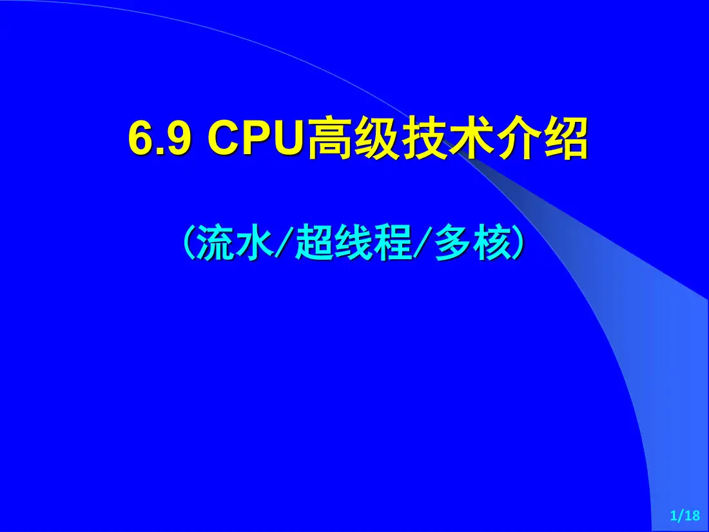

原文：

6.9 CPU高级技术介绍

(流水/超线程/多核)

1/18

### 6.9.1 流水技术

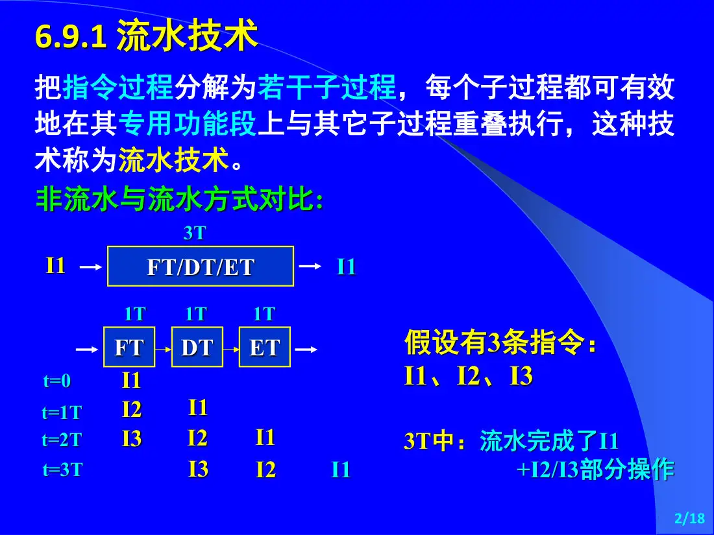

原文：

6.9.1 流水技术

把指令过程分解为若干子过程，每个子过程都可有效地在其专用功能段上与其它子过程重叠执行，这种技术称为流水技术。

非流水与流水方式对比:

3TI1 FT/DT/ET I11T 1T 1TFT 1 DT ET 一t=0 I1t=1T I2 I1t=2T I3 I2 I1t=3T I3 I2 I1假设有3条指令：I1、I2、I3

3T中：流水完成了I1 +I2/I3部分操作 [例]浮点加法的四段式流水线(时空图)

2/18

### 进入

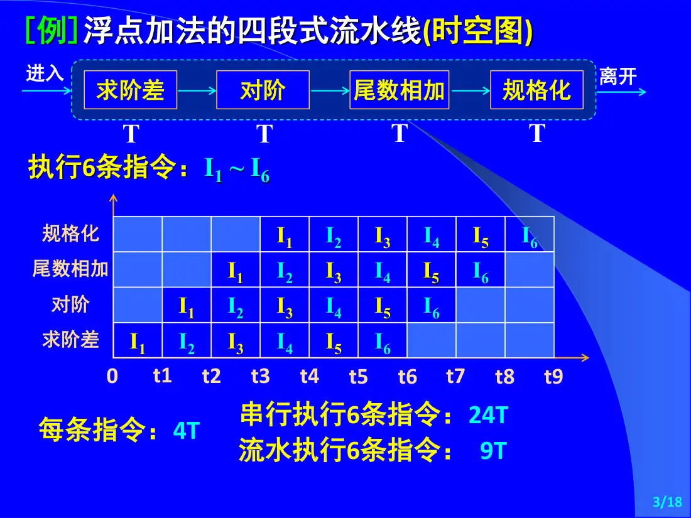

原文：

进入

求阶差

对阶

尾数相加

规格化

离开

执行6条指令： $1 5 \approx 1 6$

规格化

尾数相加

对阶

求阶差

0 t1 t2 t3 t4 t5 t6 t7 t8 t9

每条指令：4T串行执行6条指令：24T流水执行6条指令： 9T※流水线的特点

3/18

### 流水线需要经过一定的通过时间才能稳定(即无空闲功能段)：

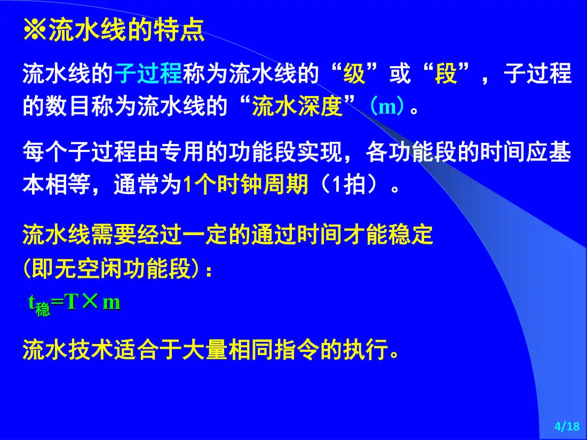

原文：

流水线的子过程称为流水线的“级”或“段”，子过程的数目称为流水线的“流水深度”(m)。

每个子过程由专用的功能段实现，各功能段的时间应基本相等，通常为1个时钟周期（1拍）。

流水线需要经过一定的通过时间才能稳定(即无空闲功能段)：

t稳=T×m

流水技术适合于大量相同指令的执行。

4/18

### 1.流水线的基本类型

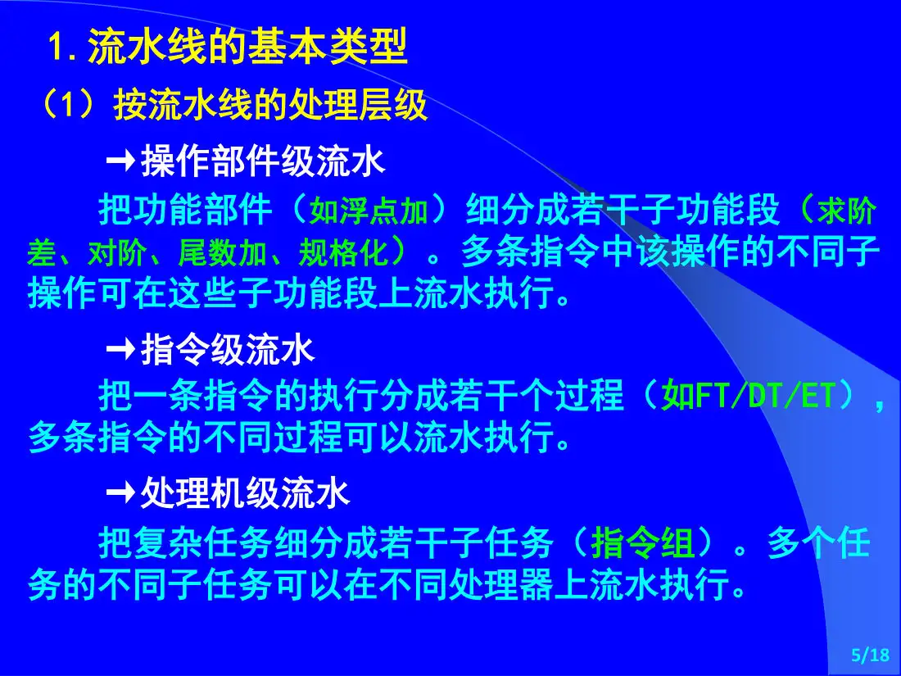

原文：

1.流水线的基本类型

（1）按流水线的处理层级

→操作部件级流水

把功能部件（如浮点加）细分成若干子功能段（求阶差、对阶、尾数加、规格化）。多条指令中该操作的不同子操作可在这些子功能段上流水执行。

→指令级流水

把一条指令的执行分成若干个过程（如FT/DT/ET）多条指令的不同过程可以流水执行。

→处理机级流水

把复杂任务细分成若干子任务（指令组）。多个任务的不同子任务可以在不同处理器上流水执行。

5/18

### （2）按流水线能完成的功能数量

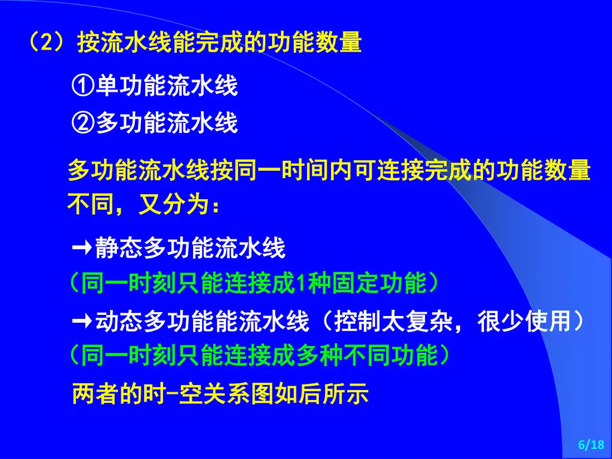

原文：

（2）按流水线能完成的功能数量

①单功能流水线

②多功能流水线

多功能流水线按同一时间内可连接完成的功能数量不同，又分为：

静态多功能流水线

（同一时刻只能连接成1种固定功能）

→动态多功能能流水线（控制太复杂，很少使用）

（同一时刻只能连接成多种不同功能）

两者的时-空关系图如后所示

6/18

### 7/18

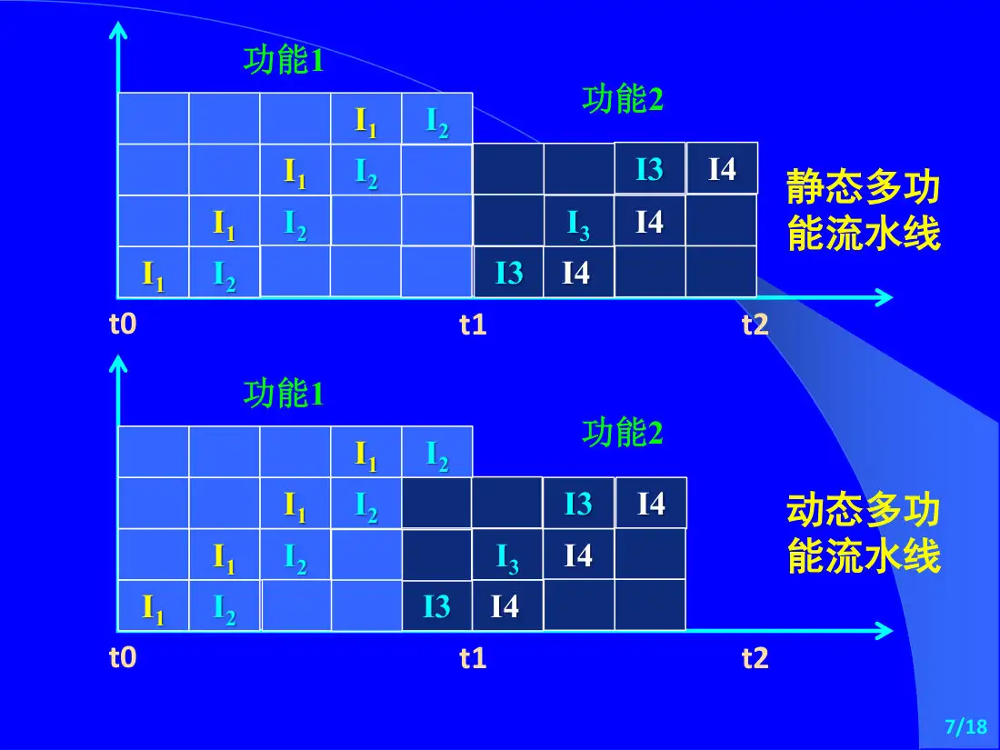

原文：

7/18

### （3）按处理的数据形态

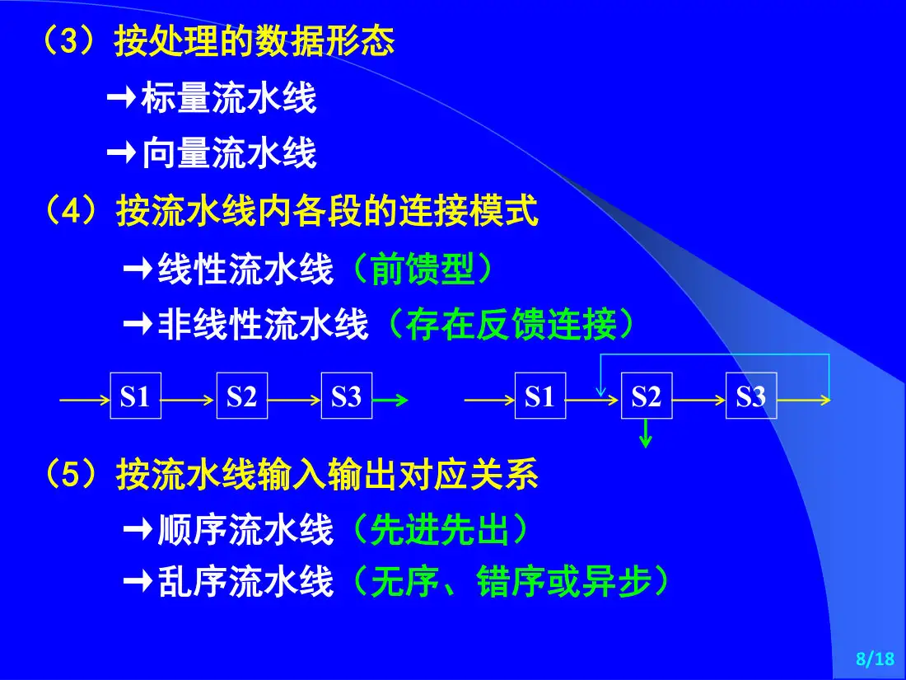

原文：

（3）按处理的数据形态

→标量流水线

→向量流水线

（4）按流水线内各段的连接模式

线性流水线 （前馈型）

→非线性流水线（存在反馈连接）

S1 S2 S3 S1 S2 S3

（5）按流水线输入输出对应关系

→顺序流水线（先进先出）

→乱序流水线（无序、错序或异步）

8/18

### 2.流水线的性能指标

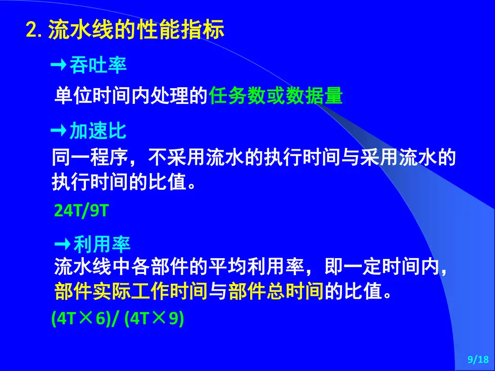

原文：

2.流水线的性能指标

→吞吐率

单位时间内处理的任务数或数据量

→加速比

同一程序，不采用流水的执行时间与采用流水的执行时间的比值。

24T/9T

→利用率流水线中各部件的平均利用率，即一定时间内，部件实际工作时间与部件总时间的比值。(4T×6)/ (4T×9)

9/18

### 3.超标量流水线和超流水线

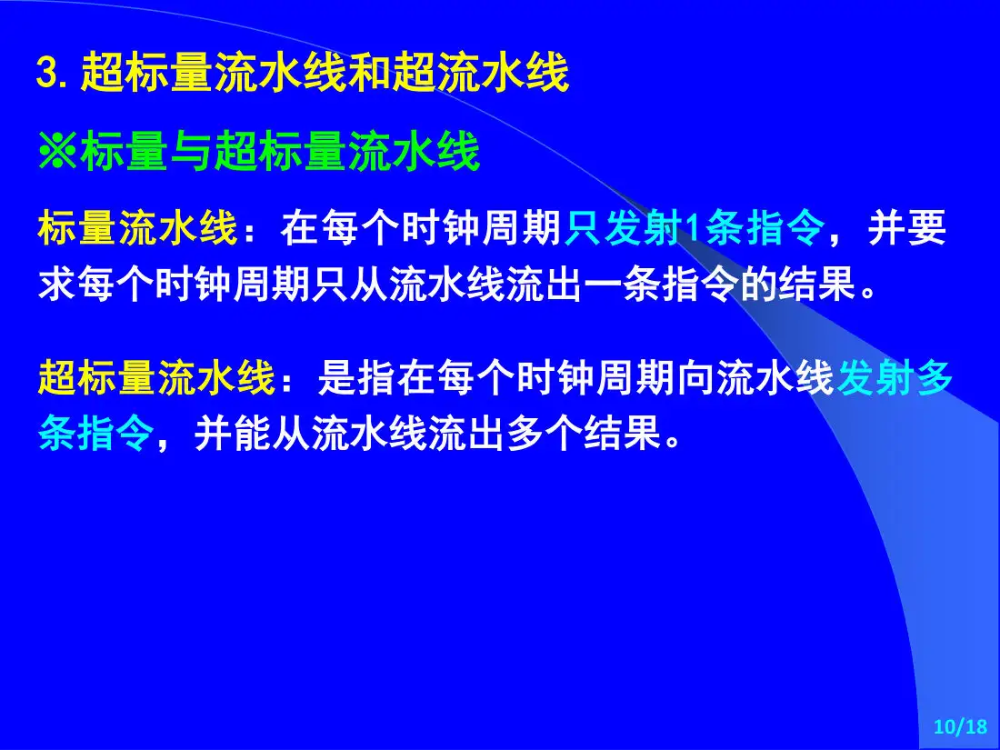

原文：

3.超标量流水线和超流水线

※标量与超标量流水线

标量流水线：在每个时钟周期只发射1条指令，并要求每个时钟周期只从流水线流出一条指令的结果。

超标量流水线：是指在每个时钟周期向流水线发射多条指令，并能从流水线流出多个结果。

10/18

### 1T 2T 3T 时钟周期

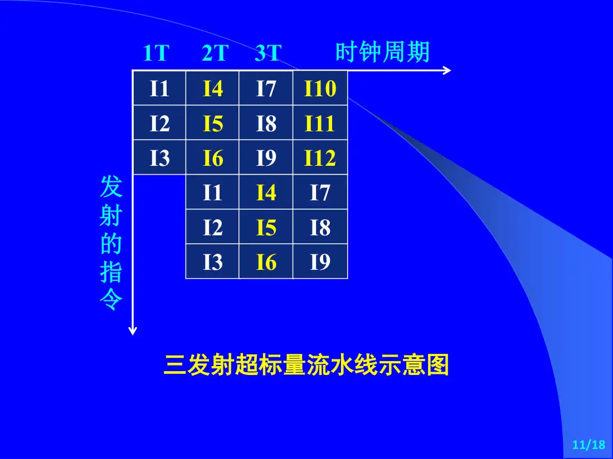

原文：

1T 2T 3T 时钟周期

发
射
的
指
令

三发射超标量流水线示意图

11/18

### ※超流水线技术

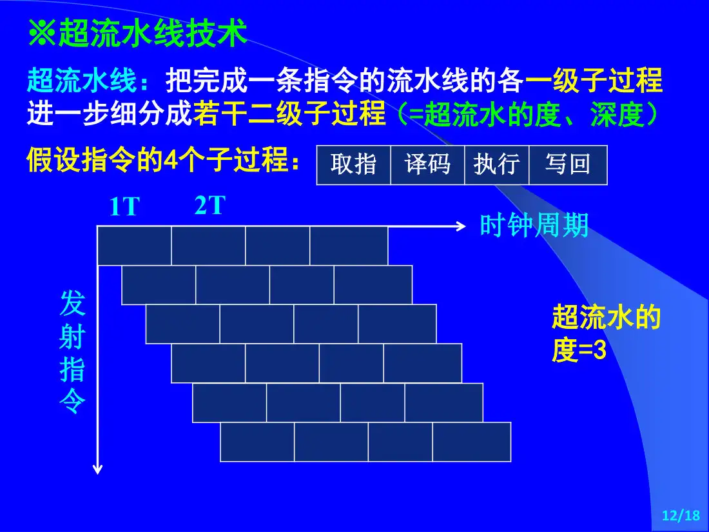

原文：

※超流水线技术

超流水线：把完成一条指令的流水线的各一级子过程进一步细分成若干二级子过程（=超流水的度、深度）

假设指令的4个子过程： 取指 译码 执行 写回

1T 2T

时钟周期

发
射
指
令

超流水的度=3

12/18

### ※超标量超流水线处理技术

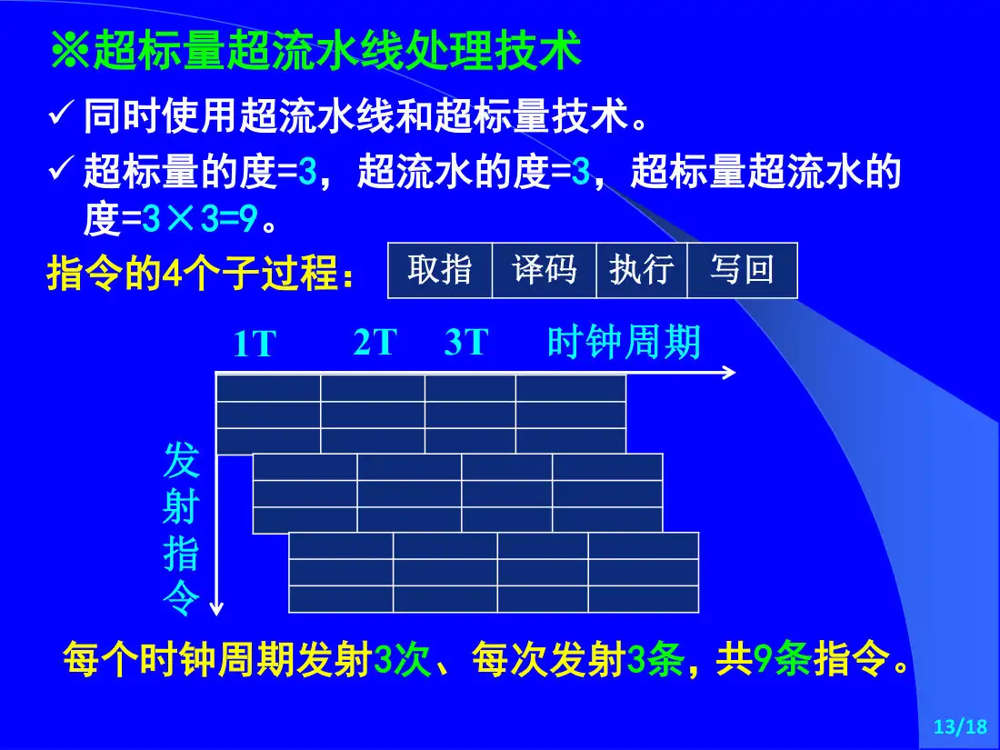

原文：

※超标量超流水线处理技术

✓ 同时使用超流水线和超标量技术。

超标量的度=3，超流水的度=3，超标量超流水的度=3×3=9。

指令的4个子过程： 取指 译码 执行 写回

1T 2T 3T 时钟周期

每个时钟周期发射3次、每次发射3条，共9条指令。

13/18

### 6.9.2 SMT与超线程

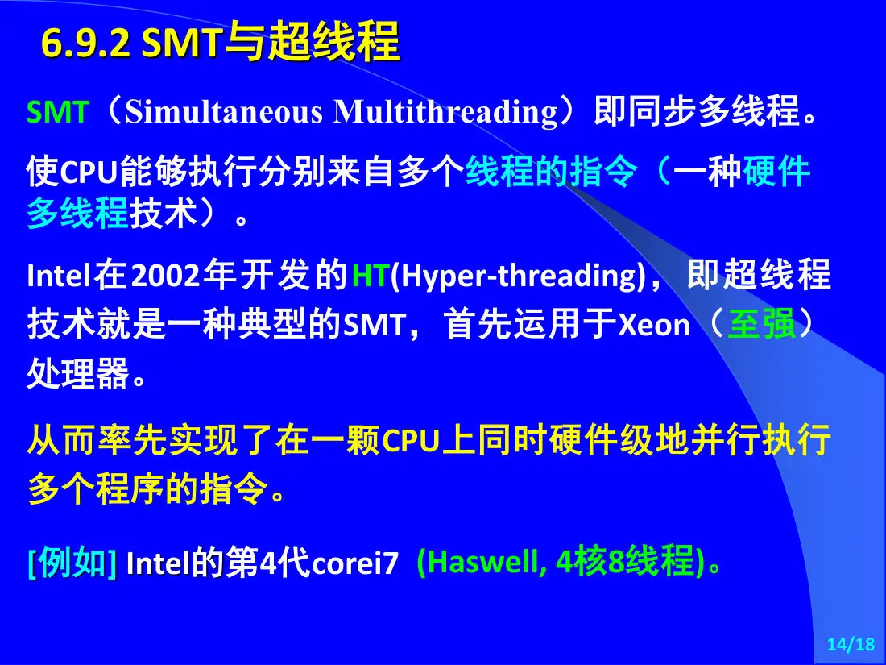

原文：

6.9.2 SMT与超线程

SMT（Simultaneous Multithreading）即同步多线程。

使CPU能够执行分别来自多个线程的指令（一种硬件多线程技术）。

Intel在2002年开发的HT(Hyper-threading)，即超线程技术就是一种典型的SMT，首先运用于Xeon（至强）处理器。

从而率先实现了在一颗CPU上同时硬件级地并行执行多个程序的指令。

[例如] Intel的第4代corei7 (Haswell, 4核8线程)。

14/18

### 6.9.3 多核技术

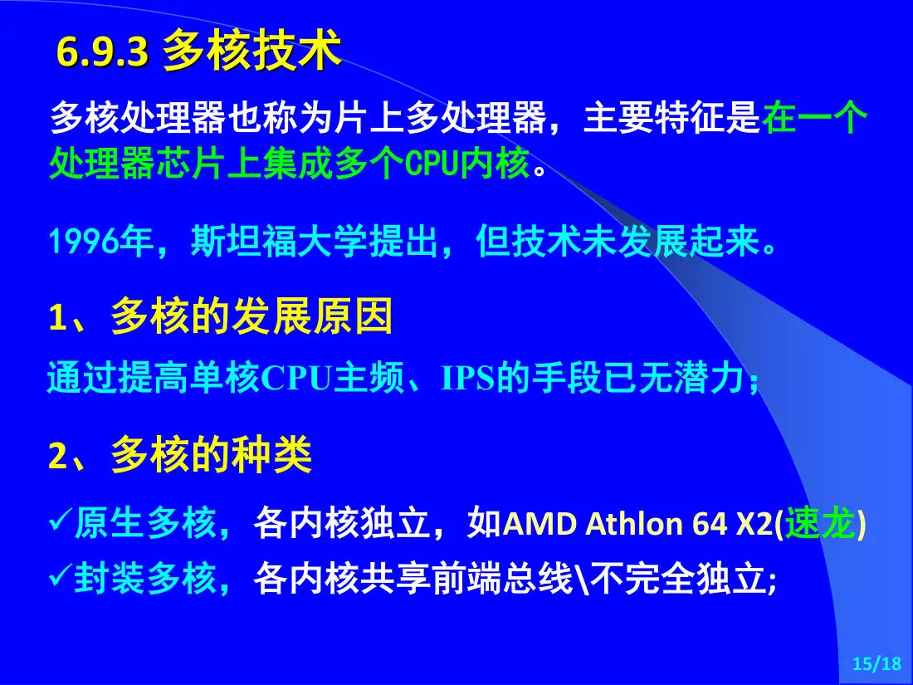

原文：

6.9.3 多核技术

多核处理器也称为片上多处理器，主要特征是在一个处理器芯片上集成多个CPU内核。

1996年，斯坦福大学提出，但技术未发展起来。

1、多核的发展原因

通过提高单核CPU主频、IPS的手段已无潜力；

2、多核的种类

✓原生多核，各内核独立，如AMD Athlon 64 X2(速龙)

✓封装多核，各内核共享前端总线\不完全独立;

15/18

### Intel的方案：将不同Die（晶元）上的两个内核封装在一起；

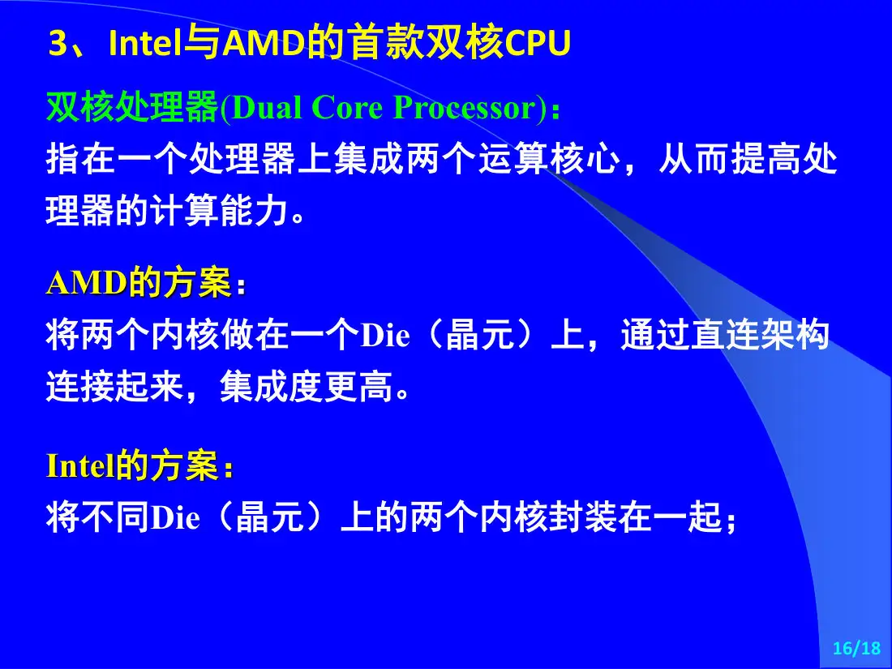

原文：

3、Intel与AMD的首款双核CPU双核处理器(Dual Core Processor)：指在一个处理器上集成两个运算核心，从而提高处理器的计算能力。

AMD的方案：将两个内核做在一个Die（晶元）上，通过直连架构连接起来，集成度更高。

Intel的方案：将不同Die（晶元）上的两个内核封装在一起；

16/18

### Intel“双芯”

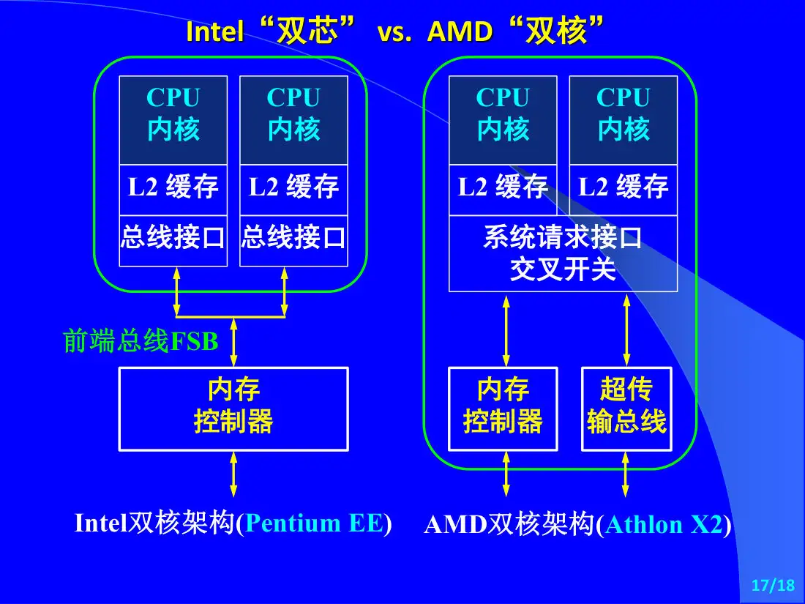

原文：

Intel“双芯”

CPU内核

CPU内核

L2 缓存

L2 缓存

总线接口

总线接口

前端总线FSB

内存控制器

Intel双核架构(Pentium EE)

vs. AMD“双核”

CPU内核

CPU内核

L2 缓存

L2 缓存

系统请求接口交叉开关

内存控制器超传输总线

AMD双核架构(Athlon X2)

17/18

### 4、多核CPU的发展趋势

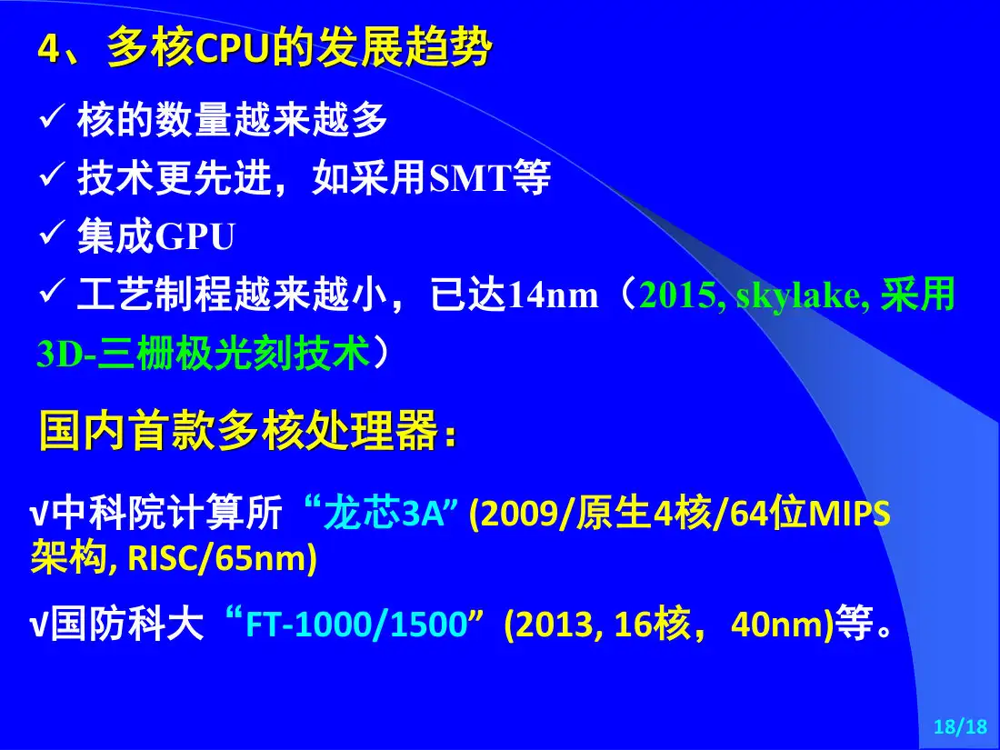

原文：

4、多核CPU的发展趋势

核的数量越来越多

技术更先进，如采用SMT等

集成GPU

✓ 工艺制程越来越小，已达14nm（2015, skylake, 采用

3D-三栅极光刻技术）

国内首款多核处理器：

√中科院计算所“龙芯3A” (2009/原生4核/64位MIPS架构, RISC/65nm)

√国防科大“FT-1000/1500” (2013, 16核，40nm)等。

18/18
