# 《计算机组成与结构》第6章 3(5)-CPU子系统-MIPS-3-单周期-1-2-目标指令与数据通路（课件）

原件的每一页，下面附识别出的文字。

### 6.3 单周期MIPS32处理器

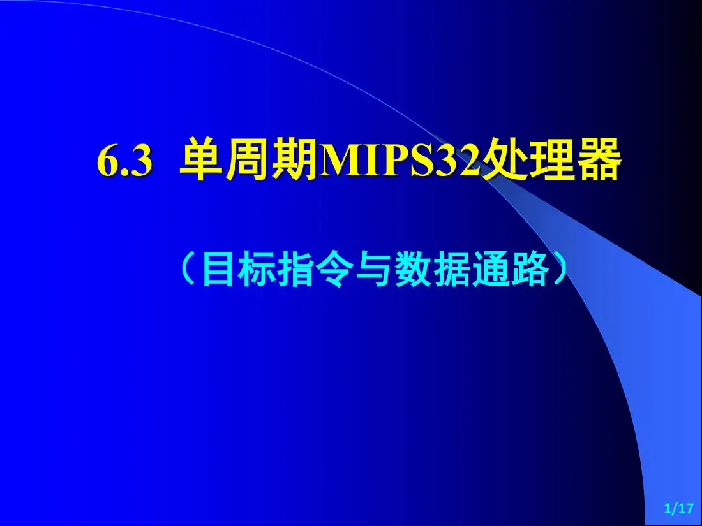

原文：

6.3 单周期MIPS32处理器

（目标指令与数据通路）

1/17

### ※CPU设计的主要任务

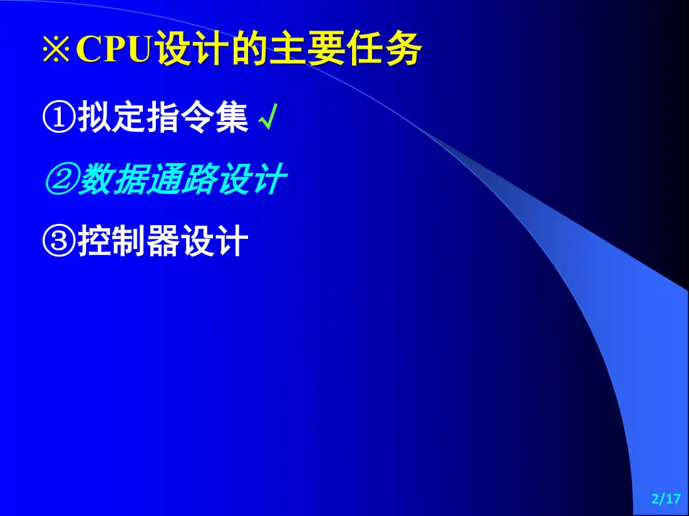

原文：

※CPU设计的主要任务

①拟定指令集√

②数据通路设计

③控制器设计

2/17

### ※CPU执行1条指令的步骤：

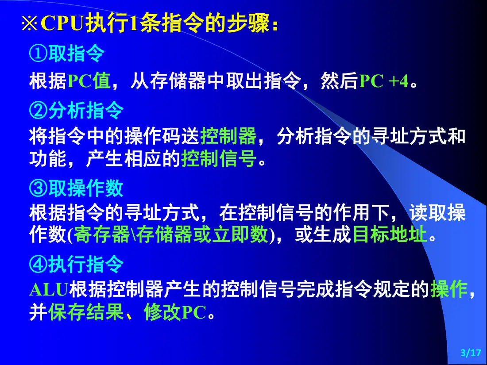

原文：

※CPU执行1条指令的步骤：

①取指令

根据PC值，从存储器中取出指令，然后PC +4。

②分析指令

将指令中的操作码送控制器，分析指令的寻址方式和功能，产生相应的控制信号。

③取操作数

根据指令的寻址方式，在控制信号的作用下，读取操作数(寄存器\存储器或立即数)，或生成目标地址。

④执行指令

ALU根据控制器产生的控制信号完成指令规定的操作，并保存结果、修改PC。

3/17

### ※根据指令执行的所需时钟周期数

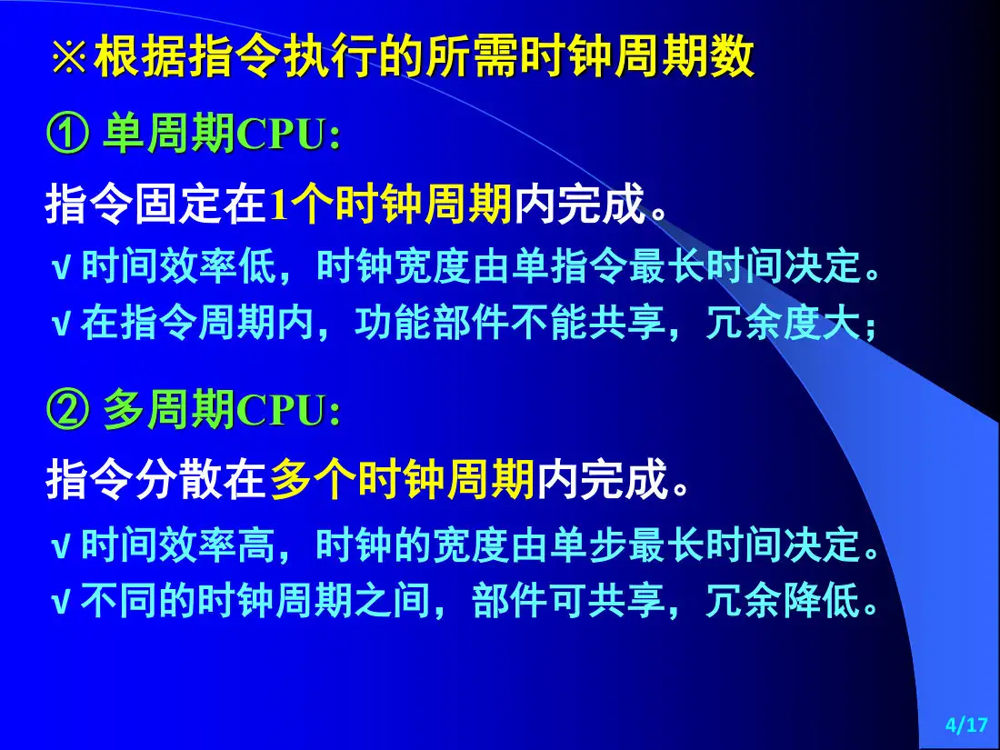

原文：

※根据指令执行的所需时钟周期数

① 单周期CPU:

指令固定在1个时钟周期内完成。

√ 时间效率低，时钟宽度由单指令最长时间决定。

√ 在指令周期内，功能部件不能共享，冗余度大；

② 多周期CPU:

指令分散在多个时钟周期内完成。

√ 时间效率高，时钟的宽度由单步最长时间决定。

√ 不同的时钟周期之间，部件可共享，冗余降低。

4/17

### 1、目标指令集（共计11条）

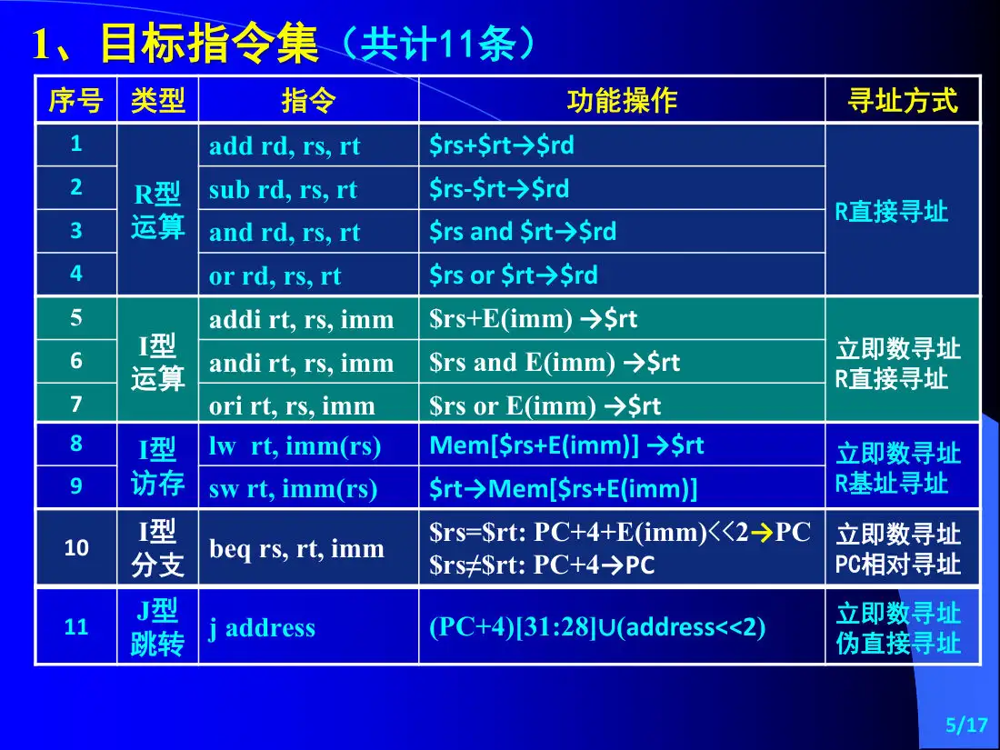

原文：

1、目标指令集（共计11条）

<table><tr><td>序号</td><td>类型</td><td>指令</td><td>功能操作</td><td>寻址方式</td></tr><tr><td>1</td><td rowspan="4">R型运算</td><td>add rd, rs, rt</td><td>$rs+$rt→$rd</td><td rowspan="4">R直接寻址</td></tr><tr><td>2</td><td>sub rd, rs, rt</td><td>$rs-$rt→$rd</td></tr><tr><td>3</td><td>and rd, rs, rt</td><td>$rs and $rt→$rd</td></tr><tr><td>4</td><td>or rd, rs, rt</td><td>$rs or $rt→$rd</td></tr><tr><td>5</td><td rowspan="3">I型运算</td><td>addi rt, rs, imm</td><td>$rs+E(imm)→$rt</td><td rowspan="3">立即数寻址R直接寻址</td></tr><tr><td>6</td><td>andi rt, rs, imm</td><td>$rs and E(imm)→$rt</td></tr><tr><td>7</td><td>ori rt, rs, imm</td><td>$rs or E(imm)→$rt</td></tr><tr><td>8</td><td rowspan="2">I型访存</td><td>lw rt, imm(rs)</td><td>Mem[$rs+E(imm)]→$rt</td><td rowspan="2">立即数寻址R基址寻址</td></tr><tr><td>9</td><td>sw rt, imm(rs)</td><td>$rt→Mem[$rs+E(imm)]</td></tr><tr><td>10</td><td>I型分支</td><td>beq rs, rt, imm</td><td>$rs=$rt: PC+4+E(imm)&lt;&lt;2→PC$rs≠$rt: PC+4→PC</td><td>立即数寻址PC相对寻址</td></tr><tr><td>11</td><td>J型跳转</td><td>j address</td><td>(PC+4)[31:28]∪(address&lt;&lt;2)</td><td>立即数寻址伪直接寻址</td></tr></table>

5/17

### 2、指令的基本数据通路

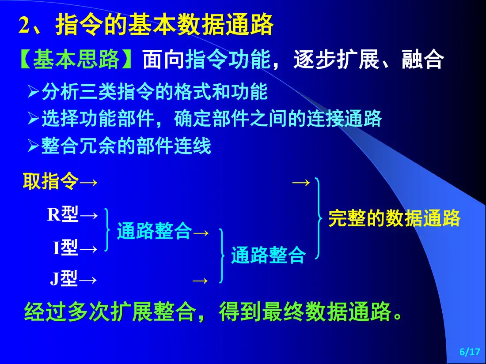

原文：

2、指令的基本数据通路

【基本思路】面向指令功能，逐步扩展、融合

➢分析三类指令的格式和功能

选择功能部件，确定部件之间的连接通路

整合冗余的部件连线

取指令→

R型→

I型→

通路整合→

完整的数据通路

通路整合

J型→

经过多次扩展整合，得到最终数据通路。

6/17

### （1）取指功能的数据通路（公共）

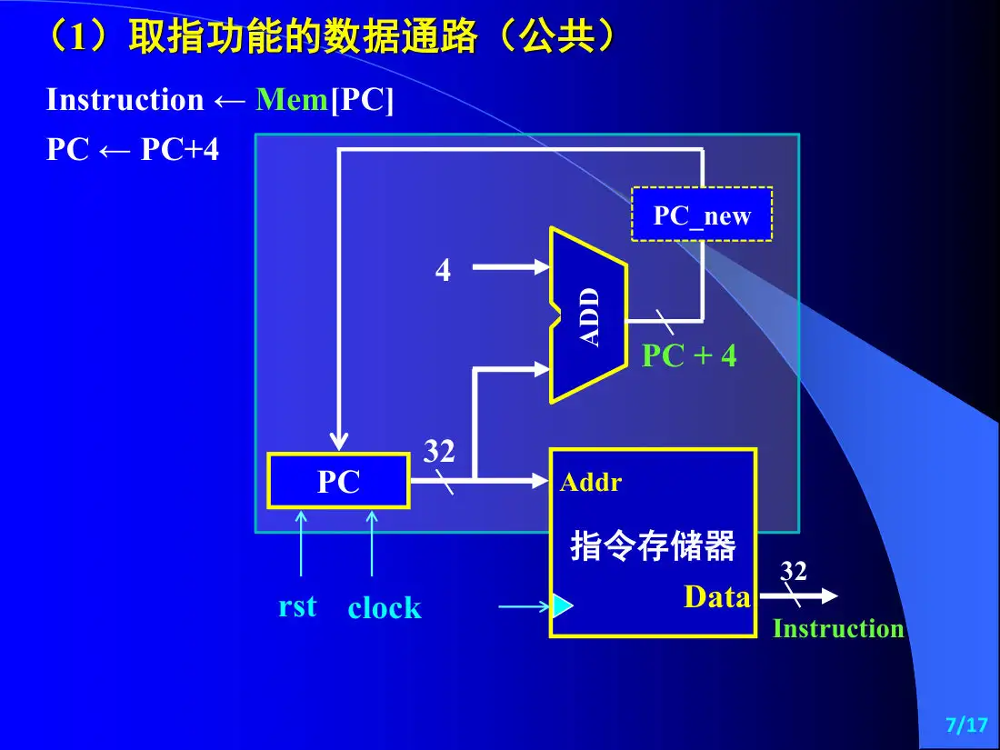

原文：

（1）取指功能的数据通路（公共）

Instruction ← Mem[PC]

指令存储器

rst clock

7/17

### （2）R型运算指令

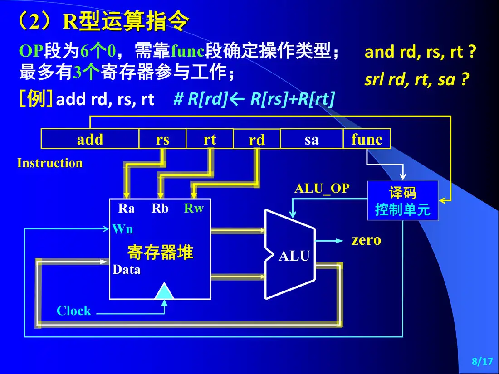

原文：

（2）R型运算指令

OP段为6个0，需靠func段确定操作类型； and rd, rs, rt ?最多有3个寄存器参与工作； srl rd, rt, sa ?[例]add rd, rs, rt # R[rd]← R[rs]+R[rt]

8/17

### （3）在R型上扩展I型运算指令

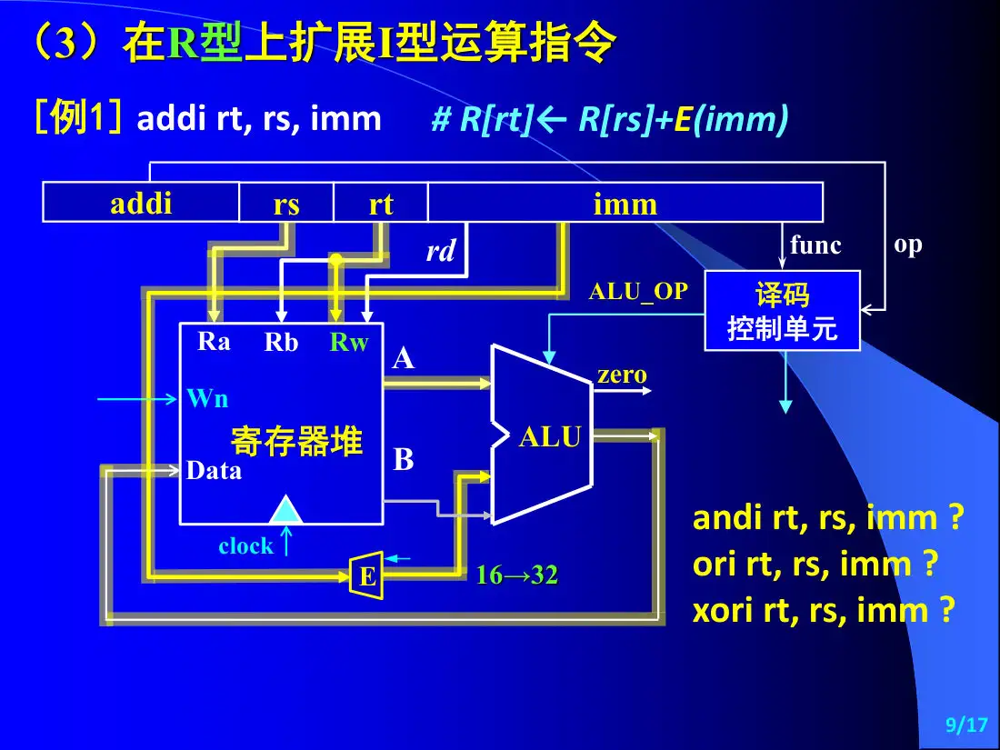

原文：

（3）在R型上扩展I型运算指令

[例1] addi rt, rs, imm # R[rt]← R[rs]+E(imm)

译码控制单元

andi rt, rs, imm ? ori rt, rs, imm ? xori rt, rs, imm ?

9/17

### sw rt, imm(rs)?

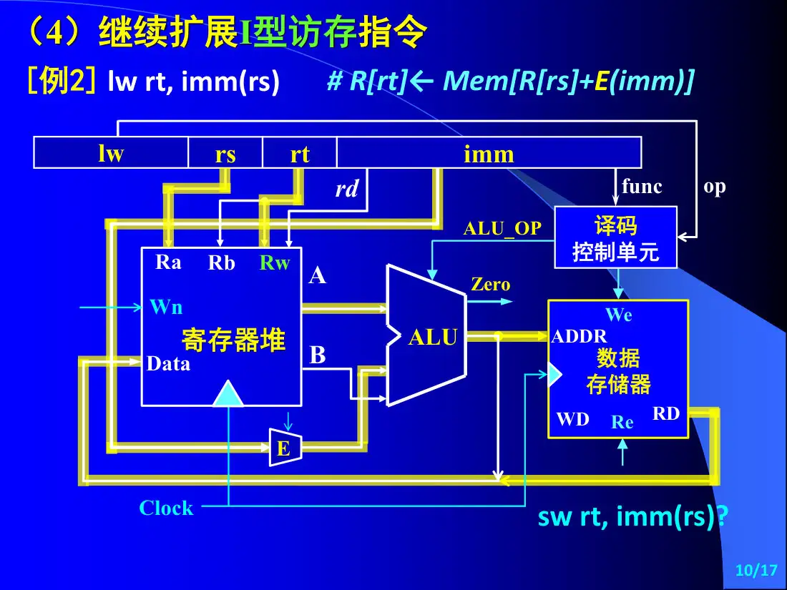

原文：

sw rt, imm(rs)?

10/17

### 11/17

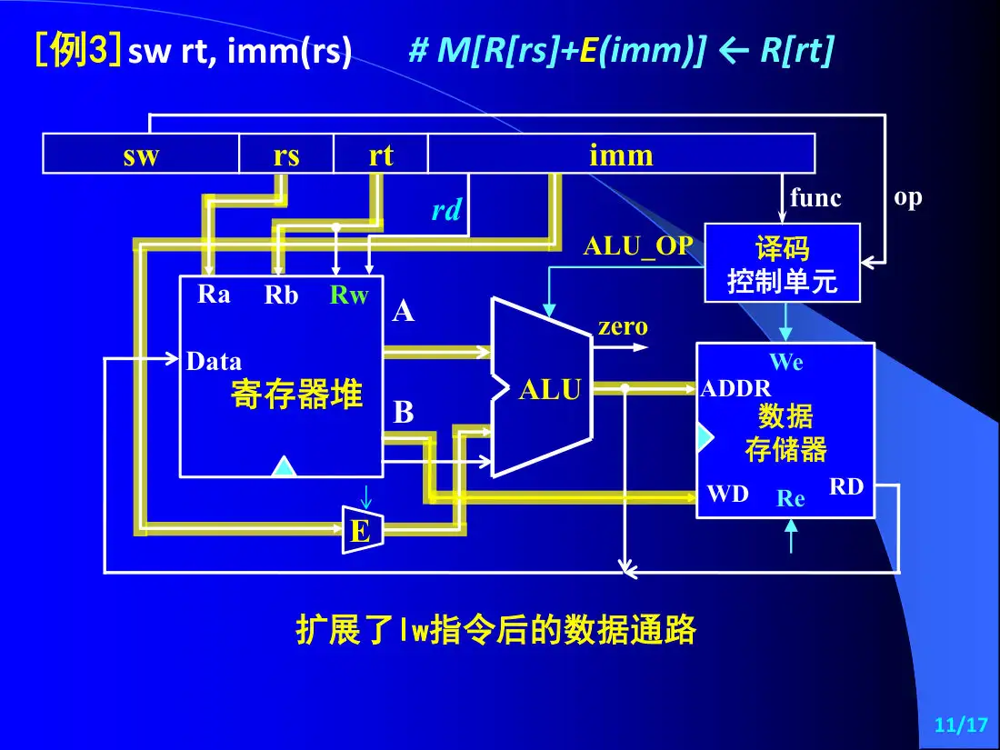

原文：

[例3]sw rt, imm(rs) # M[R[rs]+E(imm)] ← R[rt]

扩展了lw指令后的数据通路 # if R[rs]==R[rt] # then PC←PC+4+E(offset)<<2 # else PC←PC+4

11/17

### 12/17

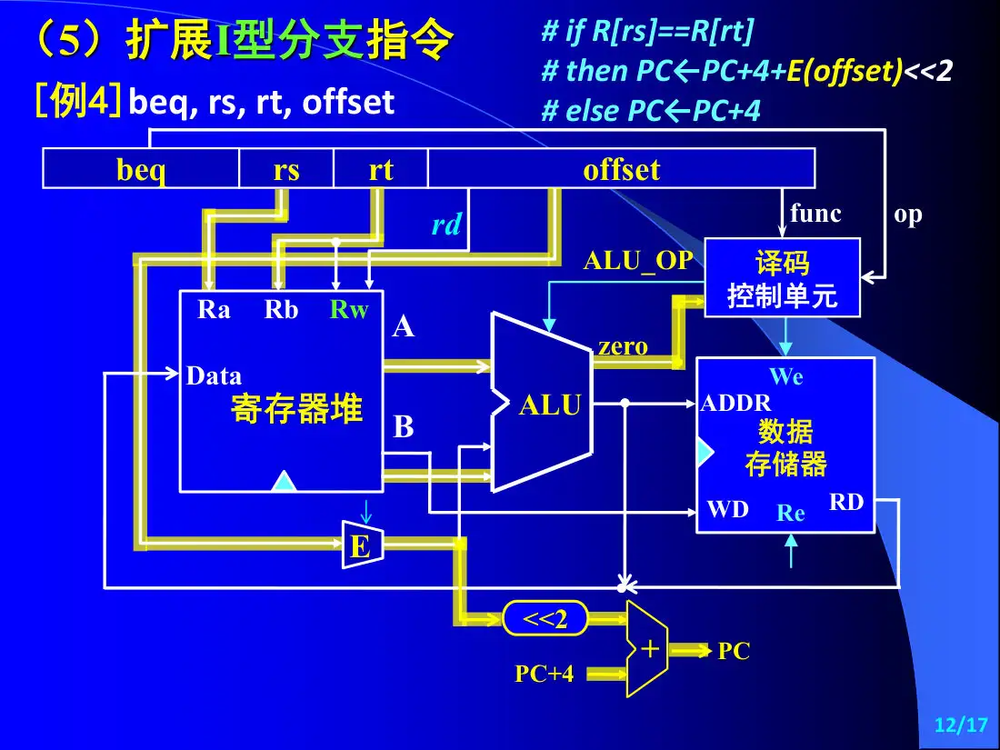

原文：

12/17

### 13/17

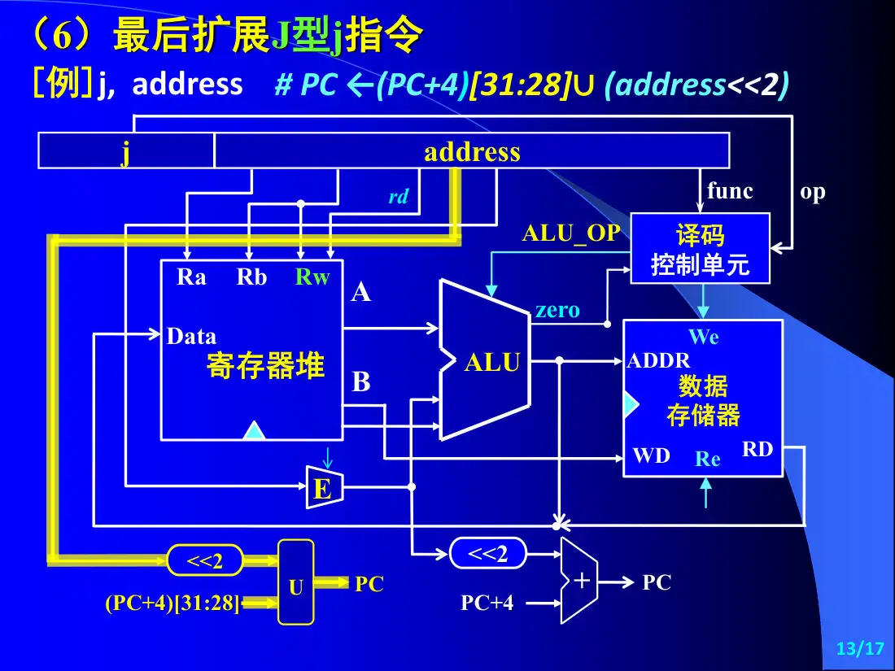

原文：

（6）最后扩展J型j指令[例]j, address # PC ←(PC+4)[31:28]∪ (address<<2)

13/17

### #重新布局

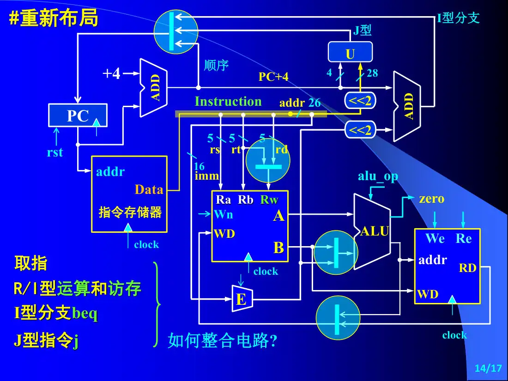

原文：

#重新布局

取指

R/I型运算和访存 I型分支beq

J型指令j

如何整合电路?

I型分支

14/17

### 3、数据通路综合

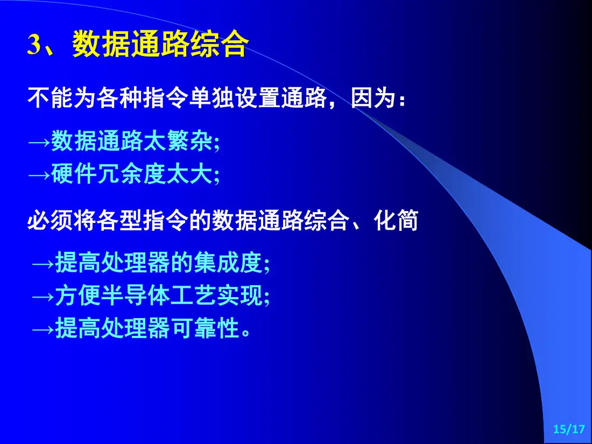

原文：

3、数据通路综合

不能为各种指令单独设置通路，因为：

→数据通路太繁杂;

→硬件冗余度太大;

必须将各型指令的数据通路综合、化简

→提高处理器的集成度;

→方便半导体工艺实现;

→提高处理器可靠性。

15/17

### 目标：把各种指令的数据路径合并

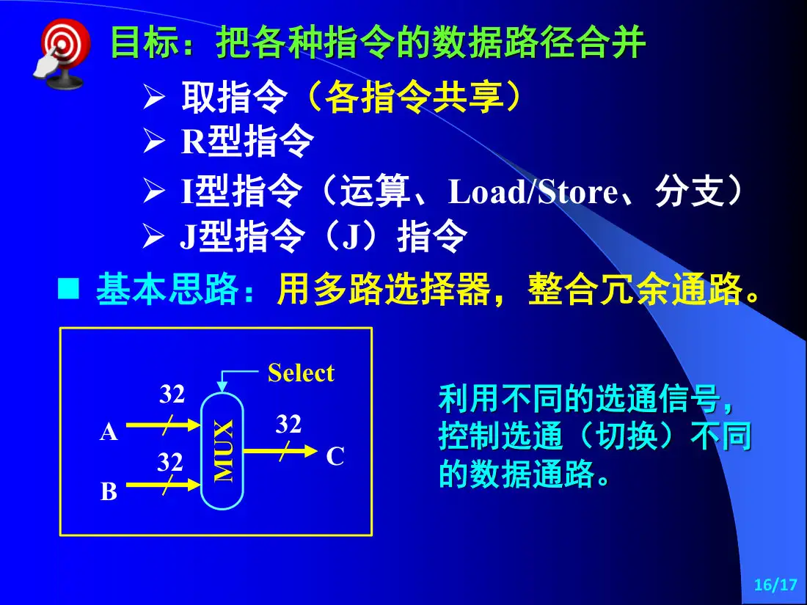

原文：

目标：把各种指令的数据路径合并

取指令（各指令共享）

R型指令

➢ I型指令（运算、Load/Store、分支）

J型指令（J）指令

◼ 基本思路：用多路选择器，整合冗余通路。

$$
\begin{array}{c c c} & \text { Select } \\ A & 3 2 & \\ B & 3 2 & \\ & \text { MUX } & 3 2 \\ & & C \end{array}
$$

利用不同的选通信号，控制选通（切换）不同的数据通路。

16/17

### 继续整合通路

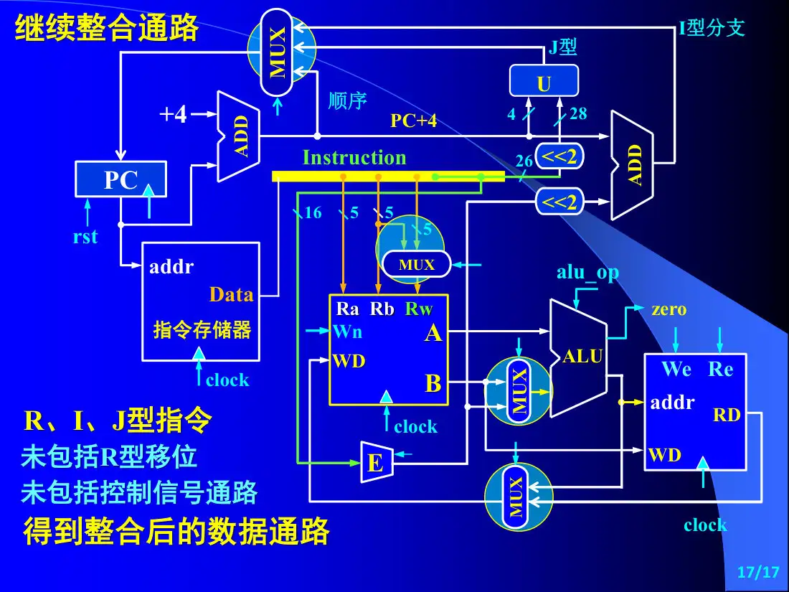

原文：

继续整合通路

R、I、J型指令未包括R型移位未包括控制信号通路得到整合后的数据通路

17/17

I型分支
