# 《计算机组成与结构》第6章 CPU子系统-MIPS32指令架构与指令集（课件）

原件的每一页，下面附识别出的文字。

### 6.1 MIPS32指令架构的CPU设计实例

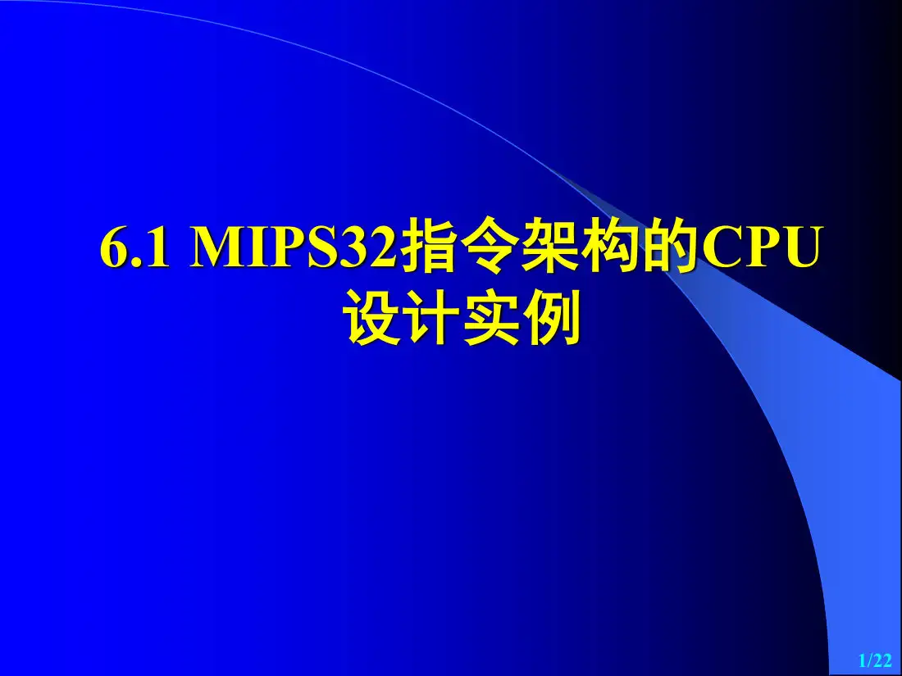

原文：

6.1 MIPS32指令架构的CPU设计实例

1/22

### 2/22

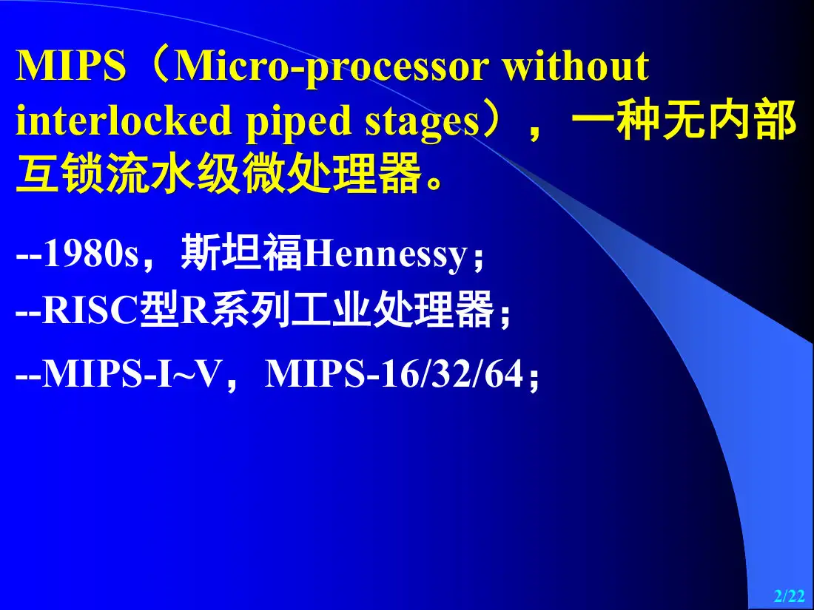

原文：

MIPS（Micro-processor withoutinterlocked piped stages），一种无内部互锁流水级微处理器。

--1980s，斯坦福Hennessy；--RISC型R系列工业处理器；--MIPS-I\~V，MIPS-16/32/64；

2/22

### 6.1.1 MIPS32的指令

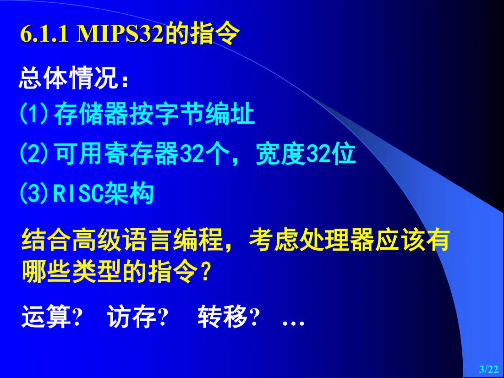

原文：

6.1.1 MIPS32的指令

总体情况：

(1)存储器按字节编址

(2)可用寄存器32个，宽度32位

(3)RISC架构

结合高级语言编程，考虑处理器应该有哪些类型的指令？

运算? 访存? 转移? …

3/22

### ※可提供的寄存器列表

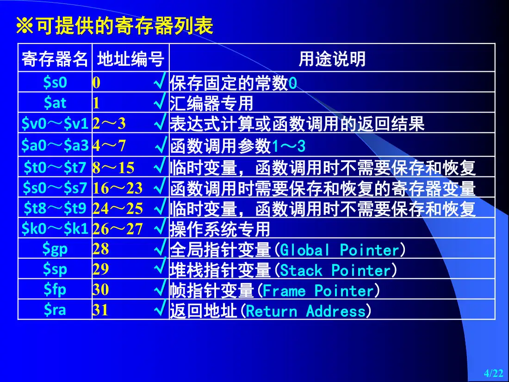

原文：

※可提供的寄存器列表

寄存器名 地址编号

用途说明

保存固定的常数0

汇编器专用

表达式计算或函数调用的返回结果

函数调用参数1～3

\$t0～\$t7 8～15 临时变量，函数调用时不需要保存和恢复√\$s0～\$s7 16～23 函数调用时需要保存和恢复的寄存器变量√\$t8～\$t9 24～25 临时变量，函数调用时不需要保存和恢复√\$k0～\$k1 26～27 操作系统专用√

全局指针变量(Global Pointer)

堆栈指针变量(Stack Pointer)

帧指针变量(Frame Pointer)

返回地址(Return Address)

4/22

### 1.指令格式与指令集

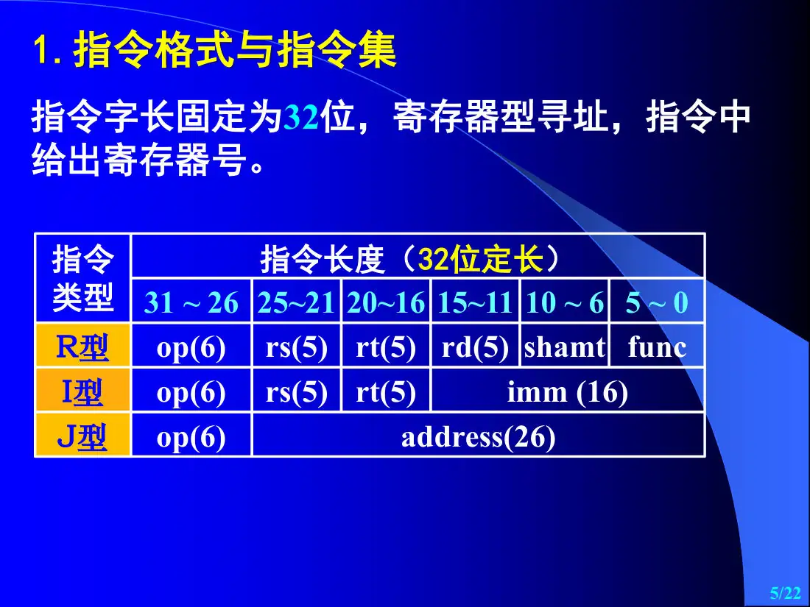

原文：

1.指令格式与指令集

指令字长固定为32位，寄存器型寻址，指令中给出寄存器号。

指令长度（32位定长）

op(6)

op(6)

rs(5)

op(6)

rt(5)

J型

imm (16)

address(26)

5/22

### ◼ R型指令(Register)

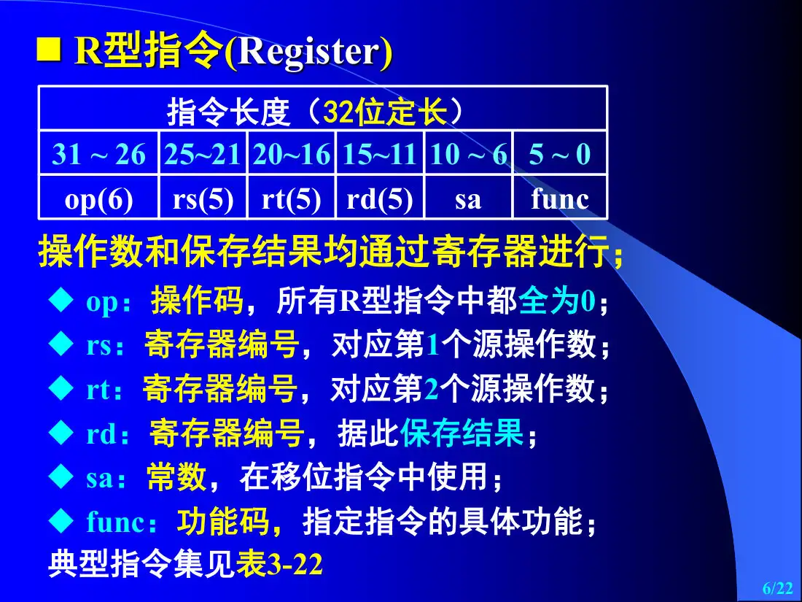

原文：

◼ R型指令(Register)

指令长度（32位定长）31 \~ 26 25\~21 20\~16 15\~11 10 \~ 6 5 \~ 0op(6) rs(5) rt(5) rd(5) sa func操作数和保存结果均通过寄存器进行op：操作码，所有R型指令中都全为0；rs： 寄存器编号，对应第1个源操作数；rt： 寄存器编号，对应第2个源操作数；rd： 寄存器编号，据此保存结果；sa：常数，在移位指令中使用；func：功能码，指定指令的具体功能；典型指令集见表3-22

6/22

### 操作数中涉及立即数，结果保存到寄存器；

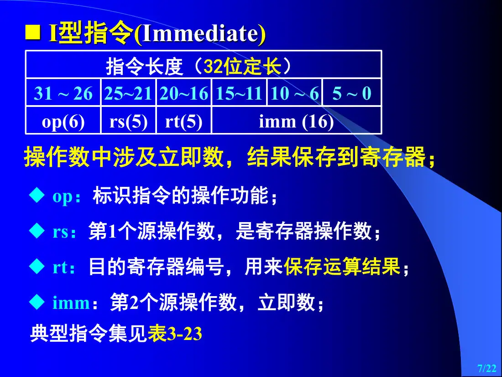

原文：

I型指令(Immediate) 指令长度 （32位定长） 31 \~ 26 25\~21 20\~16 15\~11 10 \~ 6 5 \~ 0 op(6) rs(5) rt(5) imm (16)

操作数中涉及立即数，结果保存到寄存器；

op：标识指令的操作功能；

rs：第1个源操作数，是寄存器操作数；

◆ rt：目的寄存器编号，用来保存运算结果；

imm：第2个源操作数，立即数；

典型指令集见表3-23

7/22

### ◼ J型指令(Jump)

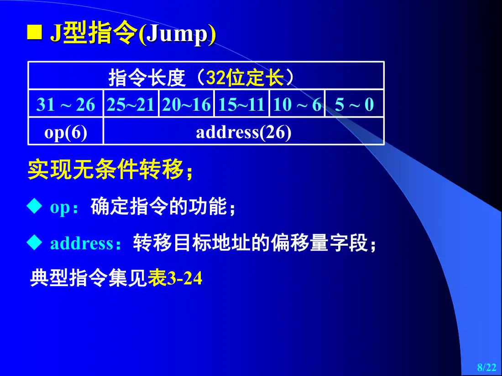

原文：

◼ J型指令(Jump)

指令长度（32位定长）31 \~ 26 25\~21 20\~16 15\~11 10 \~ 6 5 \~ 0op(6) address(26)

实现无条件转移；

op： 确定指令的功能；

address：转移目标地址的偏移量字段；

典型指令集见表3-24

8/22

### 2.寻址方式

原文：

2.寻址方式

在MIPS32指令集中，不会单设寻址方式说明字段，通过op字段和func字段(针对R型指令)隐含说明。

R型指令： 由op和func字段共同隐含说明当前的寻址方式。

I型和J型 由op字段隐含说明当前指令使用指令： 的寻址方式。

9/22

### op rs rt 立即数I立即数imm

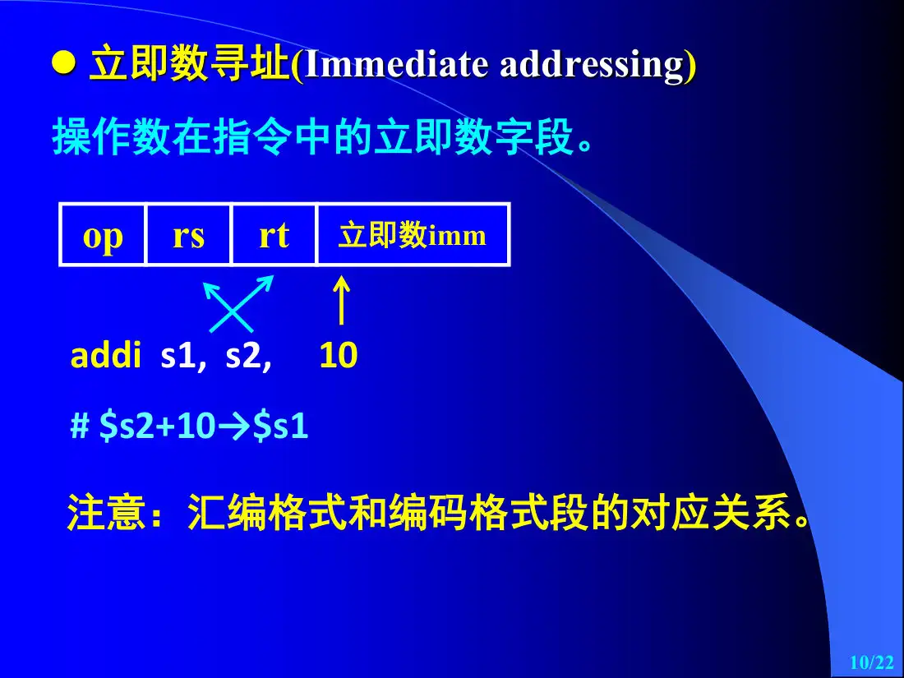

原文：

立即数寻址(Immediate addressing)操作数在指令中的立即数字段。

op rs rt 立即数I立即数imm

addi s1, s2, 10 # \$s2+10→\$s1

注意：汇编格式和编码格式段的对应关系。

10/22

### 寄存器直接寻址(Register Addressing)操作数直接在寄存器中。

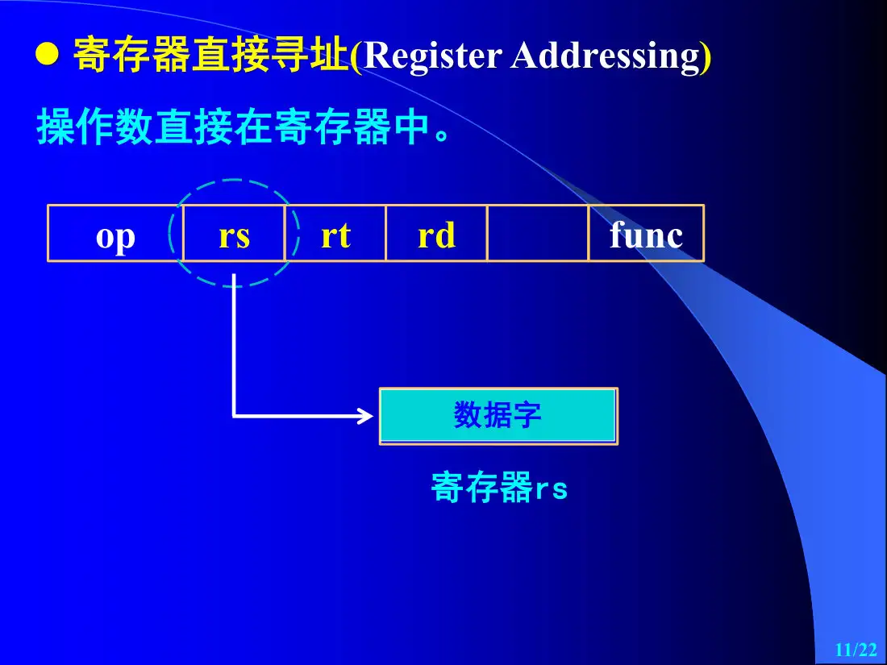

原文：

寄存器直接寻址(Register Addressing)操作数直接在寄存器中。

数据字

寄存器rs

### 基准地址码

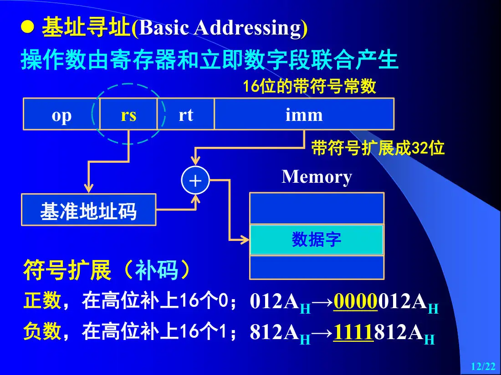

原文：

基址寻址(Basic Addressing)操作数由寄存器和立即数字段联合产生16位的带符号常数

基准地址码

imm

带符号扩展成32位

Memory

数据字

符号扩展（补码）正数，在高位补上16个0；012A →0000012A负数，在高位补上16个1；812A →1111812A

12/22

### 16位的带符号常数

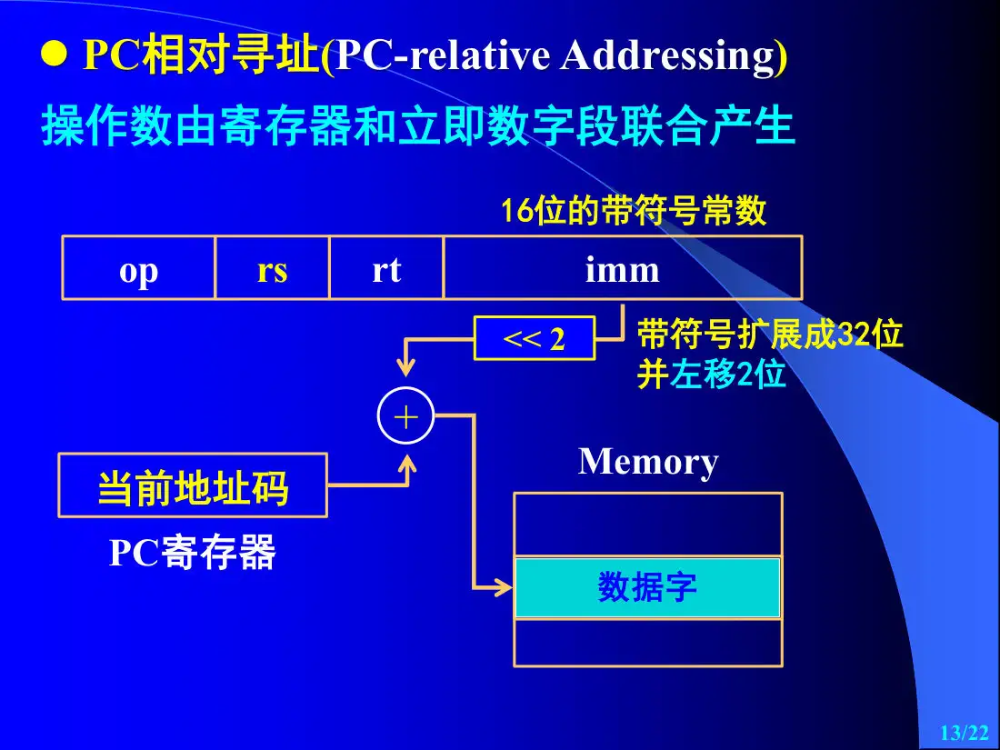

原文：

⚫ PC相对寻址(PC-relative Addressing)操作数由寄存器和立即数字段联合产生

16位的带符号常数

当前地址码

PC寄存器带符号扩展成32位并左移2位

Memory

数据字

### op

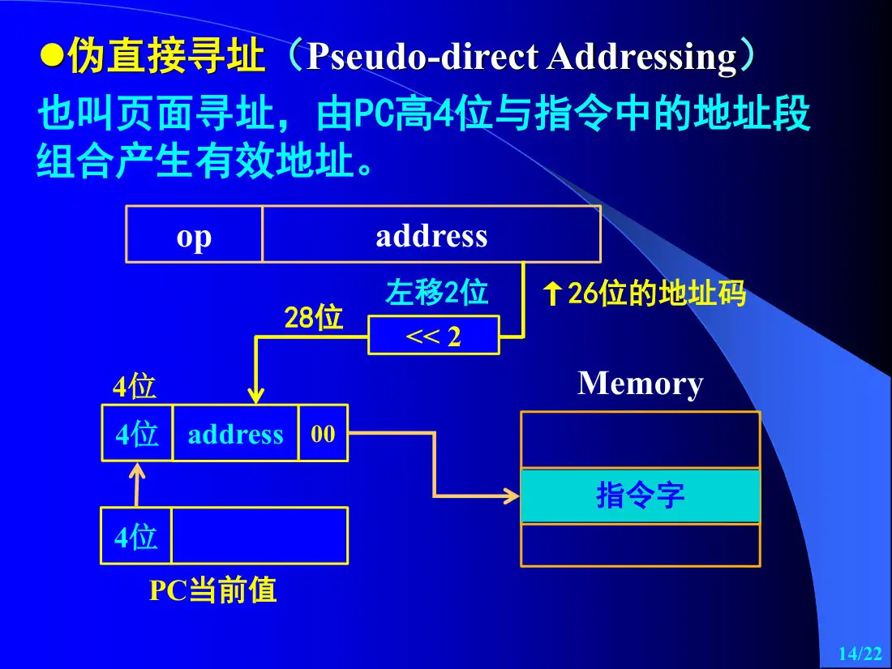

原文：

⚫伪直接寻址（Pseudo-direct Addressing）也叫页面寻址，由PC高4位与指令中的地址段组合产生有效地址。

op

address

28位

左移2位

↑26位的地址码

4位

4位

address

00

4位

PC当前值

Memory

指令字

14/22

### 3.指令代码与功能

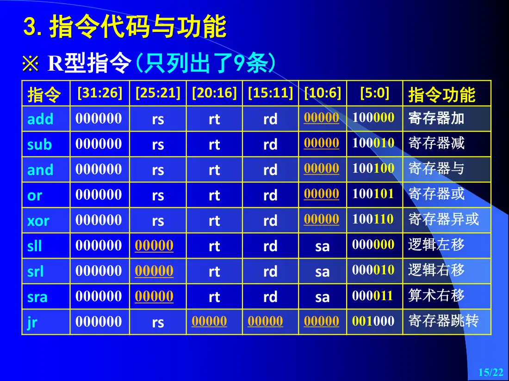

原文：

3.指令代码与功能

※ R型指令(只列出了9条)

<table><tr><td>指令</td><td>[31:26]</td><td>[25:21]</td><td>[20:16]</td><td>[15:11]</td><td>[10:6]</td><td>[5:0]</td><td>指令功能</td></tr><tr><td>add</td><td>000000</td><td>rs</td><td>rt</td><td>rd</td><td>00000</td><td>100000</td><td>寄存器加</td></tr><tr><td>sub</td><td>000000</td><td>rs</td><td>rt</td><td>rd</td><td>00000</td><td>100010</td><td>寄存器减</td></tr><tr><td>and</td><td>000000</td><td>rs</td><td>rt</td><td>rd</td><td>00000</td><td>100100</td><td>寄存器与</td></tr><tr><td>or</td><td>000000</td><td>rs</td><td>rt</td><td>rd</td><td>00000</td><td>100101</td><td>寄存器或</td></tr><tr><td>xor</td><td>000000</td><td>rs</td><td>rt</td><td>rd</td><td>00000</td><td>100110</td><td>寄存器异或</td></tr><tr><td>sll</td><td>000000</td><td>00000</td><td>rt</td><td>rd</td><td>sa</td><td>000000</td><td>逻辑左移</td></tr><tr><td>srl</td><td>000000</td><td>00000</td><td>rt</td><td>rd</td><td>sa</td><td>000010</td><td>逻辑右移</td></tr><tr><td>sra</td><td>000000</td><td>00000</td><td>rt</td><td>rd</td><td>sa</td><td>000011</td><td>算术右移</td></tr><tr><td>jr</td><td>000000</td><td>rs</td><td>00000</td><td>00000</td><td>00000</td><td>001000</td><td>寄存器跳转</td></tr></table>

15/22

### 由操作码op配合func字段，确定具体的操作R型指令，存在3种不同类型：

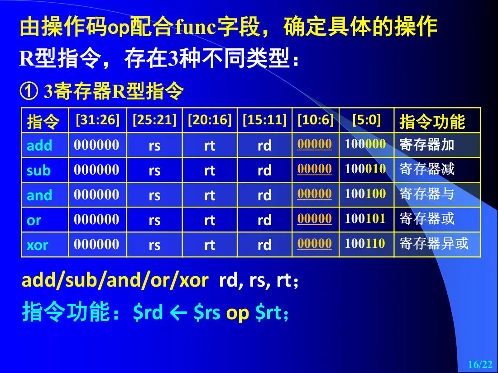

原文：

由操作码op配合func字段，确定具体的操作R型指令，存在3种不同类型：

① 3寄存器R型指令

<table><tr><td>指令</td><td>[31:26]</td><td>[25:21]</td><td>[20:16]</td><td>[15:11]</td><td>[10:6]</td><td>[5:0]</td><td>指令功能</td></tr><tr><td>add</td><td>000000</td><td>rs</td><td>rt</td><td>rd</td><td>00000</td><td>100000</td><td>寄存器加</td></tr><tr><td>sub</td><td>000000</td><td>rs</td><td>rt</td><td>rd</td><td>00000</td><td>100010</td><td>寄存器减</td></tr><tr><td>and</td><td>000000</td><td>rs</td><td>rt</td><td>rd</td><td>00000</td><td>100100</td><td>寄存器与</td></tr><tr><td>or</td><td>000000</td><td>rs</td><td>rt</td><td>rd</td><td>00000</td><td>100101</td><td>寄存器或</td></tr><tr><td>xor</td><td>000000</td><td>rs</td><td>rt</td><td>rd</td><td>00000</td><td>100110</td><td>寄存器异或</td></tr></table>

add/sub/and/or/xor rd, rs, rt；指令功能：\$rd ← \$rs op \$rt；

16/22

### ②2寄存器R型指令

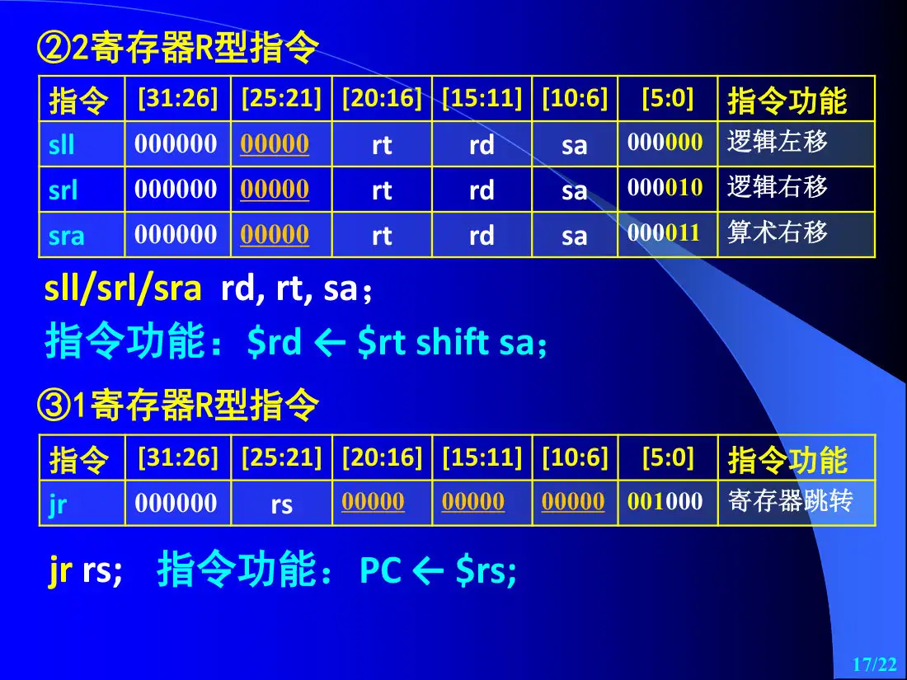

原文：

②2寄存器R型指令

<table><tr><td>指令</td><td>[31:26]</td><td>[25:21]</td><td>[20:16]</td><td>[15:11]</td><td>[10:6]</td><td>[5:0]</td><td>指令功能</td></tr><tr><td>sll</td><td>000000</td><td>00000</td><td>rt</td><td>rd</td><td>sa</td><td>000000</td><td>逻辑左移</td></tr><tr><td>srl</td><td>000000</td><td>00000</td><td>rt</td><td>rd</td><td>sa</td><td>000010</td><td>逻辑右移</td></tr><tr><td>sra</td><td>000000</td><td>00000</td><td>rt</td><td>rd</td><td>sa</td><td>000011</td><td>算术右移</td></tr></table>

sll/srl/sra rd, rt, sa；指令功能：\$rd ← \$rt shift sa；

③1寄存器R型指令

<table><tr><td>指令</td><td>[31:26]</td><td>[25:21]</td><td>[20:16]</td><td>[15:11]</td><td>[10:6]</td><td>[5:0]</td><td>指令功能</td></tr><tr><td>jr</td><td>000000</td><td>rs</td><td>00000</td><td>00000</td><td>00000</td><td>001000</td><td>寄存器跳转</td></tr></table>

jr rs; 指令功能：PC ← \$rs;

17/22

### ※I型指令(只列出9条)

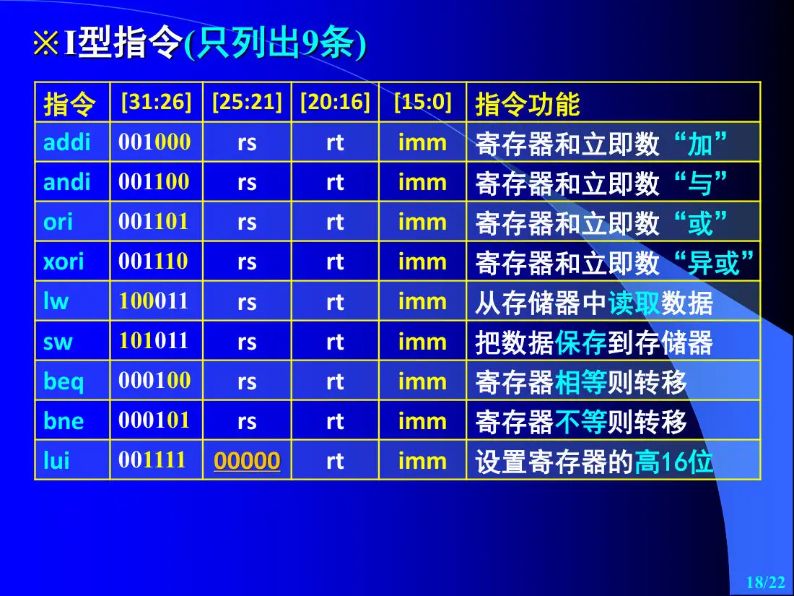

原文：

※I型指令(只列出9条)

<table><tr><td>指令</td><td>[31:26]</td><td>[25:21]</td><td>[20:16]</td><td>[15:0]</td><td>指令功能</td></tr><tr><td>addi</td><td>001000</td><td>rs</td><td>rt</td><td>imm</td><td>寄存器和立即数“加”</td></tr><tr><td>andi</td><td>001100</td><td>rs</td><td>rt</td><td>imm</td><td>寄存器和立即数“与”</td></tr><tr><td>ori</td><td>001101</td><td>rs</td><td>rt</td><td>imm</td><td>寄存器和立即数“或”</td></tr><tr><td>xori</td><td>001110</td><td>rs</td><td>rt</td><td>imm</td><td>寄存器和立即数“异或”</td></tr><tr><td>lw</td><td>100011</td><td>rs</td><td>rt</td><td>imm</td><td>从存储器中读取数据</td></tr><tr><td>sw</td><td>101011</td><td>rs</td><td>rt</td><td>imm</td><td>把数据保存到存储器</td></tr><tr><td>beq</td><td>000100</td><td>rs</td><td>rt</td><td>imm</td><td>寄存器相等则转移</td></tr><tr><td>bne</td><td>000101</td><td>rs</td><td>rt</td><td>imm</td><td>寄存器不等则转移</td></tr><tr><td>lui</td><td>001111</td><td>000000</td><td>rt</td><td>imm</td><td>设置寄存器的高16位</td></tr></table>

18/22

### I型指令，存在4种不同类型：①面向运算的I型指令

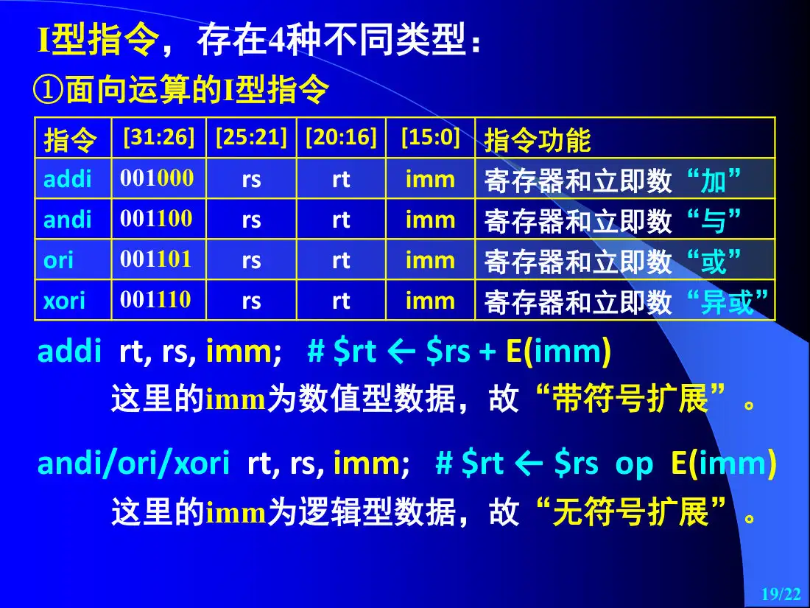

原文：

I型指令，存在4种不同类型：①面向运算的I型指令

<table><tr><td>指令</td><td>[31:26]</td><td>[25:21]</td><td>[20:16]</td><td>[15:0]</td><td>指令功能</td></tr><tr><td>addi</td><td>001000</td><td>rs</td><td>rt</td><td>imm</td><td>寄存器和立即数“加”</td></tr><tr><td>andi</td><td>001100</td><td>rs</td><td>rt</td><td>imm</td><td>寄存器和立即数“与”</td></tr><tr><td>ori</td><td>001101</td><td>rs</td><td>rt</td><td>imm</td><td>寄存器和立即数“或”</td></tr><tr><td>xori</td><td>001110</td><td>rs</td><td>rt</td><td>imm</td><td>寄存器和立即数“异或”</td></tr></table>

addi rt, rs, imm; # \$rt ← \$rs + E(imm) 这里的imm为数值型数据，故“带符号扩展”

andi/ori/xori rt, rs, imm; # \$rt ← \$rs op E(imm)这里的imm为逻辑型数据，故“无符号扩展”。

19/22

### ②面向访存的I型指令

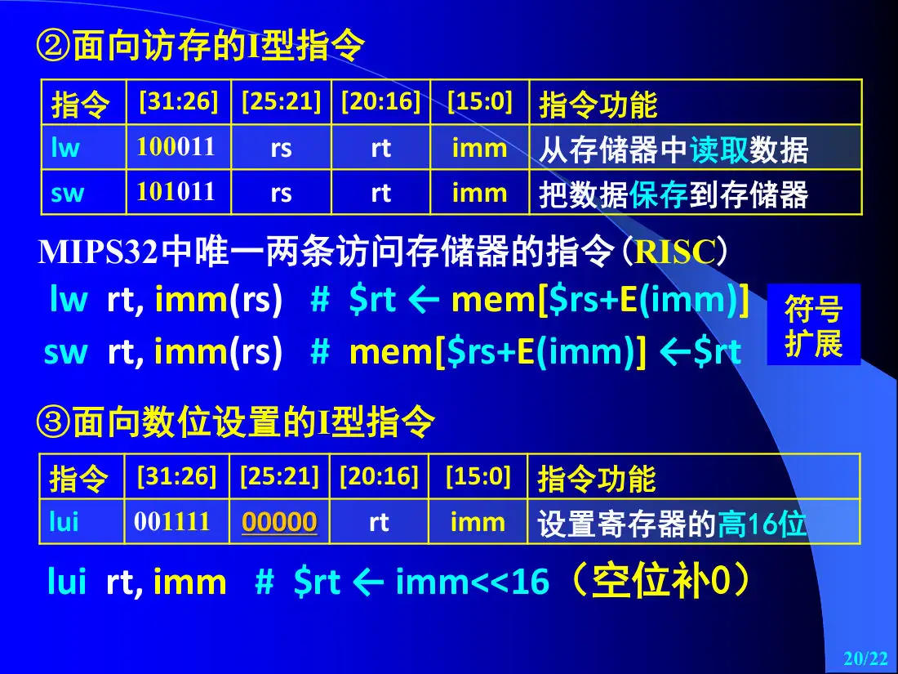

原文：

②面向访存的I型指令

指令功能

从存储器中读取数据

把数据保存到存储器

MIPS32中唯一两条访问存储器的指令(RISC) lw rt, imm(rs) # \$rt ← mem[\$rs+E(imm)] sw rt, imm(rs) # mem[\$rs+E(imm)] ←\$rt

符号扩展

③面向数位设置的I型指令

00000

rt

[15:0]

imm

指令功能

设置寄存器的高16位

lui rt, imm # \$rt ← imm<<16（空位补0）

20/22

### ④面向条件转移(分支)的I型指令

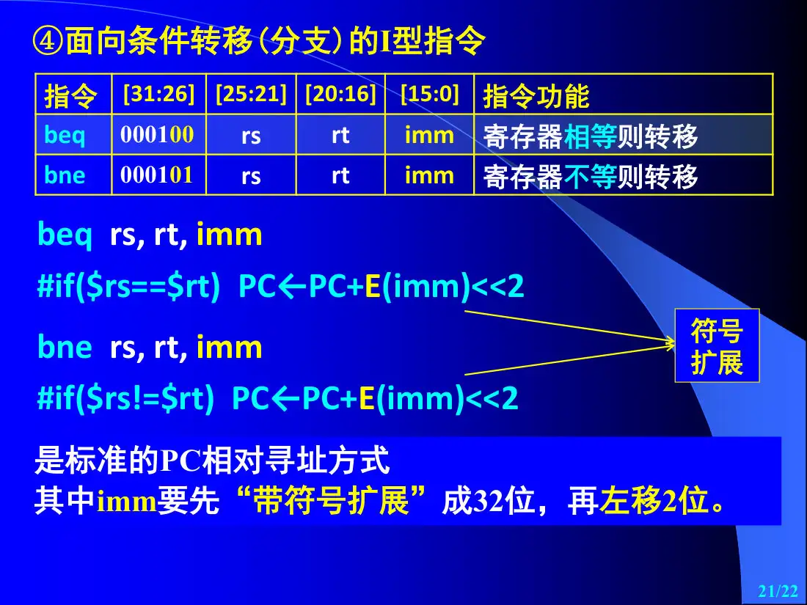

原文：

④面向条件转移(分支)的I型指令

指令 [31:26] [25:21] [20:16] [15:0] 指令功能

beq 000100 rs rt imm 寄存器相等则转移

bne 000101 rs rt imm 寄存器不等则转移

beq rs, rt, imm #if(\$rs==\$rt) PC←PC+E(imm)<<2

bne rs, rt, imm #if(\$rs!=\$rt) PC←PC+E(imm)<<2

符号扩展

是标准的PC相对寻址方式其中imm要先“带符号扩展”成32位，再左移2位。

21/22

### ※J型指令(列出2条)

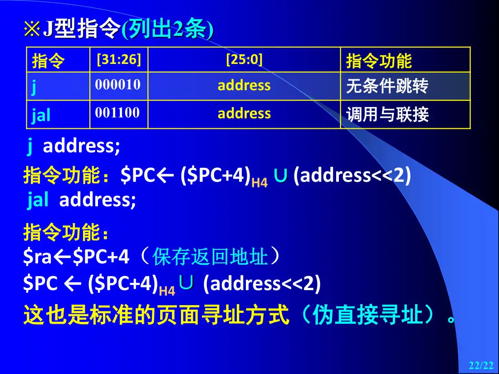

原文：

※J型指令(列出2条)

指令

[31:26]

000010

[25:0]

address

指令功能

无条件跳转

jal

001100

address

调用与联接

j address;

指令功能：\$PC← (\$PC+4)H4 ∪ (address<<2) jal address;

指令功能：\$ra←\$PC+4（保存返回地址）\$PC ← (\$PC+4)H4∪ (address<<2)这也是标准的页面寻址方式（伪直接寻址）

22/22
