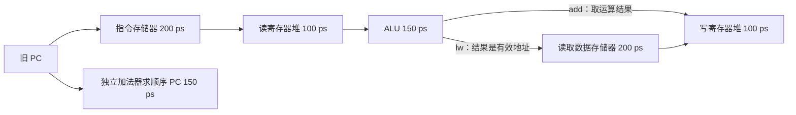

# 《计算机组成与结构》第6章 CPU子系统-MIPS指令时间特性分析（课件）

一台处理器时钟能跑到 5 GHz，另一台只能跑到约 1.33 GHz，前者为何还可能需要更久才能完成同一条指令？原件借小型 MIPS32 实现区分==时钟周期==、==一条指令占用的拍数==和==实际指令耗时==。指令集决定要实现哪些行为，数据通路决定信号能经过哪些部件，控制器决定操作能否并行以及被放在哪一拍。三个层面一起确定时间，不能只盯主频。

## 单周期：最长的不只是某一个部件（原件第 1–7 页）

课件的理想延时为：存储器读或写 200 ps，寄存器堆读或写 100 ps，ALU 或加法器 150 ps，拼接器 50 ps，其他部件忽略；$1\ \mathrm{ps}=10^{-12}\ \mathrm{s}$。这些是假设，不是 MIPS32 指令集规定的器件参数。原件的单周期模型覆盖 11 条 R、I、J 型目标指令，以加法与装载绘出关键路径。

加法从取指到写目的寄存器依次用 $200+100+150+100=550$ ps；两个源寄存器从两个读口并行取出，不是 $100+100$。<kbd>lw</kbd> 虽也用 ALU 做加法，此时 ALU 结果只是数据地址，还要读数据存储器，增加 200 ps，因此用 750 ps。原图中两条指令的顺序 PC 回路与结果路径并行，不另加 150 ps；它仍必须在同拍满足自己的时序。

| 指令类 | 原件列出的串行路径延时（ps） | 实际占用整拍（ps） |
| --- | ---: | ---: |
| R/I 型运算 | 550 | 750 |
| <kbd>lw</kbd> | 750 | 750 |
| <kbd>sw</kbd> | 650 | 750 |
| <kbd>beq</kbd> | 450 | 750 |
| <kbd>j</kbd> | 250 | 750 |

> [!TIP]
> ==沿依赖串行相加，遇到并行汇合取较晚到达者==。先逐条求指令所需的最长路径，再在指令之间取最大值作为时钟下限，不取平均。因此本模型为 $T_{\rm single}=750$ ps，主频约 1.33 GHz，所有指令的 CPI 都是 1，即使 <kbd>j</kbd> 很早就形成目标地址。

把整条指令各功能塞进一个时钟时，同一拍内会被不同操作同时占用的硬件不能靠分时复用。原图将取指与访问数据分别接到存储器接口，并让顺序 PC 用独立加法器生成。若加入更慢、更复杂的指令，原样维持一拍就可能将时钟拉长，其他指令也会跟着等。这解释了第 7 页对小型指令集适用性的判断，而不是说单周期电路物理上绝对不能实现浮点。

## 多周期：按阶段复用，但每拍仍有统一长度（原件第 8–10 页）

多周期图用 <kbd>IorD</kbd> 选择 PC 或 ALU 形成的地址，将同一个存储器接口在取指和数据阶段复用。IR 留住指令，A/B 留住寄存器源值，F 留住 ALU 结果，MDR 留住读出的数据，以便下一拍使用。FT、DT、ET、MT、RT 在本课件中分别对应取指、译码/取数、执行、访存、结果写回。以加法为例：FT 取指；DT 取寄存器入 A/B；ET 算和并存 F；RT 从 F 写回。各步有效延时合计 550 ps，但它跨了四个完整周期，因此不是 550 ps 就一定能完成。

| 指令类 | FT、DT、ET、MT、RT 的有效延时（ps） | 有效延时合计 | 原件列出的拍数与耗时 |
| --- | --- | ---: | --- |
| R/I 型运算 | 200、100、150、—、100 | 550 ps | 4 拍，800 ps |
| <kbd>lw</kbd> | 200、100、150、200、100 | 750 ps | 5 拍，1,000 ps |
| <kbd>sw</kbd> | 200、100、150、200、— | 650 ps | 5 拍，1,000 ps；见下方核对 |
| <kbd>beq</kbd> | 200、150、150、—、— | 500 ps | 3 拍，600 ps |
| <kbd>j</kbd> | 200、50、—、—、— | 250 ps | 2 拍，400 ps |

单个阶段中最长的延时是存储器读写的 200 ps，故不计寄存与时序开销时 $T_{\rm multi}=200$ ps，主频约 5 GHz。分支的译码拍可同时读寄存器和计算目标地址，解读原表中的 150 ps 应取并行路径的较大者，而不是把两次工作全串起来相加；下一拍用 ALU 比较并决定是否更新 PC。

> [!WARNING]
> **订正口径：**第 10 页的 <kbd>sw</kbd> 实际列出四个有工作量的阶段，表尾却计五拍。同章《多周期MIPS处理器指令流程与微命令》第 8 页也只给出 T0 到 T3 的操作，T4 留白。引用原时间表应保留其五拍数并注明不一致；若控制器在 T3 写主存后直接返回取指，则按四拍计 800 ps。没有状态图或“空一拍”的题设，不能把第 5 拍当成已证实的硬件行为；写主存不需要再安排寄存器写回。

## 用指令比例比较整段程序（原件第 11 页与补充）

多周期让指令按需要占不同拍数，并可复用硬件；代价是阶段间须暂存信号，短阶段还要等长至一个完整时钟周期。在上述参数下，运算和装载的多周期耗时比相应单周期拍长，分支和跳转反而较短；所以原件“指令周期一般变长”是该方案的取舍，不是每条指令都变慢。比较程序时同一指令条数下，应比较==平均 CPI 乘时钟周期==。

**补充算例与参考解答：**若五类指令各占五分之一，按原表五拍的 <kbd>sw</kbd> 口径，平均 CPI 为 $(4+5+5+3+2)/5=3.8$，每条平均 $3.8\times200=760$ ps，略慢于单周期 750 ps。若该控制器的 <kbd>sw</kbd> 实际为四拍，平均 CPI 降为 $3.6$，平均 $720$ ps，则略快。保持时钟参数时，分界点是 $750/200=3.75$ 拍每条；若给出指令混合比例，要先算加权 CPI 再和这一门槛比较。工程上还需计入建立时间、时钟偏差、缓存等待等课件忽略的成本。

相关知识点：[单周期数据通路](../../../topics/计算机组成/single-cycle-datapath.md)、[多周期数据通路](../../../topics/计算机组成/multi-cycle-datapath.md)、[多周期控制](../../../topics/计算机组成/multi-cycle-control.md)、[指令流程与微命令](../../../topics/计算机组成/instruction-flow.md)、[执行时间与性能](../../../topics/计算机组成/cpu-time.md)、[CPI 与指令速率](../../../topics/计算机组成/mips-rate.md)。
