# 《计算机组成与结构》第6章 CPU子系统-MIPS指令时间特性分析（课件）

原件的每一页，下面附识别出的文字。

### 6.8 MIPS32处理器设计

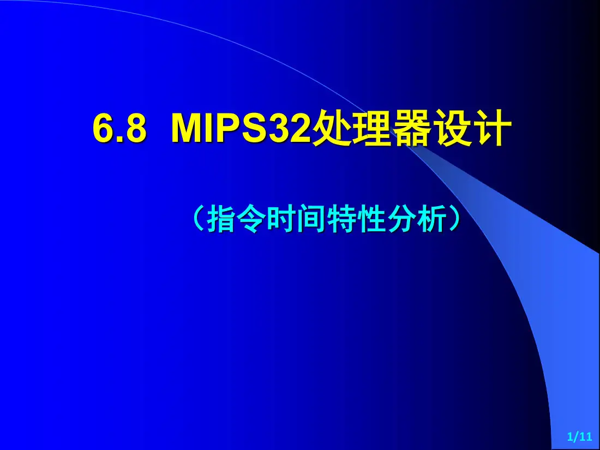

原文：

6.8 MIPS32处理器设计

（指令时间特性分析）

1/11

### ※CPU设计的主要任务

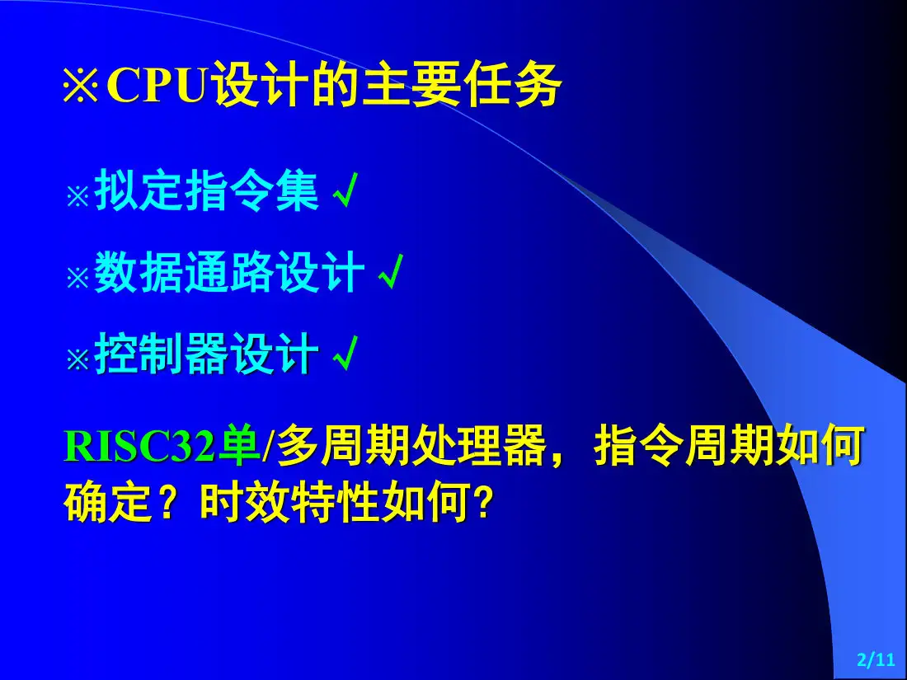

原文：

※CPU设计的主要任务

※拟定指令集√

※数据通路设计√

※控制器设计√

RISC32单/多周期处理器，指令周期如何确定？时效特性如何?

2/11

### 假设各部件的硬件延时（10-12秒，皮秒）：

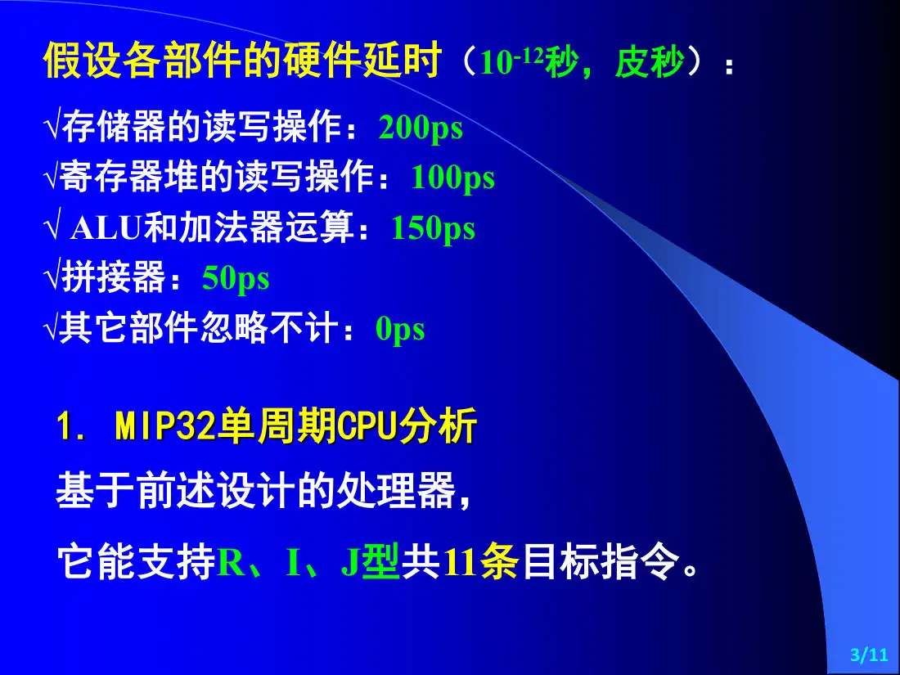

原文：

假设各部件的硬件延时（10-12秒，皮秒）：

存储器的读写操作：200ps

√寄存器堆的读写操作：100ps

ALU和加法器运算：150ps

√拼接器：50ps

√其它部件忽略不计：0ps

1. MIP32单周期CPU分析

基于前述设计的处理器，

它能支持R、I、J型共11条目标指令。

3/11

### [举例]

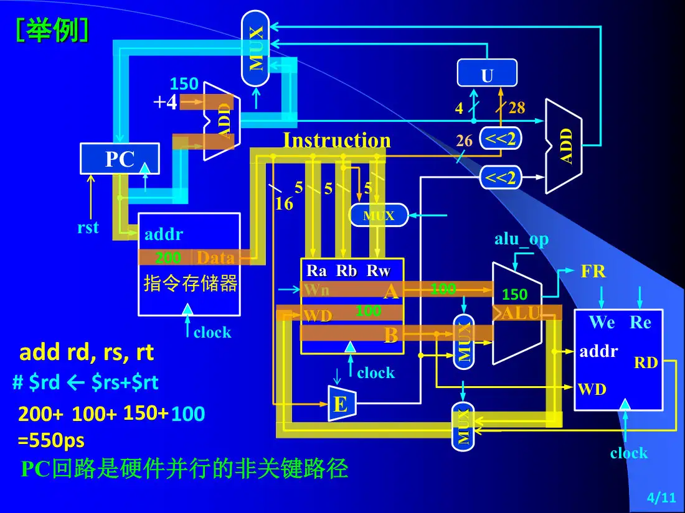

原文：

[举例]

add rd, rs, rt# \$rd ← \$rs+\$rt200+ 100+ 150+100=550ps

PC回路是硬件并行的非关键路径lw rt, imm(rs)# \$rt ← Mem[\$rs+E(imm)]200+100+ 150+ 200 +100=750ps

4/11

### PC回路是硬件并行的非关键路径

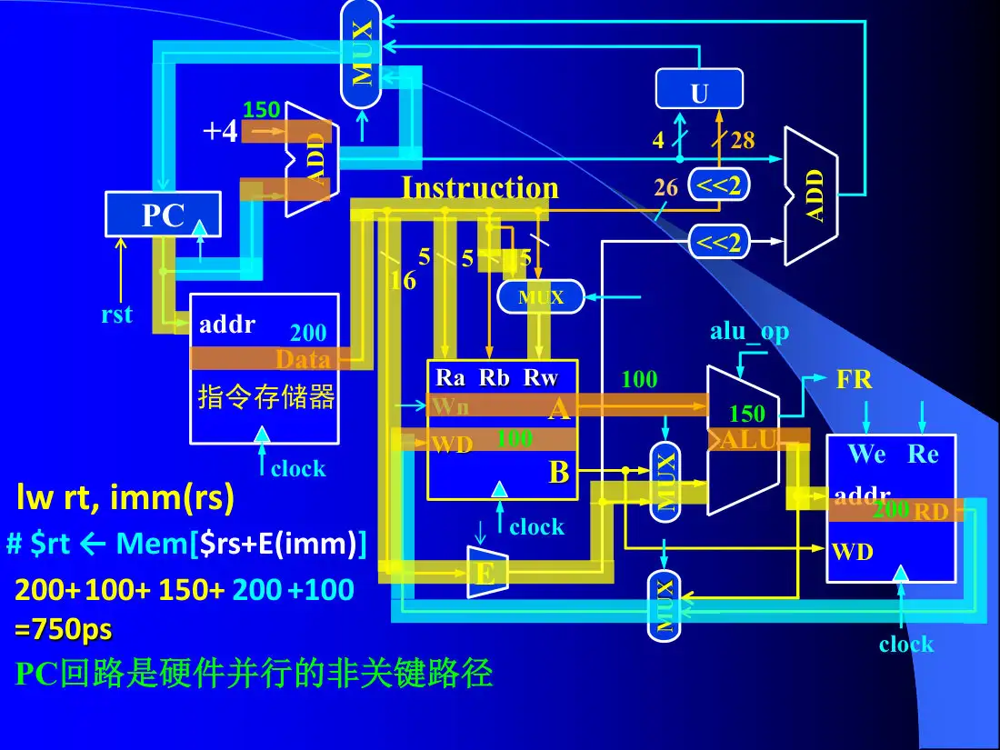

原文：

PC回路是硬件并行的非关键路径

### 用同样方法可得到如下时间：

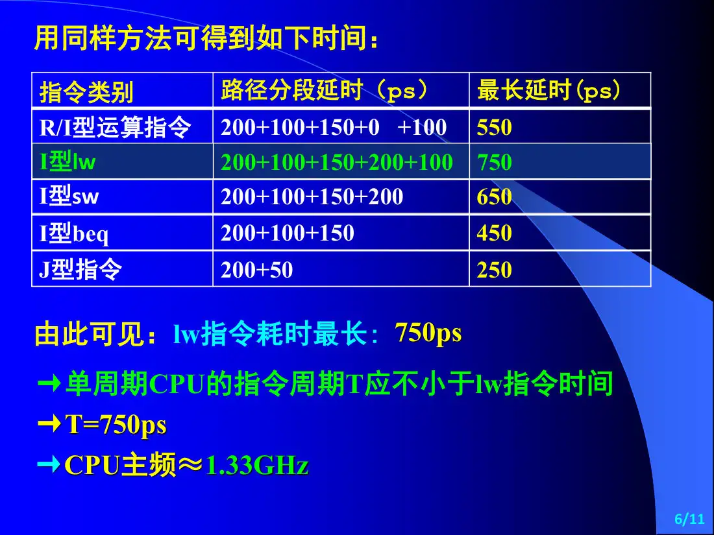

原文：

用同样方法可得到如下时间：

<table><tr><td>指令类别</td><td>路径分段延时(ps)</td><td>最长延时(ps)</td></tr><tr><td>R/I型运算指令</td><td>200+100+150+0 +100</td><td>550</td></tr><tr><td>I型lw</td><td>200+100+150+200+100</td><td>750</td></tr><tr><td>I型sw</td><td>200+100+150+200</td><td>650</td></tr><tr><td>I型beq</td><td>200+100+150</td><td>450</td></tr><tr><td>J型指令</td><td>200+50</td><td>250</td></tr></table>

由此可见：lw指令耗时最长: 750ps

→单周期CPU的指令周期T应不小于lw指令时间

→T=750ps

→CPU主频≈1.33GHz

6/11

### ※单周期CPU特性总结

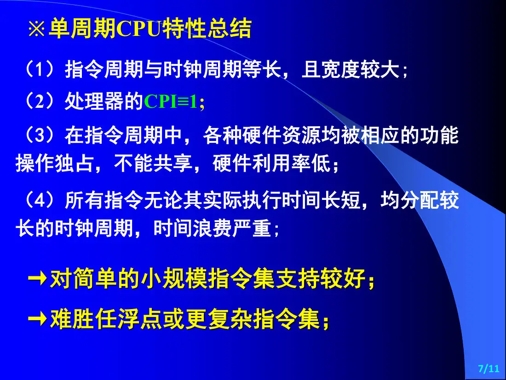

原文：

※单周期CPU特性总结

（1）指令周期与时钟周期等长，且宽度较大;

（2）处理器的CPI≡1;

（3）在指令周期中，各种硬件资源均被相应的功能操作独占，不能共享，硬件利用率低；

（4）所有指令无论其实际执行时间长短，均分配较长的时钟周期，时间浪费严重;

→对简单的小规模指令集支持较好；

→难胜任浮点或更复杂指令集；

7/11

### 2.MIPS32多周期CPU分析

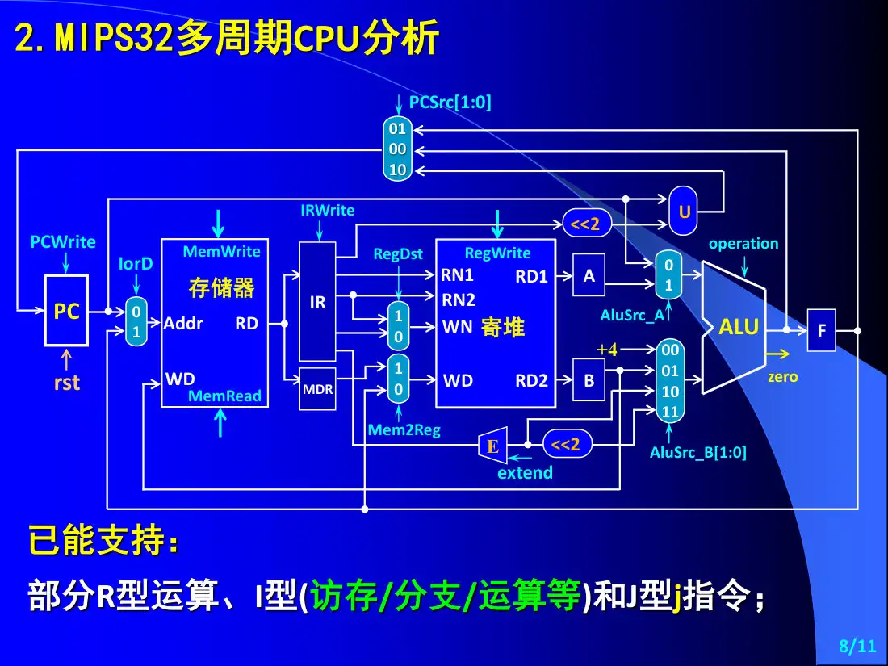

原文：

2.MIPS32多周期CPU分析

已能支持：

部分R型运算、I型(访存/分支/运算等)和J型j指令；

8/11

### [举例] add rd, rs, rt # \$rd ← \$rs+\$rt

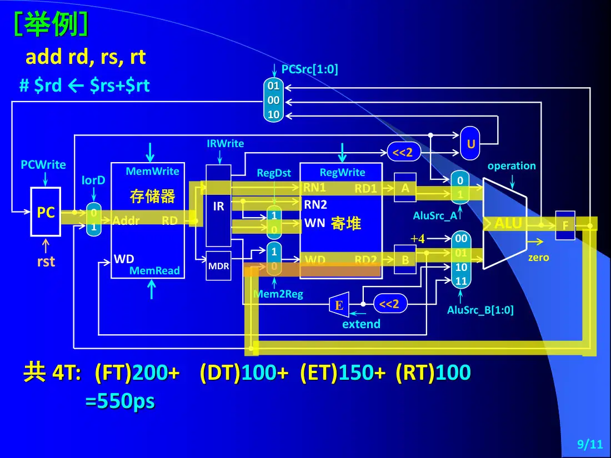

原文：

[举例] add rd, rs, rt # \$rd ← \$rs+\$rt

共 4T: (FT)200+ (DT)100+ (ET)150+ (RT)100 =550ps

9/11

### 用同样方法，可得如下结果：

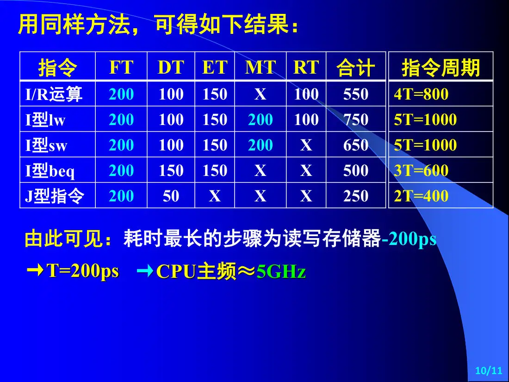

原文：

用同样方法，可得如下结果：

<table><tr><td>指令</td><td>FT</td><td>DT</td><td>ET</td><td>MT</td><td>RT</td><td>合计</td><td>指令周期</td></tr><tr><td>I/R运算</td><td>200</td><td>100</td><td>150</td><td>X</td><td>100</td><td>550</td><td>4T=800</td></tr><tr><td>I型lw</td><td>200</td><td>100</td><td>150</td><td>200</td><td>100</td><td>750</td><td>5T=1000</td></tr><tr><td>I型sw</td><td>200</td><td>100</td><td>150</td><td>200</td><td>X</td><td>650</td><td>5T=1000</td></tr><tr><td>I型beq</td><td>200</td><td>150</td><td>150</td><td>X</td><td>X</td><td>500</td><td>3T=600</td></tr><tr><td>J型指令</td><td>200</td><td>50</td><td>X</td><td>X</td><td>X</td><td>250</td><td>2T=400</td></tr></table>

由此可见：耗时最长的步骤为读写存储器-200ps

$\angle 2 0 ^ { \circ } = 9 \angle 1 1 0 ^ { \circ } ( 0 )$ →CPU主频≈5GHz

10/11

### ※多周期CPU特性总结

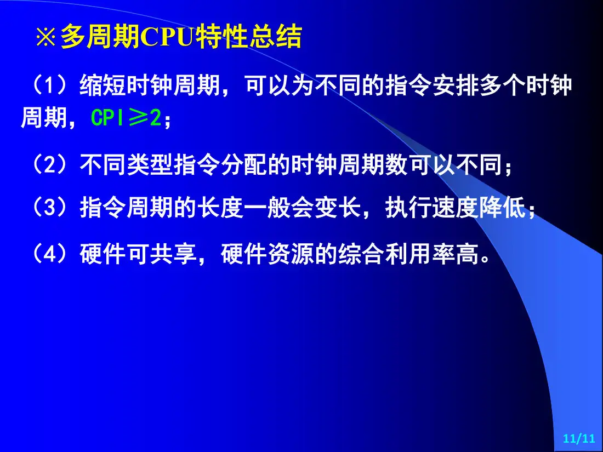

原文：

※多周期CPU特性总结

（1）缩短时钟周期，可以为不同的指令安排多个时钟周期，CPI≥2；

（2）不同类型指令分配的时钟周期数可以不同；

（3）指令周期的长度一般会变长，执行速度降低；

（4）硬件可共享，硬件资源的综合利用率高。

11/11
