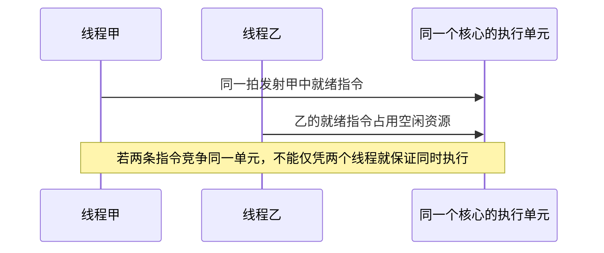

# 《计算机组成与结构》第6章 CPU 子系统：高级技术导读

如果四级流水线确实每一拍都有结果，为何第一条指令还要等四拍？这两个数字回答的是不同问题：**单条延迟**数一条指令经历的时间，**吞吐率**数系统持续完成多少条。课件的三组主题都在尝试提高吞吐率，但着手处不同：流水化让步骤在时间上重叠，超标量扩宽同时发射的容量，硬件多线程与多核分别从一个核或多个核寻找更多可执行工作。

## 从第一条到最后一条（原件第 1–4 页、第 9 页）

课件先用取指、译码、执行说明时间重叠，再把一个浮点加操作拆成求阶差、对阶、尾数相加和规格化。假定四段各占一拍、单发射、无冒险、每拍都接收一个新操作。四段的占用如下，表的列是时间区间而不是边界时刻：

| 功能段 | 第 1 拍 | 第 2 拍 | 第 3 拍 | 第 4 拍 | 第 5 拍 | 第 6 拍 | 第 7 拍 | 第 8 拍 | 第 9 拍 |
|---|---|---|---|---|---|---|---|---|---|
| 求阶差 | 1 | 2 | 3 | 4 | 5 | 6 | — | — | — |
| 对阶 | — | 1 | 2 | 3 | 4 | 5 | 6 | — | — |
| 尾数相加 | — | — | 1 | 2 | 3 | 4 | 5 | 6 | — |
| 规格化 | — | — | — | 1 | 2 | 3 | 4 | 5 | 6 |

从首项输入到首项完成要四拍；第 4–6 拍四段同时占用，末项第 9 拍完成。对 $n$ 个相互独立的操作、$m$ 级等长流水线、拍长 $T$，第 $i$ 个操作在第 $i+m-1$ 拍末完成，
$$
T_{\mathrm{串}}=nmT,\qquad T_{\mathrm{流}}=(m+n-1)T.
$$
故原例的串行和流水时间分别为 $24T$、$9T$，平均吞吐率 $6/(9T)$，加速比 $8/3$，平均段利用率为工作格数与可用格数之比 $24/(4\cdot9)=2/3$。在足够长且无阻塞的输入中，吞吐率趋近 $1/T$，而非把本批次直接按 $1/T$ 算。[流水线基本原理](../../../topics/计算机组成/pipeline-basic.md)和[性能指标](../../../topics/计算机组成/pipeline-perf.md)给出通用关系。

> [!TIP]
> 题面问==执行完一整批==时，把填充和排空画进表；问稳态才看相邻完成之间的拍数。遇到阶段不等长，不能套每级时间等于平均时长：同步设计的拍长至少受最慢阶段和段间寄存开销约束。

**补充算例。** 原例中若全线在第 3 拍后共同停两拍，不增加有效工作而只平移后续活动，总时长变为 $11T$、利用率 $24/44=6/11$。若题面只是某一级阻塞，则哪些操作停、是否有旁路吸收以及末项晚几拍不能直接照搬。可对照[数据冒险](../../../topics/计算机组成/data-hazard.md)与[结构冒险](../../../topics/计算机组成/structural-hazard.md)。

## 分类是五个独立问题（原件第 5–8 页）

| 分类轴 | 原件类别 | 看什么判断 |
|---|---|---|
| 重叠的是哪一层 | 操作部件级、指令级、处理机级 | 重叠操作的子步骤、指令的子过程，还是分配给多个处理器的任务阶段 |
| 可组织出几种功能 | 单功能、多功能；多功能又可静态或动态 | 改换功能是否须先让旧模式退出，还是旧、新功能可按资源调度同时推进 |
| 一项数据长什么样 | 标量、向量 | 处理对象为单个量还是按向量方式组织；这不是每拍发射指令数 |
| 段怎样连 | 线性、非线性 | 是否只沿前馈顺序走，还是可能反馈、再次占用既有阶段 |
| 输入、输出怎样对应 | 顺序、乱序 | 输出是否保持输入次序；不要与体系结构是否保持顺序提交混为一谈 |

第 7 页图的关键信息在交接处：静态重组等之前的功能结束，动态重组允许两类任务跨过切换时刻重叠，前提是不会争用同一资源。**订正。** 第 6 页动态型一句在“多种不同功能”前多写了“只能”；结合下页的时空图，应理解为**可同时**组织不同功能，并非同一物理段可以无限地服务多个任务。

## 加宽、加深和填补空槽（原件第 10–14 页）

第 10–11 页的一拍三发射图先增加的是**同拍容量**；第 12 页把原来的每级再细分，理想模型先增加的是**单位原拍的发射次数**；第 13 页将二者合用。题图的 $3\times3=9$ 指每个原长周期有三个短发射槽、每槽可发三条，这是理想上限而非一般程序的加速比：数据依赖、分支、缓存缺失和资源竞争都会让槽位空着，寄存开销也让物理时钟未必恰好缩短三倍。看见“每拍执行几条”还须辨清是发射、执行完成还是提交。[超标量流水线](../../../topics/计算机组成/superscalar-pipeline.md)进一步说明这些界限。

第 14 页的 SMT 是同一个核保留多个硬件线程上下文，让各线程就绪的指令争取这个核的执行资源。课件举例的超线程是 SMT 的一种实现，四核八线程仍是四个物理核，不是将所有功能部件加倍；如果两条线程主要使用同一瓶颈，SMT 不能凭空扩出该资源。[多核、SMT 与线程级并行](../../../topics/计算机组成/multicore-smt.md)把这两层资源分别画了出来。

## 核添在哪里，瓶颈又会移到哪里（原件第 15–18 页）

第 15–17 页比较了两个历史双核设计。一例是同一封装中的两个芯粒，通过前端总线访问外部内存控制器；另一例将核集成在同一芯片内，并展示核向交叉开关和内存控制器发出请求的路径。看图不只数核，还要追问“两个核同时读内存时最后在哪里排队”。将核放在哪个芯粒，与缓存、中断、内存通道怎样共享，是分开的设计问题；原图对应指定时期的产品，不能套到品牌的全部处理器。末页提到增核、SMT、集成图形单元和制程，以及龙芯、飞腾等历史示例，应读作该课件所处时期的案例而非今天的规格上限。

> [!WARNING]
> 题面说==四核八线程==时，先数四组物理核资源；另四个是额外的线程上下文，不保证内存带宽或执行吞吐加倍。

**补充自检。** 假定一项作业原来用时 $20$ 秒，其中三分之一无法并行，其余在改用四核后恰缩短为四分之一且无额外开销。新耗时为 $20(1/3+(2/3)/4)=10$ 秒，即加速 $2$ 倍。这个简单模型还未计入共享带宽和调度；若瓶颈在这些地方，测到的改善很可能更小。
