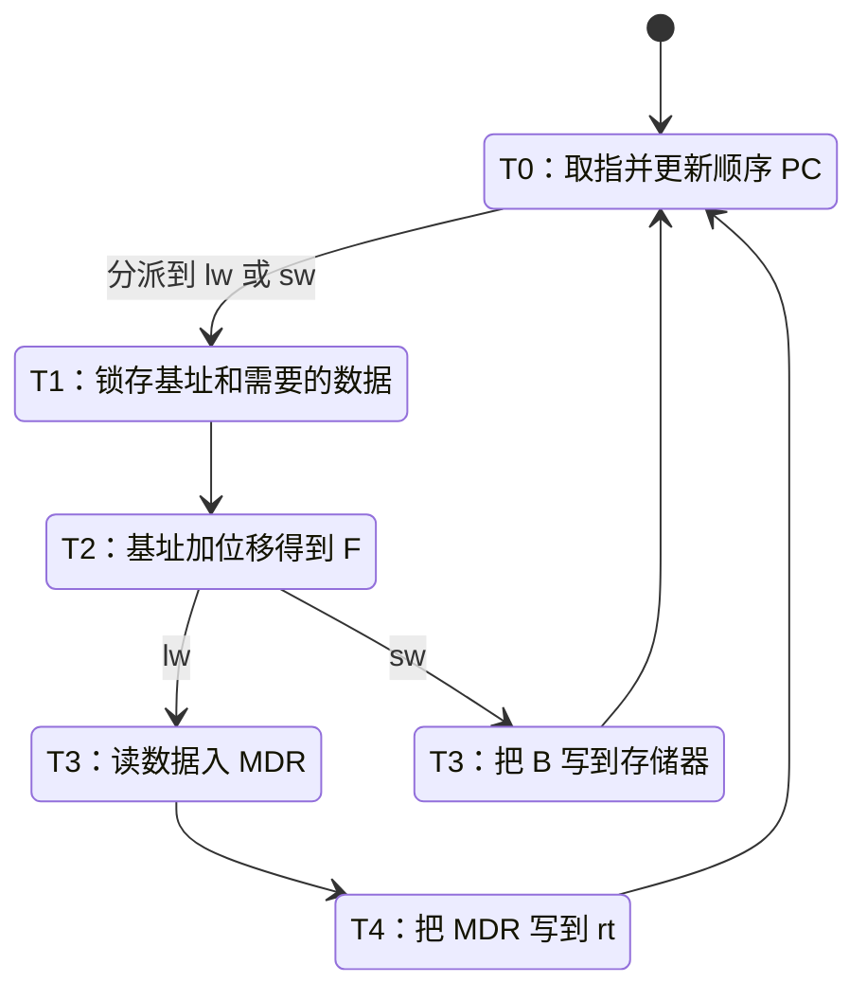

# 《计算机组成与结构》第6章 CPU子系统——多周期MIPS处理器（指令流程与微命令）

如果取指和装载都要用同一个存储器，为什么不会冲突？因为它们不在同一拍。新的问题是：操作之间隔着时钟边沿，前一拍的地址、数据或运算结果得留到下一拍。原件以 IR 保存机器指令、A/B 保存源值、F 保存 ALU 结果、MDR 保存读出的数据。于是设计控制器时，应先列每拍寄存器传送，再译成微命令，而不是先背一串选择位。

## 13 组信号分别解决什么问题（原件第 2–4 页）

| 想决定的事 | 本图的信号与取值 | 不要混淆 |
| --- | --- | --- |
| PC 从哪里得到新值、是否写入 | <kbd>PCSrc</kbd>：<kbd>00</kbd> 选当前 ALU 输出，<kbd>01</kbd> 选 F，<kbd>10</kbd> 选 J 型拼接结果；<kbd>PCWrite=1</kbd> 才写入 | 选了来源不等于发出写命令；分支和 J 型跳转不是同一路 |
| 存储器访问地址来自哪里 | <kbd>IorD=0</kbd> 选 PC，<kbd>IorD=1</kbd> 选 F | <kbd>MemRead</kbd>、<kbd>MemWrite</kbd> 另决定动作；<kbd>IRWrite</kbd> 决定是否更新 IR |
| ALU 从哪里取操作数 | <kbd>ALUSrc_A</kbd>：0 选 PC、1 选 A；<kbd>ALUSrc_B</kbd>：<kbd>00</kbd> 常数 4、<kbd>01</kbd> B、<kbd>10</kbd> 扩展值、<kbd>11</kbd> 扩展后左移两位 | <kbd>Extend</kbd> 为 0 时零扩展、为 1 时符号扩展；<kbd>operation</kbd> 另选算术或逻辑运算 |
| 写回寄存器堆时写哪一格、用哪个值 | <kbd>RegDst</kbd>：0 选 rd、1 选 rt；<kbd>Mem2Reg</kbd>：0 选 F、1 选 MDR；<kbd>RegWrite=1</kbd> 才执行寄存器写入 | 目的编号与写回数据是两个选择器；有的其他实现对 <kbd>RegDst</kbd> 使用相反的 0/1 编码 |

这些是课件图 3-91 的编码，不是指令集对控制信号命名或电平的约定。第 3 页把 <kbd>PCSrc=10</kbd> 泛称为转移地址；按第 2 页连线及第 9、11 页逐拍表，对 <kbd>beq</kbd> 应选 F 的 <kbd>01</kbd>，对 <kbd>j</kbd> 才选拼接结果 <kbd>10</kbd>。

## 共用 T0；取指后才知道走哪条路（原件第 5–11 页）

T0 总从旧 PC 指定的地址读取指令，同时 ALU 计算顺序地址。令 <kbd>IorD=0, MemRead=1, IRWrite=1</kbd>，并行取 <kbd>ALUSrc_A=0, ALUSrc_B=00, operation=0010</kbd> 做加法，然后以 <kbd>PCSrc=00, PCWrite=1</kbd> 更新 PC。按字节编址且指令固定 4 B，所以寄存器边沿前表现为读取 $M[PC_{\text{旧}}]$，边沿后 PC 已经是 $PC_{\text{旧}}+4$。==后面再用 PC 计算跳转目标时，基准已变成这个新 PC==。

| 指令 | T1 | T2 | 接下来的拍 |
| --- | --- | --- | --- |
| R 型运算 | 由 rs、rt 取值并锁存到 A、B | 选 A/B 两路并按操作码给出 ALU 功能，结果进 F | T3 用 <kbd>RegDst=0, Mem2Reg=0, RegWrite=1</kbd> 把 F 写到 rd |
| <kbd>lw</kbd> | 读基址进 A | A 加符号扩展的 16 位位移，F 得到字节地址 | T3 以 <kbd>IorD=1, MemRead=1</kbd> 把数据读到 MDR；T4 以 <kbd>RegDst=1, Mem2Reg=1, RegWrite=1</kbd> 写到 rt |
| <kbd>sw</kbd> | 读基址进 A，待存值进 B | 与 <kbd>lw</kbd> 一样，先把地址算入 F | T3 以 <kbd>IorD=1, MemWrite=1</kbd> 把 B 写到地址 F；不写寄存器堆 |
| <kbd>beq</kbd> | A/B 取两个源值，并用 PC 与符号扩展后左移两位的位移求和，候选地址入 F | A 减 B（<kbd>operation=0110</kbd>）；当零标志为 1 时，<kbd>PCSrc=01, PCWrite=1</kbd> | 相等则取候选地址，否则保留 T0 前移后的 PC |
| I 型立即数运算 | 读 rs 进 A | 用 <kbd>ALUSrc_A=1, ALUSrc_B=10</kbd> 取 A 与扩展值，按操作计算写入 F | T3 用 <kbd>RegDst=1, Mem2Reg=0, RegWrite=1</kbd> 把 F 写到 rt |
| <kbd>j</kbd> | 取更新后 PC 的高 4 位，与 26 位索引和两个低零位拼接；<kbd>PCSrc=10, PCWrite=1</kbd> | 已完成 | 不做第二次取指或地址读存储器 |

<kbd>lw</kbd>、<kbd>sw</kbd> 的 T2 都用 <kbd>ALUSrc_A=1, ALUSrc_B=10, Extend=1, operation=0010</kbd>；不同点不是地址计算，而是谁在后续阶段驱动主存以及是否写回寄存器。分支 T1 的 B 端选 <kbd>11</kbd>，因为位移按指令字表达，访存却选 <kbd>10</kbd>，因为位移已经是字节数。

> [!WARNING]
> **订正：**原件总览图（第 5 页）给 R 型、I 型运算各画了两个重复写回框；相应的逐拍表（第 6、10 页）只在 T3 发出写回，T4 留空。按详细时序一次写回即可。第 10 页以符号扩展的 I 型运算为例；若是 <kbd>ori</kbd> 等逻辑立即数指令，应按第 3 页的规则选零扩展，不能把 <kbd>Extend=1</kbd> 照搬到所有立即数运算。第 12 页无额外题目。

## 补充验算：同样的位移为何不产生同一个地址

假设 <kbd>lw</kbd> 的 rs 值为 <kbd>0x1008</kbd>，位移字段 <kbd>0xFFFC</kbd>；相邻的 <kbd>beq</kbd> 示例采用同一位移字段、旧指令地址为 <kbd>0x1020</kbd>。

**参考解答：**作为 16 位有符号数，位移是 $-4$。<kbd>lw</kbd> 的 T2 不左移，因此地址 $0x1008-4$ 为 <kbd>0x1004</kbd>；若那里存着 <kbd>0x89ABCDEF</kbd>，T3 时这个值只在 MDR，到 T4 才写 rt。同址 <kbd>sw</kbd> 会把 B 的值写过去而不改 rt。<kbd>beq</kbd> 的 T0 把 PC 更新到 <kbd>0x1024</kbd>，T1 将 $-4$ 乘 4 得 $-16$ 并求候选地址 <kbd>0x1014</kbd>。T2 若相等，PC 从 F 取 <kbd>0x1014</kbd>；若不等，PC 保持 <kbd>0x1024</kbd>，不能把 ALU 的差值写进去。

> [!TIP]
> 拿到微命令填表题，先写“==本拍哪个部件要改变，以及新值从哪里来==”。例如 F 与 ALU 当拍输出都是 PC 的候选来源，只有前者还保存着上一拍的分支目标；选错 <kbd>PCSrc</kbd>，就会把用于判相等的差写入 PC。选线路与发写许可应分别检查。

相关知识点：[多周期数据通路](../../../topics/计算机组成/multi-cycle-datapath.md)、[多周期控制](../../../topics/计算机组成/multi-cycle-control.md)、[指令流程与微命令](../../../topics/计算机组成/instruction-flow.md)、[指令周期](../../../topics/计算机组成/instruction-cycle.md)、[I 型指令](../../../topics/计算机组成/mips-i-type.md)、[J 型指令](../../../topics/计算机组成/mips-j-type.md)。
