# 《计算机组成与结构》第6章 CPU子系统——多周期MIPS处理器（指令流程与微命令）

原件的每一页，下面附识别出的文字。

### 6.6 多周期MIPS处理器

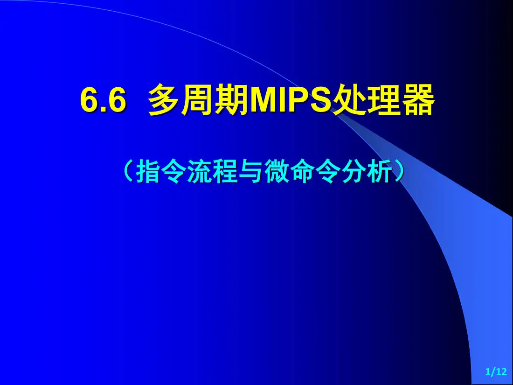

原文：

6.6 多周期MIPS处理器

（指令流程与微命令分析）

1/12

### ※多周期CPU所需的控制信号

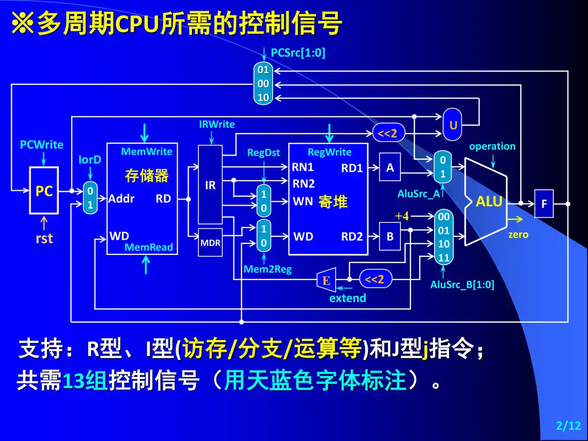

原文：

※多周期CPU所需的控制信号

支持：R型、I型(访存/分支/运算等)和J型j指令；共需13组控制信号（用天蓝色字体标注）。

2/12

### 整理所需的控制信号 (参见表3-32)

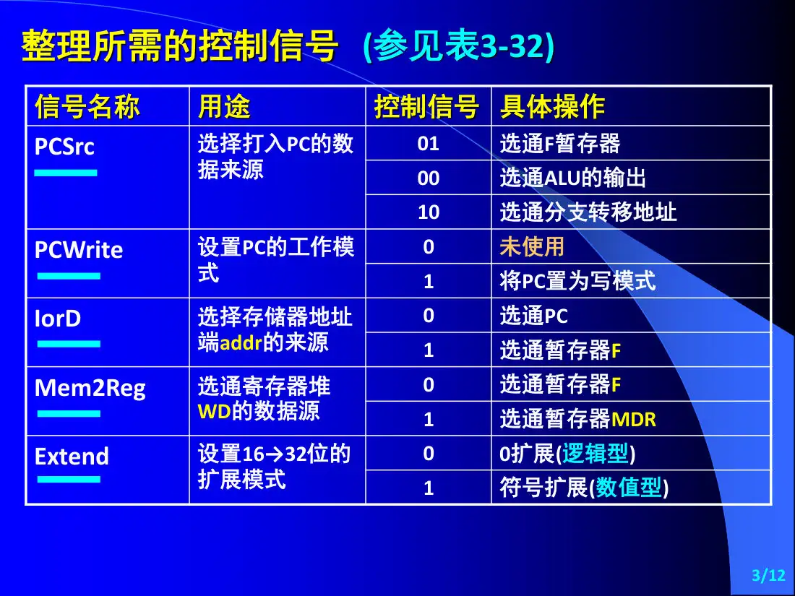

原文：

整理所需的控制信号 (参见表3-32)

<table><tr><td>信号名称</td><td>用途</td><td>控制信号</td><td>具体操作</td></tr><tr><td rowspan="3">PCSrc</td><td rowspan="3">选择打入PC的数据来源</td><td>01</td><td>选通F暂存器</td></tr><tr><td>00</td><td>选通ALU的输出</td></tr><tr><td>10</td><td>选通分支转移地址</td></tr><tr><td rowspan="2">PCWrite</td><td rowspan="2">设置PC的工作模式</td><td>0</td><td>未使用</td></tr><tr><td>1</td><td>将PC置为写模式</td></tr><tr><td rowspan="2">IorD</td><td rowspan="2">选择存储器地址端addr的来源</td><td>0</td><td>选通PC</td></tr><tr><td>1</td><td>选通暂存器F</td></tr><tr><td rowspan="2">Mem2Reg</td><td rowspan="2">选通寄存器堆WD的数据源</td><td>0</td><td>选通暂存器F</td></tr><tr><td>1</td><td>选通暂存器MDR</td></tr><tr><td rowspan="2">Extend</td><td rowspan="2">设置16→32位的扩展模式</td><td>0</td><td>0扩展(逻辑型)</td></tr><tr><td>1</td><td>符号扩展(数值型)</td></tr></table>

3/12

### （续表）

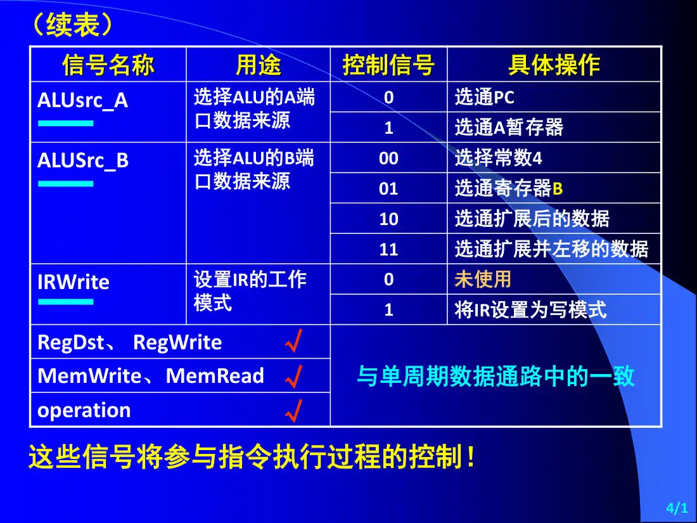

原文：

（续表）

<table><tr><td>信号名称</td><td>用途</td><td>控制信号</td><td>具体操作</td></tr><tr><td rowspan="2">ALUsrc_A</td><td rowspan="2">选择ALU的A端口数据来源</td><td>0</td><td>选通PC</td></tr><tr><td>1</td><td>选通A暂存器</td></tr><tr><td rowspan="4">ALUSrc_B</td><td rowspan="4">选择ALU的B端口数据来源</td><td>00</td><td>选择常数4</td></tr><tr><td>01</td><td>选通寄存器B</td></tr><tr><td>10</td><td>选通扩展后的数据</td></tr><tr><td>11</td><td>选通扩展并左移的数据</td></tr><tr><td rowspan="2">IRWrite</td><td rowspan="2">设置IR的工作模式</td><td>0</td><td>未使用</td></tr><tr><td>1</td><td>将IR设置为写模式</td></tr><tr><td colspan="2">RegDst、RegWrite √</td><td rowspan="3" colspan="2">与单周期数据通路中的一致</td></tr><tr><td colspan="2">MemWrite、MemRead √</td></tr><tr><td colspan="2">operation √</td></tr></table>

这些信号将参与指令执行过程的控制！

4/1

### （1）指令执行流程

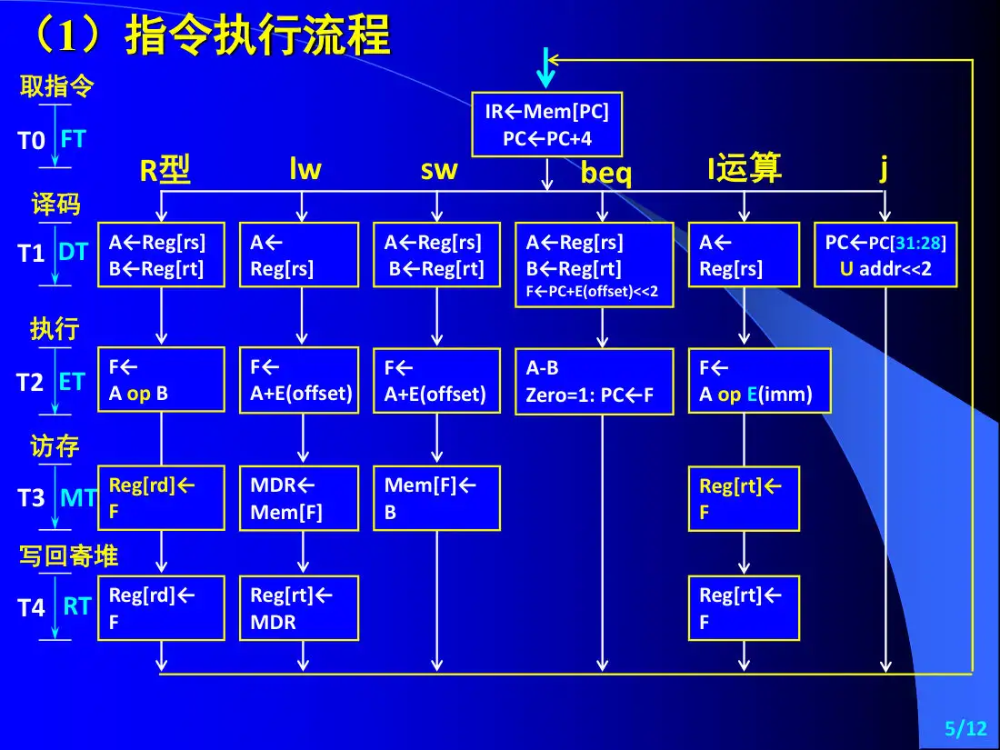

原文：

（1）指令执行流程

R型

A←Reg[rs] B←Reg[rt]

lw

F←A op B

Reg[rd]← F

T4 RT

写回寄堆

A← Reg[rs]

F← A+E(offset)

Reg[rd]←

MDR← Mem[F]

Reg[rt]← MDR

sw

A←Reg[rs] B←Reg[rt]

F← A+E(offset)

Mem[F]← B

IR←Mem[PC] PC←PC+4

beq

A←Reg[rs] B←Reg[rt] F←PC+E(offset)<<2

A-B Zero=1: PC←F

I运算

A← Reg[rs]

PC←PC[31:28] U addr<<2

F← A op E(imm)

Reg[rt]←

Reg[rt]← F

5/12

### 时钟周期

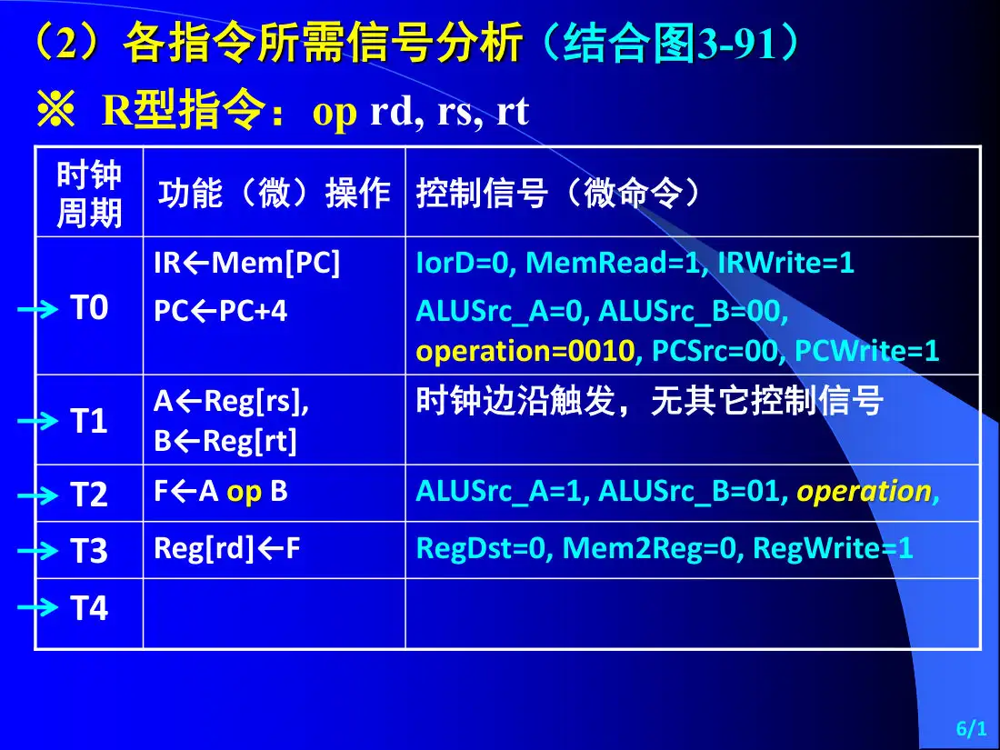

原文：

（2）各指令所需信号分析（结合图3-91）※ R型指令：op rd, rs, rt

时钟周期

功能 （微） 操作 控制信号 （微命令）

IR←Mem[PC]

T0

PC←PC+4

T1

A←Reg[rs], B←Reg[rt]

T2

F←A op B

T3

Reg[rd]←F

T4

IorD=0, MemRead=1, IRWrite=1

ALUSrc\_A=0, ALUSrc\_B=00, operation=0010, PCSrc=00, PCWrite=1

时钟边沿触发，无其它控制信号

ALUSrc\_A=1, ALUSrc\_B=01, operation,

RegDst=0, Mem2Reg=0, RegWrite=1

6/1

### ※ I型访存指令: lw rt, offset(rs)

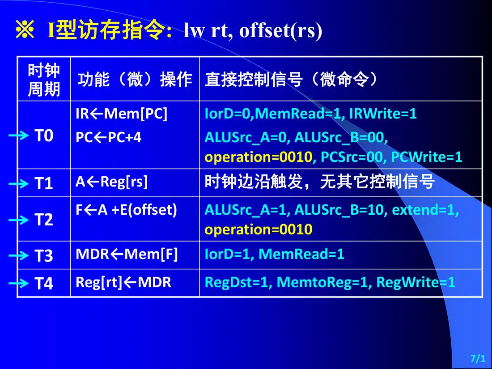

原文：

※ I型访存指令: lw rt, offset(rs)

时钟周期

功能（微）操作 直接控制信号（微命令）

IR←Mem[PC]

T0 PC←PC+4

T1

A←Reg[rs]

T2

F←A +E(offset)

T3

MDR←Mem[F]

T4 Reg[rt]←MDR

IorD=0,MemRead=1, IRWrite=1 ALUSrc\_A=0, ALUSrc\_B=00, operation=0010, PCSrc=00, PCWrite=1

时钟边沿触发，无其它控制信号

ALUSrc\_A=1, ALUSrc\_B=10, extend=1, operation=0010

IorD=1, MemRead=1

RegDst=1, MemtoReg=1, RegWrite=1

7/1

### ※ I型访存指令: sw rt, offset(rs)

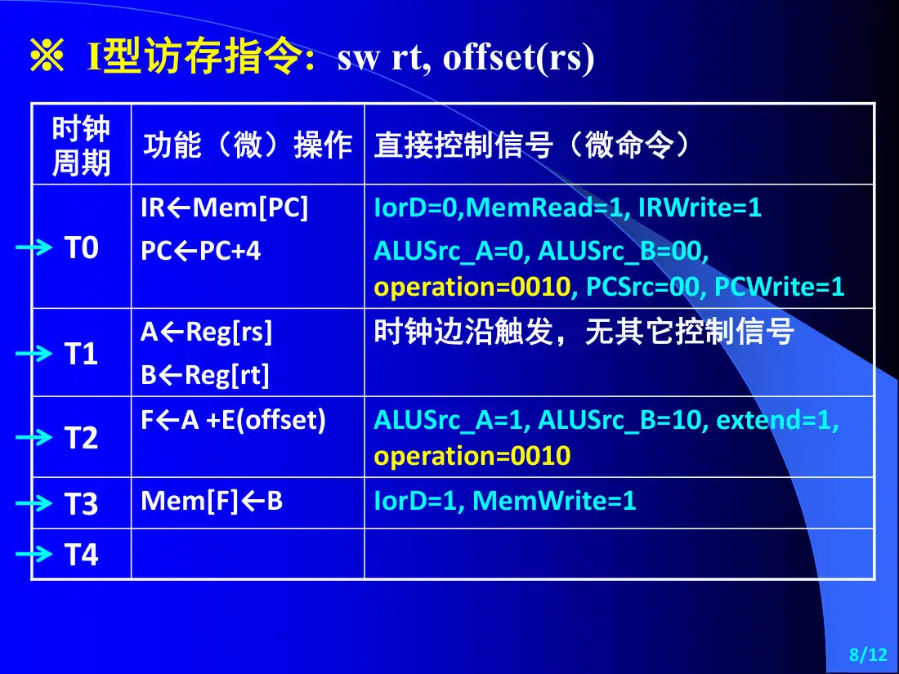

原文：

※ I型访存指令: sw rt, offset(rs)

时钟周期

功能（微）操作 直接控制信号（微命令）

IR←Mem[PC]

T0

T1

PC←PC+4

A←Reg[rs]

B←Reg[rt]

T2

F←A +E(offset)

T3

Mem[F]←B

T4

IorD=0,MemRead=1, IRWrite=1

ALUSrc\_A=0, ALUSrc\_B=00, operation=0010, PCSrc=00, PCWrite=1

时钟边沿触发，无其它控制信号

ALUSrc\_A=1, ALUSrc\_B=10, extend=1, operation=0010

IorD=1, MemWrite=1

8/12

### ※ I型分支指令: beq rs, rt, offset

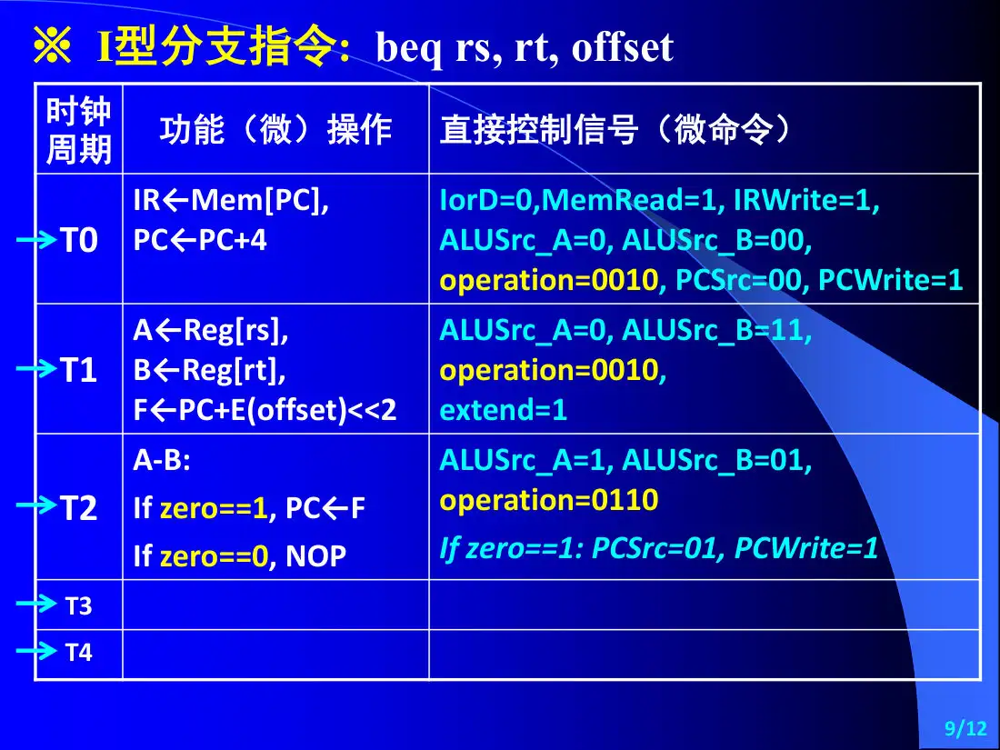

原文：

<table><tr><td>时钟周期</td><td>功能(微)操作</td><td>直接控制信号(微命令)</td></tr><tr><td>T0</td><td>IR←Mem[PC], PC←PC+4</td><td>lorD=0,MemRead=1, IRWrite=1, ALUSrc_A=0, ALUSrc_B=00, operation=0010, PCSrc=00, PCWrite=1</td></tr><tr><td>T1</td><td>A←Reg[rs], B←Reg[rt], F←PC+E(offset)&lt;&lt;2</td><td>ALUSrc_A=0, ALUSrc_B=11, operation=0010, extend=1</td></tr><tr><td>T2</td><td>A-B: If zero==1, PC←F If zero==0, NOP</td><td>ALUSrc_A=1, ALUSrc_B=01, operation=0110 If zero==1: PCSrc=01, PCWrite=1</td></tr><tr><td>T3</td><td></td><td></td></tr><tr><td>T4</td><td></td><td></td></tr></table>

※ I型分支指令: beq rs, rt, offset

9/12

### ※ I型运算指令: op rt, rs, imm

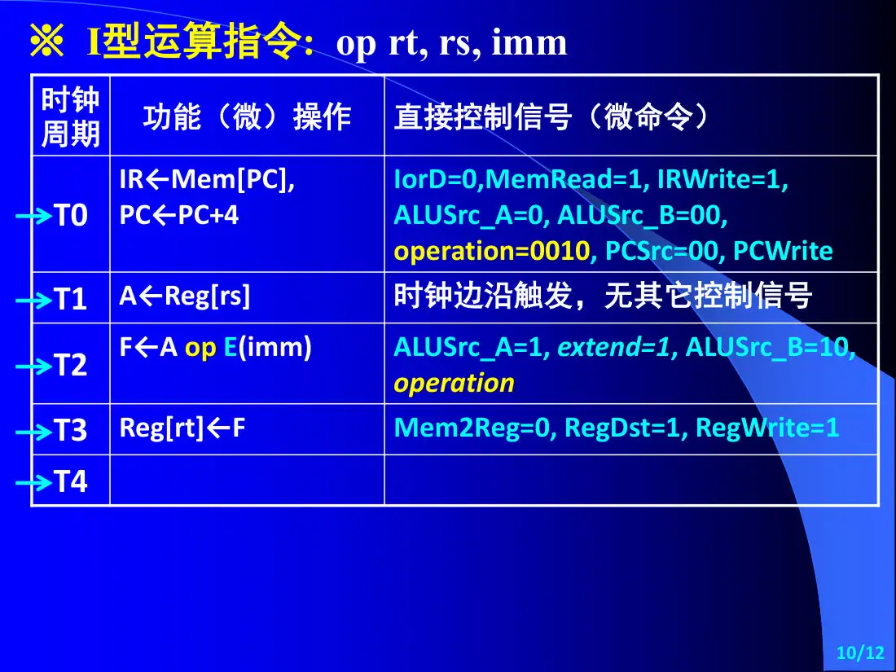

原文：

※ I型运算指令: op rt, rs, imm

时钟周期

功能 （微） 操作

IR←Mem[PC],

T0

T1 A←Reg[rs]

T2

F←A op E(imm)

T3

Reg[rt]←F

T4

直接控制信号（微命令）

IorD=0,MemRead=1, IRWrite=1, ALUSrc\_A=0, ALUSrc\_B=00, operation=0010, PCSrc=00, PCWrite

时钟边沿触发，无其它控制信号

ALUSrc\_A=1, extend=1, ALUSrc\_B=10, operation

Mem2Reg=0, RegDst=1, RegWrite=1

10/12

### ※ J型转移指令: j address

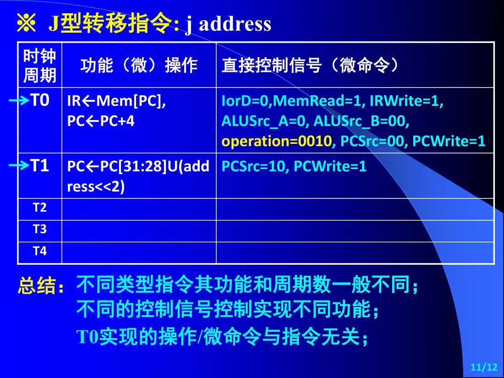

原文：

※ J型转移指令: j address

时钟周期

功能 （微） 操作

IR←Mem[PC], PC←PC+4

T1 PC←PC[31:28]U(add ress<<2)

直接控制信号（微命令）

IorD=0,MemRead=1, IRWrite=1, ALUSrc\_A=0, ALUSrc\_B=00, operation=0010, PCSrc=00, PCWrite=1

PCSrc=10, PCWrite=1

总结： 不同类型指令其功能和周期数一般不同；不同的控制信号控制实现不同功能；T0实现的操作/微命令与指令无关；

11/12

### 第 12 页

