# 《计算机组成与结构》第6章 CPU子系统：多周期MIPS处理器数据通路（课件）

原件的每一页，下面附识别出的文字。

### 6.5 多周期MIPS处理器

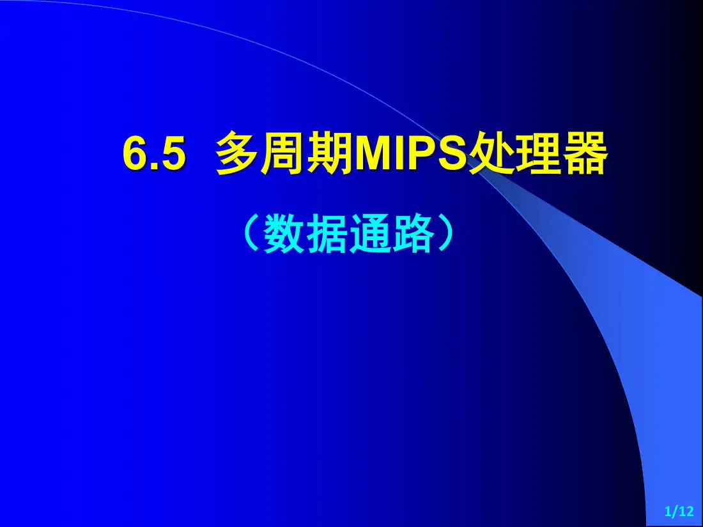

原文：

6.5 多周期MIPS处理器

（数据通路）

1/12

### CPU的指令周期对比

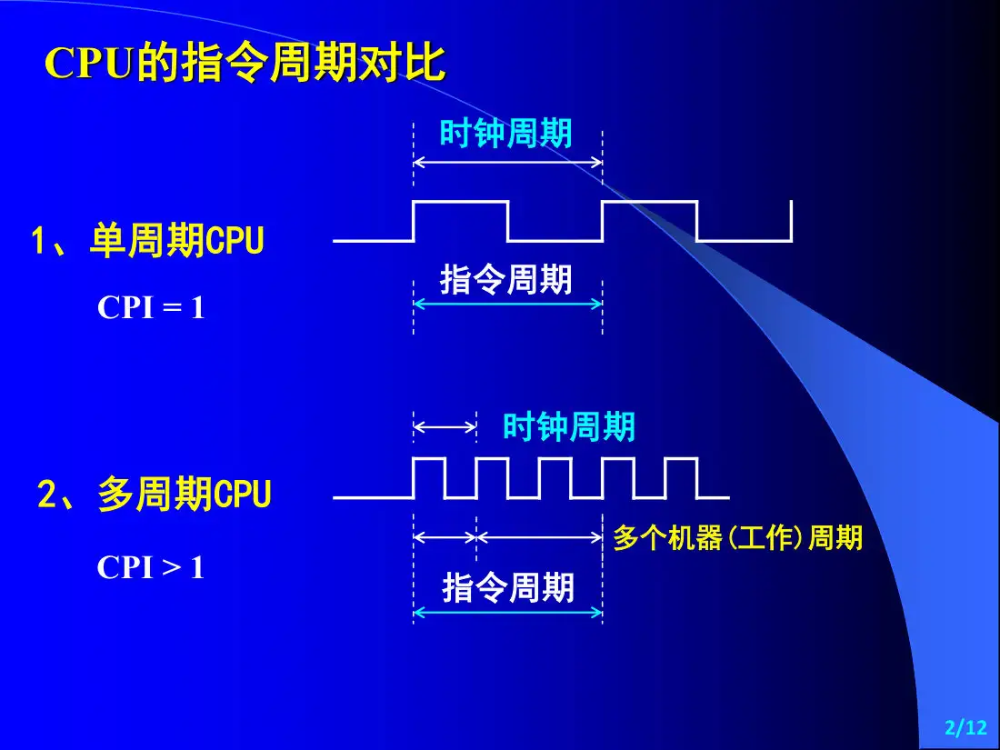

原文：

CPU的指令周期对比

时钟周期

1、单周期CPU

CPI = 1

CPI > 1

指令周期

2、多周期CPU

时钟周期

多个机器(工作)周期

指令周期

2/12

### 多周期处理器的特点

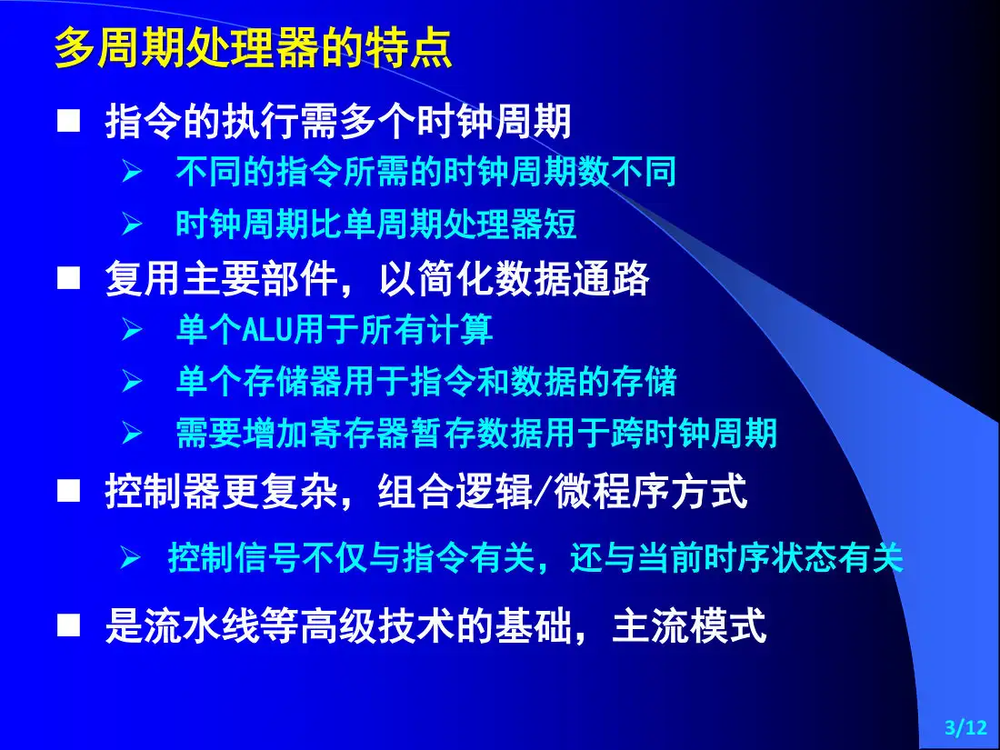

原文：

多周期处理器的特点

指令的执行需多个时钟周期

➢ 不同的指令所需的时钟周期数不同

时钟周期比单周期处理器短

复用主要部件，以简化数据通路

➢ 单个ALU用于所有计算

单个存储器用于指令和数据的存储

➢ 需要增加寄存器暂存数据用于跨时钟周期

控制器更复杂，组合逻辑/微程序方式

➢ 控制信号不仅与指令有关，还与当前时序状态有关

◼ 是流水线等高级技术的基础，主流模式

3/12

### 与单周期CPU相比，数据通路的结构特点：

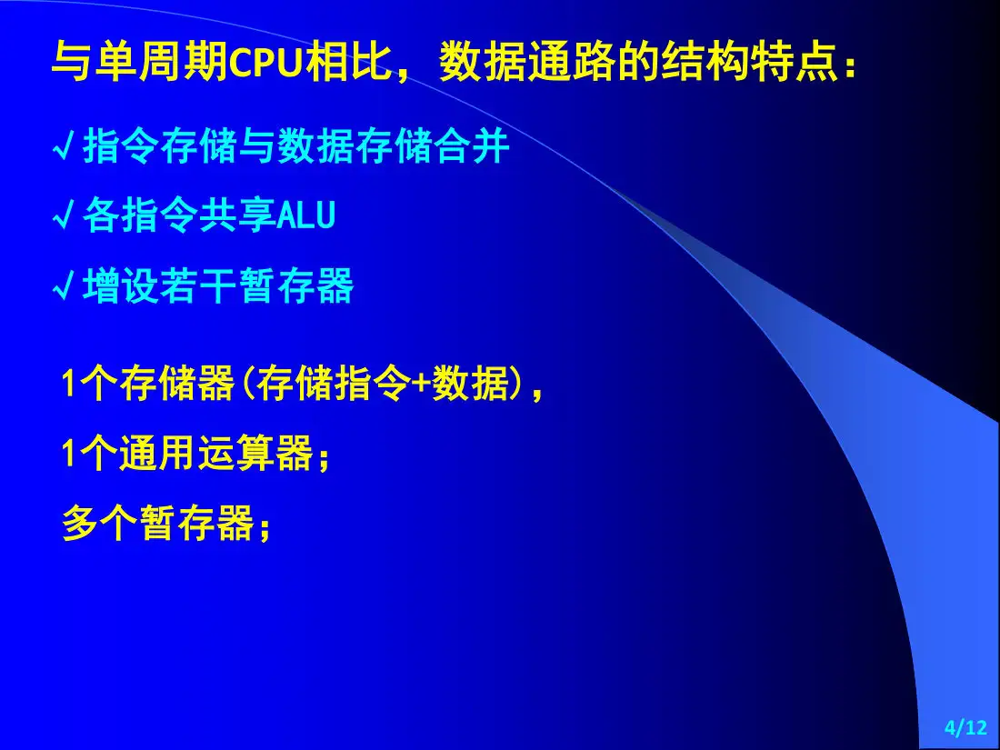

原文：

与单周期CPU相比，数据通路的结构特点：

√指令存储与数据存储合并

√各指令共享ALU

√增设若干暂存器

1个存储器(存储指令+数据)，

1个通用运算器；

多个暂存器；

4/12

### 多周期处理器的设计思路

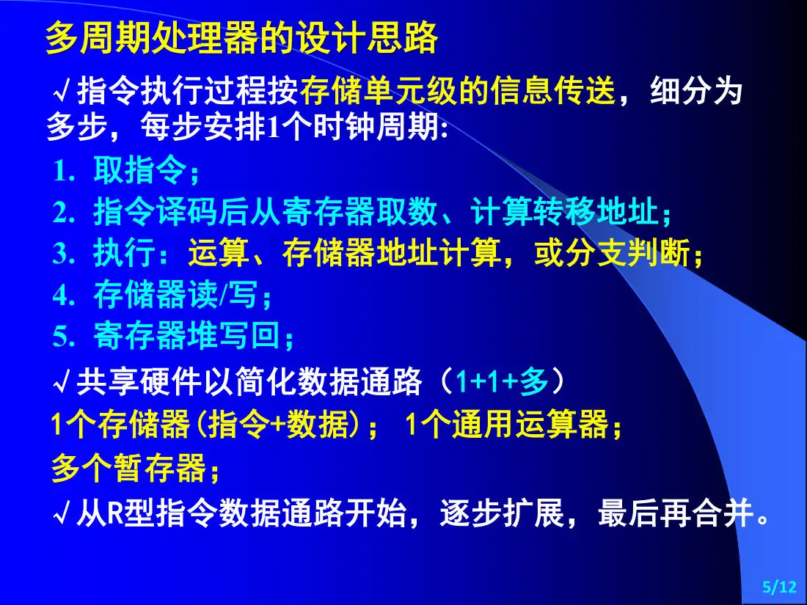

原文：

多周期处理器的设计思路

√指令执行过程按存储单元级的信息传送，细分为多步，每步安排1个时钟周期:

1. 取指令；

2. 指令译码后从寄存器取数、计算转移地址；

3. 执行：运算、存储器地址计算，或分支判断；

4. 存储器读/写；

5. 寄存器堆写回；

√共享硬件以简化数据通路（1+1+多）

1个存储器(指令+数据)； 1个通用运算器；

多个暂存器；

√从R型指令数据通路开始，逐步扩展，最后再合并。

5/12

### 1、 数据通路设计（表3-26，11条指令）

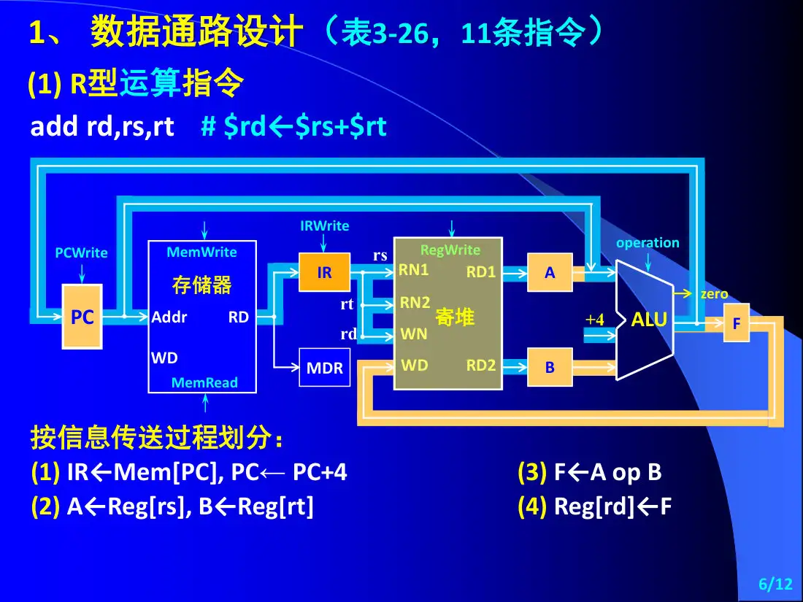

原文：

1、 数据通路设计（表3-26，11条指令）

(1) R型运算指令 add rd,rs,rt # \$rd←\$rs+\$rt

按信息传送过程划分： (1) IR←Mem[PC], PC← PC+4 (2) A←Reg[rs], B←Reg[rt]

(3) F←A op B (4) Reg[rd]←F

6/12

### (2) 扩展I型访存指令

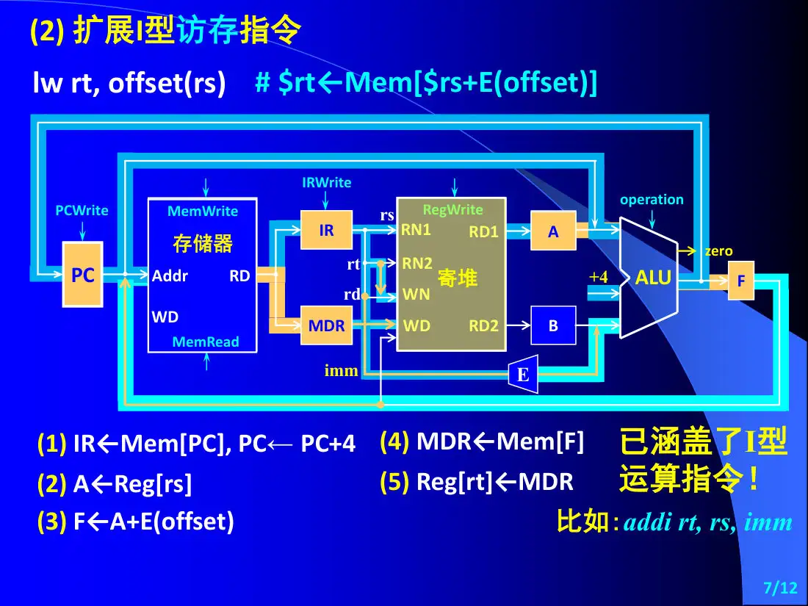

原文：

(2) 扩展I型访存指令

lw rt, offset(rs) # \$rt←Mem[\$rs+E(offset)]

(1) IR←Mem[PC], PC← PC+4

(2) A←Reg[rs]

(3) F←A+E(offset)

(4) MDR←Mem[F] 已涵盖了I型(5) Reg[rt]←MDR 运算指令！

比如:addi rt, rs, imm

7/12

### (1) IR←Mem[PC], PC←PC+4

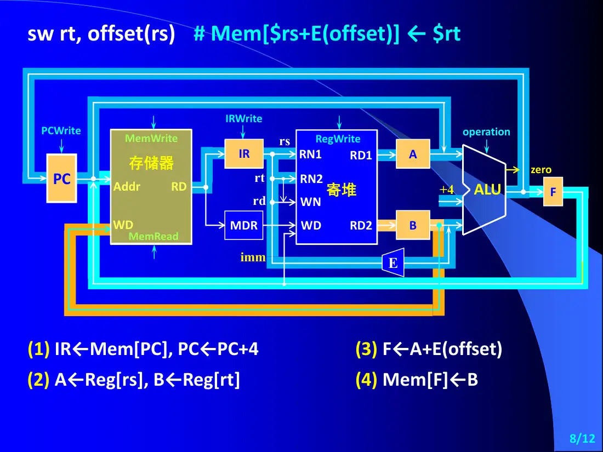

原文：

sw rt, offset(rs) # Mem[\$rs+E(offset)] ← \$rt

(1) IR←Mem[PC], PC←PC+4

(2) A←Reg[rs], B←Reg[rt]

(3) F←A+E(offset)

(4) Mem[F]←B

8/12

### 9/12

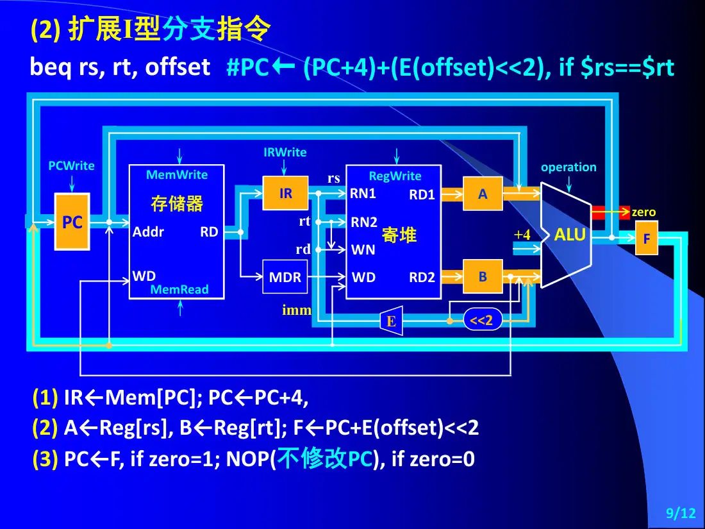

原文：

(2) 扩展I型分支指令 beq rs, rt, offset #PC← (PC+4)+(E(offset)<<2), if \$rs==\$rt

(1) IR←Mem[PC]; PC←PC+4, (2) A←Reg[rs], B←Reg[rt]; F←PC+E(offset)<<2 (3) PC←F, if zero=1; NOP(不修改PC), if zero=0

9/12

### (1) IR←Mem[PC]; PC←PC+4,

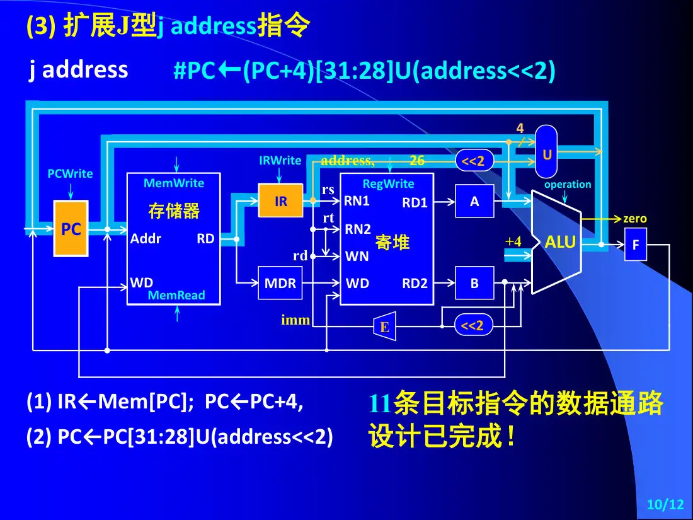

原文：

(3) 扩展J型j address指令 j address #PC←(PC+4)[31:28]U(address<<2)

(1) IR←Mem[PC]; PC←PC+4,

(2) PC←PC[31:28]U(address<<2)

11条目标指令的数据通路设计已完成！

10/12

### 未整合的数据通路

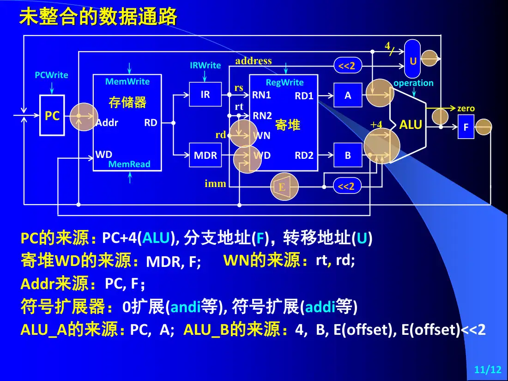

原文：

未整合的数据通路

PC的来源：PC+4(ALU), 分支地址(F)，转移地址(U)寄堆WD的来源： WN的来源：MDR, F; rt, rd;Addr来源：PC, F；符号扩展器：0扩展(andi等), 符号扩展(addi等)ALU\_A的来源： ALU\_B的来源：PC, A; 4, B, E(offset), E(offset)<<2

11/12

### 对数据通路进行整合：

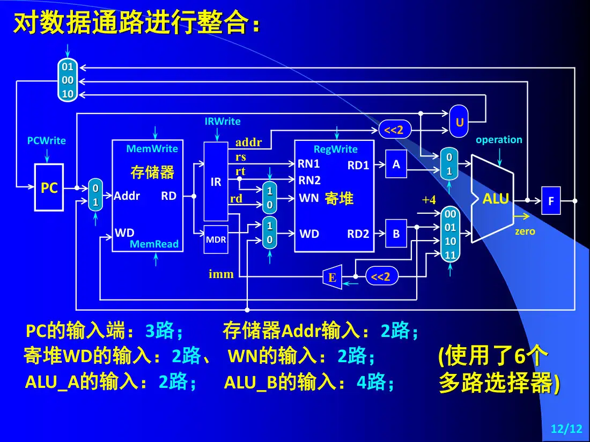

原文：

对数据通路进行整合：

PC的输入端：3路； 存储器Addr输入：2路；寄堆WD的输入：2路、 WN的输入：2路；ALU\_A的输入：2路； ALU\_B的输入：4路；

(使用了6个多路选择器)

12/12
