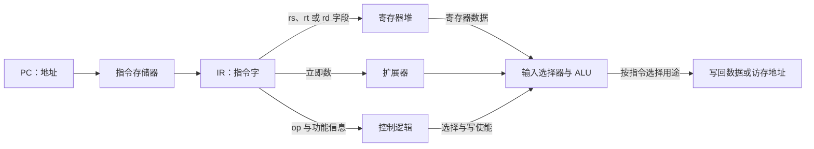

# 《计算机组成与结构》第6章 MIPS-32处理器基本部件分析（课件）

指令集规定程序能要求机器做什么；数据通路决定如何取到所需的位、经过哪些部件；控制器则让正确的部件在正确的时刻接收数据。原件用经典 32 位定长 MIPS 教学模型选部件，第 1–5 页说明设计层次和指令格式，第 6–10 页讲存储与寄存器，第 11–13 页讲运算，第 14–16 页讲预处理和通路选择。

## 先从字段推出端口，不从部件名单反推功能

同一种指令集可以有单周期、多周期等不同实现；位段和指令结果是软件可见的约定，是否分开存放指令和数据、如何在每拍控制写入，则是本章的实现选择。经典固定 32 位格式虽然共享 6 位操作码，后续位段的职责却不同：

| 指令格式 | 从高到低的位段宽度 | 数据通路须提供什么 |
| --- | --- | --- |
| R 型 | op(6)、rs(5)、rt(5)、rd(5)、sa(5)、funct(6) | 按 rs、rt 读两个寄存器，结果可写到 rd；还须把功能信息交给控制路径 |
| I 型 | op(6)、rs(5)、rt(5)、imm(16) | 立即数可扩展成 32 位；rt 可能是写回目的，或在存储指令中作数据来源 |
| J 型 | op(6)、目标索引(26) | 把索引换成低位字节地址并与高位拼接，不把它当作第二个寄存器号 |

**订正：**原件第 4 页表头把 rd 所在区间印为 25–11。字段实际是 15–11：其前面两组寄存器号占 25–21、20–16；若再从 25 起算，字段立即重叠，且不可能保持图中 5 位宽。这里的位编号与寄存器编号是两回事。

## 三类存储对象，三种作用（原件第 6–10 页）

寄存器堆按 32 个 32 位寄存器建模，$2^5=32$，所以读地址 Ra、Rb 和写地址 Rw 各 5 位，而三路数据各 32 位。两路独立读端口让 rs 与 rt 可同时供给 ALU；一个写端口由写使能 Wn 及约定的时钟边沿控制。**补充：**图上按本课时序建模，不能据此说任何寄存器堆的读端都必须边沿触发；部分实现用组合逻辑读、时钟边沿写，读写同一地址时还要查明先后规则。MIPS 的零号寄存器另有“读为零”的体系结构约束。

取指用 PC 的地址读指令存储器，读出的编码进入 IR 后可把 op、rs 等字段交给后续部件。数据存储器另接操作数地址和写入数据；原件按下面的使能组合建模，不描述同时读写的存储器接口。

| 写使能 | 读使能 | 教学模型的行为 |
| --- | --- | --- |
| 0 | 0 | 不访问 |
| 0 | 1 | 将指定地址的数据送到读输出 |
| 1 | 0 | 在约定时序写入 |
| 1 | 1 | 未定义为正常操作，不应生成 |

PC 负责取指地址，IR 暂存当前机器指令，原图的 FR 是送给控制器的运算状态。图中 Enable 的作用是控制写入，未写不等于寄存器旧内容消失；具体如何读仍按元件的时序接口解释。不要把教学图的整组状态标志当作 MIPS32 软件必定可直接访问的条件码寄存器。

## 加法器和通用 ALU 为什么可以同时存在（原件第 11–13 页）

固定的顺序地址更新需要把 PC 加 4。教学电路可让专用加法器做这件事；同时，另一条路径上的 ALU 可做运算、比较或数据地址计算。若用同一个 ALU 复用两项工作，需要安排不同时间或重新考虑资源冲突，不能默认同拍做两个独立运算。

控制字若要区分 $m$ 项功能，至少用 $\lceil\log_2 m\rceil$ 位；原图使用四位操作码，并非把十六种组合全部定义。该图示例为 <kbd>0000</kbd> 与、<kbd>0001</kbd> 或、<kbd>0010</kbd> 加、<kbd>0110</kbd> 减、<kbd>0111</kbd> 小于置位、<kbd>1100</kbd> 或非。运算结果与 Zero 等状态要分开理解：用于相等比较时，可计算两输入之差并检查是否为零；若要比较有符号大小，简单读减法结果的符号位会在溢出时给出错误判断，须按正确的比较逻辑实现。这些是本图的控制取值，不等于指令本身编码中的 op 或 funct。

## 进 ALU 之前，先弄清位串的身份（原件第 14–16 页）

| 部件 | 解决什么问题 | 原件或补充验算 |
| --- | --- | --- |
| 双模 16→32 位扩展器 | <kbd>E=1</kbd> 保持有符号数值，复制最高位；<kbd>E=0</kbd> 保持无符号位串，在高位补零 | 原件 <kbd>800A</kbd> 符号扩展为 <kbd>FFFF800A</kbd>；<kbd>F12C</kbd> 零扩展为 <kbd>0000F12C</kbd> |
| 固定左移两位 | 从按四字节指令计数的索引或位移换到字节单位，低两位补零 | 26 位索引左移后需要 28 位；固定宽度的有符号位移要先扩展，再按数据通路宽度移位 |
| 4＋28 位拼接器 | 从 PC 取高四位，加上已成形的 28 位低地址；这里是拼接，不做算术进位 | 原件示意高四位是 A、低 28 位为 <kbd>FFFFBB4</kbd>，结果是 <kbd>AFFFFBB4</kbd>；该 28 位输入已经移位，不应再乘 4 |
| 数据选择器 MUX | 从多路候选中送出恰好一路完整数据 | 32 位通路的每一路都宽 32 位，但控制线不必 32 根；$2^k\ge n$ 时 $k$ 位才有足够编码选择 $n$ 路 |

> [!TIP]
> ==同一 16 位字面量，先由操作决定采用哪种扩展。== 例如符号扩展的 <kbd>800A</kbd> 保留负数含义；若拿它当逻辑掩码，就应该零扩展为 <kbd>0000800A</kbd>。最后还要核对选择器：在原件的二选一图中 1 接 A、0 接 B，别把其他电路的默认规则搬过来。

**补充算例与参考解答：**若一条等值分支的旧 PC 为 <kbd>0x20000008</kbd>，16 位位移 <kbd>FFFE</kbd> 符号扩展为 $-2$，左移换成 $-8$ 字节，以顺序地址 <kbd>0x2000000C</kbd> 为基准相加，目标是 <kbd>0x20000004</kbd>。若另一条位于区域最后一个字的 J 型指令，其旧 PC 为 <kbd>0x0FFFFFFC</kbd>，索引是 3，则 PC 的基准取顺序地址 <kbd>0x10000000</kbd>；低 28 位来自 <kbd>3&lt;&lt;2</kbd>，拼接结果为 <kbd>0x1000000C</kbd>。这两个例子分别用“加”和“拼接”，不是一种运算的两种写法。

> [!WARNING]
> ==地址选择和允许写入是两件事。== MUX 能选出正确目标，但不代表已更新 PC；寄存器堆写地址选对了，也仍须在合适的边沿使能。检查一条数据通路时，沿途问每条边传的是地址、数据还是控制，能发现大多数误接。

相关知识点：[CPU 基本部件](../../../topics/计算机组成/cpu-components.md)、[单周期数据通路](../../../topics/计算机组成/single-cycle-datapath.md)、[R 型指令](../../../topics/计算机组成/mips-r-type.md)、[I 型指令](../../../topics/计算机组成/mips-i-type.md)、[J 型指令](../../../topics/计算机组成/mips-j-type.md)、[数制与编码](../../../topics/计算机组成/number-systems.md)。
