# 《计算机组成与结构》第6章 单周期MIPS处理器——控制单元设计（课件）

原件的每一页，下面附识别出的文字。

### 6.4 单周期MIPS处理器

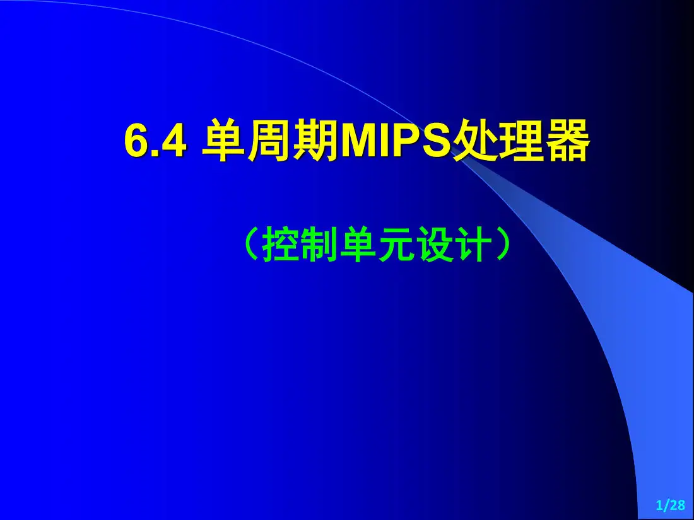

原文：

6.4 单周期MIPS处理器

（控制单元设计）

1/28

### ※CPU设计的主要任务

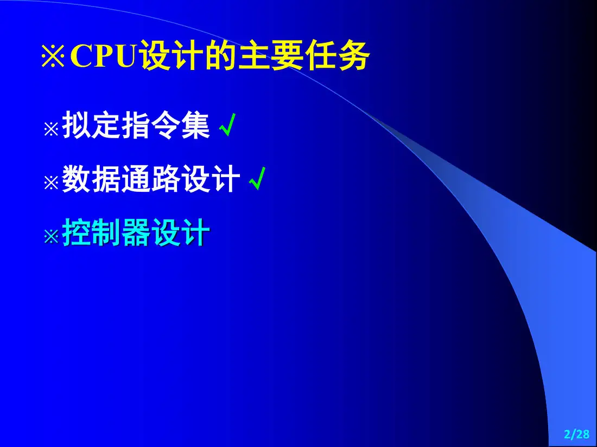

原文：

※CPU设计的主要任务

※拟定指令集

※数据通路设计

※控制器设计

2/28

### 单周期微架构

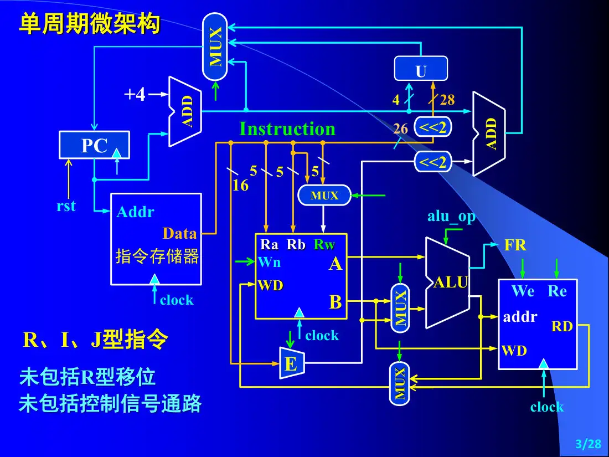

原文：

单周期微架构

clock

R、I、J型指令未包括R型移位未包括控制信号通路

### ➢ 控制信号（微命令）产生部件

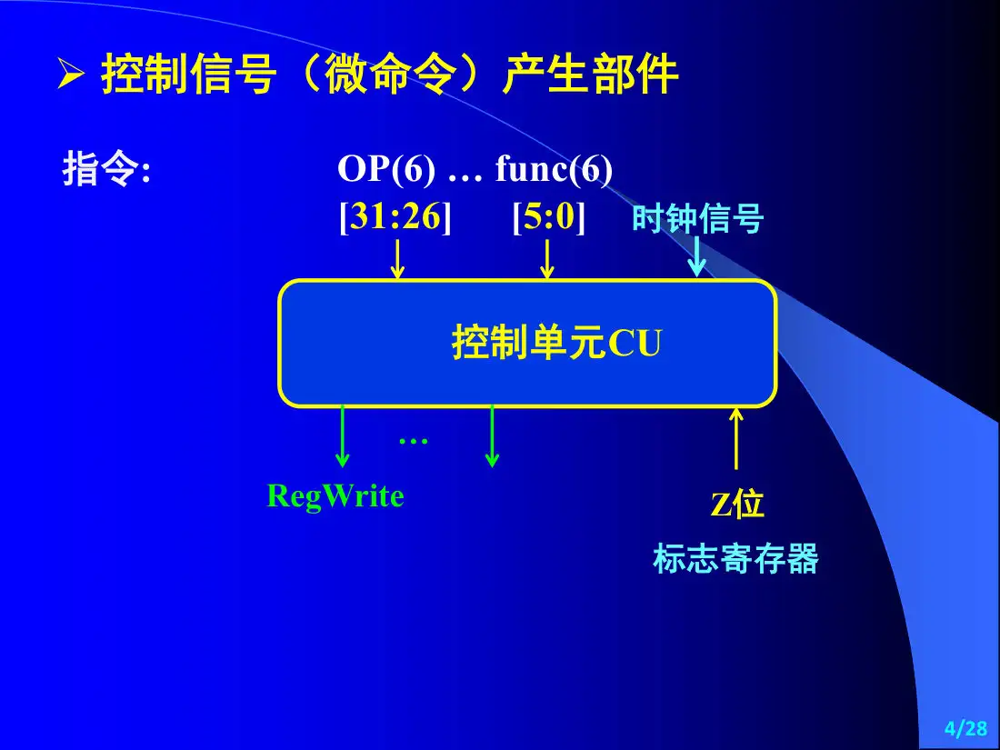

原文：

➢ 控制信号（微命令）产生部件

指令:

OP(6) … func(6)[31:26] [5:0] 时钟信号

控制单元CU

RegWrite

Z位

标志寄存器

4/28

### 如何恰当地产生这些控制信号？

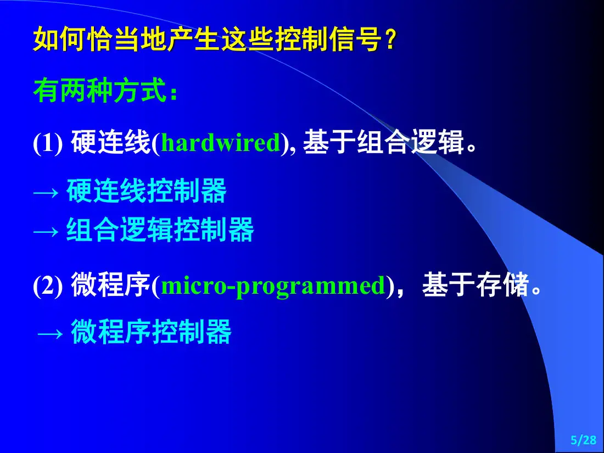

原文：

如何恰当地产生这些控制信号？

有两种方式：

(1) 硬连线(hardwired), 基于组合逻辑。

硬连线控制器

→ 组合逻辑控制器

(2) 微程序(micro-programmed)，基于存储。

→ 微程序控制器

5/28

### （1）组合逻辑控制的基本原理

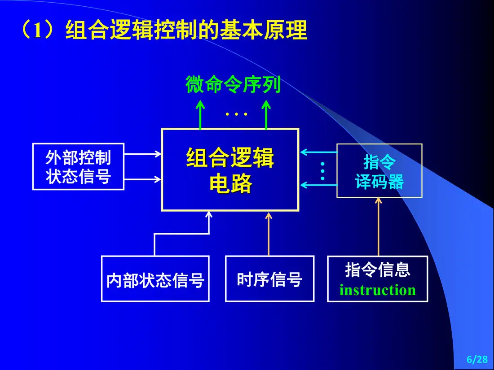

原文：

（1）组合逻辑控制的基本原理

微命令序列

外部控制状态信号

组合逻辑电路指令译码器

内部状态信号时序信号指令信息instruction

6/28

### （2）微程序控制的基本原理

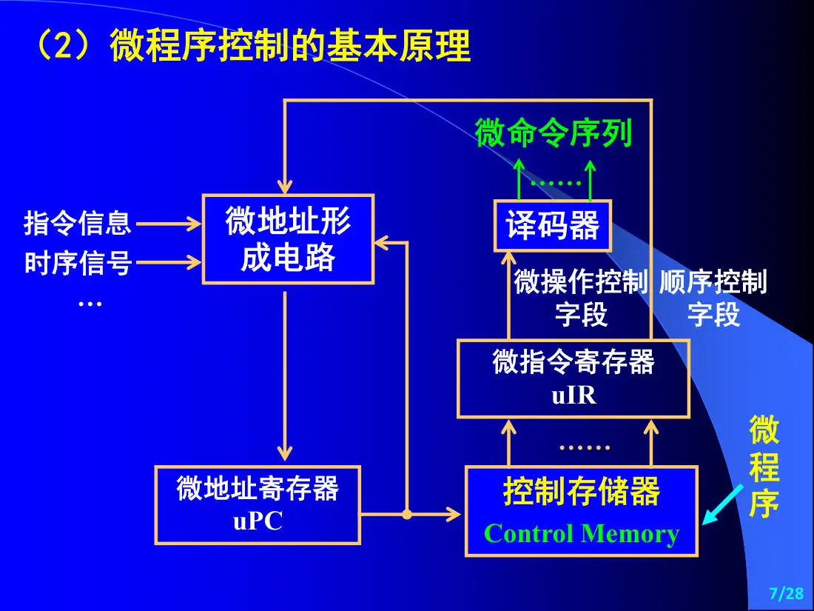

原文：

（2）微程序控制的基本原理

指令信息时序信号微地址形成电路

微地址寄存器uPC

微命令序列

译码器

微操作控制字段

微指令寄存器 uIR

控制存储器

Control Memory顺序控制字段

程

序

7/28

### 组合逻辑方式的特点：

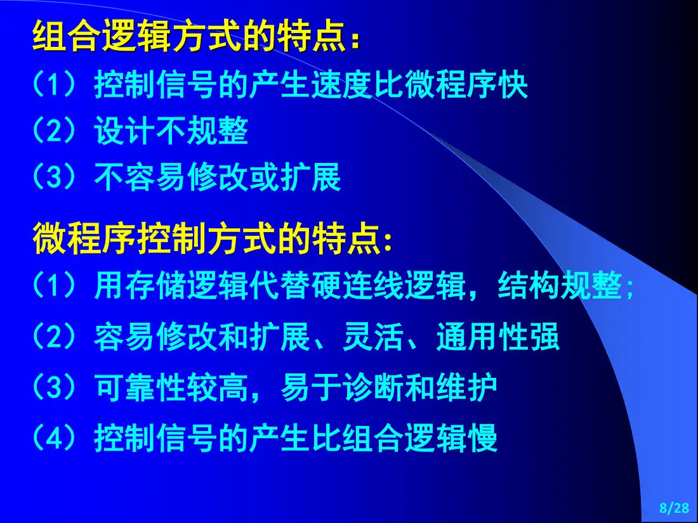

原文：

组合逻辑方式的特点：

（1）控制信号的产生速度比微程序快

（2）设计不规整

（3）不容易修改或扩展

微程序控制方式的特点:

（1）用存储逻辑代替硬连线逻辑，结构规整;

（2）容易修改和扩展、灵活、通用性强

（3）可靠性较高，易于诊断和维护

（4）控制信号的产生比组合逻辑慢

8/28

### 3、单周期控制单元设计

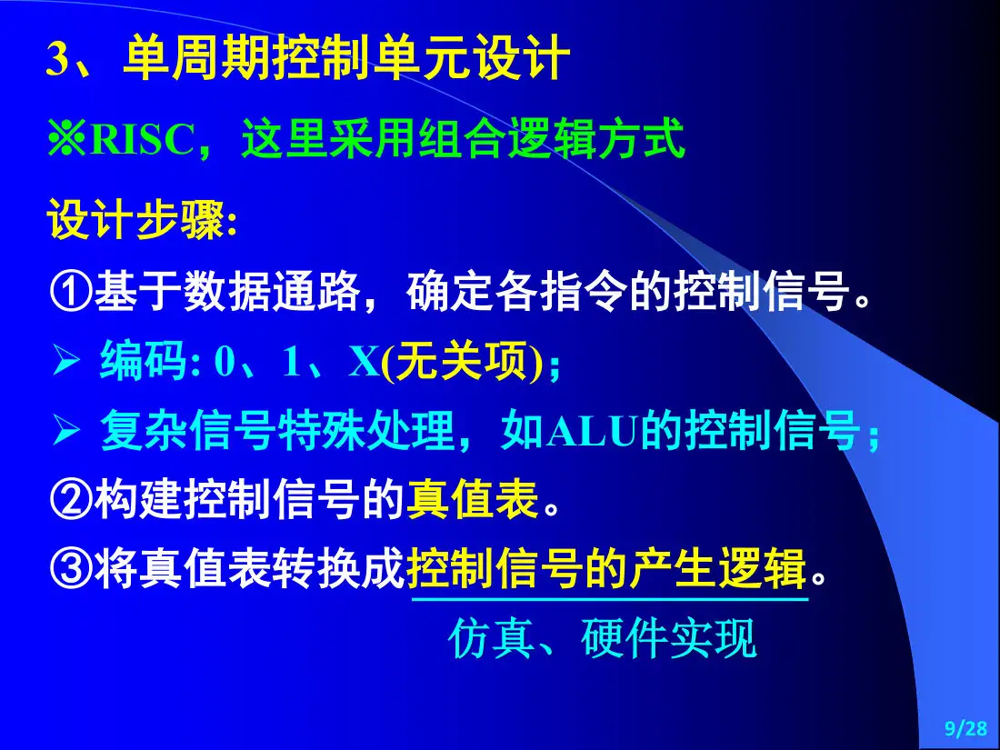

原文：

3、单周期控制单元设计

※RISC，这里采用组合逻辑方式

设计步骤:

①基于数据通路，确定各指令的控制信号。

➢ 编码: 0、1、X(无关项)；

➢ 复杂信号特殊处理，如ALU的控制信号；

②构建控制信号的真值表。

③将真值表转换成控制信号的产生逻辑。

仿真、硬件实现

9/28

### 单周期微架构

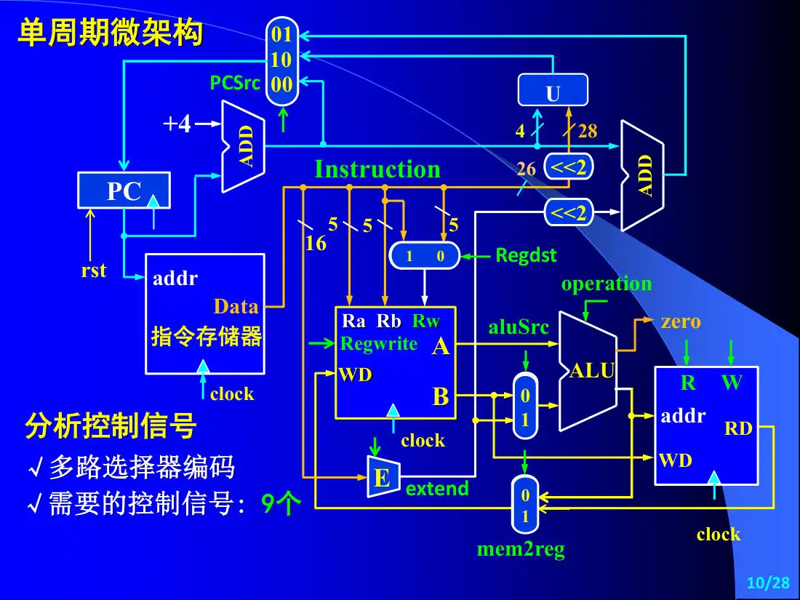

原文：

单周期微架构

分析控制信号

√多路选择器编码

√需要的控制信号: 9个

10/28

### 各控制信号的定义:

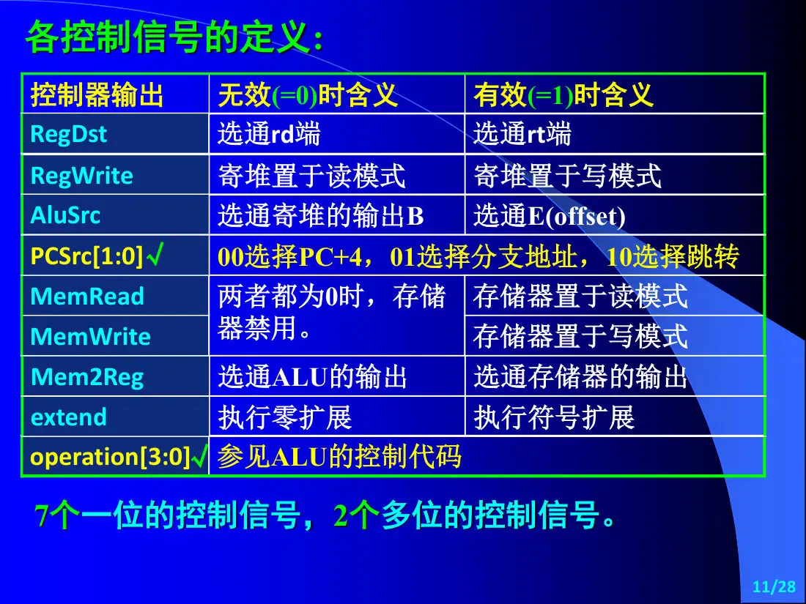

原文：

各控制信号的定义:

控制器输出

RegDst

RegWrite

AluSrcAluSrc

PCSrc[1:0]

MemRead

MemWriteMemWrite

Mem2Reg

extend

operation[3:0]

无效(=0)时含义

选通rd端

寄堆置于读模式

选通寄堆的输出B

有效(=1)时含义

选通rt端

选通ALU的输出

寄堆置于写模式

00选择PC+4，01选择分支地址，10选择跳转

选通E(offset)

两者都为0时，存储器禁用。

执行零扩展

参见ALU的控制代码

存储器置于读模式

存储器置于写模式

选通存储器的输出

执行符号扩展

7个一位的控制信号，2个多位的控制信号。

11/28

### （1）控制单元的总体结构

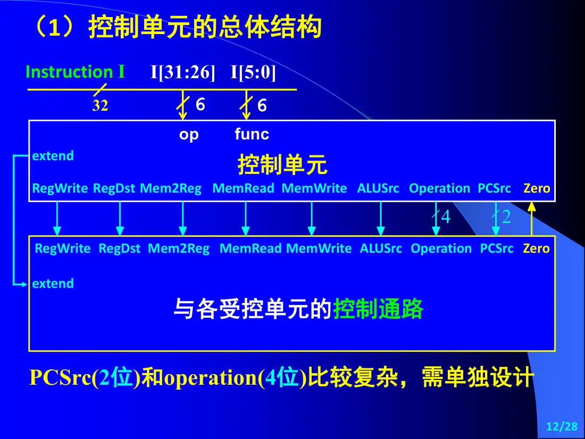

原文：

（1）控制单元的总体结构

Instruction I I[31:26] I[5:0]

op func

extend

控制单元

RegWrite RegDst Mem2Reg MemRead MemWrite ALUSrc Operation PCSrc Zero

RegWrite RegDst Mem2Reg MemRead MemWrite ALUSrc Operation PCSrc Zero

extend

与各受控单元的控制通路

PCSrc(2位)和operation(4位)比较复杂，需单独设计

12/28

### 对于PCSrc（00，01，10）：

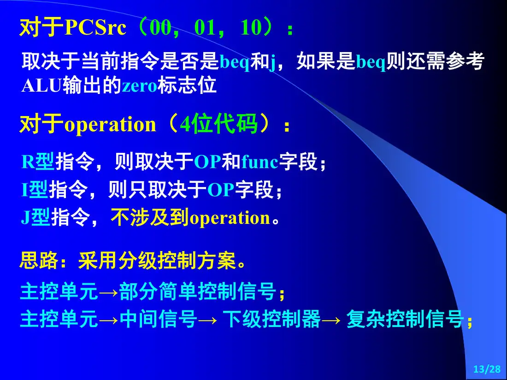

原文：

对于PCSrc（00，01，10）：

取决于当前指令是否是beq和j，如果是beq则还需参考ALU输出的zero标志位

对于operation（4位代码）：

R型指令，则取决于OP和func字段；I型指令，则只取决于OP字段；J型指令，不涉及到operation。

思路：采用分级控制方案。

主控单元→部分简单控制信号；

主控单元→中间信号→ 下级控制器→ 复杂控制信号；

13/28

### 控制单元采用两级控制模式

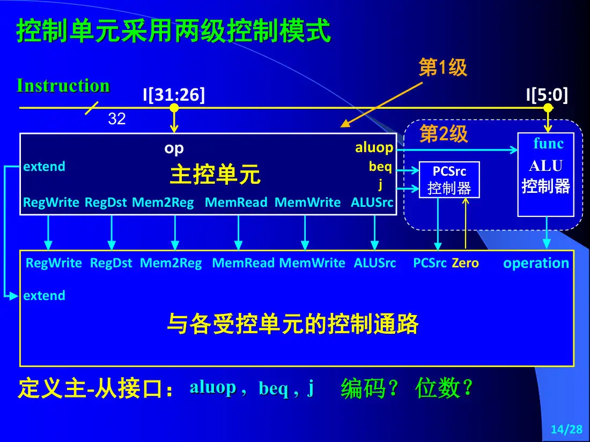

原文：

控制单元采用两级控制模式

Instruction

I[31:26]

第1级

32

extend

op

主控单元aluopbeq第2级

PCSrc控制器

funcALU控制器

RegWrite RegDst Mem2Reg MemRead MemWrite ALUSrc

ZeroRegWrite RegDst Mem2Reg MemRead MemWrite ALUSrc PCSrc operation

extend

与各受控单元的控制通路

定义主-从接口： aluop , beq , j 编码？ 位数？

14/28

### （2）设计ALU控制单元

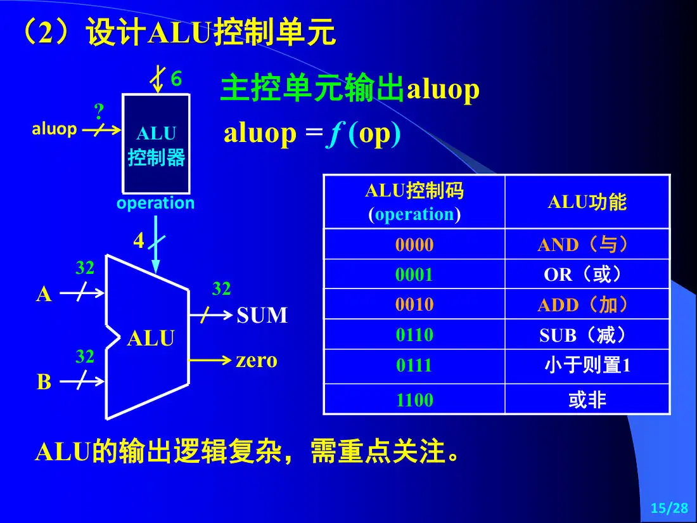

原文：

（2）设计ALU控制单元

主控单元输出aluop

aluop = f (op)

<table><tr><td>ALU控制码(operation)</td><td>ALU功能</td></tr><tr><td>0000</td><td>AND(与)</td></tr><tr><td>0001</td><td>OR(或)</td></tr><tr><td>0010</td><td>ADD(加)</td></tr><tr><td>0110</td><td>SUB(减)</td></tr><tr><td>0111</td><td>小于则置1</td></tr><tr><td>1100</td><td>或非</td></tr></table>

ALU的输出逻辑复杂，需重点关注。

15/28

### ◼ ALU控制器的输出依赖于？

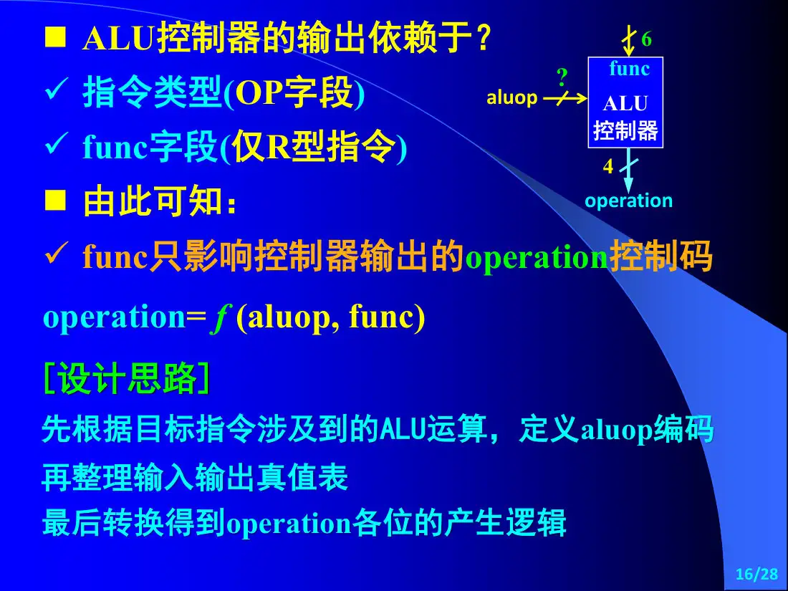

原文：

◼ ALU控制器的输出依赖于？

指令类型(OP字段)

func字段(仅R型指令)

◼ 由此可知：

ALU控制器

func只影响控制器输出的operation控制码

operation= f (aluop, func)

[设计思路]

先根据目标指令涉及到的ALU运算，定义aluop编码

再整理输入输出真值表

最后转换得到operation各位的产生逻辑

16/28

### 17/28

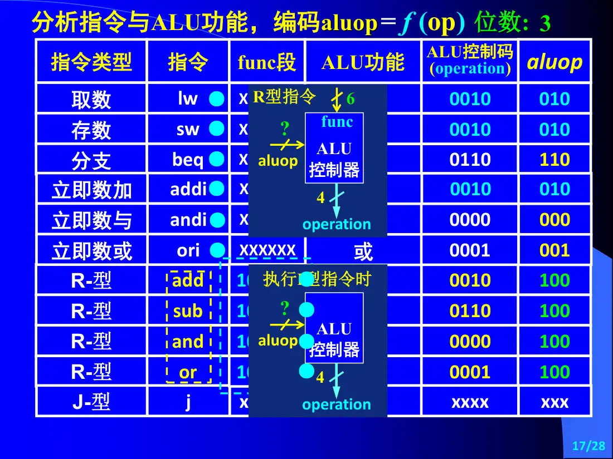

原文：

<table><tr><td>指令类型</td><td>指令</td><td>func段</td><td>ALU功能</td><td>ALU控制码(operation)</td><td>aluop</td></tr><tr><td>取数</td><td>lw</td><td>x R型指令</td><td>6</td><td></td><td>0010</td></tr><tr><td>存数</td><td>sw</td><td>x ? aluop</td><td rowspan="2">funcALU控制器</td><td></td><td>0010</td></tr><tr><td>分支</td><td>beq</td><td>x</td><td></td><td>0110</td></tr><tr><td>立即数加</td><td>addi</td><td>x</td><td rowspan="2">4operation</td><td></td><td>0010</td></tr><tr><td>立即数与</td><td>andi</td><td>x</td><td></td><td>0000</td></tr><tr><td>立即数或</td><td>ori</td><td>xxxxxx</td><td>或</td><td></td><td>0001</td></tr><tr><td>R-型</td><td>add</td><td>1</td><td>执行型指令时</td><td></td><td>0010</td></tr><tr><td>R-型</td><td>sub</td><td>1</td><td rowspan="2">? ALU控制器</td><td></td><td>0110</td></tr><tr><td>R-型</td><td>and</td><td>1</td><td></td><td>0000</td></tr><tr><td>R-型</td><td>or</td><td>1</td><td rowspan="2">4operation</td><td></td><td>0001</td></tr><tr><td>J-型</td><td>j</td><td>x</td><td></td><td>xxxx</td></tr></table>

17/28

### ALU控制器的真值表

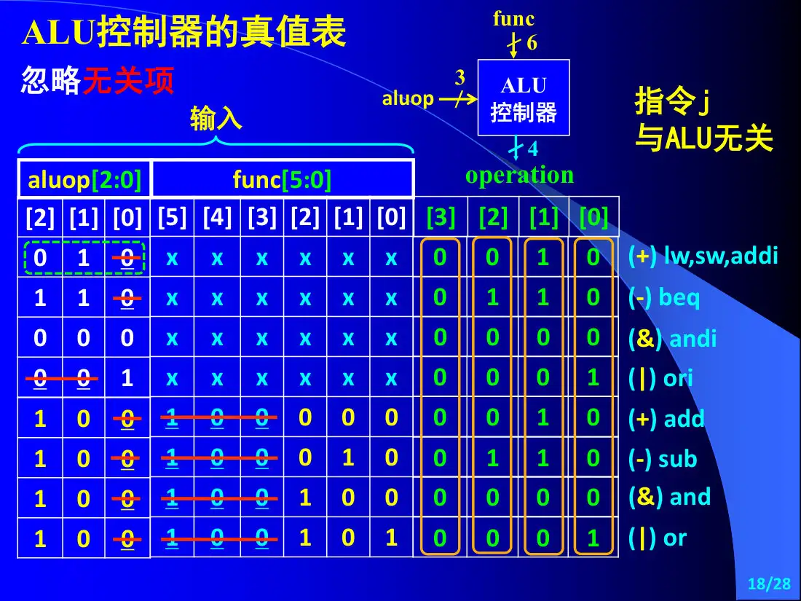

原文：

ALU控制器的真值表

输入

3 aluop

ALU控制器

operation 指令j 与ALU无关

<table><tr><td colspan="3">aluop[2:0]</td><td colspan="6">func[5:0]</td><td colspan="4">operation</td></tr><tr><td>[2]</td><td>[1]</td><td>[0]</td><td>[5]</td><td>[4]</td><td>[3]</td><td>[2]</td><td>[1]</td><td>[0]</td><td>[3]</td><td>[2]</td><td>[1]</td><td>[0]</td></tr><tr><td>0</td><td>1</td><td>0</td><td>x</td><td>x</td><td>x</td><td>x</td><td>x</td><td>x</td><td>0</td><td>0</td><td>1</td><td>0</td></tr><tr><td>1</td><td>1</td><td>0</td><td>x</td><td>x</td><td>x</td><td>x</td><td>x</td><td>x</td><td>0</td><td>1</td><td>1</td><td>0</td></tr><tr><td>0</td><td>0</td><td>0</td><td>x</td><td>x</td><td>x</td><td>x</td><td>x</td><td>x</td><td>0</td><td>0</td><td>0</td><td>0</td></tr><tr><td>0</td><td>0</td><td>1</td><td>x</td><td>x</td><td>x</td><td>x</td><td>x</td><td>x</td><td>0</td><td>0</td><td>0</td><td>1</td></tr><tr><td>1</td><td>0</td><td>0</td><td>1</td><td>0</td><td>0</td><td>0</td><td>0</td><td>0</td><td>0</td><td>0</td><td>1</td><td>0</td></tr><tr><td>1</td><td>0</td><td>0</td><td>1</td><td>0</td><td>0</td><td>0</td><td>1</td><td>0</td><td>0</td><td>1</td><td>1</td><td>0</td></tr><tr><td>1</td><td>0</td><td>0</td><td>1</td><td>0</td><td>0</td><td>1</td><td>0</td><td>0</td><td>0</td><td>0</td><td>0</td><td>0</td></tr><tr><td>1</td><td>0</td><td>0</td><td>1</td><td>0</td><td>0</td><td>1</td><td>0</td><td>1</td><td>0</td><td>0</td><td>0</td><td>1</td></tr></table>

18/28

### 根据真值表, 写出输入-输出逻辑式:

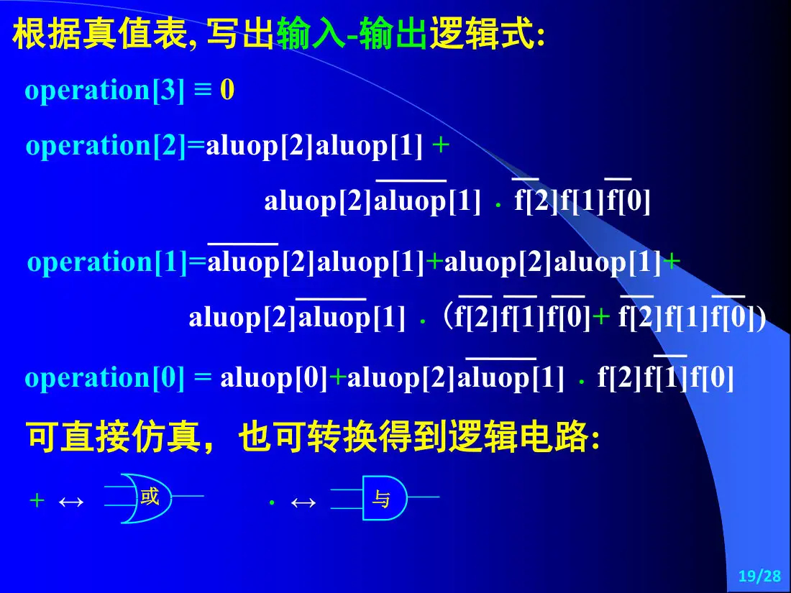

原文：

根据真值表, 写出输入-输出逻辑式:

operation[3] ≡ 0

operation[2]=aluop[2]aluop[1] +

aluop[2]aluop[1]﹒f[2]f[1]f[0]

operation[1]=aluop[2]aluop[1]+aluop[2]aluop[1]+ aluop[2]aluop[1]﹒(f[2]f[1]f[0]+ f[2]f[1]f[0])

operation[0] = aluop[0]+aluop[2]aluop[1]﹒f[2]f[1]f[0]

可直接仿真，也可转换得到逻辑电路:

\+ 或 · 与

19/28

### operation[1]

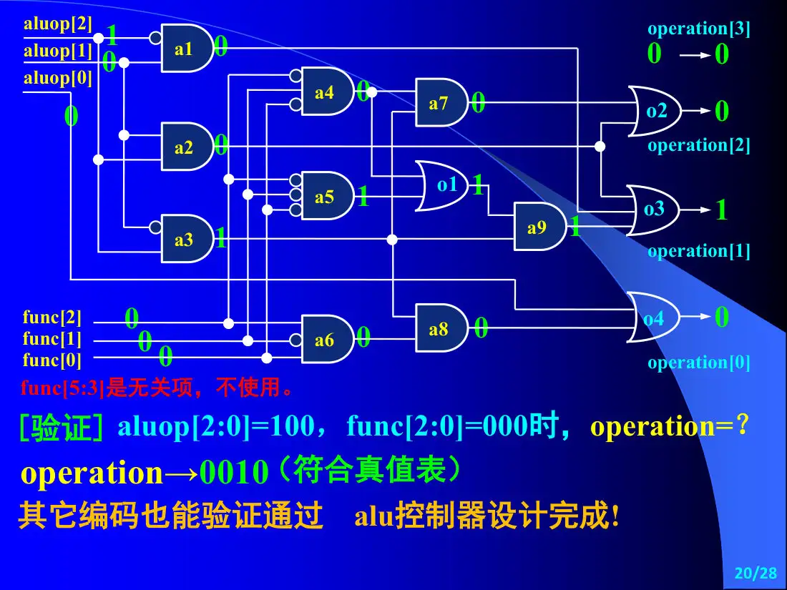

原文：

operation[1]

operation[0]

func[5:3]是无关项，不使用。[验证] aluop[2:0]=100，func[2:0]=000时，operation=？operation→0010（符合真值表）其它编码也能验证通过 alu控制器设计完成!

20/28

### 控制单元采用两级译码

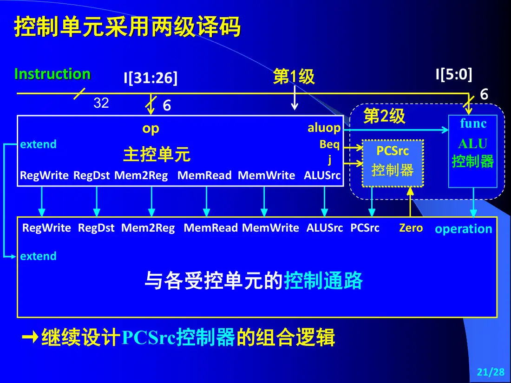

原文：

控制单元采用两级译码

Instruction

I[31:26]

第1级

I[5:0]

32

op

extend

第2级

主控单元

aluop Beq

RegWrite RegDst Mem2Reg MemRead MemWrite ALUSrc

PCSrcPCSrc控制器控制器

funcALU控制器

RegWrite RegDst Mem2Reg MemRead MemWrite ALUSrc PCSrc Zero operation

extend

与各受控单元的控制通路

→继续设计PCSrc控制器的组合逻辑

21/28

### （3）PCSrc控制单元

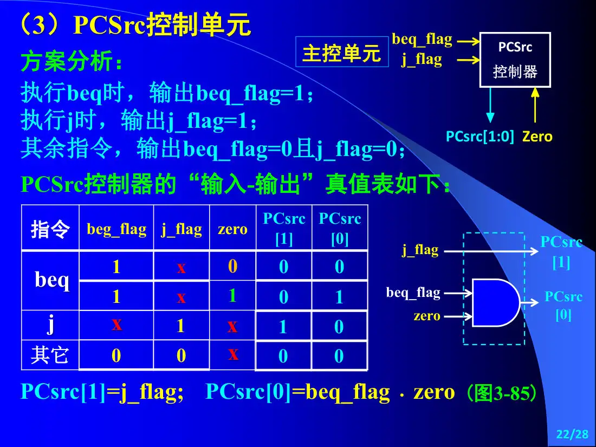

原文：

（3）PCSrc控制单元

方案分析：

主控单元

PCSrc控制器

执行beq时，输出beq\_flag=1；执行j时，输出j\_flag=1；其余指令，输出beq\_flag=0且j\_flag=0；

PCSrc控制器的“输入-输出”真值表如下：

<table><tr><td>指令</td><td>beg_flag</td><td>j_flag</td><td>zero</td><td>PCsrc[1]</td><td>PCsrc[0]</td></tr><tr><td rowspan="2">beq</td><td>1</td><td>x</td><td>0</td><td>0</td><td>0</td></tr><tr><td>1</td><td>x</td><td>1</td><td>0</td><td>1</td></tr><tr><td>j</td><td>x</td><td>1</td><td>x</td><td>1</td><td>0</td></tr><tr><td>其它</td><td>0</td><td>0</td><td>x</td><td>0</td><td>0</td></tr></table>

PCsrc[1]=j\_flag; PCsrc[0]=beq\_flag﹒zero (图3-85)

22/28

### 控制单元采用两级译码

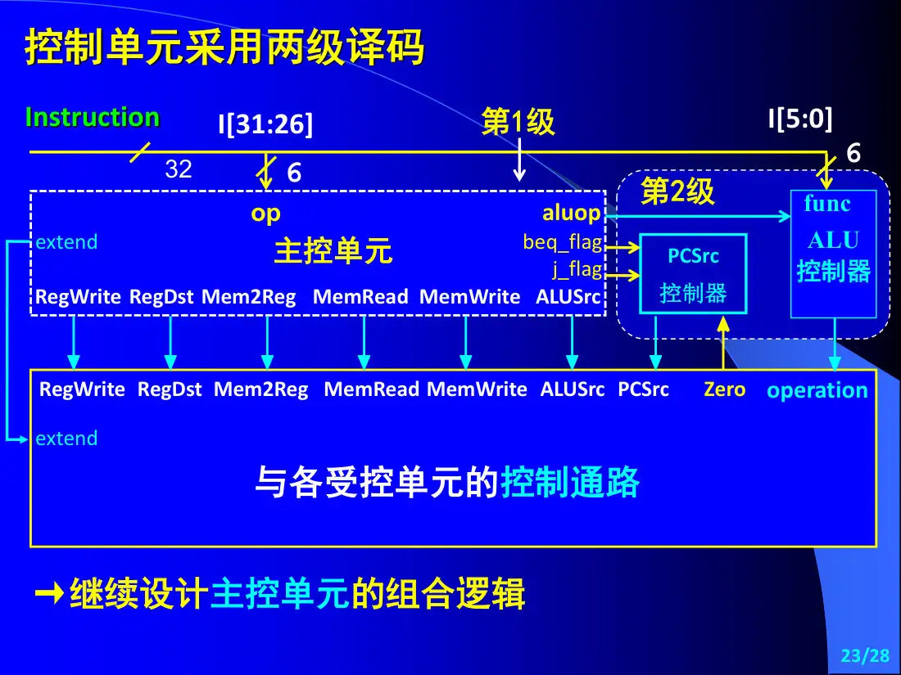

原文：

控制单元采用两级译码

Instruction I[31:26]

第1级

32

op

第2级

extend

主控单元

RegWrite RegDst Mem2Reg MemRead MemWrite ALUSrc

PCSrc控制器funcALU控制器

RegWrite RegDst Mem2Reg MemRead MemWrite ALUSrc PCSrc Zero operation

extend

与各受控单元的控制通路

→继续设计主控单元的组合逻辑

23/28

### （4）主控单元的设计

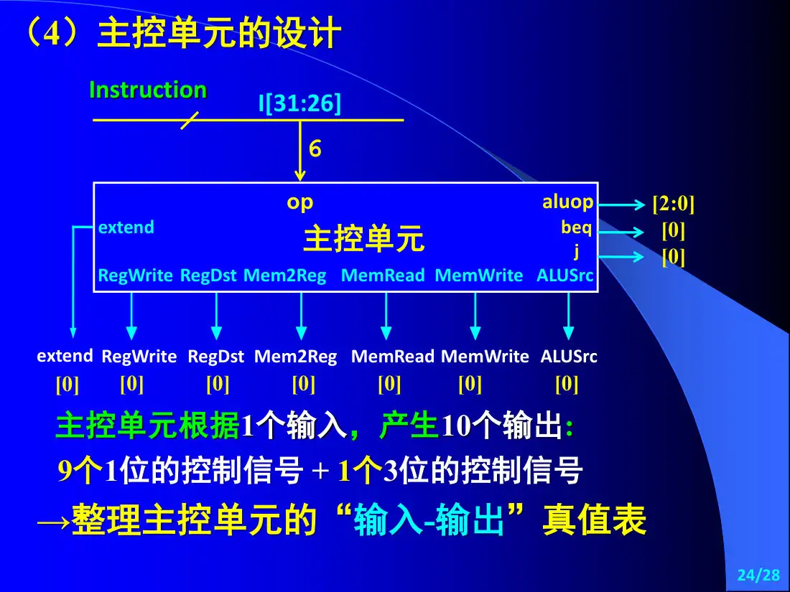

原文：

（4）主控单元的设计

Instruction

I[31:26]

6

extend

op

主控单元

aluop

beq [2:0] [0] [0]

RegWrite RegDst Mem2Reg MemRead MemWrite ALUSrc

RegWrite RegDst Mem2Reg MemRead MemWrite ALUSrcextend [0] [0] [0] [0] [0] [0] [0]

主控单元根据1个输入，产生10个输出:

9个1位的控制信号 + 1个3位的控制信号

→整理主控单元的“输入-输出”真值表

24/28

### 主控单元的“输入-输出”真值表（表3-31）

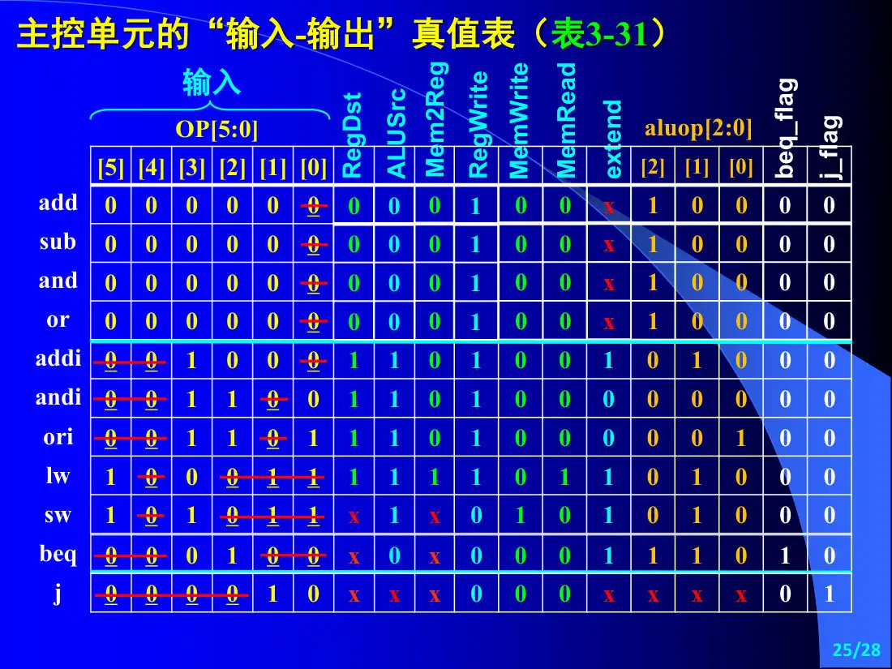

原文：

主控单元的“输入-输出”真值表（表3-31）

<table><tr><td rowspan="2"></td><td colspan="6">输入OP[5:0]</td><td rowspan="2">RegDst</td><td rowspan="2">ALUSrc</td><td rowspan="2">Mem2Reg</td><td rowspan="2">RegWrite</td><td rowspan="2">MemWrite</td><td rowspan="2">MemRead</td><td rowspan="2">extend</td><td colspan="3">aluop[2:0]</td><td rowspan="2">beq_flag</td><td rowspan="2">j_flag</td></tr><tr><td>[5]</td><td>[4]</td><td>[3]</td><td>[2]</td><td>[1]</td><td>[0]</td><td>[2]</td><td>[1]</td><td>[0]</td></tr><tr><td>add</td><td>0</td><td>0</td><td>0</td><td>0</td><td>0</td><td>0</td><td>0</td><td>0</td><td>0</td><td>1</td><td>0</td><td>0</td><td>x</td><td>1</td><td>0</td><td>0</td><td>0</td><td>0</td></tr><tr><td>sub</td><td>0</td><td>0</td><td>0</td><td>0</td><td>0</td><td>0</td><td>0</td><td>0</td><td>0</td><td>1</td><td>0</td><td>0</td><td>x</td><td>1</td><td>0</td><td>0</td><td>0</td><td>0</td></tr><tr><td>and</td><td>0</td><td>0</td><td>0</td><td>0</td><td>0</td><td>0</td><td>0</td><td>0</td><td>0</td><td>1</td><td>0</td><td>0</td><td>x</td><td>1</td><td>0</td><td>0</td><td>0</td><td>0</td></tr><tr><td>or</td><td>0</td><td>0</td><td>0</td><td>0</td><td>0</td><td>0</td><td>0</td><td>0</td><td>0</td><td>1</td><td>0</td><td>0</td><td>x</td><td>1</td><td>0</td><td>0</td><td>0</td><td>0</td></tr><tr><td>addi</td><td>0</td><td>0</td><td>1</td><td>0</td><td>0</td><td>0</td><td>1</td><td>1</td><td>0</td><td>1</td><td>0</td><td>0</td><td>1</td><td>0</td><td>1</td><td>0</td><td>0</td><td>0</td></tr><tr><td>andi</td><td>0</td><td>0</td><td>1</td><td>1</td><td>0</td><td>0</td><td>1</td><td>1</td><td>0</td><td>1</td><td>0</td><td>0</td><td>0</td><td>0</td><td>0</td><td>0</td><td>0</td><td>0</td></tr><tr><td>ori</td><td>0</td><td>0</td><td>1</td><td>1</td><td>0</td><td>1</td><td>1</td><td>1</td><td>0</td><td>1</td><td>0</td><td>0</td><td>0</td><td>0</td><td>0</td><td>1</td><td>0</td><td>0</td></tr><tr><td>lw</td><td>1</td><td>0</td><td>0</td><td>0</td><td>1</td><td>1</td><td>1</td><td>1</td><td>1</td><td>1</td><td>0</td><td>1</td><td>1</td><td>0</td><td>1</td><td>0</td><td>0</td><td>0</td></tr><tr><td>sw</td><td>1</td><td>0</td><td>1</td><td>0</td><td>1</td><td>1</td><td>x</td><td>1</td><td>x</td><td>0</td><td>1</td><td>0</td><td>1</td><td>0</td><td>1</td><td>0</td><td>0</td><td>0</td></tr><tr><td>beq</td><td>0</td><td>0</td><td>0</td><td>1</td><td>0</td><td>0</td><td>x</td><td>0</td><td>x</td><td>0</td><td>0</td><td>0</td><td>1</td><td>1</td><td>1</td><td>0</td><td>1</td><td>0</td></tr><tr><td>j</td><td>0</td><td>0</td><td>0</td><td>0</td><td>1</td><td>0</td><td>x</td><td>x</td><td>x</td><td>0</td><td>0</td><td>0</td><td>x</td><td>x</td><td>x</td><td>x</td><td>0</td><td>1</td></tr></table>

25/28

### 写出各输出信号的逻辑式：

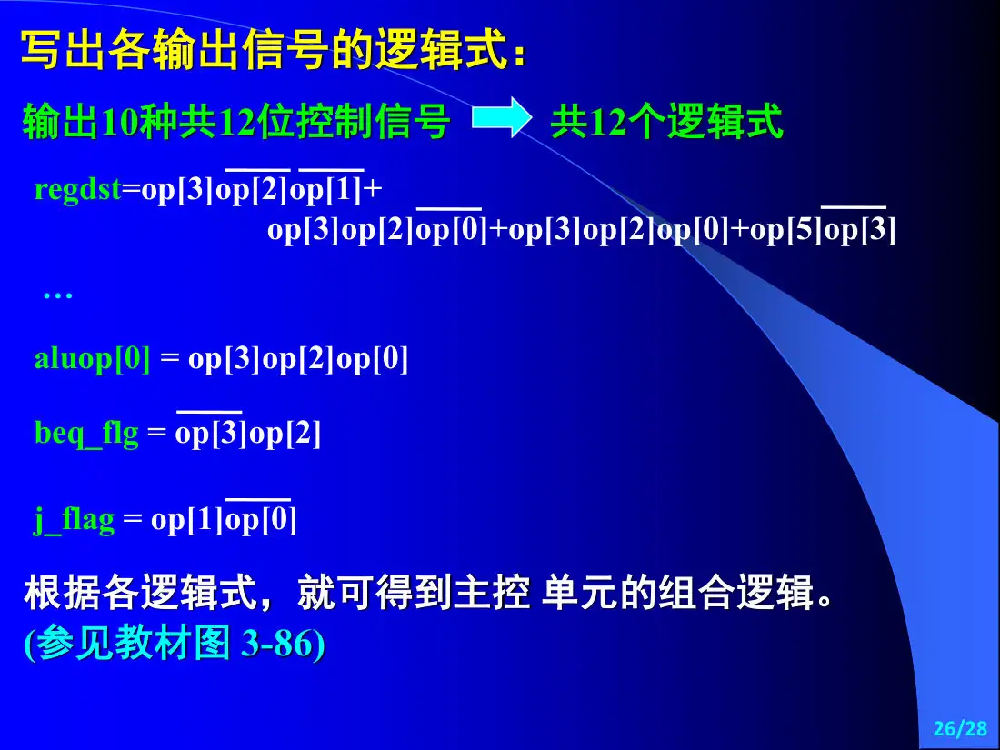

原文：

写出各输出信号的逻辑式：

输出10种共12位控制信号 共12个逻辑式

regdst=op[3]op[2]op[1] op[3]op[2]op[0]+op[3]op[2]op[0]+op[5]op[3]

aluop[0] = op[3]op[2]op[0]

beq\_flg = op[3]op[2]

j\_flag = op[1]op[0]

根据各逻辑式，就可得到主控 单元的组合逻辑。(参见教材图 3-86)

26/28

### 第 27 页

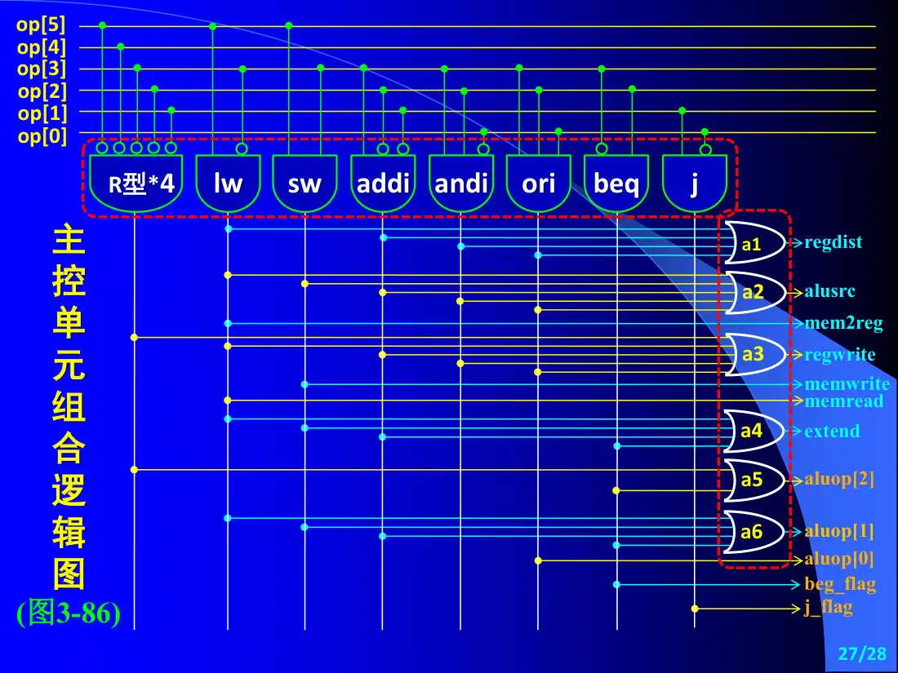

### 完整的单周期CPU微架构

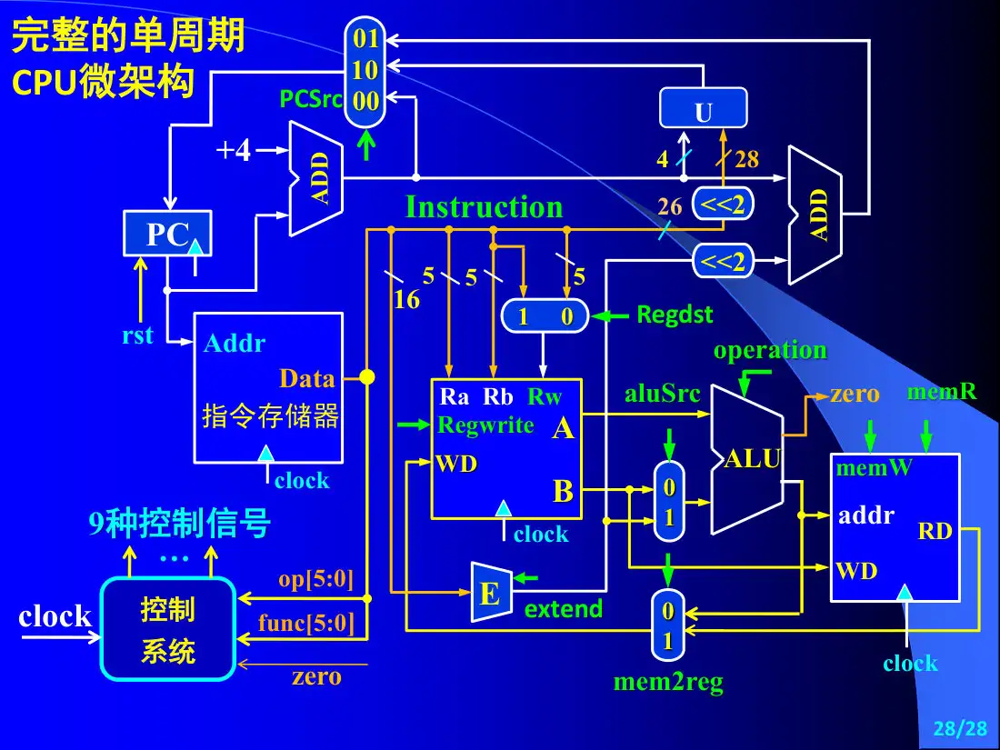

原文：

完整的单周期CPU微架构

控制系统
