# 《计算机组成与结构》第6章 多周期MIPS处理器控制系统（课件）

原件的每一页，下面附识别出的文字。

### 6.7 多周期MIPS处理器

原文：

6.7 多周期MIPS处理器

（组合逻辑与微程序）

1/33

### ※多周期CPU所需的控制信号

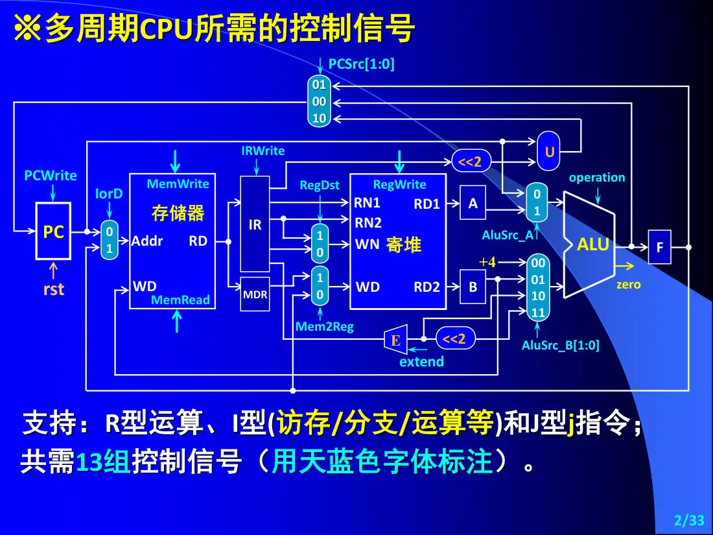

原文：

※多周期CPU所需的控制信号

支持：R型运算、I型(访存/分支/运算等)和J型j指令；共需13组控制信号（用天蓝色字体标注）。

2/33

### 3、控制系统方案

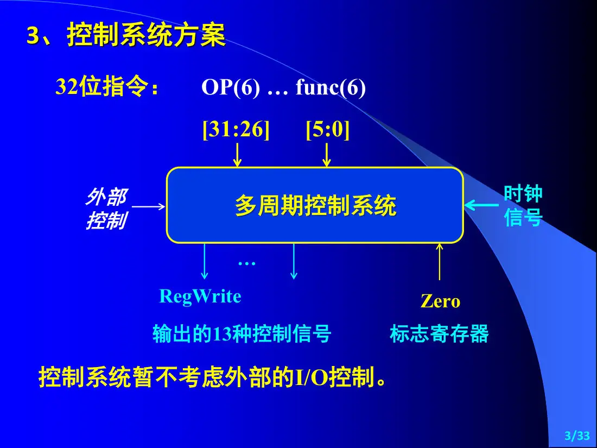

原文：

3、控制系统方案

32位指令：

OP(6) … func(6)

[31:26] [5:0]

外部控制

多周期控制系统

时钟信号

RegWrite

Zero

输出的13种控制信号

标志寄存器

控制系统暂不考虑外部的I/O控制。

3/33

### ※控制信号的产生方式

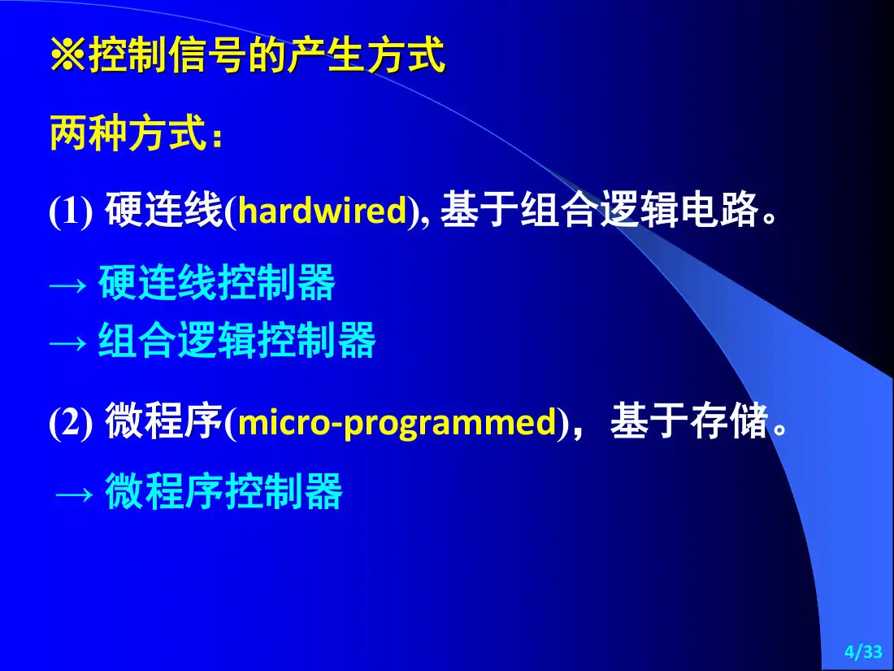

原文：

※控制信号的产生方式

两种方式：

(1) 硬连线(hardwired), 基于组合逻辑电路。

硬连线控制器

→ 组合逻辑控制器

(2) 微程序(micro-programmed)，基于存储。

微程序控制器

4/33

### (1) 硬连线(组合逻辑)控制方式※控制信号(微命令)的产生原理

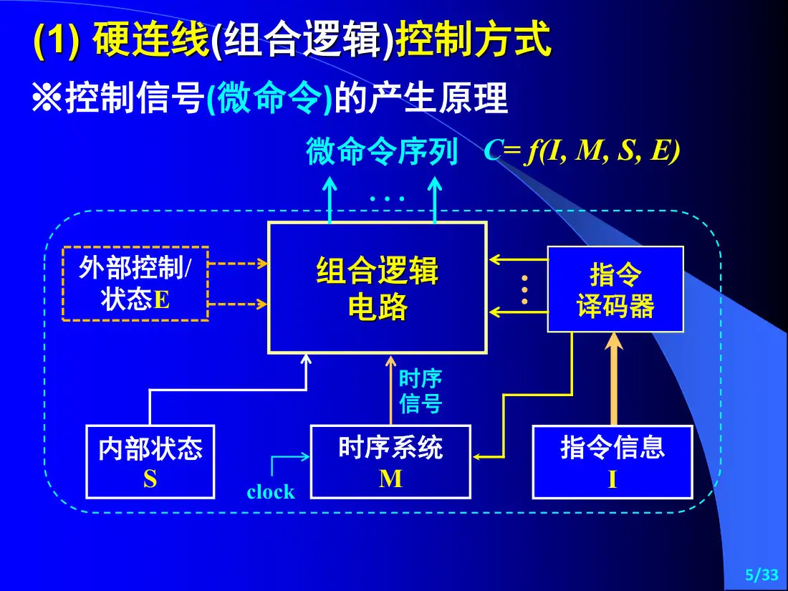

原文：

(1) 硬连线(组合逻辑)控制方式※控制信号(微命令)的产生原理

微命令序列 C= f(I, M, S, E)

外部控制/状态E

组合逻辑电路指令译码器

内部状态S

clock时序信号

时序系统M

指令信息

5/33

### 采用两级控制模式

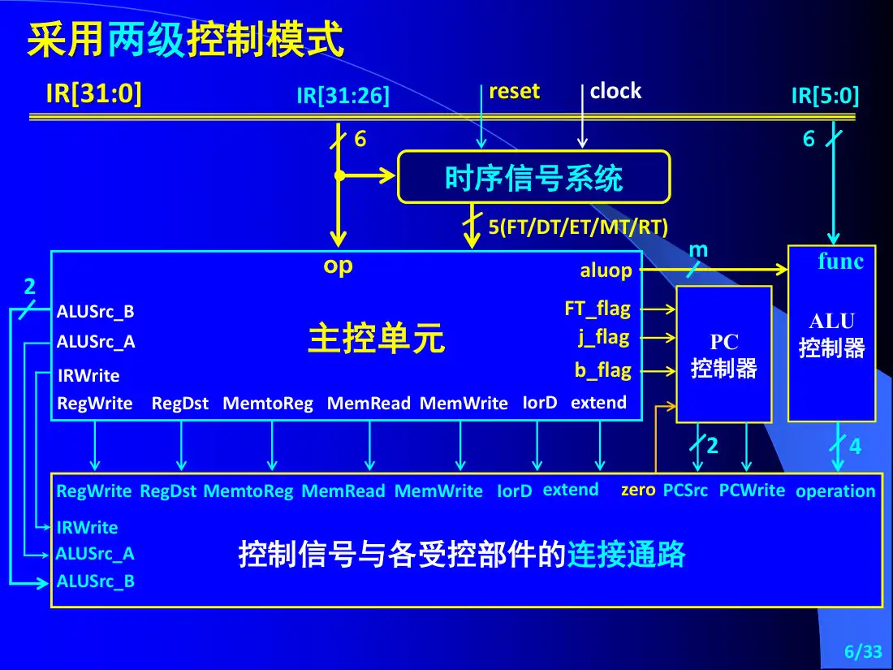

原文：

采用两级控制模式

IR[31:0]

IR[31:26]

reset

clock

IR[5:0]

时序信号系统

5(FT/DT/ET/MT/RT)

op

aluop

func

ALUSrc\_B

ALUSrc\_A

主控单元

FT\_flag

j\_flag

IRWrite

b\_flag

PC控制器

ALU控制器

RegWrite RegDst MemtoReg MemRead MemWrite IorD extend

2

zeroRegWrite RegDst MemtoReg MemRead MemWrite IorD extend PCSrc PCWrite operation

IRWrite

ALUSrc\_A

ALUSrc\_B

控制信号与各受控部件的连接通路

6/33

### ※需分别设计实现各控制部件

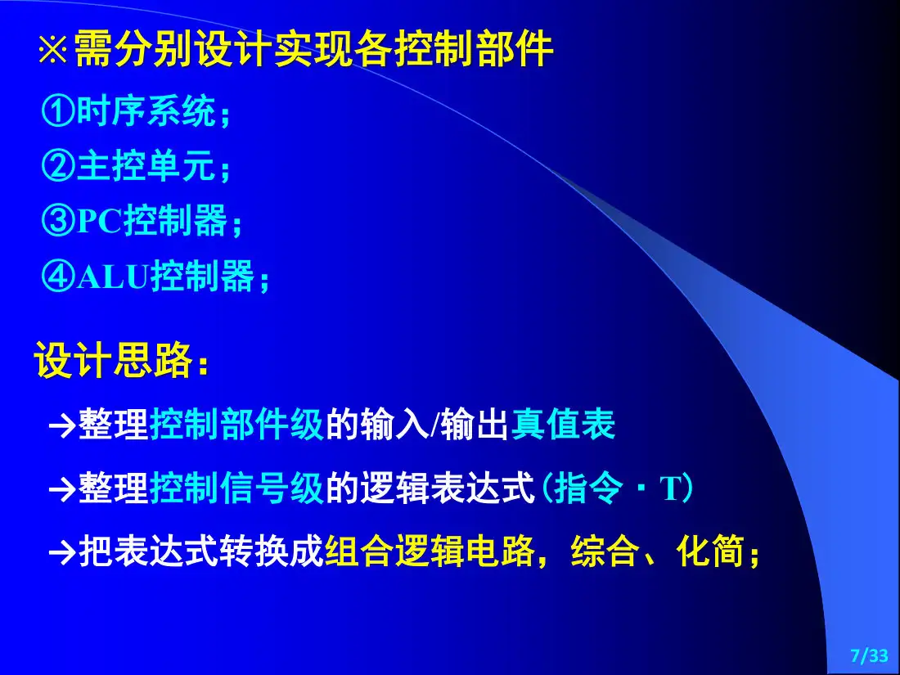

原文：

※需分别设计实现各控制部件

①时序系统；

②主控单元；

③PC控制器；

④ALU控制器；

设计思路：

→整理控制部件级的输入/输出真值表

→整理控制信号级的逻辑表达式(指令·T)

→把表达式转换成组合逻辑电路，综合、化简；

7/33

### IR[31:26]

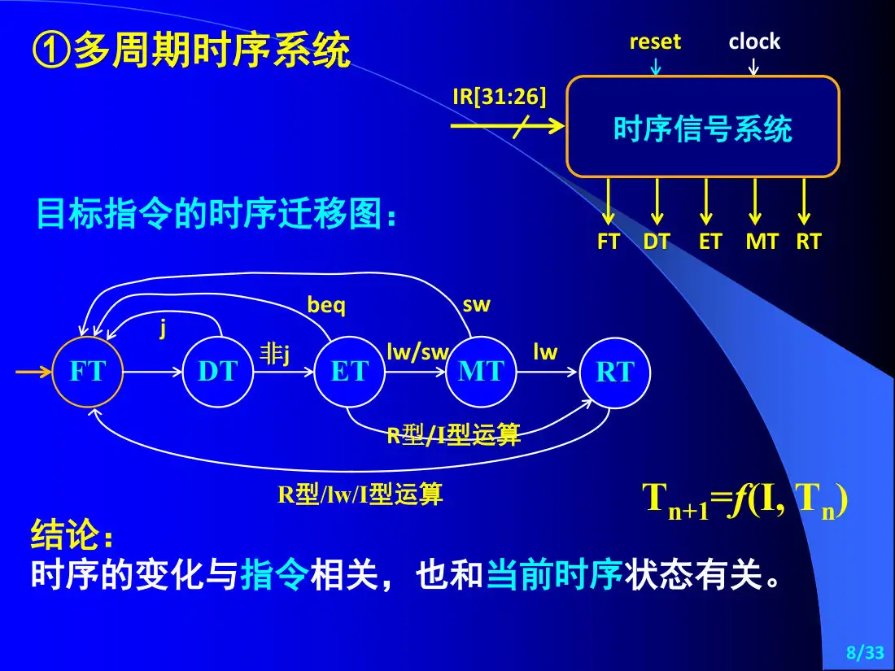

原文：

IR[31:26]

目标指令的时序迁移图：

时序信号系统

FT DT ET MT RT

R型/I型运算

R型/lw/I型运算

Tn+1=f(I, Tn)

结论：时序的变化与指令相关，也和当前时序状态有关。

①多周期时序系统

reset clock

8/33

### √时序主处理单元+6个时序状态触发器；√反馈型的时序信号连接；

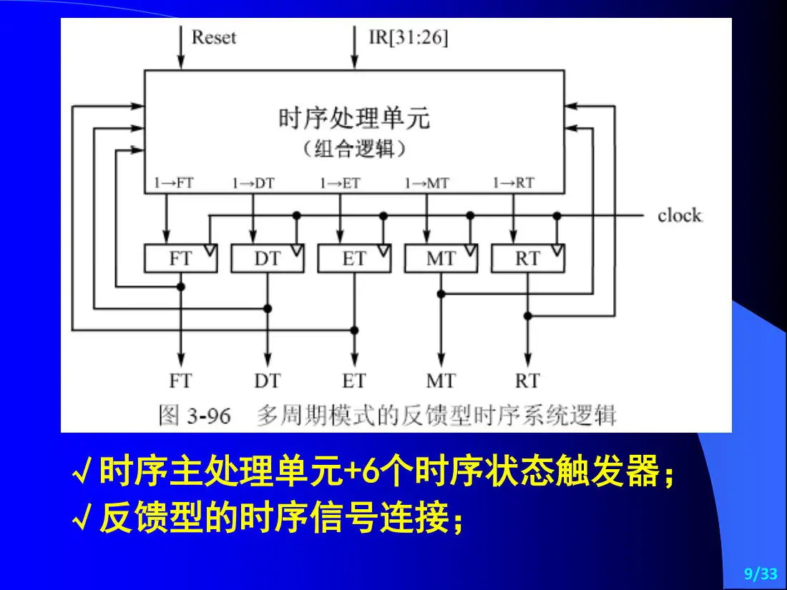

原文：

√时序主处理单元+6个时序状态触发器；√反馈型的时序信号连接；

9/33

### 非j lw/sw lwFT DT V ET MT RT

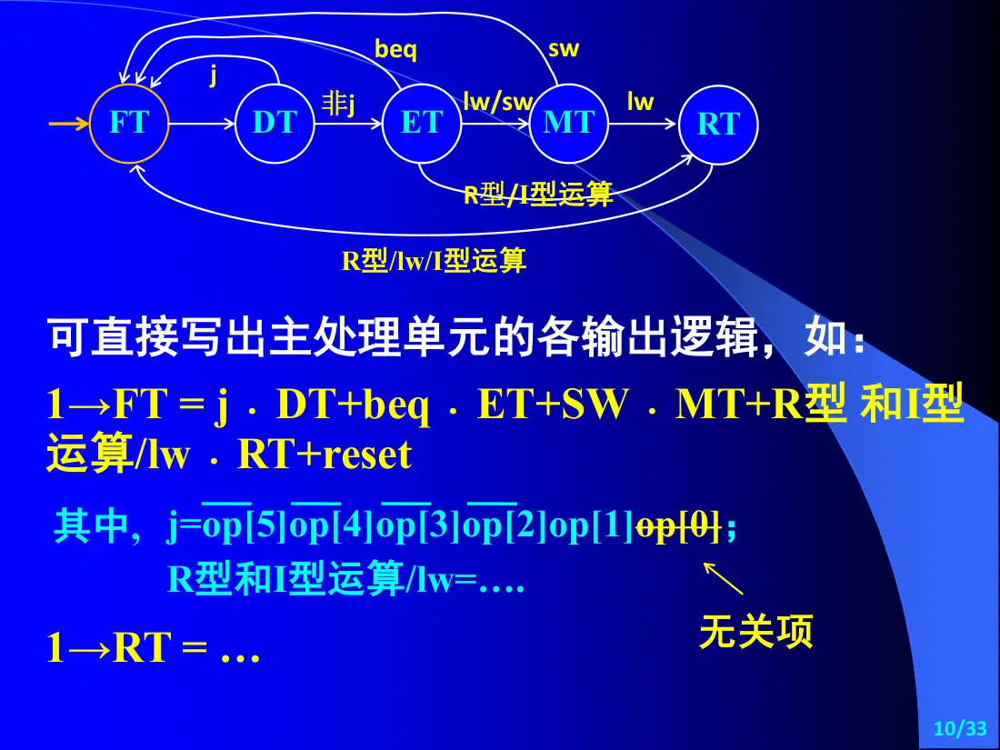

原文：

非j lw/sw lwFT DT V ET MT RT

R型/I型运算

R型/lw/I型运算

可直接写出主处理单元的各输出逻辑，如：

$1 1 \div 2 : 1 1 = 1 1$ DT+beq﹒ET+SW﹒MT+R型 和I型运算/lw﹒RT+reset

j=op[5]op[4]op[3]op[2]op[1]op[0]；其中,R型和I型运算/lw=….

$$
1 \rightarrow \mathrm{RT} = \dots
$$

无关项

10/33

### ②主控单元逻辑

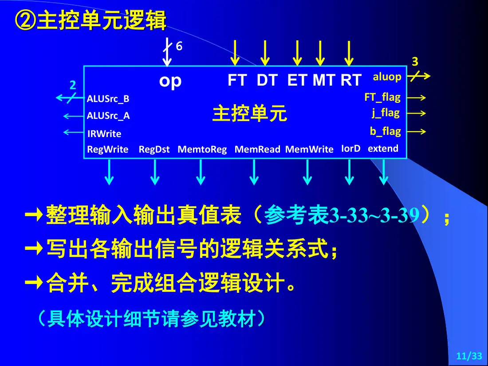

原文：

②主控单元逻辑

op

FT DT ET MT RT aluop

ALUSrc\_B

ALUSrc\_A

主控单元

FT\_flag

j\_flag

IRWrite

b\_flag

RegWrite RegDst MemtoReg MemRead MemWrite IorD extend

→整理输入输出真值表（参考表3-33\~3-39）

→写出各输出信号的逻辑关系式；

→合并、完成组合逻辑设计。

（具体设计细节请参见教材）

11/33

### ③ALU控制单元逻辑

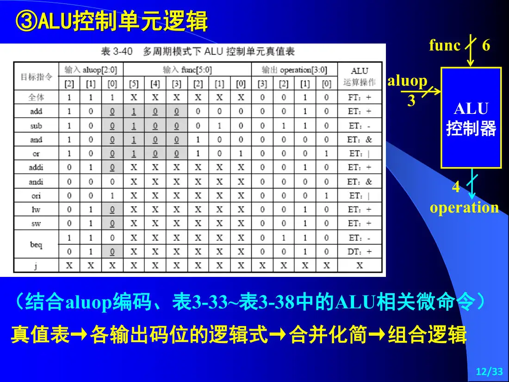

原文：

③ALU控制单元逻辑

表 3-40 多周期模式下 ALU 控制单元真值表
<table><tr><td rowspan="2">目标指令</td><td colspan="3">输入aluop[2:0]</td><td colspan="6">输入func[5:0]</td><td colspan="4">输出operation[3:0]</td><td rowspan="2">ALU运算操作</td></tr><tr><td>[2]</td><td>[1]</td><td>[0]</td><td>[5]</td><td>[4]</td><td>[3]</td><td>[2]</td><td>[1]</td><td>[0]</td><td>[3]</td><td>[2]</td><td>[1]</td><td>[0]</td></tr><tr><td>全体</td><td>1</td><td>1</td><td>1</td><td>X</td><td>X</td><td>X</td><td>X</td><td>X</td><td>X</td><td>0</td><td>0</td><td>1</td><td>0</td><td>FT: +</td></tr><tr><td>add</td><td>1</td><td>0</td><td>0</td><td>1</td><td>0</td><td>0</td><td>0</td><td>0</td><td>0</td><td>0</td><td>0</td><td>1</td><td>0</td><td>ET: +</td></tr><tr><td>sub</td><td>1</td><td>0</td><td>0</td><td>1</td><td>0</td><td>0</td><td>0</td><td>1</td><td>0</td><td>0</td><td>1</td><td>1</td><td>0</td><td>ET: -</td></tr><tr><td>and</td><td>1</td><td>0</td><td>0</td><td>1</td><td>0</td><td>0</td><td>1</td><td>0</td><td>0</td><td>0</td><td>0</td><td>0</td><td>0</td><td>ET: &amp;</td></tr><tr><td>or</td><td>1</td><td>0</td><td>0</td><td>1</td><td>0</td><td>0</td><td>1</td><td>0</td><td>1</td><td>0</td><td>0</td><td>0</td><td>1</td><td>ET: |</td></tr><tr><td>addi</td><td>0</td><td>1</td><td>0</td><td>X</td><td>X</td><td>X</td><td>X</td><td>X</td><td>X</td><td>0</td><td>0</td><td>1</td><td>0</td><td>ET: +</td></tr><tr><td>andi</td><td>0</td><td>0</td><td>0</td><td>X</td><td>X</td><td>X</td><td>X</td><td>X</td><td>X</td><td>0</td><td>0</td><td>0</td><td>0</td><td>ET: &amp;</td></tr><tr><td>ori</td><td>0</td><td>0</td><td>1</td><td>X</td><td>X</td><td>X</td><td>X</td><td>X</td><td>X</td><td>0</td><td>0</td><td>0</td><td>1</td><td>ET: |</td></tr><tr><td>lw</td><td>0</td><td>1</td><td>0</td><td>X</td><td>X</td><td>X</td><td>X</td><td>X</td><td>X</td><td>0</td><td>0</td><td>1</td><td>0</td><td>ET: +</td></tr><tr><td>sw</td><td>0</td><td>1</td><td>0</td><td>X</td><td>X</td><td>X</td><td>X</td><td>X</td><td>X</td><td>0</td><td>0</td><td>1</td><td>0</td><td>ET: +</td></tr><tr><td rowspan="2">beq</td><td>1</td><td>1</td><td>0</td><td>X</td><td>X</td><td>X</td><td>X</td><td>X</td><td>X</td><td>0</td><td>1</td><td>1</td><td>0</td><td>ET: -</td></tr><tr><td>0</td><td>1</td><td>0</td><td>X</td><td>X</td><td>X</td><td>X</td><td>X</td><td>X</td><td>0</td><td>0</td><td>1</td><td>0</td><td>DT: +</td></tr><tr><td>j</td><td>X</td><td>X</td><td>X</td><td>X</td><td>X</td><td>X</td><td>X</td><td>X</td><td>X</td><td>X</td><td>X</td><td>X</td><td>X</td><td>X</td></tr></table>

（结合aluop编码、表3-33\~表3-38中的ALU相关微命真值表→各输出码位的逻辑式→合并化简→组合逻辑

12/33

### ④PC控制单元逻辑

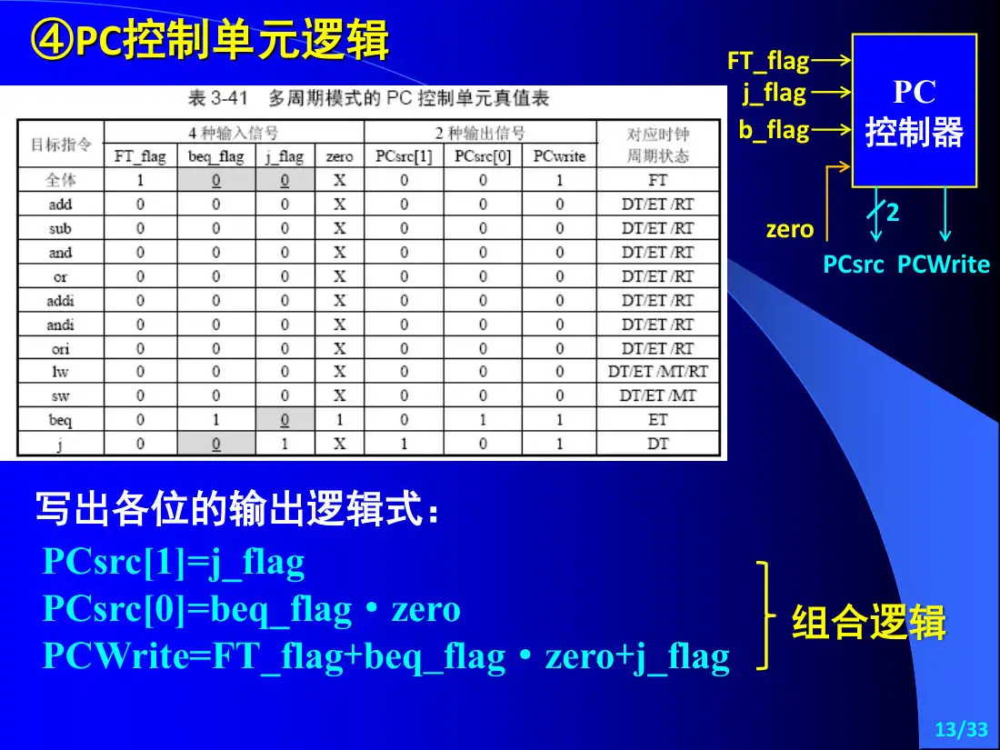

原文：

④PC控制单元逻辑

表3-41 多周期模式的 PC 控制单元真值表
<table><tr><td rowspan="2">目标指令</td><td colspan="4">4种输入信号</td><td colspan="3">2种输出信号</td><td rowspan="2">对应时钟周期状态</td></tr><tr><td>FT_flag</td><td>beq_flag</td><td>j_flag</td><td>zero</td><td>PCsrc[1]</td><td>PCsrc[0]</td><td>PCwrite</td></tr><tr><td>全体</td><td>1</td><td>0</td><td>0</td><td>X</td><td>0</td><td>0</td><td>1</td><td>FT</td></tr><tr><td>add</td><td>0</td><td>0</td><td>0</td><td>X</td><td>0</td><td>0</td><td>0</td><td>DT/ET /RT</td></tr><tr><td>sub</td><td>0</td><td>0</td><td>0</td><td>X</td><td>0</td><td>0</td><td>0</td><td>DT/ET /RT</td></tr><tr><td>and</td><td>0</td><td>0</td><td>0</td><td>X</td><td>0</td><td>0</td><td>0</td><td>DT/ET /RT</td></tr><tr><td>or</td><td>0</td><td>0</td><td>0</td><td>X</td><td>0</td><td>0</td><td>0</td><td>DT/ET /RT</td></tr><tr><td>addi</td><td>0</td><td>0</td><td>0</td><td>X</td><td>0</td><td>0</td><td>0</td><td>DT/ET /RT</td></tr><tr><td>andi</td><td>0</td><td>0</td><td>0</td><td>X</td><td>0</td><td>0</td><td>0</td><td>DT/ET /RT</td></tr><tr><td>ori</td><td>0</td><td>0</td><td>0</td><td>X</td><td>0</td><td>0</td><td>0</td><td>DT/ET /RT</td></tr><tr><td>lw</td><td>0</td><td>0</td><td>0</td><td>X</td><td>0</td><td>0</td><td>0</td><td>DT/ET /MT/RT</td></tr><tr><td>sw</td><td>0</td><td>0</td><td>0</td><td>X</td><td>0</td><td>0</td><td>0</td><td>DT/ET /MT</td></tr><tr><td>beq</td><td>0</td><td>1</td><td>0</td><td>1</td><td>0</td><td>1</td><td>1</td><td>ET</td></tr><tr><td>j</td><td>0</td><td>0</td><td>1</td><td>X</td><td>1</td><td>0</td><td>1</td><td>DT</td></tr></table>

写出各位的输出逻辑式：

PCsrc[1]=j\_flag PCsrc[0]=beq\_flag·zero PCWrite=FT\_flag+beq\_flag·zero+j\_flag

PC控制器

组合逻辑

13/33

### ※处理器的完整硬件架构图

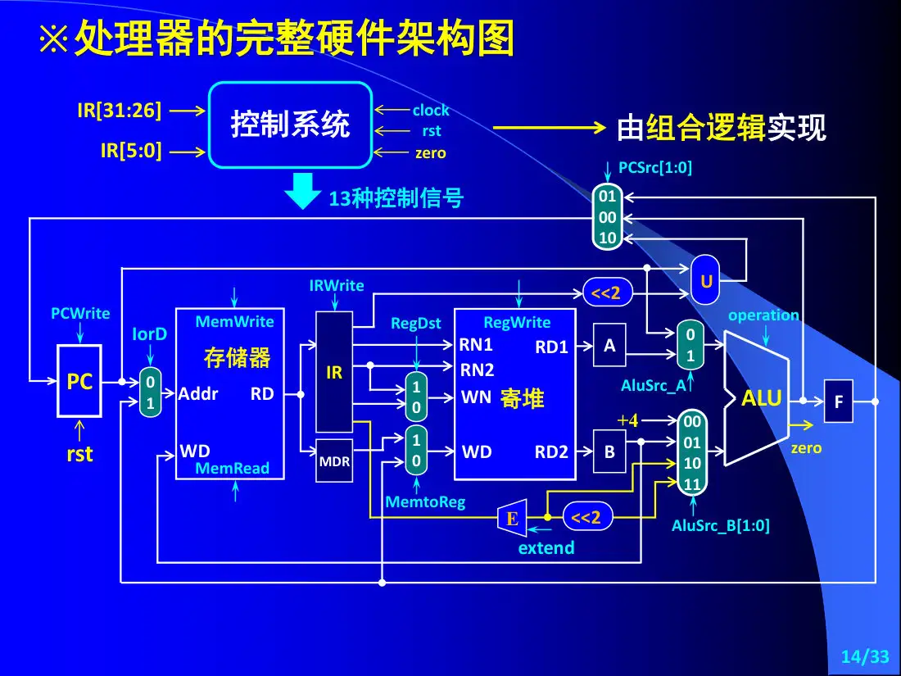

原文：

※处理器的完整硬件架构图

IR[31:26]

IR[5:0]

控制系统

clock

rst

13种控制信号

由组合逻辑实现

14/33

### (2) 微程序控制方式

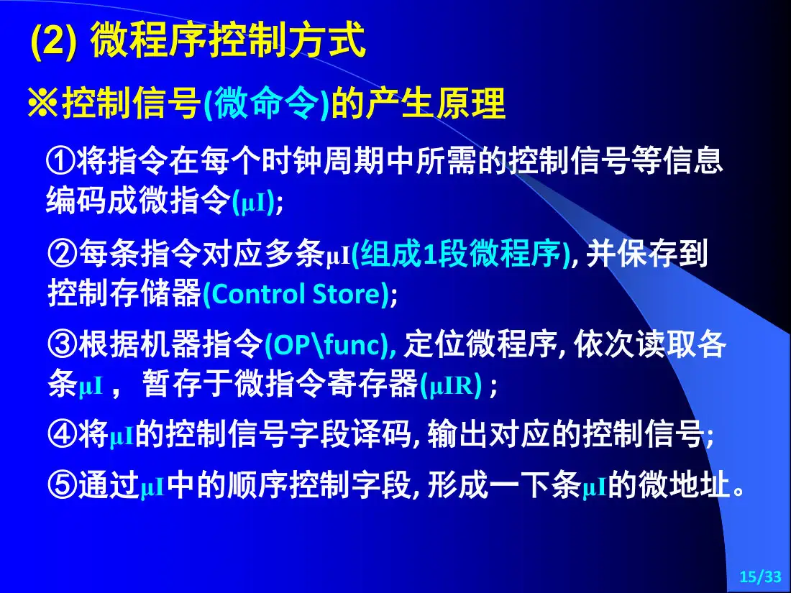

原文：

(2) 微程序控制方式

※控制信号(微命令)的产生原理

①将指令在每个时钟周期中所需的控制信号等信息编码成微指令(μI);

②每条指令对应多条μI(组成1段微程序), 并保存到 控制存储器(Control Store);

③根据机器指令(OP\func), 定位微程序, 依次读取各条μI ，暂存于微指令寄存器(μIR) ;

④将μI的控制信号字段译码, 输出对应的控制信号;

⑤通过μI中的顺序控制字段, 形成一下条μI的微地址。

15/33

### IR[31:0]

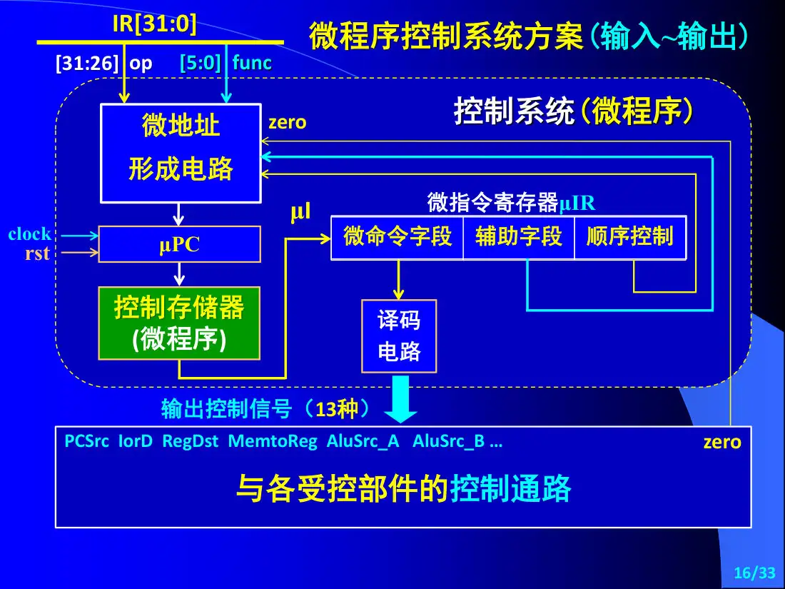

原文：

IR[31:0]

微程序控制系统方案(输入\~输出)

[31:26] op [5:0] func

微地址

控制系统(微程序)

形成电路

clock rst μPC

微指令寄存器μIR

微命令字段

辅助字段

顺序控制

控制存储器(微程序)

译码电路

输出控制信号（13种）

PCSrc IorD RegDst MemtoReg AluSrc\_A AluSrc\_B …

zero

与各受控部件的控制通路

16/33

### ※需要设计的内容

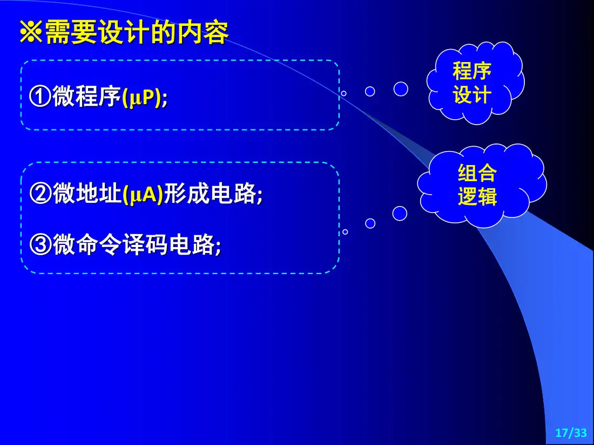

原文：

※需要设计的内容

①微程序(μP);

②微地址(μA)形成电路;

③微命令译码电路;

程序设计

组合 逻辑

17/33

### ① 微程序的设计

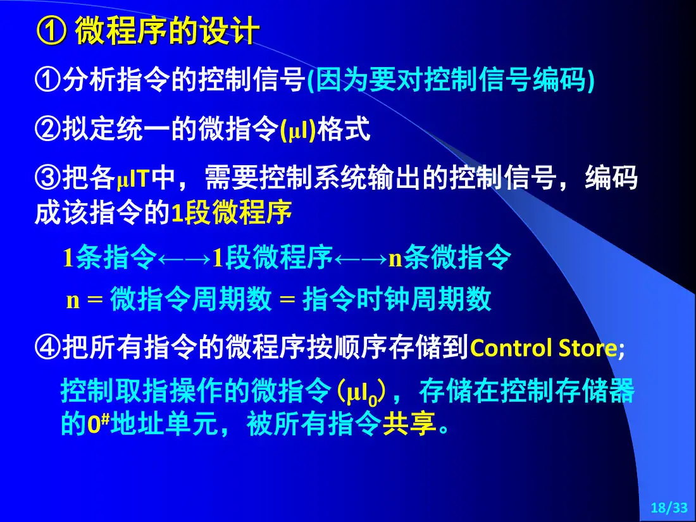

原文：

① 微程序的设计

①分析指令的控制信号(因为要对控制信号编码)

②拟定统一的微指令(μI)格式

③把各μIT中，需要控制系统输出的控制信号，编码成该指令的1段微程序

1条指令←→1段微程序←→n条微指令

n = 微指令周期数 = 指令时钟周期数

④把所有指令的微程序按顺序存储到Control Store;

控制取指操作的微指令(μI )，存储在控制存储器的0#地址单元，被所有指令共享。

18/33

### 微指令字长32位

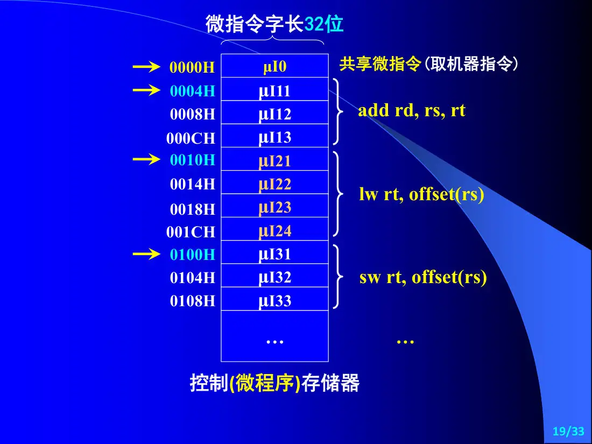

原文：

微指令字长32位

共享微指令(取机器指令)

add rd, rs, rt

lw rt, offset(rs)

sw rt, offset(rs)

控制(微程序)存储器

19/33

### 各指令的控制信号

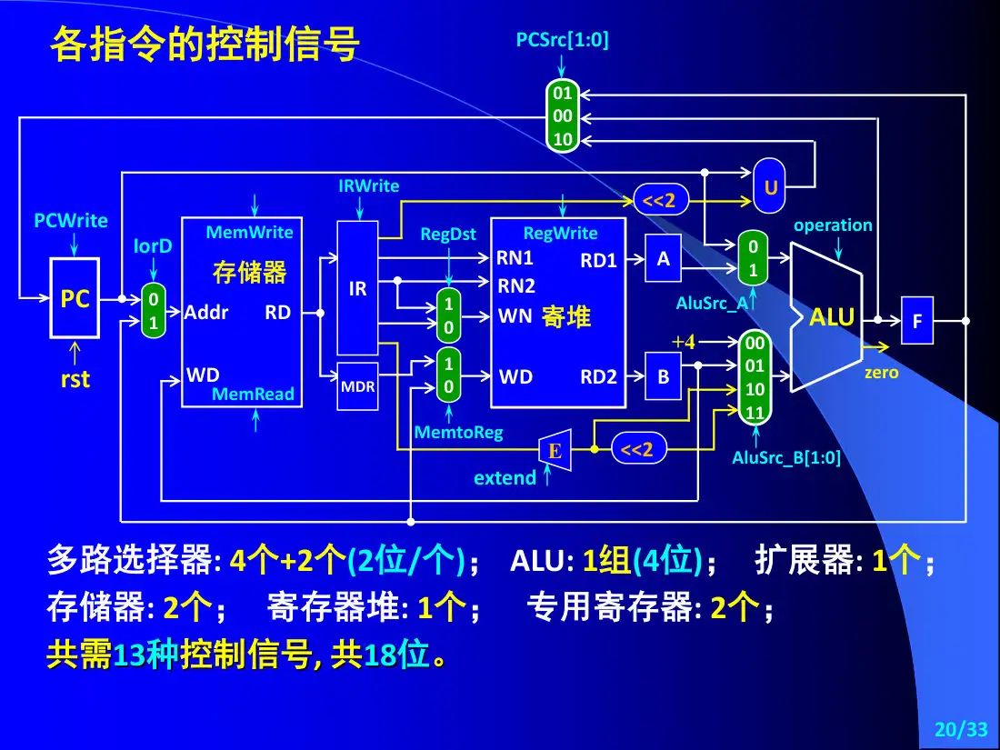

原文：

各指令的控制信号

多路选择器: 4个+2个(2位/个)； ALU: 1组(4位)； 扩展器: 1个；存储器: 2个； 寄存器堆: 1个； 专用寄存器: 2个；共需13种控制信号, 共18位。

20/33

### 31:14

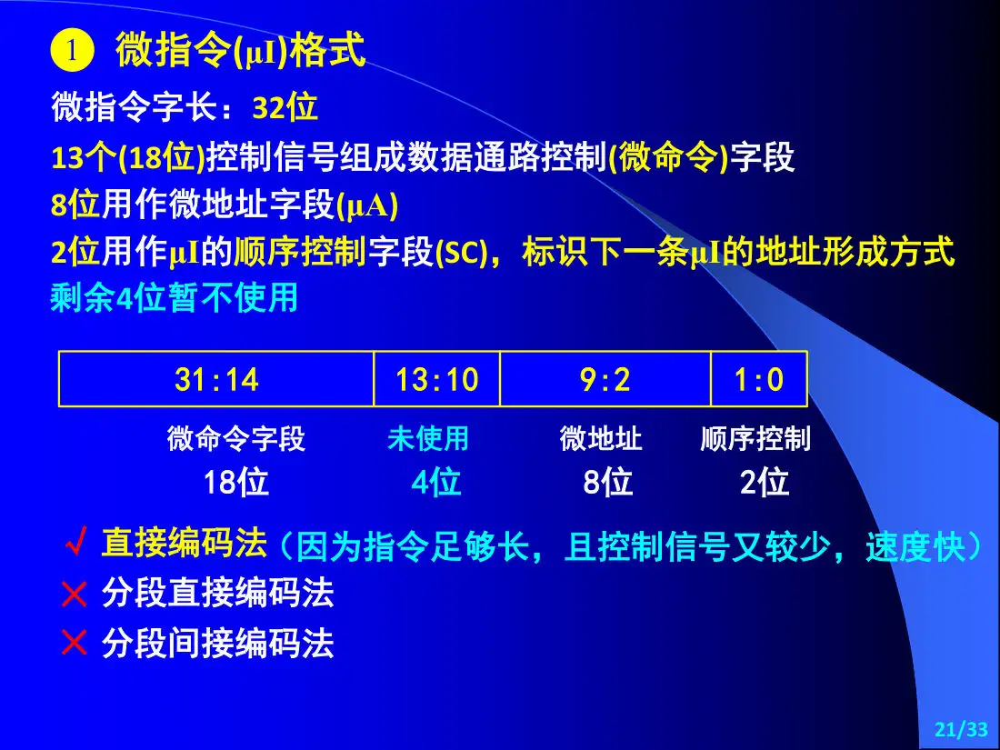

原文：

微指令(μI)格式微指令字长：32位13个(18位)控制信号组成数据通路控制(微命令)字段8位用作微地址字段(μA)2位用作μI的顺序控制字段(SC)，标识下一条μI的地址形成方式剩余4位暂不使用

31:14

13:10

9:2

1:0

微命令字段

18位

未使用

微地址

顺序控制

4位

8位

2位

直接编码法√ （因为指令足够长，且控制信号又较少，速度快）

分段直接编码法×

分段间接编码法×

21/33

### 微命令字段的编排顺序

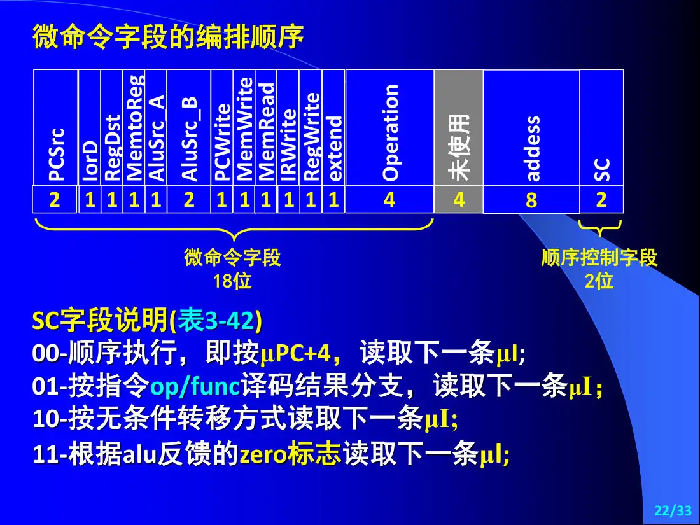

原文：

微命令字段的编排顺序

addess8未使用4

Operation 4

CSr orD RegDst MemtoReg AluSrc\_A AluSrc\_B PCWrite MemWrite MemRead IRWrite RegWrite extend 2 1 1 1 1 2 1 1 1 1 1 1

微命令字段18位

顺序控制字段2位

SC字段说明(表3-42)00-顺序执行，即按μPC+4，读取下一条μI;01-按指令op/func译码结果分支，读取下一条μI；10-按无条件转移方式读取下一条μI;11-根据alu反馈的zero标志读取下一条μI;

22/33

### ❷把各T中的控制信号直接编码成μI

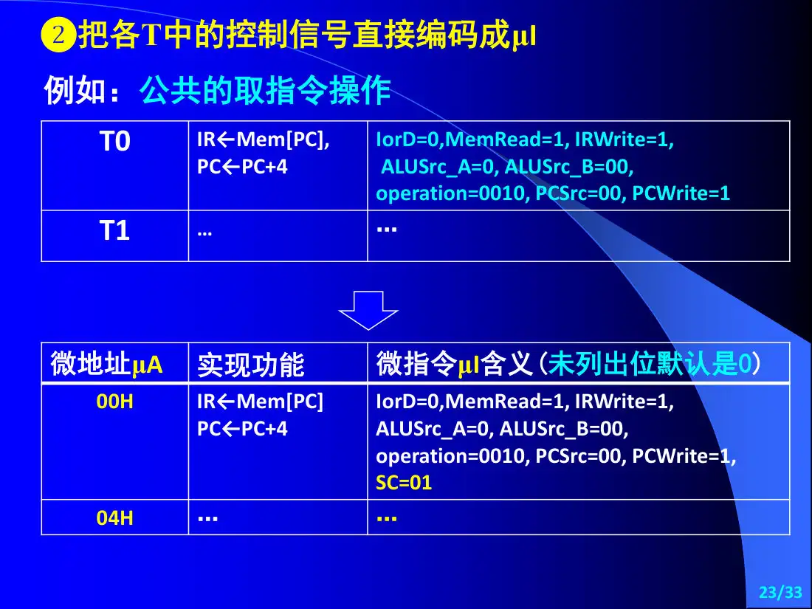

原文：

❷把各T中的控制信号直接编码成μI

例如：公共的取指令操作

T0

IR←Mem[PC], PC←PC+4

微地址μA

实现功能

IR←Mem[PC] PC←PC+4

IorD=0,MemRead=1, IRWrite=1, ALUSrc\_A=0, ALUSrc\_B=00, operation=0010, PCSrc=00, PCWrite=1

微指令μI含义(未列出位默认是0)

IorD=0,MemRead=1, IRWrite=1, ALUSrc\_A=0, ALUSrc\_B=00, operation=0010, PCSrc=00, PCWrite=1, SC=01

23/33

### 将控制信号直接编码

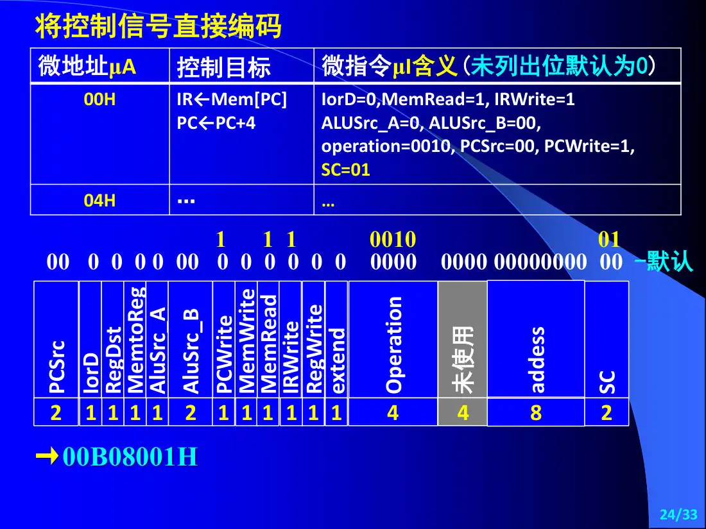

原文：

将控制信号直接编码

微地址μA

控制目标

IR←Mem[PC] PC←PC+4

微指令μI含义(未列出位默认为0)

IorD=0,MemRead=1, IRWrite=1 ALUSrc\_A=0, ALUSrc\_B=00, operation=0010, PCSrc=00, PCWrite=1, SC=01

1 1 1 0010 01 00 0 0 0 0 00 0 0 0 0 0 0 0000 0000 00000000 00 -默认

→00B08001H

24/33

### ❸ 整合所有指令的微程序并存储到Control Store

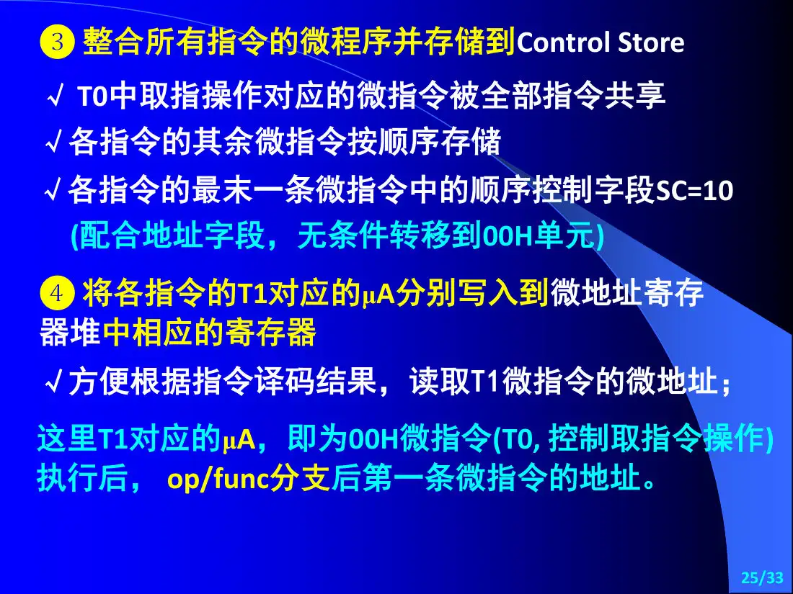

原文：

❸ 整合所有指令的微程序并存储到Control Store

√T0中取指操作对应的微指令被全部指令共享

√各指令的其余微指令按顺序存储

√各指令的最末一条微指令中的顺序控制字段SC=10(配合地址字段，无条件转移到00H单元)

❹将各指令的T1对应的μA分别写入到微地址寄存器堆中相应的寄存器

√方便根据指令译码结果，读取T1微指令的微地址；

这里T1对应的μA，即为00H微指令(T0, 控制取指令操作)执行后，op/func分支后第一条微指令的地址。

25/33

### ② 微地址(μA)形成电路

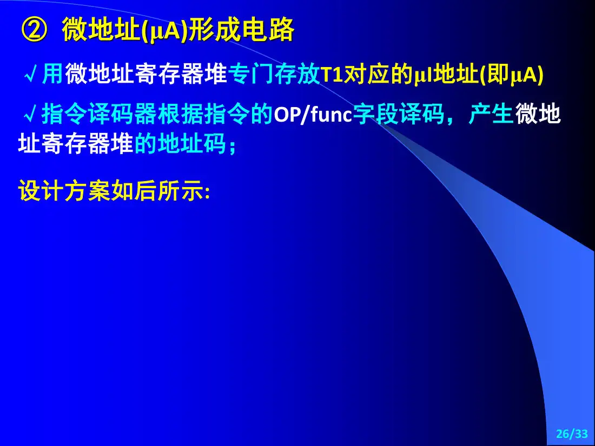

原文：

② 微地址(μA)形成电路

√用微地址寄存器堆专门存放T1对应的μI地址(即μA)

√指令译码器根据指令的OP/func字段译码，产生微地址寄存器堆的地址码；

设计方案如后所示:

26/33

### 微地址形成电路方案之一：基于微地址存储

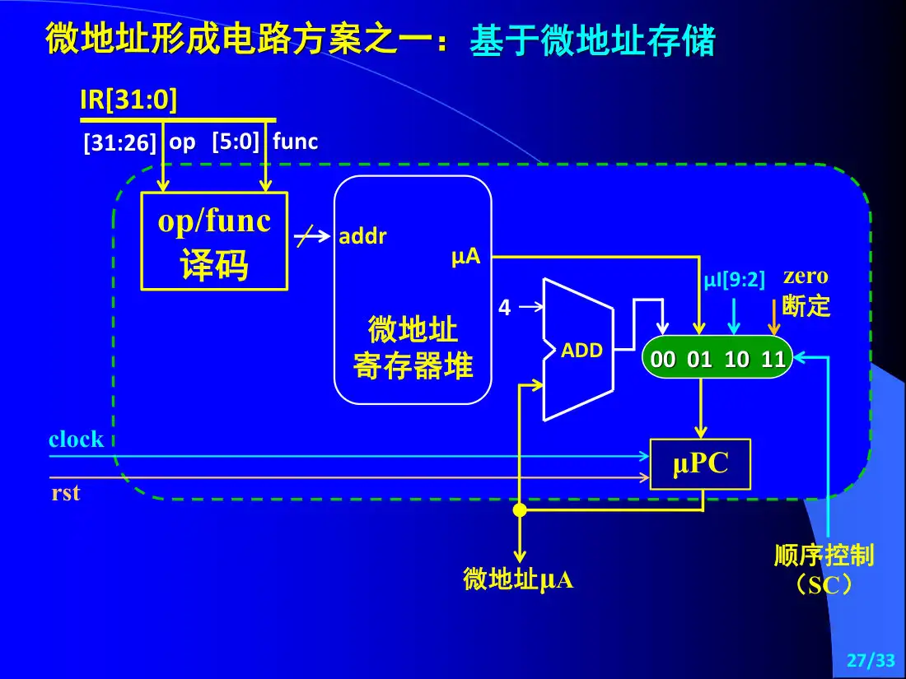

原文：

微地址形成电路方案之一：基于微地址存储

op/func译码

微地址寄存器堆

### 微地址寄存器堆的存储方案 微指令字长32位

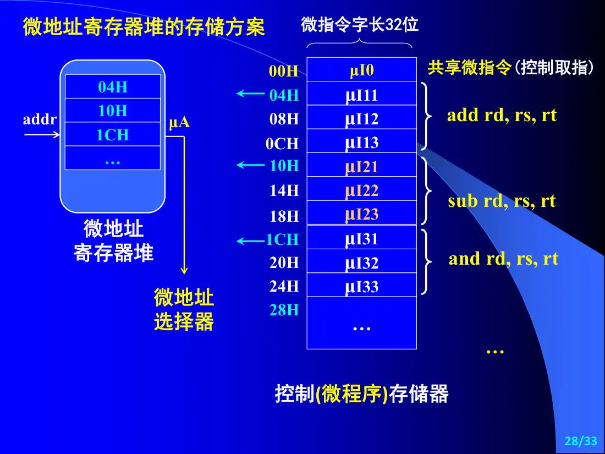

原文：

微地址寄存器堆的存储方案 微指令字长32位

微地址寄存器堆

微地址选择器

共享微指令(控制取指)

add rd, rs, rt

sub rd, rs, rt

and rd, rs, rt

控制(微程序)存储器

28/33

### 指令op/func译码器

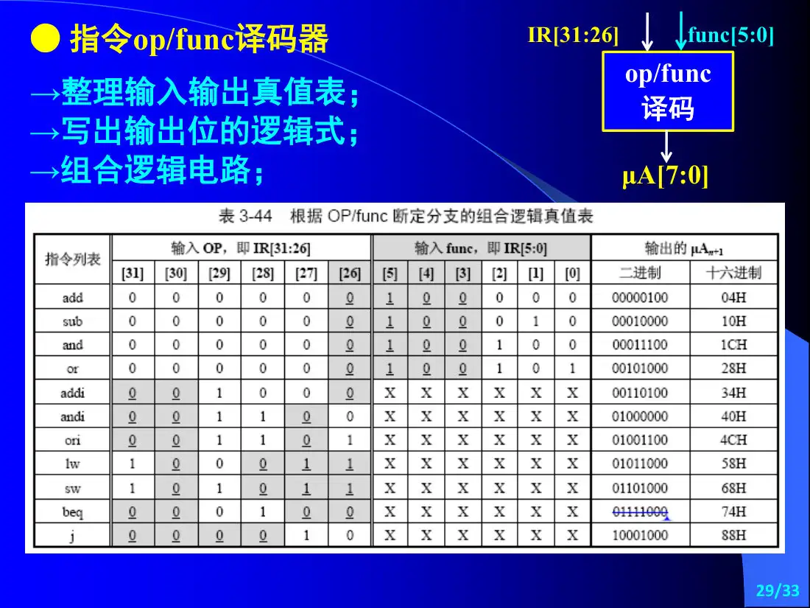

原文：

指令op/func译码器

整理输入输出真值表；→写出输出位的逻辑式；→组合逻辑电路；

op/func译码

μA[7:0]

表 3-44 根据 OP/func 断定分支的组合逻辑真值表
<table><tr><td rowspan="2">指令列表</td><td colspan="6">输入OP,即IR[31:26]</td><td colspan="6">输入func,即IR[5:0]</td><td colspan="2">输出的 $μA_{n+1}$ </td></tr><tr><td>[31]</td><td>[30]</td><td>[29]</td><td>[28]</td><td>[27]</td><td>[26]</td><td>[5]</td><td>[4]</td><td>[3]</td><td>[2]</td><td>[1]</td><td>[0]</td><td>二进制</td><td>十六进制</td></tr><tr><td>add</td><td>0</td><td>0</td><td>0</td><td>0</td><td>0</td><td>0</td><td>1</td><td>0</td><td>0</td><td>0</td><td>0</td><td>0</td><td>00000100</td><td>04H</td></tr><tr><td>sub</td><td>0</td><td>0</td><td>0</td><td>0</td><td>0</td><td>0</td><td>1</td><td>0</td><td>0</td><td>0</td><td>1</td><td>0</td><td>00010000</td><td>10H</td></tr><tr><td>and</td><td>0</td><td>0</td><td>0</td><td>0</td><td>0</td><td>0</td><td>1</td><td>0</td><td>0</td><td>1</td><td>0</td><td>0</td><td>00011100</td><td>1CH</td></tr><tr><td>or</td><td>0</td><td>0</td><td>0</td><td>0</td><td>0</td><td>0</td><td>1</td><td>0</td><td>0</td><td>1</td><td>0</td><td>1</td><td>00101000</td><td>28H</td></tr><tr><td>addi</td><td>0</td><td>0</td><td>1</td><td>0</td><td>0</td><td>0</td><td>X</td><td>X</td><td>X</td><td>X</td><td>X</td><td>X</td><td>00110100</td><td>34H</td></tr><tr><td>andi</td><td>0</td><td>0</td><td>1</td><td>1</td><td>0</td><td>0</td><td>X</td><td>X</td><td>X</td><td>X</td><td>X</td><td>X</td><td>01000000</td><td>40H</td></tr><tr><td>ori</td><td>0</td><td>0</td><td>1</td><td>1</td><td>0</td><td>1</td><td>X</td><td>X</td><td>X</td><td>X</td><td>X</td><td>X</td><td>01001100</td><td>4CH</td></tr><tr><td>lw</td><td>1</td><td>0</td><td>0</td><td>0</td><td>1</td><td>1</td><td>X</td><td>X</td><td>X</td><td>X</td><td>X</td><td>X</td><td>01011000</td><td>58H</td></tr><tr><td>sw</td><td>1</td><td>0</td><td>1</td><td>0</td><td>1</td><td>1</td><td>X</td><td>X</td><td>X</td><td>X</td><td>X</td><td>X</td><td>01101000</td><td>68H</td></tr><tr><td>beq</td><td>0</td><td>0</td><td>0</td><td>1</td><td>0</td><td>0</td><td>X</td><td>X</td><td>X</td><td>X</td><td>X</td><td>X</td><td>01111000</td><td>74H</td></tr><tr><td>j</td><td>0</td><td>0</td><td>0</td><td>0</td><td>1</td><td>0</td><td>X</td><td>X</td><td>X</td><td>X</td><td>X</td><td>X</td><td>10001000</td><td>88H</td></tr></table>

IR[31:26] func[5:0]

29/33

### zero断定分支的设计

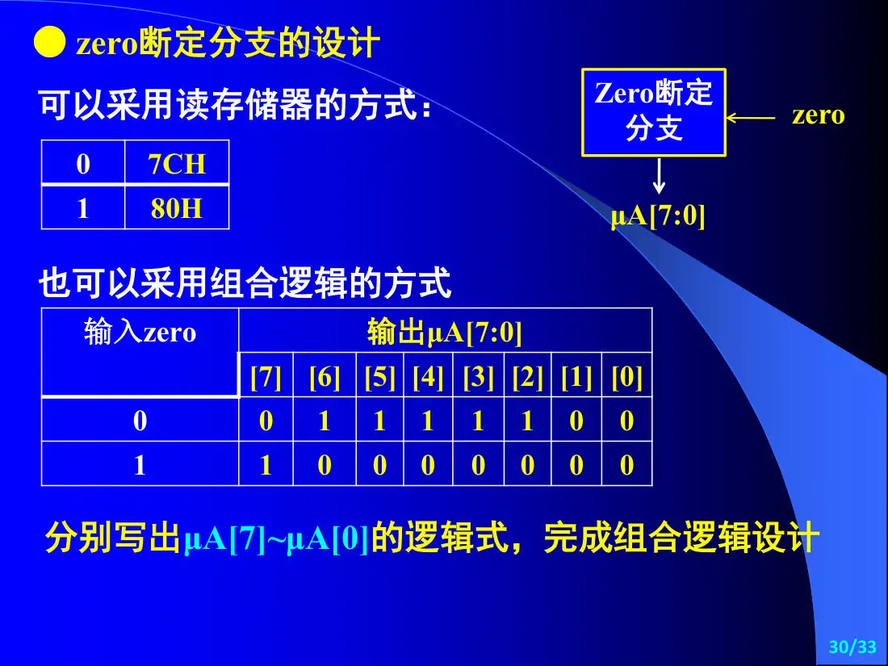

原文：

zero断定分支的设计

可以采用读存储器的方式：

0 7CH

1 80H

也可以采用组合逻辑的方式

Zero断定分支

μA[7:0]

<table><tr><td rowspan="2">输入zero</td><td colspan="8">输出μA[7:0]</td></tr><tr><td>[7]</td><td>[6]</td><td>[5]</td><td>[4]</td><td>[3]</td><td>[2]</td><td>[1]</td><td>[0]</td></tr><tr><td>0</td><td>0</td><td>1</td><td>1</td><td>1</td><td>1</td><td>1</td><td>0</td><td>0</td></tr><tr><td>1</td><td>1</td><td>0</td><td>0</td><td>0</td><td>0</td><td>0</td><td>0</td><td>0</td></tr></table>

分别写出μA[7]\~μA[0]的逻辑式，完成组合逻辑设计

30/33

### ③微命令译码电路

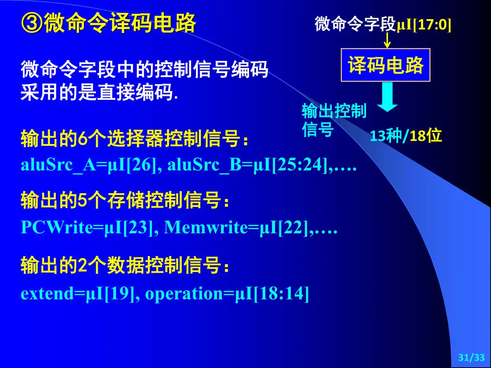

原文：

③微命令译码电路

微命令字段μI[17:0]

微命令字段中的控制信号编码采用的是直接编码.

译码电路

输出控制信号 信号

输出的6个选择器控制信号：$\mathrm  2 1 1 6 ) ( 2 0 , ~ [ - 1 1 , ~ 1 2 , ~ 1 1 , ~ 2 . ~ 1 1 , ~ 1 1 , ~ 2 . ~ 2 . ~ 1 3 , ~ 1 5 , ~ 2 . ~ 1 5 , ~ 2 . ~ 1 5 , ~ 2 . ~ 1 5 , ~ 2 . ~ 1 5 , ~ 2 . ~ 1 5 , ~ 2 . ~ 1 5 , ~ 2 . ~ 1 5 , ~ 2 . ~ 1 5 , ~ 2 . ~ 1 5 , ~ 2 . ~ 1 5 , ~ 2 . ~ 1 5 , ~ 2 . ~ 1 5 , ~ 2 . ~ 1 5 , ~ 2 . ~ 1 5 , ~ 2 . ~ 1 5 , ~ 2 . ~ 1 5 , ~ 2 . ~ 1 5 , ~ 2 . ~ 1 5 , ~ 2 . ~ 1 5 , ~ 2 . ~ 1 5 , ~ 2 . ~ 1 5 , ~ 2 . ~ 1 5 , ~ 2 . ~ 1 5 , ~ 2 . ~ 1 5 , ~ 2 . ~ 1 5 , ~ 2 . ~ 1 5 , ~ 2 . ~ 1 5 , ~ 2 . ~ 1 5 , ~ 2 .$

13种/18位

输出的5个存储控制信号： PCWrite=μI[23], Memwrite=μI[22],….

输出的2个数据控制信号： extend=μI[19], operation=μI[18:14]

31/33

### ※CPU的完整硬件结构

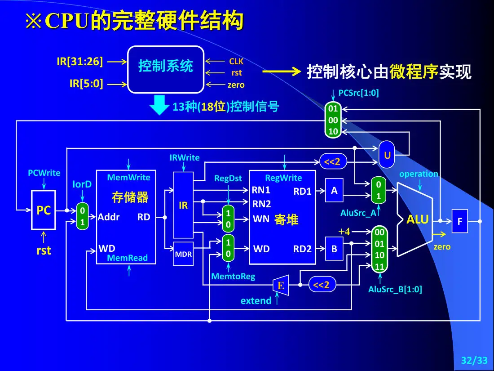

原文：

※CPU的完整硬件结构

IR[31:26]

IR[5:0]

控制系统

CLK

控制核心由微程序实现

13种(18位)控制信号

存储器

32/33

### 组合逻辑方式的特点：

原文：

组合逻辑方式的特点：

（1）控制信号的产生速度比微程序快

（2）设计不规整

（3）不容易修改或扩展

微程序控制方式的特点：

（1）用规整的存储逻辑代替了不规整的、繁琐的硬连线逻辑，结构简化，有利于设计自动化

（2）容易修改和扩展、灵活、通用性强

（3）可靠性较高，易于诊断和维护

（4）控制信号的产生速度比组合逻辑慢

33/33
