# 《计算机组成与结构》第7章 并行处理器（课件）

原件的每一页，下面附识别出的文字。

### COMPUTER ORGANIZATION AND ARCHITECTURE

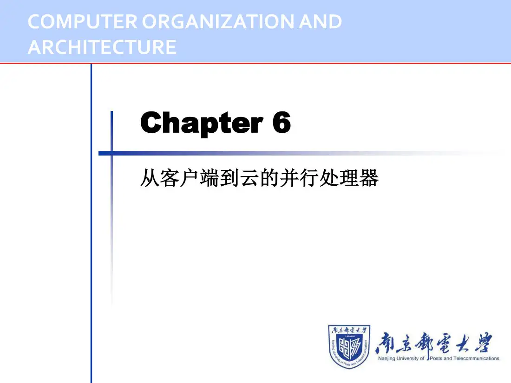

原文：

COMPUTER ORGANIZATION AND ARCHITECTURE

Chapter 6

从客户端到云的并行处理器

南京教宅大学 南京郵電大学 Nanjing University of Posts and Telecommunications y fPosto anddT

### 介绍

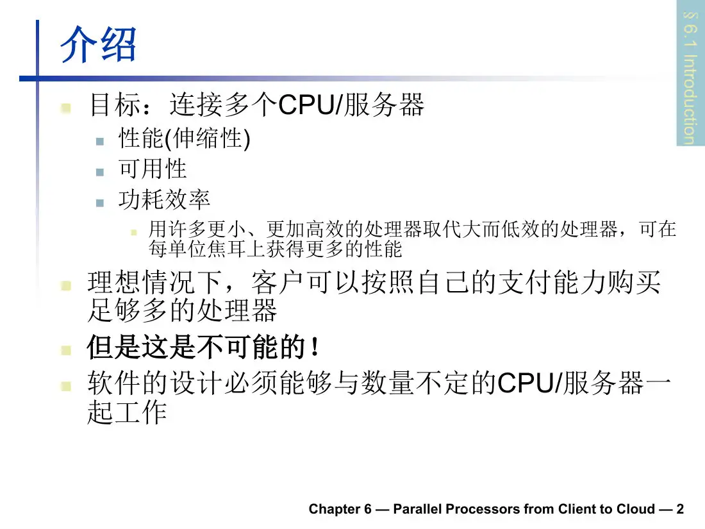

原文：

介绍

◼ 目标：连接多个CPU/服务器

◼ 性能(伸缩性)

◼ 可用性

◼ 功耗效率

◼ 用许多更小、更加高效的处理器取代大而低效的处理器，可在每单位焦耳上获得更多的性能

◼ 理想情况下，客户可以按照自己的支付能力购买足够多的处理器

◼ 但是这是不可能的！

◼ 软件的设计必须能够与数量不定的CPU/服务器一起工作

§ 6.1 Introduction

Chapter 6 — Parallel Processors from Client to Cloud

2

### 硬件与软件

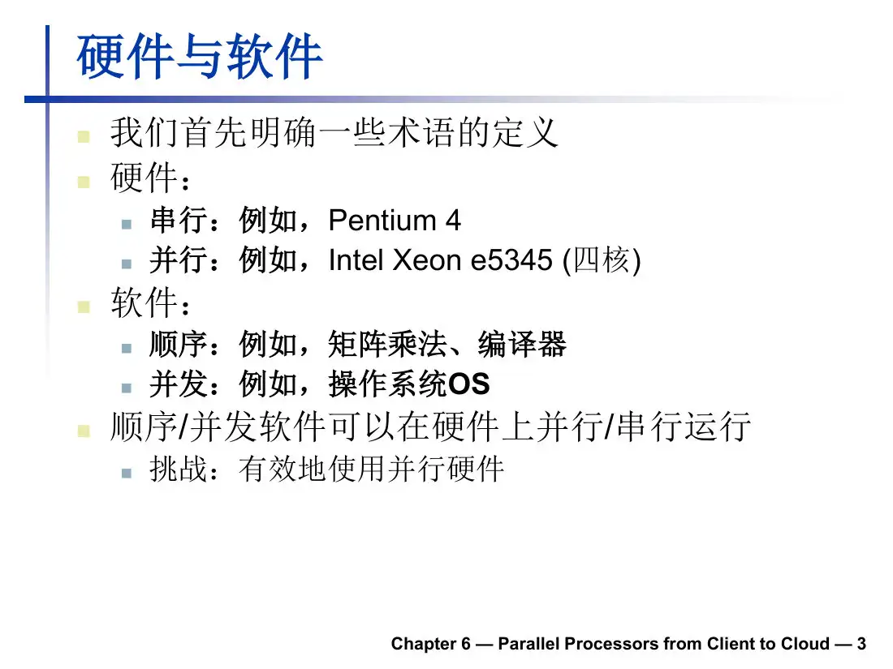

原文：

硬件与软件

◼ 我们首先明确一些术语的定义

◼ 硬件：

◼ 串行：例如，Pentium 4

◼ 并行：例如，Intel Xeon e5345 (四核)

◼ 软件：

◼ 顺序：例如，矩阵乘法、编译器

并发：例如，操作系统OS

◼ 顺序/并发软件可以在硬件上并行/串行运行

挑战：有效地使用并行硬件

Chapter 6 — Parallel Processors from Client to Cloud — 3

### 本书已涉及的并行

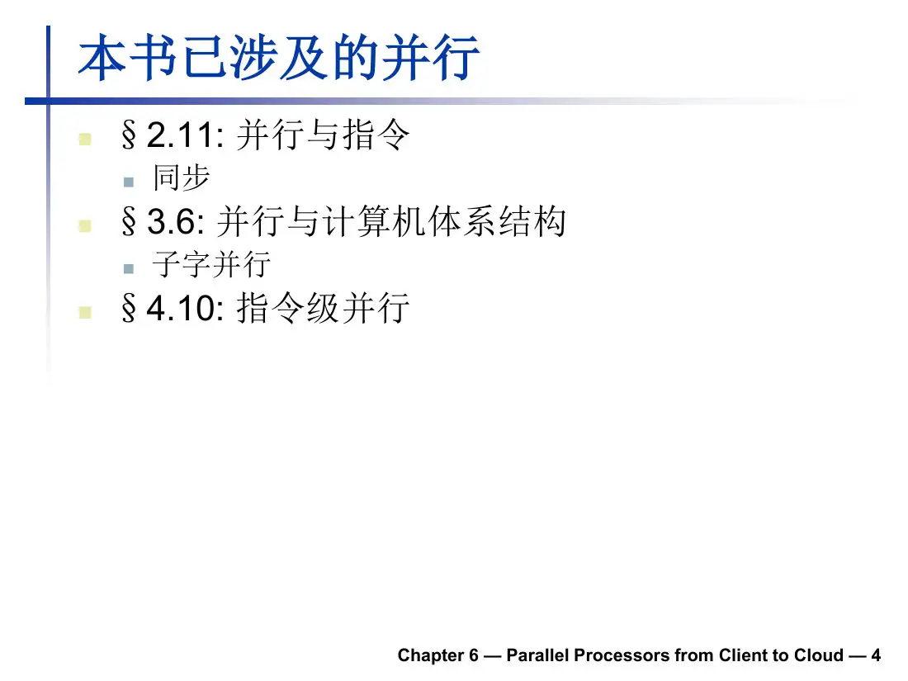

原文：

本书已涉及的并行

◼ §2.11: 并行与指令

◼ 同步

◼ §3.6: 并行与计算机体系结构

◼ 子字并行

◼ §4.10: 指令级并行

Chapter 6 — Parallel Processors from Client to Cloud — 4

### 并行编程

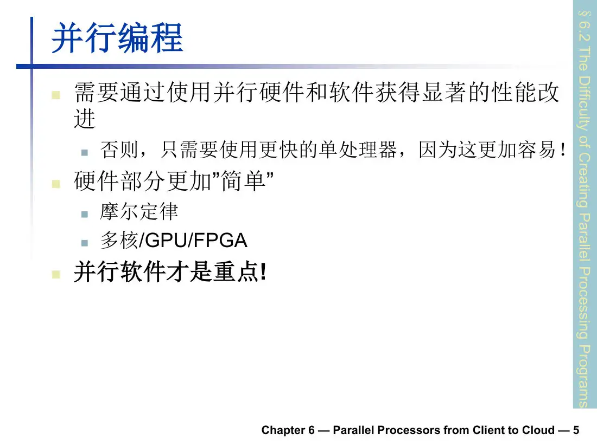

原文：

并行编程

◼ 需要通过使用并行硬件和软件获得显著的性能改进

◼ 否则，只需要使用更快的单处理器，因为这更加容易！

◼ 硬件部分更加”简单”

摩尔定律

◼ 多核/GPU/FPGA

◼ 并行软件才是重点!

§ 6.2 The Difficulty of Creating Parallel Processing Programs

Chapter 6 — Parallel Processors from Client to Cloud — 5

### 并行编程

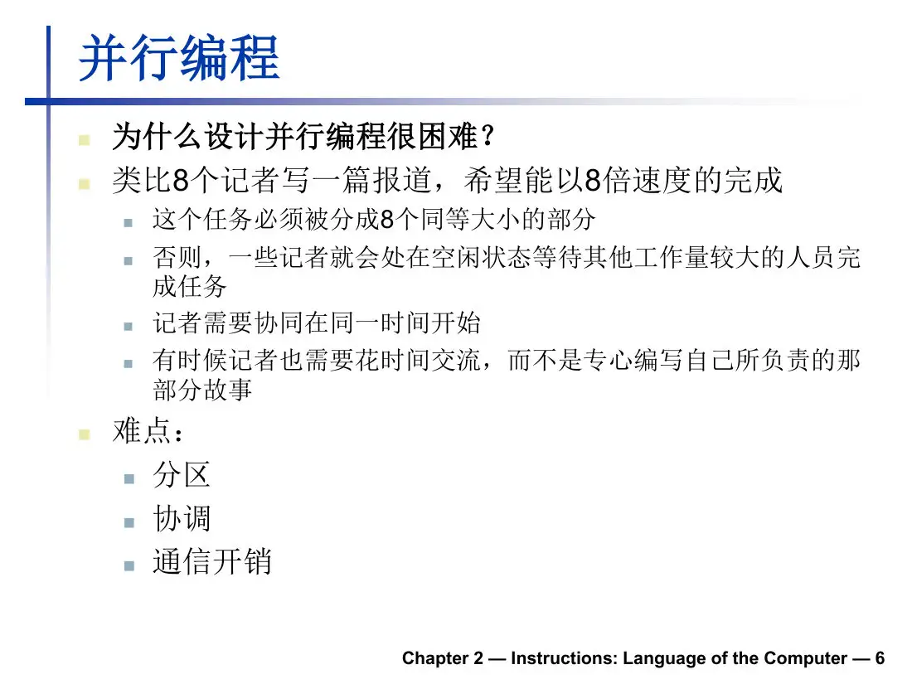

原文：

并行编程

◼ 为什么设计并行编程很困难？

◼ 类比8个记者写一篇报道，希望能以8倍速度的完成

◼ 这个任务必须被分成8个同等大小的部分

◼ 否则，一些记者就会处在空闲状态等待其他工作量较大的人员完成任务

◼ 记者需要协同在同一时间开始

◼ 有时候记者也需要花时间交流，而不是专心编写自己所负责的那部分故事

◼ 难点：

◼ 分区

◼ 协调

◼ 通信开销

Chapter 2 — Instructions: Language of the Computer — 6

### Amdahl定律

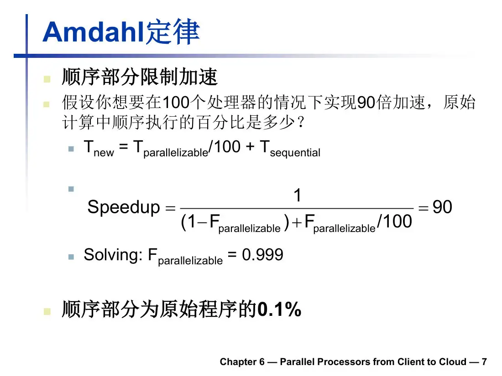

原文：

Amdahl定律

◼ 顺序部分限制加速

◼ 假设你想要在100个处理器的情况下实现90倍加速，原始计算中顺序执行的百分比是多少？

$$
T _ {\text {new}} = T _ {\text {parallelizable}} / 1 0 0 + T _ {\text {sequential}}
$$

$$
\text {Speedup} = \frac {1}{(1 - F _ {\text {parallelizable}}) + F _ {\text {parallelizable}} / 1 0 0} = 9 0
$$

◼ Solving: $\mathsf { F } _ { \mathsf { p a r a l l e } | | \mathsf { z a b l e } } = 0 . 9 9 9$

◼ 顺序部分为原始程序的0.1%

Chapter 6 — Parallel Processors from Client to Cloud — 7

### 指令与数据流

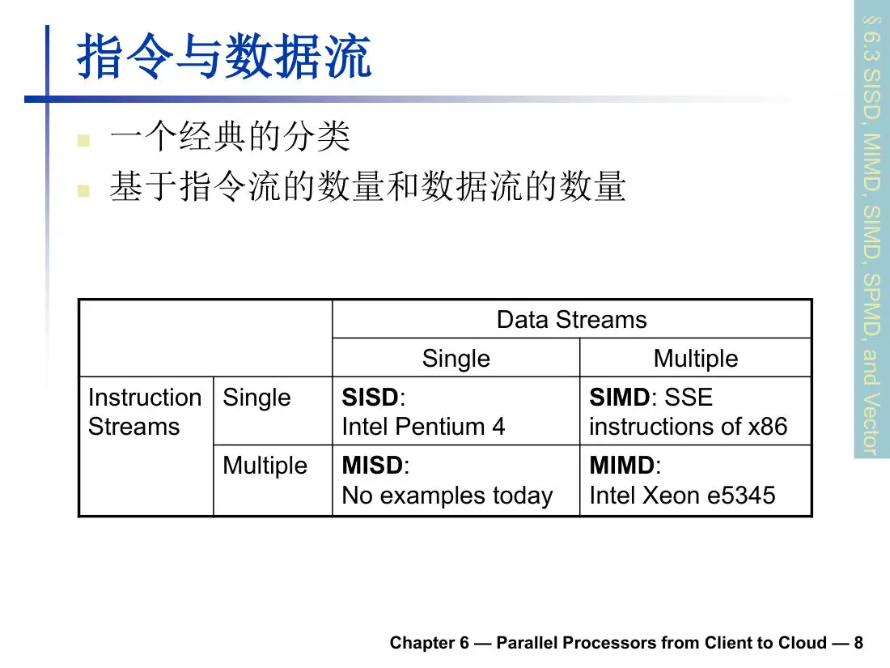

原文：

指令与数据流

◼ 一个经典的分类

◼ 基于指令流的数量和数据流的数量

<table><tr><td rowspan="2" colspan="2"></td><td colspan="2">Data Streams</td></tr><tr><td>Single</td><td>Multiple</td></tr><tr><td rowspan="2">Instruction Streams</td><td>Single</td><td>SISD:Intel Pentium 4</td><td>SIMD: SSEinstructions of x86</td></tr><tr><td>Multiple</td><td>MISD:No examples today</td><td>MIMD:Intel Xeon e5345</td></tr></table>

§ 6.3 SISD, MIMD, SIMD, SPMD, and Vector

Chapter 6 — Parallel Processors from Client to Cloud —

8

### MIMD (共享内存的多核)

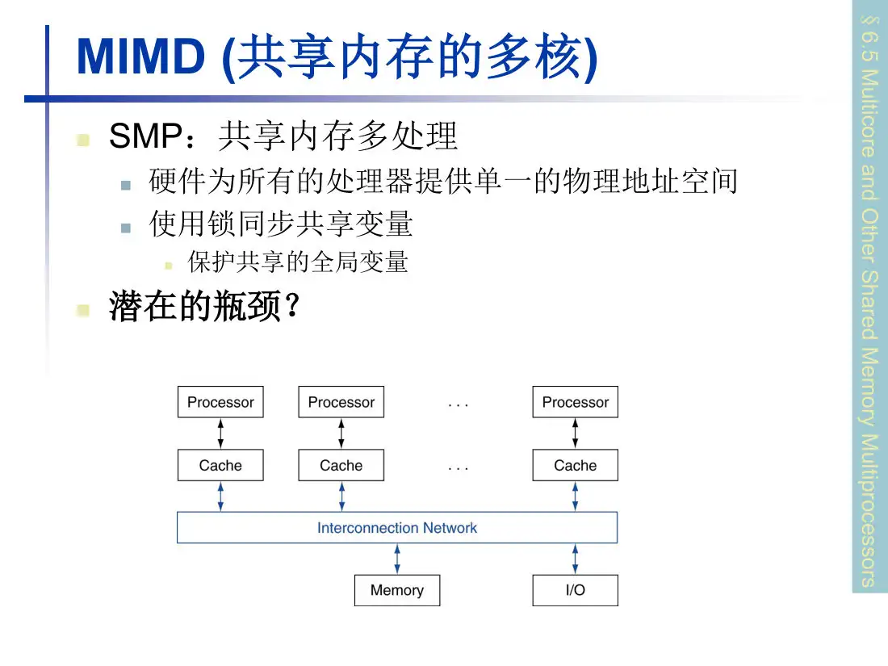

原文：

MIMD (共享内存的多核)

◼ SMP：共享内存多处理

◼ 硬件为所有的处理器提供单一的物理地址空间

◼ 使用锁同步共享变量

◼ 保护共享的全局变量

◼ 潜在的瓶颈？

§ 6.5 Multicore and Other Shared Memory Multiprocessors

### 消息传递

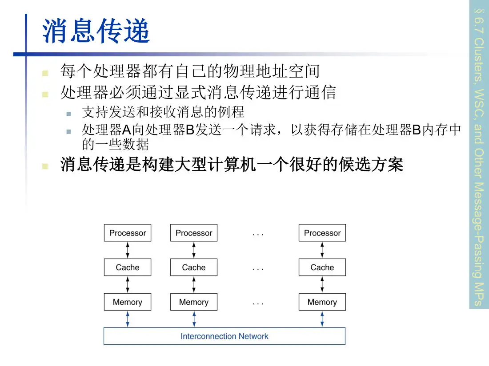

原文：

消息传递

◼ 每个处理器都有自己的物理地址空间

◼ 处理器必须通过显式消息传递进行通信

◼ 支持发送和接收消息的例程

处理器A向处理器B发送一个请求，以获得存储在处理器B内存中的一些数据

◼ 消息传递是构建大型计算机一个很好的候选方案

§ 6.7 Clusters, WSC, and Other Message-Passing MPs

### 互联网

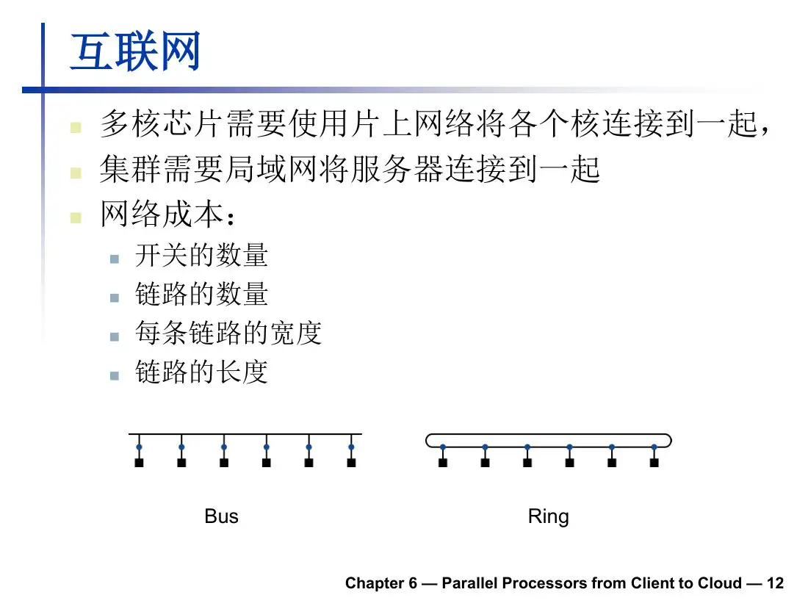

原文：

互联网

◼ 多核芯片需要使用片上网络将各个核连接到一起，

◼ 集群需要局域网将服务器连接到一起

◼ 网络成本：

◼ 开关的数量

◼ 链路的数量

◼ 每条链路的宽度

◼ 链路的长度

Chapter 6 — Parallel Processors from Client to Cloud

12

### 互联网

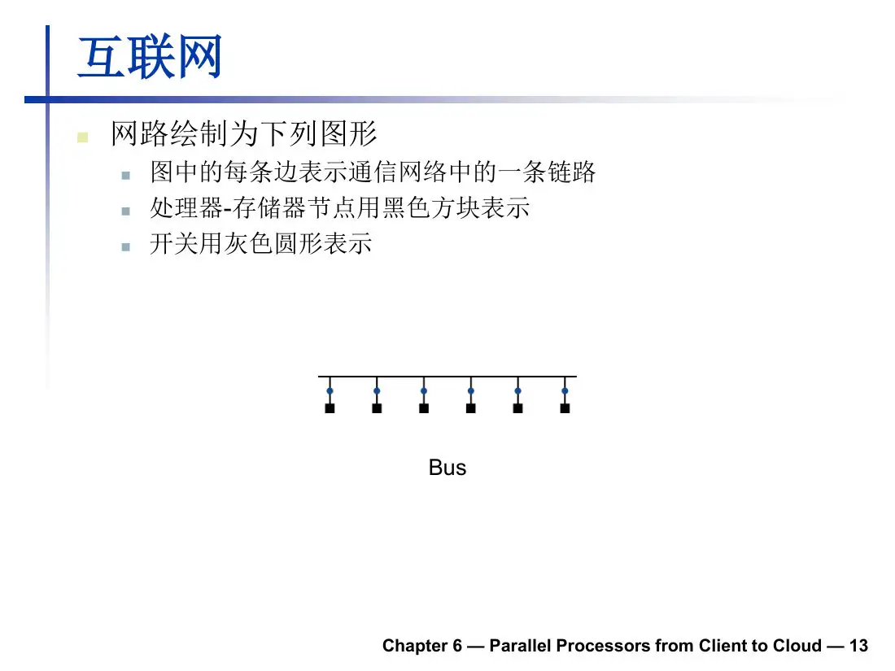

原文：

互联网

◼ 网路绘制为下列图形

◼ 图中的每条边表示通信网络中的一条链路

◼ 处理器-存储器节点用黑色方块表示

◼ 开关用灰色圆形表示

Chapter 6 — Parallel Processors from Client to Cloud

13

### 互联网

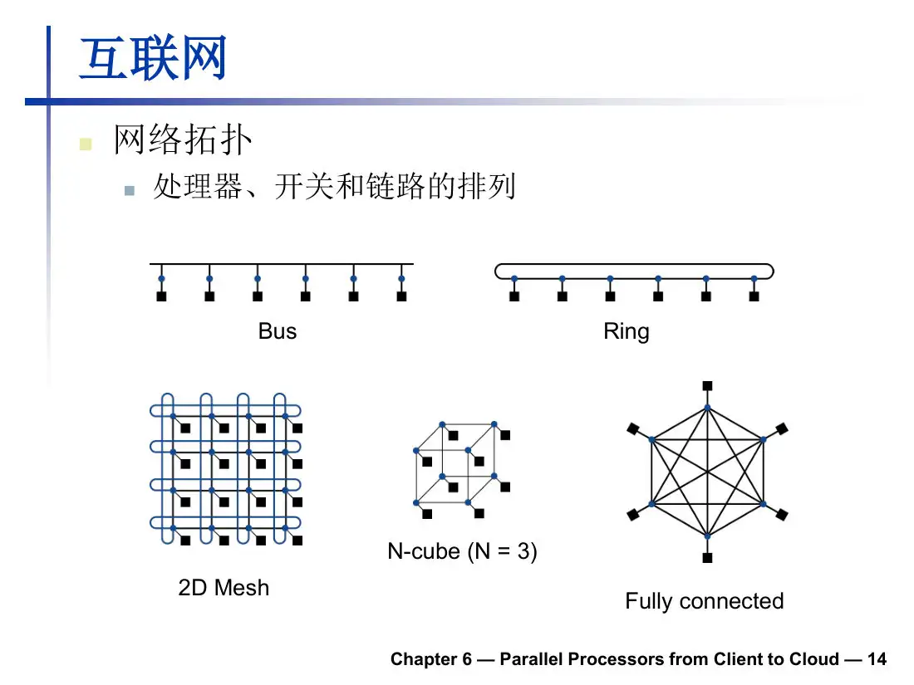

原文：

互联网

◼ 网络拓扑

◼ 处理器、开关和链路的排列

Chapter 6 — Parallel Processors from Client to Cloud —

14

### 并行基准测试

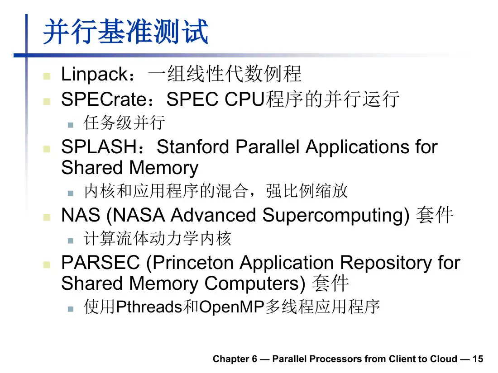

原文：

并行基准测试

◼ Linpack：一组线性代数例程

◼ SPECrate：SPEC CPU程序的并行运行

◼ 任务级并行

◼ SPLASH：Stanford Parallel Applications for Shared Memory

◼ 内核和应用程序的混合，强比例缩放

◼ NAS (NASA Advanced Supercomputing) 套件 ◼ 计算流体动力学内核

◼ PARSEC (Princeton Application Repository for Shared Memory Computers) 套件

◼ 使用Pthreads和OpenMP多线程应用程序

Chapter 6 — Parallel Processors from Client to Cloud

15

### 代码 or 应用？

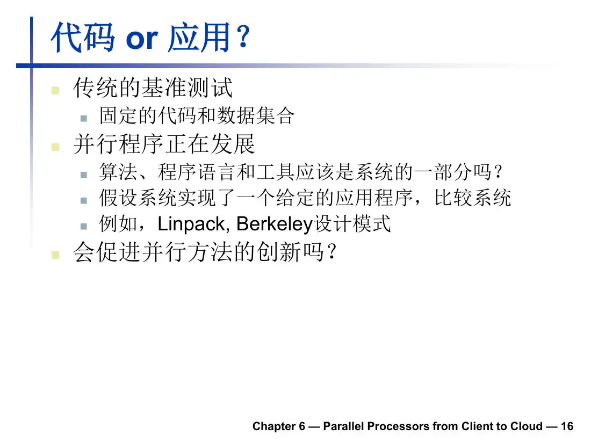

原文：

代码 or 应用？

◼ 传统的基准测试

◼ 固定的代码和数据集合

◼ 并行程序正在发展

◼ 算法、程序语言和工具应该是系统的一部分吗？

◼ 假设系统实现了一个给定的应用程序，比较系统

◼ 例如，Linpack, Berkeley设计模式

◼ 会促进并行方法的创新吗？

Chapter 6 — Parallel Processors from Client to Cloud

16

### 模型性能

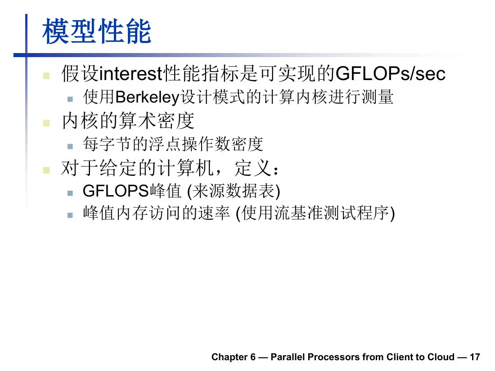

原文：

模型性能

◼ 假设interest性能指标是可实现的GFLOPs/sec◼ 使用Berkeley设计模式的计算内核进行测量

◼ 内核的算术密度

◼ 每字节的浮点操作数密度

◼ 对于给定的计算机，定义：

◼ GFLOPS峰值 (来源数据表)

◼ 峰值内存访问的速率 (使用流基准测试程序)

Chapter 6 — Parallel Processors from Client to Cloud

17

### Roofline图

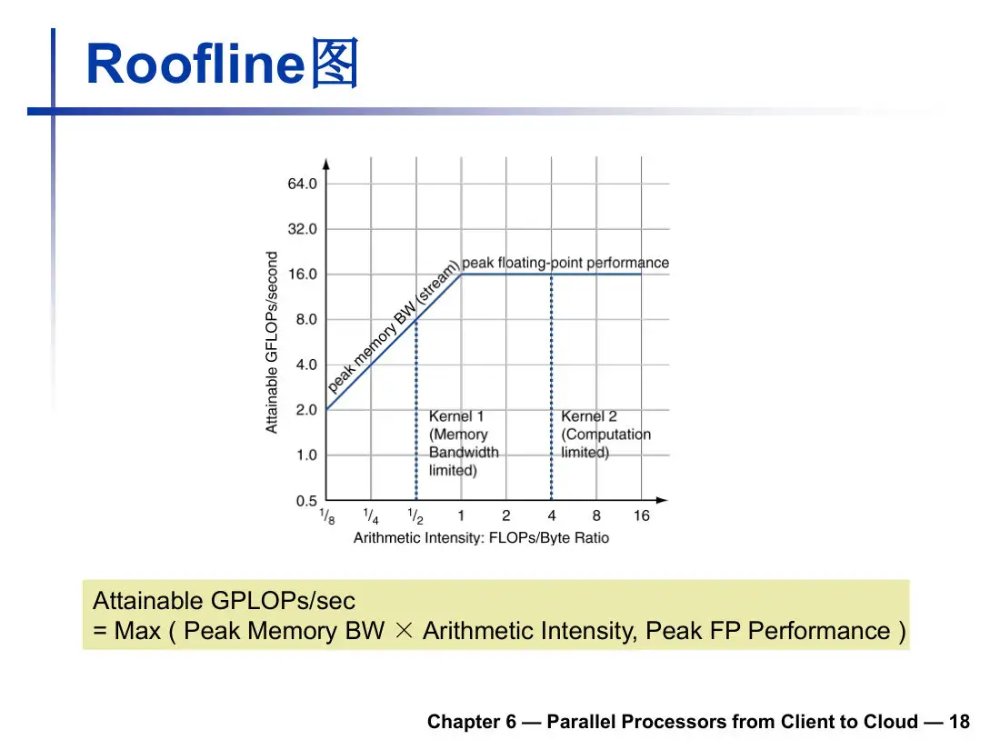

原文：

Roofline图

= Max ( Peak Memory BW × Arithmetic Intensity, Peak FP Performance

Chapter 6 — Parallel Processors from Client to Cloud

18

### 系统比较

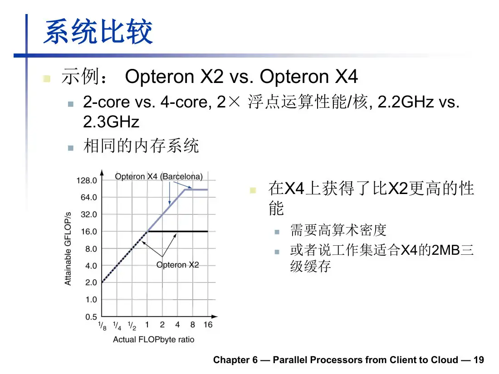

原文：

系统比较

◼ 示例： Opteron X2 vs. Opteron X4

◼ 2-core vs. 4-core, 2× 浮点运算性能/核, 2.2GHz vs. 2.3GHz

◼ 相同的内存系统

◼ 在X4上获得了比X2更高的性 能

◼ 需要高算术密度

◼ 或者说工作集适合X4的2MB三级缓存

Chapter 6 — Parallel Processors from Client to Cloud

19

### 优化的性能

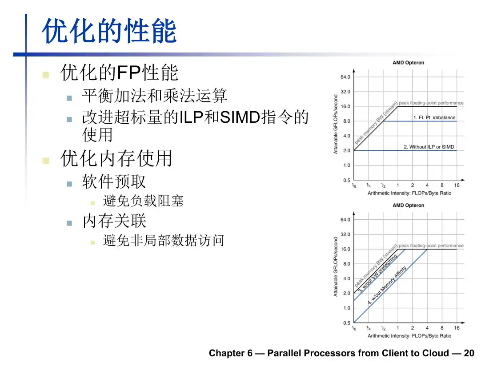

原文：

优化的性能

◼ 优化的FP性能

◼ 平衡加法和乘法运算

◼ 改进超标量的ILP和SIMD指令的使用

◼ 优化内存使用

软件预取

◼ 避免负载阻塞

◼ 内存关联

◼ 避免非局部数据访问

Chapter 6 — Parallel Processors from Client to Cloud

20

### 优化性能

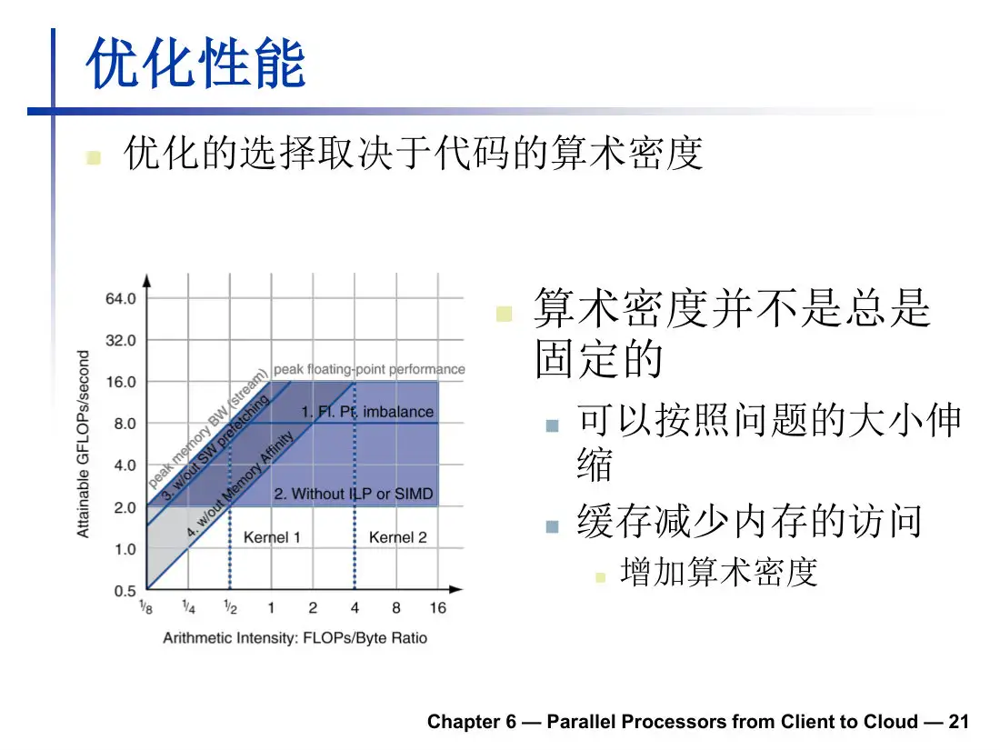

原文：

优化性能

◼ 优化的选择取决于代码的算术密度

◼ 算术密度并不是总是固定的

可以按照问题的大小伸缩

◼ 缓存减少内存的访问◼ 增加算术密度

Chapter 6 — Parallel Processors from Client to Cloud

21

### i7-960 vs NVIDIA Tesla 280/480

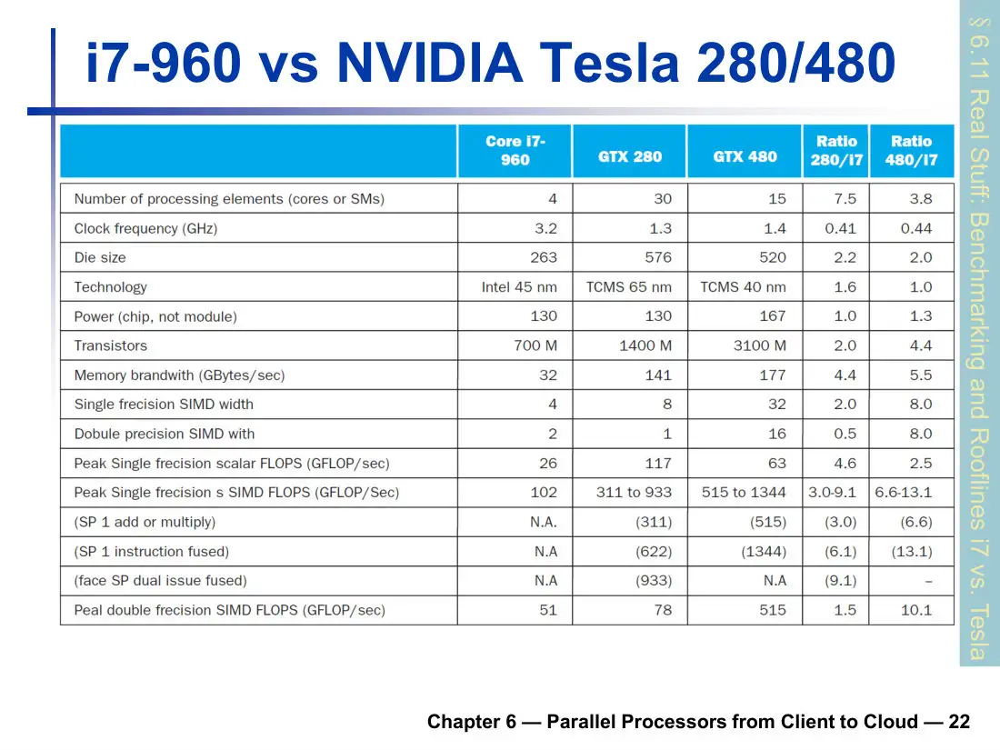

原文：

i7-960 vs NVIDIA Tesla 280/480

<table><tr><td></td><td>Core i7-960</td><td>GTX 280</td><td>GTX 480</td><td>Ratio 280/i7</td><td>Ratio 480/i7</td></tr><tr><td>Number of processing elements (cores or SMs)</td><td>4</td><td>30</td><td>15</td><td>7.5</td><td>3.8</td></tr><tr><td>Clock frequency (GHz)</td><td>3.2</td><td>1.3</td><td>1.4</td><td>0.41</td><td>0.44</td></tr><tr><td>Die size</td><td>263</td><td>576</td><td>520</td><td>2.2</td><td>2.0</td></tr><tr><td>Technology</td><td>Intel 45 nm</td><td>TCMS 65 nm</td><td>TCMS 40 nm</td><td>1.6</td><td>1.0</td></tr><tr><td>Power (chip, not module)</td><td>130</td><td>130</td><td>167</td><td>1.0</td><td>1.3</td></tr><tr><td>Transistors</td><td>700 M</td><td>1400 M</td><td>3100 M</td><td>2.0</td><td>4.4</td></tr><tr><td>Memory brandwith (GBytes/sec)</td><td>32</td><td>141</td><td>177</td><td>4.4</td><td>5.5</td></tr><tr><td>Single precision SIMD width</td><td>4</td><td>8</td><td>32</td><td>2.0</td><td>8.0</td></tr><tr><td>Dobule precision SIMD with</td><td>2</td><td>1</td><td>16</td><td>0.5</td><td>8.0</td></tr><tr><td>Peak Single precision scalar FLOPS (GFLOP/sec)</td><td>26</td><td>117</td><td>63</td><td>4.6</td><td>2.5</td></tr><tr><td>Peak Single precision s SIMD FLOPS (GFLOP/Sec)</td><td>102</td><td>311 to 933</td><td>515 to 1344</td><td>3.0-9.1</td><td>6.6-13.1</td></tr><tr><td>(SP 1 add or multiply)</td><td>N.A.</td><td>(311)</td><td>(515)</td><td>(3.0)</td><td>(6.6)</td></tr><tr><td>(SP 1 instruction fused)</td><td>N.A</td><td>(622)</td><td>(1344)</td><td>(6.1)</td><td>(13.1)</td></tr><tr><td>(face SP dual issue fused)</td><td>N.A</td><td>(933)</td><td>N.A</td><td>(9.1)</td><td>-</td></tr><tr><td>Peal double precision SIMD FLOPS (GFLOP/sec)</td><td>51</td><td>78</td><td>515</td><td>1.5</td><td>10.1</td></tr></table>

Chapter 6 — Parallel Processors from Client to Cloud

§ 6.11 Real Stuff: Benchmarking and Rooflines i7 vs. Tesla

22

### Rooflines

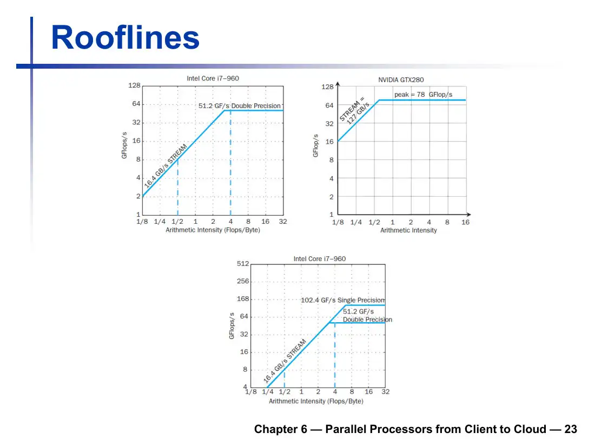

原文：

Rooflines

Chapter 6 — Parallel Processors from Client to Cloud — 23

### 基准测试

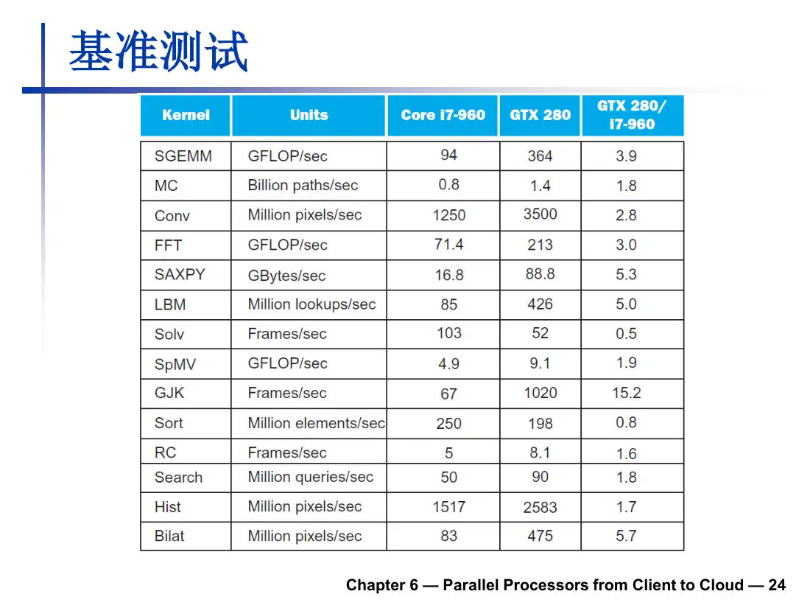

原文：

基准测试

Chapter 6 — Parallel Processors from Client to Cloud —
<table><tr><td>Kernel</td><td>Units</td><td>Core i7-960</td><td>GTX 280</td><td>GTX 280/ i7-960</td></tr><tr><td>SGEMM</td><td>GFLOP/sec</td><td>94</td><td>364</td><td>3.9</td></tr><tr><td>MC</td><td>Billion paths/sec</td><td>0.8</td><td>1.4</td><td>1.8</td></tr><tr><td>Conv</td><td>Million pixels/sec</td><td>1250</td><td>3500</td><td>2.8</td></tr><tr><td>FFT</td><td>GFLOP/sec</td><td>71.4</td><td>213</td><td>3.0</td></tr><tr><td>SAXPY</td><td>GBytes/sec</td><td>16.8</td><td>88.8</td><td>5.3</td></tr><tr><td>LBM</td><td>Million lookups/sec</td><td>85</td><td>426</td><td>5.0</td></tr><tr><td>Solv</td><td>Frames/sec</td><td>103</td><td>52</td><td>0.5</td></tr><tr><td>SpMV</td><td>GFLOP/sec</td><td>4.9</td><td>9.1</td><td>1.9</td></tr><tr><td>GJK</td><td>Frames/sec</td><td>67</td><td>1020</td><td>15.2</td></tr><tr><td>Sort</td><td>Million elements/sec</td><td>250</td><td>198</td><td>0.8</td></tr><tr><td>RC</td><td>Frames/sec</td><td>5</td><td>8.1</td><td>1.6</td></tr><tr><td>Search</td><td>Million queries/sec</td><td>50</td><td>90</td><td>1.8</td></tr><tr><td>Hist</td><td>Million pixels/sec</td><td>1517</td><td>2583</td><td>1.7</td></tr><tr><td>Bilat</td><td>Million pixels/sec</td><td>83</td><td>475</td><td>5.7</td></tr></table>

24

### 性能总结

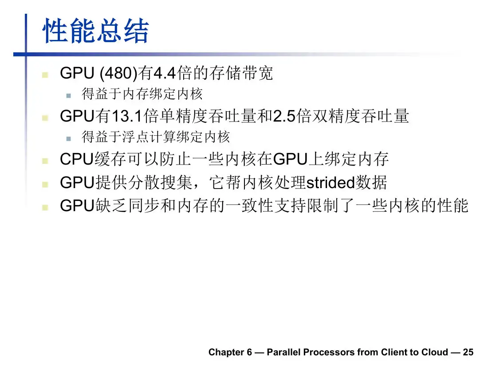

原文：

性能总结

◼ GPU (480)有4.4倍的存储带宽

得益于内存绑定内核

◼ GPU有13.1倍单精度吞吐量和2.5倍双精度吞吐量

◼ 得益于浮点计算绑定内核

◼ CPU缓存可以防止一些内核在GPU上绑定内存

◼ GPU提供分散搜集，它帮内核处理strided数据

◼ GPU缺乏同步和内存的一致性支持限制了一些内核的性能

Chapter 6 — Parallel Processors from Client to Cloud

25

### Backup

原文：

Backup

Chapter 2 — Instructions: Language of the Computer

26

### 多线程DGEMM

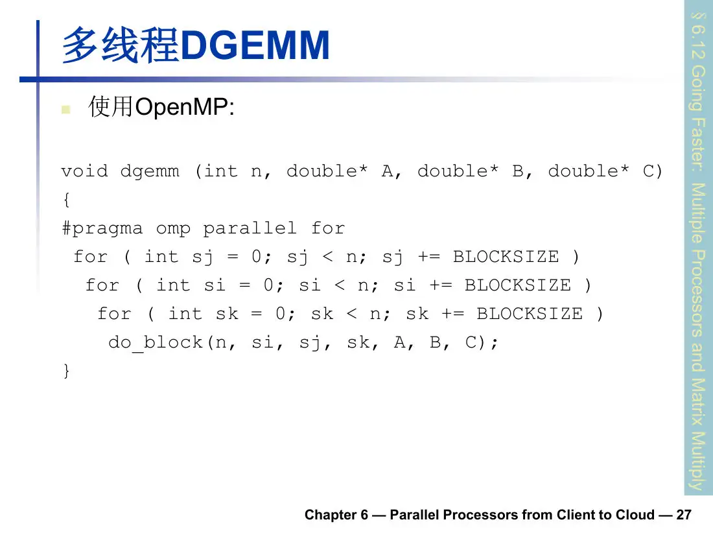

原文：

多线程DGEMM

◼ 使用OpenMP:

Chapter 6 — Parallel Processors from Client to Cloud —

§ 6.12 Going Faster: Multiple Processors and Matrix Multiply

27

### 多线程DGEMM

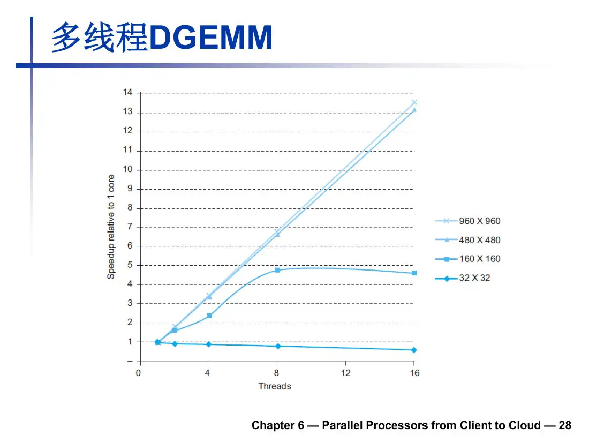

原文：

多线程DGEMM

28

### 多线程DGEMM

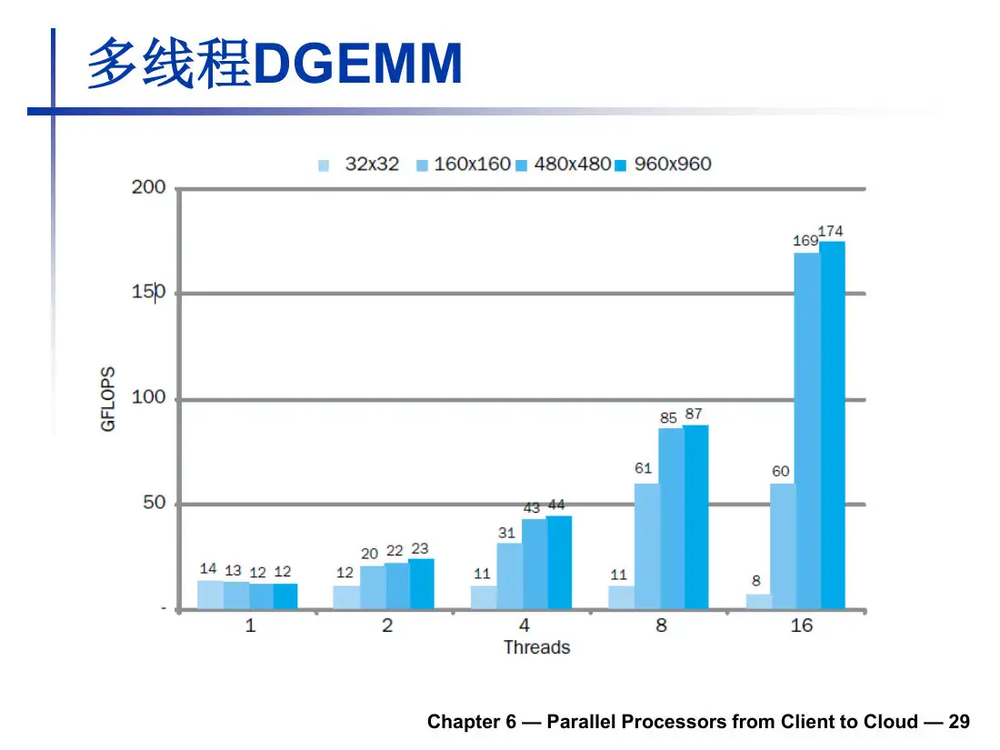

原文：

多线程DGEMM

29

### 谬论

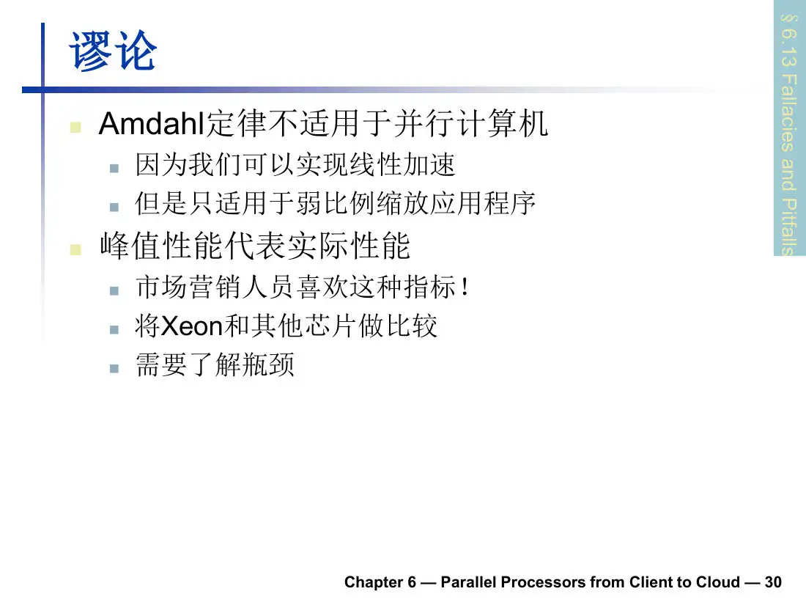

原文：

谬论

◼ Amdahl定律不适用于并行计算机

◼ 因为我们可以实现线性加速

◼ 但是只适用于弱比例缩放应用程序

◼ 峰值性能代表实际性能

◼ 市场营销人员喜欢这种指标！

◼ 将Xeon和其他芯片做比较

◼ 需要了解瓶颈

§ 6.13 Fallacies and Pitfalls

Chapter 6 — Parallel Processors from Client to Cloud

30

### 陷阱

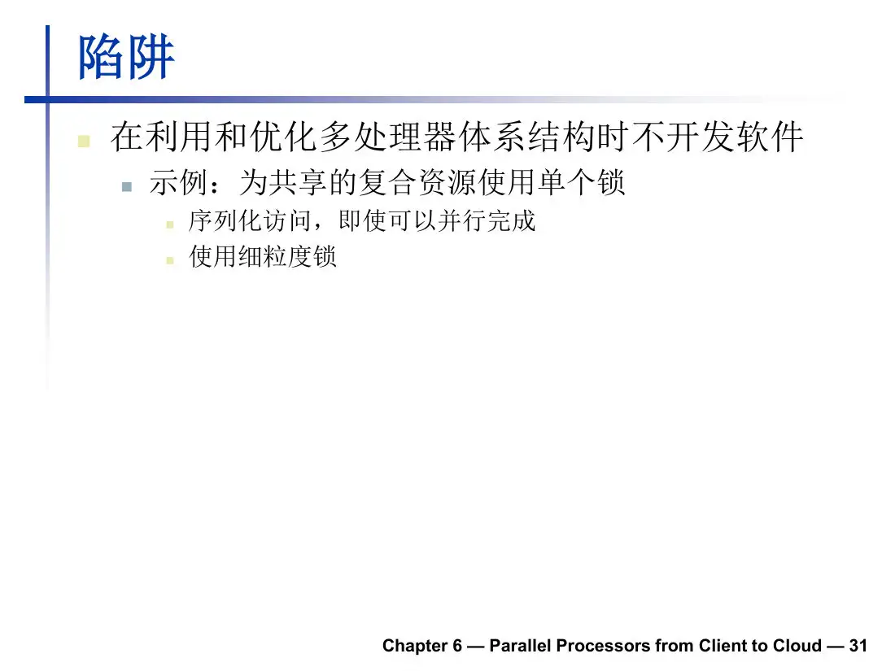

原文：

陷阱

◼ 在利用和优化多处理器体系结构时不开发软件

◼ 示例：为共享的复合资源使用单个锁

◼ 序列化访问，即使可以并行完成

◼ 使用细粒度锁

Chapter 6 — Parallel Processors from Client to Cloud

31

### 结束语

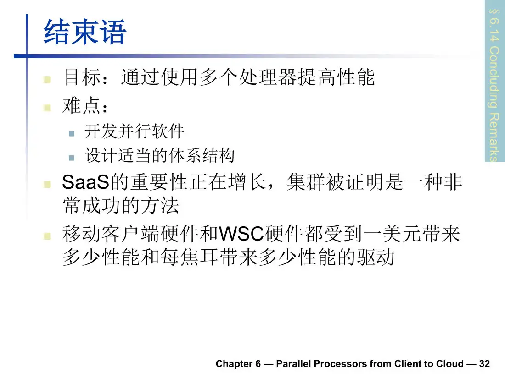

原文：

结束语

◼ 目标：通过使用多个处理器提高性能

◼ 难点：

◼ 开发并行软件

◼ 设计适当的体系结构

◼ SaaS的重要性正在增长，集群被证明是一种非常成功的方法

◼ 移动客户端硬件和WSC硬件都受到一美元带来多少性能和每焦耳带来多少性能的驱动

§ 6.14 Concluding Remarks

Chapter 6 — Parallel Processors from Client to Cloud

32

### 结束语

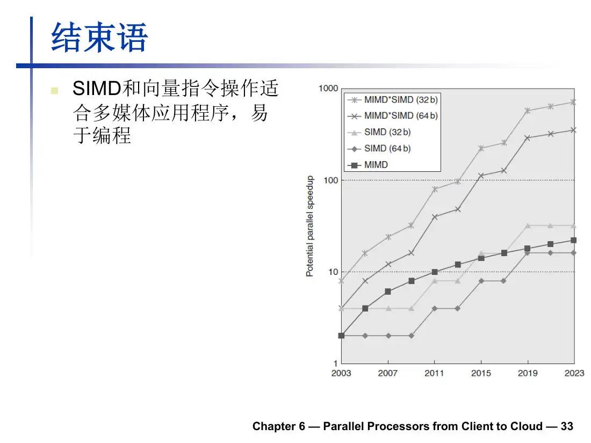

原文：

结束语

◼ SIMD和向量指令操作适合多媒体应用程序，易于编程

### 34

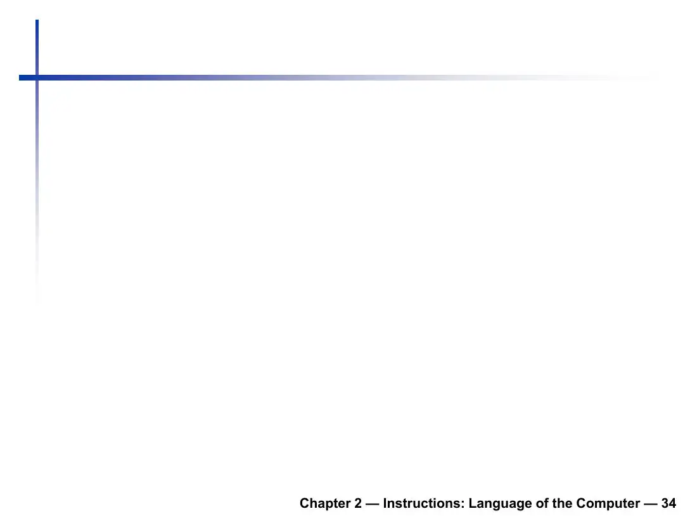

原文：

Chapter 2 — Instructions: Language of the Computer

34

### Backup

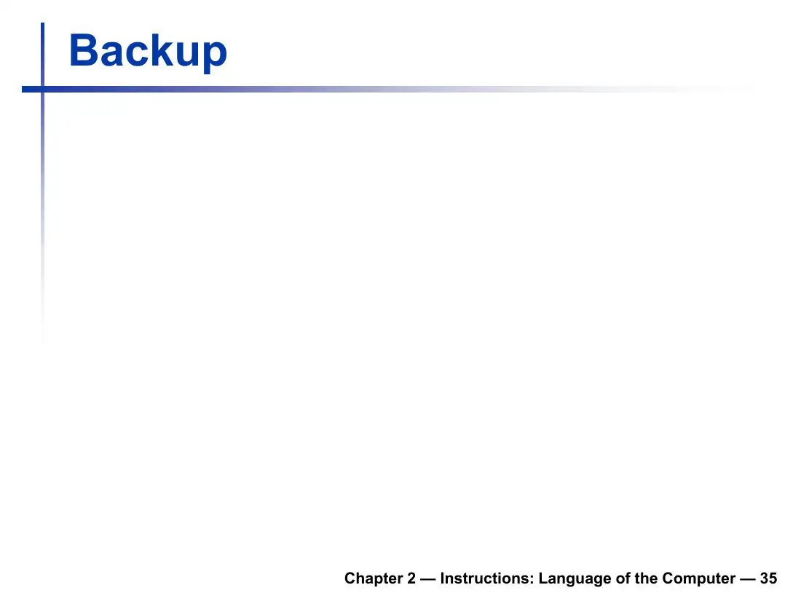

原文：

Backup

Chapter 2 — Instructions: Language of the Computer

35

### 拓展示例

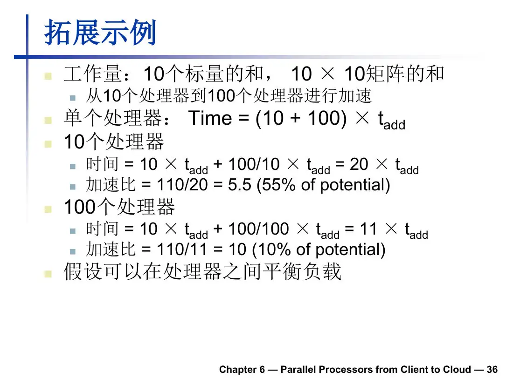

原文：

拓展示例

◼ 工作量：10个标量的和， $1 0 \times 1 0$ 矩阵的和◼ 从10个处理器到100个处理器进行加速

◼ 单个处理器： $\mathsf { T i m e } = ( 1 0 + 1 0 0 ) \times \mathsf { t } _ { \mathrm { a d d } }$

◼ 10个处理器

◼ 时间 $= 1 0 \times \mathrm { t } _ { \mathrm { a d d } } + 1 0 0 / 1 0 \times \mathrm { t } _ { \mathrm { a d d } } = 2 0 \times \mathrm { t } _ { \mathrm { a d d } }$

◼ 加速比 $= 1 1 0 / 2 0 = 5 . 5$ (55% of potential)

◼ 100个处理器

◼ 时间 $= 1 0 \times \mathrm { t } _ { \mathrm { a d d } } + 1 0 0 / 1 0 0 \times \mathrm { t } _ { \mathrm { a d d } } = 1 1 \times \mathrm { t } _ { \mathrm { a d d } }$

◼ 加速比 $= 1 1 0 / 1 1 = 1 0 ( 1 0 \%$ of potential)

◼ 假设可以在处理器之间平衡负载

Chapter 6 — Parallel Processors from Client to Cloud

36

### 拓展示例

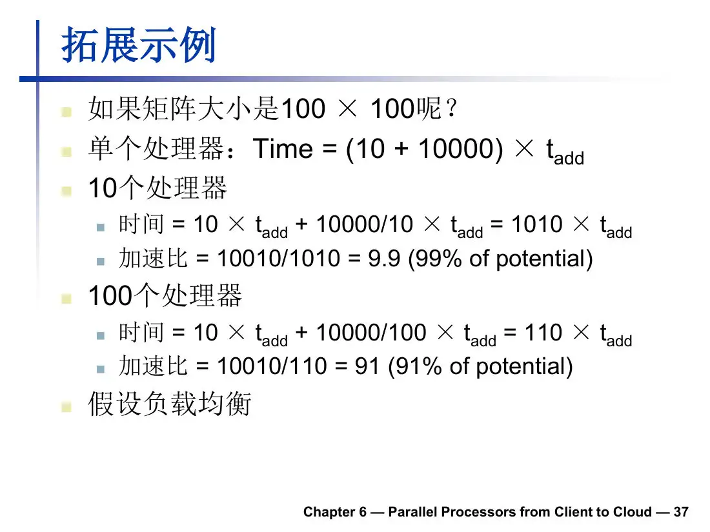

原文：

拓展示例

◼ 如果矩阵大小是 $1 0 0 \times 1 0 0 \textcircled { ! } \sum \textit { i }$ ？

◼ 单个处理器： $\mathsf { T i m e } = ( 1 0 + 1 0 0 0 0 ) \times \mathsf { t } _ { \mathrm { a d d } }$

◼ 10个处理器

◼ 时间 $= 1 0 \times \mathrm { \sf t _ { a d d } } +$ 10000/10 $\times \mathrm { \Delta t _ { a d d } } = 1 0 1 0 \times \mathrm { t _ { a d d } }$

◼ 加速比 $= 1 0 0 1 0 / 1 0 1 0 = 9 . 9 \ ( 9 9 \%$ of potential)

◼ 100个处理器

◼ 时间 $= 1 0 \times \mathfrak { t } _ { \mathrm { a d d } } + 1 0 0 0 0 / 1 0 0 \times \mathfrak { t } _ { \mathrm { a d d } } = 1 1 0 \times \mathfrak { t } _ { \mathrm { a d d } }$

◼ 加速比 $= 1 0 0 1 0 / 1 1 0 = 9 1 \ ( 9 1 \%$ of potential)

◼ 假设负载均衡

Chapter 6 — Parallel Processors from Client to Cloud

37

### 强比例缩放 vs. 弱比例缩放

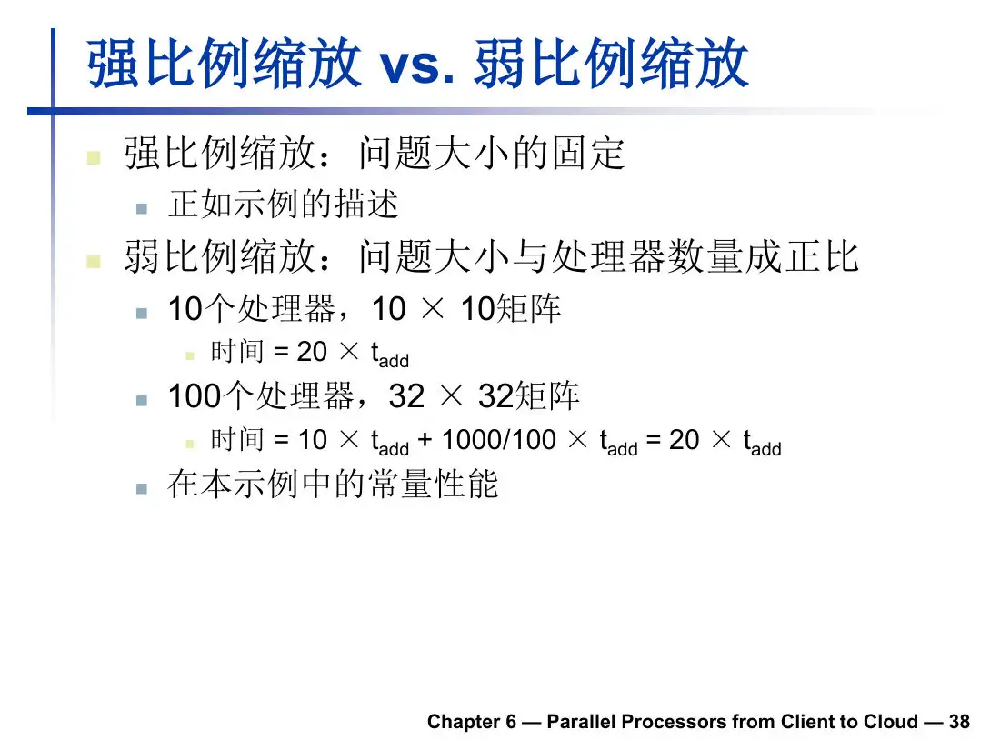

原文：

强比例缩放 vs. 弱比例缩放

◼ 强比例缩放：问题大小的固定

◼ 正如示例的描述

◼ 弱比例缩放：问题大小与处理器数量成正比

◼ 10个处理器， $1 0 \times 1 0$ 矩阵

◼ 时间 $= 2 0 \times \mathfrak { t } _ { \mathsf { a d d } }$

◼ 100个处理器， $3 2 \times 3 2$ 矩阵

◼ 时间 $= 1 0 \times \mathrm { t _ { a d d } } + 1 0 0 0 / 1 0 0 \times \mathrm { t _ { a d d } } = 2 0 \times \mathrm { t _ { a d d } }$

◼ 在本示例中的常量性能

Chapter 6 — Parallel Processors from Client to Cloud

38

### 示例：DAXPY (Y = a × X + Y)

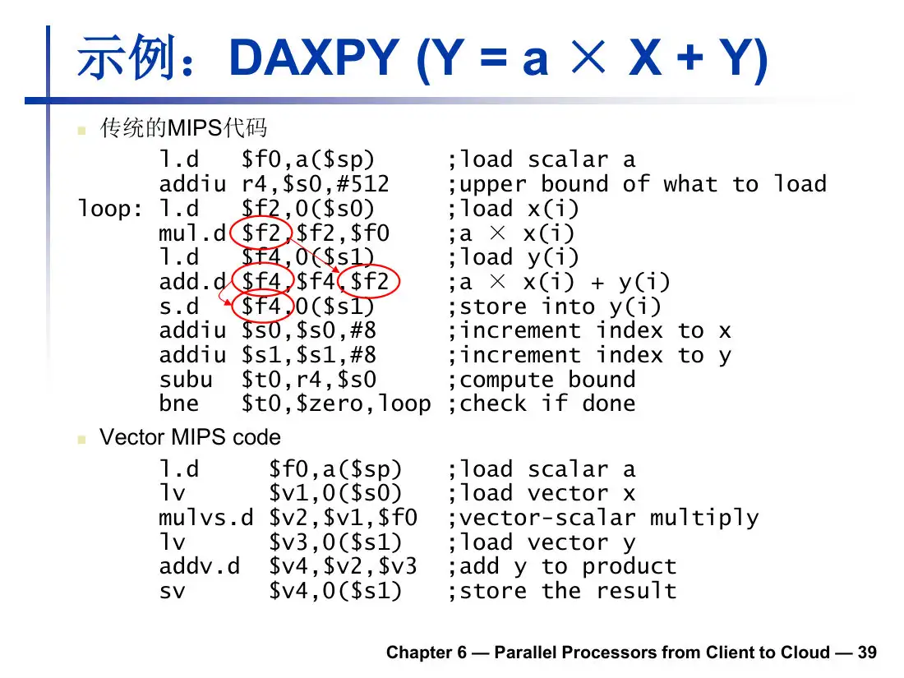

原文：

示例：DAXPY (Y = a × X + Y)

◼ 传统的MIPS代码

◼ Vector MIPS code

Chapter 6 — Parallel Processors from Client to Cloud

39

### 向量处理器

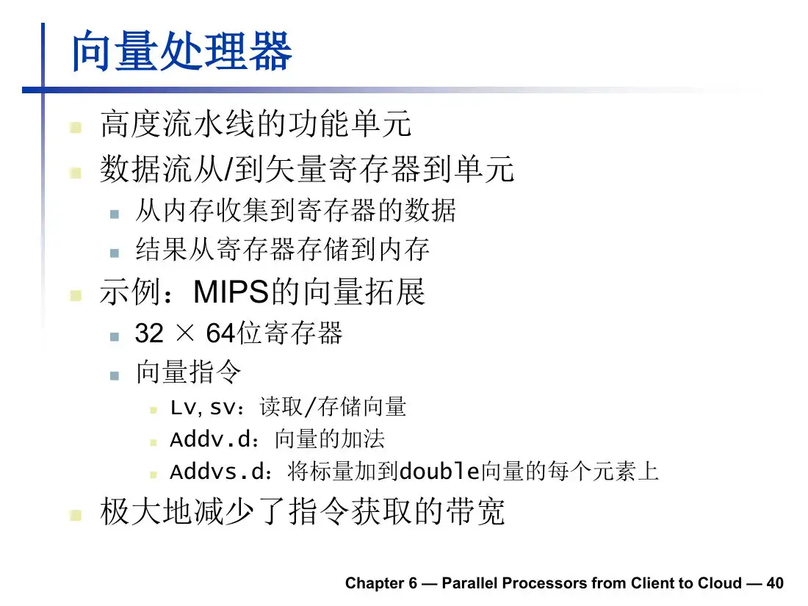

原文：

向量处理器

◼ 高度流水线的功能单元

◼ 数据流从/到矢量寄存器到单元

◼ 从内存收集到寄存器的数据

结果从寄存器存储到内存

◼ 示例：MIPS的向量拓展

◼ 32 × 64位寄存器

向量指令

◼ Lv, sv：读取/存储向量

Addv.d：向量的加法

◼ Addvs.d：将标量加到double向量的每个元素上

◼ 极大地减少了指令获取的带宽

Chapter 6 — Parallel Processors from Client to Cloud

40

### 向量 vs. 标量

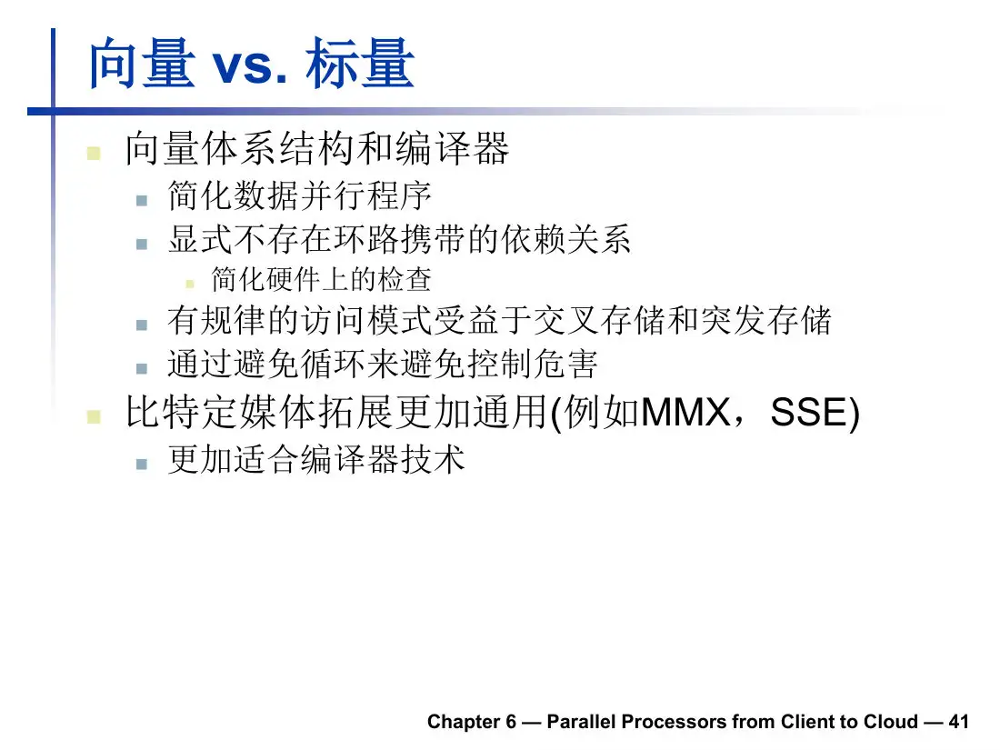

原文：

向量 vs. 标量

◼ 向量体系结构和编译器

简化数据并行程序

◼ 显式不存在环路携带的依赖关系

◼ 简化硬件上的检查

◼ 有规律的访问模式受益于交叉存储和突发存储

◼ 通过避免循环来避免控制危害

◼ 比特定媒体拓展更加通用(例如MMX，SSE)

◼ 更加适合编译器技术

Chapter 6 — Parallel Processors from Client to Cloud

41

### 向量 vs. 多媒体拓展

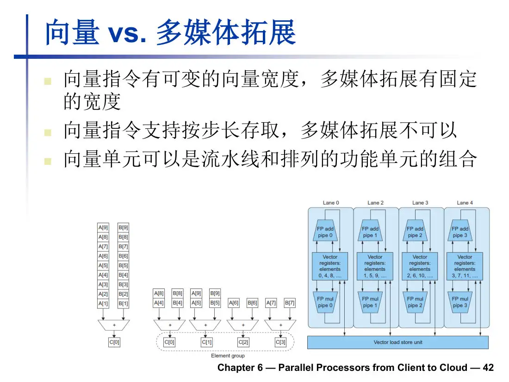

原文：

向量 vs. 多媒体拓展

◼ 向量指令有可变的向量宽度，多媒体拓展有固定的宽度

◼ 向量指令支持按步长存取，多媒体拓展不可以

◼ 向量单元可以是流水线和排列的功能单元的组合

### (MIMD)多线程

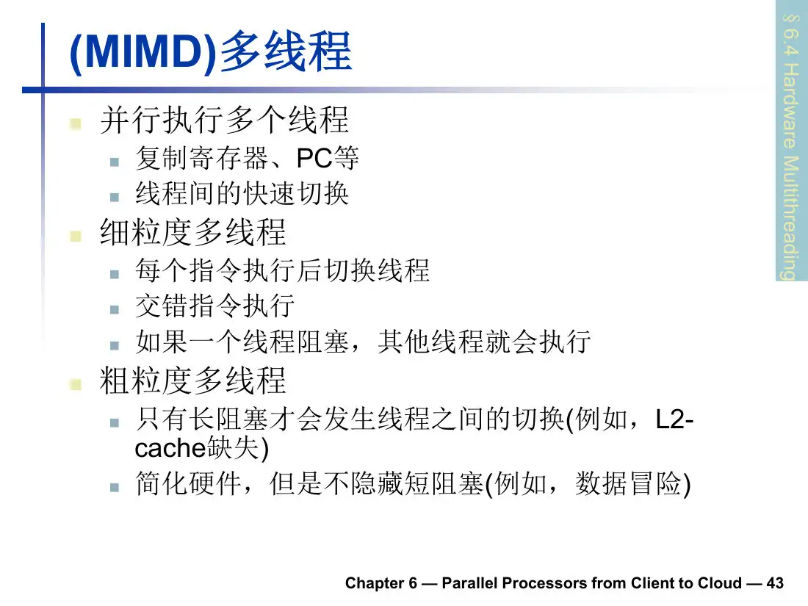

原文：

(MIMD)多线程

◼ 并行执行多个线程

◼ 复制寄存器、PC等

◼ 线程间的快速切换

◼ 细粒度多线程

◼ 每个指令执行后切换线程

◼ 交错指令执行

◼ 如果一个线程阻塞，其他线程就会执行

◼ 粗粒度多线程

◼ 只有长阻塞才会发生线程之间的切换(例如，L2-cache缺失)

◼ 简化硬件，但是不隐藏短阻塞(例如，数据冒险)

§ 6.4 Hardware Multithreading

Chapter 6 — Parallel Processors from Client to Cloud

43

### 同步多线程

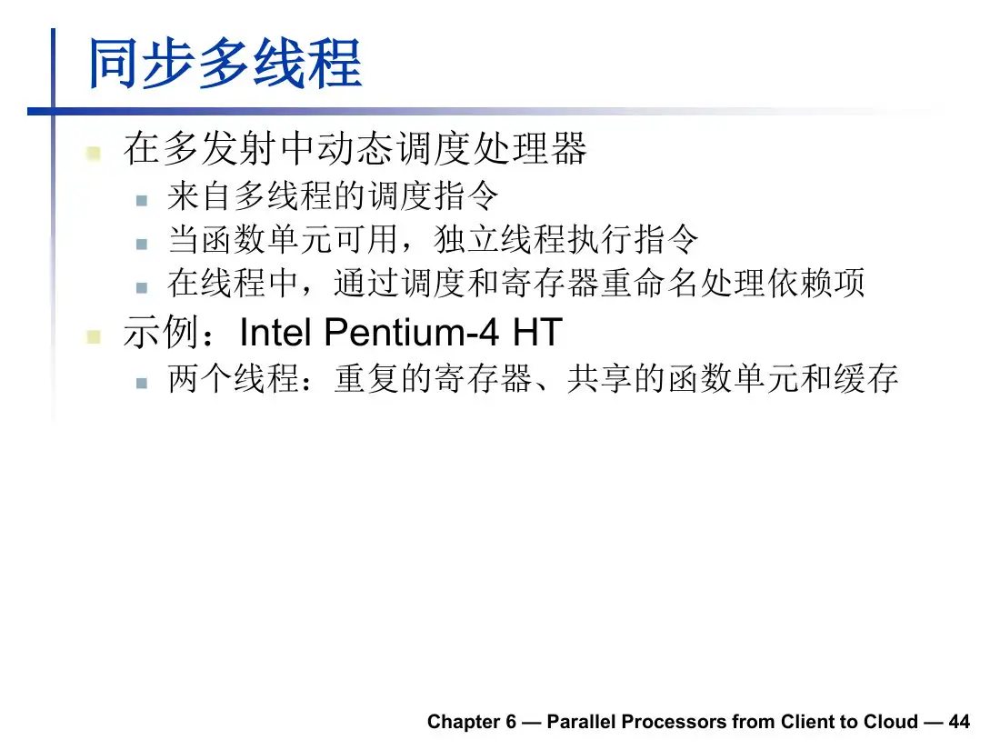

原文：

同步多线程

◼ 在多发射中动态调度处理器

◼ 来自多线程的调度指令

◼ 当函数单元可用，独立线程执行指令

◼ 在线程中，通过调度和寄存器重命名处理依赖项

◼ 示例：Intel Pentium-4 HT

◼ 两个线程：重复的寄存器、共享的函数单元和缓存

Chapter 6 — Parallel Processors from Client to Cloud

44

### 多线程示例

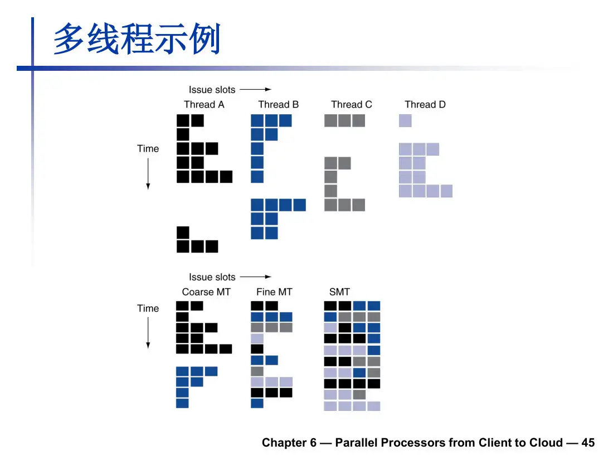

原文：

多线程示例

Chapter 6 — Parallel Processors from Client to Cloud —

45

### 多线程的未来

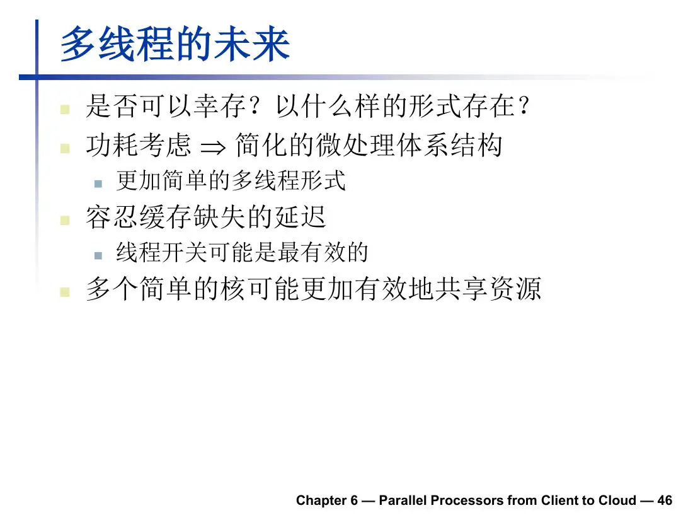

原文：

多线程的未来

◼ 是否可以幸存？以什么样的形式存在？

◼ 功耗考虑  简化的微处理体系结构

◼ 更加简单的多线程形式

◼ 容忍缓存缺失的延迟

◼ 线程开关可能是最有效的

◼ 多个简单的核可能更加有效地共享资源

Chapter 6 — Parallel Processors from Client to Cloud

46

### 示例：和约简

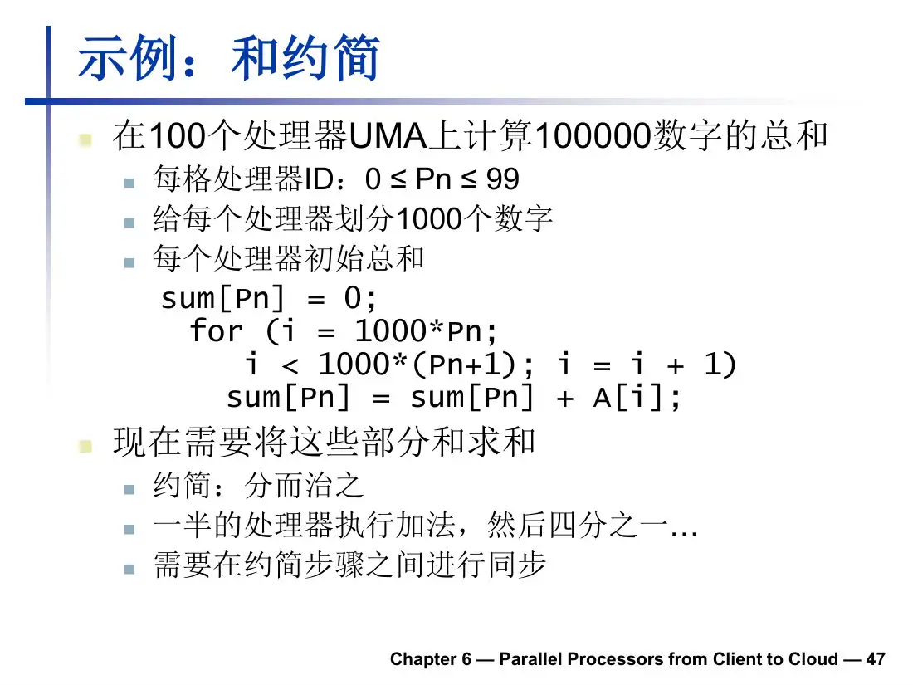

原文：

示例：和约简

◼ 在100个处理器UMA上计算100000数字的总和

每格处理器ID： $0 \leq \mathsf { P } \mathsf { n } \leq 9 9$

◼ 给每个处理器划分1000个数字

◼ 每个处理器初始总和

◼ 现在需要将这些部分和求和

◼ 约简：分而治之

◼ 一半的处理器执行加法，然后四分之一…

◼ 需要在约简步骤之间进行同步

Chapter 6 — Parallel Processors from Client to Cloud

47

### 示例：和约简

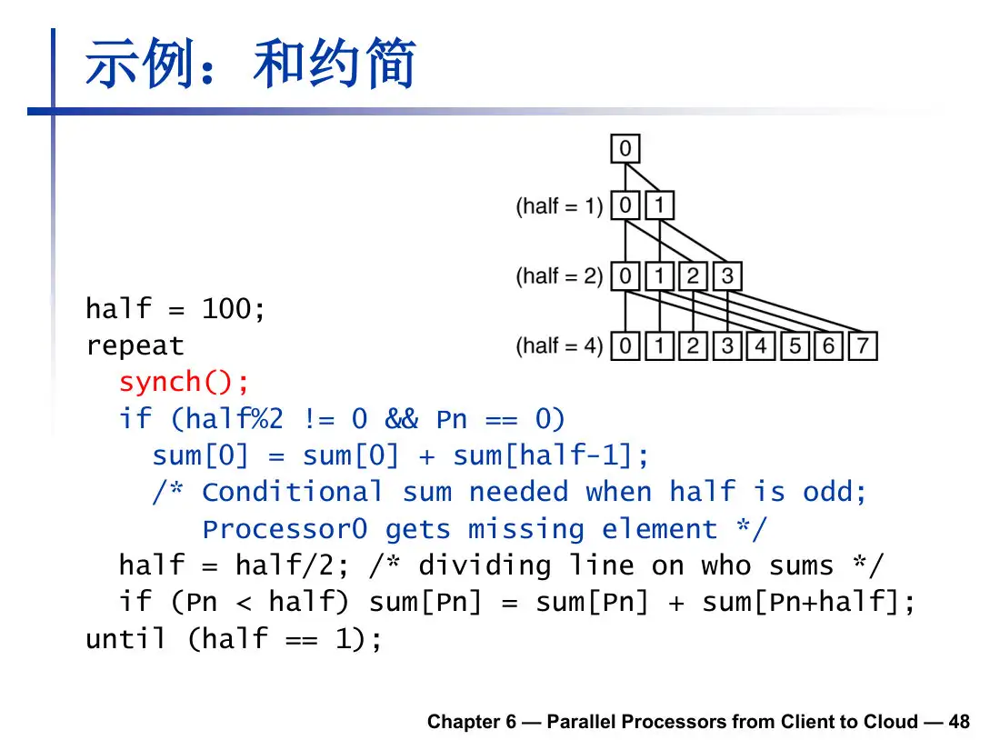

原文：

示例：和约简

Chapter 6 — Parallel Processors from Client to Cloud

48

### GPU的历史

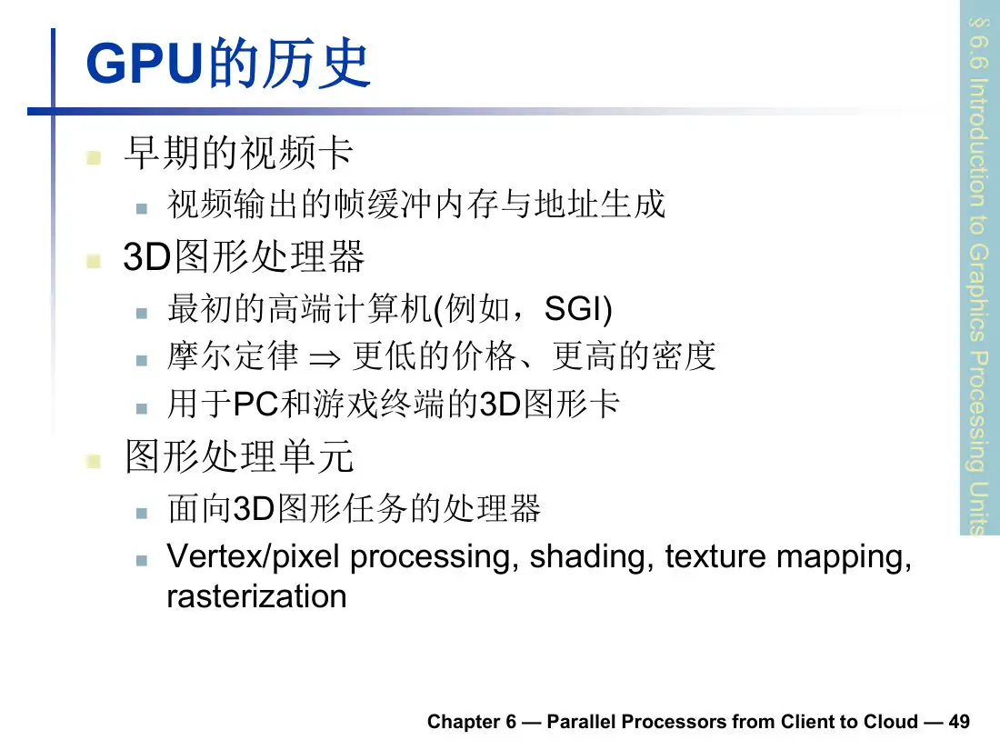

原文：

GPU的历史

◼ 早期的视频卡

◼ 视频输出的帧缓冲内存与地址生成

◼ 3D图形处理器

最初的高端计算机(例如，SGI)

◼ 摩尔定律  更低的价格、更高的密度

◼ 用于PC和游戏终端的3D图形卡

◼ 图形处理单元

◼ 面向3D图形任务的处理器

◼ Vertex/pixel processing, shading, texture mapping, rasterization

§ 6.6 Introduction to Graphics Processing Units

Chapter 6 — Parallel Processors from Client to Cloud

49

### 系统中的图形

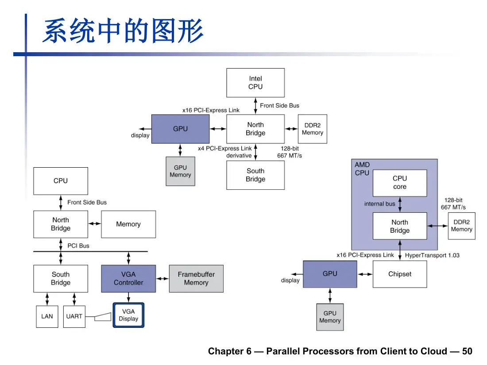

原文：

系统中的图形

### GPU体系结构

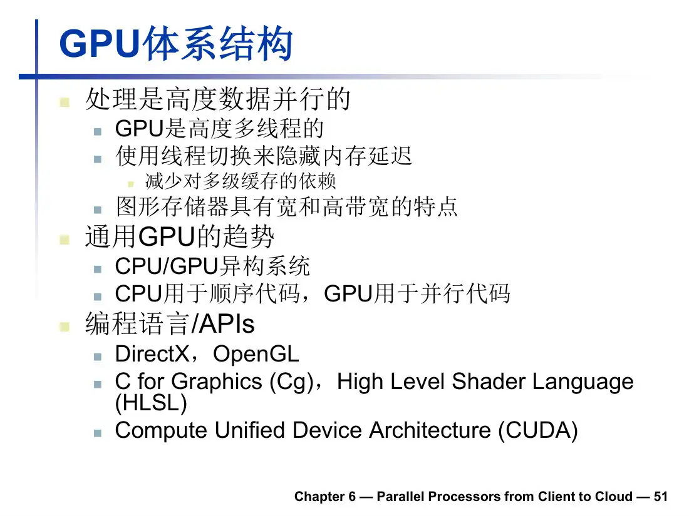

原文：

GPU体系结构

◼ 处理是高度数据并行的

◼ GPU是高度多线程的

◼ 使用线程切换来隐藏内存延迟

◼ 减少对多级缓存的依赖

◼ 图形存储器具有宽和高带宽的特点

◼ 通用GPU的趋势

◼ CPU/GPU异构系统

◼ CPU用于顺序代码，GPU用于并行代码

◼ 编程语言/APIs

◼ DirectX，OpenGL

◼ C for Graphics (Cg)，High Level Shader Language (HLSL)

◼ Compute Unified Device Architecture (CUDA)

Chapter 6 — Parallel Processors from Client to Cloud

51

### 示例：NVIDIA Tesla

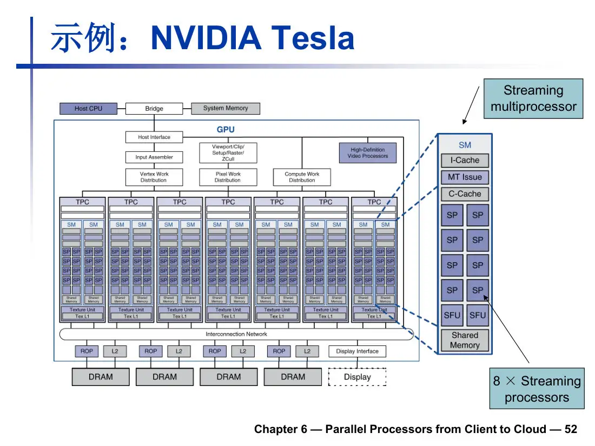

原文：

示例：NVIDIA Tesla

### 示例：NVIDIA Tesla

原文：

示例：NVIDIA Tesla

◼ 流处理器

◼ 单精度浮点运算和整型单元

◼ 每个SP是细粒度多线程

◼ Warp: 32个线程一组

◼ SIMD风格并行执行◼ 8 SPs× 4 时钟周期

◼ Hardware contexts for 24 warps ◼ 寄存器、PC…

### GPU的分类

原文：

GPU的分类

◼ 不适合SIMD/MIMD的模型

◼ 线程中有条件的执行允许产生MIMD的错觉

◼ 但是随着性能下降

◼ 需要小心的编写通用代码

<table><tr><td></td><td>Static: Discovered at Compile Time</td><td>Dynamic: Discovered at Runtime</td></tr><tr><td>Instruction-Level Parallelism</td><td>VLIW</td><td>Superscalar</td></tr><tr><td>Data-Level Parallelism</td><td>SIMD or Vector</td><td>Tesla Multiprocessor</td></tr></table>

Chapter 6 — Parallel Processors from Client to Cloud

54

### GPU内存结构

原文：

GPU内存结构

### 正确看待GPU

原文：

正确看待GPU

<table><tr><td>Feature</td><td>Multicore with SIMD</td><td>GPU</td></tr><tr><td>SIMD processors</td><td>4 to 8</td><td>8 to 16</td></tr><tr><td>SIMD lanes/processor</td><td>2 to 4</td><td>8 to 16</td></tr><tr><td>Multithreading hardware support for SIMD threads</td><td>2 to 4</td><td>16 to 32</td></tr><tr><td>Typical ratio of single precision to double-precision performance</td><td>2:1</td><td>2:1</td></tr><tr><td>Largest cache size</td><td>8 MB</td><td>0.75 MB</td></tr><tr><td>Size of memory address</td><td>64-bit</td><td>64-bit</td></tr><tr><td>Size of main memory</td><td>8 GB to 256 GB</td><td>4 GB to 6 GB</td></tr><tr><td>Memory protection at level of page</td><td>Yes</td><td>Yes</td></tr><tr><td>Demand paging</td><td>Yes</td><td>No</td></tr><tr><td>Integrated scalar processor/SIMD processor</td><td>Yes</td><td>No</td></tr><tr><td>Cache coherent</td><td>Yes</td><td>No</td></tr></table>

Chapter 6 — Parallel Processors from Client to Cloud

56

### GPU术语指南

原文：

GPU术语指南

<table><tr><td>Type</td><td>More descriptive name</td><td>Closest old term outside of GPUs</td><td>Official CUDA/NVIDIA GPU term</td><td>Book definition</td></tr><tr><td rowspan="3">Program abstractions</td><td>Vectorizable Loop</td><td>Vectorizable Loop</td><td>Grid</td><td>A vectorizable loop, executed on the GPU, made up of one or more Thread Blocks (bodies of vectorized loop) that can execute in parallel.</td></tr><tr><td>Body of Vectorized Loop</td><td>Body of a (Strip-Mined) Vectorized Loop</td><td>Thread Block</td><td>A vectorized loop executed on a multithreaded SIMD Processor, made up of one or more threads of SIMD instructions. They can communicate via Local Memory.</td></tr><tr><td>Sequence of SIMD Lane Operations</td><td>One iteration of a Scalar Loop</td><td>CUDA Thread</td><td>A vertical cut of a thread of SIMD instructions corresponding to one element executed by one SIMD Lane. Result is stored depending on mask and predicate register.</td></tr><tr><td rowspan="2">Machine object</td><td>A Thread of SIMD Instructions</td><td>Thread of Vector Instructions</td><td>Warp</td><td>A traditional thread, but it contains just SIMD instructions that are executed on a multithreaded SIMD Processor. Results stored depending on a per-element mask.</td></tr><tr><td>SIMD Instruction</td><td>Vector Instruction</td><td>PTX Instruction</td><td>A single SIMD instruction executed across SIMD Lanes.</td></tr><tr><td rowspan="4">Processing hardware</td><td>Multithreaded SIMD Processor</td><td>(Multithreaded) Vector Processor</td><td>Streaming Multiprocessor</td><td>A multithreaded SIMD Processor executes threads of SIMD instructions, independent of other SIMD Processors.</td></tr><tr><td>Thread Block Scheduler</td><td>Scalar Processor</td><td>Giga Thread Engine</td><td>Assigns multiple Thread Blocks (bodies of vectorized loop) to multithreaded SIMD Processors.</td></tr><tr><td>SIMD Thread Scheduler</td><td>Thread scheduler in a Multithreaded CPU</td><td>Warp Scheduler</td><td>Hardware unit that schedules and issues threads of SIMD instructions when they are ready to execute; includes a scoreboard to track SIMD Thread execution.</td></tr><tr><td>SIMD Lane</td><td>Vector lane</td><td>Thread Processor</td><td>A SIMD Lane executes the operations in a thread of SIMD instructions on a single element. Results stored depending on mask.</td></tr><tr><td rowspan="3">Memory hardware</td><td>GPU Memory</td><td>Main Memory</td><td>Global Memory</td><td>DRAM memory accessible by all multithreaded SIMD Processors in a GPU.</td></tr><tr><td>Local Memory</td><td>Local Memory</td><td>Shared Memory</td><td>Fast local SRAM for one multithreaded SIMD Processor, unavailable to other SIMD Processors.</td></tr><tr><td>SIMD Lane Registers</td><td>Vector Lane Registers</td><td>Thread Processor Registers</td><td>Registers in a single SIMD Lane allocated across a full thread block (body of vectorized loop).</td></tr></table>

Chapter 6 — Parallel Processors from Client to Cloud

57

### 多级网络

原文：

多级网络

### 网络特点

原文：

网络特点

性能

◼ 每条消息的延迟(无负载网络)

◼ 吞吐量

◼ 链路带宽

◼ 网络总带宽

◼ 对分带宽

◼ 拥塞延迟(取决于拥塞情况)

◼ 成本

◼ 功耗

Routability in silicon

Chapter 6 — Parallel Processors from Client to Cloud

59

### 和约简

原文：

和约简

◼ 在100个处理器上对100000数字进行求和

◼ 首先划分100个数字为一组

◼ 然后计算部分和

$$
\text { for } (i = 0; i <   1 0 0 0; i = i + 1)
$$

$$
\text { sum } = \text { sum } + \text { AN } [ i ];
$$

◼ 约简

◼ 一半的处理器发送，另一半处理器接受并执行加法

◼ 然后四分之一处理器发送，四分之一处理器接收并执行加法

Chapter 6 — Parallel Processors from Client to Cloud

60

### 和约简

原文：

和约简

Chapter 6 — Parallel Processors from Client to Cloud

61
