# 《计算机组成与结构》第8章 总线技术（课件）

原件的每一页，下面附识别出的文字。

### Chapter 8

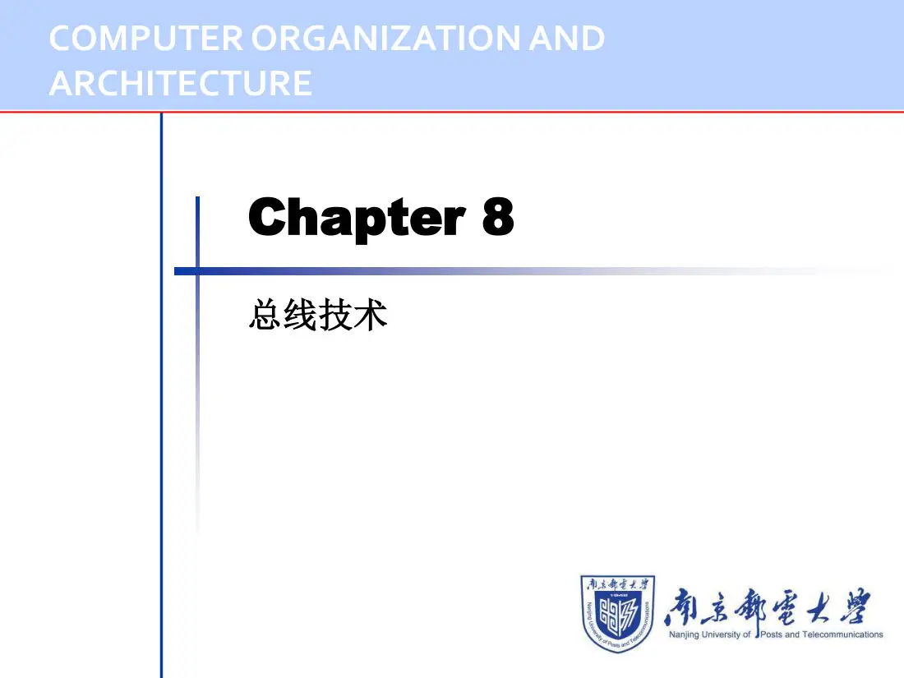

原文：

Chapter 8

总线技术

COMPUTER ORGANIZATION AND ARCHITECTURE

南京都电大学 Nanijing O 圆 nons 南京郵電大学 Nanjing University of Posts and Telecommunications ty o Posts and T

### 总线的基本概念和结构形态

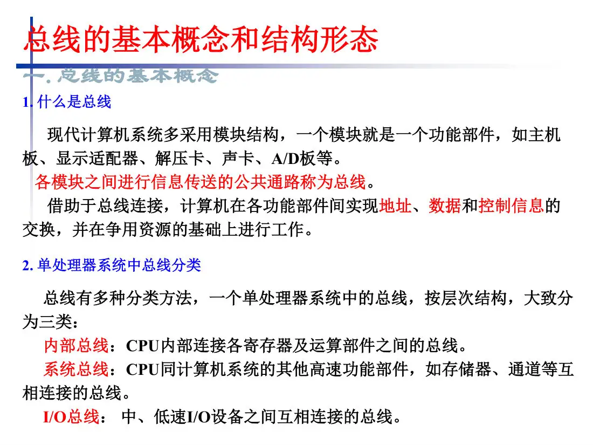

原文：

总线的基本概念和结构形态

一. 总线的基本概念

1. 什么是总线

现代计算机系统多采用模块结构，一个模块就是一个功能部件，如主机板、显示适配器、解压卡、声卡、A/D板等。

各模块之间进行信息传送的公共通路称为总线。

借助于总线连接，计算机在各功能部件间实现地址、数据和控制信息的交换，并在争用资源的基础上进行工作。

2. 单处理器系统中总线分类

总线有多种分类方法，一个单处理器系统中的总线，按层次结构，大致分为三类：

内部总线：CPU内部连接各寄存器及运算部件之间的总线。

系统总线：CPU同计算机系统的其他高速功能部件，如存储器、通道等互相连接的总线。

I/O总线：中、低速I/O设备之间互相连接的总线。

### 总线的特性

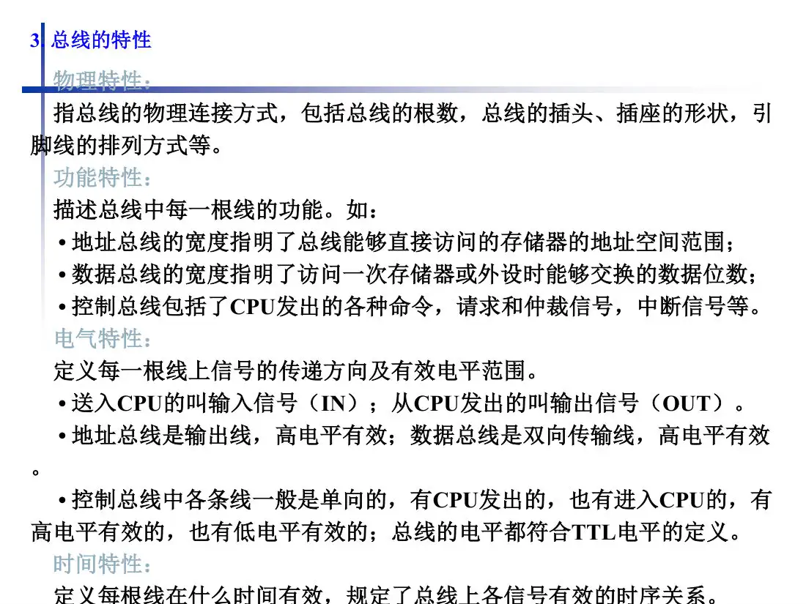

原文：

总线的特性

物理特性：

指总线的物理连接方式，包括总线的根数，总线的插头、插座的形状，引脚线的排列方式等。

功能特性：

描述总线中每一根线的功能。如：

• 地址总线的宽度指明了总线能够直接访问的存储器的地址空间范围；

• 数据总线的宽度指明了访问一次存储器或外设时能够交换的数据位数；

• 控制总线包括了CPU发出的各种命令，请求和仲裁信号，中断信号等。电气特性：

定义每一根线上信号的传递方向及有效电平范围。

• 送入CPU的叫输入信号（IN）；从CPU发出的叫输出信号（OUT）。

• 地址总线是输出线，高电平有效；数据总线是双向传输线，高电平有效

• 控制总线中各条线一般是单向的，有CPU发出的，也有进入CPU的，有高电平有效的，也有低电平有效的；总线的电平都符合TTL电平的定义。

时间特性：

定义每根线在什么时间有效，规定了总线上各信号有效的时序关系。

### 总线的标准化

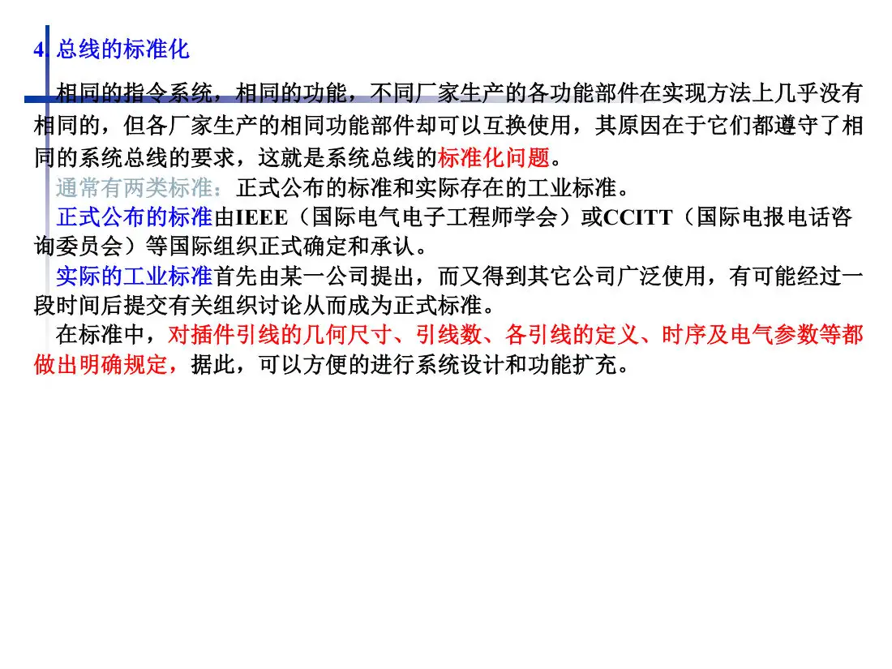

原文：

总线的标准化

相同的指令系统，相同的功能，不同厂家生产的各功能部件在实现方法上几乎没有相同的，但各厂家生产的相同功能部件却可以互换使用，其原因在于它们都遵守了相同的系统总线的要求，这就是系统总线的标准化问题。

通常有两类标准：正式公布的标准和实际存在的工业标准。

正式公布的标准由IEEE（国际电气电子工程师学会）或CCITT（国际电报电话咨询委员会）等国际组织正式确定和承认。

实际的工业标准首先由某一公司提出，而又得到其它公司广泛使用，有可能经过一段时间后提交有关组织讨论从而成为正式标准。

在标准中，对插件引线的几何尺寸、引线数、各引线的定义、时序及电气参数等都做出明确规定，据此，可以方便的进行系统设计和功能扩充。

### 总线的性能指标

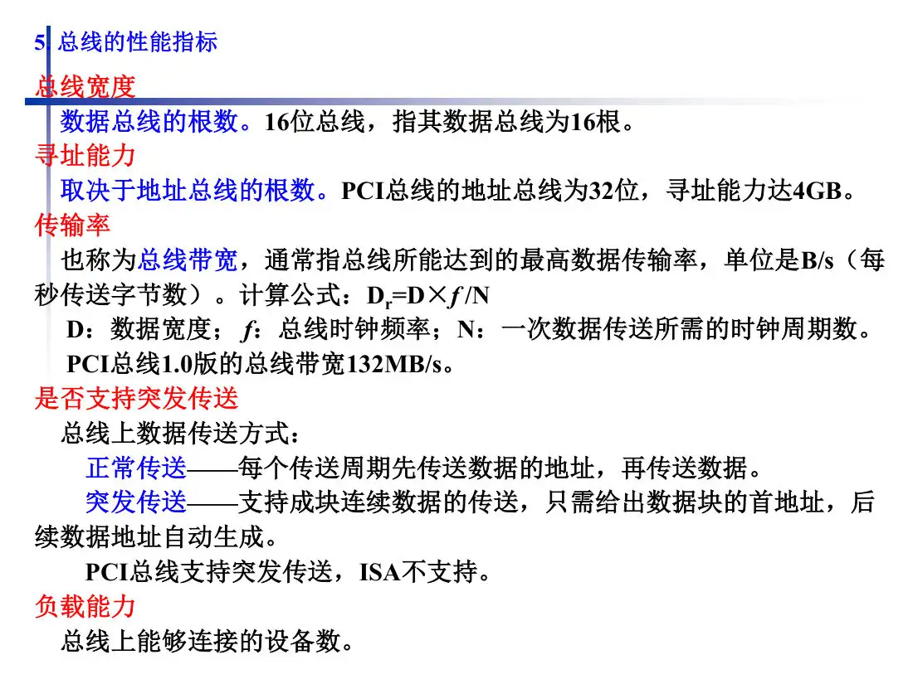

原文：

总线的性能指标

总线宽度

数据总线的根数。16位总线，指其数据总线为16根。

寻址能力

取决于地址总线的根数。PCI总线的地址总线为32位，寻址能力达4GB。

传输率

也称为总线带宽，通常指总线所能达到的最高数据传输率，单位是B/s（每秒传送字节数）。计算公式： $\mathbf { D } _ { \mathbf { r } } { = } \mathbf { D } { \times } f / \mathbf { N }$

D：数据宽度；f：总线时钟频率；N：一次数据传送所需的时钟周期数。

PCI总线1.0版的总线带宽132MB/s。

是否支持突发传送

总线上数据传送方式：

正常传送——每个传送周期先传送数据的地址，再传送数据。

突发传送——支持成块连续数据的传送，只需给出数据块的首地址，后续数据地址自动生成。

PCI总线支持突发传送，ISA不支持。

负载能力

总线上能够连接的设备数。

### D——数据宽度； f——总线时钟频率；

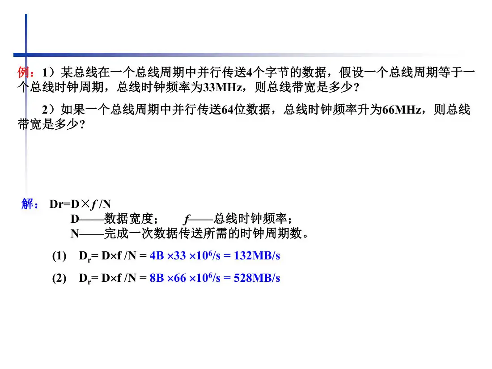

原文：

例：1）某总线在一个总线周期中并行传送4个字节的数据，假设一个总线周期等于一个总线时钟周期，总线时钟频率为33MHz，则总线带宽是多少?

2）如果一个总线周期中并行传送64位数据，总线时钟频率升为66MHz，则总线带宽是多少?

解： $\scriptstyle \mathbf { D r } = \mathbf { D } \times { \boldsymbol { f } } / \mathbf { N }$

D——数据宽度； f——总线时钟频率；

N——完成一次数据传送所需的时钟周期数。

(1) ${ \bf D } _ { \mathrm { r } } \mathrm { = } { \bf D } { \bf \times } { \bf f } / { \bf N } = 4 { \bf B } \times 3 3 \times 1 0 ^ { 6 } / { \bf s } = 1 3 2 { \bf M B } / { \bf s }$

(2) ${ \bf D } _ { \mathrm { r } } \mathrm { = } { \bf D } { \bf \times } { \bf f } / { \bf N } = { \bf 8 } { \bf B } \times { \bf 6 } { \bf 6 } \times { \bf 1 0 ^ { 6 } } / { \bf s } = 5 2 8 { \bf M B } / { \bf s }$

### 总线接

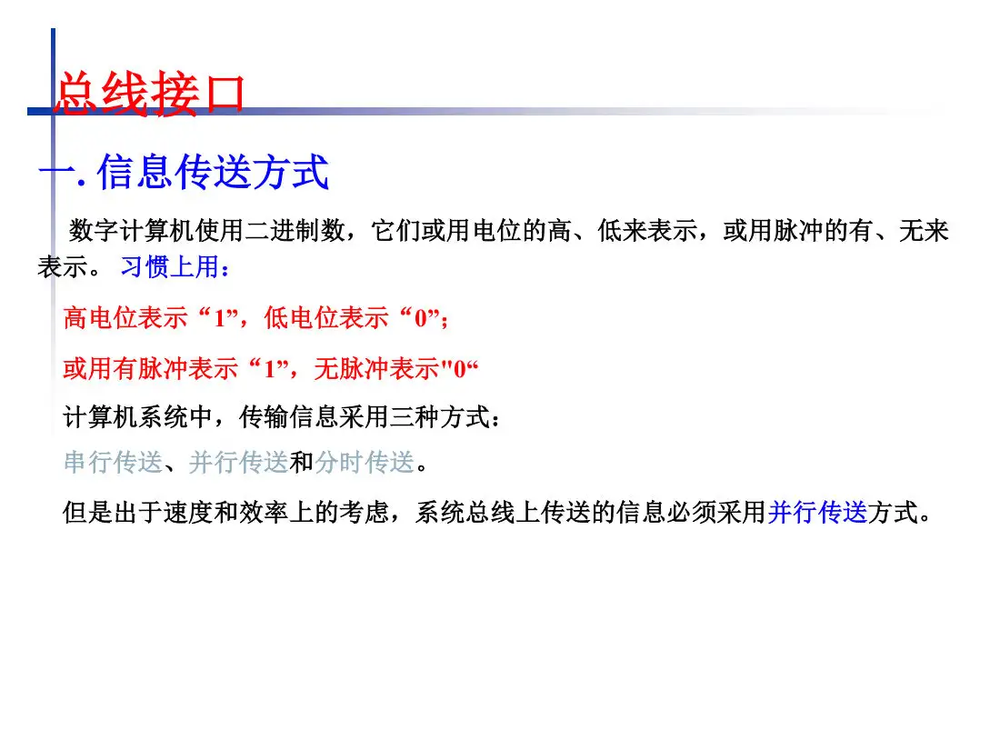

原文：

总线接

一. 信息传送方式

数字计算机使用二进制数，它们或用电位的高、低来表示，或用脉冲的有、无来表示。 习惯上用：

高电位表示“1”，低电位表示“0”；

或用有脉冲表示“1”，无脉冲表示"0“

计算机系统中，传输信息采用三种方式：

串行传送、并行传送和分时传送。

但是出于速度和效率上的考虑，系统总线上传送的信息必须采用并行传送方式。

### 串行传送

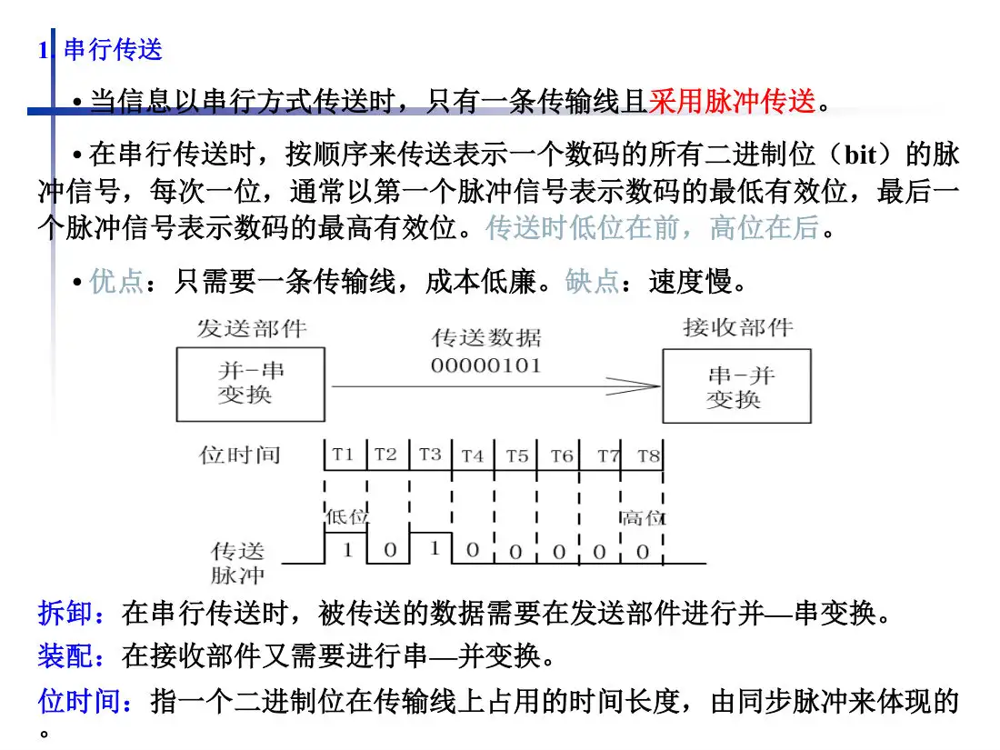

原文：

串行传送

• 当信息以串行方式传送时，只有一条传输线且采用脉冲传送。

• 在串行传送时，按顺序来传送表示一个数码的所有二进制位（bit）的脉冲信号，每次一位，通常以第一个脉冲信号表示数码的最低有效位，最后一个脉冲信号表示数码的最高有效位。传送时低位在前，高位在后。

• 优点：只需要一条传输线，成本低廉。缺点：速度慢。

拆卸：在串行传送时，被传送的数据需要在发送部件进行并—串变换。

装配：在接收部件又需要进行串—并变换。

位时间：指一个二进制位在传输线上占用的时间长度，由同步脉冲来体现的

### 总线的仲裁

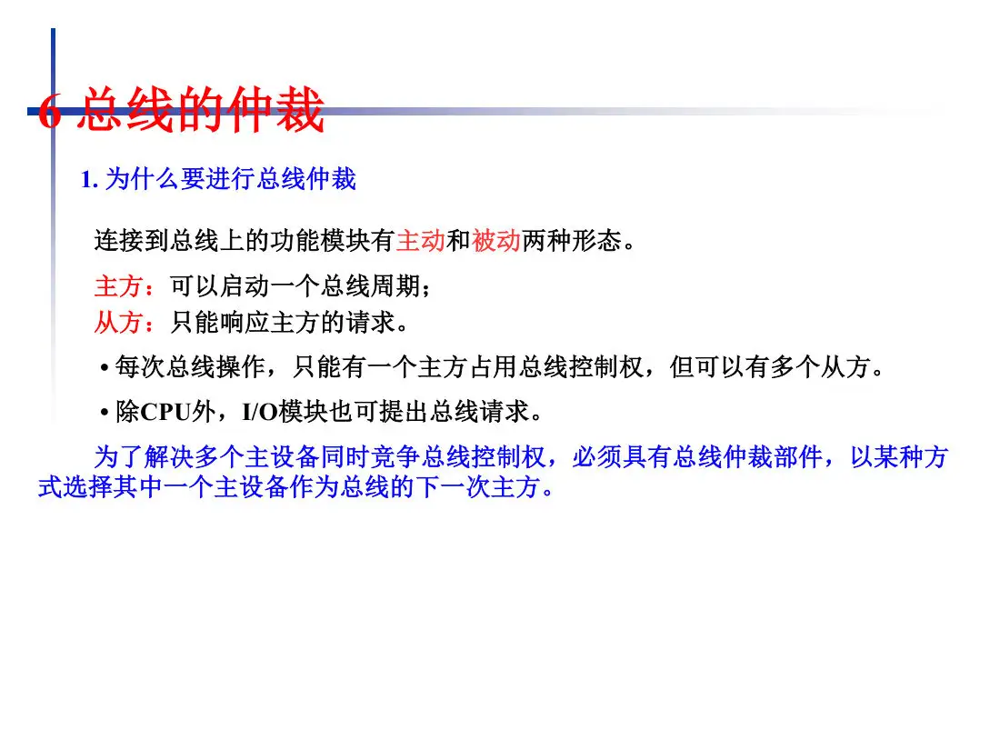

原文：

总线的仲裁

1. 为什么要进行总线仲裁

连接到总线上的功能模块有主动和被动两种形态。

主方：可以启动一个总线周期；

从方：只能响应主方的请求。

• 每次总线操作，只能有一个主方占用总线控制权，但可以有多个从方。

• 除CPU外，I/O模块也可提出总线请求。

为了解决多个主设备同时竞争总线控制权，必须具有总线仲裁部件，以某种方式选择其中一个主设备作为总线的下一次主方。

### 2. 总线仲裁方式

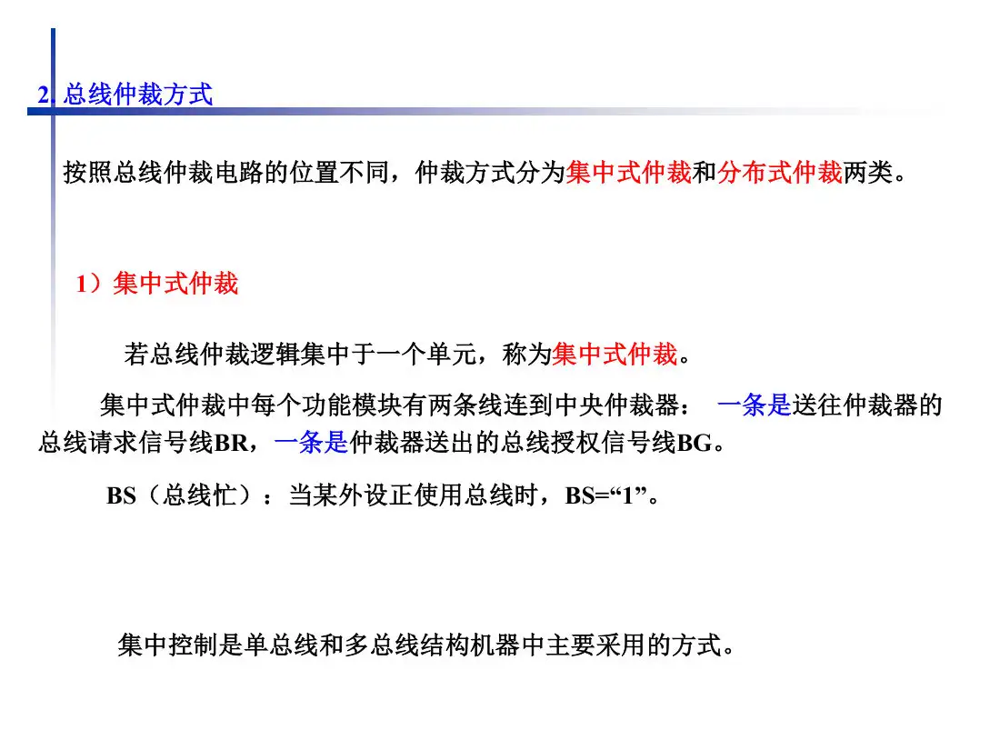

原文：

2. 总线仲裁方式

按照总线仲裁电路的位置不同，仲裁方式分为集中式仲裁和分布式仲裁两类。

1）集中式仲裁

若总线仲裁逻辑集中于一个单元，称为集中式仲裁。

集中式仲裁中每个功能模块有两条线连到中央仲裁器： 一条是送往仲裁器的总线请求信号线BR，一条是仲裁器送出的总线授权信号线BG。

BS（总线忙）：当某外设正使用总线时， $\mathbf { B S } \mathbf { = } ^ { 6 6 } \mathbf { 1 } ^ { 9 9 } .$

集中控制是单总线和多总线结构机器中主要采用的方式。

### 链式查询方式的主要特点：

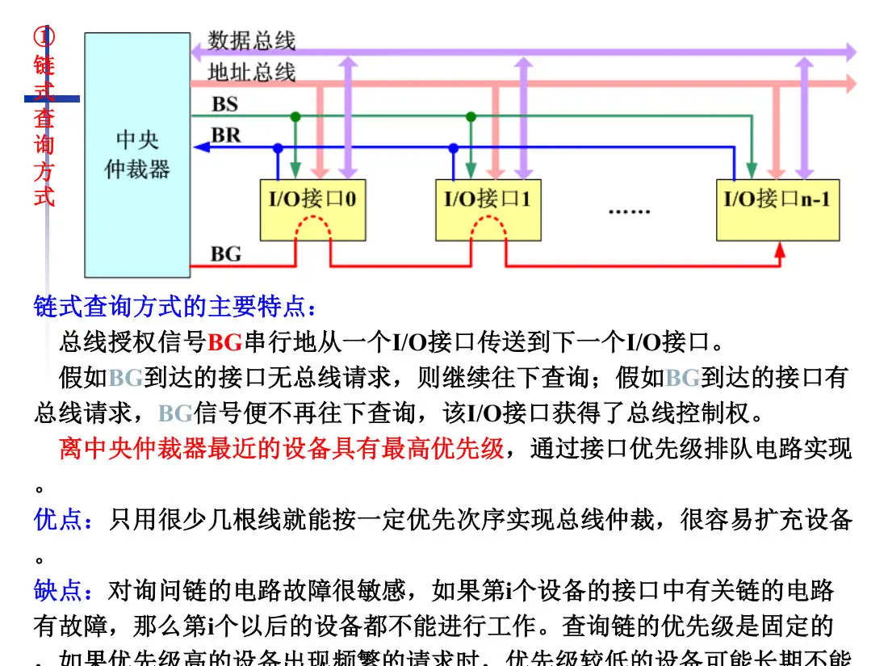

原文：

链式查询方式的主要特点：

总线授权信号BG串行地从一个I/O接口传送到下一个I/O接口。

假如BG到达的接口无总线请求，则继续往下查询；假如BG到达的接口有总线请求，BG信号便不再往下查询，该I/O接口获得了总线控制权。

离中央仲裁器最近的设备具有最高优先级，通过接口优先级排队电路实现o

优点：只用很少几根线就能按一定优先次序实现总线仲裁，很容易扩充设备

缺点：对询问链的电路故障很敏感，如果第i个设备的接口中有关链的电路有故障，那么第i个以后的设备都不能进行工作。查询链的优先级是固定的，如果优先级高的设备出现频繁的请求时，优先级较低的设备可能长期不能

### 第 12 页

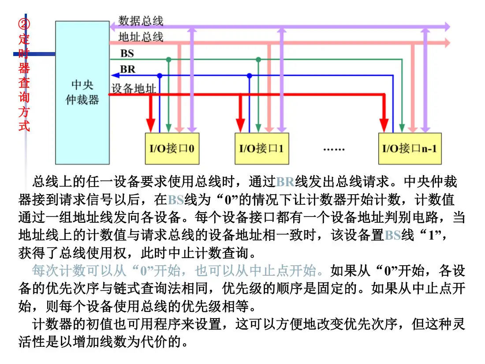

原文：

总线上的任一设备要求使用总线时，通过BR线发出总线请求。中央仲裁器接到请求信号以后，在BS线为“0”的情况下让计数器开始计数，计数值通过一组地址线发向各设备。每个设备接口都有一个设备地址判别电路，当地址线上的计数值与请求总线的设备地址相一致时，该设备置BS线“1”，获得了总线使用权，此时中止计数查询。

每次计数可以从“0”开始，也可以从中止点开始。如果从“0”开始，各设备的优先次序与链式查询法相同，优先级的顺序是固定的。如果从中止点开始，则每个设备使用总线的优先级相等。

计数器的初值也可用程序来设置，这可以方便地改变优先次序，但这种灵活性是以增加线数为代价的。

### 独立请求方式的优点：

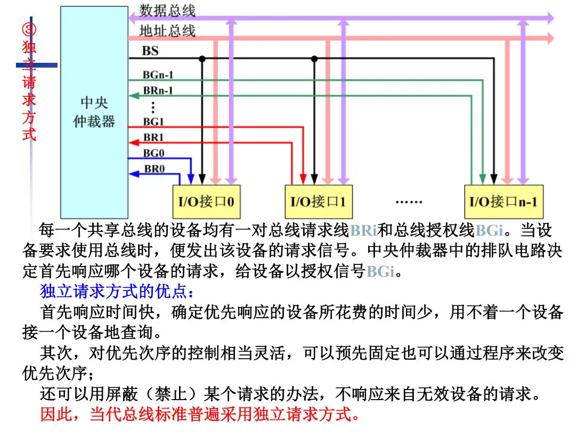

原文：

每一个共享总线的设备均有一对总线请求线BRi和总线授权线BGi。当设备要求使用总线时，便发出该设备的请求信号。中央仲裁器中的排队电路决定首先响应哪个设备的请求，给设备以授权信号BGi。

独立请求方式的优点：

首先响应时间快，确定优先响应的设备所花费的时间少，用不着一个设备接一个设备地查询。

其次，对优先次序的控制相当灵活，可以预先固定也可以通过程序来改变优先次序；

还可以用屏蔽（禁止）某个请求的办法，不响应来自无效设备的请求。

因此，当代总线标准普遍采用独立请求方式。

### 总线仲裁器

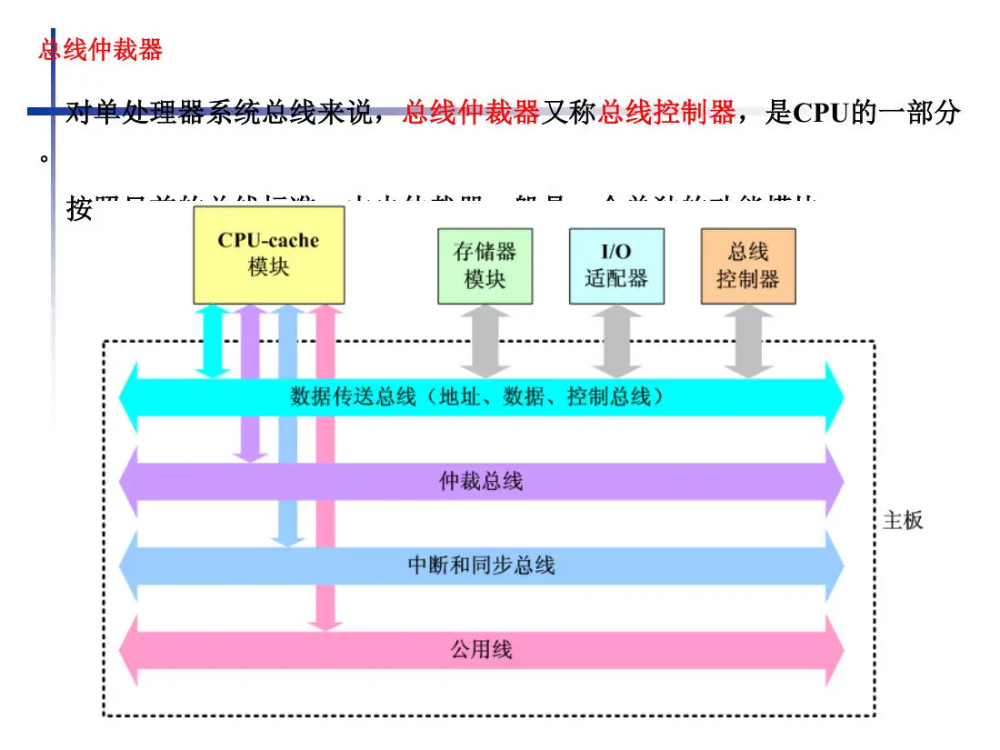

原文：

总线仲裁器

对单处理器系统总线来说，总线仲裁器又称总线控制器，是CPU的一部分

### 分布式仲裁

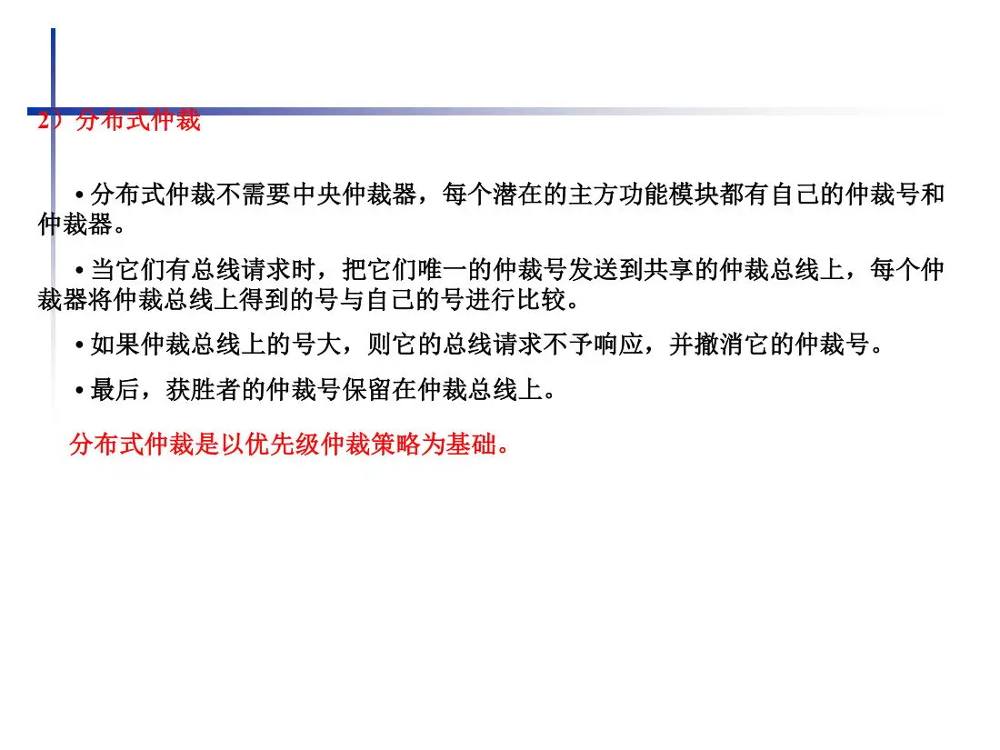

原文：

分布式仲裁

• 分布式仲裁不需要中央仲裁器，每个潜在的主方功能模块都有自己的仲裁号和仲裁器。

• 当它们有总线请求时，把它们唯一的仲裁号发送到共享的仲裁总线上，每个仲裁器将仲裁总线上得到的号与自己的号进行比较。

• 如果仲裁总线上的号大，则它的总线请求不予响应，并撤消它的仲裁号。

• 最后，获胜者的仲裁号保留在仲裁总线上。

分布式仲裁是以优先级仲裁策略为基础。

### 第 16 页

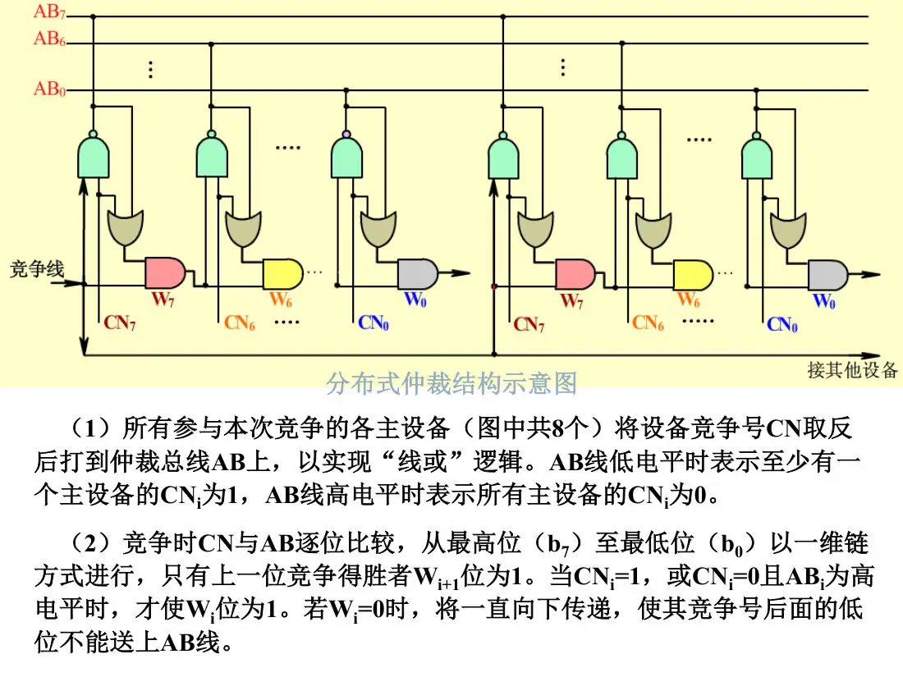

原文：

（1）所有参与本次竞争的各主设备（图中共8个）将设备竞争号CN取反后打到仲裁总线AB上，以实现“线或”逻辑。AB线低电平时表示至少有一个主设备的 $\mathbf { C N _ { i } }$ 为1，AB线高电平时表示所有主设备的 $\mathbf { C N _ { i } }$ 为0。

（2）竞争时CN与AB逐位比较，从最高位 $( \mathbf { b } _ { 7 } )$ 至最低位 $( \mathbf { b _ { 0 } } )$ ）以一维链方式进行，只有上一位竞争得胜者 $\mathbf { W _ { i + 1 } }$ 位为1。当 $\mathbf { C N _ { i } = 1 }$ ，或 $\mathbf { C N _ { i } = 0 }$ 且 $\mathbf { A B _ { i } }$ 为高电平时，才使 $\mathbf { W _ { i } }$ 位为1。若 $\bf { W _ { i } = 0 }$ 时，将一直向下传递，使其竞争号后面的低位不能送上AB线。

### 总线的定时和数据传送模式

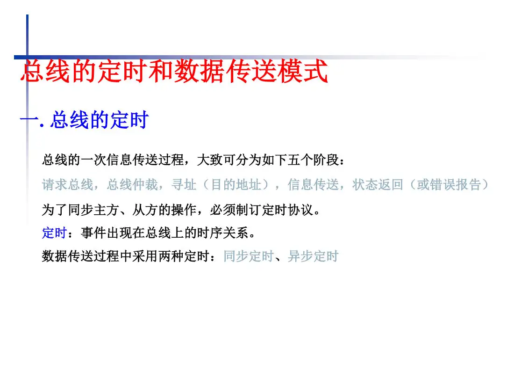

原文：

总线的定时和数据传送模式

一. 总线的定时

总线的一次信息传送过程，大致可分为如下五个阶段：

请求总线，总线仲裁，寻址（目的地址），信息传送，状态返回（或错误报告）

为了同步主方、从方的操作，必须制订定时协议。

定时：事件出现在总线上的时序关系。

数据传送过程中采用两种定时：同步定时、异步定时

### 同步定时

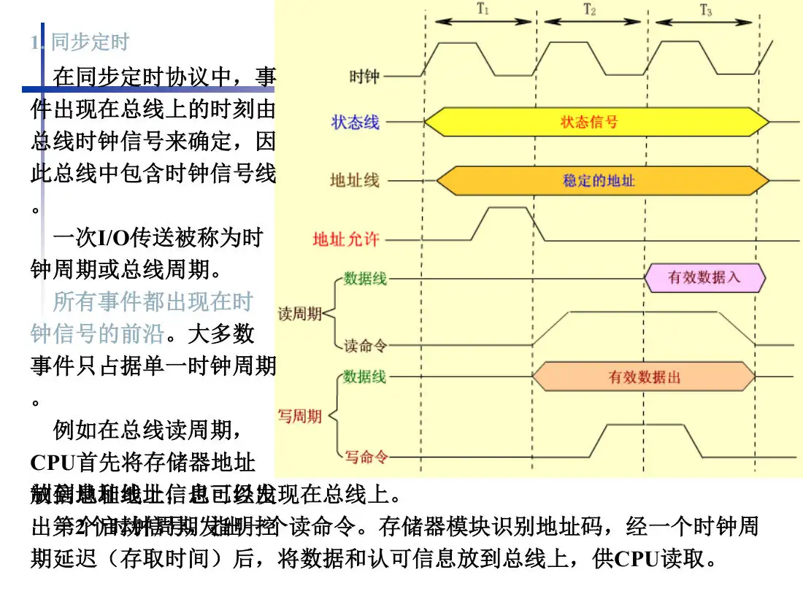

原文：

同步定时

在同步定时协议中，事件出现在总线上的时刻由总线时钟信号来确定，因此总线中包含时钟信号线

一次I/O传送被称为时钟周期或总线周期。

所有事件都出现在时钟信号的前沿。大多数事件只占据单一时钟周期。

例如在总线读周期，CPU首先将存储器地址

放到地址线上，也可以发制信息和地址信息已经出现在总线上。

出一个启动信号，指明控第2个时钟周期发出一个读命令。存储器模块识别地址码，经一个时钟周期延迟（存取时间）后，将数据和认可信息放到总线上，供CPU读取。

### 如果是总线写周期，CPU在第2个时钟周期开始将数据放到总线上。

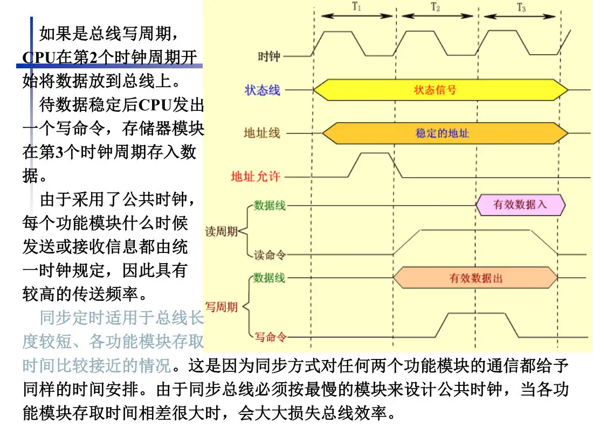

原文：

如果是总线写周期，CPU在第2个时钟周期开始将数据放到总线上。

待数据稳定后CPU发出个写命令，存储器模块在第3个时钟周期存入数据。

由于采用了公共时钟，每个功能模块什么时候发送或接收信息都由统一时钟规定，因此具有较高的传送频率。

同步定时适用于总线长度较短、各功能模块存取

时间比较接近的情况。这是因为同步方式对任何两个功能模块的通信都给予同样的时间安排。由于同步总线必须按最慢的模块来设计公共时钟，当各功能模块存取时间相差很大时，会大大损失总线效率。

### 2. 异步定时

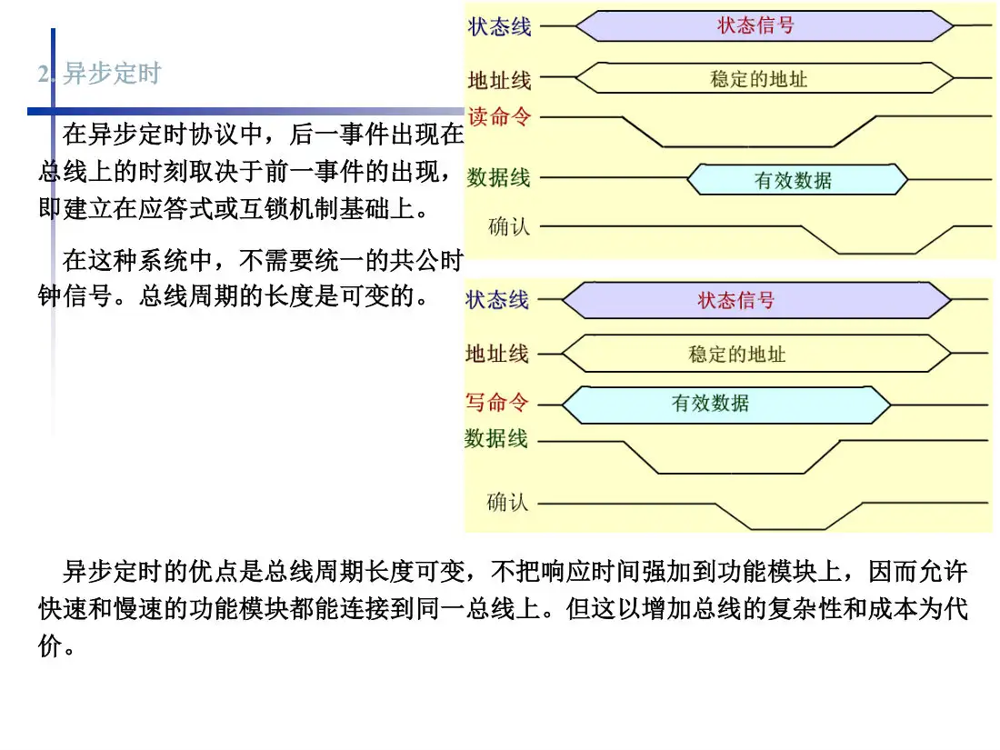

原文：

2. 异步定时

在异步定时协议中，后一事件出现在总线上的时刻取决于前一事件的出现，即建立在应答式或互锁机制基础上。

在这种系统中，不需要统一的共公时钟信号。总线周期的长度是可变的。

异步定时的优点是总线周期长度可变，不把响应时间强加到功能模块上，因而允许快速和慢速的功能模块都能连接到同一总线上。但这以增加总线的复杂性和成本为代价。

### 解：从时序图看出，该总线采用异步定时协议。

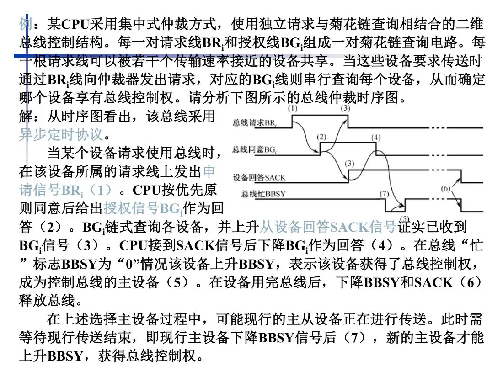

原文：

例：某CPU采用集中式仲裁方式，使用独立请求与菊花链查询相结合的二维总线控制结构。每一对请求线 $\mathbf { B R _ { i } }$ 和授权线 $\mathbf { B G } _ { \mathrm { i } }$ 组成一对菊花链查询电路。每一根请求线可以被若干个传输速率接近的设备共享。当这些设备要求传送时通过 $\mathbf { B R _ { i } }$ 线向仲裁器发出请求，对应的 $\mathbf { B G } _ { \mathrm { i } }$ 线则串行查询每个设备，从而确定哪个设备享有总线控制权。请分析下图所示的总线仲裁时序图。

解：从时序图看出，该总线采用异步定时协议。

当某个设备请求使用总线时，在该设备所属的请求线上发出申请信号BR（1）。CPU按优先原则同意后给出授权信号 $\mathbf { B G } _ { \mathrm { i } } .$ 作为回

答（2）。 $\mathbf { B G _ { i } }$ 链式查询各设备，并上升从设备回答SACK信号证实已收到$\mathbf { B G _ { i } }$ 信号（3）。CPU接到SACK信号后下降 $\mathbf { B G _ { i } }$ 作为回答（4）。在总线“忙”标志BBSY为“0”情况该设备上升BBSY，表示该设备获得了总线控制权，成为控制总线的主设备（5）。在设备用完总线后，下降BBSY和SACK（6）释放总线。

在上述选择主设备过程中，可能现行的主从设备正在进行传送。此时需等待现行传送结束，即现行主设备下降BBSY信号后（7），新的主设备才能上升BBSY，获得总线控制权。
