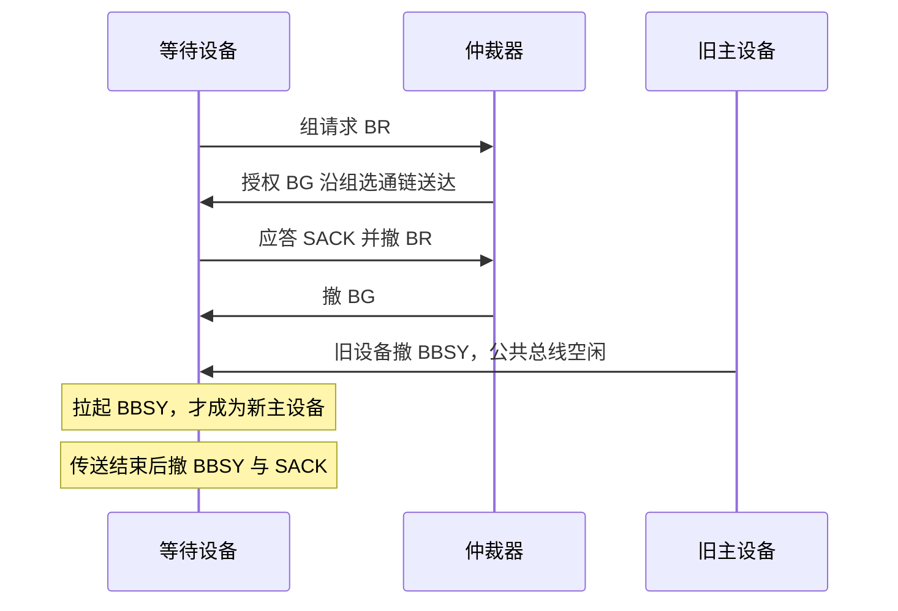

# 《计算机组成与结构》第8章 总线技术（课件）

这份历史课件用共享总线说明三个不同的问题：部件能否接在一起、多个部件竞争时谁先用，以及占用以后在什么时刻交换数据。与其从信号缩写背起，不如先问：**已经看到授权，就能开始驱动数据线吗？** 如果旧主设备还没有退出，总线上就可能出现两个驱动者。仲裁指定候选主设备，定时协议负责使候选在正确时刻接管；两者缺一不可。

## 接得上不等于能交换数据

课件第 2–4 页按连接层次区分处理器内部总线、连接处理器与主存等高速部件的系统总线，以及连接外设的 I/O 总线。同一条共享通路可交换三类信息：**地址确定对象，数据承载内容，控制说明读写、请求、认可等动作**。接口能否互换，至少要检查四层约定：接插件与引脚布置、各引脚的用途、方向与电平、发送与采样的时刻。正式公布的标准和先流行起来的工业规范都可以统一这些约定，不是只规定连接器外形。[总线的基本概念与特性](../../../topics/计算机组成/bus-concept.md)展开了这四层。

**订正（第 3、7–8 页）：** TTL 电平、一条串行数据线、最低位先送和“系统总线必须并行”都属于具体例子或历史描述。串行表示在一条数据通道上按时序发送各位，位序、是否要另外的时钟线、使用几条通道，由协议来定；并行在同一拍传多位，但并不天然更快，因为多条线也要满足到达时差和电气约束。分时复用解决的是**同一物理资源何时承担哪一类信息**，可以和并行传送同时使用。

## 先确定一拍干什么，再换算带宽

原件第 5–6 页给出的模型是每次传 $D$ 字节、每次占 $N$ 拍、时钟频率为 $f$。在连续无停顿的前提下：

$$
B=\frac{D f}{N}.
$$

如果题中写的是数据宽度 $w$ 位，先换成 $D=w/8$ 字节。地址宽度不用于替代这里的 $D$：若有 32 个地址位，且每个地址指一个字节，才是 $2^{32}$ 字节的地址空间，即 $4\ \mathrm{GiB}$。该空间的大小不是每秒能传多少字节。[总线性能](../../../topics/计算机组成/bus-performance.md)和[总线宽度](../../../topics/计算机组成/bus-width.md)分别处理这两种量。

| 第 6 页原例 | 每次的数据量 | 时钟与占用 | 参考解答 |
| --- | ---: | --- | ---: |
| 一拍传 4 字节 | 4 B | 33 MHz，1 拍 | 132 MB/s |
| 一拍传 64 位 | 8 B | 66 MHz，1 拍 | 528 MB/s |

> [!TIP]
> 题面给了“总线周期”时，不要默认它等于一个“总线时钟周期”。看到==每次占几拍==，先确定 $N$；看到==突发==，先确定有几次传输共用一次寻址。

**补充：**设总线为 32 位、50 MHz，每拍传一个字，首次寻址另需两拍。八个字若逐字寻址，要 $8(2+1)=24$ 拍；同样的字若构成一次突发，要 $2+8=10$ 拍。两种方式都传 32 B，所得有效速率分别约为 $66.7\ \mathrm{MB/s}$ 和 $160\ \mathrm{MB/s}$，都不超过无开销的 $200\ \mathrm{MB/s}$。只有一个字时，两种方案同为三拍；突发没有改变每拍的数据宽度，只摊薄了寻址开销。

## 谁得授权，由请求如何被区分决定

原件第 9–14 页先区分可发起周期的主设备与响应的从设备，再给出三种[集中式仲裁](../../../topics/计算机组成/bus-arbitration.md)。图中的请求、授权与忙分别记作 BR、BG、BS（最后一例写 BBSY）；判断它们的作用比背缩写更重要。

| 方式 | 仲裁器怎样区分请求者 | 主要代价或边界 |
| --- | --- | --- |
| 链式查询 | 同一授权沿设备排列次序向下传，第一个请求者截获 | 少用信号线；优先级由位置固定，前端链路故障可能隔断后端，持续高优先级请求可使低优先级一直等 |
| 计数器定时查询 | 通过设备编号逐个询问，请求者匹配编号后占用 | 从固定编号重新起查是固定优先；只有实现轮转起点并按次交还等条件，才可据此讨论公平 |
| 独立请求 | 每个设备有独立的 BR/BG，仲裁逻辑并行看见请求 | 不必沿链接逐个问；布线随设备数增长，优先级仍取决于选择规则而非“独立”本身 |

原件第 15–16 页的[分布式仲裁](../../../topics/计算机组成/distributed-arbitration.md)没有独立的中央选择器。对图中的有线电平，某位若有存活竞争者把逻辑 1 作为竞争位，公共线表现为低电平，竞争位为 0 的设备退出；若都是 0，则这一位没有区分能力。注意==只让仍在竞争的设备参与下一位==。例如独立补充的三位竞争号 101、100、011：在最高位先去掉 011，中间位仍平，最低位才由 101 获胜；若错误地允许已经退出的 011 继续驱动中间位，就会得出矛盾结果。物理线的低/高与逻辑优先位的 1/0 不要倒着读。

## 定时图：把授权确认、取得所有权与传送画开

第 17–20 页把一次事务分成请求、仲裁、寻址、信息交换与状态返回。读事务的数据由被选中的从设备送回，写事务的数据由主设备送出；命令随同地址并不意味着数据与它同时采样。[同步与异步总线定时](../../../topics/计算机组成/bus-timing.md)的区别在于：前者以共同的时钟边沿约定事件，可按协议加入等待状态；后者允许响应时间随设备而变，由事件与认可握手推进，不需要双方按一根公共时钟的固定相位来完成这一事务。同步不一定不等，异步也不等于零延迟。

**参考解答（第 21 页二维仲裁时序）：**仲裁器先在若干组 BR/BG 中选择请求组，再在选中组内沿链查找设备。课件图采用异步定时。设备拉起 BR，仲裁器给出 BG；链上选中的设备应答 SACK 并撤 BR，仲裁器收到 SACK 后撤 BG。此时如果旧主设备尚占用总线，新设备仍须等待它撤下 BBSY；线路空闲后新设备才拉起 BBSY、成为主设备。新设备传完再释放自己的 BBSY 和 SACK。图中旧主设备的释放是事件（7）；若它仍忙，（7）是新主设备取得总线的事件（5）的先决条件，不能照序号当时间先后。

> [!WARNING]
> 第 21 页的 SACK 证实的是**候选设备收到了授权**，不是数据从设备已经读写成功。只看 SACK 就判定总线能用，会漏掉当前占用者尚未离开的反例。
