# 《计算机组成与结构》第9章 IO设备（课件）

原件的每一页，下面附识别出的文字。

### COMPUTER ORGANIZATION AND ARCHITECTURE

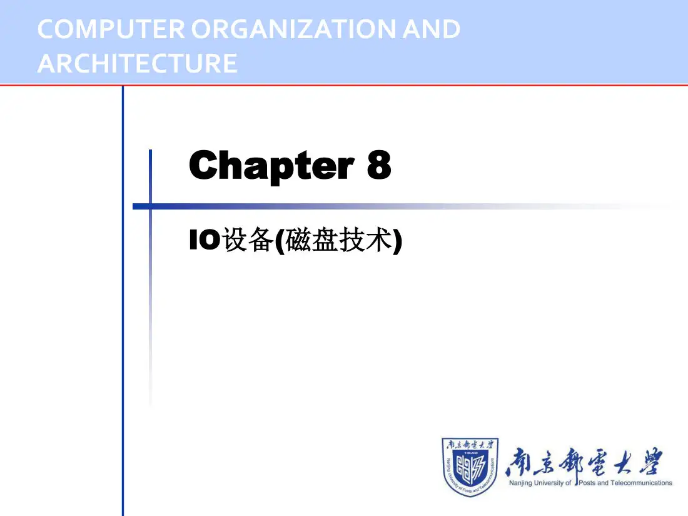

原文：

COMPUTER ORGANIZATION AND ARCHITECTURE

Chapter 8

IO设备(磁盘技术)

南京都电大学 Nanijing O 圆 南京郵電大学 Nanjing University of Posts and Telecommunications ty o Posts and T

### 外围设备概述

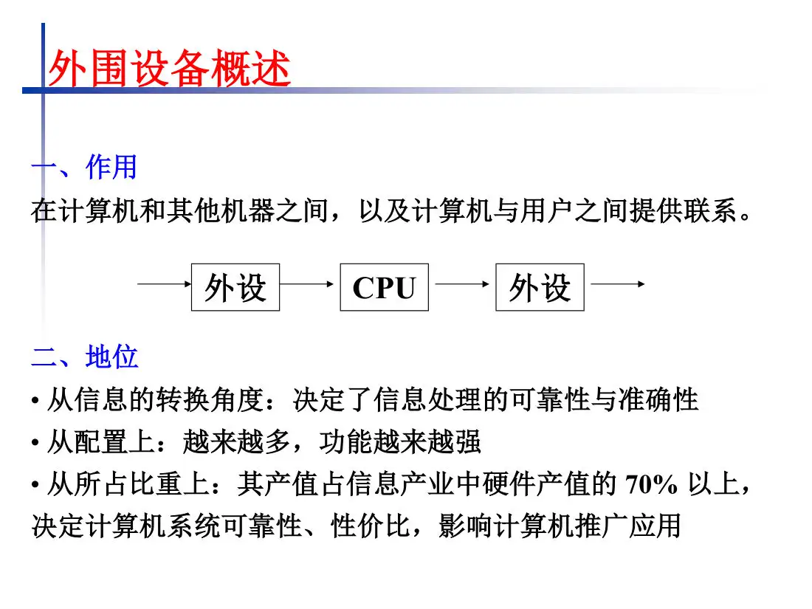

原文：

外围设备概述

一、作用

在计算机和其他机器之间，以及计算机与用户之间提供联系。

二、地位

• 从信息的转换角度：决定了信息处理的可靠性与准确性

• 从配置上：越来越多，功能越来越强

•从所占比重上：其产值占信息产业中硬件产值的 70% 以上，决定计算机系统可靠性、性价比，影响计算机推广应用

### 三、外设的发展

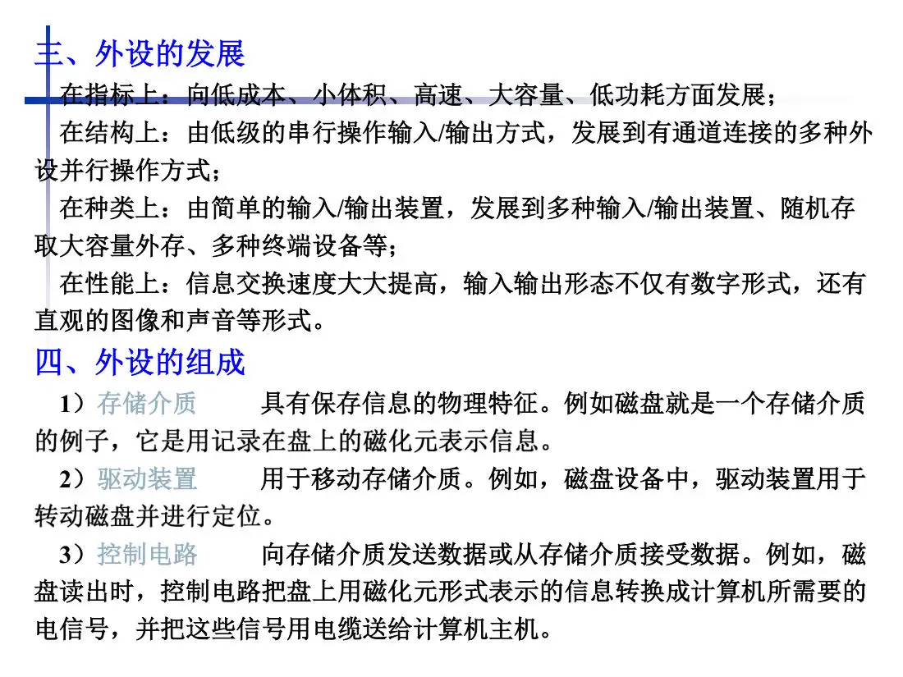

原文：

三、外设的发展

在指标上：向低成本、小体积、高速、大容量、低功耗方面发展；

在结构上：由低级的串行操作输入/输出方式，发展到有通道连接的多种外设并行操作方式；

在种类上：由简单的输入/输出装置，发展到多种输入/输出装置、随机存取大容量外存、多种终端设备等；

在性能上：信息交换速度大大提高，输入输出形态不仅有数字形式，还有直观的图像和声音等形式。

四、外设的组成

1）存储介质 具有保存信息的物理特征。例如磁盘就是一个存储介质的例子，它是用记录在盘上的磁化元表示信息。

2）驱动装置 用于移动存储介质。例如，磁盘设备中，驱动装置用于转动磁盘并进行定位。

3）控制电路 向存储介质发送数据或从存储介质接受数据。例如，磁盘读出时，控制电路把盘上用磁化元形式表示的信息转换成计算机所需要的电信号，并把这些信号用电缆送给计算机主机。

### 五、外设的分类

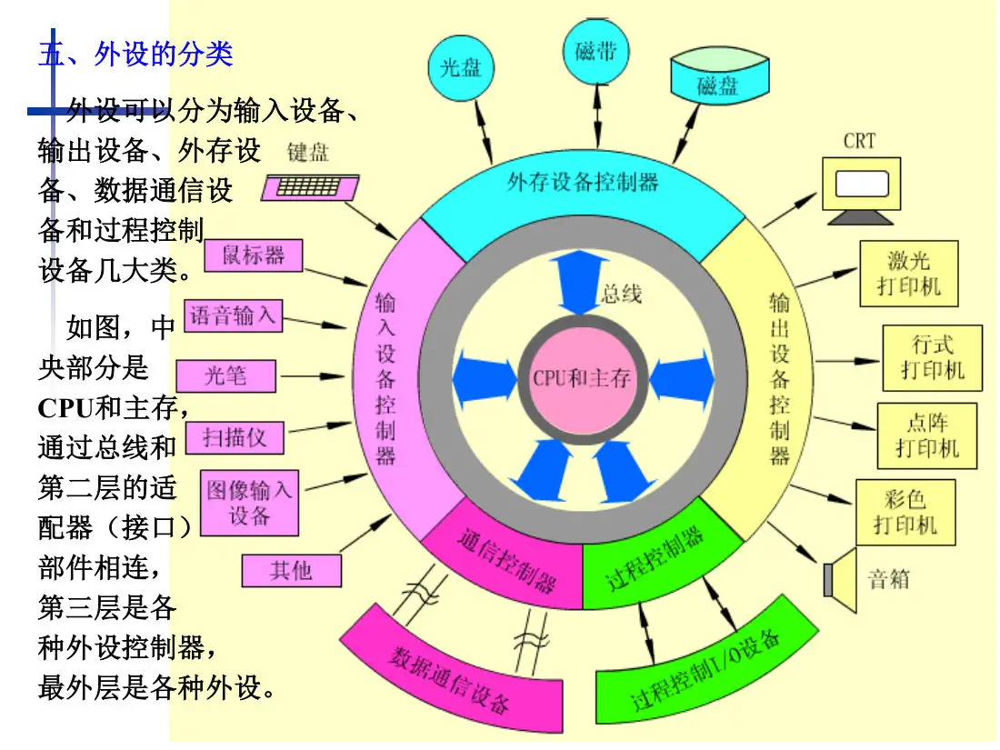

原文：

五、外设的分类

外设可以分为输入设备、输出设备、 外存设 键盘备、数据通信设 备和过程控制鼠标器设备几大类。

### 磁盘存储设备

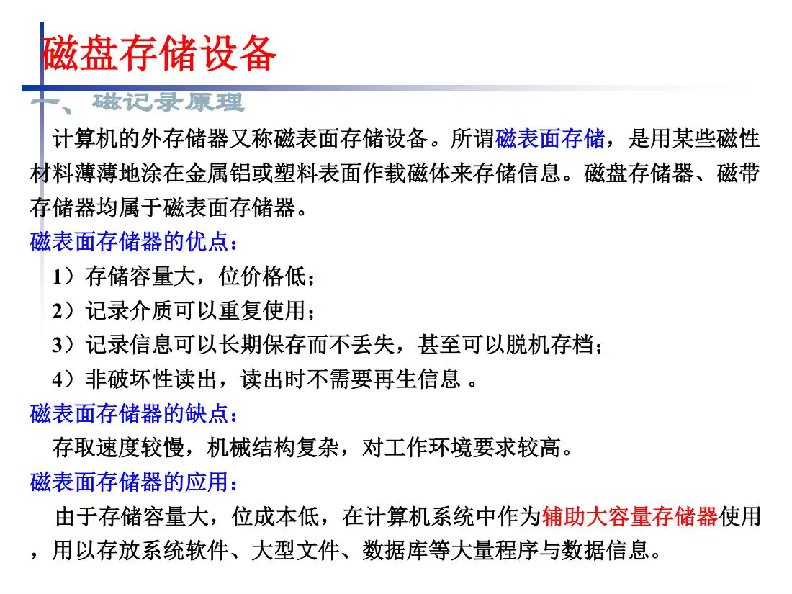

原文：

磁盘存储设备

一、磁记录原理

计算机的外存储器又称磁表面存储设备 所谓磁表面存储，是用某些磁性材料薄薄地涂在金属铝或塑料表面作载磁体来存储信息。磁盘存储器、磁带存储器均属于磁表面存储器。

磁表面存储器的优点：

1）存储容量大，位价格低；

2）记录介质可以重复使用；

3）记录信息可以长期保存而不丢失，甚至可以脱机存档；

4）非破坏性读出，读出时不需要再生信息。

磁表面存储器的缺点：

存取速度较慢，机械结构复杂，对工作环境要求较高。

磁表面存储器的应用：

由于存储容量大，位成本低，在计算机系统中作为辅助大容量存储器使用，用以存放系统软件、大型文件、数据库等大量程序与数据信息。

### 磁性材料的物理特性

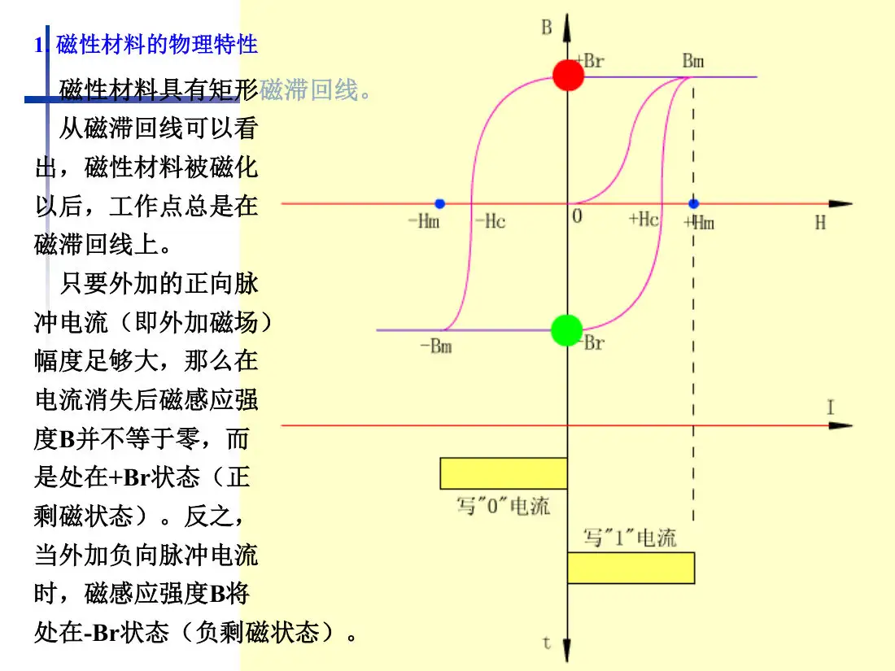

原文：

磁性材料的物理特性

磁性材料具有矩形磁滞回线。

从磁滞回线可以看出，磁性材料被磁化以后，工作点总是在磁滞回线上。

只要外加的正向脉冲电流（即外加磁场）幅度足够大，那么在电流消失后磁感应强度B并不等于零，而是处在+Br状态（正剩磁状态）。反之，当外加负向脉冲电流时，磁感应强度B将处在-Br状态（负剩磁状

### 第 7 页

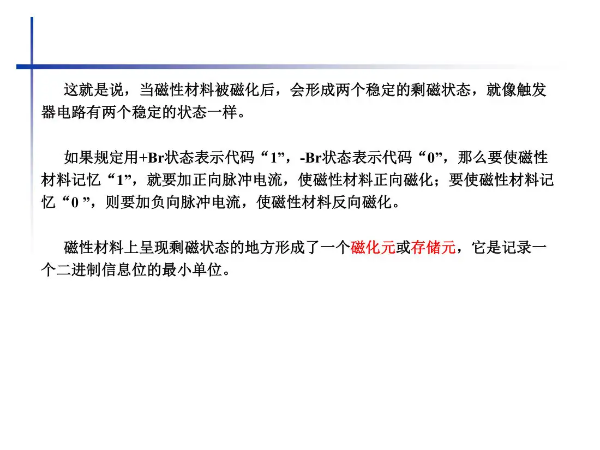

原文：

这就是说，当磁性材料被磁化后，会形成两个稳定的剩磁状态，就像触发器电路有两个稳定的状态一样。

如果规定用+Br状态表示代码“1”，-Br状态表示代码“0”，那么要使磁性材料记忆“1”，就要加正向脉冲电流，使磁性材料正向磁化；要使磁性材料记忆“0 ”，则要加负向脉冲电流，使磁性材料反向磁化。

磁性材料上呈现剩磁状态的地方形成了一个磁化元或存储元，它是记录一个二进制信息位的最小单位。

### 2. 磁表面存储器的读写原理

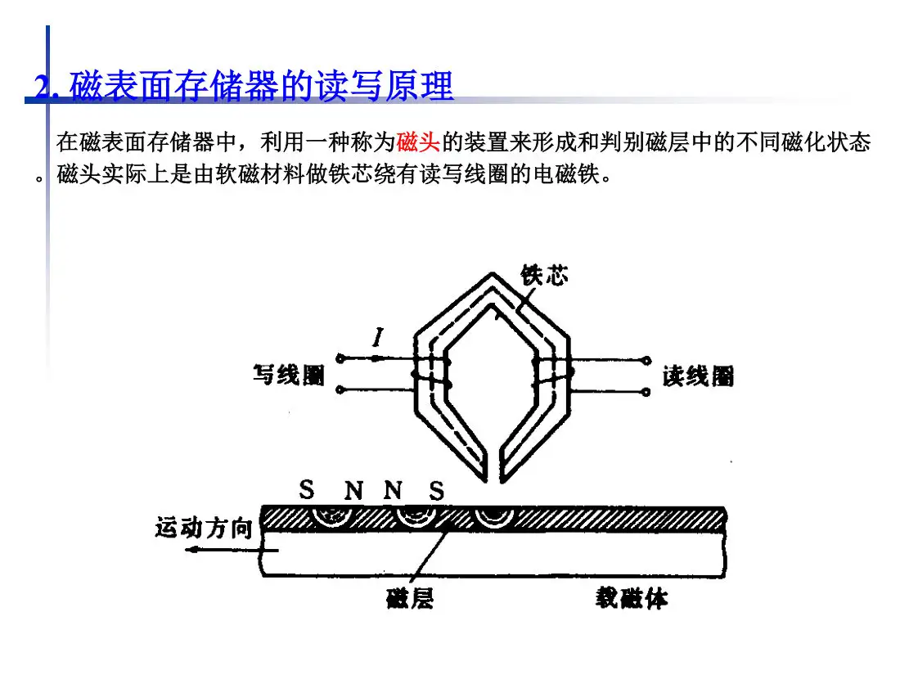

原文：

2. 磁表面存储器的读写原理

在磁表面存储器中，利用一种称为磁头的装置来形成和判别磁层中的不同磁化状态磁头实际上是由软磁材料做铁芯绕有读写线圈的电磁铁。

### 硬磁盘通常按以下方法分类：

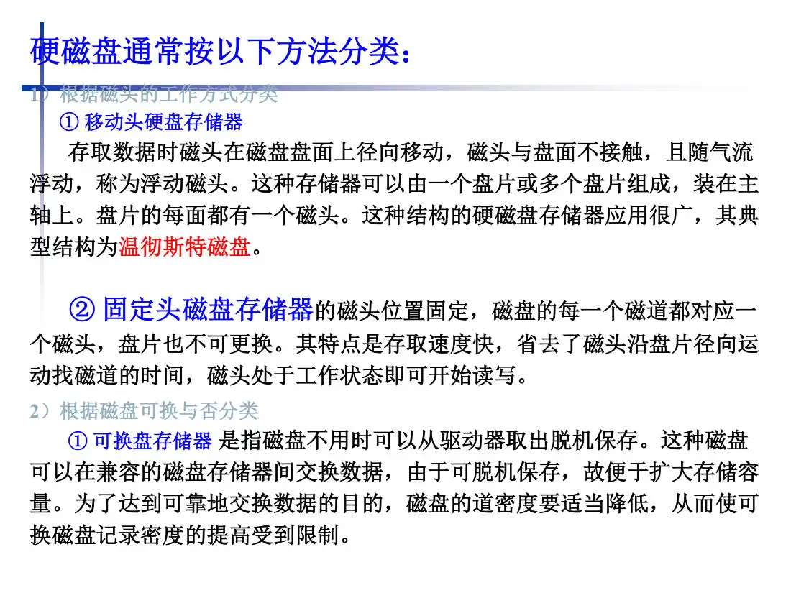

原文：

硬磁盘通常按以下方法分类：

根据磁头的工作方式分类

① 移动头硬盘存储器

存取数据时磁头在磁盘盘面上径向移动，磁头与盘面不接触，且随气流浮动，称为浮动磁头。这种存储器可以由一个盘片或多个盘片组成，装在主轴上。盘片的每面都有一个磁头。这种结构的硬磁盘存储器应用很广，其典型结构为温彻斯特磁盘。

② 固定头磁盘存储器的磁头位置固定，磁盘的每一个磁道都对应一个磁头，盘片也不可更换。其特点是存取速度快，省去了磁头沿盘片径向运动找磁道的时间，磁头处于工作状态即可开始读写。

2）根据磁盘可换与否分类

①可换盘存储器 是指磁盘不用时可以从驱动器取出脱机保存。这种磁盘可以在兼容的磁盘存储器间交换数据，由于可脱机保存，故便于扩大存储容量。为了达到可靠地交换数据的目的，磁盘的道密度要适当降低，从而使可换磁盘记录密度的提高受到限制。

### 第 10 页

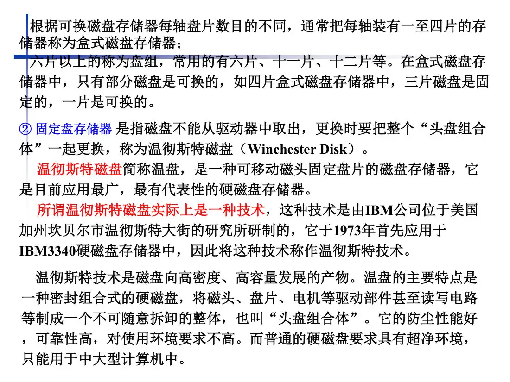

原文：

根据可换磁盘存储器每轴盘片数目的不同，通常把每轴装有一至四片的存储器称为盒式磁盘存储器；

六片以上的称为盘组，常用的有六片、十一片、十二片等。在盒式磁盘存储器中，只有部分磁盘是可换的，如四片盒式磁盘存储器中，三片磁盘是固定的，一片是可换的。

②固定盘存储器是指磁盘不能从驱动器中取出，更换时要把整个“头盘组合体”一起更换，称为温彻斯特磁盘（Winchester Disk）。

温彻斯特磁盘简称温盘，是一种可移动磁头固定盘片的磁盘存储器，它是目前应用最广，最有代表性的硬磁盘存储器。

所谓温彻斯特磁盘实际上是一种技术，这种技术是由IBM公司位于美国加州坎贝尔市温彻斯特大街的研究所研制的，它于1973年首先应用于IBM3340硬磁盘存储器中，因此将这种技术称作温彻斯特技术。

温彻斯特技术是磁盘向高密度、高容量发展的产物。温盘的主要特点是一种密封组合式的硬磁盘，将磁头、盘片、电机等驱动部件甚至读写电路等制成一个不可随意拆卸的整体，也叫“头盘组合体”。它的防尘性能好，可靠性高，对使用环境要求不高。而普通的硬磁盘要求具有超净环境，只能用于中大型计算机中。

### 磁盘驱动器和控制器

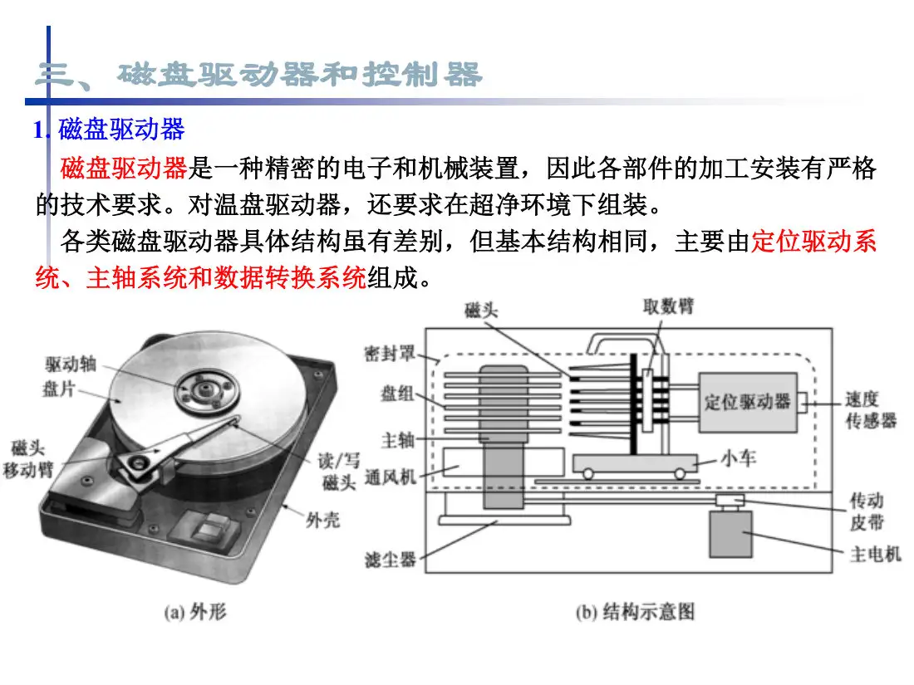

原文：

磁盘驱动器和控制器

磁盘驱动器

磁盘驱动器是一种精密的电子和机械装置，因此各部件的加工安装有严格的技术要求。对温盘驱动器，还要求在超净环境下组装。

各类磁盘驱动器具体结构虽有差别，但基本结构相同，主要由定位驱动系统、主轴系统和数据转换系统组成。

### 2. 磁盘控制器

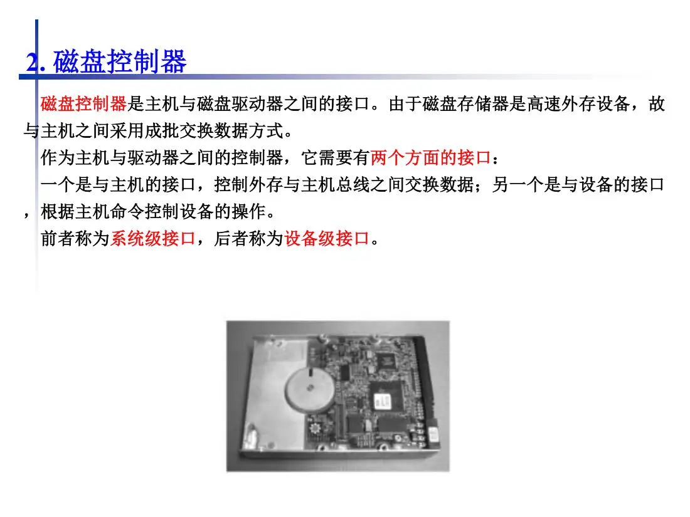

原文：

2. 磁盘控制器

磁盘控制器是主机与磁盘驱动器之间的接口。由于磁盘存储器是高速外存设备，故与主机之间采用成批交换数据方式。

作为主机与驱动器之间的控制器，它需要有两个方面的接口：

一个是与主机的接口，控制外存与主机总线之间交换数据；另一个是与设备的接口，根据主机命令控制设备的操作。

前者称为系统级接口，后者称为设备级接口。

### 四、磁盘上信息的分布

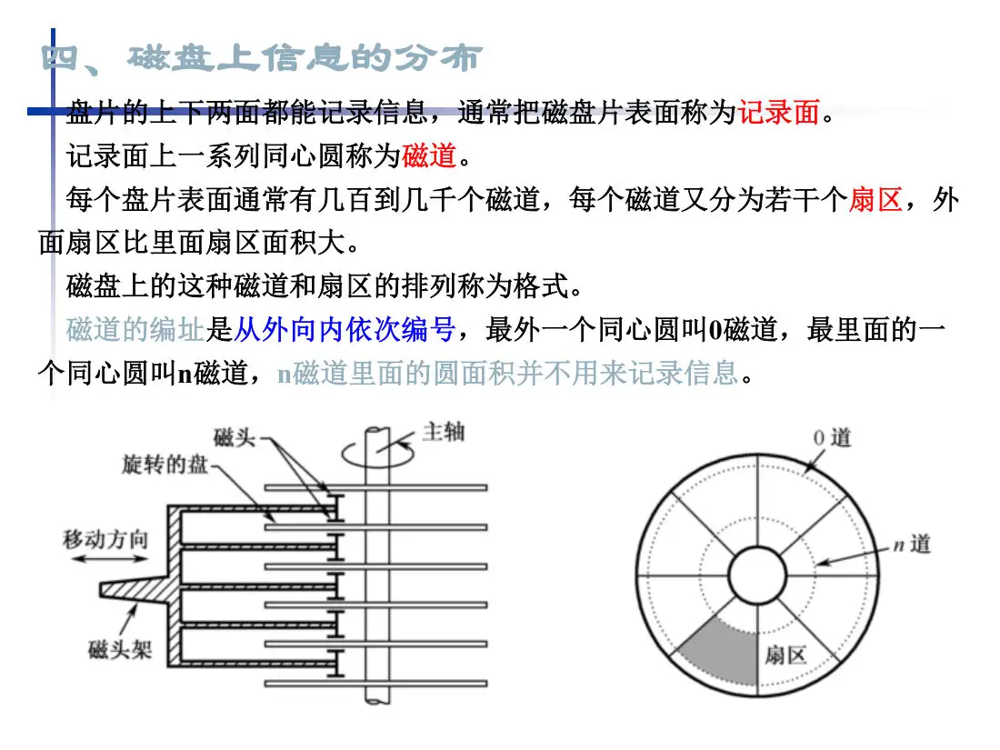

原文：

四、磁盘上信息的分布

盘片的上下两面都能记录信息，通常把磁盘片表面称为记录面。

记录面上一系列同心圆称为磁道。

每个盘片表面通常有几百到几千个磁道，每个磁道又分为若干个扇区，外面扇区比里面扇区面积大。

磁盘上的这种磁道和扇区的排列称为格式。

磁道的编址是从外向内依次编号，最外一个同心圆叫0磁道，最里面的一个同心圆叫n磁道，n磁道里面的圆面积并不用来记录信息。

### 扇区的编号有多种方法，可以连续编号，也可间隔编号。

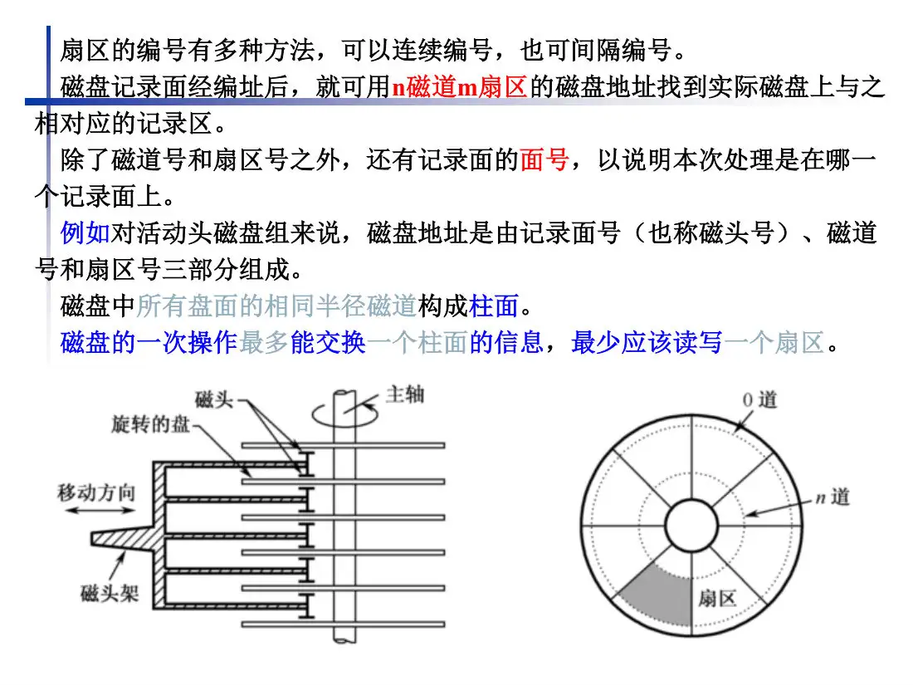

原文：

扇区的编号有多种方法，可以连续编号，也可间隔编号。

磁盘记录面经编址后，就可用n磁道m扇区的磁盘地址找到实际磁盘上与之相对应的记录区。

除了磁道号和扇区号之外，还有记录面的面号，以说明本次处理是在哪一个记录面上。

例如对活动头磁盘组来说，磁盘地址是由记录面号（也称磁头号）、磁道号和扇区号三部分组成。

磁盘中所有盘面的相同半径磁道构成柱面。

磁盘的一次操作最多能交换一个柱面的信息，最少应该读写一个扇区。

### 数据在磁盘上的记录格式如下：

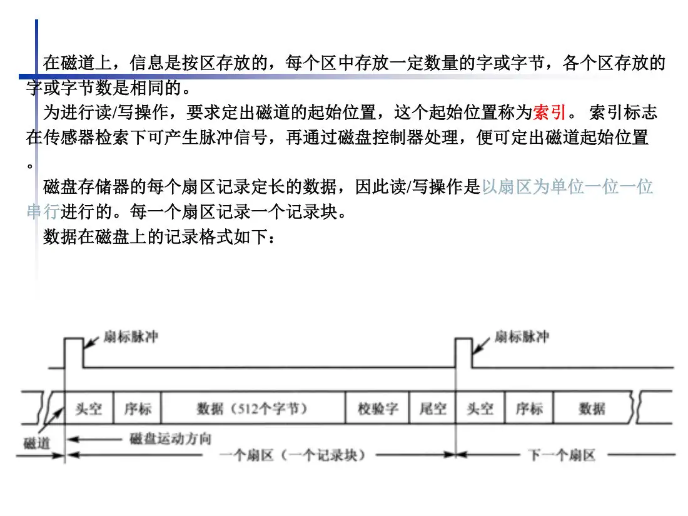

原文：

在磁道上，信息是按区存放的，每个区中存放一定数量的字或字节，各个区存放的字或字节数是相同的。

为进行读/写操作，要求定出磁道的起始位置，这个起始位置称为索引。 索引标志在传感器检索下可产生脉冲信号，再通过磁盘控制器处理，便可定出磁道起始位置。

磁盘存储器的每个扇区记录定长的数据，因此读/写操作是以扇区为单位一位一位串行进行的。每一个扇区记录一个记录块。

数据在磁盘上的记录格式如下：

### 每个扇区开始时由磁盘控制器产生一个扇标脉冲。

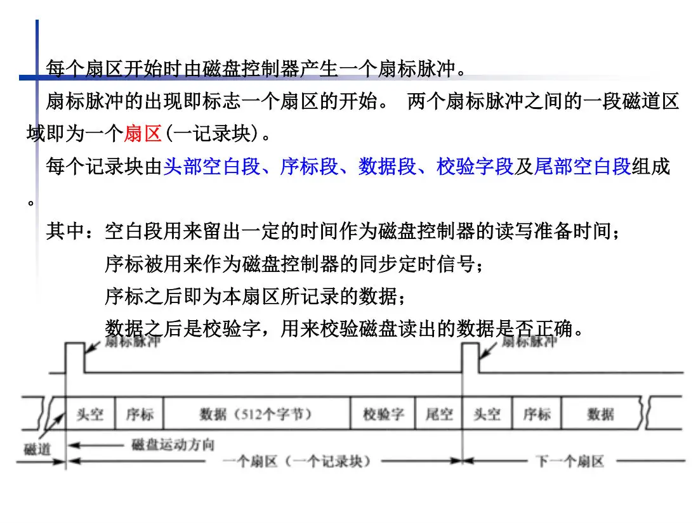

原文：

每个扇区开始时由磁盘控制器产生一个扇标脉冲。

扇标脉冲的出现即标志一个扇区的开始。 两个扇标脉冲之间的一段磁道区域即为一个扇区(一记录块)。

每个记录块由头部空白段、序标段、数据段、校验字段及尾部空白段组成

其中：空白段用来留出一定的时间作为磁盘控制器的读写准备时间；

序标被用来作为磁盘控制器的同步定时信号；

序标之后即为本扇区所记录的数据；

数据之后是校验字，用来校验磁盘读出的数据是否正确。

### 五、磁盘存储器的技术指标

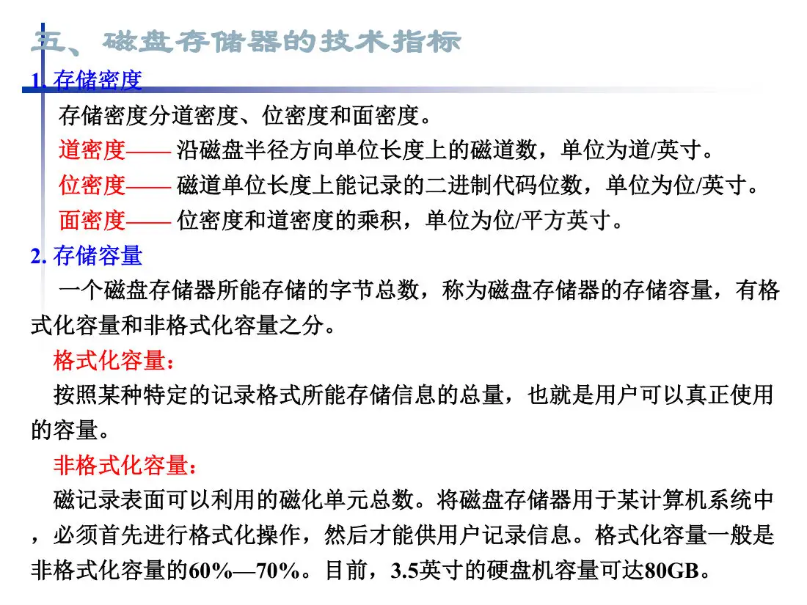

原文：

五、磁盘存储器的技术指标

存储密度

存储密度分道密度、位密度和面密度。

道密度——沿磁盘半径方向单位长度上的磁道数，单位为道/英寸。

位密度——磁道单位长度上能记录的二进制代码位数，单位为位/英寸。

面密度—— 位密度和道密度的乘积，单位为位/平方英寸。

2. 存储容量

一个磁盘存储器所能存储的字节总数，称为磁盘存储器的存储容量，有格式化容量和非格式化容量之分。

格式化容量：

按照某种特定的记录格式所能存储信息的总量，也就是用户可以真正使用的容量。

非格式化容量：

磁记录表面可以利用的磁化单元总数。将磁盘存储器用于某计算机系统中，必须首先进行格式化操作，然后才能供用户记录信息。格式化容量一般是非格式化容量的60%—70%。目前，3.5英寸的硬盘机容量可达80GB。

### 3. 平均存取时间

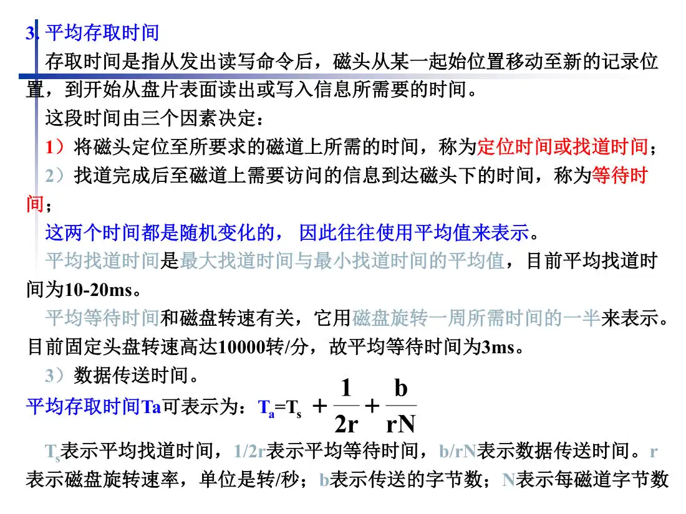

原文：

3. 平均存取时间

存取时间是指从发出读写命令后，磁头从某一起始位置移动至新的记录位置，到开始从盘片表面读出或写入信息所需要的时间。

这段时间由三个因素决定：

1）将磁头定位至所要求的磁道上所需的时间，称为定位时间或找道时间；

2）找道完成后至磁道上需要访问的信息到达磁头下的时间，称为等待时间；

这两个时间都是随机变化的，因此往往使用平均值来表示。

平均找道时间是最大找道时间与最小找道时间的平均值，目前平均找道时间为10-20ms。

平均等待时间和磁盘转速有关，它用磁盘旋转一周所需时间的一半来表示。目前固定头盘转速高达10000转/分，故平均等待时间为3ms。

3）数据传送时间。平均存取时间Ta可表示为： $\mathrm { T _ { a } } \mathrm { = } \mathrm { T _ { s } } \ + \frac { 1 } { 2 \mathrm { r } } \mathrm { + } \frac { \mathrm { b } } { \mathrm { r N } }$

$\mathrm { T _ { s } }$ 表示平均找道时间，1/2r表示平均等待时间，b/rN表示数据传送时间。 r表示磁盘旋转速率，单位是转/秒；b表示传送的字节数；N表示每磁道字节数例：磁盘组有6片磁盘，每片有两个记录面，最上最下两个面不用。存储区域内径22cm，外径33cm，道密度为40道/cm，内层位密度400位/cm，转速6000转/分。问：

### (1) 共有多少柱面？ (2) 盘组总存储容量是多少？ (3) 数据传输率多少？

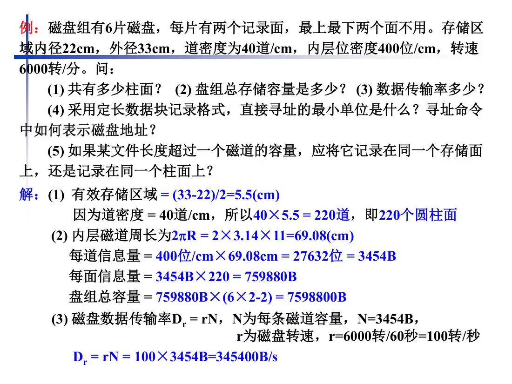

原文：

(1) 共有多少柱面？ (2) 盘组总存储容量是多少？ (3) 数据传输率多少？

(4) 采用定长数据块记录格式，直接寻址的最小单位是什么？寻址命令中如何表示磁盘地址？

(5) 如果某文件长度超过一个磁道的容量，应将它记录在同一个存储面上，还是记录在同一个柱面上？

解：(1) 有效存储区域 = (33-22)/2=5.5(cm)因为道密度= 40道/cm，所以 $\mathbf { 4 0 } \times 5 . 5 = 2 2 \mathbf { 0 }$ 道，即220个圆柱面

(2) 内层磁道周长为 $2 \pi \mathbf { R } = 2 \times 3 . 1 4 \times 1 1 { = } 6 9 . 0 8 ( \mathrm { c m } )$ 每道信息 $\bf \Xi = 4 0 0 / \dot { \underline { { \bf 3 / 2 } } } / \bf c m \times 6 9 . 0 8 c m = 2 7 6 3 2 / \ddot { \underline { { \bf 3 / 2 } } } = 3 4 5 4 \bf B$ 每面信息量 = 3454B×220 = 759880B盘组总容量 = 759880B×(6×2-2) = 7598800B

(3) 磁盘数据传输率 $\mathbf { D _ { r } } \mathbf { = r N }$ ，N为每条磁道容量， $\scriptstyle \mathbf { N = } 3 4 5 4 \mathbf { B }$ r为磁盘转速，r=6000转/60秒=100转/秒$\mathrm { D } _ { \mathrm { r } } = \mathrm { r } \mathrm { N } = 1 0 0 \times 3 4 5 4 \mathrm { B } { = } 3 4 5 4 0 0 \mathrm { B } / \mathrm { s }$
