# 《计算机组成与结构》第六章 CPU子系统-MIPS-2-基本部件分析（课件）

原件的每一页，下面附识别出的文字。

### 6.2 MIPS-32处理器

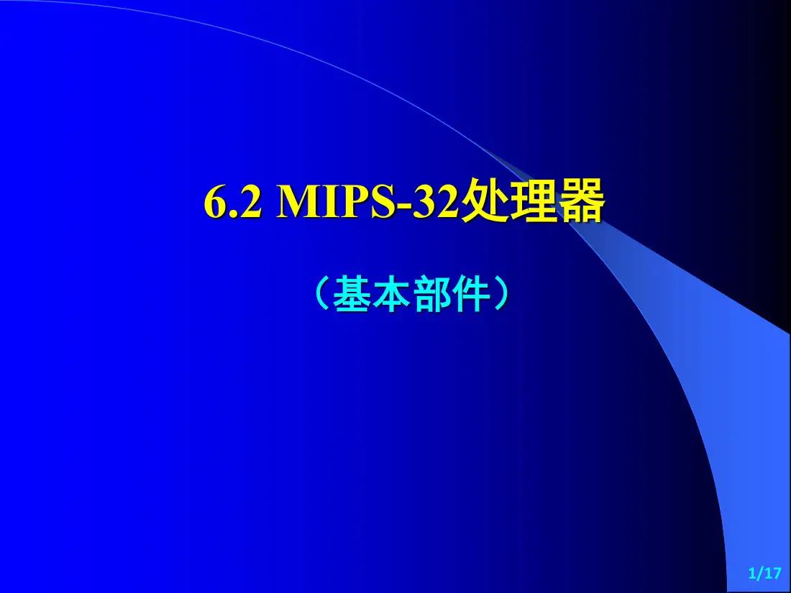

原文：

6.2 MIPS-32处理器

（基本部件）

1/17

### ※CPU设计的主要任务

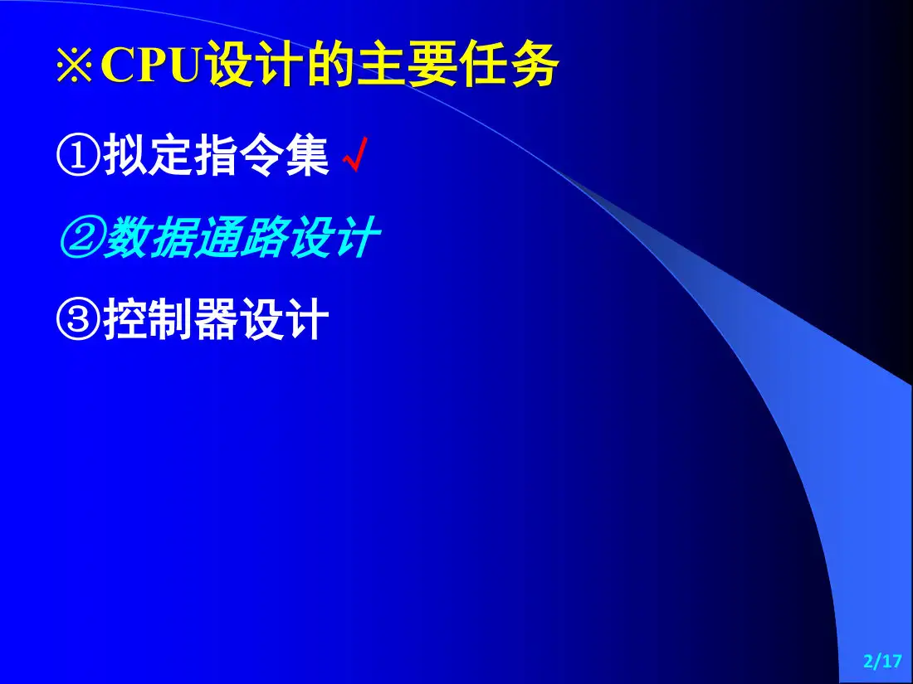

原文：

※CPU设计的主要任务

①拟定指令集√

②数据通路设计

③控制器设计

2/17

### ※CPU设计的主要任务

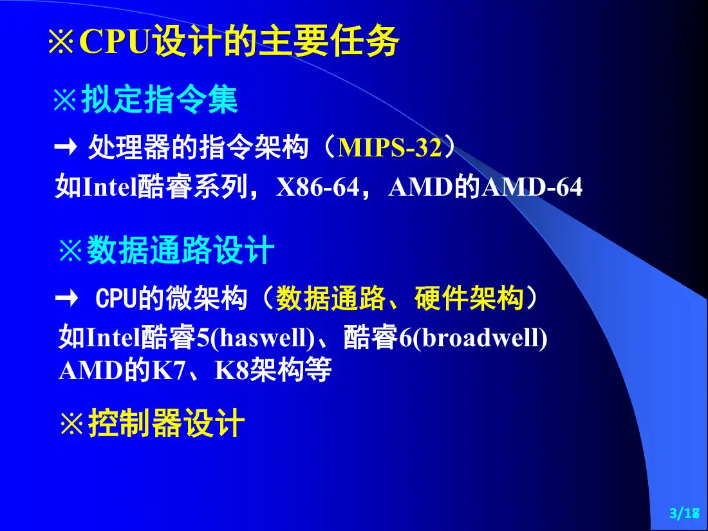

原文：

※CPU设计的主要任务

※拟定指令集

→ 处理器的指令架构（MIPS-32）如Intel酷睿系列，X86-64，AMD的AMD-64

※数据通路设计

→ CPU的微架构（数据通路、硬件架构）如Intel酷睿5(haswell)、酷睿6(broadwell)AMD的K7、K8架构等

※控制器设计

3/178

### MIPS32的指令格式

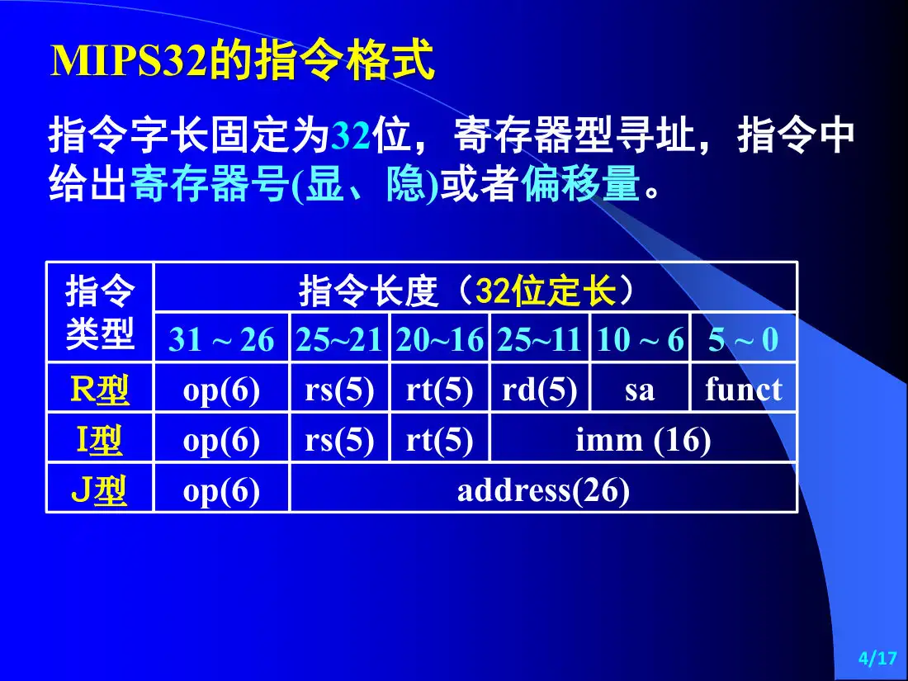

原文：

MIPS32的指令格式

指令字长固定为32位，寄存器型寻址，指令中给出寄存器号(显、隐)或者偏移量。

指令类型

指令长度（32位定长）

31 \~ 26 25\~21 20\~16 25\~11 10 \~ 6 5 \~ 0

R型 op(6) rs(5) rt(5) rd(5) sa funct

I型

op(6)

J型

rs(5)

op(6)

imm (16)

rt(5)

address(26)

4/17

### 基本部件的选型

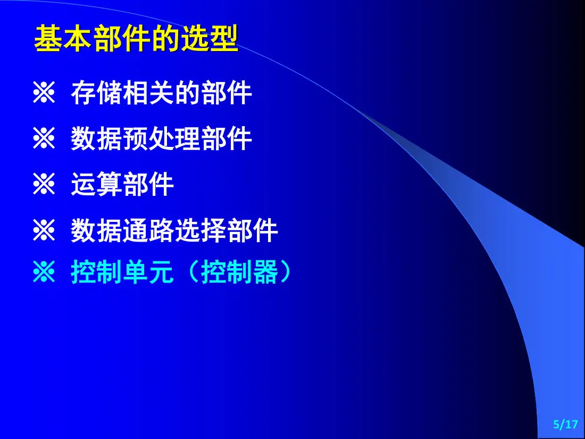

原文：

基本部件的选型

※ 存储相关的部件

数据预处理部件

※ 运算部件

※ 数据通路选择部件

※ 控制单元（控制器）

5/17

### 1、存储相关的部件

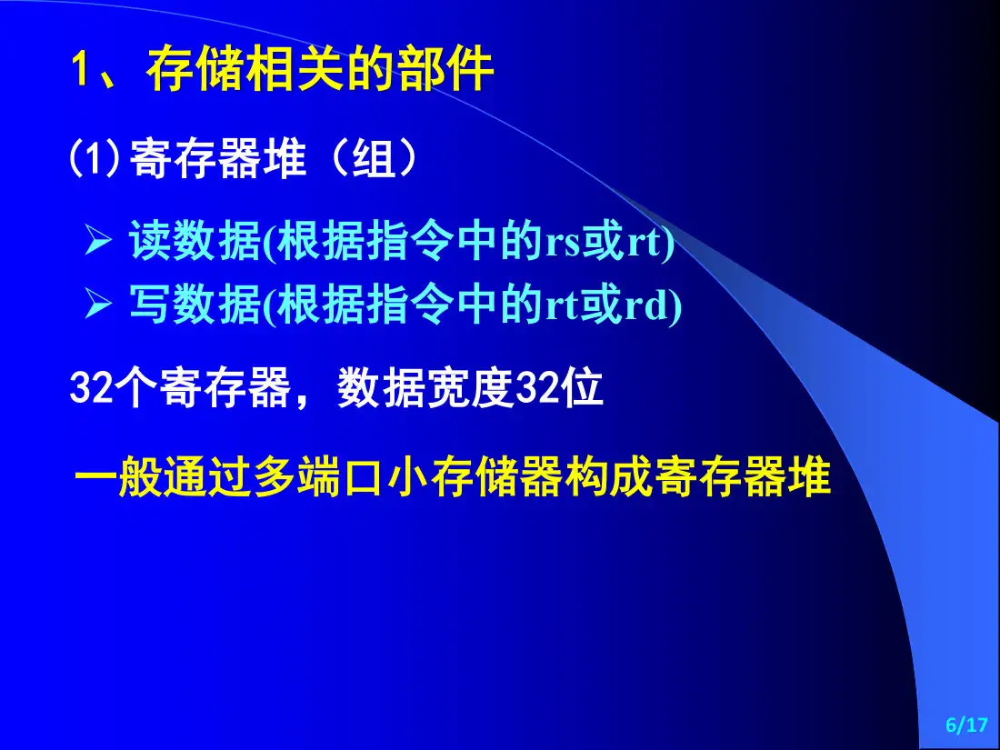

原文：

1、存储相关的部件

(1)寄存器堆（组）

读数据(根据指令中的rs或rt)

写数据(根据指令中的rt或rd)

32个寄存器，数据宽度32位

一般通过多端口小存储器构成寄存器堆

6/17

### op(6) rs(5) rt(5) rd(5) sa funct R型指令

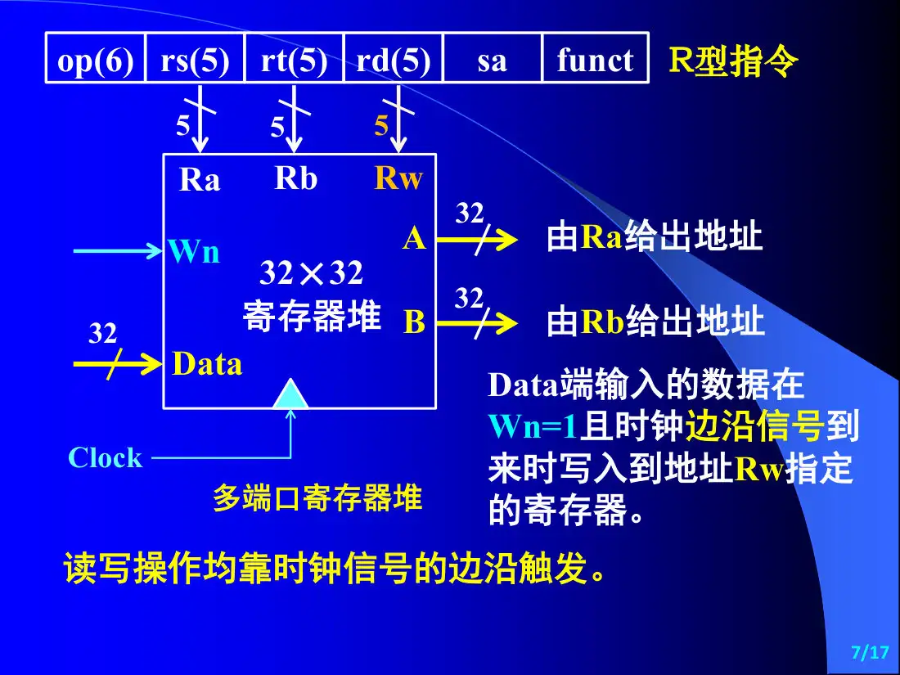

原文：

op(6) rs(5) rt(5) rd(5) sa funct R型指令

5 5 5 Ra Rb Rw

Wn

32

32×32 寄存器堆

Data

Clock

多端口寄存器堆

32由Ra给出地址

32由Rb给出地址

Data端输入的数据在Wn=1且时钟边沿信号到来时写入到地址Rw指定的寄存器。

读写操作均靠时钟信号的边沿触发。

7/17

### (2)存储器

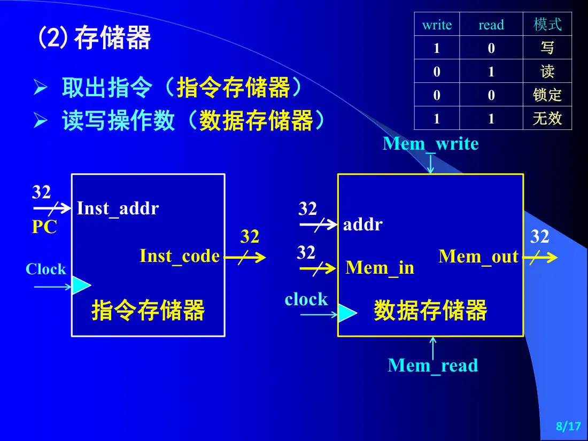

原文：

(2)存储器

取出指令（指令存储器）

读写操作数（数据存储器）

32 PC

Inst\_addr

Clock

Inst\_code

32

32 32

指令存储器

clock

<table><tr><td>write</td><td>read</td><td>模式</td></tr><tr><td>1</td><td>0</td><td>写</td></tr><tr><td>0</td><td>1</td><td>读</td></tr><tr><td>0</td><td>0</td><td>锁定</td></tr><tr><td>1</td><td>1</td><td>无效</td></tr></table>

Mem\_write

addr

Mem\_in

Mem\_out

32

数据存储器

Mem\_read

8/17

### (3)特殊功能寄存器

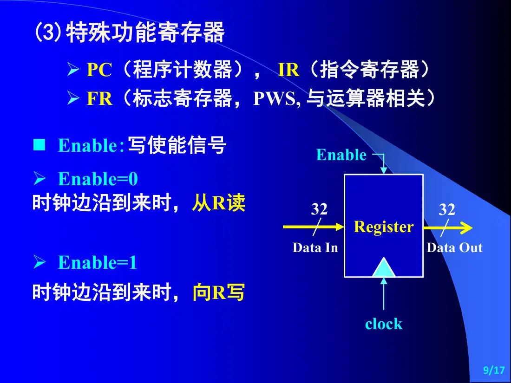

原文：

(3)特殊功能寄存器

PC（程序计数器），IR（指令寄存器）FR（标志寄存器，PWS, 与运算器相关）

Enable:写使能信号

Enable=0时钟边沿到来时，从R读

➢ Enable=1

时钟边沿到来时，向R写

9/17

### → PC和IR在数据通路中的作用

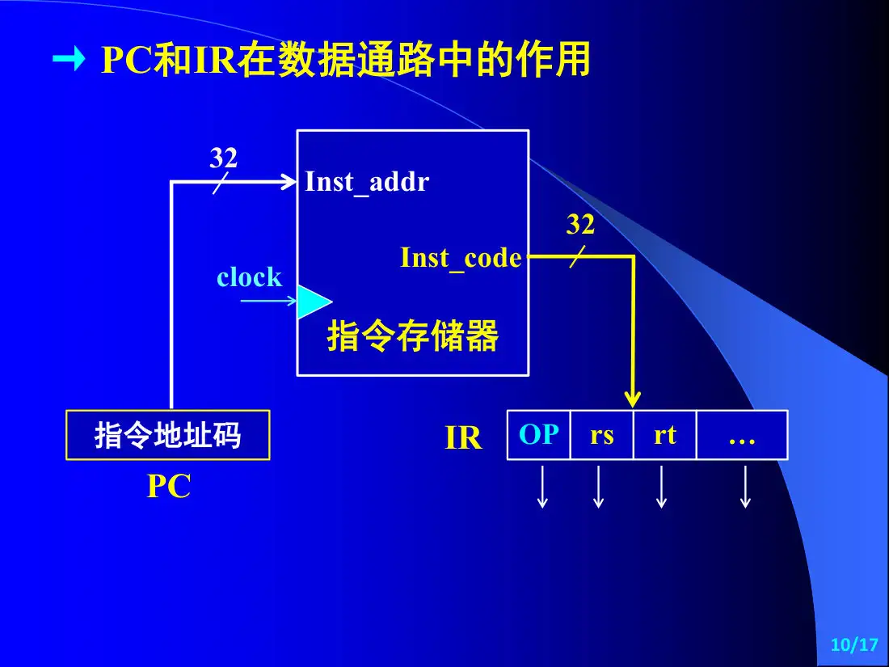

原文：

→ PC和IR在数据通路中的作用

Inst\_addr

clock

Inst\_code

指令存储器

指令地址码

PC

IR OP rs rt V

10/17

### 2、运算部件

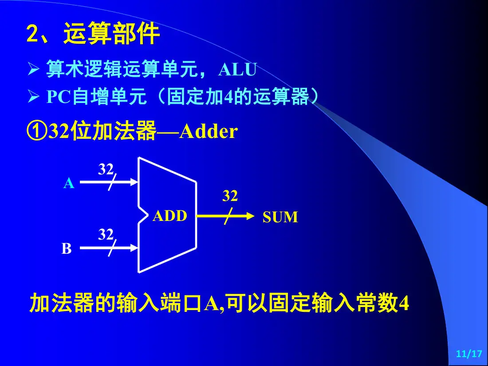

原文：

2、运算部件

算术逻辑运算单元，ALU PC自增单元（固定加4的运算器） ①32位加法器—Adder

$$
\begin{array}{c c} \text {   A   } & 3 2 \\ \text {   B   } & 3 2 \end{array} \quad \text {   ADD   } \quad \text {   SUM   }
$$

加法器的输入端口A,可以固定输入常数4

11/17

### ②32位运算器—ALU

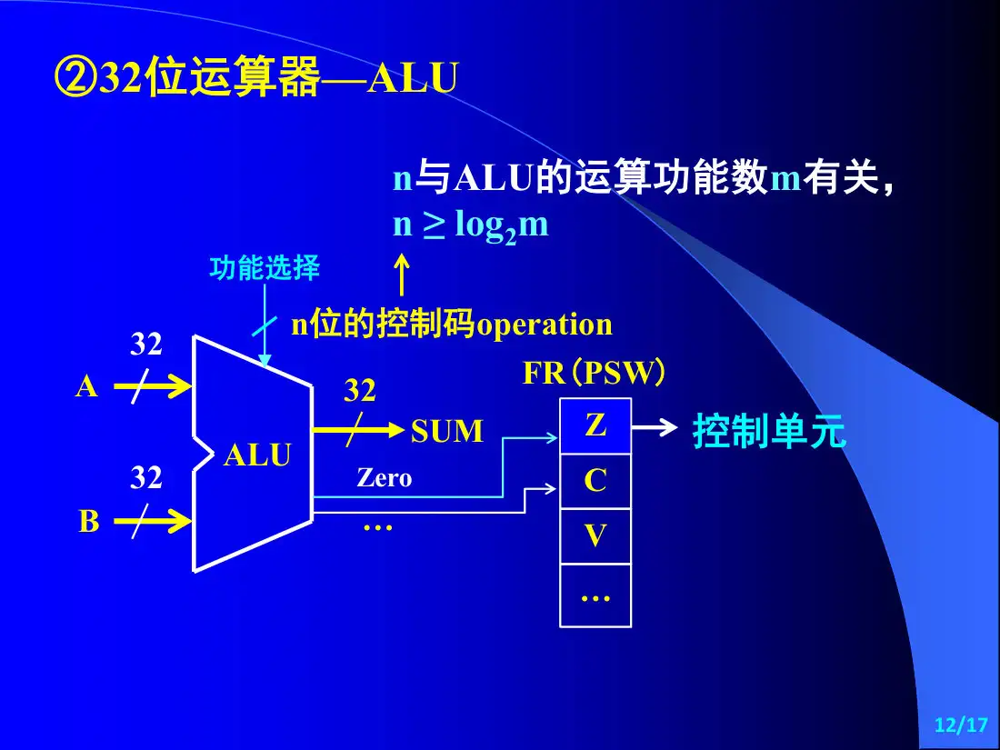

原文：

②32位运算器—ALU

n与ALU的运算功能数m有关，

n ≥ log2m

功能选择

$$
\mathrm{A} \xrightarrow {3 2}
$$

n位的控制码operation

$$
\mathrm{B} \xrightarrow {3 2}
$$

ALU

FR(PSW)

SUM

Zero

控制单元

12/17

### 加法器的输入端口A,可以固定输入常数4

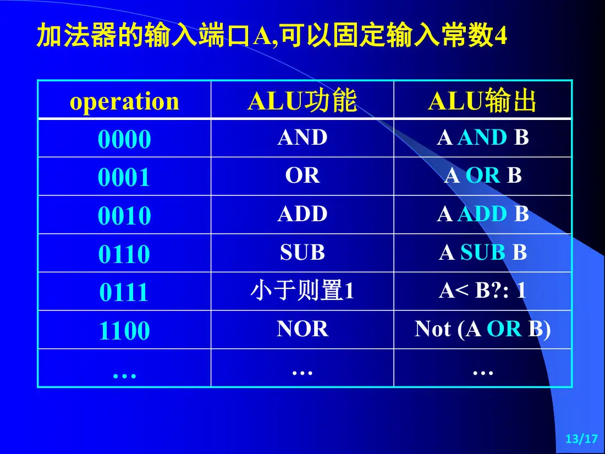

原文：

加法器的输入端口A,可以固定输入常数4

<table><tr><td>operation</td><td>ALU功能</td><td>ALU输出</td></tr><tr><td>0000</td><td>AND</td><td>A AND B</td></tr><tr><td>0001</td><td>OR</td><td>A OR B</td></tr><tr><td>0010</td><td>ADD</td><td>A ADD B</td></tr><tr><td>0110</td><td>SUB</td><td>A SUB B</td></tr><tr><td>0111</td><td>小于则置1</td><td>A &lt; B?: 1</td></tr><tr><td>1100</td><td>NOR</td><td>Not (A OR B)</td></tr><tr><td>...</td><td>...</td><td>...</td></tr></table>

13/17

### 3、数据预处理部件

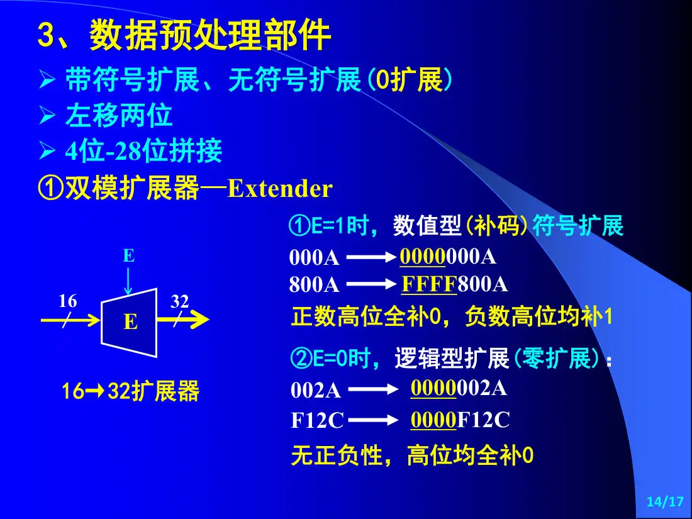

原文：

3、数据预处理部件

➢ 带符号扩展、无符号扩展(0扩展)

➢ 左移两位

➢ 4位-28位拼接

①双模扩展器—Extender

16→32扩展器

①E=1时，数值型(补码)符号扩展

000A 0000000A

800A FFFF800A

正数高位全补0，负数高位均补1

②E=0时，逻辑型扩展(零扩展)

002A 0000002A

F12C 0000F12C

无正负性，高位均全补0

14/17

### ②左移2位扩展器

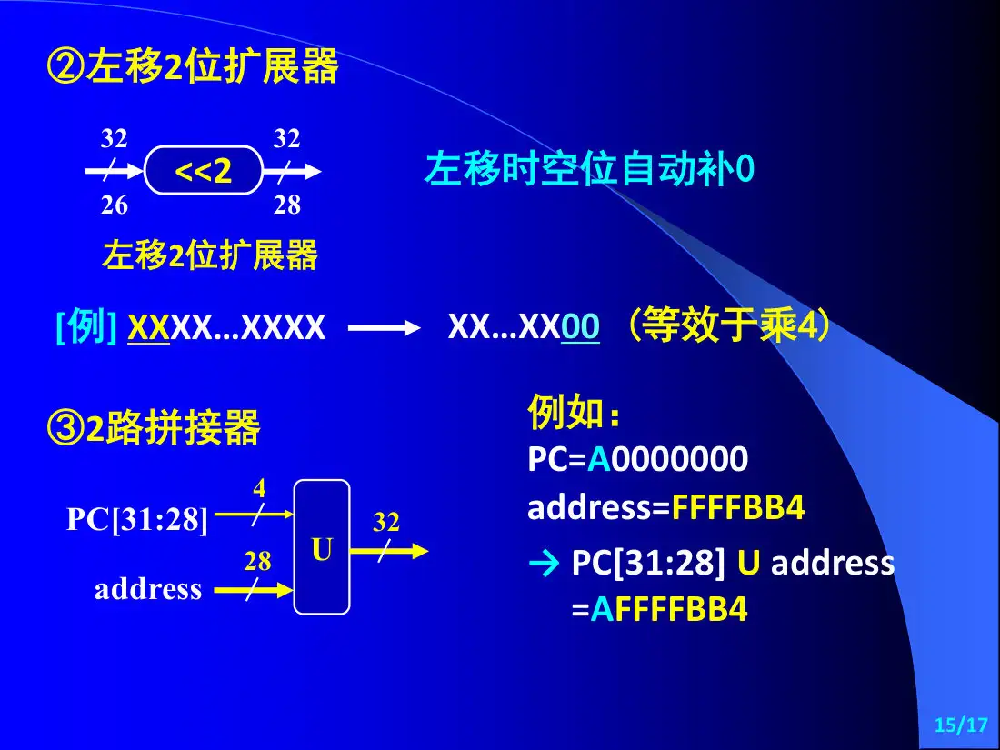

原文：

②左移2位扩展器

32 32 <<2 26 28

左移2位扩展器

左移时空位自动补0

[例] XXXX…XXXX XX…XX00 (等效于乘4)

③2路拼接器

PC[31:28] 32 U 28 address

例如：PC=A0000000address=FFFFBB4→ PC[31:28] U address=AFFFFBB4

15/17

### 4、数据通路选择部件

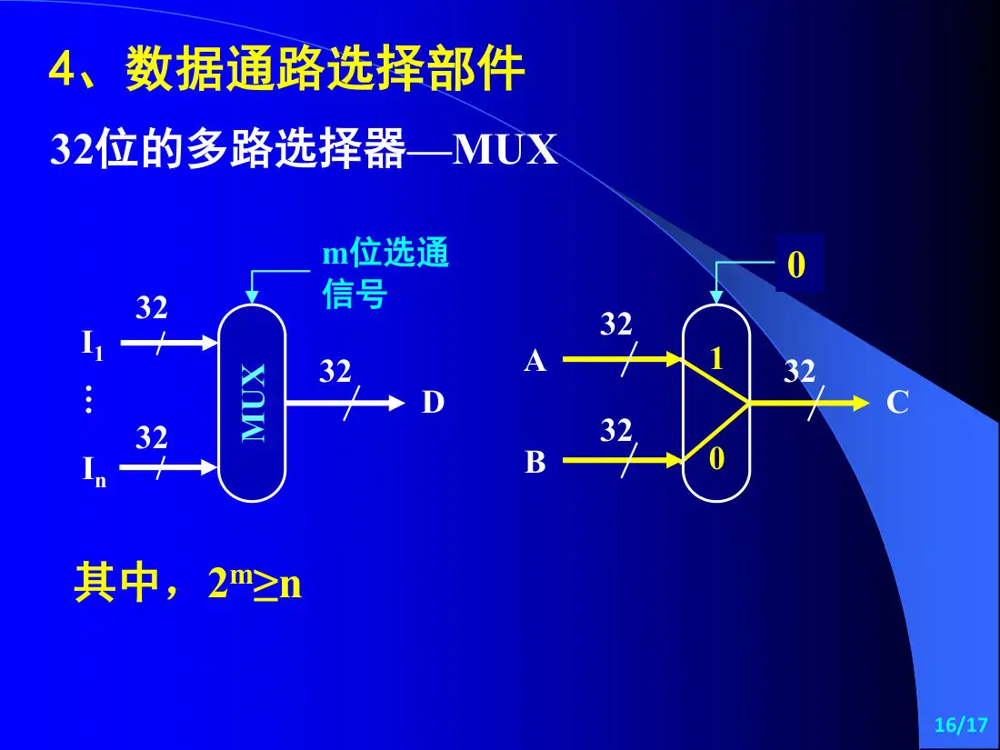

原文：

4、数据通路选择部件

32位的多路选择器—MUX

m位选通信号

MUX

其中， $2 0 0$

16/17
