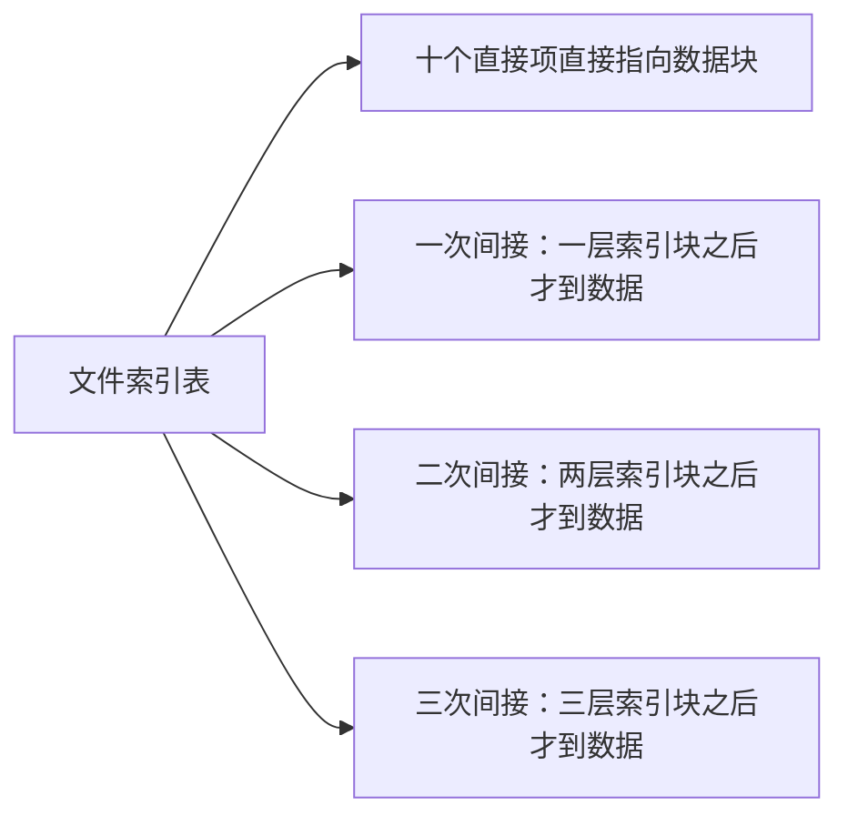

# 2021—2022 学年第二学期《操作系统B》期末试卷（A卷）

原件为两张试卷页合成的一页扫描图，含四道简答和六道解答，共 100 分，未附答案。下面按题序整理题面；所有**参考解答**为另行推导，不是原卷给出的答案。

## 一、简答题（每题 10 分，共 40 分）

### 1. 时间片轮转的开销

**题意：**为什么时间片大小影响时间片轮转的调度开销？设置时间片需考虑哪些因素？

**参考解答：**时间片过短时，定时中断和上下文切换更频繁，保存、恢复执行现场，以及缓存重新预热，都挤占有效计算时间。若总有其他就绪任务、每次用完整个时间片 $q$，而每次切换平均花 $s$，一个简化周期的开销占比约为 $s/(q+s)$；任务提前阻塞等情况会改变这个估算。时间片很长又会使就绪队列中靠后的交互任务等得更久，极端情况下接近先来先服务。应权衡切换成本、交互响应目标、就绪进程数量及典型计算段/I/O 等待特征。参见 [进程调度](../../../topics/操作系统/进程调度算法.md)。

### 2. 请求分页需要增加哪些页表信息

**题意：**把普通分页拓展成分页式虚拟存储，页表应增加哪些字段，各起什么作用？

**参考解答：**典型教学模型有四类信息。**驻留位**用来判断页是否在主存；地址合法而页不驻留时进入缺页处理。**访问位**记录页被引用过，供 Clock 等策略估计冷热。**修改位**表示驻留内容是否已经变脏，被换出时决定是否通常要回写。**后备位置**使缺页处理能够找到页的数据来源，实际系统也可能把这项信息放在页表外，或对首次使用的匿名页按需清零。“快表没有映射”不等于“页不驻留”；“地址不合法或权限不允许”也不等于正常缺页调入。参见 [分页](../../../topics/操作系统/分页存储管理.md)、[快表](../../../topics/操作系统/快表机制.md)、[虚拟存储器](../../../topics/操作系统/虚拟存储器.md)。

### 3. 什么是磁臂粘着

**题意：**什么是“磁臂粘着”？怎样解决扫描算法中的粘着问题？

**参考解答：**若调度器容许在当前磁道或邻近区域不断插入新请求，磁头可能长时间服务这批局部请求，不再推进到远处，远处请求等待无界。这是题目讨论的动态请求场景，不是说每一种实现了有界批次的扫描调度都必然饥饿。可把正在扫描的一批请求冻结，而把新请求放入另一队列：完成这一轮后才交换队列（FSCAN）。也可将请求按进入顺序划分为最多 $N$ 个的批次，对每批做扫描，新来的排入后续批次（N 步扫描）。关键是==不允许新请求无限挤入当前批次==，不是只更换磁头移动方向。参见 [磁盘调度](../../../topics/操作系统/磁盘调度算法.md)。

### 4. 连续文件如何在中间插入一个块

**题意：**原图给出下列目录。文件 `tr` 的三个逻辑块依次在 14、15、16；在逻辑块 0 和 1 之间插入新块，写出操作过程。

| 文件 | 起始块 | 块数 |
| --- | ---: | ---: |
| count | 0 | 2 |
| tr | 14 | 3 |
| mail | 19 | 6 |
| list | 28 | 4 |
| f | 6 | 2 |

**参考解答：**原图中块 17 空闲，可先预留。为避免覆盖原数据，按从后往前的次序搬：原物理块 16 移到 17，原块 15 移到 16；再把新数据写入 15，并将目录的文件长度从 3 块改为 4 块、起始块仍为 14，同时更新空闲块记录。逻辑序列由旧 0、旧 1、旧 2 变成旧 0、新块、旧 1、旧 2。若后继块不是空的，就不能占用其他文件的块；保持连续组织时，需要找足够大的新连续区并搬移。参见 [文件物理结构](../../../topics/操作系统/文件物理结构.md)、[连续分配](../../../topics/操作系统/连续文件优缺点.md)。

## 二、解答题（每题 10 分，共 60 分）

### 1. 银行家算法能否批准 P2 的请求

**题意：**资源向量按 A、B、C、D 排列，当前可用量为 (1, 6, 2, 2)，进程 P2 请求 (1, 3, 2, 2)。根据下表判断能否分配并说明理由。

| 进程 | 已分配 Allocation | 最大需求 Max | 参考解答：剩余需求 Need |
| --- | --- | --- | --- |
| P0 | (0,0,3,2) | (0,0,4,4) | (0,0,1,2) |
| P1 | (1,0,0,0) | (2,7,5,0) | (1,7,5,0) |
| P2 | (1,3,5,4) | (3,6,10,10) | (2,3,5,6) |
| P3 | (0,3,3,2) | (0,9,8,4) | (0,6,5,2) |
| P4 | (0,0,1,4) | (0,6,6,10) | (0,6,5,6) |

**参考解答：**先用 `Max−Allocation` 得到上表 Need。P2 的请求逐项不超过 Need 和 Available，故可试分配：可用量降为 (0,3,0,0)；P2 的已分配升为 (2,6,7,6)，剩余需求降为 (1,0,3,4)。但此时 P0 还要 C、D，P1 还要 A，P2 还要 A，P3、P4 都至少还要更多 B，找不到第一个可满足最大剩余需求的进程。于是试分配后不安全，**暂缓请求并撤回试分配**。作为对照，试分配前确有安全序列 P0→P3→P1→P2→P4。参见 [银行家算法](../../../topics/操作系统/死锁预防与避免.md)。

> [!TIP]
> ==请求量没有超出可用量==只够进入试分配，不足以批准。下一步必须按试分配后的剩余需求寻找完整安全序列。

### 2. 段式地址转换

**题意：**段 0 的首址、段长为 (600,100)，段 1 为 (300,200)，段 2 为 (900,300)，段 3 无有效表项。转换 [0,112]、[1,35]、[3,99]。

**参考解答：**先查段号是否有有效表项，再验证 $0\le d<\text{段长}$，通过后才做加法。[0,112] 段号有效但位移越界；[1,35] 合法，物理地址 $300+35=335$；[3,99] 没有有效段映射，题目没提供可用基址，不能把空白字段当成 0，也不能擅自判成可调入的段。参见 [段式地址转换](../../../topics/操作系统/分段存储管理.md)。

### 3. 用信号量实现循环缓冲区

**题意：**大小为 $N$ 的环形缓冲区只有 A 写入、B 读出；二者分别按顺序推进。用 P、V 操作实现同步。

**参考解答：**令 `empty=N, full=0, in=out=0`，假定 $N>0$。A 在下一空槽写，B 在下一可读槽取，各自仅修改自己的下标：

```text
A: 重复
       x = 在局部准备数据
       P(empty)
       buffer[in] = x; in = (in + 1) mod N
       V(full)

B: 重复
       P(full)
       y = 复制 buffer[out]; out = (out + 1) mod N
       V(empty)
       在局部使用 y
```

两个计数分别防止盖写未读数据、读取未发布数据。由于只有一个写者、一个读者，且下标不共享修改，信号量的许可即可约束同一槽的所有权转移。若增加多个写者或多个读者，则共享下标的选择与修改须另做互斥。参见 [信号量](../../../topics/操作系统/信号量与PV操作.md)、[生产者与消费者](../../../topics/操作系统/经典同步问题.md)。

### 4. FIFO 与 LRU 的缺页轨迹

**题意：**访问序列为 2、3、2、1、5、2、4、5、3、2、5、2，初始 3 个页框均空。求两种策略的缺页数、缺页率及置换过程。

**参考解答：**表中从左至右，FIFO 是按入内存先后，LRU 是按最近访问时间从早到晚。星号表示本次缺页，包括最初装入空页框。

| 步 | 页 | FIFO | LRU |
| ---: | ---: | --- | --- |
| 1 | 2 | 2 ★ | 2 ★ |
| 2 | 3 | 2,3 ★ | 2,3 ★ |
| 3 | 2 | 2,3 | 3,2 |
| 4 | 1 | 2,3,1 ★ | 3,2,1 ★ |
| 5 | 5 | 3,1,5 ★ | 2,1,5 ★ |
| 6 | 2 | 1,5,2 ★ | 1,5,2 |
| 7 | 4 | 5,2,4 ★ | 5,2,4 ★ |
| 8 | 5 | 5,2,4 | 2,4,5 |
| 9 | 3 | 2,4,3 ★ | 4,5,3 ★ |
| 10 | 2 | 2,4,3 | 5,3,2 ★ |
| 11 | 5 | 4,3,5 ★ | 3,2,5 |
| 12 | 2 | 3,5,2 ★ | 3,5,2 |

FIFO **9 次，75%**；LRU **7 次，约 58.33%**。第 3 步命中 2 时已改变了 LRU 次序，因此第 5 步它淘汰 3，而 FIFO 仍淘汰较早装入的 2。参见 [页面置换](../../../topics/操作系统/页面置换算法.md)。

### 5. FCFS 与 SSTF 的寻道长度

**题意：**磁头在 100；请求序列为 54、58、39、18、90、160、150、38、180，分别求先来先服务和最短寻道时间优先的总移动量。

| 算法 | 服务路径（含初始位置） | 参考解答：移动量 |
| --- | --- | ---: |
| FCFS | 100→54→58→39→18→90→160→150→38→180 | $46+4+19+21+72+70+10+112+142=496$ 道 |
| SSTF | 100→90→58→54→39→38→18→150→160→180 | $10+32+4+15+1+20+132+10+20=244$ 道 |

**参考解答：**SSTF 每服务一项就以新位置重算距离。例如从 39 到 38 只差 1，所以先到 38，再到 18；不能只从 100 排一次序而始终使用该顺序。计算终点是最后一个请求，不再另走到盘端。参见 [磁盘调度](../../../topics/操作系统/磁盘调度算法.md)。

### 6. 混合索引的各级容量

**题意：**每文件 13 个索引项，每项 32 位，登记一个盘块号。块大小 8 KB，头 10 项为直接寻址，第 11、12、13 项分别是一、二、三次间接，求各级覆盖量。

**参考解答：**按题设二进制口径，每块 8 KiB、每项 4 字节，索引块可装 $8192/4=2048$ 项。每多一层间接指向便把数据块数乘 2,048，最后才乘 8 KiB：

| 级别 | 本级单独增加的块数 | 本级单独覆盖的数据量 |
| --- | ---: | ---: |
| 直接 | 10 | 80 KiB |
| 一次间接 | 2,048 | 16 MiB |
| 二次间接 | $2048^2$ | 32 GiB |
| 三次间接 | $2048^3$ | 64 TiB |

若问使用截至某级的总覆盖量，应累加该级及之前各级；例如用到一次间接时是 80 KiB 加 16 MiB。上表是索引树的理论覆盖量，未扣索引块开销或文件系统长度限制。若 32 位盘块号还确实限制全盘可区分的物理块最多为 $2^{32}$，则全盘最多寻址 32 TiB，且其中还要存元数据；64 TiB 不等于实际可创建文件的最大容量。



参见 [混合索引](../../../topics/操作系统/文件物理结构.md)。
