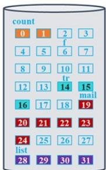

# 2021—2022 学年第二学期《操作系统B》期末试卷（A卷）

原件经识别和整理；“参考解答”是我们补的。

整理自南京邮电大学 2021/2022 学年第 2 学期期末考试试卷。

## 一、简答题（每小题 10 分，共 4 小题，共 40 分）

### 简答 1

时间片轮转调度算法的开销与时间片的大小有关，为什么？CPU 时间片大小设置需要考虑哪些因素？

知识点：[进程调度算法（FCFS、SJF、优先级、时间片轮转、多级反馈队列）](../../../topics/操作系统/进程调度算法.md)、[处理机的三级调度（高级、中级、低级调度）](../../../topics/操作系统/处理机调度级别.md)

### 简答 2

为了将分页存储管理机制拓展为分页式虚拟存储管理机制，需要对页表增加哪些字段？这些新增字段各自的作用分别是什么？

知识点：[页式存储管理的基本原理与地址转换](../../../topics/操作系统/分页存储管理.md)、[虚拟存储器的基本思想与局部性原理](../../../topics/操作系统/虚拟存储器.md)、[页面置换算法（OPT、FIFO、LRU、Clock、LFU）](../../../topics/操作系统/页面置换算法.md)

### 简答 3

硬盘驱动臂调度算法，除了先来先服务算法之外，都会出现饥饿现象，被称为“磁臂粘着”。请回答何谓“磁臂粘着”？有什么方法可以解决扫描算法的“磁臂粘着”问题？

知识点：[磁盘调度算法（FCFS、SSTF、SCAN、CSCAN）](../../../topics/操作系统/磁盘调度算法.md)

### 简答 4

顺序结构是一种典型的文件物理结构，某采用顺序结构的文件系统中的文件情况如下图所示。

| 文件名 | 始址 | 块数 |
| :--- | :--- | :--- |
| count | 0 | 2 |
| tr | 14 | 3 |
| mail | 19 | 6 |
| list | 28 | 4 |
| f | 6 | 2 |

其中文件 tr，目前共有 3 个数据块，从编号为 14 的物理块连续存放，即文件 tr 的逻辑块号为 0 的数据块存放在 14 号物理块上，后续的数据块依次连续存放。现在，要在逻辑块号为 0 和逻辑块号为 1 的数据块之间插入一个新的数据块，请描述插入过程。

## 二、解答题（每小题 10 分，共 6 小题，共 60 分）

知识点：[文件的物理结构（连续、链接、索引、混合索引）](../../../topics/操作系统/文件物理结构.md)、[连续文件的优缺点](../../../topics/操作系统/连续文件优缺点.md)

### 解答 1

假设系统当前有 A、B、C、D 四种资源，进程 P0、P1、P2、P3、P4 并发运行，目前的资源分配情况如下表所示：

| Process | 已分配资源数向量 (A, B, C, D) | 所需要总资源数向量 (A, B, C, D) | 剩余资源数向量 (A, B, C, D) |
| :--- | :--- | :--- | :--- |
| $P_0$ | 0, 0, 3, 2 | 0, 0, 4, 4 | 1, 6, 2, 2 |
| $P_1$ | 1, 0, 0, 0 | 2, 7, 5, 0 | |
| $P_2$ | 1, 3, 5, 4 | 3, 6, 10, 10 | |
| $P_3$ | 0, 3, 3, 2 | 0, 9, 8, 4 | |
| $P_4$ | 0, 0, 1, 4 | 0, 6, 6, 10 | |

此时，进程 P2 发出的资源请求向量为 $(1, 3, 2, 2)$，即 P2 申请 1 个 A 类资源、3 个 B 类资源、2 个 C 类资源、2 个 D 类资源。基于银行家算法来避免死锁，请问系统是否可以满足 P2 当前发出的资源请求？请描述具体的分析过程。

知识点：[死锁的预防方法与避免方法（银行家算法）](../../../topics/操作系统/死锁预防与避免.md)、[死锁的定义与四个必要条件（互斥、请求保持、不可剥夺、循环等待）](../../../topics/操作系统/死锁概念与必要条件.md)

### 解答 2

给定段表如下：

| 段号 | 段首址 | 段长 |
| :--- | :--- | :--- |
| 0 | 600 | 100 |
| 1 | 300 | 200 |
| 2 | 900 | 300 |
| 3 | | |

给定地址为段号和段内位移：（1）[0，112]；（2）[1，35]；（3）[3，99]，请分别完成地址转换工作，写出对应的物理地址，若不能填写出物理地址请给出相应原因。

知识点：[段式存储管理的基本原理与地址转换](../../../topics/操作系统/分段存储管理.md)

### 解答 3

设有一个具有 N 个单元的缓冲区，仅供 A、B 进程共享循环使用。A 进程顺序地把信息写入缓冲区，B 进程依次地从缓冲区中读出信息。请用信号量和 P、V 操作来实现 A、B 进程之间的同步。（注：用伪代码描述即可）

知识点：[临界区、临界资源与互斥的概念](../../../topics/操作系统/临界区与互斥.md)、[信号量机制与P、V操作的定义](../../../topics/操作系统/信号量与PV操作.md)、[经典进程同步问题（生产者-消费者、读者-写者、哲学家进餐）](../../../topics/操作系统/经典同步问题.md)

### 解答 4

某采用分页式虚拟存储管理机制的系统中，某进程的逻辑页面访问次序为：2、3、2、1、5、2、4、5、3、2、5、2。当前，系统分配给该进程的页框数为 3，初始页框为空。请问：系统分别使用 FIFO 和 LRU 页面置换算法，访问过程中发生的缺页中断次数和缺页中断率分别是多少？请给出页面置换过程。

知识点：[页面置换算法（OPT、FIFO、LRU、Clock、LFU）](../../../topics/操作系统/页面置换算法.md)、[虚拟存储器的基本思想与局部性原理](../../../topics/操作系统/虚拟存储器.md)、[页式存储管理的基本原理与地址转换](../../../topics/操作系统/分页存储管理.md)

### 解答 5

假定当前磁头位于 100 号磁道，进程对磁道的请求序列依次为 54，58，39，18，90，160，150，38，180。当采用先来先服务和最短寻道时间优先算法时，总的移动的磁道数分别是多少？

知识点：[磁盘调度算法（FCFS、SSTF、SCAN、CSCAN）](../../../topics/操作系统/磁盘调度算法.md)

### 解答 6

某文件系统中，文件物理结构采用的是混合索引结构：每个文件的索引表规定为 13 个索引项，每项 32 bit，登记一个物理块号。前面 10 项存放文件信息的物理块号，为直接寻址。假定物理块的大小是 8KB，如果文件大于 10 块，则利用第 11 项指向一个物理块，为一次间接寻址，更大的文件还可以利用第 12 和 13 项作二次和三次间接寻址。

请回答：直接寻址可以表示多大的文件？一次间接寻址，可以表示多大的文件？二次和三次间接寻址分别可以表示多大的文件？请给出计算过程。

知识点：[文件的物理结构（连续、链接、索引、混合索引）](../../../topics/操作系统/文件物理结构.md)
