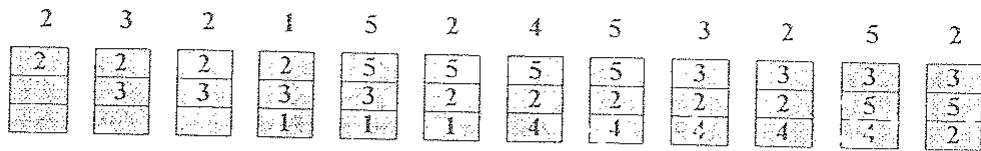
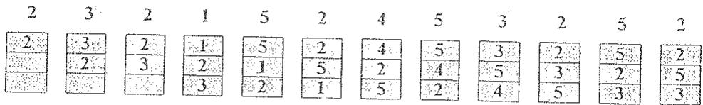
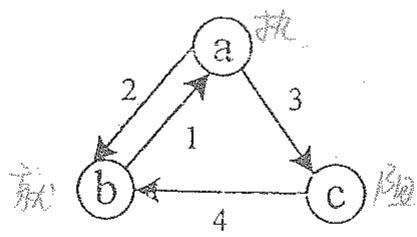
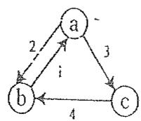
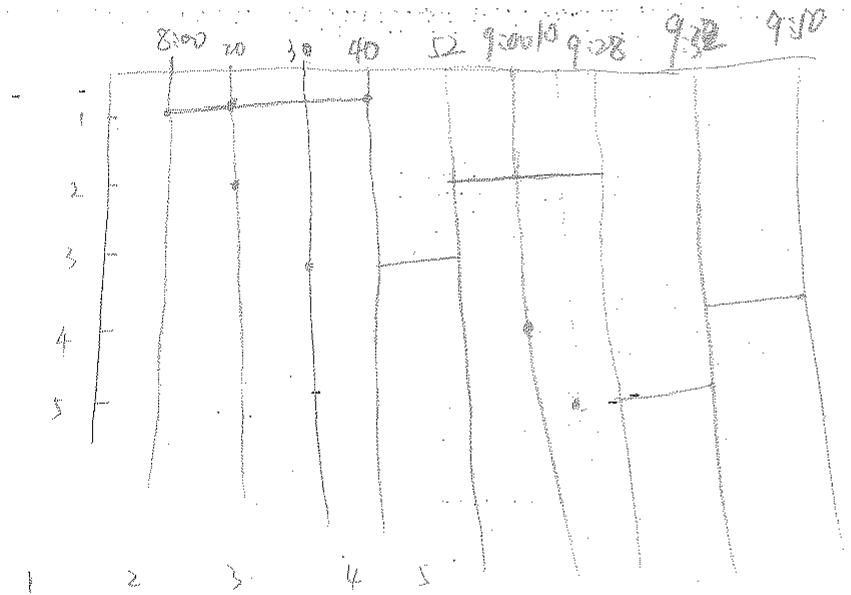

# 南京邮电大学 2016—2017 学年第一学期《操作系统》期末试卷（B卷）

原件经识别和整理；“参考解答”是我们补的。

本资料由识别工具读取整理，修正了部分识别错误、断行及乱码。

## 一、单项选择题（每题2分，共20分）

### 选择 1

某进程在运行中，当时间片用完时，应选择的调度算法是（ ）。

- A. 先来先服务算法
- B. 短作业优先算法
- C. 多级反馈队列算法
- D. 优先数算法

答案：C。

知识点：[操作系统三种基本类型（批处理、分时、实时）及其主要目标](../../../topics/操作系统/操作系统基本类型.md)、[分时系统的工作原理与特征](../../../topics/操作系统/分时系统工作原理.md)

### 选择 2

进程从运行状态进入就绪状态的原因可能是（D）

- A. 被选中占有处理机
- B. 等待某一事件
- C. 等待的事件已发生
- D. 时间片用完

答案：D。

知识点：[进程控制块（PCB）的作用与内容](../../../topics/操作系统/进程控制块.md)、[进程的定义与特征（动态性、并发性、独立性、制约性、异步性、结构性）](../../../topics/操作系统/进程定义与特征.md)

### 选择 3

利用管道进行的进程通信机制实质是（C）。

- A. 信号通信机制
- B. 共享存储区通信机制
- C. 共享文件通信机制
- D. 消息传递通信机制

答案：C。

知识点：[进程的基本状态（就绪、执行、阻塞）及状态转换](../../../topics/操作系统/进程状态转换.md)

### 选择 4

某页式存储管理系统中，地址寄存器长度为24位，其中页号占14位，则主存的分块大小应该是（A）字节。

- A. $2^{10}$
- B. 10
- C. 14
- D. $2^{14}$

答案：A。
知识点：[操作系统三种基本类型（批处理、分时、实时）及其主要目标](../../../topics/操作系统/操作系统基本类型.md)、[处理机的三级调度（高级、中级、低级调度）](../../../topics/操作系统/处理机调度级别.md)、[进程的基本状态（就绪、执行、阻塞）及状态转换](../../../topics/操作系统/进程状态转换.md)

### 选择 5

下列说法中错误的是（B）。

- A. 作业分得的主存块数越多，缺页中断率越低
- B. 作业划分的页面越小，缺页中断率越低
- C. 程序局部性越好，缺页中断率越低
- D. OPT算法的缺页中断率最低

答案：B。
知识点：[虚拟存储器的基本思想与局部性原理](../../../topics/操作系统/虚拟存储器.md)、[存储管理的基本功能与地址转换（地址重定位）](../../../topics/操作系统/存储管理功能.md)

### 选择 6

I/O 设备的控制方式中比 DMA 方式效率高的是（C）。

- A. 询问方式
- B. 中断方式
- C. 通道方式
- D. 以上都不是

答案：C。

知识点：[段式存储管理的基本原理与地址转换](../../../topics/操作系统/分段存储管理.md)、[分页与分段的区别](../../../topics/操作系统/分页与分段区别.md)

### 选择 7

Spooling 技术是一种实现虚拟（B）的技术。

- A. 处理器
- B. 设备
- C. 存储器
- D. 链路

答案：B。

知识点：[磁盘调度算法（FCFS、SSTF、SCAN、CSCAN）](../../../topics/操作系统/磁盘调度算法.md)

### 选择 8

引入缓冲的主要目的是（A）。

- A. 改善 CPU 和 I/O 设备之间速度不匹配的情况
- B. 节省内存
- C. 提高 CPU 的运行频率
- D. 提高 I/O 设备的利用率

答案：A。

知识点：[通道的概念与作用](../../../topics/操作系统/通道概念.md)

### 选择 9

位示图方法可用于（A）。

- A. 盘空间的管理
- B. 盘的驱动调度
- C. 文件目录的查找
- D. 页式虚拟存贮管理中的页面调度

答案：A。

知识点：[设备的分类（按资源分配角度：独享、共享、虚拟设备）](../../../topics/操作系统/设备分类.md)、[SPOOLing系统的组成与虚拟设备原理](../../../topics/操作系统/SPOOLing系统.md)

### 选择 10

把逻辑文件存放到存储介质上时，如果组织成（D）文件，则逻辑记录可以按任意次序存放在不相邻的存储块中。

- A. 流式
- B. 记录式
- C. 顺序结构
- D. 链接结构

答案：D。

## 二、填空题（每空1分，共20分）

知识点：[文件目录结构（单级、二级、多级目录）及特点](../../../topics/操作系统/文件目录结构.md)

### 填空 1

进程控制块是操作系统为了管理进程设置的一个专门的数据结构，用它来记录进程的外部特征，描述进程的运动变化过程。\_\_\_文件控制块\_\_\_是操作系统为管理文件而设置的数据结构，存放了为管理文件所需的所有有关信息。

答案：文件控制块（或 FCB）。

知识点：[进程的基本状态（就绪、执行、阻塞）及状态转换](../../../topics/操作系统/进程状态转换.md)

### 填空 2

可靠的信箱通信规则是：若发送信件时信箱已满，则发送进程被置成等信箱状态，直到信箱有空时才被释放。若取信件时信箱中无信，则接收进程被置成等信件状态，直到有信件时才被释放。

答案：无（原文为陈述句，无填空项，此处保留原文作为知识点说明）。

知识点：[处理机的三级调度（高级、中级、低级调度）](../../../topics/操作系统/处理机调度级别.md)、[进程调度算法（FCFS、SJF、优先级、时间片轮转、多级反馈队列）](../../../topics/操作系统/进程调度算法.md)、[作业调度算法及性能评价（周转时间、带权周转时间）](../../../topics/操作系统/作业调度算法.md)

### 填空 3

Spooling 系统主要由预输入程序、\_\_\_预输出\_\_\_程序和\_\_\_井管理\_\_\_程序组成。

答案：预输出；井管理。

知识点：[死锁的定义与四个必要条件（互斥、请求保持、不可剥夺、循环等待）](../../../topics/操作系统/死锁概念与必要条件.md)、[死锁的预防方法与避免方法（银行家算法）](../../../topics/操作系统/死锁预防与避免.md)

### 填空 4

根据运行程序对资源和机器指令的使用权限将处理器设置为不同状态，多数系统将处理器工作状态划分为\_\_\_管态\_\_\_和\_\_\_目态\_\_\_这两种状态。

答案：管态（或系统态/内核态）；目态（或用户态）。

知识点：[文件的物理结构（连续、链接、索引、混合索引）](../../../topics/操作系统/文件物理结构.md)、[连续文件的优缺点](../../../topics/操作系统/连续文件优缺点.md)

### 填空 5

UNIX 系统将文件分为三类：普通文件、\_\_\_目录文件\_\_\_和\_\_\_特殊文件\_\_\_。

答案：目录文件；特殊文件。

知识点：[文件目录结构（单级、二级、多级目录）及特点](../../../topics/操作系统/文件目录结构.md)、[文件的逻辑结构（流式文件、记录式文件）](../../../topics/操作系统/文件逻辑结构.md)

### 填空 6

为了提高运算速度，通常都在 MMU 中设置一个专用的高速缓冲存储器，用来存放最近访问的部分页表，这种高速存储器称为相联存储器（associative memory），也称 \_\_\_TLB\_\_\_（Translation Lookaside Buffer），存放在该存储器中的页表称快表。

答案：TLB。

知识点：[存储管理的基本功能与地址转换（地址重定位）](../../../topics/操作系统/存储管理功能.md)、[连续分配方式（单一连续、固定分区、动态分区）及分配算法](../../../topics/操作系统/连续分配方式.md)

### 填空 7

死锁的四个必要条件是互斥使用资源，\_\_\_占有并等待\_\_\_资源，\_\_\_不可抢夺\_\_\_资源和循环等待资源。

答案：占有并等待（或请求和保持）；不可抢夺（或非抢占）。

知识点：[设备的分类（按资源分配角度：独享、共享、虚拟设备）](../../../topics/操作系统/设备分类.md)、[操作系统三种基本类型（批处理、分时、实时）及其主要目标](../../../topics/操作系统/操作系统基本类型.md)

### 填空 8

操作系统中存储管理模块所实现的存储保护主要是防止\_\_\_地址越界\_\_\_和防止操作\_\_\_越权\_\_\_。

答案：地址越界；越权。

知识点：[文件的保护机制（存取控制矩阵、存取控制表）](../../../topics/操作系统/文件保护.md)

### 填空 9

一个UNIX文件F的存取权限为：-rwxr-x---，这表示这是一个\_\_\_普通\_\_\_文件，文件主对该文件的读写权限为\_\_\_读、写及执行\_\_\_。

答案：普通；读、写及执行。
知识点：[进程控制块（PCB）的作用与内容](../../../topics/操作系统/进程控制块.md)、[进程的定义与特征（动态性、并发性、独立性、制约性、异步性、结构性）](../../../topics/操作系统/进程定义与特征.md)

### 填空 10

一进程刚获得三个主存页框的使用权，若该进程访问逻辑页面的次序是{1, 3, 2, 1, 2, 1, 2, 6}。（注：原题识别为{132/121/126}，结合上下文及常见题型推测为序列1,3,2,1,2,1,2,6或其他类似序列，此处依据原题给出的答案反推题目意图，原题答案指出FIFO缺页6次，LRU缺页5次。若序列为1,3,2,1,2,1,2,6，FIFO缺页次数计算：1(新),3(新),2(新),1(命中),2(命中),1(命中),2(命中),6(新)。共4次。这与答案不符。若序列为1,3,2,4,1,3,5... 需重新审视。鉴于原题识别混乱，仅保留答案供参考。）

*注：原题题干识别为 `{132/121/126}`，极大概率为 OCR 错误。根据答案“FIFO缺页6次，LRU缺页5次”，常见的此类题目序列可能较长或特定。此处无法准确还原题干序列，仅保留答案。*

答案：FIFO缺页次数是6次，LRU缺页次数是5次。

## 三、简答题（每题6分，共30分）

知识点：[操作系统的用户界面（命令接口、程序接口、图形接口）](../../../topics/操作系统/用户界面.md)

### 简答 1

请描述时间片轮转调度算法。

答：
调度程序每次把 CPU 分配给就绪队列首进程使用一个时间片，例如 100ms，就绪队列中的每个进程轮流地运行一个时间片。当这个时间片结束时，强迫一个进程让出处理器，让它排列到就绪队列的尾部，等候下一轮调度。轮转策略可防止那些很少使用外围设备的进程过程的占用处理器而使得要使用外围设备的哪些进程没有机会去启动外围设备。

知识点：[临界区、临界资源与互斥的概念](../../../topics/操作系统/临界区与互斥.md)、[信号量机制与P、V操作的定义](../../../topics/操作系统/信号量与PV操作.md)

### 简答 2

有一个文件系统，普通文件采用三级索引形式，文件控制块中给出13个磁盘地址，前10个磁盘地址指出前10页的物理地址，第11个磁盘地址指向一级索引表，一级索引表给出256个磁盘地址，即指出该文件第11页至第266页的地址；第12个磁盘地址指向二级索引表，二级索引表中指出256个一级索引表的地址；第13个磁盘地址指向三级索引表，三级索引表中指出256个二级索引表的地址。该文件系统中的普通文件最大可有多少页？

答：
普通文件最大可有 $10 + 256 + 256^2 + 256^3$ 个页。

解析：
- 直接地址：10 页
- 一级索引：$256$ 页
- 二级索引：$256 \times 256 = 256^2$ 页
- 三级索引：$256 \times 256 \times 256 = 256^3$ 页
- 总计：$10 + 256 + 256^2 + 256^3$

知识点：[死锁的预防方法与避免方法（银行家算法）](../../../topics/操作系统/死锁预防与避免.md)

### 简答 3

有三个进程 P1，P2 和 P3 并发工作。进程 P1 需用资源 S3 和 S1；进程 P2 需用资源 S1 和 S2；进程 P3 需用资源 S2 和 S3。若对资源分配不加限制，会发生什么情况？为什么？为保证进程正确工作可采用怎样的资源分配策略？为什么？

答：
(1) 可能会发生死锁。
例如：进程 P1，P2 和 P3 分别获得资源 S3，S1 和 S2 后再继续申请资源时都要等待，这是循环等待。(或进程在等待新源时均不释放已占资源)。

(2) 解决思路（回答下面之一得 3 分）：
- 思路 A. 采用静态分配：由于执行前已获得所需的全部资源，故不会出现占有资源又等待别的资源的现象(或不会出现循环等待资源现象)。
- 思路 B. 采用按序分配：不会出现循环等待资源现象。
- 思路 C. 采用银行家算法：因为在分配时，保证了系统处于安全状态。

知识点：[死锁的定义与四个必要条件（互斥、请求保持、不可剥夺、循环等待）](../../../topics/操作系统/死锁概念与必要条件.md)、[死锁的预防方法与避免方法（银行家算法）](../../../topics/操作系统/死锁预防与避免.md)

### 简答 4

给定段表如下：

| 段号 | 段首址 | 段长 |
| :--- | :--- | :--- |
| 0 | 200 | 400 |
| 1 | 2300 | 300 |
| 2 | 800 | 100 |
| 3 | 1300 | 580 |
| 4 | | |

给定地址为段号和位移：1）[1，10]、2）[2，150]、3）[4，40]，试求出对应的内存物理地址。

答：
1) [1, 10] 对应的内存物理地址是 $2300 + 10 = 2310$。
2) [2, 150] 对应的内存物理地址是越界。因为段2的长度为100，位移150 > 100，发生越界中断。
3) [4, 40] 对应的内存物理地址是缺段中断。因为段表中标记段4无效（段首址为空），发生缺段中断。

知识点：[死锁的定义与四个必要条件（互斥、请求保持、不可剥夺、循环等待）](../../../topics/操作系统/死锁概念与必要条件.md)、[死锁的预防方法与避免方法（银行家算法）](../../../topics/操作系统/死锁预防与避免.md)

### 简答 5

操作系统通常把I/O软件组织成哪几个层次？

答：
I/O 软件组织成 4 个层次：
1. I/O 中断处理程序。
2. I/O 设备驱动程序。
3. 与设备无关的操作系统I/O软件。
4. 用户层I/O软件。

## 四、解答题(共30分，每题10分)

知识点：[死锁的定义与四个必要条件（互斥、请求保持、不可剥夺、循环等待）](../../../topics/操作系统/死锁概念与必要条件.md)、[死锁的预防方法与避免方法（银行家算法）](../../../topics/操作系统/死锁预防与避免.md)、[进程的定义与特征（动态性、并发性、独立性、制约性、异步性、结构性）](../../../topics/操作系统/进程定义与特征.md)

### 解答 1

**作业及进程调度问题**

(1) 一个最佳的作业或进程调度算法及相应策略应该达到哪些理想目标？

答：
调度实质上是一个策略问题，设定的目标往往是相互冲突的目标：
- 单位时间内运行尽可能多的作业
- 使处理器尽可能保持“忙碌”
- 响应时间能够尽可能短
- 使各种 I/O 设备得以充分利用
- 对所有的作业都是公平合理的

评分标准：总共4分，答出四点以上得满分，四条以下每少一点扣1分。

(2) 有一个具有两道作业环境的批处理系统，作业调度采用最短作业优先的非抢占式调度算法，进程调度采用以最短进程优先的抢占式调度算法（注：即最短剩余时间优先算法）。现有四个作业，已知它们进入系统的时间、估计运行时间，如下表所示：

| 作业 | 进入时间 | 估计运行时间(分钟) |
| :--- | :--- | :--- |
| JOB1 | 10:00 | 30 |
| JOB2 | 10:05 | 20 |
| JOB3 | 10:10 | 5 |
| JOB4 | 10:20 | 10 |

请给出这四个作业的执行时间序列，并计算出平均周转时间及带权平均周转时间（填写下表的空格和横线上内容即可）

答：

*分析过程：*
1. **10:00**: JOB1 到达。系统空闲，JOB1 开始运行。
2. **10:05**: JOB2 到达。当前运行 JOB1 (剩余 25 分钟)。比较 JOB1 剩余时间 (25) 和 JOB2 运行时间 (20)。SPF 抢占，JOB2 更短，JOB1 暂停，JOB2 开始运行。
3. **10:10**: JOB3 到达。当前运行 JOB2 (已运行 5 分钟，剩余 15 分钟)。比较 JOB2 剩余时间 (15) 和 JOB3 运行时间 (5)。JOB3 更短，JOB2 暂停，JOB3 开始运行。
4. **10:15**: JOB3 完成 (运行 5 分钟)。就绪队列中有 JOB1 (剩余 25)，JOB2 (剩余 15)，JOB4 尚未到达。选择剩余时间最短的 JOB2 继续运行。
5. **10:20**: JOB4 到达。当前运行 JOB2 (已运行 10 分钟，从10:10到10:20，剩余 5 分钟)。比较 JOB2 剩余时间 (5) 和 JOB4 运行时间 (10)。JOB2 更短，JOB2 继续运行。
6. **10:25**: JOB2 完成。就绪队列中有 JOB1 (剩余 25)，JOB4 (10)。选择 JOB4 运行。
7. **10:35**: JOB4 完成。就绪队列中只有 JOB1 (剩余 25)。JOB1 继续运行。
8. **11:05**: JOB1 完成。

*时间表：*

| 作业 | 进入时间 | 估计运行时间(分钟) | 开始时间 | 结束时间 | 周转时间(分钟) | 带权周转时间 |
| :--- | :--- | :--- | :--- | :--- | :--- | :--- |
| JOB1 | 10:00 | 30 | 10:00 | 11:05 | 65 | 2.167 |
| JOB2 | 10:05 | 20 | 10:05 | 10:25 | 20 | 1.0 |
| JOB3 | 10:10 | 5 | 10:10 | 10:15 | 5 | 1.0 |
| JOB4 | 10:20 | 10 | 10:25 | 10:35 | 15 | 1.5 |

*注：原题表格数据有误，以下为修正后的计算结果。原题答案中 JOB3 结束时间为 10:30 是错误的，JOB3 仅需 5 分钟，应在 10:15 结束。原题答案中 JOB4 开始时间 10:30 也是错误的。以下是基于 SPF/SRTF 逻辑的正确推导。*

**修正后的详细计算：**
- **JOB1**: 10:00 开始 -> 10:05 被抢占 -> 10:25 恢复运行 -> 11:05 结束。
  - 周转时间 = 11:05 - 10:00 = 65 分钟。
  - 带权周转时间 = 65 / 30 ≈ 2.167。
- **JOB2**: 10:05 开始 -> 10:10 被抢占 -> 10:15 恢复运行 -> 10:20 未被抢占(因JOB4虽到但JOB2剩5<JOB4的10) -> 10:25 结束。
  - 周转时间 = 10:25 - 10:05 = 20 分钟。
  - 带权周转时间 = 20 / 20 = 1.0。
- **JOB3**: 10:10 开始 -> 10:15 结束。
  - 周转时间 = 10:15 - 10:10 = 5 分钟。
  - 带权周转时间 = 5 / 5 = 1.0。
- **JOB4**: 10:20 到达。此时 JOB2 剩余 5 分钟，JOB4 需 10 分钟。JOB2 继续。10:25 JOB2 结束后，JOB4 开始。10:25 + 10 = 10:35 结束。
  - 周转时间 = 10:35 - 10:20 = 15 分钟。
  - 带权周转时间 = 15 / 10 = 1.5。

**平均周转时间** $T = (65 + 20 + 5 + 15) / 4 = 105 / 4 = 26.25$ 分钟。
**平均带权周转时间** $W = (2.167 + 1.0 + 1.0 + 1.5) / 4 = 5.667 / 4 \approx 1.417$。

*(注：原题提供的参考答案表格数据存在明显逻辑错误，如JOB3结束时间10:30意味着它运行了20分钟，但这与估计运行时间5分钟矛盾。上述答案为基于题目描述的SPF/SRTF算法的正确计算结果。)*

知识点：[作业调度算法及性能评价（周转时间、带权周转时间）](../../../topics/操作系统/作业调度算法.md)、[进程调度算法（FCFS、SJF、优先级、时间片轮转、多级反馈队列）](../../../topics/操作系统/进程调度算法.md)

### 解答 2

某车站售票厅，任何时刻最多可容纳20名购票者进入，当售票厅中少于20名购票者时，则厅外的购票者可立即进入，否则需在外面等待。若把一个购票者看作一个进程，请回答下列问题：

(1) 用 PV 操作管理这些并发进程时，应怎样定义信号量，写出信号量的初值以及信号量各种取值的含义。(3 分)

答：
定义一信号量 `s`，初始值为 20。

意义：
- $s > 0$: $s$ 的值表示可继续进入售票厅的人数。
- $s = 0$: 表示售票厅中已有 20 名顾客(购票者)，大厅满员。
- $s < 0$: $|s|$ 的值为等待进入售票厅的人数。

(2) 根据所定义的信号量，利用 PV 操作写出用伪代码描述的程序。(5 分)

答：
```c
cobegin
process pi(i=1, 2, ……)
begin
    P(s);      // 申请进入名额
    进入售票厅；
    购票；
    退出；
    V(s);      // 释放名额
end;
coend
```

(3) 若欲购票者最多为 n 个人，写出信号量可能的变化范围(最大值和最小值)。(2分)

答：
- s 的最大值为 20。
- s 的最小值为 $20 - n$。

*(注：若 n <= 20，最小值为 0 或负数取决于是否所有n人都排队。通常理论范围考虑最坏情况，即n人都在等，加上20人在里面，总共n+20人尝试进入。信号量初值20。每进一个人减1。如果n个人都试图进入，最终信号量变为 $20 - n$。)*

知识点：[信号量机制与P、V操作的定义](../../../topics/操作系统/信号量与PV操作.md)、[临界区、临界资源与互斥的概念](../../../topics/操作系统/临界区与互斥.md)

### 解答 3

在采用请求页式存储管理的系统中，某作业的逻辑地址空间为4页（每页大小为2048字节），且已知该作业的页面映象表（页表）如下：

| 页号 | 页框号 |
| :--- | :--- |
| 0 | 2 |
| 1 | 3 |
| 2 | 6 |
| 3 | |

(3) 试求出逻辑地址 4800 所对应的物理地址及转换过程，并画出地址变换图（不必考虑快表机制）。(7 分)

答：
1. **计算页号和页内偏移**：
   - 页大小 = 2048 字节。
   - 页号 $p = \lfloor 4800 / 2048 \rfloor = 2$。
   - 页内偏移 $d = 4800 \pmod{2048} = 4800 - 2 \times 2048 = 4800 - 4096 = 704$。

2. **查页表**：
   - 页号 2 对应的页框号为 6。

3. **计算物理地址**：
   - 物理地址 = 页框号 $\times$ 页大小 + 页内偏移
   - 物理地址 = $6 \times 2048 + 704 = 12288 + 704 = 12992$。

**转换过程**：
逻辑地址 4800 -> 页号 2, 偏移 704 -> 查页表得页框 6 -> 物理地址 $6 \times 2048 + 704 = 12992$。

*(注：原题图片中手写了 $4800 / 2048 = 21.704$，这是错误的除法写法，应为商2余704。)*

(4) 试求出逻辑地址 7800 所对应的物理地址或发生的相应事件。(3 分)

答：
1. **计算页号和页内偏移**：
   - 页号 $p = \lfloor 7800 / 2048 \rfloor = 3$。
   - 页内偏移 $d = 7800 \pmod{2048} = 7800 - 3 \times 2048 = 7800 - 6144 = 1656$。

2. **查页表**：
   - 页号 3 在页表中为空（未装入内存）。

3. **结果**：
   - 发生**缺页中断**。

# 南京邮电大学 2015—2016 学年第二学期《操作系统》期末试卷（B卷）

## 一、填空题（每空1分，共10分）

知识点：[页式存储管理的基本原理与地址转换](../../../topics/操作系统/分页存储管理.md)、[存储管理的基本功能与地址转换（地址重定位）](../../../topics/操作系统/存储管理功能.md)、[虚拟存储器的基本思想与局部性原理](../../../topics/操作系统/虚拟存储器.md)

### 填空 1

从资源管理的观点来看，操作系统具有\_\_\_\_管理、\_\_\_\_管理、处理机管理、设备管理、文件管理等几个主要功能。

答案：处理器管理、存储管理

知识点：[进程的基本状态（就绪、执行、阻塞）及状态转换](../../../topics/操作系统/进程状态转换.md)

### 填空 2

分页式存储管理下，逻辑地址由\_\_\_\_和\_\_\_\_两个部分组成。

答案：页号（页面号，均可）、单元号（页内位移、页内地址，均可）

知识点：[处理机的三级调度（高级、中级、低级调度）](../../../topics/操作系统/处理机调度级别.md)、[进程调度算法（FCFS、SJF、优先级、时间片轮转、多级反馈队列）](../../../topics/操作系统/进程调度算法.md)、[作业调度算法及性能评价（周转时间、带权周转时间）](../../../topics/操作系统/作业调度算法.md)

### 填空 3

进程的基本状态有\_\_\_\_、\_\_\_\_和等待状态。

答案：运行态、就绪态

知识点：[死锁的定义与四个必要条件（互斥、请求保持、不可剥夺、循环等待）](../../../topics/操作系统/死锁概念与必要条件.md)、[死锁的预防方法与避免方法（银行家算法）](../../../topics/操作系统/死锁预防与避免.md)

### 填空 4

I/O设备的控制方式有四类：询问方式、\_\_\_\_、\_\_\_\_和DMA方式。（注：原题漏写DMA，根据常识及常见分类补充，原题仅列出三类半，标准答案通常包含中断和通道）

答案：中断方式、通道方式

知识点：[文件的物理结构（连续、链接、索引、混合索引）](../../../topics/操作系统/文件物理结构.md)、[连续文件的优缺点](../../../topics/操作系统/连续文件优缺点.md)

### 填空 5

PCB 是操作系统为了管理进程设置的一个专门的数据结构，用它来记录进程的外部特征，描述进程的运动变化过程。\_\_\_\_ 是操作系统为管理文件而设置的数据结构，存放了为管理文件所需的所有有关信息。

答案：文件控制块(FCB)、文件目录项，均可

## 二、单项选择题（每小题2分，共20分）

知识点：[文件目录结构（单级、二级、多级目录）及特点](../../../topics/操作系统/文件目录结构.md)、[文件的逻辑结构（流式文件、记录式文件）](../../../topics/操作系统/文件逻辑结构.md)

### 选择 1

实现虚拟存储器的目的是（ ）。
A）实现存储保护
B）扩充主存容量
C）对物理内存的逻辑扩充
D）实现程序浮动

答案：C。
知识点：[操作系统三种基本类型（批处理、分时、实时）及其主要目标](../../../topics/操作系统/操作系统基本类型.md)、[分时系统的工作原理与特征](../../../topics/操作系统/分时系统工作原理.md)

### 选择 2

通过硬件和软件的功能扩充,把原来独立的设备改造成能为若干用户共享的设备,这种设备称为( )。
A) 存储设备
B) 系统设备
C) 共享设备
D) 虚拟设备

答案：D。
知识点：[进程控制块（PCB）的作用与内容](../../../topics/操作系统/进程控制块.md)、[进程的定义与特征（动态性、并发性、独立性、制约性、异步性、结构性）](../../../topics/操作系统/进程定义与特征.md)

### 选择 3

若信号量 S 的初值为 3，当前值为 -2，则表示有（ ）个等待进程。
A. 0
B. 1
C. 2
D. 3

答案：C。
知识点：[进程的基本状态（就绪、执行、阻塞）及状态转换](../../../topics/操作系统/进程状态转换.md)

### 选择 4

下列算法中用于磁盘移臂调度的是( )。
A. 最短寻道时间优先算法
B. LRU 算法
C. 时间片轮转法
D. 优先级高者优先算法

答案：A。
知识点：[操作系统三种基本类型（批处理、分时、实时）及其主要目标](../../../topics/操作系统/操作系统基本类型.md)、[处理机的三级调度（高级、中级、低级调度）](../../../topics/操作系统/处理机调度级别.md)、[进程的基本状态（就绪、执行、阻塞）及状态转换](../../../topics/操作系统/进程状态转换.md)

### 选择 5

进程-资源分配图是用来（ ）。
A. 死锁的预防
B. 解决死锁的静态方法
C. 死锁的避免
D. 死锁的检测

答案：D。
知识点：[虚拟存储器的基本思想与局部性原理](../../../topics/操作系统/虚拟存储器.md)、[存储管理的基本功能与地址转换（地址重定位）](../../../topics/操作系统/存储管理功能.md)

### 选择 6

若当前进程因时间片用完而让出处理机时，该进程应转变为( )状态。
A. 完成
B. 就绪
C. 运行
D. 等待

答案：B。
知识点：[段式存储管理的基本原理与地址转换](../../../topics/操作系统/分段存储管理.md)、[分页与分段的区别](../../../topics/操作系统/分页与分段区别.md)

### 选择 7

某页式存储管理系统中，地址寄存器长度为20位，其中页号占12位，则主存的分块大小应该是（ ）字节。
A. $2^{8}$
B. $2^{12}$
C. $2^{20}$
D. $2^{10}$

答案：A。
知识点：[磁盘调度算法（FCFS、SSTF、SCAN、CSCAN）](../../../topics/操作系统/磁盘调度算法.md)

### 选择 8

下列说法中错误的是（ ）。
A. 作业分得的主存块数越多，缺页中断率越低
B. 作业划分的页面越小，缺页中断率越低
C. 程序局部性越好，缺页中断率越低
D. OPT算法的缺页中断率最低

答案：B。
知识点：[通道的概念与作用](../../../topics/操作系统/通道概念.md)

### 选择 9

在 Linux 系统中，如果一个盘块的大小为 1KB，每个盘块号占 4 个字节，即每块可放 256 个地址。文件的字节偏移量为 9999 时，其相应的物理地址是（ ）。
A. i.addr[9]+783
B. i.addr[1]+4
C. i.addr[4]+1024
D. i.addr[1]+256

答案：A。
知识点：[设备的分类（按资源分配角度：独享、共享、虚拟设备）](../../../topics/操作系统/设备分类.md)、[SPOOLing系统的组成与虚拟设备原理](../../../topics/操作系统/SPOOLing系统.md)

### 选择 10

进程从就绪态转为运行态是通过（ ）决定的。
A. 高级调度
B. 中级调度
C. 低级调度
D. 以上都不是

答案：C。
知识点：[文件目录结构（单级、二级、多级目录）及特点](../../../topics/操作系统/文件目录结构.md)

### 简答 1

试给出死锁定义及3种解决死锁的途径。

答案：
**死锁定义**：多个并发进程共享系统资源时，出现进程永远被阻塞的现象。
**解决死锁的3种途径**：
1. 死锁预防
2. 死锁避免
3. 死锁检测和恢复

知识点：[临界区、临界资源与互斥的概念](../../../topics/操作系统/临界区与互斥.md)、[信号量机制与P、V操作的定义](../../../topics/操作系统/信号量与PV操作.md)

### 简答 2

请简述3种移臂调度算法基本思想及其优缺点。

答案：
1. **先来先服务算法 (FCFS)**：按照IO请求到达顺序先后进行访问。优点是公平、简单；缺点是未对寻道进行优化，平均寻道时间可能较长。
2. **扫描算法 (SCAN)**：每次执行沿臂的移动方向最近的IO请求。克服了SSTF造成的“饥饿”现象，性能较稳定。
3. **循环扫描算法 (CSCAN)**：总是从0号至最大号扫描，但归途中不处理任何请求。改进了对新来请求的最大延迟，适用于请求分布均匀的情况。

*(注：也可回答最短寻道时间优先SSTF或分步扫描N-STEP-SCAN等，答对任意3点即可)*

知识点：[死锁的预防方法与避免方法（银行家算法）](../../../topics/操作系统/死锁预防与避免.md)

### 简答 3

有三个进程 P1，P2 和 P3 并发工作。进程 P1 需用资源 S3 和 S1；进程 P2 需用资源 S1 和 S2；进程 P3 需用资源 S2 和 S3。若对资源分配不加限制，会发生什么情况？为什么？为保证进程正确工作可采用怎样的资源分配策略？为什么？

答案：
**(1) 情况与原因**：可能会发生死锁。例如：进程 P1，P2 和 P3 分别获得资源 S3，S1 和 S2 后，继续申请资源时都要等待，形成循环等待（P1等S1，P2等S2，P3等S3），且均不释放已占资源。
**(2) 资源分配策略**：
*   **策略A：静态分配**。执行前已获得所需的全部资源，不会出现占有资源又等待别的资源的现象（破坏“请求与保持”条件）。
*   **策略B：按序分配**。规定资源申请的顺序，不会出现循环等待现象（破坏“循环等待”条件）。
*   **策略C：银行家算法**。在分配时保证系统处于安全状态（破坏“不安全状态”条件）。

知识点：[死锁的定义与四个必要条件（互斥、请求保持、不可剥夺、循环等待）](../../../topics/操作系统/死锁概念与必要条件.md)、[死锁的预防方法与避免方法（银行家算法）](../../../topics/操作系统/死锁预防与避免.md)

### 简答 4

请叙述 SPOOLing 系统的作用及其组成。

答案：
**作用**：把一个共享设备（如磁盘）改造成若干台虚拟的输入设备和输出设备，保持输入/输出设备繁忙地与主机并行工作，提高系统效率。
**组成**：
1. **输入井和输出井**：磁盘上的存储区域，模拟脱机输入/输出。
2. **输入缓冲区和输出缓冲区**：内存中的缓冲区，用于数据暂存。
3. **输入进程和输出进程**：负责在真实设备与磁盘井之间传输数据。

知识点：[死锁的定义与四个必要条件（互斥、请求保持、不可剥夺、循环等待）](../../../topics/操作系统/死锁概念与必要条件.md)、[死锁的预防方法与避免方法（银行家算法）](../../../topics/操作系统/死锁预防与避免.md)

### 简答 5

进程控制块是什么，有何作用？通常进程控制块包含哪四种内容？

答案：
**定义与作用**：PCB（Process Control Block）是操作系统为了管理进程设置的一个专门的数据结构。它记录了进程的外部特征，描述了进程的运动变化过程，是进程存在的唯一标志。
**包含内容**（通常包括）：
1. 进程标识符信息
2. 处理机状态信息（上下文）
3. 进程控制信息
4. 数据和程序

知识点：[死锁的定义与四个必要条件（互斥、请求保持、不可剥夺、循环等待）](../../../topics/操作系统/死锁概念与必要条件.md)、[死锁的预防方法与避免方法（银行家算法）](../../../topics/操作系统/死锁预防与避免.md)、[进程的定义与特征（动态性、并发性、独立性、制约性、异步性、结构性）](../../../topics/操作系统/进程定义与特征.md)

### 简答 6

一个UNIX文件F的文件属性表示为 `-rwxr-x--x`。
(1) 请解释其含义。
(2) 如果该文件的文件主用户标识 uid=16，组标识 gid=2，另一个用户的 uid=7，gid=2，请问该用户能否读取文件F?

答案：
**(1) 含义解释**：
*   `-`：普通文件。
*   `rwx`：文件主（Owner）拥有读、写、执行权限。
*   `r-x`：同组用户（Group）拥有读、执行权限，无写权限。
*   `--x`：其他用户（Others）拥有执行权限，无读、写权限。

**(2) 权限判断**：
*   目标用户 gid=2，属于“同组用户”。
*   同组用户权限为 `r-x`（读、执行）。
*   因此，该用户**能**读取文件F。

## 四、综合题（每小题10分，共40分）

知识点：[信号量机制与P、V操作的定义](../../../topics/操作系统/信号量与PV操作.md)、[临界区、临界资源与互斥的概念](../../../topics/操作系统/临界区与互斥.md)、[进程的基本状态（就绪、执行、阻塞）及状态转换](../../../topics/操作系统/进程状态转换.md)

### 综合 1

有一个具有两道作业的批处理系统，作业调度采用短作业优先的非抢占式调度算法，进程调度采用以优先数为基础的抢占式调度算法，在下表所示的作业序列中，作业优先数即为进程优先数，优先数越小优先级越高。

| 作业名 | 到达时间 | 估计运行时间 | 优先数 |
| :--- | :--- | :--- | :--- |
| A | 10:00 | 40分 | 5 |
| B | 10:20 | 30分 | 3 |
| C | 10:30 | 50分 | 4 |
| D | 10:50 | 20分 | 6 |

（1）列出所有作业进入内存时间及结束时间。
（2）计算平均作业周转时间。
（要求：先写出计算过程，再填写如下表格）

答案：
**分析过程**：
系统最多容纳两道作业。
1.  **10:00**：作业A到达。内存空闲，A进入内存。A开始运行。
2.  **10:20**：作业B到达。内存中有A。B进入内存（此时内存满：A, B）。
    *   比较A和B的优先数：A(5), B(3)。B优先级更高。
    *   由于是**抢占式**进程调度，B抢占CPU。A暂停。
    *   A已运行20分钟，剩余20分钟。
3.  **10:30**：作业C到达。内存已满（A, B）。C等待。
4.  **10:50**：作业D到达。内存已满（A, B）。D等待。
    *   此时B正在运行。B需要30分钟，从10:20开始，预计10:50结束。
    *   **10:50时刻**：B运行结束。
    *   内存中剩余：A（剩20分钟，优先数5）。
    *   等待队列：C（优先数4），D（优先数6）。
    *   作业调度（短作业优先，非抢占）：C需50分，D需20分。D更短，D进入内存。
    *   现在内存中有：A（剩20分，优5），D（20分，优6）。
    *   进程调度（抢占式，优先数小优先）：A(5) < D(6)，A优先级高。A继续运行。
5.  **11:10**：A运行结束（剩余20分钟，从10:50到11:10）。
    *   内存空出一个位置。
    *   等待队列：C（50分，优4），D（20分，优6）。
    *   作业调度：D更短，D已在内存？不，D刚才在内存但被A抢占。D仍在内存等待队列中吗？
    *   *修正逻辑*：D在10:50进入内存。内存状态：{A(残20, P5), D(全20, P6)}。A抢占运行。
    *   11:10 A结束。内存中剩D。
    *   作业调度：C等待。C进入内存。内存状态：{D(全20, P6), C(全50, P4)}。
    *   进程调度：C(4) < D(6)，C优先级高。C开始运行。
6.  **12:00**：C运行结束（50分钟，从11:10到12:00）。
    *   内存中剩D。
    *   D开始运行。
7.  **12:20**：D运行结束（20分钟，从12:00到12:20）。

**时间表汇总**：
*   A: 进入 10:00, 结束 11:10. 周转时间 = 70分.
*   B: 进入 10:20, 结束 10:50. 周转时间 = 30分.
*   C: 进入 11:10, 结束 12:00. 周转时间 = 90分.
*   D: 进入 10:50, 结束 12:20. 周转时间 = 90分.

**平均周转时间**：$(70 + 30 + 90 + 90) / 4 = 280 / 4 = 70$ 分钟。

**表格填写**：

| 作业名 | 进入内存时间 | 结束时间 | 作业周转时间 | 平均作业周转时间 |
| :--- | :--- | :--- | :--- | :--- |
| A | 10:00 | 11:10 | 70 | 70min |
| B | 10:20 | 10:50 | 30 | |
| C | 11:10 | 12:00 | 90 | |
| D | 10:50 | 12:20 | 90 | |

知识点：[磁盘调度算法（FCFS、SSTF、SCAN、CSCAN）](../../../topics/操作系统/磁盘调度算法.md)、[存储管理的基本功能与地址转换（地址重定位）](../../../topics/操作系统/存储管理功能.md)、[设备的分类（按资源分配角度：独享、共享、虚拟设备）](../../../topics/操作系统/设备分类.md)

### 综合 2

有 m 个生产者和 n 个消费者进程，它们共享一个可存放 k 件产品的缓冲区。生产者负责生产产品并将其放到缓冲区中，当缓冲区已满时须等待；消费者负责从缓冲区中取走并消费产品，当缓冲区为空时须等待。生产者和消费者应互斥地对缓冲区进行存取。试用信号量机制及 P、V 操作来实现这一过程（包括初始化和具体过程，用伪代码表示即可）。

答案：
```c
semaphore empty = k;  // 缓冲区空单元数，初值为k
semaphore full = 0;   // 缓冲区满单元数，初值为0
semaphore mutex = 1;  // 互斥信号量，初值为1

// 生产者进程
Producer() {
    while (true) {
        produce();          // 生产一个产品
        P(empty);           // 申请一个空缓冲区
        P(mutex);           // 申请进入临界区
        add_to_buffer();    // 将产品放入缓冲区
        V(mutex);           // 离开临界区
        V(full);            // 增加一个满缓冲区
    }
}

// 消费者进程
Consumer() {
    while (true) {
        P(full);            // 申请一个满缓冲区
        P(mutex);           // 申请进入临界区
        remove_from_buffer(); // 从缓冲区取出产品
        V(mutex);           // 离开临界区
        V(empty);           // 增加一个空缓冲区
        consume();          // 消费产品
    }
}
```

知识点：[经典进程同步问题（生产者-消费者、读者-写者、哲学家进餐）](../../../topics/操作系统/经典同步问题.md)、[信号量机制与P、V操作的定义](../../../topics/操作系统/信号量与PV操作.md)、[临界区、临界资源与互斥的概念](../../../topics/操作系统/临界区与互斥.md)

### 综合 3

考虑一个共有150个存储单元的系统，如下分配给三个进程，
P1 最大需求 70，己占有 25；
P2 最大需求 60，己占有 40；
P3 最大需求 60，已占有 45。
使用银行家算法，以确定下面的任何一个请求是否安全。如果安全，找出所有的安全序列：如果不安全，给出结果分配情况。

(1) P4 进程到达，P4 最大需求 60，最初请求 25 个。
(2) P4 进程到达，P4 最大需求 60，最初请求 35 个。

答案：
**初始状态分析**：
总资源：150
已分配：P1(25) + P2(40) + P3(45) = 110
当前可用 (Available)：$150 - 110 = 40$

最大需求矩阵 Max：
P1: 70, P2: 60, P3: 60

分配矩阵 Allocation：
P1: 25, P2: 40, P3: 45

需求矩阵 Need = Max - Allocation：
P1: $70-25=45$
P2: $60-40=20$
P3: $60-45=15$

#### (1) P4 请求 25 个资源

P4 加入系统。
P4 Max = 60, Request = 25.
检查请求是否合法：Request (25) <= P4 Max (60) ? Yes.
检查是否有足够资源：Request (25) <= Available (40) ? Yes.

**试探性分配**：
Available = $40 - 25 = 15$
Allocation(P4) = 25
Need(P4) = $60 - 25 = 35$

**安全性检查**：
当前 Work = 15.
Need 向量: P1(45), P2(20), P3(15), P4(35).

1.  寻找 Need <= Work 的进程：
    *   P1(45) > 15 No
    *   P2(20) > 15 No
    *   P3(15) <= 15 **Yes**. 选中 P3.
    *   P4(35) > 15 No

2.  执行 P3：
    *   P3 运行完毕，回收 Allocation(P3)=45.
    *   Work = $15 + 45 = 60$.
    *   Finish(P3) = true.
    *   安全序列: {P3}

3.  寻找 Need <= Work (60) 的进程：
    *   P1(45) <= 60 **Yes**.
    *   P2(20) <= 60 **Yes**.
    *   P4(35) <= 60 **Yes**.

    *分支 1: 选 P1*
    *   执行 P1，回收 25. Work = $60 + 25 = 85$. Finish(P1)=true. Seq: {P3, P1}
    *   剩余 P2(20), P4(35). Work=85 >= 20, 85 >= 35.
    *   可接 P2 或 P4.
    *   若接 P2: Work = $85+40=125$. 剩 P4(35<=125). Seq: {P3, P1, P2, P4}
    *   若接 P4: Work = $85+25=110$. 剩 P2(20<=110). Seq: {P3, P1, P4, P2}

    *分支 2: 选 P2*
    *   执行 P2，回收 40. Work = $60 + 40 = 100$. Finish(P2)=true. Seq: {P3, P2}
    *   剩余 P1(45), P4(35). Work=100 >= 45, 100 >= 35.
    *   可接 P1 或 P4.
    *   若接 P1: Work = $100+25=125$. 剩 P4. Seq: {P3, P2, P1, P4}
    *   若接 P4: Work = $100+25=125$. 剩 P1. Seq: {P3, P2, P4, P1}

    *分支 3: 选 P4*
    *   执行 P4，回收 25. Work = $60 + 25 = 85$. Finish(P4)=true. Seq: {P3, P4}
    *   剩余 P1(45), P2(20). Work=85 >= 45, 85 >= 20.
    *   可接 P1 或 P2.
    *   若接 P1: Work = $85+25=110$. 剩 P2. Seq: {P3, P4, P1, P2}
    *   若接 P2: Work = $85+40=125$. 剩 P1. Seq: {P3, P4, P2, P1}

**结论 (1)**：安全。存在多个安全序列，例如：P3, P1, P2, P4 （或其他组合）。

#### (2) P4 请求 35 个资源

P4 加入系统。
P4 Max = 60, Request = 35.
检查请求是否合法：Request (35) <= P4 Max (60) ? Yes.
检查是否有足够资源：Request (35) <= Available (40) ? Yes.

**试探性分配**：
Available = $40 - 35 = 5$
Allocation(P4) = 35
Need(P4) = $60 - 35 = 25$

**安全性检查**：
当前 Work = 5.
Need 向量: P1(45), P2(20), P3(15), P4(25).

1.  寻找 Need <= Work (5) 的进程：
    *   P1(45) > 5 No
    *   P2(20) > 5 No
    *   P3(15) > 5 No
    *   P4(25) > 5 No

没有任何进程的 Need <= 5。系统进入不安全状态。

**结论 (2)**：不安全。拒绝请求。

知识点：[页面置换算法（OPT、FIFO、LRU、Clock、LFU）](../../../topics/操作系统/页面置换算法.md)、[页式存储管理的基本原理与地址转换](../../../topics/操作系统/分页存储管理.md)

### 综合 4

一个页式存储管理系统使用 FIFO 和 LRU 页面替换算法，如果一个作业的页面走向为：2、3、2、1、5、2、4、5、3、2、5、2。当分配给该作业的物理页框块数为 3 时，请先写出页面替换过程，指出被淘汰的页面，再计算发生的缺页中断次数和缺页中断率（说明：本题初始化时内存为空，初始调入的页面也算为缺页中断）。

答案：
**页面走向**：2, 3, 2, 1, 5, 2, 4, 5, 3, 2, 5, 2
**物理块数**：3

#### 1. FIFO (先进先出) 算法

| 访问页面 | 内存状态 (队头->队尾) | 是否缺页 | 淘汰页面 |
| :--- | :--- | :--- | :--- |
| 2 | [2, -, -] | 是 | - |
| 3 | [2, 3, -] | 是 | - |
| 2 | [2, 3, -] | 否 | - |
| 1 | [2, 3, 1] | 是 | - |
| 5 | [3, 1, 5] | 是 | 2 |
| 2 | [1, 5, 2] | 是 | 3 |
| 4 | [5, 2, 4] | 是 | 1 |
| 5 | [5, 2, 4] | 否 | - |
| 3 | [2, 4, 3] | 是 | 5 |
| 2 | [4, 3, 2] | 是 | 2 (注意：FIFO只看入队顺序，这里2是之前淘汰过又进来的吗？不，FIFO队列里是[5,2,4]，最老的是5。等等，让我们重新追踪FIFO队列) |

**重新仔细追踪 FIFO**：
队列记录进入内存的顺序。
1.  **2**: Miss. Mem: [2]. Queue: [2]
2.  **3**: Miss. Mem: [2, 3]. Queue: [2, 3]
3.  **2**: Hit. Mem: [2, 3]. Queue: [2, 3] (2已在内存，不更新队列位置，FIFO不感知访问)
4.  **1**: Miss. Mem: [2, 3, 1]. Queue: [2, 3, 1]
5.  **5**: Miss. 淘汰队首 2. Mem: [5, 3, 1]. Queue: [3, 1, 5]
6.  **2**: Miss. 淘汰队首 3. Mem: [5, 2, 1]. Queue: [1, 5, 2]
7.  **4**: Miss. 淘汰队首 1. Mem: [5, 2, 4]. Queue: [5, 2, 4]
8.  **5**: Hit. Mem: [5, 2, 4]. Queue: [5, 2, 4]
9.  **3**: Miss. 淘汰队首 5. Mem: [3, 2, 4]. Queue: [2, 4, 3]
10. **2**: Hit. Mem: [3, 2, 4]. Queue: [2, 4, 3]
11. **5**: Miss. 淘汰队首 2. Mem: [3, 5, 4]. Queue: [4, 3, 5]
12. **2**: Miss. 淘汰队首 4. Mem: [3, 5, 2]. Queue: [3, 5, 2]

**FIFO 统计**：
缺页次数：9次 (2,3,1,5,2,4,3,5,2)
缺页率：$9 / 12 = 75\%$

#### 2. LRU (最近最少使用) 算法

| 访问页面 | 内存状态 (MRU->LRU) | 是否缺页 | 淘汰页面 |
| :--- | :--- | :--- | :--- |
| 2 | [2] | 是 | - |
| 3 | [3, 2] | 是 | - |
| 2 | [2, 3] | 否 | - |
| 1 | [1, 2, 3] | 是 | - |
| 5 | [5, 1, 2] | 是 | 3 |
| 2 | [2, 5, 1] | 是 | 1 |
| 4 | [4, 2, 5] | 是 | 5 |
| 5 | [5, 4, 2] | 是 | 2 |
| 3 | [3, 5, 4] | 是 | 4 |
| 2 | [2, 3, 5] | 是 | 3 (注意：上一步内存是[3,5,4]，LRU是4被换掉了吗？不，看上面步骤9) |

**重新仔细追踪 LRU**：
栈顶为最近使用。
1.  **2**: Miss. Stack: [2]
2.  **3**: Miss. Stack: [3, 2]
3.  **2**: Hit. Stack: [2, 3]
4.  **1**: Miss. Stack: [1, 2, 3]
5.  **5**: Miss. 淘汰 LRU(3). Stack: [5, 1, 2]
6.  **2**: Miss. 淘汰 LRU(1). Stack: [2, 5, 1] -> 修正：Stack应为 [2, 5, 1] 去掉1变成 [2, 5] 再加2? 不，是替换最久未用的。
    *   Current Mem: {1, 2, 5}. Last used order: 2(most recent), then 5, then 1(least recent).
    *   Access 2: Hit. Update 2 to most recent. Order: 2, 5, 1.
    *   Wait, step 6 is accessing 2.
    *   Let's restart carefully.
    
    1.  **2**: Miss. Mem: {2}. LRU: 2
    2.  **3**: Miss. Mem: {2, 3}. LRU: 3 (2 is MRU) -> 实际上LRU指最久未使用，所以栈底是LRU。
        *   Mem: [2, 3] (3 is new)
    3.  **2**: Hit. Mem: [3, 2] (2 moves to top/MRU)
    4.  **1**: Miss. Mem: [3, 2, 1] (1 moves to top)
    5.  **5**: Miss. Full. Evict LRU (3). Mem: [2, 1, 5] (5 moves to top)
    6.  **2**: Hit. Mem: [1, 5, 2] (2 moves to top)
    7.  **4**: Miss. Full. Evict LRU (1). Mem: [5, 2, 4] (4 moves to top)
    8.  **5**: Hit. Mem: [2, 4, 5] (5 moves to top)
    9.  **3**: Miss. Full. Evict LRU (2). Mem: [4, 5, 3] (3 moves to top)
    10. **2**: Miss. Full. Evict LRU (4). Mem: [5, 3, 2] (2 moves to top)
    11. **5**: Hit. Mem: [3, 2, 5] (5 moves to top)
    12. **2**: Hit. Mem: [3, 5, 2] (2 moves to top)

**LRU 统计**：
缺页次数：8次 (2,3,1,5,4,3,2... wait, let's count hits/misses again)
Sequence: 2(M), 3(M), 2(H), 1(M), 5(M), 2(H), 4(M), 5(H), 3(M), 2(M), 5(H), 2(H).
Misses at indices: 1, 2, 4, 5, 7, 9, 10.
Total Misses: 7? Let's re-verify step 10.
Step 9 ended with Mem: [4, 5, 3] (Top is 3). LRU is 4.
Step 10 access 2. Miss. Evict 4. Mem: [5, 3, 2].
Step 11 access 5. Hit. Mem: [3, 2, 5].
Step 12 access 2. Hit. Mem: [3, 5, 2].

Let's re-verify Step 7 and 8.
Step 6 end: Mem [1, 5, 2] (Top 2). LRU is 1.
Step 7 access 4. Miss. Evict 1. Mem [5, 2, 4] (Top 4).
Step 8 access 5. Hit. Mem [2, 4, 5] (Top 5).
Step 9 access 3. Miss. Evict 2 (LRU of [2,4,5]). Mem [4, 5, 3] (Top 3).
Step 10 access 2. Miss. Evict 4 (LRU of [4,5,3]). Mem [5, 3, 2] (Top 2).
Step 11 access 5. Hit. Mem [3, 2, 5] (Top 5).
Step 12 access 2. Hit. Mem [3, 5, 2] (Top 2).

Misses:
1. 2 (M)
2. 3 (M)
3. 2 (H)
4. 1 (M)
5. 5 (M)
6. 2 (H)
7. 4 (M)
8. 5 (H)
9. 3 (M)
10. 2 (M)
11. 5 (H)
12. 2 (H)

Total Misses: 7.
缺页率：$7 / 12 \approx 58.3\%$

**总结**：
*   **FIFO**: 缺页 9 次，缺页率 75%。
*   **LRU**: 缺页 7 次，缺页率 58.3%。

在内存中要开辟两个缓冲区，分别用于暂存由输入设备和从输出井送来的数据，以后再分别传送到输入井和输出设备。

（3）输入进程 $SP_{i}$ 和输出进程 $SP_{o}$

进程 $\mathbf{SP}_{\mathrm{i}}$ 模拟脱机输入时的外围控制机，$SP_{o}$ 进程模拟脱机输出时的外围控制机。下图给出了 SPOOLing 系统的组成。


【三个组成部分，3 分】

知识点：[磁盘调度算法（FCFS、SSTF、SCAN、CSCAN）](../../../topics/操作系统/磁盘调度算法.md)

### 简答 5

进程控制块是什么，有何作用？通常进程控制块包含哪四种内容？

答：

进程控制块 PCB（Process Control Block）是操作系统为了管理进程设置的一个专门的数据结构，用它来记录进程的外部特征，描述进程的运动变化过程。

【进程控制块是什么，有何作用？回答对得 1 分】

通常进程控制块包含以下四种内容：【回答对四种内容得 4 分】

（1）进程描述信息：进程标识符，每个进程都有唯一的进程名或进程标识号。

（2）进程控制信息：进程当前状态、优先级（priority）、代码执行入口地址等。

（3）所拥有的资源和使用情况：占用内存大小及其管理用数据结构指针。

（4）CPU 现场保护信息：寄存器值、指向赋予该进程的段/页表的指针。

知识点：[死锁的定义与四个必要条件（互斥、请求保持、不可剥夺、循环等待）](../../../topics/操作系统/死锁概念与必要条件.md)、[死锁的预防方法与避免方法（银行家算法）](../../../topics/操作系统/死锁预防与避免.md)、[进程的定义与特征（动态性、并发性、独立性、制约性、异步性、结构性）](../../../topics/操作系统/进程定义与特征.md)

### 简答 6

一个 UNIX 文件 F 的文件属性表示为 `-rw1r{x-x}`。（1）请解释其含义。（2）如果该文件的文件主用户标识 uid=16，组标识 gid=2。另一个用户的 uid=7，gid=2。请问该用户能否读取文件 F？

答：

（1）表示 F 是普通文件【1 分】，文件主可对 F 进行读、写及执行操作【1 分】，同组用户可对 F 进行读及执行操作【1 分】，其他用户只能对 F 进行执行操作【1 分】。

（2）另一用户，因为其组标识符和主用户的相同，所以能读取文件 F【1 分】。

## 四、综合题（每小题 10 分，共 40 分）

知识点：[信号量机制与P、V操作的定义](../../../topics/操作系统/信号量与PV操作.md)、[临界区、临界资源与互斥的概念](../../../topics/操作系统/临界区与互斥.md)、[进程的基本状态（就绪、执行、阻塞）及状态转换](../../../topics/操作系统/进程状态转换.md)

### 综合 1

有一个具有两道作业的批处理系统，作业调度采用短作业优先的非抢式调度算法，进程调度采用以优先数为基础的抢占式调度算法，在下表所示的作业序列中，作业优先数即为进程优先数，优先数越小优先级越高。

| 作业名 | 到达时间 | 估计运行时间 | 优先数 |
| --- | --- | --- | --- |
| A | 10:00 | 40 分 | 5 |
| B | 10:20 | 30 分 | 3 |
| C | 10:30 | 50 分 | 4 |
| D | 10:50 | 20 分 | 6 |

（1）列出所有作业进入内存时间及结束时间。（2）计算平均周转时间。

答：

（1）每个作业运行将经过两个阶段：作业调度（SJF 算法）和进程调度（优先数抢占式）。另外，批处理最多容纳 2 道作业，更多的作业将在后备队列等待。

| 时间（分钟） | 10:00 | 10:20 | 10:30 | 10:50 | 11:10 | 12:00 | 12:20 |
| --- | --- | --- | --- | --- | --- | --- | --- |
| CPU | A | B | A | C | D | | |

进程就绪队列。

作业后备队列。


a) 10:00，作业 A 到达并投入运行。

b) 10:20，作业 B 到达且优先权高于作业 A，故作业 B 投入运行而作业 A 在就绪队列等待。

c) 10:30，作业 C 到达，因内存中已有两道作业，故作业 C 进入作业后备队列等待。

d) 10:50，作业 B 运行结束，作业 D 到达，按 SJF 短作业优先算法，作业 D 被装入内存进入就绪队列。而由于作业 A 的优先级高于作业 D，故作业 A 投入运行。

e) 11:10，作业 A 运行结束，作业 C 被调入内存，且作业 C 的优先级高于作业 D，故作业 C 投入运行。

f) 12:00，作业 C 运行结束，作业 D 投入运行。

g) 12:20，作业 D 运行结束。

各作业周转时间为：作业 A 70，作业 B 30，作业 C 90，作业 D 90。

（2）平均作业周转时间为 70 分钟。

答案汇总：

| 作业 | 进入内存时间 | 运行结束时间 | 作业周转时间 | 平均作业周转时间 |
| --- | --- | --- | --- | --- |
| A | 10:00 | 11:10 | 70 | 70 |
| B | 10:20 | 10:50 | 30 | |
| C | 11:10 | 12:00 | 90 | |
| D | 10:50 | 12:20 | 90 | |

【四种作业进入内存时间及结束时间，共 8 分】【平均作业周转时间，共 2 分】

知识点：[磁盘调度算法（FCFS、SSTF、SCAN、CSCAN）](../../../topics/操作系统/磁盘调度算法.md)、[存储管理的基本功能与地址转换（地址重定位）](../../../topics/操作系统/存储管理功能.md)、[设备的分类（按资源分配角度：独享、共享、虚拟设备）](../../../topics/操作系统/设备分类.md)

### 综合 2

有 m 个生产者和 n 个消费者进程，它们共享一个可存放 k 件产品的缓冲区。生产者负责生产产品并将其放到缓冲区中，当缓冲区已满时须等待；消费者负责从缓冲区中取走并消费产品，当缓冲区为空时须等待。生产者和消费者应互斥地对缓冲区进行存取。试用信号量机制及 P、V 操作来实现这一过程（包括初始化和具体过程，用伪代码表示即可）。

答：

初始化：

```
var empty: semaphore := k;
full: semaphore := 0;
mutex: semaphore := 1;
```

【每行 1 分，共 3 分】

具体过程：

| cobegin | |
| --- | --- |
| process producer_i | process consumer_j |
| begin<br>L1: produce a product;<br>P(empty); 【1 分】<br>P(mutex); 【1 分】<br>Put a product into the buffer;<br>V(mutex);<br>V(full); 【1 分】<br>goto L1;<br>end; | begin<br>L2: P(full); 【1 分】<br>P(mutex); 【1 分】<br>Get a product from the buffer;<br>V(mutex);<br>V(empty); 【1 分】<br>Consume a product;<br>goto L2;<br>end; |
| coend. 【剩余语句 1 分】 | |

知识点：[经典进程同步问题（生产者-消费者、读者-写者、哲学家进餐）](../../../topics/操作系统/经典同步问题.md)、[信号量机制与P、V操作的定义](../../../topics/操作系统/信号量与PV操作.md)、[临界区、临界资源与互斥的概念](../../../topics/操作系统/临界区与互斥.md)

### 综合 3

考虑一个共有 150 个存储单元的系统，如下分配给三个进程：

P1 最大需求 70，已占有 25；

P2 最大需求 60，已占有 40；

P3 最大需求 60，已占有 45。

使用银行家算法，以确定下面的任何一个请求是否安全。如果安全，找出所有的安全序列；如果不安全，给出结果分配情况。

（1）P4 进程到达，P4 最大需求 60，最初请求 25 个。

（2）P4 进程到达，P4 最大需求 60，最初请求 35。

答：

（1）由于系统目前还有 150-25-40-45=40 个单元，P4 进程到达，把 25 个单元分给它。这时系统还余 15 个单元，可把 15 个单元分给 P3，它执行完后会释放 60 个单元。于是可供 P1（还要 45 个单元），P2（还要 20 个单元），P4（还要 35 个单元）任何一个执行。安全序列有 6 个序列，分别为：

| | |
| --- | --- |
| P1, P2, P3, P4, P3, P1, P2, P4 | P3, P1, P2, P4 |
| P1, P2, P3, P4, P3, P1, P4, P2 | P3, P1, P4, P2 |
| P1, P2, P3, P4, P3, P2, P1, P4 | P3, P2, P1, P4 |
| P1, P2, P3, P4, P3, P2, P4, P1 | P3, P2, P4, P1 |
| P1, P2, P3, P4, P3, P4, P1, P2 | P3, P4, P1, P2 |
| P1, P2, P3, P4, P3, P4, P2, P1 | P3, P4, P2, P1 |

【6 个序列，6 分，上述两列都可以】

（2）P4 进程到达，P4 最大需求 60，最初请求 35。如果把 35 个单元分给 P4，系统还余 5 个单元，不再能满足任何一个进程的需求，系统进入不安全状态。

【结论：系统进入不安全状态，2 分；其余说明，2 分】

知识点：[页面置换算法（OPT、FIFO、LRU、Clock、LFU）](../../../topics/操作系统/页面置换算法.md)、[页式存储管理的基本原理与地址转换](../../../topics/操作系统/分页存储管理.md)

### 综合 4

一个页式存储管理系统使用 FIFO 和 LRU 页面替换算法，如果一个作业的页面走向为：2、3、2、1、5、2、4、5、3、2、5、2。当分配给该作业的物理页框块数为 3 时，请先写出页面替换过程，指出被淘汰的页面，再计算发生的缺页中断次数和缺页中断率（说明：本题初始化时内存为空，初始调入的页面也算为缺页中断）。

答：

FIFO 页面替换算法【共 5 分，过程 3 分，结论 2 分】



FIFO 页面替换算法中被淘汰页面分别是 2, 3, 1, 5, 2, 4，缺页中断次数为 9 次，缺页中断率为 $9 / 12 = 75.0\%$。

LRU 页面替换算法【共 5 分，过程 3 分，结论 2 分】



LRU 页面替换算法中被淘汰页面分别是 3, 1, 2, 4，缺页次数为 7 次，缺页中断率为 $7 / 12 = 58.3\%$。

答案汇总：

| | FIFO | LRU |
| --- | --- | --- |
| 被淘汰的页面 | 2, 3, 1, 5, 2, 4 | 3, 1, 2, 4 |
| 缺页中断次数 | 9 | 7 |
| 缺页中断率 | 75.0% | 58.3% |

## 南京邮电大学 2014 / 2015 学年第一学期

## 《操作系统 A》试卷 B 附答案

院(系)____ 班级____ 学号____ 姓名____

| 题号 | 一 | 二 | 三 | 四 | 总分 |
| --- | --- | --- | --- | --- | --- |
| 得分 | | | | | |

## 一、填空题（每空 1 分，共 10 分）

知识点：[磁盘调度算法（FCFS、SSTF、SCAN、CSCAN）](../../../topics/操作系统/磁盘调度算法.md)

### 填空 1

多个进程运行过程中因争夺资源而造成的一种僵局称为____。当进程处于这种僵持状态时，若无外力作用，它们____（能、不能）再向前推进。

答案：不可抢占资源/资源/进程推进顺序不当；不能。

知识点：[进程的基本状态（就绪、执行、阻塞）及状态转换](../../../topics/操作系统/进程状态转换.md)

### 填空 2

内存的离散分配方式包括____存储管理和____存储管理。

答案：分页（页式）；分段（段式）。

知识点：[处理机的三级调度（高级、中级、低级调度）](../../../topics/操作系统/处理机调度级别.md)、[进程调度算法（FCFS、SJF、优先级、时间片轮转、多级反馈队列）](../../../topics/操作系统/进程调度算法.md)、[作业调度算法及性能评价（周转时间、带权周转时间）](../../../topics/操作系统/作业调度算法.md)

### 填空 3

虚拟存储器的特征包括离散性、对换性、多次性和虚拟性。

知识点：[死锁的定义与四个必要条件（互斥、请求保持、不可剥夺、循环等待）](../../../topics/操作系统/死锁概念与必要条件.md)、[死锁的预防方法与避免方法（银行家算法）](../../../topics/操作系统/死锁预防与避免.md)

### 填空 4

设备管理中的缓冲分类包括单缓冲、____、____和缓冲池。

答案：双缓冲；环形缓冲（循环缓冲）。

知识点：[文件的物理结构（连续、链接、索引、混合索引）](../../../topics/操作系统/文件物理结构.md)、[连续文件的优缺点](../../../topics/操作系统/连续文件优缺点.md)

### 填空 5

设备的控制方式分为程序直接查询控制方式、____、DMA 方式和通道方式。

答案：中断方式（程序中断控制方式）。

## 二、单项选择题（每题 2 分，共 20 分）

知识点：[文件目录结构（单级、二级、多级目录）及特点](../../../topics/操作系统/文件目录结构.md)、[文件的逻辑结构（流式文件、记录式文件）](../../../topics/操作系统/文件逻辑结构.md)

### 选择 1

分时系统中，当用户数目为 100 时，为保证响应时间不超过 2s，此时的时间片最大应该为 B。

- A. 10ms
- B. 20ms
- C. 100ms
- D. 200ms

答案：B。

知识点：[操作系统三种基本类型（批处理、分时、实时）及其主要目标](../../../topics/操作系统/操作系统基本类型.md)、[分时系统的工作原理与特征](../../../topics/操作系统/分时系统工作原理.md)

### 选择 2

D 是进程存在的唯一标志。

- A. DEB
- B. FCB
- C. JCB
- D. PCB

答案：D。

知识点：[进程控制块（PCB）的作用与内容](../../../topics/操作系统/进程控制块.md)、[进程的定义与特征（动态性、并发性、独立性、制约性、异步性、结构性）](../../../topics/操作系统/进程定义与特征.md)

### 选择 3

在一个单处理机系统中，存在 5 个进程，则最多有 C 个进程处于就绪队列。

- A. 1
- B. 2
- C. 3
- D. 4

答案：C。

4、在三种基本的操作系统中，都设置了 A。
A. 进程调度 B. 中级调度
C. 作业调度 D. 多处理机调度

5、程序局部性原理中的局部性可表现在 D 方面。
A. 时间局部性 B. 空间局部性
C. 顺序局部性 D. A、B、C 均是

6、给定段表如下表所示，给出的逻辑地址为段号和段内位移，则逻辑地址 [0, 430] 所对应的物理地址是 C。

| 段号 | 段基址 | 段长 |
| --- | --- | --- |
| 0 | 210 | 500 |
| 1 | 2350 | 20 |
| 2 | 100 | 90 |

7、以下不属于常见的磁盘调度算法的是 ____。
A. 先来先服务
B. 最短寻道时间优先
C. 扫描
D. 高响应比优先

8、通道是一种 ____。
A. I/O 专用处理器 B. 数据通道 C. I/O 端口 D. 软件工具

9、通过硬件和软件的功能扩充，把原来独立的设备改造成能为若干用户共享的设备，这种设备称为 ____。
A. 存储设备 B. 系统设备
C. 虚拟设备 D. 用户设备

10、一个文件的绝对路径名是从 ____ 开始，逐步沿着每一组子目录向下追溯到指定文件的整个通路上所有子目录名组成的一个字符串。
A. 当前目录
B. 根目录
C. 多级目录
D. 二级目录

知识点：[进程的基本状态（就绪、执行、阻塞）及状态转换](../../../topics/操作系统/进程状态转换.md)

### 三、简答题（每题 5 分，共 30 分）

知识点：[进程的定义与特征（动态性、并发性、独立性、制约性、异步性、结构性）](../../../topics/操作系统/进程定义与特征.md)、[临界区、临界资源与互斥的概念](../../../topics/操作系统/临界区与互斥.md)、[信号量机制与P、V操作的定义](../../../topics/操作系统/信号量与PV操作.md)

### 简答 1

简述操作系统设计的目标是什么？

答案：方便性、有效性、可扩充性、开放性。

知识点：[临界区、临界资源与互斥的概念](../../../topics/操作系统/临界区与互斥.md)、[信号量机制与P、V操作的定义](../../../topics/操作系统/信号量与PV操作.md)

### 简答 2

临界区管理的基本原则是什么？

知识点：[死锁的预防方法与避免方法（银行家算法）](../../../topics/操作系统/死锁预防与避免.md)

### 简答 3

进程资源分配图中，方框、方框中的圆点、圆圈、方框指向圆圈的有向边、圆圈指向方框的有向边各表示什么？

答案：方框表示进程。

知识点：[死锁的定义与四个必要条件（互斥、请求保持、不可剥夺、循环等待）](../../../topics/操作系统/死锁概念与必要条件.md)、[死锁的预防方法与避免方法（银行家算法）](../../../topics/操作系统/死锁预防与避免.md)

### 简答 4

虚拟设备的基本组成是什么？

知识点：[死锁的定义与四个必要条件（互斥、请求保持、不可剥夺、循环等待）](../../../topics/操作系统/死锁概念与必要条件.md)、[死锁的预防方法与避免方法（银行家算法）](../../../topics/操作系统/死锁预防与避免.md)

### 简答 5

文件目录管理的基本要求是什么？

知识点：[死锁的定义与四个必要条件（互斥、请求保持、不可剥夺、循环等待）](../../../topics/操作系统/死锁概念与必要条件.md)、[死锁的预防方法与避免方法（银行家算法）](../../../topics/操作系统/死锁预防与避免.md)、[进程的定义与特征（动态性、并发性、独立性、制约性、异步性、结构性）](../../../topics/操作系统/进程定义与特征.md)

### 简答 6

分页式管理和分段式管理的区别有哪些？

知识点：[信号量机制与P、V操作的定义](../../../topics/操作系统/信号量与PV操作.md)、[临界区、临界资源与互斥的概念](../../../topics/操作系统/临界区与互斥.md)、[进程的基本状态（就绪、执行、阻塞）及状态转换](../../../topics/操作系统/进程状态转换.md)

### 四、综合题（每小题 10 分，共 40 分）

知识点：[进程的基本状态（就绪、执行、阻塞）及状态转换](../../../topics/操作系统/进程状态转换.md)

### 综合 1

某系统进程状态如下图所示，a 是（①）状态，b 是（②）状态，c 是（③）状态。1 表示（④），2 表示（⑤），3 表示发生了等待事件，4 表示等待事件已发生。请做出选择。

①②③的选项：A. 挂起 B. 运行 C. 等待 D. 就绪

④⑤的选项：A. 时间片用完 B. 选中 C. 等待



知识点：[磁盘调度算法（FCFS、SSTF、SCAN、CSCAN）](../../../topics/操作系统/磁盘调度算法.md)、[存储管理的基本功能与地址转换（地址重定位）](../../../topics/操作系统/存储管理功能.md)、[设备的分类（按资源分配角度：独享、共享、虚拟设备）](../../../topics/操作系统/设备分类.md)

### 综合 2

有两组并发进程：读者进程和写者进程共享一个文件，要求允许多个读者同时执行读操作，任一写者在完成写操作之前不允许其他读者或写者工作，写者执行写操作前，应让已有的写者和读者全部退出。请使用 PV 操作实现两组进程的同步。

知识点：[经典进程同步问题（生产者-消费者、读者-写者、哲学家进餐）](../../../topics/操作系统/经典同步问题.md)、[信号量机制与P、V操作的定义](../../../topics/操作系统/信号量与PV操作.md)、[临界区、临界资源与互斥的概念](../../../topics/操作系统/临界区与互斥.md)

### 综合 3

一个 32 位地址的计算机系统使用二级页表，虚地址被分为 10 位一级页表、12 位二级页表和偏移。试问：一级和二级页表长度是多少？页面的大小是多少？虚地址空间共有多少个页面？

知识点：[页面置换算法（OPT、FIFO、LRU、Clock、LFU）](../../../topics/操作系统/页面置换算法.md)、[页式存储管理的基本原理与地址转换](../../../topics/操作系统/分页存储管理.md)

### 综合 4

Linux 操作系统采用的是混合索引方式。请画出混合索引文件结构图，并回答直接寻址可以表示多大的文件？一次间接寻址可以表示多大的文件？二次和三次间接寻址分别可以表示多大的文件？

直接寻址可以表示：$10 \times 4\text{KB}$；一次间接寻址：$1\text{K} \times 4\text{KB}$；二次间接寻址：$1\text{K} \times 1\text{K} \times 4\text{KB}$；三次间接寻址：$1\text{K} \times 1\text{K} \times 1\text{K} \times 4\text{KB}$。


## 南京邮电大学 2014 / 2015 学年第一学期 《操作系统 A》试卷（B）答案

知识点：[磁盘调度算法（FCFS、SSTF、SCAN、CSCAN）](../../../topics/操作系统/磁盘调度算法.md)

### 一、填空题（每空 1 分，共 10 分）

1、死锁、不能

2、分页、分段

3、虚拟、对换

4、双缓冲、循环缓冲

5、中断方式、DMA 方式

知识点：[死锁的定义与四个必要条件（互斥、请求保持、不可剥夺、循环等待）](../../../topics/操作系统/死锁概念与必要条件.md)、[分页与分段的区别](../../../topics/操作系统/分页与分段区别.md)、[虚拟存储器的基本思想与局部性原理](../../../topics/操作系统/虚拟存储器.md)、[缓冲技术的引入目的与类型（单缓冲、双缓冲、循环缓冲）](../../../topics/操作系统/缓冲技术.md)、[I/O控制方式（程序查询、中断、DMA、通道）及比较](../../../topics/操作系统/IO控制方式.md)

### 二、选择题（每小题 2 分，共 20 分）

| 1 | 2 | 3 | 4 | 5 | 6 | 7 | 8 | 9 | 10 |
| --- | --- | --- | --- | --- | --- | --- | --- | --- | --- |
| B | D | C | A | D | C | D | A | C | B |

知识点：[操作系统的定义与主要目标](../../../topics/操作系统/操作系统定义与目标.md)、[操作系统三种基本类型（批处理、分时、实时）及其主要目标](../../../topics/操作系统/操作系统基本类型.md)、[现代操作系统的特征（并发、共享、虚拟、异步）](../../../topics/操作系统/操作系统特征.md)

### 三、简答题（每小题 5 分，共 30 分）

知识点：[进程的基本状态（就绪、执行、阻塞）及状态转换](../../../topics/操作系统/进程状态转换.md)、[处理机的三级调度（高级、中级、低级调度）](../../../topics/操作系统/处理机调度级别.md)、[进程调度算法（FCFS、SJF、优先级、时间片轮转、多级反馈队列）](../../../topics/操作系统/进程调度算法.md)

### 简答 1

简述操作系统设计的目标是什么？

答案：目前存在着多种类型的操作系统，不同类型的操作系统，其目标各有所不同。通常期望操作系统达到以下几个目标。

(1) 方便性。

操作系统为用户提供良好的、一致的用户接口，用户按需要输入命令。操作系统按命令控制程序的执行；用户也可以在程序中调用操作系统的功能模块完成相应服务，而不必了解硬件的物理特性。

(2) 有效性。

操作系统可有效地管理和分配硬件、软件资源，合理地组织计算机的工作流程，提高系统工作效率。

(3) 可扩充性。

为满足计算机硬件与体系结构的发展以及不断扩大的应用要求，操作系统应能方便地扩展新的功能。

(4) 开放性。

开放性指的是产品和技术之间相互连接和协作的能力。开放性设计使操作系统必须提供统一开放的接口，使其应用在不同的系统中具有可移植性，并使不同的系统能够通过网络进行集成，从而能正确、有效地协同工作。

知识点：[临界区、临界资源与互斥的概念](../../../topics/操作系统/临界区与互斥.md)、[信号量机制与P、V操作的定义](../../../topics/操作系统/信号量与PV操作.md)

### 简答 2

临界区管理的基本原则是什么？

答案：(1) 有空让进，当无进程在互斥区时，任何有权使用互斥区的进程可进入。

(2) 无空等待，不允许两个以上的进程同时进入互斥区。

(3) 多中择一，当没有进程在临界区，而同时有多个进程要求进入临界区，只能让其中之一进入临界区，其他进程必须等待。

(4) 有限等待，任何进入互斥区的要求应在有限的时间内得到满足。

(5) 让权等待，处于等待状态的进程应放弃占用 CPU，以使其他进程有机会得到 CPU 的使用权。

知识点：[死锁的预防方法与避免方法（银行家算法）](../../../topics/操作系统/死锁预防与避免.md)

### 简答 3

进程资源分配图中，方框、方框中的圆点、圆圈、方框指向圆圈的有向边、圆圈指向方框的有向边各表示什么？

答案：进程-资源分配图中：

(1) 用方框表示资源类（资源的不同类型）。

(2) 用方框中的黑圆点表示资源实例（存在于每个资源类中）。

(3) 用圆圈中加进程名表示进程。

(4) 用资源实例指向进程的一条有向边来表示分配边。

(5) 用进程指向资源类的一条有向边来表示申请边。

知识点：[死锁的定义与四个必要条件（互斥、请求保持、不可剥夺、循环等待）](../../../topics/操作系统/死锁概念与必要条件.md)、[死锁的预防方法与避免方法（银行家算法）](../../../topics/操作系统/死锁预防与避免.md)

### 简答 4

虚拟设备的基本组成是什么？

答案：(1) 输入井和输出井

输入井和输出井是在磁盘上开辟的两个大缓冲区。输入井是模拟脱机输入时的磁盘，用于收容 I/O 设备输入的数据。输出井是模拟脱机输出时的磁盘，用于收容用户程序的输出数据。

(2) 输入缓冲区和输出缓冲区

在内存中要开辟两个缓冲区，其中输入缓冲区用于暂存由输入设备送来的数据，以后再传送到输入井；输出缓冲区用于暂存从输出井送来的数据，以后再传送给输出设备。

(3) 输入进程和输出进程

输入进程（$\text{SP}_i$）模拟脱机输入时的外围控制机，将用户要求的数据从输入机通过输入缓冲区再送到输入井。当 CPU 需要输入数据时，直接从输入井读入内存。输出进程（$\text{SP}_o$）模拟脱机输出时的外围控制机，把用户要求输出的数据先从内存送到输出井，待输出设备空闲时，再将输出井中的数据经过输出缓冲区送到输出设备上。

知识点：[死锁的定义与四个必要条件（互斥、请求保持、不可剥夺、循环等待）](../../../topics/操作系统/死锁概念与必要条件.md)、[死锁的预防方法与避免方法（银行家算法）](../../../topics/操作系统/死锁预防与避免.md)

### 简答 5

文件目录管理的基本要求是什么？

答案：(1) 实现“按名存取”。用户只需提供文件名，即可对文件进行存取。这是目录管理中最基本的功能，也是文件系统向用户提供的最基本服务。

(2) 提高对目录的检索速度。通过合理组织目录结构的方法来加快对目录的检索速度，从而加快了对文件的存取速度。

(3) 文件共享。在多用户系统中应允许多个用户共享一个文件，这样只需在外存中保留一份该文件的副本，供不同用户使用，以节省大量的存储空间。

(4) 允许文件重名。系统应允许不同用户对不同文件取用相同的名字，以便于用户按照自己的习惯命名和使用文件。

知识点：[死锁的定义与四个必要条件（互斥、请求保持、不可剥夺、循环等待）](../../../topics/操作系统/死锁概念与必要条件.md)、[死锁的预防方法与避免方法（银行家算法）](../../../topics/操作系统/死锁预防与避免.md)、[进程的定义与特征（动态性、并发性、独立性、制约性、异步性、结构性）](../../../topics/操作系统/进程定义与特征.md)

### 简答 6

分页式管理和分段式管理的区别有哪些？

答案：其主要区别表现在以下三点。

(1) 页是信息的物理单位，页式管理是为实现离散分配方式，以减少内存的外碎片，提高内存的利用率，或者说，页式管理是出于系统管理的需要。而段是信息的逻辑单位，含有一组意义相对完整的信息，段式管理的目的是为了能更好地满足用户的需要。

(2) 页的大小固定且由系统确定，逻辑地址由页号和页内地址组成，可由机器硬件实现。段长不固定，取决于用户所编写的程序，通常由编译程序在对源程序进行编译时，根据信息的性质来划分。

(3) 页式管理中，进程地址空间是一维的，是单一的线性地址空间。而段式管理中，进程地址空间是二维的，编程人员在标识一个地址时，既需给出段名，又需给出段内地址。

直接寻址可以表示 40KB（4KB×10）的文件。

知识点：[信号量机制与P、V操作的定义](../../../topics/操作系统/信号量与PV操作.md)、[临界区、临界资源与互斥的概念](../../../topics/操作系统/临界区与互斥.md)、[进程的基本状态（就绪、执行、阻塞）及状态转换](../../../topics/操作系统/进程状态转换.md)

### 四、综合题（每题 10 分，共 40 分）

知识点：[进程的基本状态（就绪、执行、阻塞）及状态转换](../../../topics/操作系统/进程状态转换.md)、[原语的概念与进程控制原语（创建、撤销、阻塞、唤醒）](../../../topics/操作系统/原语.md)、[经典进程同步问题（生产者-消费者、读者-写者、哲学家进餐）](../../../topics/操作系统/经典同步问题.md)

### 综合 1

每空 2 分。

| 题号 | 1 | 2 | 3 | 4 | 5 |
| --- | --- | --- | --- | --- | --- |
| 选项 | B | D | C | B | A |

知识点：[磁盘调度算法（FCFS、SSTF、SCAN、CSCAN）](../../../topics/操作系统/磁盘调度算法.md)、[存储管理的基本功能与地址转换（地址重定位）](../../../topics/操作系统/存储管理功能.md)、[设备的分类（按资源分配角度：独享、共享、虚拟设备）](../../../topics/操作系统/设备分类.md)

### 综合 2

知识点：[经典进程同步问题（生产者-消费者、读者-写者、哲学家进餐）](../../../topics/操作系统/经典同步问题.md)、[信号量机制与P、V操作的定义](../../../topics/操作系统/信号量与PV操作.md)、[临界区、临界资源与互斥的概念](../../../topics/操作系统/临界区与互斥.md)

### 综合 3

一级页表长度为 $2^{10}$，二级页表长度为 $2^{12}$，页面大小为 $2^{10}$，共有 $2^{22}$ 个页面。

知识点：[页面置换算法（OPT、FIFO、LRU、Clock、LFU）](../../../topics/操作系统/页面置换算法.md)、[页式存储管理的基本原理与地址转换](../../../topics/操作系统/分页存储管理.md)

### 综合 4


三次间接寻址可以表示 4TB 的文件。

## 南京邮电大学 2013/2014 学年第二学期《操作系统》期末试卷有答案

院(系)____ 班级____ 学号____ 姓名____

| 题号 | 一 | 二 | 三 | 四 | 五 | 六 | 总分 |
| --- | --- | --- | --- | --- | --- | --- | --- |
| 得分 | | | | | | | |

知识点：[磁盘调度算法（FCFS、SSTF、SCAN、CSCAN）](../../../topics/操作系统/磁盘调度算法.md)

### 一、填空题（每空 1 分，共 20 分）

1、操作系统的主要特性有：并发性、共享性、异步性和虚拟性。

2、操作系统的三种基本分类是：批处理操作系统、实时系统和分时系统。

3、操作系统可以通过用户接口和程序接口两种接口方式把它的服务和功能提供给用户。

4、从实现的角度看，线程可以分成用户级线程、内核级线程，分别在用户空间和核心空间实现。

5、程序在执行前已经实现地址转换的方法是静态重定位，程序在执行过程中实现地址转换的方法是动态重定位。

6、死锁的必要条件有互斥条件、占有和等待条件、循环等待条件、不可抢占条件。

7、用于进程三个基本状态之间转换的控制原语有 ____ 和 ____。

8、低级调度的主要算法有：先来先服务算法、优先级算法、时间片轮转等。

9、操作系统 I/O 软件层组织有四部分组成：中断处理程序、设备驱动程序、设备无关的 I/O 软件、用户 I/O 软件。

10、在文件目录控制块中，必不可少的信息是文件名、物理地址。

知识点：[现代操作系统的特征（并发、共享、虚拟、异步）](../../../topics/操作系统/操作系统特征.md)、[操作系统三种基本类型（批处理、分时、实时）及其主要目标](../../../topics/操作系统/操作系统基本类型.md)、[操作系统的用户界面（命令接口、程序接口、图形接口）](../../../topics/操作系统/用户界面.md)、[线程的概念及与进程的区别](../../../topics/操作系统/线程概念.md)、[存储管理的基本功能与地址转换（地址重定位）](../../../topics/操作系统/存储管理功能.md)、[死锁的定义与四个必要条件（互斥、请求保持、不可剥夺、循环等待）](../../../topics/操作系统/死锁概念与必要条件.md)、[进程的基本状态（就绪、执行、阻塞）及状态转换](../../../topics/操作系统/进程状态转换.md)、[原语的概念与进程控制原语（创建、撤销、阻塞、唤醒）](../../../topics/操作系统/原语.md)、[进程调度算法（FCFS、SJF、优先级、时间片轮转、多级反馈队列）](../../../topics/操作系统/进程调度算法.md)、[I/O控制方式（程序查询、中断、DMA、通道）及比较](../../../topics/操作系统/IO控制方式.md)、[文件目录结构（单级、二级、多级目录）及特点](../../../topics/操作系统/文件目录结构.md)

### 二、单项选择题（每小题 2 分，共 20 分）

1、允许将多个作业提交给计算机集中处理的操作系统称为 ____。
A. 批处理操作系统
B. 分时操作系统
C. 多处理机操作系统
D. 实时操作系统

2、在操作系统中，并发性是指若干事件 ____ 发生。
A. 在同一时刻
B. 一定在不同时刻
C. 在某一时间间隔内
D. 依次在不同时间间隔内

3、若信号量 S 的初值为 2，当前值为 -1，则表示有 ____ 个等待进程。
A. 0
B. 1
C. 2

4、下列进程状态变化中，C 变化是不可能发生的。
A. 运行→就绪
B. 运行→等待
C. 等待→运行
D. 等待→就绪

5、临界区是 ____。
A. 一个缓冲区
B. 一个共享数据区
C. 一个程序段
D. 一个互斥资源

6、下列表述中，最能体现原语的特点。
A. 并发性
B. 异步性
C. 共享性
D. 不可分割性

7、在引入线程的操作系统中，CPU 调度的基本单位是 ____。
A. 程序
B. 作业
C. 进程

8、银行家算法在解决死锁问题中，是用于 ____。
A. 死锁的防止
B. 死锁的避免
C. 死锁的检测
D. 死锁的解除

9、操作系统中的 Spooling 技术，实质上是将 ____ 转化为共享设备的技术。
A. 虚拟设备
B. 独占设备
C. 脱机设备
D. 块设备

10、文件系统的主要目的是 ____。
A. 实现对文件的按名存取
B. 实现虚拟存储
C. 提高外存的读写速度
D. 用于存储系统文件

知识点：[操作系统三种基本类型（批处理、分时、实时）及其主要目标](../../../topics/操作系统/操作系统基本类型.md)、[进程的基本状态（就绪、执行、阻塞）及状态转换](../../../topics/操作系统/进程状态转换.md)

### 三、简答题（每小题 6 分，共 30 分）

知识点：[中断的概念、类型与处理过程](../../../topics/操作系统/中断机制.md)、[进程的基本状态（就绪、执行、阻塞）及状态转换](../../../topics/操作系统/进程状态转换.md)、[原语的概念与进程控制原语（创建、撤销、阻塞、唤醒）](../../../topics/操作系统/原语.md)、[信号量机制与P、V操作的定义](../../../topics/操作系统/信号量与PV操作.md)、[经典进程同步问题（生产者-消费者、读者-写者、哲学家进餐）](../../../topics/操作系统/经典同步问题.md)

### 简答 1

试从调度、并发性、拥有资源和系统开销四个方面对传统进程和线程进行比较。

知识点：[临界区、临界资源与互斥的概念](../../../topics/操作系统/临界区与互斥.md)、[信号量机制与P、V操作的定义](../../../topics/操作系统/信号量与PV操作.md)

### 简答 2

叙述作业与进程、作业调度与进程调度有何不同及联系。

知识点：[死锁的预防方法与避免方法（银行家算法）](../../../topics/操作系统/死锁预防与避免.md)

### 简答 3

试比较分页式存储管理和分段式存储管理。

知识点：[死锁的定义与四个必要条件（互斥、请求保持、不可剥夺、循环等待）](../../../topics/操作系统/死锁概念与必要条件.md)、[死锁的预防方法与避免方法（银行家算法）](../../../topics/操作系统/死锁预防与避免.md)

### 简答 4

进程最基本的状态有哪些？画出三种基本状态的转换图，哪些事件可能引起不同状态之间的转换？

知识点：[死锁的定义与四个必要条件（互斥、请求保持、不可剥夺、循环等待）](../../../topics/操作系统/死锁概念与必要条件.md)、[死锁的预防方法与避免方法（银行家算法）](../../../topics/操作系统/死锁预防与避免.md)

### 简答 5

简要叙述 I/O 系统的软件层次。

知识点：[死锁的定义与四个必要条件（互斥、请求保持、不可剥夺、循环等待）](../../../topics/操作系统/死锁概念与必要条件.md)、[死锁的预防方法与避免方法（银行家算法）](../../../topics/操作系统/死锁预防与避免.md)、[进程的定义与特征（动态性、并发性、独立性、制约性、异步性、结构性）](../../../topics/操作系统/进程定义与特征.md)

### 四、计算题 1（10 分）

# 南京邮电大学 2016—2017 学年第一学期《操作系统》期末试卷（B卷）

本资料整理自《南京邮电大学 2016—2017 学年第一学期〈操作系统〉期末试卷（B卷）》及相关的参考答案部分，对识别出的题目、计算过程及解答进行了格式规范化处理。

## 四、计算题（共 20 分）

知识点：[进程调度算法（FCFS、SJF、优先级、时间片轮转、多级反馈队列）](../../../topics/操作系统/进程调度算法.md)、[作业调度算法及性能评价（周转时间、带权周转时间）](../../../topics/操作系统/作业调度算法.md)、[处理机的三级调度（高级、中级、低级调度）](../../../topics/操作系统/处理机调度级别.md)

### 选择 1

在一分页式存储管理系统中，逻辑地址的长度为 16 位，页面的大小为 4096 字节，现有两个逻辑地址 2F6A(H) 和 0897(H)，且第 0、1、2 页依次存放在物理块 10、12、14 号中，问相应的物理地址分别为多少？（用 16 进制表示）

答案：
(1) 2F6A(H) 对应的物理地址是 EF6A(H)。
(2) 0897(H) 对应的物理地址是 A907(H)。

知识点：[操作系统三种基本类型（批处理、分时、实时）及其主要目标](../../../topics/操作系统/操作系统基本类型.md)、[分时系统的工作原理与特征](../../../topics/操作系统/分时系统工作原理.md)

### 选择 2

给定段表如表 1 所示，给出的逻辑地址为段号和段内位移。求 `[0, 430]`、`[1, 10]` 和 `[2, 500]` 所对应的物理地址。

表 1

| 段号 | 段首址 | 段长 |
| :--- | :--- | :--- |
| 0 | 210 | 500 |
| 1 | 2350 | 20 |
| 2 | 100 | 90 |
| 3 | 1350 | 590 |
| 4 | 1938 | 95 |

答案：
- `[0, 430]` 对应的物理地址是 640。
- `[1, 10]` 对应的物理地址是 2360。
- `[2, 500]` 发生越界中断。

知识点：[进程控制块（PCB）的作用与内容](../../../topics/操作系统/进程控制块.md)、[进程的定义与特征（动态性、并发性、独立性、制约性、异步性、结构性）](../../../topics/操作系统/进程定义与特征.md)

### 简答 1

（1）试说明生产者与消费者问题中同步和互斥的关系，并用 PV 操作描述实现；

答案：
生产者想发送数据时，有界缓冲区中至少有一个单元是空的；消费者想接收数据时，有界缓冲区中至少有一个单元是满的。

PV 操作描述：
```c
semaphore empty = n; // 空闲缓冲区数量，n为缓冲区长度
semaphore full = 0;  // 满缓冲区数量
semaphore mutex = 1; // 互斥信号量，保护临界区

// 生产者进程
while(true) {
    producer_item();
    P(empty);
    P(mutex);
    add_item_to_buffer();
    V(mutex);
    V(full);
}

// 消费者进程
while(true) {
    P(full);
    P(mutex);
    remove_item_from_buffer();
    V(mutex);
    V(empty);
    consumer_item();
}
```

知识点：[临界区、临界资源与互斥的概念](../../../topics/操作系统/临界区与互斥.md)、[信号量机制与P、V操作的定义](../../../topics/操作系统/信号量与PV操作.md)

### 简答 2

（2）在以上 PV 操作实现中，P 操作、V 操作是否可以交换？为什么？

答案：
P 操作不可以交换，交换后会产生死锁；V 操作可以交换。

知识点：[死锁的预防方法与避免方法（银行家算法）](../../../topics/操作系统/死锁预防与避免.md)

### 《操作系统》期末试卷 参考答案及评分

知识点：[操作系统的主要功能（处理机管理、存储管理、设备管理、文件管理、用户接口）](../../../topics/操作系统/操作系统功能.md)、[进程的基本状态（就绪、执行、阻塞）及状态转换](../../../topics/操作系统/进程状态转换.md)、[处理机的三级调度（高级、中级、低级调度）](../../../topics/操作系统/处理机调度级别.md)

### 填空 1

就绪、等待、执行。（三选二）

知识点：[进程的基本状态（就绪、执行、阻塞）及状态转换](../../../topics/操作系统/进程状态转换.md)

### 填空 2

作业调度、进程调度、交换调度。（三选二）

知识点：[处理机的三级调度（高级、中级、低级调度）](../../../topics/操作系统/处理机调度级别.md)、[进程调度算法（FCFS、SJF、优先级、时间片轮转、多级反馈队列）](../../../topics/操作系统/进程调度算法.md)、[作业调度算法及性能评价（周转时间、带权周转时间）](../../../topics/操作系统/作业调度算法.md)

### 填空 3

互斥、部分分配、非剥夺、环路条件（四选二）

知识点：[死锁的定义与四个必要条件（互斥、请求保持、不可剥夺、循环等待）](../../../topics/操作系统/死锁概念与必要条件.md)、[死锁的预防方法与避免方法（银行家算法）](../../../topics/操作系统/死锁预防与避免.md)

### 填空 4

连续、串联、索引。（三选二）

知识点：[文件的物理结构（连续、链接、索引、混合索引）](../../../topics/操作系统/文件物理结构.md)、[连续文件的优缺点](../../../topics/操作系统/连续文件优缺点.md)

### 填空 5

文件目录中必须要有的基本信息是\_文件名\_和\_物理地址\_。

知识点：[文件目录结构（单级、二级、多级目录）及特点](../../../topics/操作系统/文件目录结构.md)、[文件的逻辑结构（流式文件、记录式文件）](../../../topics/操作系统/文件逻辑结构.md)

### 填空 6

静态重定位是靠\_软件（程序）实现的，动态重定位是靠\_硬件（寄存器）实现的。

知识点：[存储管理的基本功能与地址转换（地址重定位）](../../../topics/操作系统/存储管理功能.md)、[连续分配方式（单一连续、固定分区、动态分区）及分配算法](../../../topics/操作系统/连续分配方式.md)

### 填空 7

UNIX 系统把外部设备划分为\_\_\_\_字\_\_\_\_和\_\_\_\_块\_\_\_\_设备。

知识点：[设备的分类（按资源分配角度：独享、共享、虚拟设备）](../../../topics/操作系统/设备分类.md)、[操作系统三种基本类型（批处理、分时、实时）及其主要目标](../../../topics/操作系统/操作系统基本类型.md)

### 填空 8

口令、密码、存储表、存储矩阵。（四选二）

知识点：[文件的保护机制（存取控制矩阵、存取控制表）](../../../topics/操作系统/文件保护.md)

### 填空 9

进程的组成包括进程程序、数据，PCB。

知识点：[进程控制块（PCB）的作用与内容](../../../topics/操作系统/进程控制块.md)、[进程的定义与特征（动态性、并发性、独立性、制约性、异步性、结构性）](../../../topics/操作系统/进程定义与特征.md)

### 填空 10

操作系统为用户提供两个接口：命令和程序。

知识点：[操作系统的用户界面（命令接口、程序接口、图形接口）](../../../topics/操作系统/用户界面.md)

### 选择 1

分时系统中，当用户数目为 100 时，为保证响应时间不超过 2s，此时的时间片最大应该为\_\_\_\_。

- A. 10ms
- B. 20ms
- C. 100ms
- D. 200ms

知识点：[操作系统三种基本类型（批处理、分时、实时）及其主要目标](../../../topics/操作系统/操作系统基本类型.md)、[分时系统的工作原理与特征](../../../topics/操作系统/分时系统工作原理.md)

### 选择 2

\_\_\_\_是进程存在的唯一标志。

- A. DEB
- B. FCB
- C. JCB
- D. PCB

知识点：[进程控制块（PCB）的作用与内容](../../../topics/操作系统/进程控制块.md)、[进程的定义与特征（动态性、并发性、独立性、制约性、异步性、结构性）](../../../topics/操作系统/进程定义与特征.md)

### 选择 3

在一个单处理机系统中：存在 5 个进程，则最多有\_\_\_\_个进程处于就绪队列。

- A. 1
- B. 2
- C. 3
- D. 4

知识点：[进程的基本状态（就绪、执行、阻塞）及状态转换](../../../topics/操作系统/进程状态转换.md)

### 选择 4

在三种基本的操作系统中，都设置了\_\_\_\_。

- A. 进程调度
- B. 中级调度
- C. 作业调度
- D. 多处理机调度

知识点：[操作系统三种基本类型（批处理、分时、实时）及其主要目标](../../../topics/操作系统/操作系统基本类型.md)、[处理机的三级调度（高级、中级、低级调度）](../../../topics/操作系统/处理机调度级别.md)、[进程的基本状态（就绪、执行、阻塞）及状态转换](../../../topics/操作系统/进程状态转换.md)

### 选择 5

程序局部性原理中的局部性可表现在\_\_\_\_方面。

- A. 时间局部性
- B. 空间局部性
- C. 顺序局部性
- D. A、B、C 均是

知识点：[虚拟存储器的基本思想与局部性原理](../../../topics/操作系统/虚拟存储器.md)、[存储管理的基本功能与地址转换（地址重定位）](../../../topics/操作系统/存储管理功能.md)

### 选择 6

给定段表如下表所示，给出的逻辑地址为段号和段内位移，则逻辑地址 [0, 430] 所对应的物理地址是\_\_\_\_。

| 段号 | 段首址 | 段长 |
| --- | --- | --- |
| 0 | 210 | 500 |
| 1 | 2350 | 20 |
| 2 | 100 | 90 |

知识点：[段式存储管理的基本原理与地址转换](../../../topics/操作系统/分段存储管理.md)、[分页与分段的区别](../../../topics/操作系统/分页与分段区别.md)

### 选择 7

以下不属于常见的磁盘调度算法的是\_\_\_\_。

- A. 先来先服务
- B. 最短寻道时间优先
- C. 扫描
- D. 高响应比优先

知识点：[磁盘调度算法（FCFS、SSTF、SCAN、CSCAN）](../../../topics/操作系统/磁盘调度算法.md)

### 选择 8

通道是一种

- A. I/O 专用处理器
- B. 数据通道
- C. I/O 端口
- D. 软件工具

知识点：[通道的概念与作用](../../../topics/操作系统/通道概念.md)

### 选择 9

通过硬件和软件的功能扩充，把原来独立的设备改造成能为若干用户共享的设备。这种设备称为\_\_\_\_。

- A. 存储设备
- B. 系统设备
- C. 虚拟设备
- D. 用户设备

知识点：[设备的分类（按资源分配角度：独享、共享、虚拟设备）](../../../topics/操作系统/设备分类.md)、[SPOOLing系统的组成与虚拟设备原理](../../../topics/操作系统/SPOOLing系统.md)

### 选择 10

一个文件的绝对路径名是从\_\_\_\_开始，逐步沿着每一组子目录向下追溯到指定文件的整个通路上所有子目录名组成的一个字符串。

- A. 当前目录
- B. 根目录
- C. 多级目录
- D. 二级目录

知识点：[文件目录结构（单级、二级、多级目录）及特点](../../../topics/操作系统/文件目录结构.md)

### 选择 11

- A. I/O 端口
- B. 数据通道
- C. I/O 专用处理器
- D. 软件工具

知识点：[I/O控制方式（程序查询、中断、DMA、通道）及比较](../../../topics/操作系统/IO控制方式.md)

### 选择 12

单项选择题（每小题 2 分，共 20 分）

| 题号 | 1 | 2 | 3 | 4 | 5 | 6 | 7 | 8 | 9 | 10 |
| --- | --- | --- | --- | --- | --- | --- | --- | --- | --- | --- |
| 答案 | D | E | A | D | C | C | C | B | C | A |

## 三、简答题（每小题 5 分，共 30 分）

知识点：[进程的基本状态（就绪、执行、阻塞）及状态转换](../../../topics/操作系统/进程状态转换.md)、[原语的概念与进程控制原语（创建、撤销、阻塞、唤醒）](../../../topics/操作系统/原语.md)、[死锁的定义与四个必要条件（互斥、请求保持、不可剥夺、循环等待）](../../../topics/操作系统/死锁概念与必要条件.md)

### 简答 1

简述操作系统的四个基本特性。

知识点：[临界区、临界资源与互斥的概念](../../../topics/操作系统/临界区与互斥.md)、[信号量机制与P、V操作的定义](../../../topics/操作系统/信号量与PV操作.md)

### 简答 2

请叙述预防死锁的方法有哪些？

知识点：[死锁的预防方法与避免方法（银行家算法）](../../../topics/操作系统/死锁预防与避免.md)

### 简答 3

简单叙述进程的特征。

知识点：[死锁的定义与四个必要条件（互斥、请求保持、不可剥夺、循环等待）](../../../topics/操作系统/死锁概念与必要条件.md)、[死锁的预防方法与避免方法（银行家算法）](../../../topics/操作系统/死锁预防与避免.md)

### 简答 4

缓冲技术的基本思想是什么？

知识点：[死锁的定义与四个必要条件（互斥、请求保持、不可剥夺、循环等待）](../../../topics/操作系统/死锁概念与必要条件.md)、[死锁的预防方法与避免方法（银行家算法）](../../../topics/操作系统/死锁预防与避免.md)

### 简答 5

文件目录管理的基本要求是什么？

知识点：[死锁的定义与四个必要条件（互斥、请求保持、不可剥夺、循环等待）](../../../topics/操作系统/死锁概念与必要条件.md)、[死锁的预防方法与避免方法（银行家算法）](../../../topics/操作系统/死锁预防与避免.md)、[进程的定义与特征（动态性、并发性、独立性、制约性、异步性、结构性）](../../../topics/操作系统/进程定义与特征.md)

### 简答 6

虚拟存储器的特征是什么？

知识点：[信号量机制与P、V操作的定义](../../../topics/操作系统/信号量与PV操作.md)、[临界区、临界资源与互斥的概念](../../../topics/操作系统/临界区与互斥.md)、[进程的基本状态（就绪、执行、阻塞）及状态转换](../../../topics/操作系统/进程状态转换.md)

### 简答 7

简述操作系统设计的目标是什么？

知识点：[操作系统的定义与主要目标](../../../topics/操作系统/操作系统定义与目标.md)

### 简答 8

临界区管理的基本原则是什么？

知识点：[临界区、临界资源与互斥的概念](../../../topics/操作系统/临界区与互斥.md)

### 简答 9

进程资源分配图中，方框、方框中的圆点、圆圈、方框指向圆圈的有向边、圆圈指向方框的有向边各表示什么？

知识点：[死锁的检测（资源分配图）与解除方法](../../../topics/操作系统/死锁检测与解除.md)

### 简答 10

虚拟设备的基本组成是什么？

知识点：[SPOOLing系统的组成与虚拟设备原理](../../../topics/操作系统/SPOOLing系统.md)、[设备的分类（按资源分配角度：独享、共享、虚拟设备）](../../../topics/操作系统/设备分类.md)

### 简答 11

文件目录管理的基本要求是什么？

知识点：[文件目录结构（单级、二级、多级目录）及特点](../../../topics/操作系统/文件目录结构.md)、[操作系统的主要功能（处理机管理、存储管理、设备管理、文件管理、用户接口）](../../../topics/操作系统/操作系统功能.md)

### 简答 12

分页式管理和分段式管理的区别有哪些？

知识点：[分页与分段的区别](../../../topics/操作系统/分页与分段区别.md)、[页式存储管理的基本原理与地址转换](../../../topics/操作系统/分页存储管理.md)、[段式存储管理的基本原理与地址转换](../../../topics/操作系统/分段存储管理.md)

### 简答 13

叙述作业调度与进程调度有何不同及联系。

作业调用是按一定的原则对外存输入井上的后备作业进行选择，给选出的作业分配内存、I/O 设备等必要的资源，并建立相应的进程，使该作业的进程获得竞争处理机的权力。当作业执行完时，还负责回收系统资源。进程调度是按照某种策略和方法选取一个处于就绪状态的进程占用处理机，在批处理系统间，存在作业调度和进程调度，先进行作业调度后是进程调度。

知识点：[处理机的三级调度（高级、中级、低级调度）](../../../topics/操作系统/处理机调度级别.md)、[作业调度算法及性能评价（周转时间、带权周转时间）](../../../topics/操作系统/作业调度算法.md)、[进程的定义与特征（动态性、并发性、独立性、制约性、异步性、结构性）](../../../topics/操作系统/进程定义与特征.md)

### 简答 14

叙述进程和程序的主要区别。

进程是一个动态概念，而程序是一个静态概念，程序是指令的有序集合，无执行的含义，进程则是强调执行的过程。

进程具有并发特征（独立性、异步性），程序则没有。

不同的进程可以包含同一个程序，同一个程序在执行中也可以产生多个进程。

知识点：[进程与程序的区别与联系](../../../topics/操作系统/进程与程序区别.md)、[进程的定义与特征（动态性、并发性、独立性、制约性、异步性、结构性）](../../../topics/操作系统/进程定义与特征.md)、[操作系统三种基本类型（批处理、分时、实时）及其主要目标](../../../topics/操作系统/操作系统基本类型.md)

### 简答 15

试比较分页式存储管理和分段式存储管理。

| 段式 | 页式 |
| --- | --- |
| 分段由用户设计划分，每段对应一个相应的程序模块，有完整的逻辑意义 | 分页用户看不见，由操作系统为内存管理划分 |
| 段是信息的逻辑单位，便于段的共享，执行时按需动态链接装入 | 页面是信息的物理单位，页一般不能共享 |

41

## 四、综合题（每小题 10 分，共 40 分）

知识点：[分页与分段的区别](../../../topics/操作系统/分页与分段区别.md)、[页式存储管理的基本原理与地址转换](../../../topics/操作系统/分页存储管理.md)、[段式存储管理的基本原理与地址转换](../../../topics/操作系统/分段存储管理.md)

### 综合 1

单道批处理环境下有 5 个作业，各作业进入系统的时间和估计运行时间如下表所示

| 作业 | 进入系统时间 | 估计运行时间/分钟 |
| --- | --- | --- |
| 1 | 8:00 | 40 |
| 2 | 8:20 | 30 |
| 3 | 8:30 | 12 |
| 4 | 9:00 | 18 |
| 5 | 9:10 | 5 |

（1）如果应用先来先服务的作业调度算法进行调度，请完成答题纸上的表格。

（2）如果应用最短作业优先的作业调度算法进行调度，请完成答题纸上的表格。

知识点：[磁盘调度算法（FCFS、SSTF、SCAN、CSCAN）](../../../topics/操作系统/磁盘调度算法.md)、[存储管理的基本功能与地址转换（地址重定位）](../../../topics/操作系统/存储管理功能.md)、[设备的分类（按资源分配角度：独享、共享、虚拟设备）](../../../topics/操作系统/设备分类.md)

### 综合 2

桌上有一只盘子，每次只能放入一只水果：爸爸专向盘子中放苹果（apple），妈妈专向盘子中放桔子（orange）；一个儿子专等吃盘子中的桔子，一个女儿专等吃盘子里的苹果。请使用 PV 操作实现爸爸、妈妈、儿子和女儿的同步和互斥关系。

TIPD:

知识点：[经典进程同步问题（生产者-消费者、读者-写者、哲学家进餐）](../../../topics/操作系统/经典同步问题.md)、[信号量机制与P、V操作的定义](../../../topics/操作系统/信号量与PV操作.md)、[临界区、临界资源与互斥的概念](../../../topics/操作系统/临界区与互斥.md)

### 综合 3

一个页式存储管理系统使用 FIFO 和 OPT 页面替换算法，如果一个作业的页面走向为：2, 3, 2, 1, 5, 2, 4, 5, 3, 2, 5 和 2。当分配给该作业的物理页模块数为 3 时，试计算访问过程中发生的缺页中断次数。

2. $\left| \begin{array}{c} 2 \\ 3 \\ 1 \end{array} \right| = \left| \begin{array}{c} 2 \\ 3 \\ 6 \end{array} \right| = \left| \begin{array}{c} 3 \\ 2 \\ 4 \\ 5 \end{array} \right| = \left| \begin{array}{c} 3 \\ 4 \\ 7 \end{array} \right|$ $9/12 = -75\%$

知识点：[页面置换算法（OPT、FIFO、LRU、Clock、LFU）](../../../topics/操作系统/页面置换算法.md)、[页式存储管理的基本原理与地址转换](../../../topics/操作系统/分页存储管理.md)

### 综合 4

假定磁盘有 200 个柱面，编号 0-199，当前存取臂的位置在 143 号柱面上，并刚刚完成了 125 号柱面的服务请求，如果请求队列的先后顺序是：86, 147, 91, 177, 94, 150, 102, 175, 130；试问：为完成上述请求，下列算法存取臂移动的总量是多少？

2 2 2 2 4 2
3 3 3 3 3
1 5 5 5
1/2 = 20

（1）最短寻道时间优先算法：$125 \rightarrow 130 \rightarrow 147 \rightarrow 150 \rightarrow 175 \rightarrow 177 \rightarrow 102 \rightarrow 94 \rightarrow 91 \rightarrow 86$

（2）扫描调度算法。$125 \rightarrow 130 \rightarrow 140 \rightarrow 150 \rightarrow 175 \rightarrow 177 \rightarrow 182 \rightarrow 194 \rightarrow 191 \rightarrow 86$

知识点：[磁盘调度算法（FCFS、SSTF、SCAN、CSCAN）](../../../topics/操作系统/磁盘调度算法.md)

### 综合 5

某系统进程状态如下图所示，a 是（①）状态，b 是（②）状态，c 是（③）状态。1 表示（④），2 表示（⑤），3 表示发生了等待事件，4 表示等待事件已发生。请做出选择。

①②③的选项：A. 挂起 B. 运行 C. 等待 D. 就绪

④⑤的选项：A. 时间片用完 B. 选中 C. 等待



43

## 《操作系统教程》南邮正式版 习题解答

知识点：[进程的基本状态（就绪、执行、阻塞）及状态转换](../../../topics/操作系统/进程状态转换.md)、[进程的定义与特征（动态性、并发性、独立性、制约性、异步性、结构性）](../../../topics/操作系统/进程定义与特征.md)、[原语的概念与进程控制原语（创建、撤销、阻塞、唤醒）](../../../topics/操作系统/原语.md)

### 第三章 进程管理与调度习题

知识点：[进程的定义与特征（动态性、并发性、独立性、制约性、异步性、结构性）](../../../topics/操作系统/进程定义与特征.md)、[进程的基本状态（就绪、执行、阻塞）及状态转换](../../../topics/操作系统/进程状态转换.md)、[处理机的三级调度（高级、中级、低级调度）](../../../topics/操作系统/处理机调度级别.md)

### 习题 1

什么是多道程序设计？多道程序设计利用了系统与外围设备的并行工作能力，从而提高工作效率，具体表现在哪些方面？

答：

让多个计算问题同时装入一个计算机系统的主存储器并行执行，这种设计技术称“多道程序设计”，这种计算机系统称“多道程序设计系统”或简称“多道系统”。在多道程序设计的系统中，主存储器中同时存放了多个作业的程序。为避免相互干扰，必须提供必要的手段使得在主存储器中的各道程序只能访问自己的区域。

提高工作效率，具体表现在：

提高了处理器的利用率；

充分利用外围设备资源：计算机系统配置多种外围设备，采用多道程序设计并行工作时，可以将使用不同设备的程序搭配在一起同时装入主存储器，使得系统中各外围设备经常处于忙碌状态，系统资源被充分利用；

发挥了处理器与外围设备以及外围设备之间的并行工作能力；

从总体上说，采用多道程序设计技术后，可以有效地提高系统中资源的利用率，增加单位时间内的算题量，从而提高了吞吐率。

知识点：[现代操作系统的特征（并发、共享、虚拟、异步）](../../../topics/操作系统/操作系统特征.md)、[操作系统三种基本类型（批处理、分时、实时）及其主要目标](../../../topics/操作系统/操作系统基本类型.md)

### 习题 2

请描述进程的定义和属性。

答：

进程是具有独立功能的程序关于某个数据集合上的一次运行活动，是系统进行资源分配、调度和保护的独立单位。

进程的属性有：结构性、共享性、动态性、独立性、制约性、并发性

知识点：[进程的定义与特征（动态性、并发性、独立性、制约性、异步性、结构性）](../../../topics/操作系统/进程定义与特征.md)、[进程与程序的区别与联系](../../../topics/操作系统/进程与程序区别.md)、[操作系统三种基本类型（批处理、分时、实时）及其主要目标](../../../topics/操作系统/操作系统基本类型.md)

### 习题 3

请描述进程与程序的区别及关系。

答：

63

程序是静止的，进程是动态的。进程包括程序和程序处理的对象（数据集），进程能得到程序处理的结果。进程和程序并非一一对应的，一个程序运行在不同的数据集上就构成了不同的进程。通常把进程分为“系统进程”和“用户进程”两大类，把完成操作系统功能的进程称为系统进程，而完成用户功能的进程则称为用户进程。

知识点：[进程与程序的区别与联系](../../../topics/操作系统/进程与程序区别.md)

### 习题 4

进程有哪三种基本状态？三种进程状态如何变化？

答：

通常，根据进程执行过程中不同时刻的状态，可归纳为三种基本状态：

- 等待态：等待某个事件的完成；
- 就绪态：等待系统分配处理器以便运行；
- 运行态：占有处理器正在运行。

进程在执行中状态会不断地改变，每个进程在任何时刻总是处于上述三种基本状态的某一种基本状态，进程状态之间转换关系：

运行态→等待态往往是由于等待外设，等待主存等资源分配或等待人工干预而引起的。

等待态→就绪态则是等待的条件已满足，只需分配到处理器后就能运行。

运行态→就绪态 不是由于自身原因，而是由外界原因使运行状态的进程让出处理器，这时候就变成就绪态。例如时间片用完，或有更高优先级的进程来抢占处理器等。

就绪态→运行态 系统按某种策略选中就绪队列中的一个进程占用处理器，此时就变成了运行态。

知识点：[进程的基本状态（就绪、执行、阻塞）及状态转换](../../../topics/操作系统/进程状态转换.md)

### 习题 5

进程控制块是什么，有何作用？通常进程控制块包含哪些信息？

进程控制块（Process Control Block，简称 PCB），是操作系统为进程分配的用于标志进程，记录各进程执行情况的。进程控制块是进程存在的标志，它记录了进程从创建到消亡动态变化的状况，进程队列实际也是进程控制块的链接。操作系统利用进程控制块对进程进行控制和管理。

- 标志信息 含唯一的进程名
- 说明信息 有进程状态、等待原因、进程程序存放位置和进程数据存放位置
- 现场信息 包括通用、控制和程序状态字寄存器的内容
- 管理信息 存放程序优先数和队列指针

进程控制块的作用有：

2

## 简答 6

什么是可再入程序？

答案：

（1）什么是可再入程序。一个能被多个用户同时调用的程序称做“可再入”的程序。

（2）可再入程序的性质。

可再入程序必须是纯代码，在执行时自身不改变；

一个可再入程序要求调用者提供工作区，以保证程序以同样方式为各用户服务。编译程序和操作系统程序通常都是“可再入”程序，能同时被不同用户调用而构成不同的进程。

## 简答 7

阐述进程调度的常用算法：先来先服务、优先数法、轮转法。

答案：

先来先服务调度算法：该算法按进程进入就绪队列的先后次序选择可以占用处理器的进程。

优先数调度算法：对每个进程确定一个优先数，该算法总是让优先数最高的进程先使用处理器。对具有相同优先数的进程，再采用先来先服务的次序分配处理器。系统常以任务的紧迫性和系统效率等因素确定进程的优先数。进程的优先数可以是固定的，也可随进程执行过程动态变化。一个高优先数的进程占用处理器后，系统处理该进程时有两种方法，一是“非抢占式”，另一种是“可抢占式”。前者是此进程占用处理器后一直运行到结束，除非本身主动让出处理器，后者则是严格保证任何时刻总是让优先数最高的进程在处理器上运行。

时间片轮转调度法：把规定进程一次使用处理器的最长时间称为“时间片”。时间片轮转调度算法让就绪进程按就绪的先后次序排成队列，每次总选择该队列中第一个进程占用处理器，但规定只能使用一个时间片，如该进程尚未完成，则排入队尾，等待下一个供它使用的时间片。各个进程就这样轮转运行。时间片轮转算法经常用于分时操作系统中。

## 简答 8

程序状态字包含哪些主要内容？

答案：

（1）程序基本状态

（2）中断码

（3）中断屏蔽位

## 简答 9

比较进程调度与作业调度的不同点。

答案：

（1）作业调度是宏观调度，它决定了哪一个作业能进入主存。进程调度是微观调度，它决定各作业中的哪一个进程占有中央处理机。（或）作业调度是高级调度，它位于操作系统的作业管理层次。进程调度是低级调度，它位于操作系统分层结构的最内层。

（2）作业调度是选符合条件的收容态作业装入内存。进程调度是从就绪态进程中选一个占用处理机。

## 计算 1

单道批处理环境下有 5 个作业，各作业进入系统的时间和估计运行时间如下表所示：

| 作业 | 进入系统时间 | 估计运行时间/分钟 |
|---|---|---|
| 1 | 8:00 | 40 |
| 2 | 8:20 | 30 |
| 3 | 8:30 | 12 |
| 4 | 9:00 | 18 |
| 5 | 9:10 | 5 |

（1）如果应用先来先服务的作业调度算法，试将下面表格填写完整。

| 作业 | 进入系统时间 | 估计运行时间/分钟 | 开始时间 | 结束时间 | 周转时间/分钟 |
|---|---|---|---|---|---|
| 1 | 8:00 | 40 |  |  |  |
| 2 | 8:20 | 30 |  |  |  |
| 3 | 8:30 | 12 |  |  |  |
| 4 | 9:00 | 18 |  |  |  |
| 5 | 9:10 | 5 |  |  |  |
| 作业平均周转时间 T= |  |  |  |  |  |

（2）如果应用最短作业优先的作业调度算法，试将下面表格填写完整。

| 作业 | 进入系统时间 | 估计运行时间/分钟 | 开始时间 | 结束时间 | 周转时间/分钟 |
|---|---|---|---|---|---|
| 1 | 8:00 | 40 |  |  |  |
| 2 | 8:20 | 30 |  |  |  |
| 3 | 8:30 | 12 |  |  |  |
| 4 | 9:00 | 18 |  |  |  |
| 5 | 9:10 | 5 |  |  |  |
| 作业平均周转时间 T= |  |  |  |  |  |

答案：

（1）

| 作业 | 进入系统时间 | 估计运行时间/分钟 | 开始时间 | 结束时间 | 周转时间/分钟 |
|---|---|---|---|---|---|
| 1 | 8:00 | 40 | 8:00 | 8:40 | 40 |
| 2 | 8:20 | 30 | 8:40 | 9:10 | 50 |
| 3 | 8:30 | 12 | 9:10 | 9:22 | 52 |
| 4 | 9:00 | 18 | 9:22 | 9:40 | 40 |
| 5 | 9:10 | 5 | 9:40 | 9:45 | 35 |
| 作业平均周转时间 T=43.4 |  |  |  |  | 217 |

（2）

| 作业 | 进入系统时间 | 估计运行时间/分钟 | 开始时间 | 结束时间 | 周转时间/分钟 |
|---|---|---|---|---|---|
| 1 | 8:00 | 40 | 8:00 | 8:40 | 40 |
| 2 | 8:20 | 30 | 8:52 | 9:22 | 62 |
| 3 | 8:30 | 12 | 8:40 | 8:52 | 22 |
| 4 | 9:00 | 18 | 9:27 | 9:45 | 45 |
| 5 | 9:10 | 5 | 9:22 | 9:27 | 17 |
| 作业平均周转时间 T=37.2 |  |  |  |  | 186 |

## 计算 2

有一个具有两道作业的批处理系统，作业调度采用短作业优先的非抢占式调度算法，进程调度采用以优先数为基础的抢占式调度算法，在下表所示的作业序列中，作业优先数即为进程优先数，优先数越小优先级越高。

| 作业名 | 到达时间 | 估计运行时间 | 优先数 |
|---|---|---|---|
| A | 10:00 | 40分 | -5 |
| B | 10:20 | 30分 | 3 |
| C | 10:30 | 50分 | 4 |
| D | 10:50 | 20分 | 6 |

（1）列出所有作业进入内存时间及结束时间。

（2）计算平均周转时间。

答案：

每个作业运行将经过两个阶段：作业调度（SJF 算法）和进程调度（优先数抢占式）。另外，批处理最多容纳 2 道作业，更多的作业将在后备队列等待。


（1）10:00，作业 A 到达并投入运行。

（2）10:20，作业 B 到达且优先权高于作业 A，故作业 B 投入运行而作业 A 在就绪队列等待。

（3）10:30，作业 C 到达，因内存中已有两道作业，故作业 C 进入作业后备队列等待。

（4）10:50，作业 B 运行结束，作业 D 到达，按 SJF 短作业优先算法，作业 D 被装入内存进入就绪队列。而由于作业 A 的优先级高于作业 D，故作业 A 投入运行。

（5）11:10，作业 A 运行结束，作业 C 被调入内存，且作业 C 的优先级高于作业 D，故作业 C 投入运行。

（6）12:00，作业 C 运行结束，作业 D 投入运行。

（7）12:20，作业 D 运行结束。

| 作业 | 进入内存时间 | 运行结束时间 |
|---|---|---|
| A | 10:00 | 11:10 |
| B | 10:20 | 10:50 |
| C | 11:10 | 12:00 |
| D | 10:50 | 12:20 |

各作业周转时间为：作业 A 70，作业 B 30，作业 C 90，作业 D 90。平均作业周转时间为 70 分钟。

## 第四章 并发进程的同步与互斥

知识点：[进程控制块（PCB）的作用与内容](../../../topics/操作系统/进程控制块.md)、[作业调度算法及性能评价（周转时间、带权周转时间）](../../../topics/操作系统/作业调度算法.md)、[进程调度算法（FCFS、SJF、优先级、时间片轮转、多级反馈队列）](../../../topics/操作系统/进程调度算法.md)

### 简答 1

进程间同步和互斥的含义是什么？

答案：

同步：并发进程之间存在的相互制约和相互依赖的关系。

互斥：若干进程共享一资源时，任何时刻只允许一个进程使用。

知识点：[临界区、临界资源与互斥的概念](../../../topics/操作系统/临界区与互斥.md)、[信号量机制与P、V操作的定义](../../../topics/操作系统/信号量与PV操作.md)

### 简答 2

用文字描述银行家算法的基本思想？

答案：

银行家算法的基本思想是：将系统中的所有资源比做银行家的资金，每进行一次资源的分配，银行家都要从当前的资源分配情况出发，计算这种分配方案的安全性，如果是安全的，则进行分配，否则选择其它可能的分配方案。这样，每次分配都计算安全性，从而可以避免死锁的发生。

知识点：[死锁的预防方法与避免方法（银行家算法）](../../../topics/操作系统/死锁预防与避免.md)

### 简答 3

简述死锁的防止与死锁的避免的区别。

答案：

死锁的防止是系统预先确定一些资源分配策略，进程按规定申请资源，系统按预先规定的策略进行分配，从而防止死锁的发生。

而死锁的避免是当进程提出资源申请时系统测试资源分配，仅当能确保系统安全时才把资源分配给进程，使系统一直处于安全状态之中，从而避免死锁。

知识点：[死锁的定义与四个必要条件（互斥、请求保持、不可剥夺、循环等待）](../../../topics/操作系统/死锁概念与必要条件.md)、[死锁的预防方法与避免方法（银行家算法）](../../../topics/操作系统/死锁预防与避免.md)

### 简答 4

试说明资源的静态分配策略能防止死锁的原因。

答案：

资源静态分配策略要求每个进程在开始执行前申请所需的全部资源，仅在系统为之分配了所需的全部资源后，该进程才开始执行。这样，进程在执行过程中不再申请资源，从而破坏了死锁的四个必要条件之一“占有并等待条件”，从而防止死锁的发生。

知识点：[死锁的定义与四个必要条件（互斥、请求保持、不可剥夺、循环等待）](../../../topics/操作系统/死锁概念与必要条件.md)、[死锁的预防方法与避免方法（银行家算法）](../../../topics/操作系统/死锁预防与避免.md)

### 简答 5

有三个进程 P1，P2 和 P3 并发工作。进程 P1 需用资源 S3 和 S1；进程 P2 需用资源 S1 和 S2；进程 P3 需用资源 S2 和 S3。回答：

（1）若对资源分配不加限制，会发生什么情况？为什么？

（2）为保证进程正确工作，应采用怎样的资源分配策略？为什么？

答案：

（1）可能会发生死锁。

例如：进程 P1，P2 和 P3 分别获得资源 S3，S1 和 S2 后再继续申请资源时都要等待，这是循环等待。（或进程在等待新资源时均不释放已占资源）

（2）可有几种答案：

A. 采用静态分配。由于执行前已获得所需的全部资源，故不会出现占有资源又等待别的资源的现象（或不会出现循环等待资源现象）。

或 B. 采用按序分配。不会出现循环等待资源现象。

或 C. 采用银行家算法。因为在分配时，保证了系统处于安全状态。

知识点：[死锁的定义与四个必要条件（互斥、请求保持、不可剥夺、循环等待）](../../../topics/操作系统/死锁概念与必要条件.md)、[死锁的预防方法与避免方法（银行家算法）](../../../topics/操作系统/死锁预防与避免.md)、[进程的定义与特征（动态性、并发性、独立性、制约性、异步性、结构性）](../../../topics/操作系统/进程定义与特征.md)

### 简答 6

某车站售票厅，任何时刻最多可容纳 20 名购票者进入，当售票厅中少于 20 名购票者时，则厅外的购票者可立即进入，否则需在外面等待。若把一个购票者看作一个进程，请回答下列问题：

（1）用 PV 操作管理这些并发进程时，应怎样定义信号量，写出信号量的初值以及信号量各种取值的含义。

（2）根据所定义的信号量，把应执行的 PV 操作填入适当，以保证进程能够正确地并发执行。

```
COBEGIN PROCESS PI(I=1, 2, ....)
  进入售票厅；
  购票；
  退出；
end;
COEND
```

（3）若欲购票者最多为 n 个人，写出信号量可能的变化范围（最大值和最小值）。

答案：

（1）定义一信号量 S，初始值为 20。

意义：

- S>0：S 的值表示可继续进入售票厅的人数
- S=0：表示售票厅中已有 20 名顾客（购票者）
- S<0：|S| 的值为等待进入售票厅的人数

（2）P(S)

进入售票厅；

购票；

退出；

V(S)

（3）S 的最大值为 20，S 的最小值为 20-n。

注：信号量的符号可不同（如写成 t），但使用时应一致（即上述的 s 全应改成 t）。

知识点：[信号量机制与P、V操作的定义](../../../topics/操作系统/信号量与PV操作.md)、[临界区、临界资源与互斥的概念](../../../topics/操作系统/临界区与互斥.md)、[进程的基本状态（就绪、执行、阻塞）及状态转换](../../../topics/操作系统/进程状态转换.md)

### 综合 1

假定系统有三个并发进程 read，move 和 print 共享缓冲器 B1 和 B2。进程 read 负责从输入设备上读信息，每读出一个记录后把它存放到缓冲器 B1 中。进程 move 从缓冲器 B1 中取出一记录，加工后存入缓冲器 B2。进程 print 将 B2 中的记录取出打印输出。缓冲器 B1 和 B2 每次只能存放一个记录。要求三个进程协调完成任务，使打印出来的与读入的记录的个数、次序完全一样。

请用 PV 操作，写出它们的并发程序。

答案：

```
B1, B2: record;
X: record;

begin
R: (接收来自输入设备上一个记录)
   X := 接收的一个记录；
   P(SR);
   B1 := X;
   V(SM1);
   goto R;
end;

Process move
Y: record;
begin
```

## 综合 8

某系统中有 10 台打印机，有三个进程 $\mathrm{P}_1$、$\mathrm{P}_2$、$\mathrm{P}_3$ 分别需要 8 台、7 台和 4 台。若 $\mathrm{P}_1$、$\mathrm{P}_2$、$\mathrm{P}_3$ 已申请到 4 台、2 台和 2 台。试问：按银行家算法能安全分配吗？请说明分配过程。

答：

系统能为进程 P3 分配二台打印机。因为尽管此时 10 台打印机已分配给进程 P1 4 台、P2 2 台和 P3 4 台，全部分配完，但 P3 已分配到所需要的全部 4 台打印机，它不会对打印机再提出申请，所以它能顺利运行下去，能释放占用的 4 台打印机，使进程 P1、P2 均可能获得剩余的要求 4 台和 5 台，按银行家算法是安全的。

## 综合 9

有两个用户进程 A 和 B，在运行过程中都要使用系统中的一台打印机输出计算结果。

(1) 试说明 A、B 两进程之间存在什么样的制约关系？

(2) 为保证这两个进程能正确地打印出各自的结果，请用信号量和 P、V 操作写出各自的有关申请、使用打印机的代码。要求给出信号量的含义和初值。

答：

(1) A、B 两进程之间存在互斥的制约关系。因为打印机属于临界资源，必须一个进程使用完之后另一个进程才能使用。

(2) mutex：用于互斥的信号量，初值为 1。

| 进程 A | 进程 B |
| --- | --- |
| … | … |
| … | … |
| P(mutex) | P(mutex) |
| 申请打印机 | 申请打印机 |
| 使用打印机 | 使用打印机 |
| V(mutex) | V(mutex) |

## 综合 10

试以生产者——消费者问题说明进程同步问题的实质。

答：

一个生产者，一个消费者和一个产品之间关系是典型的进程同步问题。设信号量 S 为仓库内产品，P-V 操作配对进行缺一不可。生产者进程将产品放入仓库后通知消费者可用；消费者进程在得知仓库有产品时取走，然后告诉生产者可继续生产。

## 综合 11

请描述产生死锁的四个必要条件。

答：

互斥使用（资源独占）：一个资源每次只能给一个进程使用。

不可强占（不可剥夺）：资源申请者不能强行的从资源占有者手中夺取资源，资源只能由占有者自愿释放。

请求和保持（部分分配，占有申请）：一个进程在申请新的资源的同时保持对原有资源的占有（只有这样才是动态申请，动态分配）。

循环等待：存在一个进程等待队列 $\{P_1, P_2, \ldots, P_n\}$，其中 P1 等待 P2 占有的资源，P2 等待 P3 占有的资源，…，Pn 等待 P1 占有的资源，形成一个进程等待环路。

## 综合 12

两个并发执行的进程 A 和 B 的程序如下：

进程 A

```pascal
Repeat
  N := N + 5;
Until false;
```

进程 B

```pascal
Repeat
  打印 N 的值；
  N := 0;
Until false;
```

其中 N 为整数，初值为 4。若进程 A 先执行了三个循环后，进程 A 和进程 B 又并发执行了一个循环，写出可能出现的打印值。正确的打印值应该是多少？请用 P、V 操作进行管理，使进程 A 和 B 并发执行时不会出现与时间有关的错误。

答：

因为 N 初值为 4，若进程 A 先执行了三个循环，此时 N 的值为 19。当进程 A 和进程 B 并发执行时可能会有如下两种执行次序，即进程 A 先执行一次循环，然后再进程 B 执行一次循环，此时打印的是正确值 24，执行后 N 中的值为 0。但若进程 B 先执行一次循环，然后再进程 A 执行一次循环，则打印的值是 19，执行后 N 中的值是 5。这是错误的，即发生了与时间有关的错误。用 P、V 操作进行管理，使进程 A 和 B 并发时不会出现与时间有关的错误的程序如下：(S 为互斥信号量，初值为 1)

进程 A

```pascal
Repeat
  P(S);
  N := N + 5;
  V(S);
Until false;
```

进程 B

```pascal
Repeat
  P(S);
  打印 N 的值；
  N := 0;
  V(S);
Until false;
```

## 综合 13

四个进程 P0、P1、P2、P3 和四个信箱 M0、M1、M2、M3，进程间借助相邻的信箱传递消息：每次从中取出一条消息，经加工送入中。其中 M0、M1、M2、M3 分别设有 3、3、2、2 个格子，每个格子放一条消息，初始时，M0 装满了三条消息，其余为空。写出使用信号量实现进程 $(i=0,1,2,3)$ 同步及互斥的流程。

答：

```pascal
V(mutex1);

P1: {可类似于 P0 实现之};
P2: {可类似于 P0 实现之};
P3: {可类似于 P0 实现之};
Parend;
End;
```

## 综合 14

设系统中仅有一类数量为 M 的独占型资源，系统中 N 个进程竞争该类资源，其中各进程对该类资源的最大需求量为 W。当 M、N、W 分别取下列值时，试判断哪些情况会发生死锁？为什么？

① M=2, N=2, W=1 ② M=3, N=2, W=2 ③ M=3, N=2, W=3

④ M=5, N=3, W=2 ⑤ M=6, N=3, W=3

答：

③可能会发生死锁。只要一个进程占用了少于 3 个独占型资源而另一个进程占用了其余的独占型资源，两个进程都会相互处于等待对方进程释放资源的状态。

⑤也可能会发生死锁。当每个进程都分配了两个资源时，3 个进程都会彼此等待。

## 综合 15

假定具有 5 个进程的进程集合 $P=\{P_0,P_1,P_2,P_3,P_4\}$，系统中有三类资源 A，B 和 C。其中 A 类资源有 10 个，B 类资源有 5 个，C 类资源有 7 个。假定在某时刻有如下状态：

| | Allocation | | | Max | | | Available | | |
| --- | --- | --- | --- | --- | --- | --- | --- | --- | --- |
| | A | B | C | A | B | C | A | B | C |
| P0 | 0 | 1 | 0 | 7 | 5 | 3 | 3 | 3 | 2 |
| P1 | 2 | 0 | 0 | 3 | 2 | 2 | | | |
| P2 | 3 | 0 | 2 | 9 | 0 | 2 | | | |
| P3 | 2 | 1 | 1 | 2 | 2 | 2 | | | |
| P4 | 0 | 0 | 2 | 4 | 3 | 3 | | | |

试给出 Need，并说明当前系统是否处于安全状态，如果是，给出安全序列。如果不是，说明理由。

答：

当前系统处于安全状态，安全序列如下求解：

## 综合 16

有一阅览室，读者进入时必须先在一张登记表上登记。该表中每个表项代表阅览室中的一个座位。读者离开时要消掉其登记信息。阅览室共有 50 个座位。登记表每次仅允许一位读者进行登记或注销。读者登记时，发现登记表满，他在阅览室外等待，直至有空位再登记进入。试用类 Pascal 语言和 P、V 操作，描述读者行为。

答：

## 综合 17

考虑一个共有 150 个存储单元的系统，如下分配给三个进程，P1 最大需求 70，已占有 25；P2 最大需求 60，已占有 40；P3 最大需求 60，已占有 45。使用银行家算法，以确定下面的任何一个请求是否安全。

(1) P4 进程到达，P4 最大需求 60，最初请求 25 个。

(2) P4 进程到达，P4 最大需求 60，最初请求 35。

如果安全，找出所有的安全序列；如果不安全，给出结果分配情况。

答：

(1) 由于系统目前还有 150-25-40-45=40 个单元，P4 进程到达，把 25 个单元分给它。这时系统还余 75 个单元，可把 15 个单元分给 P3，它执行完后会释放 60 个单元。于是可供 P1（还要 45 个单元）、P2（还要 20 个单元）、P4（还要 35 个单元）任何一个执行。安全序列为：

(2) P4 进程到达，P4 最大需求 60，最初请求 35。如果把 35 个单元分给 P4，系统还余 5 个单元，不再能满足任何一个进程的需求，系统进入不安全状态。

## 综合 18

在一个盒子里，混装了数量相等的黑白围棋子。现在用自动分拣系统把黑子、白子分开，设分拣系统有二个进程 P1 和 P2，其中 P1 拣白子；P2 拣黑子。规定每个进程每次拣一子；当一个进程在拣时，不允许另一个进程去拣；当一个进程拣了一子时，必须让另一个进程去拣。试写出两进程 P1 和 P2 能并发正确执行的程序。

答：

实质上是两个进程的同步问题，设信号量 S1 和 S2 分别表示可拣白子和黑子，不失一般性，若令先拣白子。

```pascal
var S1, S2: semaphore;
S1 := 1; S2 := 0;
```

## 综合 19

系统有 A、B、C、D 共 4 种资源，在某时刻进程 P0、P1、P2、P3 和 P4 对资源的占有和需求情况如表，试解答下列问题：

| Process | Allocation | | | | Claim | | | | Available | | | |
| --- | --- | --- | --- | --- | --- | --- | --- | --- | --- | --- | --- | --- |
| | A | B | C | D | A | B | C | D | A | B | C | D |
| P0 | 0 | 0 | 3 | 2 | 0 | 0 | 4 | 4 | 1 | 6 | 2 | 2 |
| P1 | 1 | 0 | 0 | 0 | 2 | 7 | 5 | 0 | | | | |
| P2 | 1 | 3 | 5 | 4 | 3 | 6 | 10 | 10 | | | | |
| P3 | 0 | 3 | 3 | 2 | 0 | 9 | 8 | 4 | | | | |
| P4 | 0 | 0 | 1 | 4 | 0 | 6 | 6 | 10 | | | | |

(1) 系统此时处于安全状态吗？为什么？

(2) 若此时 P2 发出 request1(1、2、2、2)，系统能分配资源给它吗？为什么？

答：

(1) 系统处于安全状态，存在安全序列：

P0, P3, P4, P1, P2

P0, P3, P1, P4, P2

P0, P3, P1, P2, P4

(2) 不能分配，否则系统会处于不安全状态。

## 综合 20

假设有 32 个存储区域，其编号为 0，1，…，31，用一个 32 位的标志字，位号也是 0，1，…31，分别描述 32 个存储区域使用状态：当某一位为 1 时，表示对应存储区域已分配，若为 0，表示对应存储区域空闲。

get 进程：负责存储区域分配，每次分配一个区域，找出标志字某为 0 的位置成 1。

put 进程：负责存储区域回收，把回收存储区域标志字对应位清成 0。

(1) 分析 get 进程与 put 进程的具体同步关系。

答：

get 进程分配完 32 个存储区域后，再执行分配时必须等待 put 进程回收区域，而 put 进程无须等待分配进程 get；get 与 put 共享 32 位的标志字，它们必须互斥访问。

(2) 采用 PV 操作同步工具，写出 get 进程与 put 进程的同步算法（可用流程图描述，但信号量名称、作用、初值必须说明）。

答：mutex 是互斥信号量，初值是 1，对 32 位标志字进行保护；

S 是标志字的同步信号量，初值为 32，表示系统开始时 32 个区域均空闲，可供分配。


## 第五章

知识点：[磁盘调度算法（FCFS、SSTF、SCAN、CSCAN）](../../../topics/操作系统/磁盘调度算法.md)、[存储管理的基本功能与地址转换（地址重定位）](../../../topics/操作系统/存储管理功能.md)、[设备的分类（按资源分配角度：独享、共享、虚拟设备）](../../../topics/操作系统/设备分类.md)

### 第 11 题

当分配给该作业的物理页框数为 3 时：

使用 opt 算法，缺页中断数为 6，缺页中断率为 50%

使用 fifo 算法，缺页中断数为 9，缺页中断率为 75%

使用 LRO 算法，缺页中断数为 7，缺页中断率为 $7/12 = 58.3\%$

知识点：[页面置换算法（OPT、FIFO、LRU、Clock、LFU）](../../../topics/操作系统/页面置换算法.md)、[虚拟存储器的基本思想与局部性原理](../../../topics/操作系统/虚拟存储器.md)

### 第 13 题

(1) 物理地址=400+430=830

(2) 物理地址=1300+200=1500

(3) 地址越界

(4) 缺段中断

知识点：[段式存储管理的基本原理与地址转换](../../../topics/操作系统/分段存储管理.md)

### 第 15 题

0A5C=0000 1010 0101 1100

$1\mathrm{KB} = 2^{10}\mathrm{B}$

虚拟地址的高六位为页号，低 10 位为页内地址

页号=000010B=2，对应的物理块号为 4，页内地址=1001011100B=604

物理地址=4\*1024+604=4700

093C=0000 1001 0011 1100 页号为 2，对应的物理块为 4，页内地址=100111100=316

物理地址=4\*1024+316=4412

## 第六章

知识点：[页式存储管理的基本原理与地址转换](../../../topics/操作系统/分页存储管理.md)

### 综合 1

(1) 使用 FCFS 算法从 143 磁道开始：

| 磁道号 | 移动距离 |
| --- | --- |
| 86 | 57 |
| 147 | 61 |
| 91 | 56 |
| 177 | 86 |
| 94 | 83 |
| 150 | 56 |
| 102 | 48 |
| 175 | 73 |
| 130 | 45 |

总寻道长度 565

(2) 使用 SSTF 算法：

| 磁道号 | 移动距离 |
| --- | --- |
| 147 | 4 |
| 150 | 3 |
| 130 | 20 |
| 102 | 28 |
| 94 | 8 |
| 91 | 3 |
| 86 | 5 |
| 175 | 89 |
| 177 | 2 |

(3) 使用扫描算法：

| 磁道号 | 移动距离 |
| --- | --- |
| 147 | 4 |
| 150 | 3 |
| 175 | 25 |
| 177 | 2 |
| 130 | 47 |
| 102 | 28 |
| 94 | 8 |
| 91 | 3 |

83

21

1. 多道批处理系统、分时系统

2. 外中断—内中断，较中断，不受中断。

3. 完成段式、固定分区习题分之

4. 时间局部性、空间局部性

5. 顺序存取，链接存取，直接

1. D 2. A 3. A 4. B 5. A

6. A 7. D 8. A 9. A 10. A

8:00 20 30 40 52 9:00 10 9:28 9:38 9:50



8:40 9:28 8:52 9:32 9:50
40 68 22 50 22
1 $\frac{5}{30}$ $\frac{22}{12}$ $\frac{50}{18}$ $\frac{22}{5}$

$$
FCFS: 100 \rightarrow 55 \rightarrow 58 \rightarrow 39 \rightarrow 38 \dots
$$

$$
CAN: 160 \rightarrow 40 \rightarrow 58 \rightarrow 55 \rightarrow 39 \rightarrow 38 \rightarrow 18 \rightarrow 150 \rightarrow 160 \rightarrow 186
$$

86 5

总寻道长度=125

22

知识点：[磁盘调度算法（FCFS、SSTF、SCAN、CSCAN）](../../../topics/操作系统/磁盘调度算法.md)、[存储管理的基本功能与地址转换（地址重定位）](../../../topics/操作系统/存储管理功能.md)、[设备的分类（按资源分配角度：独享、共享、虚拟设备）](../../../topics/操作系统/设备分类.md)
