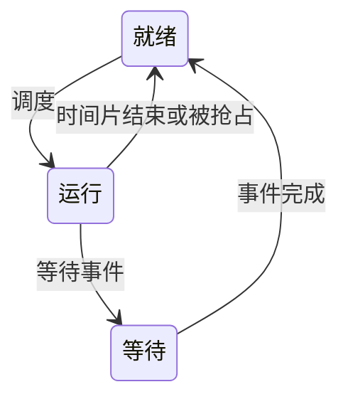

# 南京邮电大学《操作系统A》试卷（B卷）

原文件共七页，第 1—4 页为《操作系统 A》试卷（B），第 5—7 页为同卷原答案，未注明学年。下列“原卷答案”与“原卷答案摘要”来自原件；我们的核算、补充与订正另标。

原卷要求把答案写在答题纸上，写在试卷上无效；考完将试卷与答题纸交给监考老师，不得带出考场。装订线内不作答。

## 一、填空题（20 分，共 10 空）

### 填空 1

题干：三种基本的操作系统是：\_\_\_\_、\_\_\_\_、实时操作系统。

**原卷答案：** 批处理操作系统、分时操作系统。

知识点：[操作系统三种基本类型（批处理、分时、实时）及其主要目标](../../../topics/操作系统/操作系统基本类型.md)

### 填空 2

题干：Linux 操作系统按照事件来源和实现手段将中断分为 \_\_\_\_、\_\_\_\_。

**原卷答案：** 硬中断、软中断。

知识点：[中断的概念、类型与处理过程](../../../topics/操作系统/中断机制.md)

### 填空 3

题干：分区存储管理可分为 \_\_\_\_、\_\_\_\_两种方式。

**原卷答案：** 固定分区、可变分区。

知识点：[连续分配方式（单一连续、固定分区、动态分区）及分配算法](../../../topics/操作系统/连续分配方式.md)、[可变分区分配算法（首次适应、最佳适应、最差适应）](../../../topics/操作系统/可变分区分配算法.md)

### 填空 4

题干：局部性原理可总结为以下三点：\_\_\_\_、\_\_\_\_和顺序局部性。

**原卷答案：** 时间局部性、空间局部性。

知识点：[虚拟存储器的基本思想与局部性原理](../../../topics/操作系统/虚拟存储器.md)

### 填空 5

题干：文件常见的存取方法有 \_\_\_\_、\_\_\_\_和索引存取。

**原卷答案：** 顺序、直接。

知识点：[文件的逻辑结构（流式文件、记录式文件）](../../../topics/操作系统/文件逻辑结构.md)

## 二、单项选择题（20 分，共 10 题）

### 选择 1

题干：下列选项中，不属于进程关键要素的是\_\_\_\_\_\_\_\_\_\_。
- A. 程序
- B. 数据和栈
- C. 进程控制块
- D. 原语

**原卷答案：** D。

**核对：** 程序、数据与栈、PCB 均是描述或支撑进程的组成；原语是操作系统完成某项不可分操作的手段，不是该三项组成之一。

知识点：[进程的定义与特征（动态性、并发性、独立性、制约性、异步性、结构性）](../../../topics/操作系统/进程定义与特征.md)、[进程控制块（PCB）的作用与内容](../../../topics/操作系统/进程控制块.md)

### 选择 2

题干：以下不属于分时操作系统的特征是 \_\_\_\_。
- A. 同时性
- B. 独立性
- C. 无序性
- D. 及时性

**原卷答案：** C。

**核对：** 分时系统的常见特点还包括交互性；“无序性”不在这组定义中。

知识点：[操作系统三种基本类型（批处理、分时、实时）及其主要目标](../../../topics/操作系统/操作系统基本类型.md)、[分时系统的工作原理与特征](../../../topics/操作系统/分时系统工作原理.md)

### 选择 3

题干：设与某资源关联的信号量初值为 3，当前值为 -1。若 M 表示该资源的可用个数，N 表示等待该资源的进程数，则 M、N 分别是 \_\_\_\_。
- A. 0、1
- B. 1、0
- C. 1、2
- D. 2、0

**原卷答案：** A。

**核对：** 按题中有符号信号量的约定，负值的绝对值是等待者数；可立即获取的资源数为零。

知识点：[信号量机制与P、V操作的定义](../../../topics/操作系统/信号量与PV操作.md)

### 选择 4

题干：以下不属于产生死锁的原因包括 \_\_\_\_。
- A. 因为系统资源不足
- B. 采用的进程调度算法效率低下
- C. 进程运行推进的顺序不合适
- D. 资源分配不当

**原卷答案：** B。

**核对：** 调度低效不会本身造成进程循环等待；资源不足也不是单独的充分条件。判断死锁要看是否出现不可解除的等待环。

知识点：[死锁的定义与四个必要条件（互斥、请求保持、不可剥夺、循环等待）](../../../topics/操作系统/死锁概念与必要条件.md)、[死锁的预防方法与避免方法（银行家算法）](../../../topics/操作系统/死锁预防与避免.md)、[死锁的检测（资源分配图）与解除方法](../../../topics/操作系统/死锁检测与解除.md)

### 选择 5

题干：以下不属于磁盘的访问时间的是 \_\_\_\_。
- A. DMA 时间
- B. 寻道时间
- C. 旋转延迟时间
- D. 传输时间

**原卷答案：** A。

**核对：** 题中磁盘自身的访问时间分为寻道、旋转延迟和数据传输三项；DMA 是接口与内存之间的传送机制。

知识点：[磁盘调度算法（FCFS、SSTF、SCAN、CSCAN）](../../../topics/操作系统/磁盘调度算法.md)

### 选择 6

题干：一个分页存储管理系统中，地址长度为 32 位，其中页号占 8 位，则页表长度是 \_\_\_\_。
- A. $2^8$ 字节
- B. $2^{16}$ 字节
- C. $2^{24}$ 字节
- D. $2^{32}$ 字节

**原卷答案：** A。

**订正：** 可以确定页表有 $2^8=256$ 个表项；字节数还取决于每个表项占几字节。若表项为 4 字节，则需 1024 字节。选项 A 的数值对应表项数，却将单位印成了字节。

知识点：[页式存储管理的基本原理与地址转换](../../../topics/操作系统/分页存储管理.md)、[存储管理的基本功能与地址转换（地址重定位）](../../../topics/操作系统/存储管理功能.md)

### 选择 7

题干：页表地址转换采用相联存储器的方法后，地址转换时间将大大加快。假定访问内存的时间为 $100 \mathrm{~ns}$，访问相联存储器的时间为 $20 \mathrm{~ns}$，相联存储器为 32 个单元时查快表的命中率可达 $90 \%$，按逻辑地址进行存取的平均时间为 \_\_\_\_ ns。
- A. 100
- B. 108
- C. 120
- D. 128

**原卷答案：** D（128 ns）。

**订正：** 若串行查快表，命中用 $20+100=120\,\mathrm{ns}$，未命中还要在内存读一次页表，共 $20+100+100=220\,\mathrm{ns}$。平均 $0.9\times120+0.1\times220=130\,\mathrm{ns}$，原题没有这一选项。若另行假定未命中路径不计那 20 ns，才会得到 $0.9\times120+0.1\times200=128\,\mathrm{ns}$；题中没有写明这种额外的时序假设。

知识点：[快表（TLB）机制及带快表的地址变换过程](../../../topics/操作系统/快表机制.md)、[页式存储管理的基本原理与地址转换](../../../topics/操作系统/分页存储管理.md)

### 选择 8

题干：程序员利用系统调用打开 I/O 设备时，通常使用的设备标识是 \_\_\_\_\_\_\_\_。
- A. 逻辑设备名
- B. 物理设备名
- C. 主设备号
- D. 从设备号

**原卷答案：** A。

**核对：** 应用按逻辑标识打开设备，逻辑标识到物理设备的映射由系统处理。

知识点：[设备的分类（按资源分配角度：独享、共享、虚拟设备）](../../../topics/操作系统/设备分类.md)、[操作系统的用户界面（命令接口、程序接口、图形接口）](../../../topics/操作系统/用户界面.md)

### 选择 9

题干：下列选项中，不属于常见 I/O 控制方式的是 \_\_\_\_。
- A. 程序直接查询控制方式
- B. 中断方式
- C. DMA 方式
- D. 通信方式

**原卷答案：** D。

**核对：** 典型教材分类是程序查询、中断、DMA 和通道方式；“通信方式”不属于这组 I/O 控制方式。

知识点：[I/O控制方式（程序查询、中断、DMA、通道）及比较](../../../topics/操作系统/IO控制方式.md)

### 选择 10

题干：目前常用的目录结构形式不包括 \_\_\_\_。
- A. 复合目录
- B. 单级目录
- C. 二级目录
- D. 树型目录

**原卷答案：** A。

**核对：** 本题用的是单级、二级、树型三种常见目录结构分类，“复合目录”不在其中。

知识点：[文件目录结构（单级、二级、多级目录）及特点](../../../topics/操作系统/文件目录结构.md)

## 三、简答题（20 分，共 5 题）

### 简答 1

题干：简述采用了多道程序设计技术操作系统的特性。

**原卷答案摘要：**
1. **并发性**：指两个或两个以上的事件或活动在同一时间间隔内发生。操作系统具有处理和调度多个程序交替推进的能力。
2. **共享性**：指计算机系统中的资源可被多个并发执行的用户程序和系统程序共同使用，而非独占。分为顺序共享和并发共享。
3. **不确定性**（异步性）：在多道程序并发执行环境中，程序的推进速度受运行环境影响，执行结果可能因环境不同而不同。
4. **虚拟性**：通过管理技术将物理实体变为逻辑上的多个对应物，或反之，提供逻辑上具备但物理上未提供的功能，以提高资源利用率。

**补充：** “同一时间间隔”不同于“同一时刻”。一个 CPU 上多个进程可以并发，不要求多条指令流在同一瞬间执行。

知识点：[现代操作系统的特征（并发、共享、虚拟、异步）](../../../topics/操作系统/操作系统特征.md)

### 简答 2

题干：请简单叙述进程的三态模型的状态转化。

**原卷答案摘要：**
1. **就绪态 $\rightarrow$ 运行态**：当调度程序选择新进程运行时，进程由就绪态切换至运行态。
2. **运行态 $\rightarrow$ 就绪态**：运行进程用完时间片，或被高优先级进程抢占，由运行态切换回就绪态。
3. **运行态 $\rightarrow$ 等待态**：进程需等待某事件（如 I/O 完成、资源申请、IPC 通信）时，由运行态切换至等待态。
4. **等待态 $\rightarrow$ 就绪态**：当进程等待的事件发生时（如资源满足、数据到来），由等待态切换至就绪态。

**补充：** 等待的事件完成只把进程送入就绪队列；有处理器且被调度才运行。



知识点：[进程的基本状态（就绪、执行、阻塞）及状态转换](../../../topics/操作系统/进程状态转换.md)

### 简答 3

题干：简述段式存储管理和页式存储管理的共同点和区别。

**原卷答案摘要：**
**共同点**：两者都采用离散分配方式，且都要通过地址映射机构来实现地址变换。
**区别**：
1. **单位性质**：页是信息的物理单位，目的是减少外零头，提高内存利用率；段是信息的逻辑单位，含有一组意义相对完整的信息，目的是满足用户需要。
2. **大小确定**：页的大小固定且由系统确定；段长不固定，取决于用户程序，由编译程序划分。
3. **地址空间**：页式管理中地址空间是一维的（线性）；段式管理中地址空间是二维的（段名 + 段内地址）。

**补充：** 这里“段式离散”指各段之间可不相邻，不是说单个段在纯分段模型内也能切开分配。固定页避免外部碎片，不保证没有页内碎片。

知识点：[分页与分段的区别](../../../topics/操作系统/分页与分段区别.md)、[段式存储管理的基本原理与地址转换](../../../topics/操作系统/分段存储管理.md)、[页式存储管理的基本原理与地址转换](../../../topics/操作系统/分页存储管理.md)

### 简答 4

题干：简述 SPOOLing 技术的特点。

**原卷答案摘要：**
1. **提高了 I/O 速度**：将低速 I/O 设备的操作演变为对输入井/输出井的高速存取，缓和了 CPU 与低速设备速度不匹配的矛盾。
2. **设备不被独占**：系统中并未为进程实际分配物理设备，仅在井中分配存储区和建立请求表。
3. **实现了虚拟设备功能**：将独占设备变换为若干台逻辑设备，使宏观上多个进程可同时使用一台独占设备，每个进程感觉自己在独享设备。

**补充：** 假脱机改善的是进程提交 I/O 请求的等待与排队，不是让打印机等物理设备本身变快。

知识点：[SPOOLing 系统](../../../topics/操作系统/SPOOLing系统.md)

### 简答 5

题干：请简单叙述缓冲的基本思想及常见的缓冲技术。

**原卷答案摘要：**
**基本思想**：当一个进程输出数据时，先申请一块内存作为缓冲区，将数据高速写入缓冲区，填满后进程继续计算，系统将缓冲区内容写入 I/O 设备；读操作过程类似。
**常见技术**：单缓冲、双缓冲、循环缓冲和缓冲池。

**补充：** 缓冲能吸收速率差，但若没有空缓冲或者没有可读数据，进程仍须等待。

知识点：[缓冲技术的引入目的与类型（单缓冲、双缓冲、循环缓冲）](../../../topics/操作系统/缓冲技术.md)

## 四、综合题（40 分，共 4 题）

### 综合 1

题干：问题描述：若干进程通过有限的共享缓冲区交换数据。其中，生产者进程不断写入，而消费者进程不断读出，共享缓冲区有 N 个；任何时刻只能有一个进程可对共享缓冲区进行操作。使用信号量和 P、V 操作来实现两组进程之间的同步和互斥。

**原卷答案（整理由两栏转录）：** 用 $k$ 表示题中的 $N$。

```pascal
var B : array[0..k-1] of item;
empty: semaphore := k; /* 可以使用的空缓冲区数 */
full: semaphore := 0;  /* 缓冲区内可以使用的产品数 */
mutex: semaphore := 1; /* 互斥信号量 */
in, out: integer := 0; /* 放入/取出缓冲区指针 */

cobegin

process producer_i
begin
L1: produce a product;
    P(empty);
    P(mutex);
    B[in] := product;
    in := (in + 1) mod k;
    V(mutex);
    V(full);
    goto L1;
end;

process consumer_j
begin
L2: P(full);
    P(mutex);
    Product := B[out];
    out := (out + 1) mod k;
    V(mutex);
    V(empty);
    Consume a product;
    goto L2;
end;

coend
```

**核对：** 生产者先预订空槽，消费者先预订已发布产品；两者只在拥有 `mutex` 时读写环形缓冲区，读写后才向另一方发布计数。模 $k$ 让两个位置在缓冲区头尾循环。

> [!WARNING]
> 不要把 `P(mutex)` 提前到 `P(full)` 或 `P(empty)` 前。例如空缓冲时，消费者若占着互斥锁等待产品，生产者就拿不到锁放入产品。处于预订与发布之间的槽位暂不计入两个可用计数，不可断言每条指令后 `empty + full = k`。

知识点：[经典进程同步问题（生产者-消费者、读者-写者、哲学家进餐）](../../../topics/操作系统/经典同步问题.md)、[信号量机制与P、V操作的定义](../../../topics/操作系统/信号量与PV操作.md)、[临界区、临界资源与互斥的概念](../../../topics/操作系统/临界区与互斥.md)

### 综合 2

题干：单道批处理环境下有 5 个作业，各作业进入系统的时间和估计运行时间如下表所示。如果应用短作业优先（SJF）的作业调度算法，试将表格填写完整。原题中最后两列为空。

**原卷答案（最后两列）：**

<table>
<thead>
<tr><th>作业</th><th>进入系统时间</th><th>估计运行时间 /分钟</th><th>结束时间</th><th>带权周转时间</th></tr>
</thead>
<tbody>
<tr><td>1</td><td>8:00</td><td>40</td><td>8:40</td><td>1</td></tr>
<tr><td>2</td><td>8:20</td><td>30</td><td>9:22</td><td>2.07</td></tr>
<tr><td>3</td><td>8:30</td><td>12</td><td>8:52</td><td>1.83</td></tr>
<tr><td>4</td><td>9:00</td><td>18</td><td>9:45</td><td>2.5</td></tr>
<tr><td>5</td><td>9:10</td><td>5</td><td>9:27</td><td>3.4</td></tr>
</tbody>
</table>

**核算：** 每次只能在已经到达的作业中选最短的。调度非抢占，所以作业 5 于 9:10 到达时不打断正在运行的作业 2。
1. **8:00**：作业 1 到达，开始运行，预计 40 分钟，**8:40** 结束。周转时间 40，带权 1。
2. **8:40**：作业 1 结束。此时等待队列中有作业 2 (8:20 到), 作业 3 (8:30 到)。
   - 比较运行时间：作业 2 (30) > 作业 3 (12)。
   - 选择短作业优先：**作业 3** 先运行。
   - 作业 3 运行 12 分钟，**8:52** 结束。周转时间 $8:52 - 8:30 = 22$，带权 $22/12 \approx 1.83$。
3. **8:52**：作业 3 结束。此时等待队列中有作业 2 (8:20 到)。
   - 只有作业 2 在等。**作业 2** 开始运行。
   - 作业 2 运行 30 分钟，**9:22** 结束。周转时间 $9:22 - 8:20 = 62$，带权 $62/30 \approx 2.07$。
4. **9:22**：作业 2 结束。此时等待队列中有作业 4 (9:00 到), 作业 5 (9:10 到)。
   - 比较运行时间：作业 4 (18) > 作业 5 (5)。
   - 选择短作业优先：**作业 5** 先运行。
   - 作业 5 运行 5 分钟，**9:27** 结束。周转时间 $9:27 - 9:10 = 17$，带权 $17/5 = 3.4$。
5. **9:27**：作业 5 结束。只剩作业 4。
   - **作业 4** 开始运行。
   - 作业 4 运行 18 分钟，**9:45** 结束。周转时间 $9:45 - 9:00 = 45$，带权 $45/18 = 2.5$。

知识点：[作业调度算法及性能评价（周转时间、带权周转时间）](../../../topics/操作系统/作业调度算法.md)

### 综合 3

题干：考虑一个共有 150 个存储单元的系统，如下分配给三个进程：P1 最大需求 70，已占有 25；P2 最大需求 60，已占有 40；P3 最大需求 60，已占有 45。使用银行家算法，以确定下面的任何一个请求是否安全。
(1) P4 进程到达，P4 最大需求 60，最初请求 25 个。
(2) P4 进程到达，P4 最大需求 60，最初请求 35 个。

**原卷答案：** （1）安全；（2）不安全。

**核算：** 原可用量为 $150-(25+40+45)=40$。两次请求是各自从这个初始状态出发的假设，不是连续操作。试分配后，要问“手上的资源够哪个进程把剩余需求一次补齐”。

| 进程 | 最大需求 | 原分配 | 原尚需 |
| --- | ---: | ---: | ---: |
| P1 | 70 | 25 | 45 |
| P2 | 60 | 40 | 20 |
| P3 | 60 | 45 | 15 |
| P4 | 60 | 0 | 60 |

- **请求 25：** 试分后可用量为 15，P4 尚需 35。可按 P3、P2、P1、P4 完成；每次完成后的可用量依次是 60、100、125、150。
- **请求 35：** 试分后可用量为 5，P4 尚需 25；此时所有进程尚需量均大于 5，找不到第一个能完成的进程，因而不能批准试分配。不安全不等于已经死锁。

> [!TIP]
> 安全性检查里，进程完成时应计算 `Work += Allocation`，而不是加 `Max`。补给它的 `Need` 随完成归还，只抵回刚才的补给，真正新增的是它原先占有的量。最后不能凭空算出超过系统总量的可用资源。

知识点：[死锁预防与避免、银行家算法](../../../topics/操作系统/死锁预防与避免.md)

### 综合 4

题干：假定磁盘有 200 个柱面，编号 0~199，当前存取臂的位置在 100 号柱面上，且向磁道号增加方向访问。如果请求队列的先后次序是：55、58、39、18、90、160、150、38、184。试问：为完成上述请求，下列算法存取臂移动的总量是多少？并计算平均寻道长度。

1. 先来先服务算法 FCFS。
2. 扫描算法 SCAN。

**原卷答案（原答页将二项编号印为 3、4）：** FCFS 总寻道长度 498，平均 55.3；SCAN 总寻道长度 250，平均 27.8。

**核算与订正：** 总长度按路径上相邻位置的距离逐段相加，平均长度按 9 项实际请求除。端点 199 可以经过，但它不是一项额外请求。

| 算法与折返约定 | 路径（从 100 出发） | 总长度 | 平均长度 |
| --- | --- | ---: | ---: |
| FCFS | 100 → 55 → 58 → 39 → 18 → 90 → 160 → 150 → 38 → 184 | 498 | 55.3 |
| SCAN，走到盘端再折返 | 100 → 150 → 160 → 184 → 199 → 90 → 58 → 55 → 39 → 38 → 18 | 280 | 31.1 |
| LOOK，在最远待服务位置折返 | 100 → 150 → 160 → 184 → 90 → 58 → 55 → 39 → 38 → 18 | 250 | 27.8 |

FCFS 九段长度依序为 45、3、19、21、72、70、10、112、146。两种扫描都先升后降，差别仅在折返点。严格 SCAN 在 199 折返，用 $(199-100)+(199-18)=280$；原卷数值从 184 折返，即 $(184-100)+(184-18)=250$，与 LOOK 的路径一致。

知识点：[磁盘调度算法](../../../topics/操作系统/磁盘调度算法.md)
