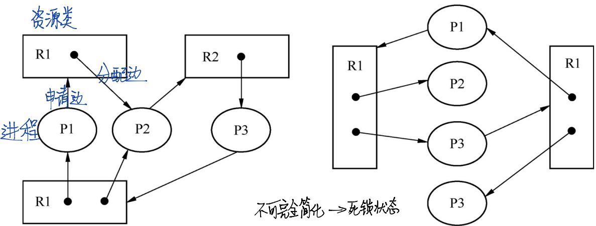
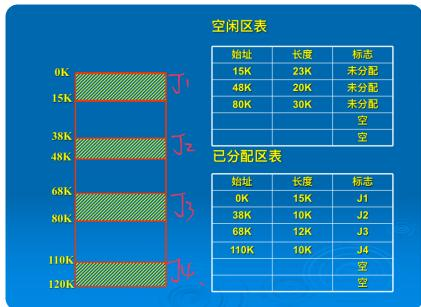
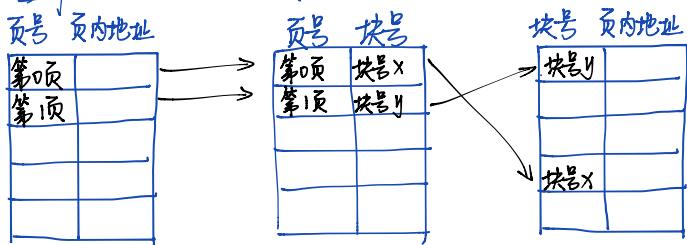
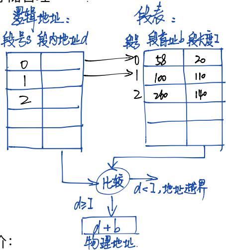
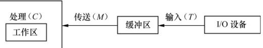
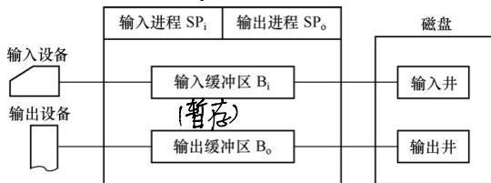
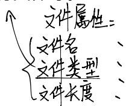

# 南京邮电大学《操作系统》期末复习知识点

原件经识别和整理；“参考解答”是我们补的。

---
title: 南京邮电大学《操作系统》期末复习知识点（第1部分）
kind: 复习要点
course: 操作系统
term: 
source: 识别工具读出的内容（第 1–6 页）
---

# 南京邮电大学《操作系统》期末复习知识点（第1部分）

本资料整理自识别工具输出的《南京邮电大学《操作系统》期末复习知识点》第一部分，涵盖操作系统概论、进程管理与调度、并发进程等核心章节。已修正明显的OCR识别错误（如乱码、断行），并规范了格式。

## 第一章、操作系统概论

### 选择 1

题干：计算机系统的层次结构包括哪些部分？

- A. 硬件、应用层、网络层
- B. 硬件、操作系统、系统软件、应用程序
- C. CPU、内存、外设
- D. 内核、用户态、系统调用

答案：B。

知识点：[操作系统的定义与主要目标](../../../topics/操作系统/操作系统定义与目标.md)

### 选择 2

题干：多道程序设计技术的主要特点是什么？

- A. 宏观上串行，微观上并行
- B. 宏观上并行，微观上串行
- C. 所有程序同时执行
- D. 提高用户响应时间

答案：B。
参考解答：多道程序设计是指在内存中存放多个程序，宏观上并行（同时处于运行状态），微观上串行（CPU在多个程序间切换）。其目的是提高资源利用率和系统吞吐率，但牺牲了用户的响应时间，即作业周转时间延长。

知识点：[现代操作系统的特征（并发、共享、虚拟、异步）](../../../topics/操作系统/操作系统特征.md)、[进程的定义与特征（动态性、并发性、独立性、制约性、异步性、结构性）](../../../topics/操作系统/进程定义与特征.md)、[处理机的三级调度（高级、中级、低级调度）](../../../topics/操作系统/处理机调度级别.md)

### 简答 1

题干：如何从三个视角理解操作系统的定义？

正文：
1. **软件视角**：操作系统是计算机系统中最基本的系统软件，它是其他软件的基础。
2. **资源管理器视角**：操作系统是计算机系统资源的管理者，负责管理处理器、存储器、设备和文件等资源。
    - **目的**：实现资源共享，提高资源利用率。
3. **虚拟机视角**：操作系统向用户提供了一台比实际硬件功能更强、使用更方便的虚拟计算机。

知识点：[进程的定义与特征（动态性、并发性、独立性、制约性、异步性、结构性）](../../../topics/操作系统/进程定义与特征.md)、[进程与程序的区别与联系](../../../topics/操作系统/进程与程序区别.md)

### 简答 2

题干：简述批处理、分时和实时操作系统的特点及优缺点。

正文：
1. **批处理操作系统**：
    - **特征**：单道性、顺序性、自动性。
    - **优点**：提高了系统资源的利用率与工作效率。
    - **缺点**：交互性差，用户无法直接控制作业运行。
2. **分时操作系统**：
    - **特征**：多路性（多终端）、独立性、及时性、交互性。
    - **优点**：缩短周转时间，采用人机对话工作方式，各终端用户彼此独立互不干扰。
    - **缺点**：对系统实时性要求不如实时系统高。
3. **实时操作系统**：
    - **特征**：及时性、可靠性高。
    - **优点**：能对随机发生的外部事件作出及时的响应和处理，响应迅速。
    - **缺点**：系统复杂度高，成本较高。

知识点：[临界区、临界资源与互斥的概念](../../../topics/操作系统/临界区与互斥.md)、[信号量机制与P、V操作的定义](../../../topics/操作系统/信号量与PV操作.md)

### 简答 3

题干：操作系统的四个基本特性及其含义是什么？

正文：
1. **并发性（Concurrency）**：
    - 指两个或多个事件在同一时间间隔内发生。宏观上程序同时执行，微观上程序在地址轮流执行。
2. **共享性（Sharing）**：
    - 资源可被多个并发执行的用户程序和系统程序共同使用。
3. **虚拟性（Virtualization）**：
    - 一种管理技术，将一个物理实体对应多个逻辑对应物，或多个物理实体对应一个逻辑对应物。
4. **不确定性（Uncertainty）**：
    - 程序的执行结果不可再现，执行次序不是事先确定的，依赖于输入数据和时间因素。

*注：这四种特性互为依存，缺一不可。*

知识点：[临界区、临界资源与互斥的概念](../../../topics/操作系统/临界区与互斥.md)

### 简答 4

题干：操作系统的主要功能有哪些？

正文：
1. **处理机管理**：对进程和线程的管理和调度（高级、中级、低级调度）。
2. **存储器管理**：内存分配、保护、扩充和交换。
3. **设备管理**：对信息资源（外围设备）的管理，包括缓冲管理、设备分配和驱动。
4. **文件管理**：对程序和数据文件的管理，提供文件的存取、共享和保护机制。

## 第三章、进程管理与调度

知识点：[信号量机制与P、V操作的定义](../../../topics/操作系统/信号量与PV操作.md)、[经典进程同步问题（生产者-消费者、读者-写者、哲学家进餐）](../../../topics/操作系统/经典同步问题.md)、[临界区、临界资源与互斥的概念](../../../topics/操作系统/临界区与互斥.md)

### 选择 1

题干：CPU的基本构成包括哪些部分？

- A. 运算器、控制器、寄存器组
- B. ALU、CU、PC、SP
- C. 内存、硬盘、CPU
- D. 总线、接口、控制器

答案：A。
参考解答：CPU由运算器、控制器和一系列寄存器组成。寄存器分为通用寄存器和专用寄存器（如程序计数器PC、栈指针SP等）。高速缓存由MMU（内存管理单元）协助管理。

知识点：[操作系统的定义与主要目标](../../../topics/操作系统/操作系统定义与目标.md)

### 简答 1

题干：什么是中断？什么情况下会触发中断？

正文：
1. **定义**：指CPU对系统中或系统外发生的异步事件的响应。CPU暂停正在执行的程序，保留现场后自动转去执行相应事件的处理程序，处理完成后返回断点，继续执行被打断的程序。
2. **触发情况**：
    - 外部设备完成数据传输。
    - 实时设备出现异常。
    - 时钟中断。
    - 程序出错（如非法指令、越界访问）。

知识点：[进程的定义与特征（动态性、并发性、独立性、制约性、异步性、结构性）](../../../topics/操作系统/进程定义与特征.md)、[进程与程序的区别与联系](../../../topics/操作系统/进程与程序区别.md)

### 简答 2

题干：请解释进程的定义、特征以及进程与程序的区别。

正文：
1. **进程定义**：具有独立功能的程序关于某个数据集合上的一次运行活动，是系统进行资源分配、调度和保护的独立单位。
2. **进程特征**：
    - **动态性**：进程有生命周期，有诞生、发展、消亡的过程。
    - **并发性**：多个进程可以在同一时间内同时在内存中存在。
    - **独立性**：进程是系统中的独立活动单位。
    - **结构性**：由程序段、数据段和PCB组成。
    - **制约性**：进程间存在相互制约关系。
    - **共享性**：资源可被多个进程共享。
3. **进程与程序的区别**：
    - **本质**：程序是静态的，进程是动态的。
    - **组成**：进程由程序、数据和PCB三部分组成；程序仅是代码序列。
    - **生命周期**：进程有生命周期（短暂）；程序相对长久。
    - **对应关系**：一个程序可对应多个进程，反之亦然。
    - **功能**：进程具有创建其他进程的功能，程序没有。

知识点：[临界区、临界资源与互斥的概念](../../../topics/操作系统/临界区与互斥.md)、[信号量机制与P、V操作的定义](../../../topics/操作系统/信号量与PV操作.md)

### 简答 3

题干：描述进程的三种基本状态及其转换条件。

正文：
1. **就绪状态（Ready）**：已具备运行条件，但无CPU，等待调度。
2. **运行状态（Running）**：占有CPU，正在执行。
3. **阻塞状态（Blocked/Waiting）**：因等待某事件（如I/O完成、信号量）而无法运行。

**转换关系**：
- **就绪 -> 运行**：调度程序选择一个新的进程运行。
- **运行 -> 就绪**：运行进程用完时间片；或被更高优先级进程抢占。
- **运行 -> 阻塞**：OS尚未完成服务，对一资源的访问尚不能进行（如请求I/O）。
- **阻塞 -> 就绪**：所等待的事件发生（如I/O完成）。

知识点：[临界区、临界资源与互斥的概念](../../../topics/操作系统/临界区与互斥.md)

### 简答 4

题干：什么是进程控制块（PCB）？它包含哪些要素？

正文：
1. **定义**：PCB是描述进程属性的数据结构，是系统感知进程存在的唯一标志。
2. **构成要素**：
    - **进程描述信息**：进程标识符、状态、优先级等。
    - **进程控制信息**：程序计数器、寄存器值、上下文信息等。
    - **资源清单**：所拥有的资源和使用情况。
3. **进程上下文**：
    - **机器级上下文**：通用寄存器、PC、PSW等。
    - **系统级上下文**：打开文件列表、信号掩码等。
4. **上下文切换**：使处于运行态的进程中断运行让出处理器，保存老进程状态而装入被保护的新进程状态。

知识点：[信号量机制与P、V操作的定义](../../../topics/操作系统/信号量与PV操作.md)、[经典进程同步问题（生产者-消费者、读者-写者、哲学家进餐）](../../../topics/操作系统/经典同步问题.md)、[临界区、临界资源与互斥的概念](../../../topics/操作系统/临界区与互斥.md)

### 简答 5

题干：什么是原语？进程的控制原语包括哪些？

正文：
1. **原语（Primitive）**：是在管态下执行、完成系统特定功能的过程。其特点是执行过程中不允许被中断，是一个不可分割的基本单位。原语的执行是顺序的而不可能是并发的。
2. **主要控制原语**：
    - **创建（Create）**：分配资源、建立PCB、初始化状态。
        - *来源*：提交批处理作业、交互式登录、操作系统创建服务进程、父进程孵化子进程。
    - **撤销（Terminate）**：释放资源、删除PCB。
    - **阻塞（Block）**：进程主动放弃CPU，进入阻塞状态。
    - **唤醒（Wakeup）**：将阻塞状态的进程转为就绪状态。
    - **挂起/激活**：涉及内存与辅存的对换。

知识点：[进程通信方式（共享存储、消息传递、管道通信）](../../../topics/操作系统/进程通信.md)

### 简答 6

题干：比较模式切换与进程上下文切换。

正文：
1. **模式切换**：
    - 发生在用户态与内核态之间。
    - 引起进程状态变化不一定引起进程切换。
    - 可通过逆向模式切换来继续执行用户进程。
2. **进程上下文切换**：
    - 发生在不同进程之间。
    - 需要保存当前进程的上下文（寄存器、PC等）并加载新进程的上下文。
    - 开销较大，频繁切换会影响系统性能。

知识点：[死锁的定义与四个必要条件（互斥、请求保持、不可剥夺、循环等待）](../../../topics/操作系统/死锁概念与必要条件.md)、[死锁的预防方法与避免方法（银行家算法）](../../../topics/操作系统/死锁预防与避免.md)、[死锁的检测（资源分配图）与解除方法](../../../topics/操作系统/死锁检测与解除.md)

### 简答 7

题干：简述三级调度的概念与作用。

正文：
1. **高级调度（作业调度）**：
    - **作用**：决定哪个作业可以进入系统，从后备队列中选择作业装入内存，建立进程。
    - **关注点**：是否接受连接、程序能否接纳、新建进程加入就绪队列。
2. **中级调度（内存调度）**：
    - **作用**：决定主存中能容纳的进程数，进行进程的对换（Swap）。
    - **方法**：将一些进程换出主存进入挂起状态，平滑和调整系统负荷。
3. **低级调度（进程调度）**：
    - **作用**：决定就绪队列中的哪个进程获得CPU。
    - **地位**：操作系统最核心的部分，直接影响系统性能。
    - **尺度**：毫秒级，要求高效。

知识点：[处理机的三级调度（高级、中级、低级调度）](../../../topics/操作系统/处理机调度级别.md)、[作业调度算法及性能评价（周转时间、带权周转时间）](../../../topics/操作系统/作业调度算法.md)、[进程调度算法（FCFS、SJF、优先级、时间片轮转、多级反馈队列）](../../../topics/操作系统/进程调度算法.md)

### 简答 8

题干：作业调度算法的设计原则及常用算法有哪些？

正文：
1. **设计原则**：
    - 调度算法应与系统设计目标保持一致。
    - 注意系统资源均衡使用。
    - 保证提交的作业在截止时间内完成。
    - 设法缩短作业平均周转时间。
2. **衡量指标**：
    - 平均周转时间（短越好）。
    - 平均带权周转时间。
3. **常用算法**：
    - **先来先服务（FCFS）**：简单公平，长作业有利，短作业不利。
    - **最短作业优先（SJF）**：短作业有利，可能导致长作业饥饿。
    - **最短剩余时间优先（SRTF）**：SJF的可剥夺版本。
    - **最高响应比优先（HRN）**：兼顾等待时间和估计服务时间，平衡长短作业。
    - **均衡调度（分类排队）**：根据系统运行情况分类轮流挑选。
    - **基于优先数调度（HPF）**：静态或动态优先级。

知识点：[作业调度算法及性能评价（周转时间、带权周转时间）](../../../topics/操作系统/作业调度算法.md)、[处理机的三级调度（高级、中级、低级调度）](../../../topics/操作系统/处理机调度级别.md)、[操作系统三种基本类型（批处理、分时、实时）及其主要目标](../../../topics/操作系统/操作系统基本类型.md)

### 简答 9

题干：低级调度（进程调度）常用算法有哪些？重点分析时间片轮转算法。

正文：
1. **常用算法**：
    - 先来先服务（FCFS）。
    - 时间片轮转（RR）。
    - 优先权调度。
    - 多级反馈队列调度。
    - 保证调度算法。
    - 彩票调度算法。
2. **时间片轮转（RR）算法**：
    - **原理**：每次把CPU分配给就绪队列首进程使用一个时间片。当时间片结束，强迫进程让出CPU，排到队尾。
    - **优点**：防止独占CPU，适合分时系统。
    - **缺点**：
        - 时间片取值太小：切换频繁，开销增大。
        - 时间片取值太大：退化为FCFS，响应速度变慢。

## 第四章、并发进程

知识点：[进程调度算法（FCFS、SJF、优先级、时间片轮转、多级反馈队列）](../../../topics/操作系统/进程调度算法.md)、[处理机的三级调度（高级、中级、低级调度）](../../../topics/操作系统/处理机调度级别.md)、[分时系统的工作原理与特征](../../../topics/操作系统/分时系统工作原理.md)

### 简答 1

题干：对比顺序程序与并发进程的特征。

正文：
1. **顺序程序**：
    - **环境**：单道运行，独占资源。
    - **特征**：
        - 顺序性执行。
        - 封闭性（独占资源）。
        - 确定性（可再现性）。
2. **并发进程**：
    - **环境**：多道运行，资源共享。
    - **特征**：
        - 间断性执行。
        - 资源共享。
        - 失去封闭性（结果不可再现）。
        - 具有独立性和制约性。
        - 程序与计算不再一一对应。

知识点：[进程的定义与特征（动态性、并发性、独立性、制约性、异步性、结构性）](../../../topics/操作系统/进程定义与特征.md)、[进程与程序的区别与联系](../../../topics/操作系统/进程与程序区别.md)

### 简答 2

题干：解释进程同步与进程互斥的区别。

正文：
1. **进程同步（直接作用）**：
    - **定义**：为了合作完成一项任务，进程间按一定时序关系协调行动。
    - **特点**：有意识安排，仅发生在相交进程间，彼此相互发送消息进行合作。
2. **进程互斥（间接作用）**：
    - **定义**：各进程竞争使用临界资源（一次只允许一个进程使用）。
    - **特点**：无意识安排，可发生在相交或无关进程间，通过中介（如锁）联系。
    - **关系**：进程互斥是进程同步的一种特殊情况。

知识点：[临界区、临界资源与互斥的概念](../../../topics/操作系统/临界区与互斥.md)、[信号量机制与P、V操作的定义](../../../topics/操作系统/信号量与PV操作.md)

### 简答 3

题干：什么是临界区？使用临界区的原则是什么？

正文：
1. **临界区**：进程中涉及临界资源的程序段。多个进程的临界区称为相关临界区。
2. **使用原则**：
    - **有空让进**：若临界区空闲，应允许请求进入的进程立即进入。
    - **无空等待**：若临界区忙，请求进程必须等待。
    - **有限等待**：等待时间必须有限，避免饥饿。
    - **让权等待**：等待时应释放CPU（阻塞），避免忙等。

知识点：[临界区、临界资源与互斥的概念](../../../topics/操作系统/临界区与互斥.md)

### 简答 4

题干：什么是信号量？P、V操作的含义是什么？解决经典同步问题有哪些？

正文：
1. **信号量（Semaphore）**：
    - **定义**：一个数据结构，用于协调进程，确保正确使用公共资源。
    - **初值**：互斥问题初值为1（表示资源数量）；同步问题初值通常取决于初始条件（如缓冲区满/空）。
2. **P、V操作**：
    - **P操作（Wait）**：申请资源。若信号量>0，减1；否则进程阻塞。
    - **V操作（Signal）**：释放资源。若信号量<=0，唤醒一个等待进程；否则加1。
    - **性质**：原子操作，不可中断。
3. **经典问题**：
    - 哲学家进餐问题。
    - 生产者-消费者问题。
    - 读者-写者问题。
    - 睡眠理发师问题。

知识点：[信号量机制与P、V操作的定义](../../../topics/操作系统/信号量与PV操作.md)、[经典进程同步问题（生产者-消费者、读者-写者、哲学家进餐）](../../../topics/操作系统/经典同步问题.md)、[临界区、临界资源与互斥的概念](../../../topics/操作系统/临界区与互斥.md)

### 简答 5

题干：Linux中常见的进程间通信（IPC）机制有哪些？

正文：
1. **信号通信机制**：模拟软中断，用于通知接收进程有某事件发生。
2. **共享存储区机制**：
    - **特点**：速度最高，直接在内存中共享区域。
    - **缺点**：需自行解决同步互斥问题。
3. **消息通信机制**：
    - **特点**：建立消息队列，消耗资源较少。
    - **优点**：自带同步控制，无需额外同步原语。
4. **管道通信机制**：
    - **特点**：半双工，固定大小的缓冲区。
    - **方式**：写进程写入管道，读进程读出数据。

知识点：[进程通信方式（共享存储、消息传递、管道通信）](../../../topics/操作系统/进程通信.md)

### 简答 6

题干：死锁产生的原因、必要条件及解决方法。

正文：
1. **定义**：多个进程无限期等待永远不会发生的条件，系统停滞。
2. **产生原因**：
    - 系统资源不足。
    - 进程推进顺序不合适。
    - 资源分配不当。
3. **四个必要条件**：
    - **互斥使用**：资源独占。
    - **不可强占**：自愿释放。
    - **请求和保持**：持有旧资源申请新资源。
    - **循环等待**：存在进程等待环路。
4. **解决方法**：
    - **预防**：破坏四个必要条件之一（如破坏循环等待，采用有序资源分配法）。
    - **避免**：银行家算法。动态检查资源分配，确保系统始终处于安全状态。
    - **检测与解除**：允许死锁发生，定期检测死锁图，一旦发现则终止进程或抢占资源以解除死锁。

## 死锁检测

“进程-资源分配图”：

检测步骤：

① 找一个只有分配边的非孤立进程结点，去掉分配边；若找不到转③。

② 将相应的资源分配给一个等待该资源的进程，转①。

③ 若图中有进程不是孤立结点，则为死锁状态。

死锁与环路的关系：

1. 无环路，则此时系统没有发生死锁。
2. 有环路，且每个资源类中仅有一个资源，则系统中发生了死锁。此时，环路是系统发生死锁的充要条件，环路中的进程便为死锁进程。
3. 有环路，且涉及的资源类中有多个资源，则环路的存在只是产生死锁的必要条件而不是充分条件。

## 死锁解除

1. 资源剥夺法：当发现死锁后，从其他进程那里剥夺足够数量的资源给死锁进程，以解除死锁状态。
2. 撤销进程法：撤销全部死锁进程，使系统恢复到正常状态。最简单但代价太大。可按照某种顺序逐个撤销死锁进程，直到有足够的资源供其他未被撤销的进程使用，消除死锁状态为止。

## 第五章 存储管理

存储体系：可移动存储、固定磁盘、磁盘缓存、主存储器、高速缓存、寄存器。

知识点：[死锁的定义与四个必要条件（互斥、请求保持、不可剥夺、循环等待）](../../../topics/操作系统/死锁概念与必要条件.md)、[死锁的预防方法与避免方法（银行家算法）](../../../topics/操作系统/死锁预防与避免.md)、[死锁的检测（资源分配图）与解除方法](../../../topics/操作系统/死锁检测与解除.md)

### 地址转换（地址重定位/地址映射）

为了保证 CPU 执行指令时可正确访问存储单元，需将用户程序中的逻辑地址转换为运行时由机器直接寻址的物理地址。

原因：当程序装入内存时，操作系统要为该程序分配一个合适的内存空间，由于程序的逻辑地址与分配到内存的物理地址不一致，而 CPU 执行指令时，是按物理地址进行的，所以要进行地址转换。

1. 静态重定位：在程序装入后且在运行之前，一次将需要转换的逻辑地址转换为物理地址。

   缺点：
   - 程序的存储空间只能是连续的一片区域，而且在重定位之后就不能移动，这不利于内存空间的有效使用；
   - 各个用户进程很难共享内存中的同一程序的副本。

2. 动态重定位：在程序运行过程中要访问数据时再进行地址变换。

   优点：
   - 程序占用的内存空间动态可变，也不必连续存放在一起；
   - 比较容易实现几个进程对同一程序副本的共享使用。

   缺点：
   - 需要附加的硬件支持，增加了机器成本；
   - 实现存储管理的软件算法比较复杂。

知识点：[存储管理的基本功能与地址转换（地址重定位）](../../../topics/操作系统/存储管理功能.md)、[连续分配方式（单一连续、固定分区、动态分区）及分配算法](../../../topics/操作系统/连续分配方式.md)

### 内存分配方式——静、动态分配

1. 静态分配：在生成可执行程序的过程中进行的。

   缺点：使得存储管理变得很简单，但同时也缺少灵活性，不仅不能有效地利用内存空间，而且不支持动态数据和程序结构，不能满足作业动态地增长存储空间的需求。

2. 动态分配：可以根据需要动态地增加附加分配存储空间。

   优点：这种分配机制支持不可预测的分配与释放存储区域的请求，表现出更大的灵活性。

知识点：[存储管理的基本功能与地址转换（地址重定位）](../../../topics/操作系统/存储管理功能.md)、[连续分配方式（单一连续、固定分区、动态分区）及分配算法](../../../topics/操作系统/连续分配方式.md)、[虚拟存储器的基本思想与局部性原理](../../../topics/操作系统/虚拟存储器.md)

### 分区存储管理——固定、可变分区 优缺点

1. 固定分区：预先把可分配的内存空间分割成若干个连续区域，每一区域称为分区。每个分区的大小可以相同也可以不同，分区大小固定不变，每个分区装一个且只能装一个作业。存储分配：如果有一个空闲区，则分配给进程；内存管理：设置“内存分配表”。

   缺点：内存利用率不高。

2. 可变分区：内存不是预先划分好的；作业装入时，根据作业的需求和内存空间的使用情况来决定是否分配；若有足够的空间，则按需要分割一部分分区给该进程；否则令其等待内存空间。

   缺点：碎片问题造成存储资源的浪费。

知识点：[连续分配方式（单一连续、固定分区、动态分区）及分配算法](../../../topics/操作系统/连续分配方式.md)、[可变分区分配算法（首次适应、最佳适应、最差适应）](../../../topics/操作系统/可变分区分配算法.md)、[存储管理的基本功能与地址转换（地址重定位）](../../../topics/操作系统/存储管理功能.md)

### 覆盖技术与交换技术

多道环境下扩充内存的方法。

覆盖技术（用于早期操作系统中）：

交换技术（小型分时系统中导致了虚拟技术的出现）：

1. 覆盖技术：把程序划分为若干个功能上相对独立的程序段，按照其自身的逻辑结构将那些不会同时执行的程序段共享同一块内存区域。当有关程序段的前一部分执行结束，把后续程序段调入内存，覆盖前面的程序段。内存扩大了。

   缺点：对用户不透明，增加了用户负担。

   

2. 交换技术：当内存空间紧张时，系统将内存中某些进程暂时移到外存，把外存中某些进程换进内存，占据前者所占用的区域，这种技术是进程在内存与外存之间的动态调度。

3. 两种技术的对比：

   - 交换技术不要求编程人员给出程序段之间的覆盖结构，它主要是在进程或作业之间进行，而覆盖技术则主要是在同一个进程或作业之间进行。
   - 交换技术的运用，可以在较小的存储空间中运行较多的作业或进程；覆盖技术的运用，可以在较小的存储空间中运行比其容量大的作业或进程。

知识点：[存储管理的基本功能与地址转换（地址重定位）](../../../topics/操作系统/存储管理功能.md)、[虚拟存储器的基本思想与局部性原理](../../../topics/操作系统/虚拟存储器.md)、[分页与分段的区别](../../../topics/操作系统/分页与分段区别.md)

### 页式存储管理

页表：

| 页号 | 页框号 |
| --- | --- |
|  |  |
|  |  |
|  |  |
|  |  |
|  |  |

物理地址：

页式评价：

- 优点：解决了碎片问题；便于管理。
- 缺点：不易实现共享；不便于动态连接。

知识点：[页式存储管理的基本原理与地址转换](../../../topics/操作系统/分页存储管理.md)、[存储管理的基本功能与地址转换（地址重定位）](../../../topics/操作系统/存储管理功能.md)

### 段式存储管理

段表：

段式评价：

- 缺点：产生碎片。
- 优点：便于动态申请内存；管理和使用统一化；便于共享；便于动态链接。

知识点：[段式存储管理的基本原理与地址转换](../../../topics/操作系统/分段存储管理.md)

### 快表

具有快表的地址变换过程：

1. 读出 CPU 给出的有效逻辑地址，分成页号和页内地址，由地址变换机构自动将页号与快表中的页号比较，这种比较是同时进行的。
2. 若其中有相匹配的页号，表示快表存在所要访问的页表项，直接读出对应的页框号，送物理地址寄存器形成物理地址。
3. 若在快表中未找到对应的页表项，则访问内存中的页表，找到页框号送地址寄存器形成物理地址；同时，将此页表项存入快表中的一个寄存器单元中，即修改快表。
4. 若快表已满，则系统根据某种算法找到一个不再需要的页表项换出。

知识点：[快表（TLB）机制及带快表的地址变换过程](../../../topics/操作系统/快表机制.md)、[页式存储管理的基本原理与地址转换](../../../topics/操作系统/分页存储管理.md)

### 地址转换步骤

地址转换步骤：当逻辑地址为 16 进制、八进制、二进制时：

第一步：把逻辑地址转为二进制；

第二步：按页的大小分离出页号和页内偏移量（高位部分为页号，低位部分为页内偏移量）；

第三步：根据题意产生页表；

第四步：将逻辑地址的页内偏移量直接复制到物理地址的页内偏移量上（即：逻辑地址的页内偏移量 = 物理地址的页内偏移量）；

第五步：以逻辑地址的页号查页表，查出物理地址的帧号，再把帧号转为二进制，复制到物理地址的帧号上，从而得出物理地址。

另一种算法：

第一步：求出逻辑地址的页号 = 逻辑地址 / 页面大小；

第二步：求出页内偏移量 = 逻辑地址 % 页面大小（“%”表示取余，只取余数，不取商）；

第三步：根据题意产生页表；

第四步：以逻辑地址的页号查页表，查出物理地址的帧号；

第五步：求出物理地址 = 帧号 × 页面大小 + 页内偏移。

知识点：[页式存储管理的基本原理与地址转换](../../../topics/操作系统/分页存储管理.md)、[快表（TLB）机制及带快表的地址变换过程](../../../topics/操作系统/快表机制.md)、[存储管理的基本功能与地址转换（地址重定位）](../../../topics/操作系统/存储管理功能.md)

### 虚拟存储管理

虚拟存储器：就是用户对待作为可编址内存的存储空间，是由操作系统提供的一个假想的存储器，它不是实际的内存，而是操作系统对物理内存的逻辑扩充。

基本思想：程序、数据、堆栈的大小可以超过内存的大小，操作系统把程序当前使用的部分保留在内存，而把其它部分保存在磁盘上，并在需要时在内存和磁盘之间动态交换。

页面置换算法：

1. 最佳页面算法——OPT：所淘汰的页应该是以后不再访问的页或距现在最长时间后再访问的页。

   

2. 先进先出页面置换算法——FIFO：选择在内存中驻留时间最长的页并淘汰。

   

3. 最近最少用页面置换算法——LRU：淘汰的页面是在最近一段时间里较久未被访问的那页。

缺页中断率：

$$
R = \frac {\mathrm{不成功的访问次数}}{\mathrm{成功的访问次数} + \mathrm{不成功的访问次数}}
$$

## 第六章 设备管理

知识点：[虚拟存储器的基本思想与局部性原理](../../../topics/操作系统/虚拟存储器.md)、[页面置换算法（OPT、FIFO、LRU、Clock、LFU）](../../../topics/操作系统/页面置换算法.md)

### I/O 设备分类

按传输速率：低速设备、中速设备、高速设备。

按信息交换的单位：块设备、字符设备。

从资源分配角度：独占设备、共享设备、虚拟设备。

知识点：[设备的分类（按资源分配角度：独享、共享、虚拟设备）](../../../topics/操作系统/设备分类.md)、[SPOOLing系统的组成与虚拟设备原理](../../../topics/操作系统/SPOOLing系统.md)

### I/O 控制方式

- 询问方式：程序直接控制方式，整个系统效率很低。
- 中断方式。
- DMA 方式：直接存储访问。
- 通道方式。

知识点：[设备的分类（按资源分配角度：独享、共享、虚拟设备）](../../../topics/操作系统/设备分类.md)、[I/O控制方式（程序查询、中断、DMA、通道）及比较](../../../topics/操作系统/IO控制方式.md)、[操作系统的用户界面（命令接口、程序接口、图形接口）](../../../topics/操作系统/用户界面.md)

### 缓冲技术

引入缓冲技术的目的：

1. 改善中央处理器与外围设备之间速度不配的矛盾。
2. 提高 CPU 和 I/O 设备的并行性。
3. 减少 I/O 中断次数、放宽 CPU 中断响应的要求。
4. 提高计算机总体性能。

对于块设备而言，假定从磁盘把一块数据输入到缓冲的时间为 T，操作系统将该缓冲区中的数据传送到用户区的时间为 M，而 CPU 对这一块数据进行计算的时间为 C。如果系统不采用缓冲技术，数据直接从磁盘到用户区，每块数据的处理时间为 T + C。

单缓冲技术原理：如果采用了单缓冲技术，每块数据的处理时间为 max(C, T) + M。通常来说 M 要远远小于 C 或者 T，因此采用缓冲技术，输入的效率提高了很多。

知识点：[缓冲技术的引入目的与类型（单缓冲、双缓冲、循环缓冲）](../../../topics/操作系统/缓冲技术.md)

### 驱动调度技术

磁盘访问时间：

1. 寻道时间：磁头移动磁道，包括启动磁臂的时间。
2. 旋转延迟时间。
3. 传输时间：把数据从磁盘读出或向磁盘写入。

硬盘 5.55ms，软盘 500ms。

磁盘驱动臂调度算法：

1. 先来先服务算法。
2. 最短查找时间优先算法：本算法考虑了各个请求之间的区别，总是先执行查找时间最短的那个磁盘请求，从而较“先来先服务”算法有较好的寻道性能。本算法存在“饥饿”现象，随着源源不断靠近当前磁头位置读写请求的到来，使早来的但距离当前磁头位置远的读写请求服务被无限期推迟。

| (从 100 号磁道开始) |  |
| --- | --- |
| 被访问的下一个磁道号 | 移动距离(磁道数) |
| 90 | 10 |
| 58 | 32 |
| 55 | 3 |
| 39 | 16 |
| 38 | 1 |
| 18 | 20 |
| 150 | 132 |
| 160 | 10 |
| 184 | 24 |
| 平均寻道长度 | 27.5 |

知识点：[磁盘调度算法（FCFS、SSTF、SCAN、CSCAN）](../../../topics/操作系统/磁盘调度算法.md)、[设备的分类（按资源分配角度：独享、共享、虚拟设备）](../../../topics/操作系统/设备分类.md)、[I/O控制方式（程序查询、中断、DMA、通道）及比较](../../../topics/操作系统/IO控制方式.md)

### （3）电梯调度算法

选择沿臂的移动方向最近的柱面，如果同一柱面上有多个请求，还需进行旋转优化。

如果这个方向没有访问请求时，就改变臂的移动方向，并使移动频率极小化，处理所遇到的最近的 I/O 请求，非常类似于电梯的调度规则。

知识点：[磁盘调度算法（FCFS、SSTF、SCAN、CSCAN）](../../../topics/操作系统/磁盘调度算法.md)、[设备的分类（按资源分配角度：独享、共享、虚拟设备）](../../../topics/操作系统/设备分类.md)、[I/O控制方式（程序查询、中断、DMA、通道）及比较](../../../topics/操作系统/IO控制方式.md)

### （4）扫描算法

磁盘臂每次沿一个方向移动，扫过所有柱面，遇到最近的 I/O 请求便进行处理，直到最后一个柱面后，再向相反方向移动回来。

知识点：[磁盘调度算法（FCFS、SSTF、SCAN、CSCAN）](../../../topics/操作系统/磁盘调度算法.md)

### （5）单向扫描算法

（6）分步扫描算法

| 被访问的下一个磁道号 | 移动距离(磁道数) |
| :--- | :--- |
| 150 | 50 |
| 160 | 10 |
| 184 | 24 |
| 90 | 94 |
| 58 | 32 |
| 55 | 3 |
| 39 | 16 |
| 38 | 1 |
| 18 | 20 |

平均寻道长度：27.8

知识点：[磁盘调度算法（FCFS、SSTF、SCAN、CSCAN）](../../../topics/操作系统/磁盘调度算法.md)

### 5、虚拟设备——SPOOLing系统：

#### #工作原理：

一旦有输入请求消息，SPOOLing 输入进程立即得到执行，把装在输入设备上的作业输入到硬盘的输入井中。

于是作业调度程序直接从输入井中把选中的作业装入内存，使主机等待作业输入的时间大大缩短。

同样对作业的输出而言，写到输出井要比写到输出设备快得多。SPOOLing 输出进程可以从容地把输出井中没有输出完的数据继续输出到输出设备上。

**特点：**
① 提高了 I/O 速度。
② 设备不被任何进程独占。
③ 实现了虚拟设备功能。

应用：打印机、E-mail 系统

## 第七章、文件系统

文件名构成文件内容的基本单位

知识点：[SPOOLing系统的组成与虚拟设备原理](../../../topics/操作系统/SPOOLing系统.md)、[设备的分类（按资源分配角度：独享、共享、虚拟设备）](../../../topics/操作系统/设备分类.md)、[缓冲技术的引入目的与类型（单缓冲、双缓冲、循环缓冲）](../../../topics/操作系统/缓冲技术.md)

### 1、文件：

一组带标识的在逻辑上有完整意义的信息项的序列集合。

文件作用：不但反映了用户概念中的逻辑结构，而且和存放它的辅助存储器的存储结构紧密相关。

*   **文件类型**：可以从不同的角度来规定文件的类型，如源文件、目标文件和可执行文件等。
    *   按用途分类：系统文件、库文件、用户文件
    *   按存取属性分：只读文件、读写文件、只执行文件
    *   按信息流向分类：输入文件、输出文件、输入输出文件

**文件组成**：文件体、文件说明

知识点：[文件的逻辑结构（流式文件、记录式文件）](../../../topics/操作系统/文件逻辑结构.md)、[文件的物理结构（连续、链接、索引、混合索引）](../../../topics/操作系统/文件物理结构.md)、[文件目录结构（单级、二级、多级目录）及特点](../../../topics/操作系统/文件目录结构.md)

### 2、文件的逻辑结构：

（1）**流式文件**：指文件内的数据是依次存放的一串信息集合。流式文件可以看成是无结构的文件，也可以看成只有一个记录的记录式文件。

（2）**记录式文件**：由若干个记录组成。记录式文件在信息管理领域显得十分方便。文件中的记录可以是顺序的，也可能是不存在相互关系。记录式文件中的记录长度可以是相等的，也可以是不等的。

知识点：[文件的逻辑结构（流式文件、记录式文件）](../../../topics/操作系统/文件逻辑结构.md)

### 3、文件的物理结构：

（1）**连续文件（顺序文件）**：把逻辑文件中的信息顺序地存储到连续的物理盘块中。

*   **优点**：
    1.  顺序存取容易；
    2.  顺序存取速度快。
*   **缺点**：
    1.  要求定量的连续存储空间；
    2.  必须事先估计文件的长度。

（2）**串联文件（链接文件）**：是在将逻辑文件存储到外存上时，不要求为整个文件分配连续的空间，而是可以装入到离散的多个盘块中，然后再用链接指针将这些离散的盘块链接成一个队列。

*   **优点**：
    1.  串联文件不需要连续的存储空间，消除了外零头问题，从而提高了存储空间利用率。
    2.  增加和删除记录时只需要修改指针即可，而不必移动大量的信息。
    3.  文件动态增长时，可以动态的分配空间，而不必事先估计文件的最大长度。
*   **缺点**：
    1.  存取速度慢，不适于随机存取；
    2.  可靠性问题，如指针出错；
    3.  更多的寻道次数和寻道时间；
    4.  链接指针占用一定的空间。

（3）**索引文件**：其结构要求系统为每个文件建立一张索引表，表中每一栏目指出文件信息所在的逻辑块号和与之对应的物理块号。索引表的物理地址则由文件说明信息项给出。

*   **优点**：
    1.  保持了链接结构的优点，又解决了其缺点；
    2.  既能顺序存取，又能随机存取；Linux 操作系统采用的是混合索引方式；
    3.  满足了文件动态增长、插入删除的要求；
    4.  能充分利用外存空间。
*   **缺点**：
    1.  较多的寻道次数和寻道时间；
    2.  索引表本身带来了系统开销。如：内外存空间，存取时间。

**文件存储设备分类**：
*   顺序存储设备：磁带
*   直接存储设备：磁盘

| 存储设备 | 磁盘 | | | 磁带 |
| :--- | :--- | :--- | :--- | :--- |
| **物理结构** | 连续文件 | 串联文件 | 索引文件 | 连续文件 |
| **文件长度** | 固定 | 可变、固定 | 可变、固定 | 固定 |
| **存取方法** | 直接、顺序 | 顺序 | 直接、顺序 | 顺序 |

知识点：[文件的物理结构（连续、链接、索引、混合索引）](../../../topics/操作系统/文件物理结构.md)、[连续文件的优缺点](../../../topics/操作系统/连续文件优缺点.md)

### 4、文件存储空间的管理——位示图法：

盘块的分配：假定找到其值为“0”的二进制位，处于位示图的第 $i$ 行、第 $j$ 列，则其相应的盘块号按下式计算：$b = i \times n + j$。将盘块 $b$ 分配出去。修改位示图，令 $map[i, j]=1$。

知识点：[文件存储空间的管理方法（位示图法、空闲表法、空闲链表法）](../../../topics/操作系统/文件存储空间管理.md)、[操作系统的主要功能（处理机管理、存储管理、设备管理、文件管理、用户接口）](../../../topics/操作系统/操作系统功能.md)

### 5、文件目录结构：

（1）**一级目录结构**：为所有文件建立一个目录文件（组成一线性表）。

*   **优点**：简单，易实现。
*   **缺点**：
    1.  限制了用户对文件的命名；
    2.  文件平均检索时间长；
    3.  限制了对文件的共享。

（2）**二级目录结构**：为改变一级目录文件命名冲突，并提高对目录文件检索速度而改进。

*   **优点**：解决了文件的重名问题和文件共享问题；用户名|文件名；查找时间降低。
*   **缺点**：增加了系统开销。

（3）**多级目录结构（树型目录）**

*   **优点**：层次结构清晰，便于管理和保护；有利于文件分类；解决重名问题；提高文件检索速度；能进行存取权限的控制。
*   **缺点**：查找一个文件按路径名逐层检查，由于每个文件都放在外存，多次访盘影响速度。

知识点：[文件目录结构（单级、二级、多级目录）及特点](../../../topics/操作系统/文件目录结构.md)、[文件的逻辑结构（流式文件、记录式文件）](../../../topics/操作系统/文件逻辑结构.md)、[文件存储空间的管理方法（位示图法、空闲表法、空闲链表法）](../../../topics/操作系统/文件存储空间管理.md)

### 6、存取控制表：

**访问控制**：防止文件主和其他用户有意或无意的非法操作所造成的文件不安全性。

基本思想是建立三元组：（用户、对象、存取权限）。

**文件 A 的存取控制表**

| 用户类别 | 权限 |
| :--- | :--- |
| 文件主 | {RWX} |
| 同组用户 | {RX} |
| 其他用户 | {X} |

例如：UNIX/Linux 把用户分为文件主、同组用户、其他用户三类，定义存取权限可读 r、可写 w、可执行 x，文件属性共有 10 位：`-rwxrwxrwx`

知识点：[文件的保护机制（存取控制矩阵、存取控制表）](../../../topics/操作系统/文件保护.md)、[操作系统的用户界面（命令接口、程序接口、图形接口）](../../../topics/操作系统/用户界面.md)、[操作系统的主要功能（处理机管理、存储管理、设备管理、文件管理、用户接口）](../../../topics/操作系统/操作系统功能.md)
