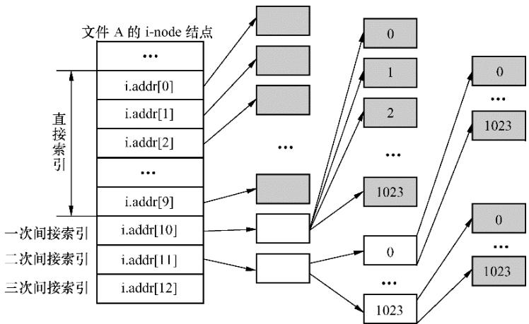
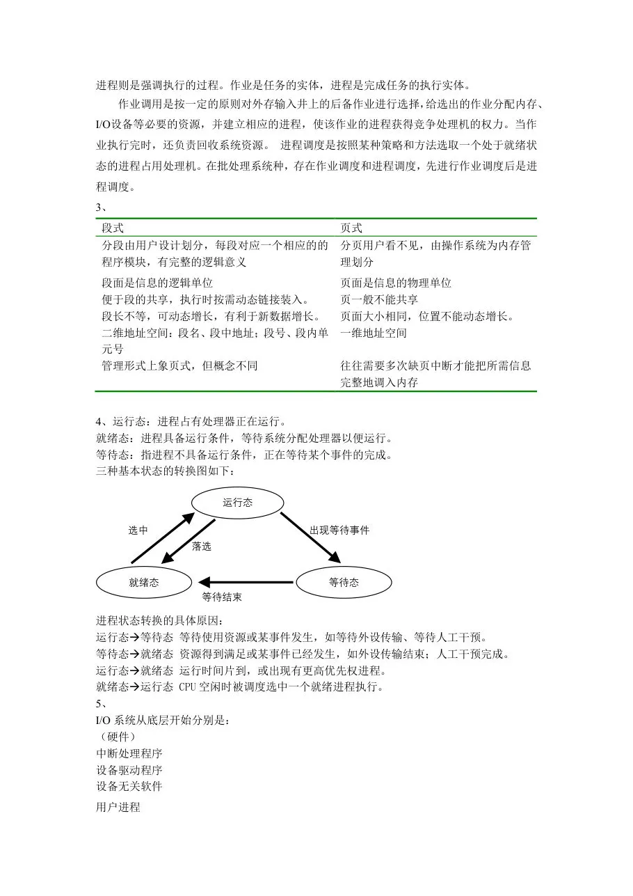

# 《操作系统 A》期末试卷（A卷）

原件经识别和整理；“参考解答”是我们补的。

## 一、填空题（每空 1 分，共 10 分）

### 填空 1

通常把批处理操作系统、实时操作系统和分时操作系统称为操作系统的三种基本类型。

答案：分时、实时。

知识点：[进程的基本状态（就绪、执行、阻塞）及状态转换](../../../topics/操作系统/进程状态转换.md)

### 填空 2

请求分页存储管理方式中，调入页面的时机可采用两种策略：请求式调入策略和预调式调入策略。

答案：请求、预调。

知识点：[处理机的三级调度（高级、中级、低级调度）](../../../topics/操作系统/处理机调度级别.md)

### 填空 3

磁盘的访问时间包括三部分时间，寻道时间、旋转延迟时间和传输时间。

答案：旋转延迟、传输。

知识点：[死锁的定义与四个必要条件（互斥、请求保持、不可剥夺、循环等待）](../../../topics/操作系统/死锁概念与必要条件.md)

### 填空 4

操作系统用户接口可分为程序接口和操作接口。

答案：命令、程序。

知识点：[文件的物理结构（连续、链接、索引、混合索引）](../../../topics/操作系统/文件物理结构.md)

### 填空 5

按设备共享属性分类，设备可以分为独占设备、共享设备和虚拟设备。

答案：独占、共享。

## 二、单项选择题（每小题 2 分，共 20 分）

知识点：[文件目录结构（单级、二级、多级目录）及特点](../../../topics/操作系统/文件目录结构.md)

### 选择 1

从资源管理程序的观点来看，操作系统是\_\_\_\_的管理者。

- A. 程序和数据
- B. 进程
- C. 系统软硬件资源
- D. 中断

答案：C。

知识点：[操作系统的定义与主要目标](../../../topics/操作系统/操作系统定义与目标.md)、[操作系统三种基本类型（批处理、分时、实时）及其主要目标](../../../topics/操作系统/操作系统基本类型.md)

### 选择 2

在引入线程的操作系统中，CPU 调度的基本单位是\_\_\_\_。

- A. 程序
- B. 作业
- C. 进程
- D. 线程

答案：D。

知识点：[操作系统三种基本类型（批处理、分时、实时）及其主要目标](../../../topics/操作系统/操作系统基本类型.md)、[分时系统的工作原理与特征](../../../topics/操作系统/分时系统工作原理.md)

### 选择 3

若信号量 S 的初值为 2，当前值为 -1，则表示有\_\_\_\_个等待进程。

- A. 0
- B. 1
- C. 2
- D. 3

答案：B。

知识点：[操作系统的定义与主要目标](../../../topics/操作系统/操作系统定义与目标.md)、[操作系统三种基本类型（批处理、分时、实时）及其主要目标](../../../topics/操作系统/操作系统基本类型.md)、[现代操作系统的特征（并发、共享、虚拟、异步）](../../../topics/操作系统/操作系统特征.md)

### 选择 4

既考虑作业等待时间，又考虑作业执行时间的调度算法是\_\_\_\_。

- A. 响应比高者优先
- B. 短作业优先
- C. 优先级调度
- D. 先来先服务

答案：A。

知识点：[现代操作系统的特征（并发、共享、虚拟、异步）](../../../topics/操作系统/操作系统特征.md)

### 选择 5

银行家算法是用来\_\_\_\_。

- A. 死锁的预防
- B. 死锁的解除
- C. 死锁的检测
- D. 死锁的避免

答案：D。

知识点：[文件的物理结构（连续、链接、索引、混合索引）](../../../topics/操作系统/文件物理结构.md)

### 选择 6

虚拟存储器系统的基础是程序的\_\_\_\_理论。

- A. 局部性
- B. 全局性
- C. 动态性
- D. 虚拟性

答案：A。

知识点：[操作系统三种基本类型（批处理、分时、实时）及其主要目标](../../../topics/操作系统/操作系统基本类型.md)

### 选择 7

在固定分区分配中，每个分区的大小是\_\_\_\_。

- A. 相同
- B. 随作业长度变化
- C. 可以不同但预先固定
- D. 可以相同但根据作业长度固定

答案：C。

知识点：[进程的基本状态（就绪、执行、阻塞）及状态转换](../../../topics/操作系统/进程状态转换.md)、[原语的概念与进程控制原语（创建、撤销、阻塞、唤醒）](../../../topics/操作系统/原语.md)、[进程的定义与特征（动态性、并发性、独立性、制约性、异步性、结构性）](../../../topics/操作系统/进程定义与特征.md)

### 选择 8

可解决文件重名问题的最简单的目录结构是\_\_\_\_。

- A. 单级目录
- B. 二级目录
- C. 树型结构目录
- D. 便于共享的目录

答案：B。

知识点：[进程的基本状态（就绪、执行、阻塞）及状态转换](../../../topics/操作系统/进程状态转换.md)

### 选择 9

设备管理程序对设备的管理是借助一些数据结构来进行的，下面的\_\_\_\_不属于设备管理数据结构。

- A. JCB
- B. DCT
- C. COCT
- D. CHCT

答案：A。

知识点：[操作系统三种基本类型（批处理、分时、实时）及其主要目标](../../../topics/操作系统/操作系统基本类型.md)、[分时系统的工作原理与特征](../../../topics/操作系统/分时系统工作原理.md)

### 选择 10

通道是一种\_\_\_\_。

- A. I/O 端口
- B. 数据通道
- C. I/O 专用处理器
- D. 软件工具

答案：C。

## 三、简答题（每小题 5 分，共 30 分）

知识点：[操作系统的主要功能（处理机管理、存储管理、设备管理、文件管理、用户接口）](../../../topics/操作系统/操作系统功能.md)、[现代操作系统的特征（并发、共享、虚拟、异步）](../../../topics/操作系统/操作系统特征.md)、[操作系统的定义与主要目标](../../../topics/操作系统/操作系统定义与目标.md)

### 简答 1

简述操作系统的四个基本特性。

答案：并发性，共享性，不确定性，虚拟性。

知识点：[处理机的三级调度（高级、中级、低级调度）](../../../topics/操作系统/处理机调度级别.md)、[作业调度算法及性能评价（周转时间、带权周转时间）](../../../topics/操作系统/作业调度算法.md)、[进程调度算法（FCFS、SJF、优先级、时间片轮转、多级反馈队列）](../../../topics/操作系统/进程调度算法.md)

### 简答 2

请叙述预防死锁的方法有哪些？

答案：破坏“不可抢占”“请求与保持”“循环等待”条件。

知识点：[进程与程序的区别与联系](../../../topics/操作系统/进程与程序区别.md)、[进程的定义与特征（动态性、并发性、独立性、制约性、异步性、结构性）](../../../topics/操作系统/进程定义与特征.md)、[现代操作系统的特征（并发、共享、虚拟、异步）](../../../topics/操作系统/操作系统特征.md)

### 简答 3

简单叙述进程的特征。

知识点：[分页与分段的区别](../../../topics/操作系统/分页与分段区别.md)、[页式存储管理的基本原理与地址转换](../../../topics/操作系统/分页存储管理.md)、[段式存储管理的基本原理与地址转换](../../../topics/操作系统/分段存储管理.md)

### 简答 4

缓冲技术的基本思想是什么？

知识点：[临界区、临界资源与互斥的概念](../../../topics/操作系统/临界区与互斥.md)、[信号量机制与P、V操作的定义](../../../topics/操作系统/信号量与PV操作.md)、[经典进程同步问题（生产者-消费者、读者-写者、哲学家进餐）](../../../topics/操作系统/经典同步问题.md)

### 简答 5

文件目录管理的基本要求是什么？

知识点：[SPOOLing系统的组成与虚拟设备原理](../../../topics/操作系统/SPOOLing系统.md)、[页式存储管理的基本原理与地址转换](../../../topics/操作系统/分页存储管理.md)、[页面置换算法（OPT、FIFO、LRU、Clock、LFU）](../../../topics/操作系统/页面置换算法.md)

### 简答 6

虚拟存储器的特征是什么？

## 四、综合题（每小题 10 分，共 40 分）

知识点：[分页与分段的区别](../../../topics/操作系统/分页与分段区别.md)、[页式存储管理的基本原理与地址转换](../../../topics/操作系统/分页存储管理.md)、[段式存储管理的基本原理与地址转换](../../../topics/操作系统/分段存储管理.md)

### 综合 1

单道批处理环境下有 5 个作业，各作业进入系统的时间和估计运行时间如下表所示。

| 作业 | 进入系统时间 | 估计运行时间/分钟 |
| --- | --- | --- |
| 1 | 8:00 | 40 |
| 2 | 8:20 | 30 |
| 3 | 8:30 | 12 |
| 4 | 9:00 | 18 |
| 5 | 9:10 | 5 |

（1）如果应用先来先服务的作业调度算法进行调度，请完成答题纸上的表格。

（2）如果应用最短作业优先的作业调度算法进行调度，请完成答题纸上的表格。

知识点：[操作系统三种基本类型（批处理、分时、实时）及其主要目标](../../../topics/操作系统/操作系统基本类型.md)、[分时系统的工作原理与特征](../../../topics/操作系统/分时系统工作原理.md)、[操作系统的用户界面（命令接口、程序接口、图形接口）](../../../topics/操作系统/用户界面.md)

### 综合 2

桌上有一只盘子，每次只能放入一只水果；爸爸专向盘子中放苹果（apple），妈妈专向盘子中放桔子（orange）；一个儿子专等吃盘子中的桔子，一个女儿专等吃盘子里的苹果。请使用 PV 操作实现爸爸、妈妈、儿子和女儿的同步和互斥关系。

知识点：[临界区、临界资源与互斥的概念](../../../topics/操作系统/临界区与互斥.md)、[信号量机制与P、V操作的定义](../../../topics/操作系统/信号量与PV操作.md)、[经典进程同步问题（生产者-消费者、读者-写者、哲学家进餐）](../../../topics/操作系统/经典同步问题.md)

### 综合 3

一个页式存储管理系统使用 FIFO 和 OPT 页面替换算法，如果一个作业的页面走向为：2，3，2，1，5，2，4，5，3，2，5 和 2。当分配给该作业的物理页框块数为 3 时，试计算访问过程中发生的缺页中断次数。

知识点：[页式存储管理的基本原理与地址转换](../../../topics/操作系统/分页存储管理.md)、[虚拟存储器的基本思想与局部性原理](../../../topics/操作系统/虚拟存储器.md)

### 综合 4

假定磁盘有 200 个柱面，编号 0～199，当前存取臂的位置在 143 号柱面上，并刚刚完成了 125 号柱面的服务请求，如果请求队列的先后顺序是：86，147，91，177，94，150，102，175，130；试问：为完成上述请求，下列算法存取臂移动的总量是多少？

（1）最短寻道时间优先算法；

（2）扫描调度算法。

## 参考答案

知识点：[文件的物理结构（连续、链接、索引、混合索引）](../../../topics/操作系统/文件物理结构.md)、[文件存储空间的管理方法（位示图法、空闲表法、空闲链表法）](../../../topics/操作系统/文件存储空间管理.md)

### 一、填空题（每空 1 分，共 10 分）

1. 分时、实时
2. 请求、预调
3. 旋转延迟、传输
4. 命令、程序
5. 独占、共享

知识点：[操作系统三种基本类型（批处理、分时、实时）及其主要目标](../../../topics/操作系统/操作系统基本类型.md)、[分时系统的工作原理与特征](../../../topics/操作系统/分时系统工作原理.md)、[磁盘调度算法（FCFS、SSTF、SCAN、CSCAN）](../../../topics/操作系统/磁盘调度算法.md)

### 二、选择题（每小题 2 分，共 20 分）

| 1 | 2 | 3 | 4 | 5 | 6 | 7 | 8 | 9 | 10 |
| --- | --- | --- | --- | --- | --- | --- | --- | --- | --- |
| C | D | B | A | D | A | C | B | A | C |

知识点：[操作系统三种基本类型（批处理、分时、实时）及其主要目标](../../../topics/操作系统/操作系统基本类型.md)、[进程的基本状态（就绪、执行、阻塞）及状态转换](../../../topics/操作系统/进程状态转换.md)、[信号量机制与P、V操作的定义](../../../topics/操作系统/信号量与PV操作.md)

### 三、简答题（每小题 5 分，共 30 分）

#### 简答 1

简述操作系统的四个基本特性。

（1）并发性

并发性是指两个或两个以上的事件或活动在同一时间间隔内发生。并发性能够消除计算机系统中部件和部件之间的相互等待，有效地改善系统资源的利用率，改进系统的吞吐率，提高系统效率。

（2）共享性

共享指计算机系统中的资源可被多个并发执行的用户程序和系统程序共同使用，而不是被其中某一个程序所独占。

（3）不确定性

不确定性也称异步性。在多道程序并发执行的环境中，各程序之间存在着直接或间接的联系，程序的推进速度会受到运行环境的影响，若不能正确控制，则执行结果会因为运行环境的不同而不同。

（4）虚拟性

虚拟性是指操作系统中的一种管理技术，它是把物理上的一个实体变成逻辑上的多个对应物，或把物理上的多个实体变成逻辑上的一个对应物的技术。

#### 简答 2

请叙述预防死锁的方法有哪些？

具体的做法是破坏产生死锁的 4 个必要条件之一。破坏“互斥使用”这一条件对于很多资源来说是不现实的，因此我们重点探讨破坏后 3 种必要条件的方法。

破坏“不可剥夺”条件

在允许进程动态申请资源前提下规定，一个进程在申请新的资源不能立即得到满足而变为等待状态之前，必须释放已占有的全部资源，若需要再重新申请。

破坏“请求和保持”条件

要求每个进程在运行前必须一次性申请它所要求的所有资源，且仅当该进程所要资源均可满足时才给予一次性分配。

破坏“循环等待”条件

即采用资源有序分配法，把系统中所有资源编号，进程在申请资源时必须严格按资源编号的递增次序进行，否则操作系统不予分配。

#### 简答 3

简单叙述进程的特征。

动态性。

进程是程序在处理机上的一次执行过程，因而是动态的。动态特性还表现在它因创建而产生，由调度而执行，因得不到资源而暂停执行，最后由撤消而消亡。可见进程有一定的生命周期。

并发性。

指多个进程实体同时存在于内存中，能在一段时间内同时运行。

独立性。

进程是一个能独立运行的基本单位，也是系统进行资源分配和调度（单线程进程）的基本单位。

制约性。

进程间由于对资源的争用而相互制约。

异步性。

进程按各自独立的、不可预知的速度向前推进。

结构性。

进程包含了数据集合和其上运行的程序。为了描述和记录进程的动态变化过程，还需要配置一个进程控制块，所以每个进程由三要素组成：程序、数据和进程控制块。

#### 简答 4

缓冲技术的基本思想是什么？

当一个进程输出数据时，先向系统申请一块内存作为输出缓冲区；然后，将输出数据高速输出到缓冲区；不断把数据填到缓冲区，直到缓冲区被装满为止；此后，进程可以继续它的计算，同时，系统将缓冲区内容写到 I/O 设备上。当一个进程执行读操作输入数据时，过程与此类似。

#### 简答 5

文件目录管理的基本要求是什么？

目录管理的要求如下。

实现“按名存取”。用户只需提供文件名，即可对文件进行存取，这是目录管理中最基本的功能，也是文件系统向用户提供的最基本服务。

提高对目录的检索速度。通过合理组织目录结构的方法来加快对目录的检索速度，从而加快了对文件的存取速度。

文件共享。在多用户系统中应允许多个用户共享一个文件，这样只需在外存中保留一份该文件的副本，供不同用户使用，以节省大量的存储空间。

允许文件重名。系统应允许不同用户对不同文件取用相同的名字，以便于用户按照自己的习惯命名和使用文件。

#### 简答 6

虚拟存储器的特征是什么？

虚拟存储器具有 4 个基本特征：离散性、多次性、对换性和虚拟性，其中最基本的特征是离散性，所表现出来的最重要特征是虚拟性。

离散性

离散性是指内存分配采用离散分配方式。

虚拟性

虚存是从逻辑上扩充内存容量，使用户编程所用到的地址空间远大于实际内存容量。

多次性

多次性是指进程不是一次性装入内存，而是被分成若干部分，分多次调入内存。

对换性

对换性是指系统允许进程的部分在运行过程中换入内存或换出到对换区。对换过程在进程运行期间可发生多次。

知识点：[现代操作系统的特征（并发、共享、虚拟、异步）](../../../topics/操作系统/操作系统特征.md)、[死锁的预防方法与避免方法（银行家算法）](../../../topics/操作系统/死锁预防与避免.md)、[进程的定义与特征（动态性、并发性、独立性、制约性、异步性、结构性）](../../../topics/操作系统/进程定义与特征.md)、[缓冲技术的引入目的与类型（单缓冲、双缓冲、循环缓冲）](../../../topics/操作系统/缓冲技术.md)、[文件目录结构（单级、二级、多级目录）及特点](../../../topics/操作系统/文件目录结构.md)、[虚拟存储器的基本思想与局部性原理](../../../topics/操作系统/虚拟存储器.md)

### 四、综合题（每小题 10 分，共 40 分）

#### 综合 1

每种算法 5 分。

（1）先来先服务调度算法

| 作业 | 进入系统时间 | 估计运行时间/分钟 | 结束时间 | 周转时间/分钟 |
| --- | --- | --- | --- | --- |
| 1 | 8:00 | 40 | 8:40 | 40 |
| 2 | 8:20 | 30 | 9:10 | 50 |
| 3 | 8:30 | 12 | 9:22 | 52 |
| 4 | 9:00 | 18 | 9:40 | 40 |
| 5 | 9:10 | 5 | 9:45 | 35 |

作业平均周转时间 T=43.4。

（2）最短作业优先调度算法

| 作业 | 进入系统时间 | 估计运行时间/分钟 | 结束时间 | 周转时间/分钟 |
| --- | --- | --- | --- | --- |
| 1 | 8:00 | 40 | 8:40 | 40 |
| 2 | 8:20 | 30 | 9:22 | 62 |
| 3 | 8:30 | 12 | 8:52 | 22 |
| 4 | 9:00 | 18 | 9:45 | 45 |
| 5 | 9:10 | 5 | 9:27 | 17 |

作业平均周转时间 T=37.2。

#### 综合 2

（原件此处仅存片段：）

```
goto L2; end;    goto L3; end;
Coend
```

#### 综合 3

每种算法 5 分。

FIFO 淘汰算法：发生缺页中断 9 次。

OPT 淘汰算法：发生缺页中断 6 次。


#### 综合 4

每小题 5 分。

（1）最短寻道时间优先算法移动总数为 162；

（2）扫描调度算法移动总数为 125。

C．640
D．以上答案都不对

知识点：[进程调度算法（FCFS、SJF、优先级、时间片轮转、多级反馈队列）](../../../topics/操作系统/进程调度算法.md)、[作业调度算法及性能评价（周转时间、带权周转时间）](../../../topics/操作系统/作业调度算法.md)、[页面置换算法（OPT、FIFO、LRU、Clock、LFU）](../../../topics/操作系统/页面置换算法.md)、[磁盘调度算法（FCFS、SSTF、SCAN、CSCAN）](../../../topics/操作系统/磁盘调度算法.md)

### 选择 7

以下不属于常见的磁盘调度算法的是（D）。

- A．先来先服务
- B．最短寻道时间优先
- C．扫描
- D．高响应比优先

答案：D。

知识点：[进程的基本状态（就绪、执行、阻塞）及状态转换](../../../topics/操作系统/进程状态转换.md)、[原语的概念与进程控制原语（创建、撤销、阻塞、唤醒）](../../../topics/操作系统/原语.md)、[进程的定义与特征（动态性、并发性、独立性、制约性、异步性、结构性）](../../../topics/操作系统/进程定义与特征.md)

### 选择 8

通道是一种（A）。

- A．I/O 专用处理器
- B．数据通道
- C．I/O 端口
- D．软件工具

答案：A。

知识点：[进程的基本状态（就绪、执行、阻塞）及状态转换](../../../topics/操作系统/进程状态转换.md)

### 选择 9

通过硬件和软件的功能扩充，把原来独立的设备改造成能为若干用户共享的设备，这种设备称为（C）。

- A．存储设备
- B．系统设备
- C．虚拟设备
- D．用户设备

答案：C。

知识点：[操作系统三种基本类型（批处理、分时、实时）及其主要目标](../../../topics/操作系统/操作系统基本类型.md)、[分时系统的工作原理与特征](../../../topics/操作系统/分时系统工作原理.md)

### 选择 10

一个文件的绝对路径名是从（B）开始，逐步沿着每一级子目录向下追溯到指定文件的整个通路上所有子目录名组成的一个字符串。

- A．当前目录
- B．根目录
- C．多级目录
- D．二级目录

答案：B。

## 三、简答题（每题 5 分，共 30 分）

知识点：[操作系统的主要功能（处理机管理、存储管理、设备管理、文件管理、用户接口）](../../../topics/操作系统/操作系统功能.md)、[现代操作系统的特征（并发、共享、虚拟、异步）](../../../topics/操作系统/操作系统特征.md)、[操作系统的定义与主要目标](../../../topics/操作系统/操作系统定义与目标.md)

### 简答 1

简述操作系统设计的目标是什么？

答案：方便性，有效性，可扩充性，开放性。

知识点：[处理机的三级调度（高级、中级、低级调度）](../../../topics/操作系统/处理机调度级别.md)、[作业调度算法及性能评价（周转时间、带权周转时间）](../../../topics/操作系统/作业调度算法.md)、[进程调度算法（FCFS、SJF、优先级、时间片轮转、多级反馈队列）](../../../topics/操作系统/进程调度算法.md)

### 简答 2

临界区管理的基本原则是什么？

答案：有空让进，无空等待，多中择一，有限等待，让权等待。

知识点：[进程与程序的区别与联系](../../../topics/操作系统/进程与程序区别.md)、[进程的定义与特征（动态性、并发性、独立性、制约性、异步性、结构性）](../../../topics/操作系统/进程定义与特征.md)、[现代操作系统的特征（并发、共享、虚拟、异步）](../../../topics/操作系统/操作系统特征.md)

### 简答 3

进程资源分配图中，方框、方框中的圆点、圆圈、方框指向圆圈的有向边、圆圈指向方框的有向边各表示什么？

知识点：[分页与分段的区别](../../../topics/操作系统/分页与分段区别.md)、[页式存储管理的基本原理与地址转换](../../../topics/操作系统/分页存储管理.md)、[段式存储管理的基本原理与地址转换](../../../topics/操作系统/分段存储管理.md)

### 简答 4

虚拟设备的基本组成是什么？

答案：输入/输出井，输入/输出缓冲区，输入/输出进程。

知识点：[临界区、临界资源与互斥的概念](../../../topics/操作系统/临界区与互斥.md)、[信号量机制与P、V操作的定义](../../../topics/操作系统/信号量与PV操作.md)、[经典进程同步问题（生产者-消费者、读者-写者、哲学家进餐）](../../../topics/操作系统/经典同步问题.md)

### 简答 5

文件目录管理的基本要求是什么？

知识点：[SPOOLing系统的组成与虚拟设备原理](../../../topics/操作系统/SPOOLing系统.md)、[页式存储管理的基本原理与地址转换](../../../topics/操作系统/分页存储管理.md)、[页面置换算法（OPT、FIFO、LRU、Clock、LFU）](../../../topics/操作系统/页面置换算法.md)

### 简答 6

分页式管理和分段式管理的区别有哪些？

## 四、综合题（每小题 10 分，共 40 分）

知识点：[分页与分段的区别](../../../topics/操作系统/分页与分段区别.md)、[页式存储管理的基本原理与地址转换](../../../topics/操作系统/分页存储管理.md)、[段式存储管理的基本原理与地址转换](../../../topics/操作系统/分段存储管理.md)

### 综合 1

某系统进程状态如下图所示，a 是（①）状态，b 是（②）状态，c 是（③）状态。1 表示（④），2 表示（⑤），3 表示发生了等待事件，4 表示等待事件已发生。请做出选择。

①②③的选项：A．挂起 B．运行 C．等待 D．就绪

④⑤的选项：A．时间片用完 B．选中 C．等待

答案：①B，②D，③C，④A，⑤B。

知识点：[操作系统三种基本类型（批处理、分时、实时）及其主要目标](../../../topics/操作系统/操作系统基本类型.md)、[分时系统的工作原理与特征](../../../topics/操作系统/分时系统工作原理.md)、[操作系统的用户界面（命令接口、程序接口、图形接口）](../../../topics/操作系统/用户界面.md)

### 综合 2

有两组并发进程：读者进程和写者进程共享一个文件，要求允许多个读者同时执行读操作，任一写者在完成写操作之前不允许其他读者或写者工作，写者执行写操作前，应让已有的写者和读者全部退出。请使用 PV 操作实现两组进程的同步。

知识点：[临界区、临界资源与互斥的概念](../../../topics/操作系统/临界区与互斥.md)、[信号量机制与P、V操作的定义](../../../topics/操作系统/信号量与PV操作.md)、[经典进程同步问题（生产者-消费者、读者-写者、哲学家进餐）](../../../topics/操作系统/经典同步问题.md)

### 综合 3

一个 32 位地址的计算机系统使用二级页表，虚地址被分为 10 位一级页表、12 位二级页表和偏移。试问：一级和二级页表长度是多少？页面的大小是多少？虚地址空间共有多少个页面？

答案：一级页表长度为 $2^{10}$，二级页表长度为 $2^{12}$，页面大小为 $2^{10}$，共有 $2^{22}$ 个页面。

知识点：[页式存储管理的基本原理与地址转换](../../../topics/操作系统/分页存储管理.md)、[虚拟存储器的基本思想与局部性原理](../../../topics/操作系统/虚拟存储器.md)

### 综合 4

Linux 操作系统采用的是混合索引方式。请画出混合索引文件结构图，并回答直接寻址可以表示多大的文件？一次间接寻址，可以表示多大的文件？二次和三次间接寻址分别可以表示多大的文件？

答案：一次间接寻址可以表示 4MB（4KB×1K）的文件。二次间接寻址可以表示 4GB 的文件。三次间接寻址可以表示 4TB 的文件。



## 二、选择题（答案部分）

| 1 | 2 | 3 | 4 | 5 | 6 | 7 | 8 | 9 | 10 |
|---|---|---|---|---|---|---|---|---|----|
| B | D | C | A | D | C | D | A | C | B  |

## 三、简答题（答案部分）

知识点：[文件的物理结构（连续、链接、索引、混合索引）](../../../topics/操作系统/文件物理结构.md)、[文件存储空间的管理方法（位示图法、空闲表法、空闲链表法）](../../../topics/操作系统/文件存储空间管理.md)

### 简答 1

简述操作系统设计的目标是什么？

目前存在着多种类型的操作系统，不同类型的操作系统，其目标各有所不同。通常期望操作系统达到以下几个目标。

**方便性。**

操作系统为用户提供良好的、一致的用户接口，用户按需要输入命令，操作系统按命令去控制程序的执行；用户也可以在程序中调用操作系统的功能模块完成相应服务，而不必了解硬件的物理特性。

**有效性。**

操作系统可有效地管理和分配硬件、软件资源，合理地组织计算机的工作流程，提高系统工作效率。

**可扩充性。**

为满足计算机硬件与体系结构的发展以及不断扩大的应用要求，操作系统应能方便地扩展新的功能。

**开放性。**

开放性指的是产品和技术之间相互连接和协作的能力。开放性设计使操作系统必须提供统一开放的接口，使其应用在不同的系统中具有可移植性，并使不同的系统能够通过网络进行集成，从而能正确、有效的协同工作。

知识点：[处理机的三级调度（高级、中级、低级调度）](../../../topics/操作系统/处理机调度级别.md)、[作业调度算法及性能评价（周转时间、带权周转时间）](../../../topics/操作系统/作业调度算法.md)、[进程调度算法（FCFS、SJF、优先级、时间片轮转、多级反馈队列）](../../../topics/操作系统/进程调度算法.md)

### 简答 2

临界区管理的基本原则是什么？

有空让进，当无进程在互斥区时，任何有权使用互斥区的进程可进入。

无空等待，不允许两个以上的进程同时进入互斥区。

多中择一，当没有进程在临界区，而同时有多个进程要求进入临界区，只能让其中之一进入临界区，其他进程必须等待。

有限等待，任何进入互斥区的要求应在有限的时间内得到满足。

让权等待，处于等待状态的进程应放弃占用 CPU，以使其他进程有机会得到 CPU 的使用权。

知识点：[进程与程序的区别与联系](../../../topics/操作系统/进程与程序区别.md)、[进程的定义与特征（动态性、并发性、独立性、制约性、异步性、结构性）](../../../topics/操作系统/进程定义与特征.md)、[现代操作系统的特征（并发、共享、虚拟、异步）](../../../topics/操作系统/操作系统特征.md)

### 简答 3

进程资源分配图中，方框、方框中的圆点、圆圈、方框指向圆圈的有向边、圆圈指向方框的有向边各表示什么？

进程-资源分配图中：

- 用方框表示资源类（资源的不同类型），
- 用方框中的黑圆点表示资源实例（存在于每个资源类中），
- 用圆圈中加进程名表示进程，
- 用资源实例指向进程的一条有向边来表示分配边，
- 用进程指向资源类的一条有向边来表示申请边。

知识点：[分页与分段的区别](../../../topics/操作系统/分页与分段区别.md)、[页式存储管理的基本原理与地址转换](../../../topics/操作系统/分页存储管理.md)、[段式存储管理的基本原理与地址转换](../../../topics/操作系统/分段存储管理.md)

### 简答 4

虚拟设备的基本组成是什么？

**输入井和输出井**

输入井和输出井是在磁盘上开辟的两个大缓冲区。输入井是模拟脱机输入时的磁盘，用于收容 I/O 设备输入的数据。输出井是模拟脱机输出时的磁盘，用于收容用户程序的输出数据。

**输入缓冲区和输出缓冲区**

在内存中要开辟两个缓冲区，其中输入缓冲区用于暂存由输入设备送来的数据，以后再传送到输入井；输出缓冲区用于暂存从输出井送来的数据，以后再传送给输出设备。

**输入进程和输出进程**

输入进程（SP）模拟脱机输入时的外围控制机，将用户要求的数据从输入机通过输入缓冲区再送到输入井。当需要输入数据时，直接从输入井读入内存。输出进程（SP）模拟脱机输出时的外围控制机，把用户要求输出的数据先从内存送到输出井，待输出设备空闲时，再将输出井中的数据经过输出缓冲区送到输出设备上。

知识点：[临界区、临界资源与互斥的概念](../../../topics/操作系统/临界区与互斥.md)、[信号量机制与P、V操作的定义](../../../topics/操作系统/信号量与PV操作.md)、[经典进程同步问题（生产者-消费者、读者-写者、哲学家进餐）](../../../topics/操作系统/经典同步问题.md)

### 简答 5

文件目录管理的基本要求是什么？

- 实现"按名存取"。用户只需提供文件名，即可对文件进行存取，这是目录管理中最基本的功能，也是文件系统向用户提供的最基本服务。
- 提高对目录的检索速度。通过合理组织目录结构的方法来加快对目录的检索速度，从而加快了对文件的存取速度。
- 文件共享。在多用户系统中应允许多个用户共享一个文件，这样只需在外存中保留一份该文件的副本，供不同用户使用，以节省大量的存储空间。
- 允许文件重名。系统应允许不同用户对不同文件取用相同的名字，以便于用户按照自己的习惯命名和使用文件。

知识点：[SPOOLing系统的组成与虚拟设备原理](../../../topics/操作系统/SPOOLing系统.md)、[页式存储管理的基本原理与地址转换](../../../topics/操作系统/分页存储管理.md)、[页面置换算法（OPT、FIFO、LRU、Clock、LFU）](../../../topics/操作系统/页面置换算法.md)

### 简答 6

分页式管理和分段式管理的区别有哪些？

其主要区别表现在以下三点。

页是信息的物理单位，页式管理是为实现离散分配方式，以减少内存的外碎片，提高内存的利用率，或者说，页式管理是出于系统管理的需要。而段是信息的逻辑单位，含有一组意义相对完整的信息，段式管理的目的是为了能更好地满足用户的需要。

页的大小固定且由系统确定，逻辑地址由页号和页内地址组成，可由机器硬件实现。段长不固定，取决于用户所编写的程序，通常由编译程序在对源程序进行编译时，根据信息的性质来划分。

页式管理中，进程地址空间是一维的，是单一的线性地址空间。而段式管理中，进程地址空间是二维的，编程人员在标识一个地址时，既需给出段名，又需给出段内地址。

## 四、综合题（答案部分）

知识点：[分页与分段的区别](../../../topics/操作系统/分页与分段区别.md)、[页式存储管理的基本原理与地址转换](../../../topics/操作系统/分页存储管理.md)、[段式存储管理的基本原理与地址转换](../../../topics/操作系统/分段存储管理.md)

### 综合 1

每空 2 分。

| 题号 | 1 | 2 | 3 | 4 | 5 |
|------|---|---|---|---|---|
| 选项 | B | D | C | B | A |

知识点：[操作系统三种基本类型（批处理、分时、实时）及其主要目标](../../../topics/操作系统/操作系统基本类型.md)、[分时系统的工作原理与特征](../../../topics/操作系统/分时系统工作原理.md)、[操作系统的用户界面（命令接口、程序接口、图形接口）](../../../topics/操作系统/用户界面.md)

### 综合 2

```pascal
var rc: integer;
    W, R: semaphore;
rc := 0; { 读进程计数 }
W := 1;
R := 1;
cobegin
  procedure read;
  begin
    P(R);
    rc := rc + 1;
    if rc = 1 then P(W);
    V(R);
    读文件;
    P(R);
    rc := rc - 1;
    if rc = 0 then V(W);
    V(R);
  end;
  procedure write;
  begin
    P(W);
    写文件;
    V(W);
  end;
coend
```

知识点：[临界区、临界资源与互斥的概念](../../../topics/操作系统/临界区与互斥.md)、[信号量机制与P、V操作的定义](../../../topics/操作系统/信号量与PV操作.md)、[经典进程同步问题（生产者-消费者、读者-写者、哲学家进餐）](../../../topics/操作系统/经典同步问题.md)

### 综合 3

一级页表长度为 $2^{10}$

二级页表长度为 $2^{12}$

页面大小为：$2^{10}$

共有 $2^{22}$ 个页面

知识点：[页式存储管理的基本原理与地址转换](../../../topics/操作系统/分页存储管理.md)、[虚拟存储器的基本思想与局部性原理](../../../topics/操作系统/虚拟存储器.md)

### 综合 4


一次间接寻址可以表示 4MB（4KB×1K）的文件。

二次间接寻址可以表示 4GB 的文件。

三次间接寻址可以表示 4TB 的文件。

# 《操作系统》期末试卷（C）

## 一、填空题（每空 1 分，共 20 分）

知识点：[文件的物理结构（连续、链接、索引、混合索引）](../../../topics/操作系统/文件物理结构.md)、[文件存储空间的管理方法（位示图法、空闲表法、空闲链表法）](../../../topics/操作系统/文件存储空间管理.md)

### 填空 1

操作系统的主要特性有：____、异步性和虚拟性。

知识点：[进程的基本状态（就绪、执行、阻塞）及状态转换](../../../topics/操作系统/进程状态转换.md)

### 填空 2

操作系统的三种基本分类是：批处理操作系统、____和____。

知识点：[处理机的三级调度（高级、中级、低级调度）](../../../topics/操作系统/处理机调度级别.md)

### 填空 3

操作系统可以通过____和____两种接口方式把它的服务和功能提供给用户。

知识点：[死锁的定义与四个必要条件（互斥、请求保持、不可剥夺、循环等待）](../../../topics/操作系统/死锁概念与必要条件.md)

### 填空 4

从实现的角度看，线程可以分成____和____，分别在用户空间和核心空间实现。

知识点：[文件的物理结构（连续、链接、索引、混合索引）](../../../topics/操作系统/文件物理结构.md)

### 填空 5

程序在执行前已经实现地址转换的方法是____重定位，程序在执行过程中实现地址转换的方法是____重定位。

知识点：[文件目录结构（单级、二级、多级目录）及特点](../../../topics/操作系统/文件目录结构.md)

### 填空 6

死锁的必要条件有互斥条件、占有和等待条件、____和____。

知识点：[存储管理的基本功能与地址转换（地址重定位）](../../../topics/操作系统/存储管理功能.md)、[连续分配方式（单一连续、固定分区、动态分区）及分配算法](../../../topics/操作系统/连续分配方式.md)

### 填空 7

用于进程三个基本状态之间转换的控制原语有____和____。

知识点：[设备的分类（按资源分配角度：独享、共享、虚拟设备）](../../../topics/操作系统/设备分类.md)

### 填空 8

低级调度的主要算法有：先来先服务算法、____等。

知识点：[文件的保护机制（存取控制矩阵、存取控制表）](../../../topics/操作系统/文件保护.md)

### 填空 9

操作系统 I/O 软件层组织有四部分组成：中断处理程序、____、____和用户层 I/O 软件。

知识点：[进程的定义与特征（动态性、并发性、独立性、制约性、异步性、结构性）](../../../topics/操作系统/进程定义与特征.md)、[进程控制块（PCB）的作用与内容](../../../topics/操作系统/进程控制块.md)、[进程与程序的区别与联系](../../../topics/操作系统/进程与程序区别.md)

### 填空 10

在文件目录控制块中，必不可少的信息是____和____。

## 二、单项选择题（每小题 2 分，共 20 分）

知识点：[操作系统的用户界面（命令接口、程序接口、图形接口）](../../../topics/操作系统/用户界面.md)

### 选择 1

允许将多个作业提交给计算机集中处理的操作系统称为（）。

- A．批处理操作系统
- B．分时操作系统
- C．多处理机操作系统
- D．实时操作系统

知识点：[操作系统的定义与主要目标](../../../topics/操作系统/操作系统定义与目标.md)、[操作系统三种基本类型（批处理、分时、实时）及其主要目标](../../../topics/操作系统/操作系统基本类型.md)

### 选择 2

在操作系统中，并发性是指若干事件（）发生。

- A．在同一时刻
- B．一定在不同时刻
- C．在某一时间间隔内
- D．依次在不同时间间隔内

知识点：[操作系统三种基本类型（批处理、分时、实时）及其主要目标](../../../topics/操作系统/操作系统基本类型.md)、[分时系统的工作原理与特征](../../../topics/操作系统/分时系统工作原理.md)

### 选择 3

若信号量的初值为____，当前值为____，则表示有____个等待进程。

- A．0
- B．1
- C．2
- D．3

知识点：[操作系统的定义与主要目标](../../../topics/操作系统/操作系统定义与目标.md)、[操作系统三种基本类型（批处理、分时、实时）及其主要目标](../../../topics/操作系统/操作系统基本类型.md)、[现代操作系统的特征（并发、共享、虚拟、异步）](../../../topics/操作系统/操作系统特征.md)

### 选择 4

下列进程状态变化中，（）变化是不可能发生的。

- A．运行→就绪
- B．运行→等待
- C．等待→运行
- D．等待→就绪

知识点：[现代操作系统的特征（并发、共享、虚拟、异步）](../../../topics/操作系统/操作系统特征.md)

### 选择 5

临界区是（）。

- A．一个缓冲区
- B．一个共享数据区
- C．一个程序段
- D．一个互斥资源

知识点：[文件的物理结构（连续、链接、索引、混合索引）](../../../topics/操作系统/文件物理结构.md)

### 选择 6

下列表述中，（）最能体现原语的特点。

- A．并发性
- B．异步性
- C．共享性
- D．不可分割性

知识点：[操作系统三种基本类型（批处理、分时、实时）及其主要目标](../../../topics/操作系统/操作系统基本类型.md)

### 选择 7

在引入线程的操作系统中，CPU 调度的基本单位是（）。

- A．程序
- B．作业
- C．进程
- D．线程

知识点：[进程的基本状态（就绪、执行、阻塞）及状态转换](../../../topics/操作系统/进程状态转换.md)、[原语的概念与进程控制原语（创建、撤销、阻塞、唤醒）](../../../topics/操作系统/原语.md)、[进程的定义与特征（动态性、并发性、独立性、制约性、异步性、结构性）](../../../topics/操作系统/进程定义与特征.md)

### 选择 8

银行家算法在解决死锁问题中，是用于（）。

- A．死锁的防止
- B．死锁的避免
- C．死锁的检测
- D．死锁的解除

知识点：[进程的基本状态（就绪、执行、阻塞）及状态转换](../../../topics/操作系统/进程状态转换.md)

### 选择 9

操作系统中的 Spooling 技术，实质上是将（）转化为共享设备的技术。

- A．虚拟设备
- B．独占设备
- C．脱机设备
- D．块设备

知识点：[操作系统三种基本类型（批处理、分时、实时）及其主要目标](../../../topics/操作系统/操作系统基本类型.md)、[分时系统的工作原理与特征](../../../topics/操作系统/分时系统工作原理.md)

### 选择 10

文件系统的主要目的是（）。

- A．实现对文件的按名存取
- B．实现虚拟存储
- C．提高外存的读写速度
- D．用于存储系统文件

## 三、简答题（每小题 6 分，共 30 分）

知识点：[操作系统的主要功能（处理机管理、存储管理、设备管理、文件管理、用户接口）](../../../topics/操作系统/操作系统功能.md)、[现代操作系统的特征（并发、共享、虚拟、异步）](../../../topics/操作系统/操作系统特征.md)、[操作系统的定义与主要目标](../../../topics/操作系统/操作系统定义与目标.md)

### 简答 1

试从调度、并发性、拥有资源和系统开销四个方面对传统进程和线程进行比较。

知识点：[处理机的三级调度（高级、中级、低级调度）](../../../topics/操作系统/处理机调度级别.md)、[作业调度算法及性能评价（周转时间、带权周转时间）](../../../topics/操作系统/作业调度算法.md)、[进程调度算法（FCFS、SJF、优先级、时间片轮转、多级反馈队列）](../../../topics/操作系统/进程调度算法.md)

### 简答 2

叙述作业与进程、作业调度与进程调度有何不同及联系。

知识点：[进程与程序的区别与联系](../../../topics/操作系统/进程与程序区别.md)、[进程的定义与特征（动态性、并发性、独立性、制约性、异步性、结构性）](../../../topics/操作系统/进程定义与特征.md)、[现代操作系统的特征（并发、共享、虚拟、异步）](../../../topics/操作系统/操作系统特征.md)

### 简答 3

试比较分页式存储管理和分段式存储管理。

知识点：[分页与分段的区别](../../../topics/操作系统/分页与分段区别.md)、[页式存储管理的基本原理与地址转换](../../../topics/操作系统/分页存储管理.md)、[段式存储管理的基本原理与地址转换](../../../topics/操作系统/分段存储管理.md)

### 简答 4

进程最基本的状态有哪些？画出三种基本状态的转换图，哪些事件可能引起不同状态之间的转换？

知识点：[临界区、临界资源与互斥的概念](../../../topics/操作系统/临界区与互斥.md)、[信号量机制与P、V操作的定义](../../../topics/操作系统/信号量与PV操作.md)、[经典进程同步问题（生产者-消费者、读者-写者、哲学家进餐）](../../../topics/操作系统/经典同步问题.md)

### 简答 5

简要叙述 I/O 系统的软件层次。

## 四、计算题 1（10 分）

知识点：[SPOOLing系统的组成与虚拟设备原理](../../../topics/操作系统/SPOOLing系统.md)、[页式存储管理的基本原理与地址转换](../../../topics/操作系统/分页存储管理.md)、[页面置换算法（OPT、FIFO、LRU、Clock、LFU）](../../../topics/操作系统/页面置换算法.md)

### 计算 1

(1) 在一分页式存储管理系统中，逻辑地址的长度为 16 位，页面的大小为 4096 字节，现有两个逻辑地址 2F6A(H) 和 0897(H)，且第 0、1、2 页依次存放在物理块 10、12、14 号中，问相应的物理地址分别为多少？（用 16 进制表示）

(2) 给定段表如表 1 所示，给出的逻辑地址为段号和段内位移，分别求逻辑地址 [0，430]、[1，10] 和 [2，500] 所对应的物理地址。

| 段号 | 段首址 | 段长 |
|------|--------|------|
| 0    | 210    | 500  |
| 1    | 2350   | 20   |
| 2    | 100    | 90   |
| 3    | 1350   | 590  |
| 4    | 1938   | 95   |

表 1

## 五、计算题 2（10 分）

知识点：[页式存储管理的基本原理与地址转换](../../../topics/操作系统/分页存储管理.md)、[段式存储管理的基本原理与地址转换](../../../topics/操作系统/分段存储管理.md)

### 计算 2

设某移动磁盘上共有 200 个磁道，由内向外依次编号为 0～199。又设该磁盘仅配有一个读写磁头，且磁头在完成对第 127 号磁道的 I/O 请求后，正在为第 140 号磁道的 I/O 请求服务。假定此时 I/O 队列中有九个读写请求，所访问磁道列表如下：

到达次序：1 2 3 4 5 6 7 8 9

访问磁盘：83 148 91 178 94 150 102 175 130

对于短距离优先、电梯调度磁盘调度算法分别求出为这九个请求服务的访问顺序和所需的磁头移动量（以跨越磁道为单位）。

## 六、解答题（10 分）

知识点：[磁盘调度算法（FCFS、SSTF、SCAN、CSCAN）](../../../topics/操作系统/磁盘调度算法.md)

### 解答 1

(1) 试说明生产者与消费者问题中同步和互斥的关系，并用 PV 操作描述实现；

(2) 在以上 PV 操作实现中，P 操作、V 操作是否可以交换？为什么？

# 《操作系统 B》期末试卷（C）参考答案及评分

## 一、填空题 (每空1分，共20分)

知识点：[信号量机制与P、V操作的定义](../../../topics/操作系统/信号量与PV操作.md)、[经典进程同步问题（生产者-消费者、读者-写者、哲学家进餐）](../../../topics/操作系统/经典同步问题.md)、[临界区、临界资源与互斥的概念](../../../topics/操作系统/临界区与互斥.md)

### 填空 1

操作系统的主要特性有：并发性、共享性、异步性和虚拟性。

知识点：[进程的基本状态（就绪、执行、阻塞）及状态转换](../../../topics/操作系统/进程状态转换.md)

### 填空 2

操作系统的三种基本分类是：批处理操作系统、分时系统和实时系统。

知识点：[处理机的三级调度（高级、中级、低级调度）](../../../topics/操作系统/处理机调度级别.md)

### 填空 3

操作系统可以通过命令接口和程序接口两种接口方式把它的服务和功能提供给用户。

知识点：[死锁的定义与四个必要条件（互斥、请求保持、不可剥夺、循环等待）](../../../topics/操作系统/死锁概念与必要条件.md)

### 填空 4

从实现的角度看，线程可以分成用户级线程和内核级线程分别在用户空间和核心空间实现。

知识点：[文件的物理结构（连续、链接、索引、混合索引）](../../../topics/操作系统/文件物理结构.md)

### 填空 5

程序在执行前已经实现地址转换的方法是静态重定位，程序在执行过程中实现地址转换的方法是动态重定位。

知识点：[文件目录结构（单级、二级、多级目录）及特点](../../../topics/操作系统/文件目录结构.md)

### 填空 6

死锁的必要条件有互斥条件、占有和等待条件、不剥夺条件和循环等待条件。

知识点：[存储管理的基本功能与地址转换（地址重定位）](../../../topics/操作系统/存储管理功能.md)、[连续分配方式（单一连续、固定分区、动态分区）及分配算法](../../../topics/操作系统/连续分配方式.md)

### 填空 7

用于进程三个基本状态之间转换的控制原语有唤醒原语和阻塞原语。

知识点：[设备的分类（按资源分配角度：独享、共享、虚拟设备）](../../../topics/操作系统/设备分类.md)

### 填空 8

低级调度的主要算法有：先来先服务算法、优先数、时间片轮转等。

知识点：[文件的保护机制（存取控制矩阵、存取控制表）](../../../topics/操作系统/文件保护.md)

### 填空 9

操作系统I/O软件层组织有四部分组成：中断处理程序、I/O驱动程序、与硬件无关的I/O软件、和用户层I/O软件。

知识点：[进程的定义与特征（动态性、并发性、独立性、制约性、异步性、结构性）](../../../topics/操作系统/进程定义与特征.md)、[进程控制块（PCB）的作用与内容](../../../topics/操作系统/进程控制块.md)、[进程与程序的区别与联系](../../../topics/操作系统/进程与程序区别.md)

### 填空 10

在文件目录控制块中，必不可少的信息是文件名和物理空间地址。

## 二、单项选择题 (每小题2分，共20分)

知识点：[操作系统的用户界面（命令接口、程序接口、图形接口）](../../../topics/操作系统/用户界面.md)

### 选择 1

答案：A

知识点：[操作系统的定义与主要目标](../../../topics/操作系统/操作系统定义与目标.md)、[操作系统三种基本类型（批处理、分时、实时）及其主要目标](../../../topics/操作系统/操作系统基本类型.md)

### 选择 2

答案：C

知识点：[操作系统三种基本类型（批处理、分时、实时）及其主要目标](../../../topics/操作系统/操作系统基本类型.md)、[分时系统的工作原理与特征](../../../topics/操作系统/分时系统工作原理.md)

### 选择 3

答案：B

知识点：[操作系统的定义与主要目标](../../../topics/操作系统/操作系统定义与目标.md)、[操作系统三种基本类型（批处理、分时、实时）及其主要目标](../../../topics/操作系统/操作系统基本类型.md)、[现代操作系统的特征（并发、共享、虚拟、异步）](../../../topics/操作系统/操作系统特征.md)

### 选择 4

答案：C

知识点：[现代操作系统的特征（并发、共享、虚拟、异步）](../../../topics/操作系统/操作系统特征.md)

### 选择 5

答案：C

知识点：[文件的物理结构（连续、链接、索引、混合索引）](../../../topics/操作系统/文件物理结构.md)

### 选择 6

答案：D

知识点：[操作系统三种基本类型（批处理、分时、实时）及其主要目标](../../../topics/操作系统/操作系统基本类型.md)

### 选择 7

答案：D

知识点：[进程的基本状态（就绪、执行、阻塞）及状态转换](../../../topics/操作系统/进程状态转换.md)、[原语的概念与进程控制原语（创建、撤销、阻塞、唤醒）](../../../topics/操作系统/原语.md)、[进程的定义与特征（动态性、并发性、独立性、制约性、异步性、结构性）](../../../topics/操作系统/进程定义与特征.md)

### 选择 8

答案：B

知识点：[进程的基本状态（就绪、执行、阻塞）及状态转换](../../../topics/操作系统/进程状态转换.md)

### 选择 9

答案：B

知识点：[操作系统三种基本类型（批处理、分时、实时）及其主要目标](../../../topics/操作系统/操作系统基本类型.md)、[分时系统的工作原理与特征](../../../topics/操作系统/分时系统工作原理.md)

### 选择 10

答案：A

## 三、简答题（每小题6分，共30分）

知识点：[操作系统的主要功能（处理机管理、存储管理、设备管理、文件管理、用户接口）](../../../topics/操作系统/操作系统功能.md)、[现代操作系统的特征（并发、共享、虚拟、异步）](../../../topics/操作系统/操作系统特征.md)、[操作系统的定义与主要目标](../../../topics/操作系统/操作系统定义与目标.md)

### 简答 1

**题目：** 比较线程和进程的区别。

**答案：**

| 比较维度 | 线程 | 进程 |
| :--- | :--- | :--- |
| **调度** | 是操作系统中的基本调度和分派单位,具有唯一的标识符和线程控制块。 | 进程具有独立的虚地址空间,以进程为单位进行任务调度,系统必须交换地址空间,切换时间长。 |
| **并发性** | 同一进程的多个线程可在一个/多个处理器上并发或并行地执行 | 许多多任务操作系统限制用户能拥有的最大进程数目,这对许多并发应用来说是不够的。 |
| **拥有资源** | 同一进程的所有线程共享但不拥有进程的状态和资源,且驻留在进程的同一个主存地址空间中,可以访问相同的数据,通信和同步的实现十分方便。 | 是系统中资源分配和保护的基本单位,也是系统调度的独立单位。每个进程都可以各自独立的速度在CPU上推进。 |
| **系统开销** | 作为系统调度和分派的基本单位,会被频繁地调度和切换。同一进程中的多线程共享同一地址空间,能使线程快速切换。 | 对多个进程的管理(创建、调度、终止等)系统开销大,如响应客户请求建立一个新的服务进程的服务器应用中,创建的开销比较显著。 |

知识点：[处理机的三级调度（高级、中级、低级调度）](../../../topics/操作系统/处理机调度级别.md)、[作业调度算法及性能评价（周转时间、带权周转时间）](../../../topics/操作系统/作业调度算法.md)、[进程调度算法（FCFS、SJF、优先级、时间片轮转、多级反馈队列）](../../../topics/操作系统/进程调度算法.md)

### 简答 2

**题目：** 叙述作业调度与进程调度的区别。

**答案：**

进程是一个动态概念，而程序是一个静态概念，程序是指令的有序集合，无执行的含义，进程则是强调执行的过程。作业是任务的实体，进程是完成任务的执行实体。

作业调用是按一定的原则对外存输入井上的后备作业进行选择，给选出的作业分配内存、I/O设备等必要的资源，并建立相应的进程，使该作业的进程获得竞争处理机的权力。当作业执行完时，还负责回收系统资源。

进程调度是按照某种策略和方法选取一个处于就绪状态的进程占用处理机。在批处理系统种，存在作业调度和进程调度，先进行作业调度后是进程调度。

知识点：[进程与程序的区别与联系](../../../topics/操作系统/进程与程序区别.md)、[进程的定义与特征（动态性、并发性、独立性、制约性、异步性、结构性）](../../../topics/操作系统/进程定义与特征.md)、[现代操作系统的特征（并发、共享、虚拟、异步）](../../../topics/操作系统/操作系统特征.md)

### 简答 3

**题目：** 比较段式和页式存储管理。

**答案：**

| 特性 | 段式 | 页式 |
| :--- | :--- | :--- |
| **划分方式** | 分段由用户设计划分,每段对应一个相应的的程序模块,有完整的逻辑意义 | 分页用户看不见,由操作系统为内存管理划分 |
| **单位性质** | 段面是信息的逻辑单位 | 页面是信息的物理单位 |
| **共享性** | 便于段的共享,执行时按需动态链接装入。 | 页一般不能共享 |
| **长度变化** | 段长不等,可动态增长,有利于新数据增长。 | 页面大小相同,位置不能动态增长。 |
| **地址空间** | 二维地址空间:段名、段中地址;段号、段内单元号 | 一维地址空间 |
| **其他特点** | 管理形式上象页式,但概念不同 | 往往需要多次缺页中断才能把所需信息完整地调入内存 |

知识点：[分页与分段的区别](../../../topics/操作系统/分页与分段区别.md)、[页式存储管理的基本原理与地址转换](../../../topics/操作系统/分页存储管理.md)、[段式存储管理的基本原理与地址转换](../../../topics/操作系统/分段存储管理.md)

### 简答 4

**题目：** 叙述进程的基本状态及其转换原因。

**答案：**

运行态：进程占有处理器正在运行。

就绪态：进程具备运行条件，等待系统分配处理器以便运行。

等待态：指进程不具备运行条件，正在等待某个事件的完成。

三种基本状态的转换图如下：



进程状态转换的具体原因：

- 运行态→等待态：等待使用资源或某事件发生，如等待外设传输、等待人工干预。
- 等待态→就绪态：资源得到满足或某事件已经发生，如外设传输结束；人工干预完成。
- 运行态→就绪态：运行时间片到，或出现有更高优先权进程。
- 就绪态→运行态：CPU空闲时被调度选中一个就绪进程执行。

知识点：[临界区、临界资源与互斥的概念](../../../topics/操作系统/临界区与互斥.md)、[信号量机制与P、V操作的定义](../../../topics/操作系统/信号量与PV操作.md)、[经典进程同步问题（生产者-消费者、读者-写者、哲学家进餐）](../../../topics/操作系统/经典同步问题.md)

### 简答 5

**题目：** 简述I/O软件的层次结构。

**答案：**

I/O 系统从底层开始分别是：

1. （硬件）
2. 中断处理程序
3. 设备驱动程序
4. 设备无关软件
5. 用户进程

## 四、计算题1(10分)

**题目：** 地址转换计算。

**答案：**

(1) 
- 2F6A(H)对应的物理地址是EF6A(H) （2分）
- 0897(H)对应的物理地址是A897(H) （2分）

(2) 
- [0, 430]对应的物理地址是210 + 430 = 640 （2分）
- [1, 10]对应的物理地址是2350 + 10 = 2360 （2分）
- [2, 500]越界 （2分）

## 五、计算题2(10分)

**题目：** 磁盘调度算法计算。

**答案：**

**短距离优先（SSTF）：**（5分）

访问序列：148 150 130 102 94 91 82 175 178

移动距离=|140-148|+|148-150|+|150-130|+|130-102|+|102-94|+|94-91|+|91-83|+|83-175|+|175-178|=172

*(注：原题题干未给出磁头初始位置，根据计算过程推断初始位置可能为140或附近，且最后一步从83跳至175，题目描述可能存在笔误，此处按给定答案保留)*

**乘电梯调度算法（SCAN）：**方向为：由内向外。（5分）

访问顺序为：140 148 150 175 178 130 102 94 91 83

移动距离为：（148-140）+（150-148）+（175-150）+（178-175）+（178-130）+ （130-102）+（102-94）+（94-91）+（91-83）=133

## 六、解答题(10分)

**题目：** 生产者-消费者问题信号量操作。

**答案：**

（1） 消费者想接收数据时，有界缓冲区中至少有一个单元是满的；生产者想发送数据时，有界缓冲区中至少有一个单元是空的。（6 分）

伪代码逻辑：
```c
Producer; consumer;
P(avail); P(full); P(mutex); 
// 送数据入缓冲区某单元 / 取缓冲区中某单元数据
V(mutex); V(mutex); V(full); V(avail)
```
*(注：原题给出的伪代码逻辑较为混乱，标准生产者-消费者模型通常涉及 empty/full/mutex 三个信号量。此处保留原文描述)*

（2）P 操作不可以交换，交换后会产生死锁；V操作可以交换。（4分）

# 《 操作系统 》期末试卷（D）

院(系) 班级 学号 姓名

| 题号 | 一 | 二 | 三 | 四 | 五 | 六 | 总分 |
| :--- | :--- | :--- | :--- | :--- | :--- | :--- | :--- |
| 得分 | | | | | | | |

## 一、填空题（每空 1分，共 20分）

知识点：[SPOOLing系统的组成与虚拟设备原理](../../../topics/操作系统/SPOOLing系统.md)、[页式存储管理的基本原理与地址转换](../../../topics/操作系统/分页存储管理.md)、[页面置换算法（OPT、FIFO、LRU、Clock、LFU）](../../../topics/操作系统/页面置换算法.md)

### 填空 1

进程的三种基本状态中有 \_等状态。

知识点：[进程的基本状态（就绪、执行、阻塞）及状态转换](../../../topics/操作系统/进程状态转换.md)

### 填空 2

处理机调度可以分为可以有 等调度。

知识点：[处理机的三级调度（高级、中级、低级调度）](../../../topics/操作系统/处理机调度级别.md)

### 填空 3

死锁的必要条件有 \_等。

知识点：[死锁的定义与四个必要条件（互斥、请求保持、不可剥夺、循环等待）](../../../topics/操作系统/死锁概念与必要条件.md)

### 填空 4

文件的物理结构有 等结构。

知识点：[文件的物理结构（连续、链接、索引、混合索引）](../../../topics/操作系统/文件物理结构.md)

### 填空 5

文件目录中必须要有的基本信息是 和 C

知识点：[文件目录结构（单级、二级、多级目录）及特点](../../../topics/操作系统/文件目录结构.md)

### 填空 6

静态重定位是靠 实现的,动态重定位是靠 实现的。

知识点：[存储管理的基本功能与地址转换（地址重定位）](../../../topics/操作系统/存储管理功能.md)、[连续分配方式（单一连续、固定分区、动态分区）及分配算法](../../../topics/操作系统/连续分配方式.md)

### 填空 7

UNIX系统把外部设备划分为 \_和 \_设备。

知识点：[设备的分类（按资源分配角度：独享、共享、虚拟设备）](../../../topics/操作系统/设备分类.md)

### 填空 8

用的文件保护方法有 \_等方法。

知识点：[文件的保护机制（存取控制矩阵、存取控制表）](../../../topics/操作系统/文件保护.md)

### 填空 9

进程的组成包括进程程序、 。

知识点：[进程的定义与特征（动态性、并发性、独立性、制约性、异步性、结构性）](../../../topics/操作系统/进程定义与特征.md)、[进程控制块（PCB）的作用与内容](../../../topics/操作系统/进程控制块.md)、[进程与程序的区别与联系](../../../topics/操作系统/进程与程序区别.md)

### 填空 10

操作系统为用户提供两个接口: 和

## 二、单项选择题（每小题 2 分，共 20 分）

知识点：[操作系统的用户界面（命令接口、程序接口、图形接口）](../../../topics/操作系统/用户界面.md)

### 选择 1

关于操作系统的叙述( )是不正确的。
- A）“管理资源的程序”
- B）“管理用户程序执行的程序”
- C）“能使系统资源提高效率的程序”
- D）“能方便用户编程的程序”

知识点：[操作系统的定义与主要目标](../../../topics/操作系统/操作系统定义与目标.md)、[操作系统三种基本类型（批处理、分时、实时）及其主要目标](../../../topics/操作系统/操作系统基本类型.md)

### 选择 2

在下面的叙述中，正确的是（ ）。
- A）临界资源是非共享资源
- B）临界资源是任意共享资源
- C）临界资源是互斥共享资源
- D）临界资源是同时共享资源

知识点：[操作系统三种基本类型（批处理、分时、实时）及其主要目标](../../../topics/操作系统/操作系统基本类型.md)、[分时系统的工作原理与特征](../../../topics/操作系统/分时系统工作原理.md)

### 选择 3

若当前进程因时间片用完而让出处理机时，该进程应转变为( )状态。
- A）就绪
- B）等待
- C）运行
- D）完成

知识点：[操作系统的定义与主要目标](../../../topics/操作系统/操作系统定义与目标.md)、[操作系统三种基本类型（批处理、分时、实时）及其主要目标](../../../topics/操作系统/操作系统基本类型.md)、[现代操作系统的特征（并发、共享、虚拟、异步）](../../../topics/操作系统/操作系统特征.md)

### 选择 4

支持程序浮动的地址转换机制是( )。
- A）页式地址转换
- B）段式地址转换
- C）静态重定位
- D）动态重定位

知识点：[现代操作系统的特征（并发、共享、虚拟、异步）](../../../topics/操作系统/操作系统特征.md)

### 选择 5

设定一个作业建立一个进程，为了使长、短和交互式作业都能得到及时的运行，应选用的调度算法是（ ）。
- A）先来先服务算法
- B）短作业优先算法
- C）多级反馈队列算法
- D）优先数算法

*(注：原文中混入了“自觉遵守考试规则...”等非题目内容，已去除)*

知识点：[文件的物理结构（连续、链接、索引、混合索引）](../../../topics/操作系统/文件物理结构.md)

### 选择 6

在多进程的并发系统中，肯定不会因竞争( )而产生死锁。
- A）打印机
- B）磁带机
- C）磁盘
- D）CPU

知识点：[操作系统三种基本类型（批处理、分时、实时）及其主要目标](../../../topics/操作系统/操作系统基本类型.md)

### 选择 7

下列进程状态的转换中，哪一个是不正确的（ ）。
- A）就绪→运行
- B）运行→就绪
- C）就绪→阻塞
- D）阻塞→就绪

知识点：[进程的基本状态（就绪、执行、阻塞）及状态转换](../../../topics/操作系统/进程状态转换.md)、[原语的概念与进程控制原语（创建、撤销、阻塞、唤醒）](../../../topics/操作系统/原语.md)、[进程的定义与特征（动态性、并发性、独立性、制约性、异步性、结构性）](../../../topics/操作系统/进程定义与特征.md)

### 选择 8

在分页存储管理系统中，从页号到物理块号的地址映射是通过（ ）实现的。
- A）段表
- B）页表
- C）PCB
- D）JCB

知识点：[进程的基本状态（就绪、执行、阻塞）及状态转换](../../../topics/操作系统/进程状态转换.md)

### 选择 9

引入缓冲技术的主要目的是（ ）。
- A）改善用户编程环境
- B）提高 CPU的处理速度
- C）提高CPU与设备之间的并行程度
- D）降低计算机的硬件成本

知识点：[操作系统三种基本类型（批处理、分时、实时）及其主要目标](../../../topics/操作系统/操作系统基本类型.md)、[分时系统的工作原理与特征](../../../topics/操作系统/分时系统工作原理.md)

### 选择 10

文件系统最基本的功能是（ ）。
- A）按名存取
- B）文件共享
- C）方便快捷
- D）安全保密

## 三、简答题（每小题 6分，共 30分）

知识点：[操作系统的主要功能（处理机管理、存储管理、设备管理、文件管理、用户接口）](../../../topics/操作系统/操作系统功能.md)、[现代操作系统的特征（并发、共享、虚拟、异步）](../../../topics/操作系统/操作系统特征.md)、[操作系统的定义与主要目标](../../../topics/操作系统/操作系统定义与目标.md)

### 简答 1

叙述作业调度与进程调度有何不同及联系。

知识点：[处理机的三级调度（高级、中级、低级调度）](../../../topics/操作系统/处理机调度级别.md)、[作业调度算法及性能评价（周转时间、带权周转时间）](../../../topics/操作系统/作业调度算法.md)、[进程调度算法（FCFS、SJF、优先级、时间片轮转、多级反馈队列）](../../../topics/操作系统/进程调度算法.md)

### 简答 2

叙述进程和程序的主要区别。

知识点：[进程与程序的区别与联系](../../../topics/操作系统/进程与程序区别.md)、[进程的定义与特征（动态性、并发性、独立性、制约性、异步性、结构性）](../../../topics/操作系统/进程定义与特征.md)、[现代操作系统的特征（并发、共享、虚拟、异步）](../../../topics/操作系统/操作系统特征.md)

### 简答 3

试比较分页式存储管理和分段式存储管理。

知识点：[分页与分段的区别](../../../topics/操作系统/分页与分段区别.md)、[页式存储管理的基本原理与地址转换](../../../topics/操作系统/分页存储管理.md)、[段式存储管理的基本原理与地址转换](../../../topics/操作系统/分段存储管理.md)

### 简答 4

叙述进程的同步与互斥的区别和联系。

知识点：[临界区、临界资源与互斥的概念](../../../topics/操作系统/临界区与互斥.md)、[信号量机制与P、V操作的定义](../../../topics/操作系统/信号量与PV操作.md)、[经典进程同步问题（生产者-消费者、读者-写者、哲学家进餐）](../../../topics/操作系统/经典同步问题.md)

### 简答 5

什么是 spooling 技术，其实现的基本方法是什么？

## 四、计算题 1（10 分）

在采用请求页式存储管理的系统中，某作业的逻辑地址空间为4页（每页大小为1024字节），且已知该作业的页面映象表（页表）如下：

| 页号 | 块号 |
| :--- | :--- |
| 0 | 2 |
| 1 | 3 |
| 2 | 6 |
| 3 | |

试求出有效地址1800和4000所对应的物理地址。要求画出地址变换图。

## 五、计算题 2（10 分）

在一个请求页式存储系统中，一程序的页面走向为：4,3,2,1,4,3,5,4,3,2,1,5, 并采用最近最久未使用页面淘汰算法。设分配给该程序的存储块数分别为3和 4时，请计算出访问过程中发生的缺页率。

## 六、计算题 3（10 分）

单道批处理系统中，下列三个作业分别采用先来先服务调度算法和最高响应比优先算法进行调度，请完成下表：

| 作业 | 提交时间 | 运行时间 | 开始时间 | 完成时间 | 周转时间 | 带权周转时间 |
| :--- | :--- | :--- | :--- | :--- | :--- | :--- |
| 1 | 10:00 | 2:00 | | | | |
| 2 | 10:10 | 1:00 | | | | |
| 3 | 10:25 | 0:25 | | | | |
| **平均** | | | | | 平均作业周转时间= | 平均作业带权周转时间 W= |

# 《 操作系统 》期末试卷（D）参考答案及评分

## 一、填空题 (每空1分，共20分)

知识点：[SPOOLing系统的组成与虚拟设备原理](../../../topics/操作系统/SPOOLing系统.md)、[页式存储管理的基本原理与地址转换](../../../topics/操作系统/分页存储管理.md)、[页面置换算法（OPT、FIFO、LRU、Clock、LFU）](../../../topics/操作系统/页面置换算法.md)

### 填空 1

答案：就绪、等待、执行。（三选二）

知识点：[进程的基本状态（就绪、执行、阻塞）及状态转换](../../../topics/操作系统/进程状态转换.md)

### 填空 2

答案：作业调度、进程调度、交换调度。（三选二）

知识点：[处理机的三级调度（高级、中级、低级调度）](../../../topics/操作系统/处理机调度级别.md)

### 填空 3

答案：互斥、部分分配、非剥夺、环路条件（四选二）

知识点：[死锁的定义与四个必要条件（互斥、请求保持、不可剥夺、循环等待）](../../../topics/操作系统/死锁概念与必要条件.md)

### 填空 4

答案：连续、串联、索引。（三选二）

知识点：[文件的物理结构（连续、链接、索引、混合索引）](../../../topics/操作系统/文件物理结构.md)

### 填空 5

答案：文件目录中必须要有的基本信息是 文件名 和 物理地址

知识点：[文件目录结构（单级、二级、多级目录）及特点](../../../topics/操作系统/文件目录结构.md)

### 填空 6

答案：静态重定位是靠 软件（程序）实现的,动态重定位是靠 硬件（寄存器）实现的。

知识点：[存储管理的基本功能与地址转换（地址重定位）](../../../topics/操作系统/存储管理功能.md)、[连续分配方式（单一连续、固定分区、动态分区）及分配算法](../../../topics/操作系统/连续分配方式.md)

### 填空 7

答案：UNIX系统把外部设备划分为\_\_\_\_字\_\_和\_\_块\_\_\_设备。

知识点：[设备的分类（按资源分配角度：独享、共享、虚拟设备）](../../../topics/操作系统/设备分类.md)

### 填空 8

答案：口令、密码、存储表、存储矩阵。（四选二）

知识点：[文件的保护机制（存取控制矩阵、存取控制表）](../../../topics/操作系统/文件保护.md)

### 填空 9

答案：进程的组成包括进程程序、\_\_数据 \_PCB

知识点：[进程的定义与特征（动态性、并发性、独立性、制约性、异步性、结构性）](../../../topics/操作系统/进程定义与特征.md)、[进程控制块（PCB）的作用与内容](../../../topics/操作系统/进程控制块.md)、[进程与程序的区别与联系](../../../topics/操作系统/进程与程序区别.md)

### 填空 10

答案：操作系统为用户提供两个接口:\_\_\_命令 \_和\_\_\_\_程序

## 二、单项选择题 (每小题2分，共20分)

知识点：[操作系统的用户界面（命令接口、程序接口、图形接口）](../../../topics/操作系统/用户界面.md)

### 选择 1

答案：D

知识点：[操作系统的定义与主要目标](../../../topics/操作系统/操作系统定义与目标.md)、[操作系统三种基本类型（批处理、分时、实时）及其主要目标](../../../topics/操作系统/操作系统基本类型.md)

### 选择 2

答案：C

知识点：[操作系统三种基本类型（批处理、分时、实时）及其主要目标](../../../topics/操作系统/操作系统基本类型.md)、[分时系统的工作原理与特征](../../../topics/操作系统/分时系统工作原理.md)

### 选择 3

答案：A

知识点：[操作系统的定义与主要目标](../../../topics/操作系统/操作系统定义与目标.md)、[操作系统三种基本类型（批处理、分时、实时）及其主要目标](../../../topics/操作系统/操作系统基本类型.md)、[现代操作系统的特征（并发、共享、虚拟、异步）](../../../topics/操作系统/操作系统特征.md)

### 选择 4

答案：D

知识点：[现代操作系统的特征（并发、共享、虚拟、异步）](../../../topics/操作系统/操作系统特征.md)

### 选择 5

答案：C

知识点：[文件的物理结构（连续、链接、索引、混合索引）](../../../topics/操作系统/文件物理结构.md)

### 选择 6

答案：C

知识点：[操作系统三种基本类型（批处理、分时、实时）及其主要目标](../../../topics/操作系统/操作系统基本类型.md)

### 选择 7

答案：C

知识点：[进程的基本状态（就绪、执行、阻塞）及状态转换](../../../topics/操作系统/进程状态转换.md)、[原语的概念与进程控制原语（创建、撤销、阻塞、唤醒）](../../../topics/操作系统/原语.md)、[进程的定义与特征（动态性、并发性、独立性、制约性、异步性、结构性）](../../../topics/操作系统/进程定义与特征.md)

### 选择 8

答案：B

知识点：[进程的基本状态（就绪、执行、阻塞）及状态转换](../../../topics/操作系统/进程状态转换.md)

### 选择 9

答案：C

知识点：[操作系统三种基本类型（批处理、分时、实时）及其主要目标](../../../topics/操作系统/操作系统基本类型.md)、[分时系统的工作原理与特征](../../../topics/操作系统/分时系统工作原理.md)

### 选择 10

答案：A

## 三、简答题（每小题6分，共30分）

知识点：[操作系统的主要功能（处理机管理、存储管理、设备管理、文件管理、用户接口）](../../../topics/操作系统/操作系统功能.md)、[现代操作系统的特征（并发、共享、虚拟、异步）](../../../topics/操作系统/操作系统特征.md)、[操作系统的定义与主要目标](../../../topics/操作系统/操作系统定义与目标.md)

### 简答 1

**题目：** 叙述作业调度与进程调度有何不同及联系。

**答案：**

作业调用是按一定的原则对外存输入井上的后备作业进行选择，给选出的作业分配内存、I/O设备等必要的资源，并建立相应的进程，使该作业的进程获得竞争处理机的权力。当作业执行完时，还负责回收系统资源。

进程调度是按照某种策略和方法选取一个处于就绪状态的进程占用处理机。在批处理系统种，存在作业调度和进程调度，先进行作业调度后是进程调度。

知识点：[处理机的三级调度（高级、中级、低级调度）](../../../topics/操作系统/处理机调度级别.md)、[作业调度算法及性能评价（周转时间、带权周转时间）](../../../topics/操作系统/作业调度算法.md)、[进程调度算法（FCFS、SJF、优先级、时间片轮转、多级反馈队列）](../../../topics/操作系统/进程调度算法.md)

### 简答 2

**题目：** 叙述进程和程序的主要区别。

**答案：**

进程是一个动态概念，而程序是一个静态概念，程序是指令的有序集合，无执行的含义，进程则是强调执行的过程。

进程具有并发特征（独立性、异步性），程序则没有。

不同的进程可以包含同一个程序，同一个程序在执行中也可以产生多个进程。

知识点：[进程与程序的区别与联系](../../../topics/操作系统/进程与程序区别.md)、[进程的定义与特征（动态性、并发性、独立性、制约性、异步性、结构性）](../../../topics/操作系统/进程定义与特征.md)、[现代操作系统的特征（并发、共享、虚拟、异步）](../../../topics/操作系统/操作系统特征.md)

### 简答 3

**题目：** 试比较分页式存储管理和分段式存储管理。

**答案：**

| 特性 | 段式 | 页式 |
| :--- | :--- | :--- |
| **划分方式** | 分段由用户设计划分,每段对应一个相应的的程序模块,有完整的逻辑意义 | 分页用户看不见,由操作系统为内存管理划分 |
| **单位性质与特性** | 段面是信息的逻辑单位便于段的共享,执行时按需动态链接装入。段长不等,可动态增长,有利于新数据增长。二维地址空间:段名、段中地址;段号、段内单元号 | 页面是信息的物理单位页一般不能共享页面大小相同,位置不能动态增长。一维地址空间 |
| **其他特点** | 管理形式上象页式,但概念不同 | 往往需要多次缺页中断才能把所需信息完整地调入内存 |

## 四、计算题 1（10 分）

（1）1800-1024=776，在第 2 页

物理地址：776＋3×1024＝3848

（2）地址变换图


（3）发生地址缺页中断

## 五、计算题 2（10 分）

当 m=3 时，缺页率为 10/12；

当 m=4 时，缺页率为 8/12。

## 六、计算题 3（10 分）

FIFO

| 作业 | 提交时间 | 运行时间 | 开始时间 | 完成时间 | 周转时间 | 带权周转时间 |
| --- | --- | --- | --- | --- | --- | --- |
| 1 | 10:00 | 2:00 | 10:00 | 12:00 | 2 | 120/120=1 |
| 2 | 10:10 | 1:00 | 12:00 | 13:00 | 2:50=2.83 | 145(170)/60=2.83 |
| 3 | 10:25 | 0:25 | 13:00 | 13:25 | 3 | 180/25=7.2 |
| 平均作业周转时间=2.61=(2+2.8333+3)/3=2.61(小时)=156.6(分钟)；平均作业带权周转时间 W=3.54=(1+2.83+7.2)/3=3.678(小时) | | | | | | |
| 2 | 10:10 | 1:00 | 12:25 | 13:25 | 3:15(195)=3.25 | 195/60=3.25 |
| 3 | 10:25 | 0:25 | 12:00 | 12:25 | 2 | 120/25=4.8 |
| 平均作业周转时间=2.41=(2+3:15+2)/3=2.416667=2.42(小时)=145(分)；平均作业带权周转时间 W=3.02=(1+3.25+4.8)/3=3.016667=3.02(小时)=181(分钟) | | | | | | |

HRRF

知识点：[分页与分段的区别](../../../topics/操作系统/分页与分段区别.md)、[页式存储管理的基本原理与地址转换](../../../topics/操作系统/分页存储管理.md)、[段式存储管理的基本原理与地址转换](../../../topics/操作系统/分段存储管理.md)
